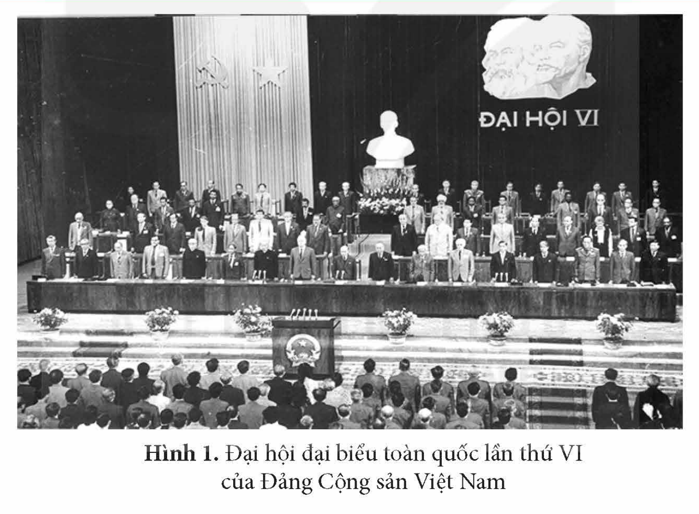
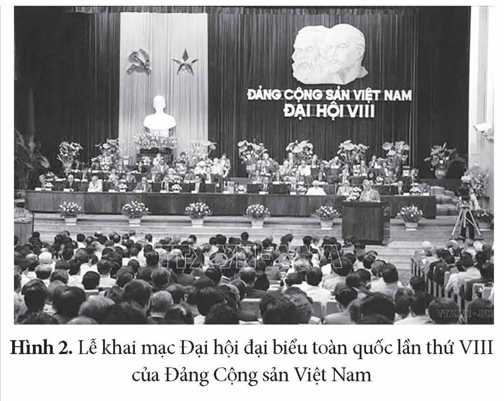

<!-- pdf:63 -->

# BÀI 10: KHÁI QUÁT VỀ CÔNG CUỘC ĐỔI MỚI TỪ NĂM 1986 ĐẾN NAY

## 🎯 Học xong bài này, em sẽ:

- Trình bày được những nội dung chính các giai đoạn của công cuộc Đổi mới đất nước từ năm 1986 đến nay.

## 🔴 Mở đầu

*Hình 1. Đại hội đại biểu toàn quốc lần thứ VI của Đảng Cộng sản Việt Nam*

Đại hội đại biểu toàn quốc lần thứ VI của Đảng Cộng sản Việt Nam (12 – 1986) đã đánh dấu một bước ngoặt rất cơ bản và có ý nghĩa quyết định trong sự nghiệp xây dựng chủ nghĩa xã hội ở Việt Nam. Từ đây, Việt Nam bước vào thời kì Đổi mới toàn diện đất nước. Công cuộc Đổi mới đất nước của Việt Nam đã trải qua những giai đoạn nào? Nội dung chính của mỗi giai đoạn là gì?

## 1. Giai đoạn khởi đầu công cuộc Đổi mới (1986 – 1995)

<!-- term: Công cuộc Đổi mới ở Việt Nam -->
Công cuộc Đổi mới ở Việt Nam được tiến hành xuất phát từ yêu cầu sống còn của sự nghiệp xây dựng chủ nghĩa xã hội, phát triển đất nước, đảm bảo đời sống nhân dân, đồng thời cũng phù hợp với xu thế chung của thời đại.

<!-- pdf:64 -->

<!-- term: Công cuộc Đổi mới ở Việt Nam -->
Đường lối đổi mới toàn diện và đồng bộ đất nước được đề ra tại Đại hội đại biểu toàn quốc lần thứ VI (1986), tiếp tục được bổ sung tại Đại hội đại biểu toàn quốc lần thứ VII (1991) của Đảng.

<!-- term: Quan điểm về Đổi mới của Đảng -->
> TƯ LIỆU 1. “Đổi mới không phải là thay đổi mục tiêu xã hội chủ nghĩa mà là làm cho mục tiêu ấy được thực hiện có hiệu quả bằng những quan niệm đúng đắn về chủ nghĩa xã hội, những hình thức, bước đi và biện pháp thích hợp”.
>
> *(Đảng Cộng sản Việt Nam, Văn kiện Đảng toàn tập, Tập 49, NXB Chính trị quốc gia, 2006, tr. 968)*

*Bảng 1. Nội dung cơ bản đường lối đổi mới giai đoạn 1986 – 1995*

<!-- term: Đường lối đổi mới giai đoạn 1986 – 1995 -->
<!-- term: Ba chương trình kinh tế lớn -->
| Trọng tâm là đổi mới về kinh tế | Đổi mới toàn diện và đồng bộ |
| --- | --- |
| – Kiên quyết xoá bỏ cơ chế quản lí kinh tế tập trung quan liêu, bao cấp, hình thành cơ chế thị trường có sự quản lí của Nhà nước. – Phát triển kinh tế hàng hoá xã hội chủ nghĩa. – Xây dựng và tổ chức thực hiện Ba chương trình kinh tế lớn gồm: Lương thực – Thực phẩm, Hàng tiêu dùng và Hàng xuất khẩu. – Đẩy lùi và kiểm soát lạm phát, ổn định và nâng cao hiệu quả của nền kinh tế – xã hội, phấn đấu bắt đầu có tích luỹ nội bộ từ nền kinh tế, từng bước đưa Việt Nam ra khỏi tình trạng khủng hoảng. | – Đổi mới kinh tế gắn liền với đổi mới chính trị, văn hoá – xã hội, chú trọng nhân tố con người. Xác định khoa học và công nghệ, giáo dục và đào tạo là quốc sách hàng đầu. – Đổi mới chính trị phải được tiến hành tích cực và vững chắc. Tiến hành đổi mới nội dung và phương thức hoạt động của các tổ chức trong hệ thống chính trị theo hướng vừa phát huy quyền làm chủ của người dân, vừa phát huy quyền lực của cơ quan Nhà nước. – Chủ trương kết hợp sức mạnh dân tộc và sức mạnh thời đại, tham gia phân công lao động quốc tế; thực hiện đa phương hoá, đa dạng hoá quan hệ đối ngoại “Việt Nam muốn làm bạn với tất cả các nước trong cộng đồng thế giới, phấn đấu vì hoà bình, độc lập và phát triển”. |

Giai đoạn khởi đầu công cuộc Đổi mới (1986 – 1995) đã tạo cơ sở để đất nước bước vào giai đoạn tiếp theo của sự nghiệp đổi mới toàn diện hơn.

> ❓ Khai thác thông tin và Tư liệu 1 trong mục, hãy nêu nội dung cơ bản của công cuộc Đổi mới giai đoạn 1986 – 1995.

## 2. Giai đoạn đẩy mạnh công nghiệp hoá, hiện đại hoá, hội nhập kinh tế quốc tế (1996 – 2006)

<!-- term: Đường lối đổi mới giai đoạn 1996 – 2006 -->
Đại hội đại biểu toàn quốc lần thứ VIII của Đảng Cộng sản Việt Nam (năm 1996) đã xác định Việt Nam chuyển sang thời kì mới: *đẩy mạnh công nghiệp hoá, hiện đại hoá đất nước*.

<!-- pdf:65 -->

<!-- term: Mục tiêu của công nghiệp hoá, hiện đại hoá -->
> TƯ LIỆU 2. “Mục tiêu của công nghiệp hoá, hiện đại hoá là xây dựng nước ta thành một nước công nghiệp có cơ sở vật chất – kĩ thuật hiện đại, cơ cấu kinh tế hợp lí, quan hệ sản xuất tiến bộ, phù hợp với trình độ phát triển của lực lượng sản xuất, đời sống vật chất tinh thần cao, quốc phòng, an ninh vững chắc, dân giàu, nước mạnh, xã hội công bằng, văn minh”.
>
> *(Đảng Cộng sản Việt Nam, Văn kiện Đại hội đại biểu toàn quốc lần thứ VIII, NXB Chính trị quốc gia, 2000, tr. 80)*

*Hình 2. Lễ khai mạc Đại hội đại biểu toàn quốc lần thứ VIII của Đảng Cộng sản Việt Nam*

*Bảng 2. Nội dung cơ bản của đường lối đổi mới giai đoạn 1996 – 2006*

<!-- term: Đường lối đổi mới giai đoạn 1996 – 2006 -->
| Về kinh tế | Về chính trị, văn hoá – xã hội, an ninh – quốc phòng | Về đối ngoại |
| --- | --- | --- |
| – Đẩy mạnh công nghiệp hoá, hiện đại hoá đất nước. – Tiếp tục phát triển kinh tế thị trường định hướng xã hội chủ nghĩa. – Tiếp tục tăng cường đầu tư xây dựng nhiều công trình lớn về kết cấu hạ tầng, tăng cường tiềm lực về cơ sở – vật chất, công nghệ cho nền kinh tế. – Xây dựng nền kinh tế mở, hội nhập với khu vực và thế giới. | – Đẩy mạnh cải cách tổ chức và hoạt động của Nhà nước pháp quyền xã hội chủ nghĩa, phát huy dân chủ, tăng cường pháp chế. – Nhấn mạnh phát triển giáo dục – đào tạo và khoa học – công nghệ là quốc sách hàng đầu. – Xây dựng và phát triển nền văn hoá tiên tiến, đậm đà bản sắc dân tộc. Coi văn hoá là nền tảng tinh thần của xã hội, vừa là mục tiêu, vừa là động lực thúc đẩy sự phát triển kinh tế – xã hội. – Mở rộng giải quyết các vấn đề xã hội như tạo thêm việc làm, xoá đói, giảm nghèo… – Xây dựng và tăng cường an ninh – quốc phòng. | Đặt trọng tâm chủ trương “hội nhập kinh tế quốc tế và khu vực” nhằm mục tiêu phục vụ sự nghiệp phát triển của đất nước. |

Công cuộc Đổi mới giai đoạn 1986 – 2006 đã tạo nền tảng cho Việt Nam đẩy mạnh công nghiệp hoá – hiện đại hoá và hội nhập quốc tế sâu rộng trong giai đoạn tiếp theo.

> ❓ Khai thác thông tin và Tư liệu 2 trong mục, hãy nêu nội dung chính của công cuộc Đổi mới giai đoạn 1996 – 2006.

<!-- pdf:66 -->

## 3. Giai đoạn tiếp tục đẩy mạnh công nghiệp hoá, hiện đại hoá, hội nhập quốc tế sâu rộng (2006 – nay)

<!-- term: Đường lối đổi mới giai đoạn từ năm 2006 đến nay -->
Đại hội đại biểu toàn quốc lần thứ X của Đảng Cộng sản Việt Nam (2006) đã chủ trương: đẩy mạnh toàn diện công cuộc Đổi mới, sớm đưa nước ta ra khỏi tình trạng kém phát triển.

Từ năm 2006 đến nay, Việt Nam thực hiện chủ trương đẩy mạnh công nghiệp hoá – hiện đại hoá và hội nhập quốc tế sâu rộng.

*Bảng 3. Nội dung cơ bản đường lối đổi mới giai đoạn từ năm 2006 đến nay*

<!-- term: Đường lối đổi mới giai đoạn từ năm 2006 đến nay -->
| Về kinh tế | Về chính trị, văn hoá – xã hội, an ninh – quốc phòng | Về đối ngoại |
| --- | --- | --- |
| – Tiếp tục hoàn thiện thể chế kinh tế thị trường định hướng xã hội chủ nghĩa. – Đẩy mạnh công nghiệp hoá, hiện đại hoá gắn với phát triển kinh tế tri thức. – Phấn đấu đưa Việt Nam trở thành nước đang phát triển, có nền công nghiệp theo hướng hiện đại. | – Tăng cường xây dựng hệ thống chính trị trong sạch, vững mạnh. – Thực hiện tiến bộ và công bằng xã hội. – Phát triển con người toàn diện và xây dựng nền văn hoá Việt Nam tiên tiến, đậm đà bản sắc dân tộc để văn hoá thực sự trở thành sức mạnh nội sinh, động lực phát triển đất nước và bảo vệ Tổ quốc. – Xây dựng và bảo vệ vững chắc Tổ quốc, giữ vững môi trường hoà bình, ổn định. | – Chuyển từ “hội nhập kinh tế quốc tế” sang “chủ động, tích cực hội nhập quốc tế toàn diện và sâu rộng”, mở rộng phạm vi, lĩnh vực và tính chất của hội nhập. – Thực hiện chiến lược hội nhập quốc tế toàn diện trên các lĩnh vực kinh tế, chính trị, an ninh – quốc phòng, văn hoá – xã hội, trong đó hội nhập kinh tế là trọng tâm. |

> ❓ Hãy nêu nội dung chính của công cuộc Đổi mới trong giai đoạn từ năm 2006 đến nay.

## ✏️ Luyện tập và vận dụng

Lập bảng hệ thống tóm tắt (theo gợi ý dưới đây vào vở) về nội dung chính của công cuộc Đổi mới ở Việt Nam từ năm 1986 đến nay.

| Giai đoạn | 1986 – 1995 | 1996 – 2006 | 2006 – nay |
| --- | --- | --- | --- |
| Nội dung chính | ? | ? | ? |

Viết một bài giới thiệu ngắn về nội dung công cuộc Đổi mới ở Việt Nam từ năm 2006 đến nay và nêu cảm nghĩ của em.

## 📷 Danh sách hình trong bài

| Mã hình | Trang PDF | Vị trí trong bài | Chú thích gốc |
| --- | --- | --- | --- |
| H12-lich_su-b10-01 | 63 | Mở đầu | Hình 1. Đại hội đại biểu toàn quốc lần thứ VI của Đảng Cộng sản Việt Nam |
| H12-lich_su-b10-02 | 65 | Mục 2 | Hình 2. Lễ khai mạc Đại hội đại biểu toàn quốc lần thứ VIII của Đảng Cộng sản Việt Nam |
