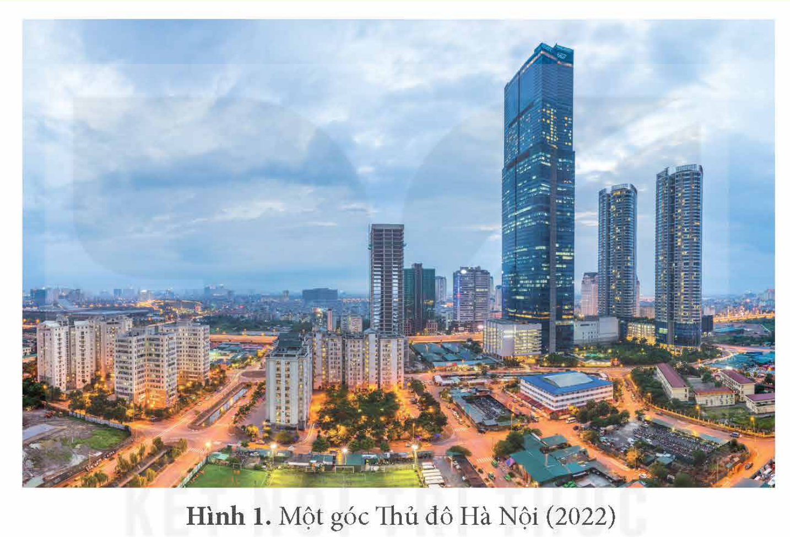
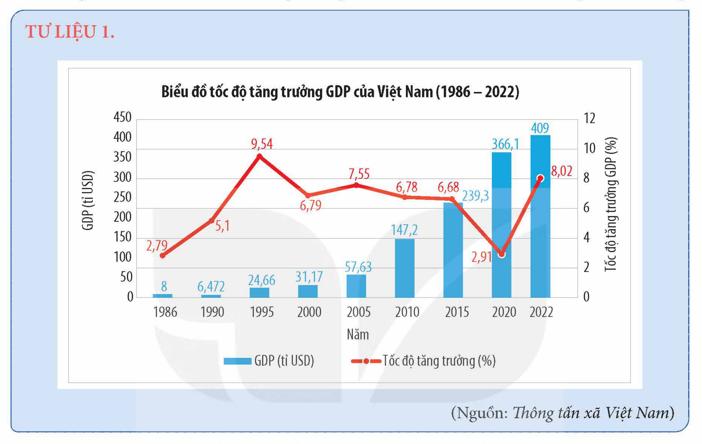
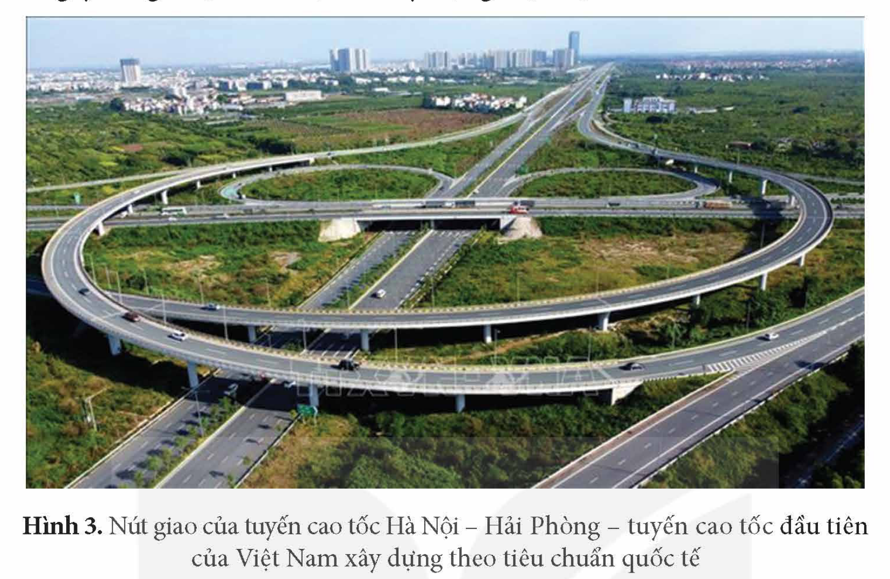
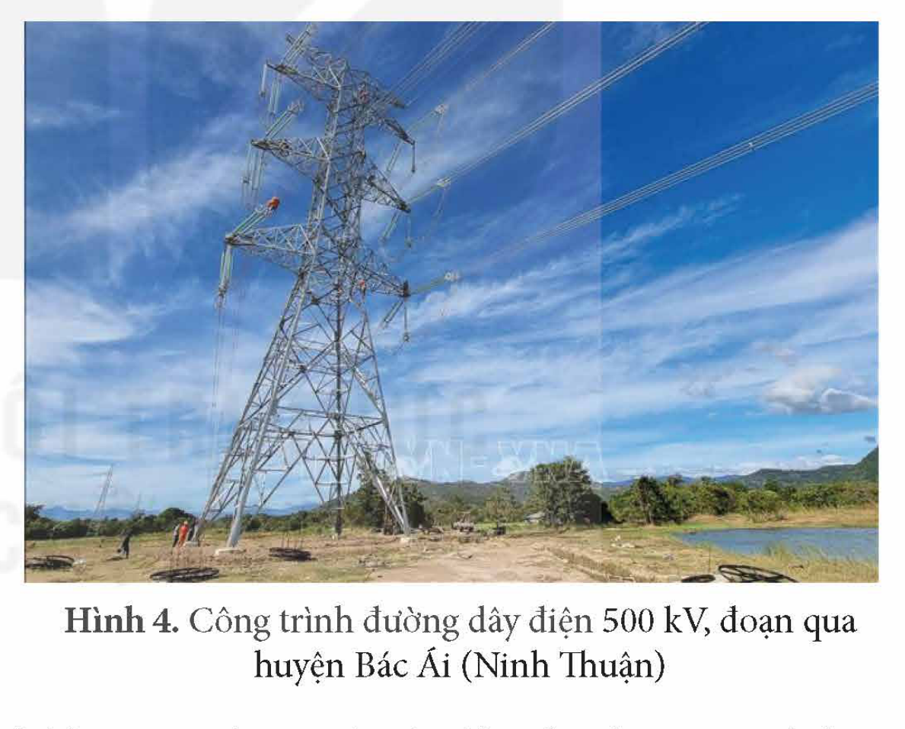
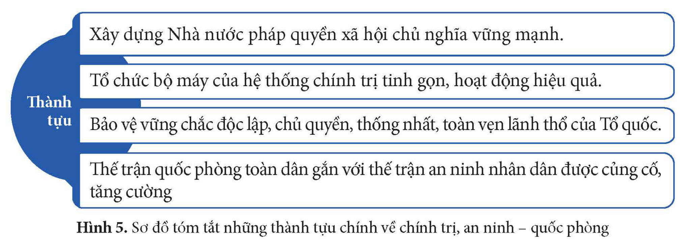
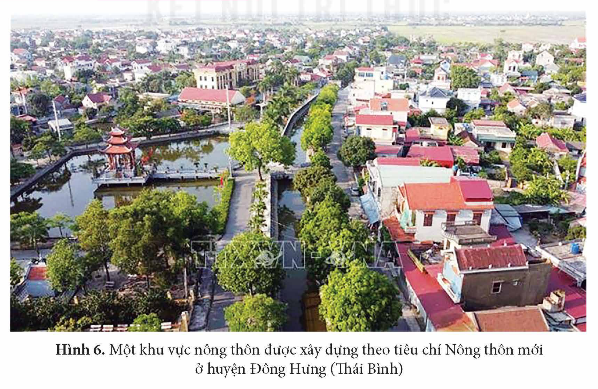
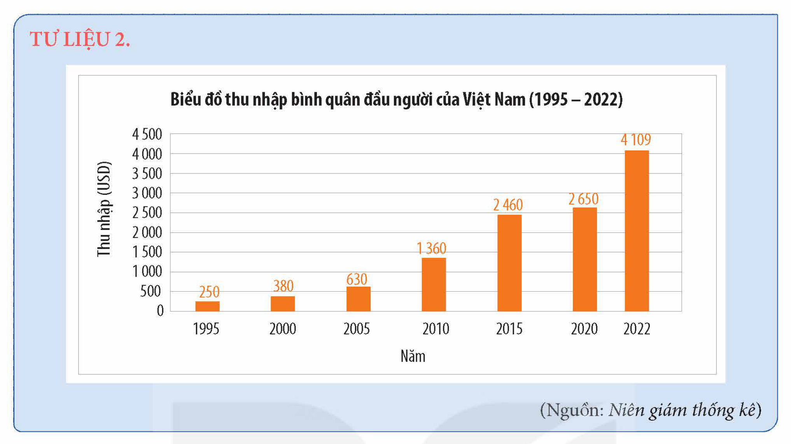
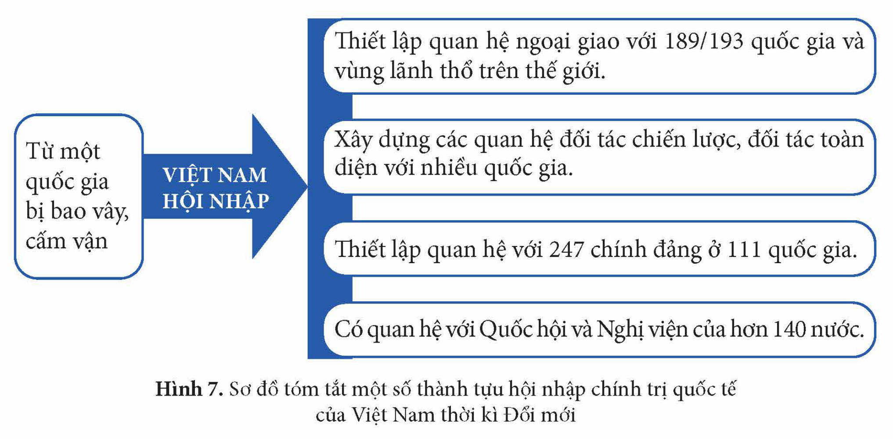
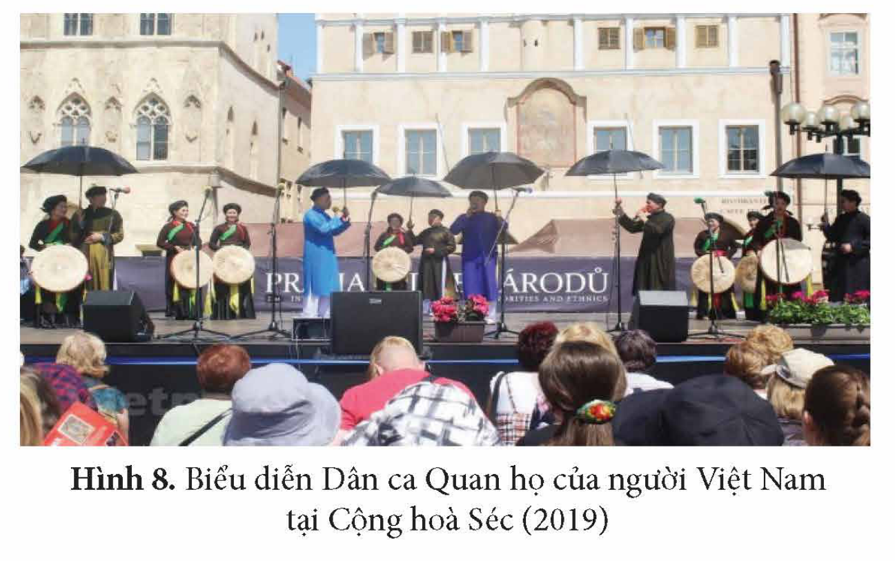

<!-- pdf:67 -->

# BÀI 11: THÀNH TỰU CƠ BẢN VÀ BÀI HỌC CỦA CÔNG CUỘC ĐỔI MỚI Ở VIỆT NAM TỪ NĂM 1986 ĐẾN NAY

## 🎯 Học xong bài này, em sẽ:

- Trình bày được thành tựu cơ bản của công cuộc Đổi mới ở Việt Nam về chính trị, kinh tế, xã hội, văn hoá và hội nhập quốc tế.
- Nêu được một số bài học kinh nghiệm của công cuộc Đổi mới ở Việt Nam từ năm 1986 đến nay.

## 🔴 Mở đầu

*Hình 1. Một góc Thủ đô Hà Nội (2022)*

Hình ảnh trên là một biểu hiện về thành tựu của công cuộc Đổi mới ở Việt Nam từ năm 1986 đến nay. Hãy chia sẻ những thành tựu khác của công cuộc Đổi mới về chính trị, kinh tế, xã hội, văn hoá,... mà em biết. Theo em, từ thực tiễn công cuộc Đổi mới có thể rút ra được những bài học gì?

## 1. Thành tựu cơ bản trong công cuộc Đổi mới ở Việt Nam

### a) Kinh tế

> 💡 EM CÓ BIẾT ?

<!-- term: Chế độ tem phiếu -->
> Ngày 1 – 4 – 1989, chế độ tem phiếu hoàn toàn được bãi bỏ ở Việt Nam. Đây là mốc kết thúc việc phát hành tem phiếu dùng để mua các mặt hàng thiết yếu của đời sống do Nhà nước phân phối. Tem phiếu đã trở thành một kí ức khó quên về thời kì bao cấp đối với nhiều thế hệ người dân Việt Nam.

<!-- term: Thành tựu đổi mới về kinh tế ở Việt Nam -->
Công cuộc đổi mới toàn diện đất nước (từ năm 1986 đến nay), đã đưa Việt Nam ra khỏi tình trạng khủng hoảng kinh tế – xã hội, đẩy mạnh công nghiệp hoá, hiện đại hoá cũng như hội nhập quốc tế mạnh mẽ, sâu rộng.

<!-- pdf:68 -->

<!-- term: Thành tựu đổi mới về kinh tế ở Việt Nam -->
Kinh tế Việt Nam có sự chuyển đổi từ mô hình quản lí kinh tế theo cơ chế tập trung, bao cấp sang mô hình kinh tế thị trường xã hội chủ nghĩa và đạt được nhiều thành tựu quan trọng.

*Tốc độ tăng trưởng:*

<!-- term: Thành tựu đổi mới về kinh tế ở Việt Nam -->
Trong thời kì Đổi mới, *tốc độ tăng trưởng* của Việt Nam khá cao và tương đối bền vững

> TƯ LIỆU 1. Biểu đồ tốc độ tăng trưởng GDP của Việt Nam (1986 – 2022)
>
> *(Nguồn: Thông tấn xã Việt Nam)*

<!-- term: Thành tựu đổi mới về kinh tế ở Việt Nam -->
Từ năm 1986 đến nay, Việt Nam đạt tốc độ tăng trưởng GDP trên 6%/năm (năm 2020, 2021 do ảnh hưởng nặng nề của đại dịch COVID-19, mức tăng GDP lần lượt chỉ đạt 2,91% và 2,59%, nhưng vẫn là mức tăng trưởng dương và Việt Nam vẫn thuộc nhóm nước có tốc độ tăng trưởng cao nhất trong khu vực và trên thế giới). Năm 2022, GDP của Việt Nam tăng 8,02% so với năm trước. Quy mô nền kinh tế được mở rộng đáng kể.

*Cơ cấu kinh tế theo ngành và theo thành phần:*

<!-- term: Thành tựu đổi mới về kinh tế ở Việt Nam -->
*Cơ cấu kinh tế theo ngành* chuyển dịch mạnh theo hướng công nghiệp hoá, hiện đại hoá. Các ngành công nghiệp, dịch vụ chiếm tỉ lệ ngày càng cao trong cơ cấu GDP (phân theo khu vực kinh tế).

Tỉ trọng ngành công nghiệp và xây dựng, dịch vụ trong cơ cấu GDP năm 1986 lần lượt là 28,88% và 33,06%; đến năm 2022 đã tăng lên 38,26% và 41,33%. Tỉ trọng ngành nông nghiệp, lâm nghiệp và thuỷ sản từ 38,06% năm 1986 giảm xuống còn 11,88% năm 2022.

<!-- term: Thành tựu đổi mới về kinh tế ở Việt Nam -->
*Cơ cấu kinh tế theo thành phần* có sự thay đổi theo hướng đa dạng hoá. Các thành phần kinh tế đóng vai trò tích cực vào phát triển đất nước.

<!-- pdf:69 -->

<!-- term: Thành tựu đổi mới về kinh tế ở Việt Nam -->
*Cơ sở hạ tầng:* Hệ thống cơ sở hạ tầng phục vụ cho phát triển kinh tế và đời sống của nhân dân ngày càng được cải thiện và xây dựng hiện đại.

*Hình 3. Nút giao của tuyến cao tốc Hà Nội – Hải Phòng – tuyến cao tốc đầu tiên của Việt Nam xây dựng theo tiêu chuẩn quốc tế*

> 💡 EM CÓ BIẾT ?

<!-- term: Đường dây 500 kV Bắc – Nam -->
> Công trình đường dây 500 kV Bắc – Nam (mạch 1) được khởi công thiết kế và xây dựng chỉ trong hai năm (1992 – 1993) từ khi khởi công đến khi đóng điện thành công. Công trình có tổng chiều dài 1 487 km, đánh dấu hệ thống điện Việt Nam có trục xương sống 500kV chạy suốt từ Bắc vào Nam lần đầu tiên trong lịch sử.

*Hình 4. Công trình đường dây điện 500 kV, đoạn qua huyện Bác Ái (Ninh Thuận)*

<!-- term: Thành tựu đổi mới về kinh tế ở Việt Nam -->
*Hội nhập kinh tế quốc tế:* Kinh tế đối ngoại phát triển đã đẩy nhanh quá trình hội nhập kinh tế quốc tế của Việt Nam và đạt được nhiều thành tựu quan trọng. Thị trường xuất, nhập khẩu mở rộng, nguồn vốn đầu tư của nước ngoài tăng nhanh chóng.

> ❓ Khai thác thông tin và Tư liệu 1 trong mục, hãy nêu những thành tựu cơ bản của Việt Nam trong công cuộc Đổi mới (từ năm 1986 đến nay) trên lĩnh vực kinh tế.

### b) Chính trị, an ninh – quốc phòng

Cùng với đổi mới về kinh tế, các lĩnh vực chính trị, an ninh – quốc phòng cũng đạt được nhiều thành tựu nổi bật.

<!-- pdf:70 -->

*Hình 5. Sơ đồ tóm tắt những thành tựu chính về chính trị, an ninh – quốc phòng*

<!-- term: Thành tựu đổi mới về chính trị, an ninh – quốc phòng -->
- Xây dựng Nhà nước pháp quyền xã hội chủ nghĩa vững mạnh.
- Tổ chức bộ máy của hệ thống chính trị tinh gọn, hoạt động hiệu quả.
- Bảo vệ vững chắc độc lập, chủ quyền, thống nhất, toàn vẹn lãnh thổ của Tổ quốc.
- Thế trận quốc phòng toàn dân gắn với thế trận an ninh nhân dân được củng cố, tăng cường.

<!-- term: Thành tựu đổi mới về chính trị, an ninh – quốc phòng -->
Những thành tựu trên lĩnh vực chính trị, an ninh – quốc phòng đã góp phần giữ vững sự ổn định chính trị và môi trường hoà bình cho công cuộc xây dựng, công cuộc Đổi mới của Việt Nam.

> ❓ Hãy trình bày thành tựu của Việt Nam trong công cuộc Đổi mới trên lĩnh vực chính trị, an ninh – quốc phòng.

### c) Văn hoá – xã hội

> 💡 EM CÓ BIẾT ?

> Đến 2015, Việt Nam đã hoàn tất việc thực hiện các *Mục tiêu Thiên niên kỉ* (MDGs) của Liên hợp quốc như: xoá đói, giảm nghèo, đạt phổ cập giáo dục tiểu học, thúc đẩy bình đẳng giới và đạt nhiều tiến bộ trong chỉ tiêu về y tế.

<!-- term: Thành tựu đổi mới về văn hoá – xã hội -->
Công cuộc xoá đói, giảm nghèo đã được thực hiện thành công, đất nước đã bước ra khỏi tình trạng kém phát triển. Đời sống vật chất và tinh thần của nhân dân được cải thiện và không ngừng nâng cao.

*Hình 6. Một khu vực nông thôn được xây dựng theo tiêu chí Nông thôn mới ở huyện Đông Hưng (Thái Bình)*

<!-- pdf:71 -->

> TƯ LIỆU 2. Biểu đồ thu nhập bình quân đầu người của Việt Nam (1995 – 2022)
>
> *(Nguồn: Niên giám thống kê)*

<!-- term: Thành tựu đổi mới về văn hoá – xã hội -->
Tỉ lệ hộ có thu nhập trung bình và thu nhập cao ngày càng tăng, tỉ lệ hộ nghèo giảm. Y tế đạt được nhiều tiến bộ khi mức sống ngày càng cải thiện.

Khả năng người dân tiếp cận hạ tầng cơ sở, hạ tầng thông tin – truyền thông được cải thiện đáng kể. Chỉ số phát triển con người (HDI) tăng lên qua các năm.

Tỉ lệ tử vong ở trẻ sơ sinh giảm, tuổi thọ trung bình tăng. Chỉ số chăm sóc sức khoẻ toàn dân cao hơn mức trung bình khu vực và trung bình thế giới.

<!-- term: Thành tựu đổi mới về văn hoá – xã hội -->
Sự nghiệp giáo dục có bước phát triển mới về quy mô, có sự đa dạng hoá về loại hình trường lớp ở các bậc học. Khoa học – công nghệ và văn hoá có nhiều chuyển biến tích cực.

Đội ngũ cán bộ khoa học và công nghệ tiếp thu, làm chủ và ứng dụng hiệu quả các công nghệ tiên tiến và hiện đại.

<!-- term: Thành tựu đổi mới về văn hoá – xã hội -->
Văn hoá truyền thống được bảo tồn và phát huy. Các giá trị văn hoá vật thể và phi vật thể được xác định và đánh giá theo chuẩn quốc tế.

> ❓ Khai thác thông tin và Tư liệu 2 trong mục, hãy trình bày thành tựu cơ bản của Việt Nam trong công cuộc Đổi mới trên lĩnh vực văn hoá – xã hội.

### d) Hội nhập quốc tế

Quá trình hội nhập quốc tế của Việt Nam trong thời kì Đổi mới đạt được nhiều thành tựu quan trọng.

*Hội nhập về chính trị:*

<!-- term: Thành tựu hội nhập quốc tế của Việt Nam thời kì Đổi mới -->
Việt Nam tăng cường mối quan hệ với các đối tác, nhất là các đối tác chiến lược, đối tác toàn diện và bạn bè truyền thống. Việt Nam tích cực xây dựng, định hình các thể chế đa phương, sẵn sàng đóng góp có trách nhiệm vào công việc của thế giới.

<!-- pdf:72 -->

*Hình 7. Sơ đồ tóm tắt một số thành tựu hội nhập chính trị quốc tế của Việt Nam thời kì Đổi mới*

<!-- term: Thành tựu hội nhập quốc tế của Việt Nam thời kì Đổi mới -->
- Từ một quốc gia bị bao vây, cấm vận, Việt Nam hội nhập:
  - Thiết lập quan hệ ngoại giao với 189/193 quốc gia và vùng lãnh thổ trên thế giới.
  - Xây dựng các quan hệ đối tác chiến lược, đối tác toàn diện với nhiều quốc gia.
  - Thiết lập quan hệ với 247 chính đảng ở 111 quốc gia.
  - Có quan hệ với Quốc hội và Nghị viện của hơn 140 nước.

*Hội nhập kinh tế:*

<!-- term: Thành tựu hội nhập quốc tế của Việt Nam thời kì Đổi mới -->
Hội nhập kinh tế quốc tế của Việt Nam diễn ra sâu rộng, trên nhiều cấp độ, đa dạng về hình thức, đã đóng góp tích cực vào tăng trưởng và chuyển dịch cơ cấu kinh tế, đặc biệt là mở rộng đầu tư nước ngoài và tăng trưởng xuất khẩu.

*Hội nhập về an ninh – quốc phòng:*

<!-- term: Thành tựu hội nhập quốc tế của Việt Nam thời kì Đổi mới -->
Về quan hệ song phương, đối ngoại quốc phòng của Việt Nam được triển khai theo hướng chủ động mở rộng quan hệ với các nước trên thế giới, triển khai các hoạt động hợp tác quốc phòng với các nước.

> 💡 EM CÓ BIẾT ?

> Tính đến 2022, Việt Nam đã có quan hệ quốc phòng với hơn 100 quốc gia, cử 33 Cơ quan Tuỳ viên Quốc phòng thường trú tại các nước và Liên hợp quốc. Mặt khác, 52 quốc gia đã đặt Cơ quan Tuỳ viên Quốc phòng, Tuỳ viên Quân sự tại Việt Nam.

<!-- term: Thành tựu hội nhập quốc tế của Việt Nam thời kì Đổi mới -->
Trên bình diện đa phương, Việt Nam chủ động tham gia và đề xuất sáng kiến tại các diễn đàn hợp tác quốc phòng đa phương trong khu vực và trên thế giới. Trong lĩnh vực gìn giữ hoà bình và hợp tác khắc phục hậu quả chiến tranh, Việt Nam cũng đạt được nhiều kết quả quan trọng.

*Hội nhập về văn hoá và các lĩnh vực khác:*

<!-- term: Thành tựu hội nhập quốc tế của Việt Nam thời kì Đổi mới -->
*Về văn hoá,* Việt Nam triển khai hợp tác, giao lưu văn hoá, thông tin đối ngoại với nhiều quốc gia và khu vực.

*Hình 8. Biểu diễn Dân ca Quan họ của người Việt Nam tại Cộng hoà Séc (2019)*

<!-- term: Thành tựu hội nhập quốc tế của Việt Nam thời kì Đổi mới -->
*Về giáo dục, khoa học – công nghệ,* Việt Nam đẩy mạnh hợp tác quốc tế trong giáo dục với các quốc gia và vùng lãnh thổ trên thế giới, đồng thời là thành viên tích cực của các tổ chức giáo dục quốc tế. Hợp tác trong lĩnh vực khoa học – công nghệ diễn ra ngày càng mạnh mẽ.

<!-- pdf:73 -->

Hiện nay, Việt Nam là thành viên của gần 100 tổ chức quốc tế về khoa học – công nghệ; có quan hệ hợp tác về khoa học – công nghệ với hơn 90 quốc gia, vùng lãnh thổ và tổ chức quốc tế; hơn 80 điều ước, thoả thuận quốc tế về hợp tác khoa học – công nghệ cấp chính phủ, cấp bộ đã được kí kết và thực hiện.

<!-- term: Thành tựu hội nhập quốc tế của Việt Nam thời kì Đổi mới -->
*Trong lĩnh vực y tế, lĩnh vực bảo vệ môi trường,...* Việt Nam tăng cường hợp tác với các nước và đạt được nhiều thành tựu.

Việt Nam tăng cường hợp tác với các nước và đạt được nhiều thành tựu. Với việc mở rộng hợp tác quốc tế, tăng cường chuyển giao kĩ thuật, đào tạo nguồn nhân lực, Việt Nam đã thực hiện được các kĩ thuật cao trong y tế chuyên sâu, đạt được trình độ cao tương đương với các nước có nền y học hiện đại trong khu vực và trên thế giới.

Trong lĩnh vực bảo vệ môi trường, Việt Nam mở rộng hợp tác thông qua nhiều đối tác song phương cũng như các tổ chức quốc tế đa phương. Các nội dung hợp tác đi vào chiều sâu bao gồm hầu hết các lĩnh vực quản lí môi trường như: đánh giá tác động môi trường, kiểm soát ô nhiễm, xử lí ô nhiễm hóa chất tồn lưu, bảo tồn đa dạng sinh học, biến đổi khí hậu,...

> ❓ Hãy nêu thành tựu của Việt Nam trong công cuộc Đổi mới trên lĩnh vực hội nhập quốc tế.

## 2. Bài học kinh nghiệm của công cuộc Đổi mới

Từ thực tiễn của công cuộc Đổi mới (từ năm 1986 đến nay), có thể rút ra một số bài học kinh nghiệm như sau:

<!-- term: Bài học kinh nghiệm của công cuộc Đổi mới -->
*Thứ nhất:* Kiên trì mục tiêu độc lập dân tộc và chủ nghĩa xã hội trên nền tảng chủ nghĩa Mác – Lê-nin và tư tưởng Hồ Chí Minh.

<!-- term: Bài học kinh nghiệm của công cuộc Đổi mới -->
Độc lập dân tộc gắn liền với chủ nghĩa xã hội là mục tiêu xuyên suốt và chủ đạo trong quá trình lãnh đạo cách mạng Việt Nam. Mục tiêu này gắn liền với mọi thắng lợi vẻ vang trong sự nghiệp cách mạng của dân tộc và mãi là sợi chỉ đỏ dẫn đường cho sự nghiệp đổi mới toàn diện đất nước hiện nay.

<!-- term: Bài học kinh nghiệm của công cuộc Đổi mới -->
*Thứ hai:* Đổi mới toàn diện, đồng bộ, có bước đi, hình thức và cách làm phù hợp.

<!-- term: Bài học kinh nghiệm của công cuộc Đổi mới -->
Luôn tôn trọng quy luật khách quan, xuất phát từ thực tiễn, bám sát và coi trọng tổng kết thực tiễn; tập trung giải quyết kịp thời, hiệu quả những vấn đề thực tiễn đặt ra.

<!-- term: Bài học kinh nghiệm của công cuộc Đổi mới -->
*Thứ ba:* Đổi mới phải vì lợi ích của nhân dân, phát huy vai trò chủ động, sáng tạo của nhân dân.

<!-- term: Bài học kinh nghiệm của công cuộc Đổi mới -->
Trong mọi công việc của Đảng và Nhà nước, phải luôn quán triệt sâu sắc và thực hiện nghiêm túc quan điểm “dân là gốc”; tôn trọng và phát huy quyền làm chủ của nhân dân, kiên trì thực hiện nguyên tắc “dân biết, dân bàn, dân làm, dân kiểm tra, dân giám sát, dân thụ hưởng”.

<!-- pdf:74 -->

<!-- term: Bài học kinh nghiệm của công cuộc Đổi mới -->
*Thứ tư:* Kết hợp sức mạnh nội lực và ngoại lực, sức mạnh dân tộc với thời đại trong điều kiện mới nhằm tạo ra sức mạnh tổng hợp để phát triển đất nước nhanh và bền vững.

Kết hợp sức mạnh dân tộc với thời đại là nguyên nhân quan trọng giúp Việt Nam đạt được những thành tựu to lớn trong công cuộc Đổi mới. Những thành tựu đó đã trở thành sức mạnh của dân tộc hiện nay. Do đó, cần tiếp tục kết hợp với các yếu tố thuận lợi của thời đại như xu thế toàn cầu hoá, cuộc cách mạng khoa học – công nghệ,... để phát triển đất nước.

> ❓ Nêu những bài học kinh nghiệm của công cuộc Đổi mới ở Việt Nam từ năm 1986 đến nay.

## ✏️ Luyện tập và vận dụng

1. Lập và hoàn thành nội dung bảng hệ thống (theo gợi ý dưới đây vào vở).

| Lĩnh vực | Thành tựu nổi bật |
| --- | --- |
| Kinh tế | ? |
| Chính trị, An ninh – quốc phòng | ? |
| Văn hoá – xã hội | ? |
| Hội nhập quốc tế | ? |

2. Lựa chọn một bài học kinh nghiệm của công cuộc Đổi mới (từ năm 1986 đến nay) mà em tâm đắc nhất và giải thích vì sao.

1. Sưu tầm tư liệu, tranh ảnh từ sách, báo và internet về một thành tựu nổi bật của thời kì Đổi mới ở Việt Nam và xây dựng infographic giới thiệu về thành tựu đó.

2. Tìm hiểu và giới thiệu một số thành tựu nổi bật về kinh tế – xã hội ở địa phương em sinh sống (tỉnh, thành phố) trong công cuộc Đổi mới (từ năm 1986 đến nay).

## 📷 Danh sách hình trong bài

| Mã hình | Trang PDF | Vị trí trong bài | Chú thích gốc |
| --- | --- | --- | --- |
| H12-lich_su-b11-01 | 67 | Mở đầu | Hình 1. Một góc Thủ đô Hà Nội (2022) |
| H12-lich_su-b11-02 | 68 | Mục 1.a (Tư liệu 1) | Biểu đồ tốc độ tăng trưởng GDP của Việt Nam (1986 – 2022) |
| H12-lich_su-b11-03 | 69 | Mục 1.a | Hình 3. Nút giao của tuyến cao tốc Hà Nội – Hải Phòng – tuyến cao tốc đầu tiên của Việt Nam xây dựng theo tiêu chuẩn quốc tế |
| H12-lich_su-b11-04 | 69 | Mục 1.a | Hình 4. Công trình đường dây điện 500 kV, đoạn qua huyện Bác Ái (Ninh Thuận) |
| H12-lich_su-b11-05 | 70 | Mục 1.b | Hình 5. Sơ đồ tóm tắt những thành tựu chính về chính trị, an ninh – quốc phòng |
| H12-lich_su-b11-06 | 70 | Mục 1.c | Hình 6. Một khu vực nông thôn được xây dựng theo tiêu chí Nông thôn mới ở huyện Đông Hưng (Thái Bình) |
| H12-lich_su-b11-07 | 71 | Mục 1.c (Tư liệu 2) | Biểu đồ thu nhập bình quân đầu người của Việt Nam (1995 – 2022) |
| H12-lich_su-b11-08 | 72 | Mục 1.d | Hình 7. Sơ đồ tóm tắt một số thành tựu hội nhập chính trị quốc tế của Việt Nam thời kì Đổi mới |
| H12-lich_su-b11-09 | 72 | Mục 1.d | Hình 8. Biểu diễn Dân ca Quan họ của người Việt Nam tại Cộng hoà Séc (2019) |
