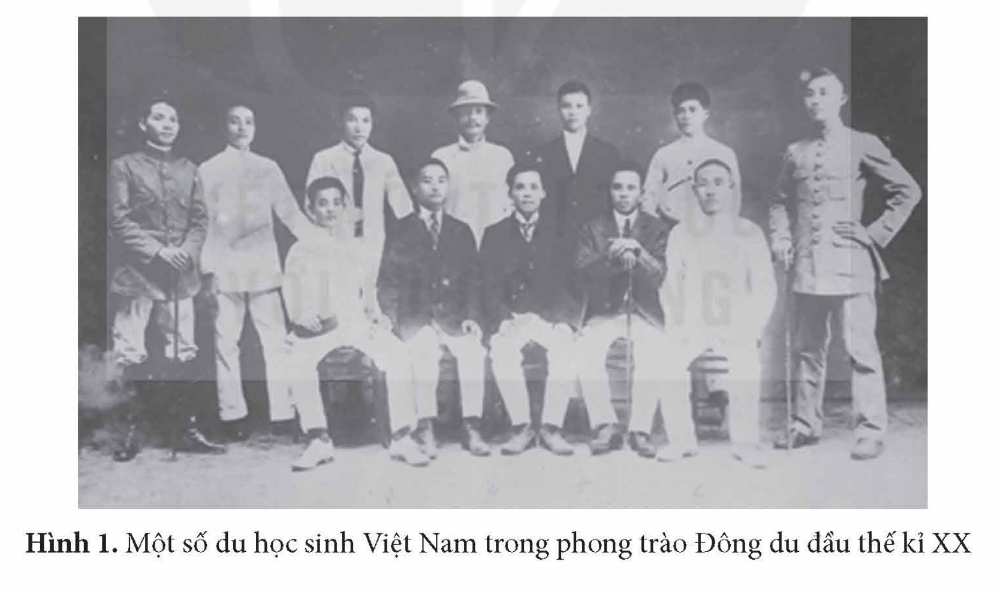
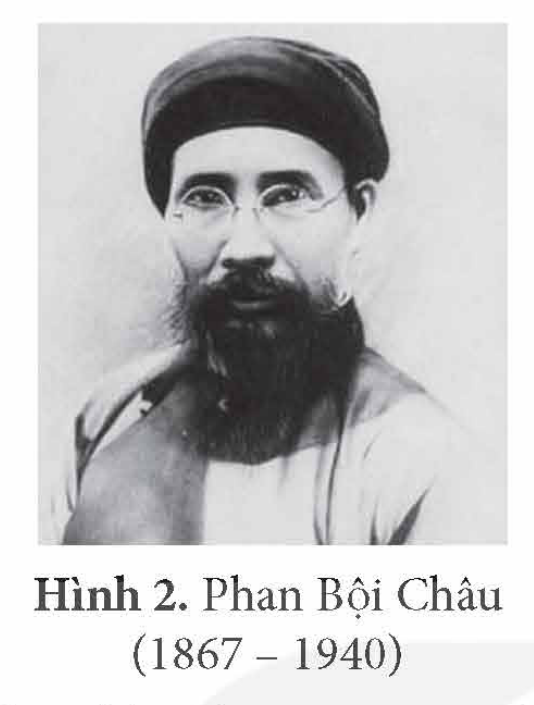
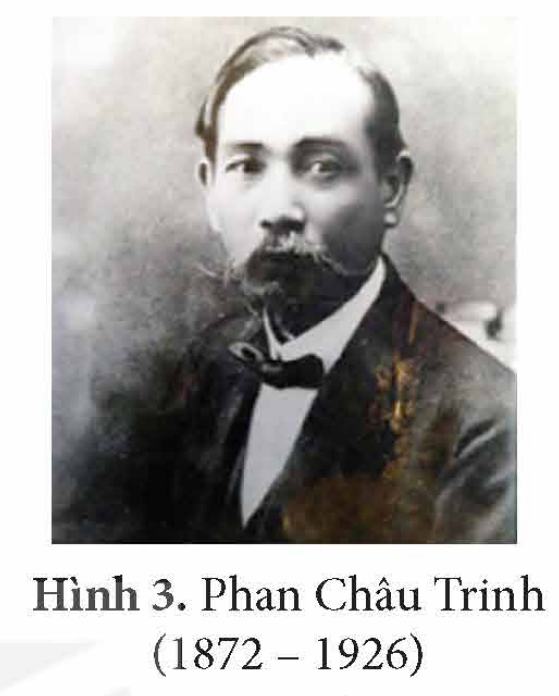
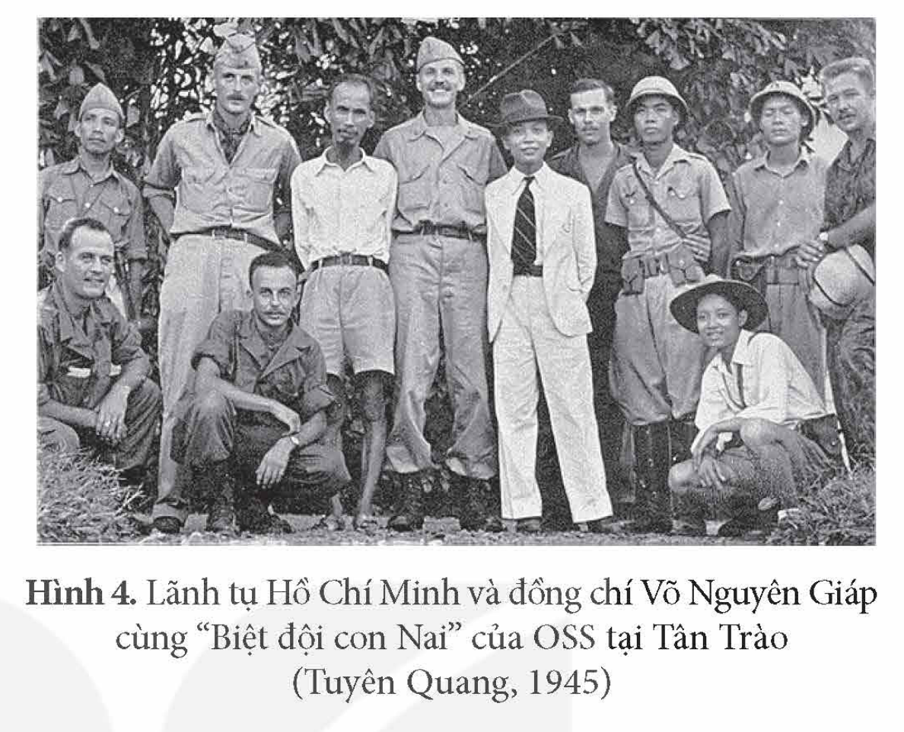

<!-- pdf:75 -->

# BÀI 12: HOẠT ĐỘNG ĐỐI NGOẠI CỦA VIỆT NAM TRONG ĐẤU TRANH GIÀNH ĐỘC LẬP DÂN TỘC (TỪ ĐẦU THẾ KỈ XX ĐẾN CÁCH MẠNG THÁNG TÁM NĂM 1945)

## 🎯 Học xong bài này, em sẽ:

- Nêu được những hoạt động đối ngoại chủ yếu của các cá nhân, các tổ chức cách mạng đầu thế kỉ XX đến Cách mạng tháng Tám năm 1945.
- Biết cách sưu tầm và sử dụng tài liệu lịch sử để tìm hiểu hoạt động đối ngoại của các cá nhân, các tổ chức cách mạng đầu thế kỉ XX đến Cách mạng tháng Tám năm 1945.

## 🔴 Mở đầu

*Hình 1. Một số du học sinh Việt Nam trong phong trào Đông du đầu thế kỉ XX*

<!-- term: Phong trào Đông du -->
Hình trên là một số du học sinh tham gia phong trào Đông du – một phong trào yêu nước tiêu biểu vào đầu thế kỉ XX với mục đích đưa thanh niên Việt Nam sang Nhật Bản học tập, chuẩn bị lực lượng, chờ thời cơ giành lại độc lập cho nước nhà. Đây là một trong những hoạt động đối ngoại tiêu biểu của các nhân sĩ yêu nước từ đầu thế kỉ XX đến Cách mạng tháng Tám năm 1945. Những hoạt động đối ngoại của Việt Nam giai đoạn này đã diễn ra như thế nào? Hãy chia sẻ hiểu biết của em.

<!-- pdf:76 -->

## 1. Hoạt động đối ngoại của Phan Bội Châu và Phan Châu Trinh

Hoạt động đối ngoại của Phan Bội Châu diễn ra chủ yếu ở Nhật Bản, Trung Quốc với mục đích tìm kiếm sự giúp đỡ từ bên ngoài để chống thực dân Pháp, giành độc lập dân tộc.

<!-- term: Điền – Quế – Việt liên minh -->
<!-- term: Đông Á đồng minh -->
Đầu năm 1905, Phan Bội Châu sang Nhật Bản nhờ giúp đỡ về khí giới, đào tạo nhân lực cho công cuộc cứu nước,... Ông đưa 200 thanh niên Việt Nam sang học tập ở các trường tư thục khác nhau. Năm 1908, Phan Bội Châu tham gia thành lập các tổ chức có mục tiêu đoàn kết quốc tế như: *Điền – Quế – Việt liên minh* (liên minh giữa Vân Nam, Quảng Tây với Việt Nam) và *Đông Á đồng minh* (gồm một số người Nhật Bản, Trung Quốc, Triều Tiên, Ấn Độ,...) để hợp sức chống đế quốc.

*Hình 2. Phan Bội Châu (1867 – 1940)*

*Hình 3. Phan Châu Trinh (1872 – 1926)*

<!-- term: Việt Nam Quang phục hội -->
<!-- term: Chấn Hoa Hưng Á -->
Năm 1911, Phan Bội Châu quyết định về hoạt động ở Trung Quốc. Đầu năm 1912, Phan Bội Châu thành lập *Việt Nam Quang phục hội* và tham gia thành lập *Chấn Hoa Hưng Á*, nhằm đánh đuổi thực dân Pháp, giành độc lập. Tại đây, Phan Bội Châu cử người liên lạc với một số tổ chức, đại diện nước ngoài như Công sứ Đức, Đại sứ quán Nga,... để tìm kiếm sự giúp đỡ cho phong trào đấu tranh chống Pháp ở Việt Nam.

Hoạt động đối ngoại của Phan Châu Trinh diễn ra chủ yếu ở Pháp với mục đích vận động cải cách cho Việt Nam.

Năm 1911, Phan Châu Trinh sang Pháp, tiếp xúc với một số nhóm Việt kiều, tổ chức, đảng phái tiến bộ, nhiều lần gửi kiến nghị đến các thành viên của Chính phủ Pháp..., phê phán chính quyền thực dân, thức tỉnh dư luận Pháp về tình hình Việt Nam. Phan Châu Trinh đóng vai trò quan trọng trong việc thành lập và hoạt động của một số tổ chức yêu nước Việt Nam tại Pháp.

> ❓ Hãy nêu những hoạt động đối ngoại chủ yếu của Phan Bội Châu, Phan Châu Trinh trong những năm đầu thế kỉ XX.

## 2. Hoạt động đối ngoại của Nguyễn Ái Quốc và Đảng Cộng sản Đông Dương

### a) Hoạt động đối ngoại của Nguyễn Ái Quốc (1911 – 1930)

Trong những năm 1911 – 1922, Nguyễn Ái Quốc đã đi qua nhiều quốc gia khác nhau và có những hoạt động đối ngoại nổi bật tại Pháp.

<!-- term: Hội Liên hiệp thuộc địa -->
Nguyễn Ái Quốc gặp gỡ, tiếp xúc với nhiều nhà hoạt động chính trị, văn hoá của Pháp và nhiều nước châu Âu. Năm 1920, Nguyễn Ái Quốc tham gia sáng lập Đảng Cộng sản Pháp. Năm 1921, Nguyễn Ái Quốc tham gia thành lập *Hội Liên hiệp thuộc địa* – một hình thức liên minh của các dân tộc bị áp bức. Trên cương vị Trưởng ban Nghiên cứu về Đông Dương thuộc Đảng Cộng sản Pháp, Nguyễn Ái Quốc tích cực xây dựng mối quan hệ gắn bó giữa những người cộng sản với nhân dân lao động Pháp và nhân dân các nước thuộc địa.

<!-- pdf:77 -->

Trong những năm 1923 – 1930, hoạt động đối ngoại của Nguyễn Ái Quốc diễn ra chủ yếu ở Liên Xô và Trung Quốc.

Tháng 6 – 1923, Nguyễn Ái Quốc từ Pháp đến Liên Xô, tích cực tham gia các hội nghị, đại hội của Quốc tế Cộng sản. Tại những diễn đàn này, Nguyễn Ái Quốc trình bày quan điểm về vai trò của cách mạng thuộc địa, về lực lượng cách mạng ở thuộc địa, về quan hệ giữa cách mạng ở chính quốc với thuộc địa,... Bằng những hoạt động này, Nguyễn Ái Quốc chính thức xác lập mối quan hệ giữa cách mạng Việt Nam với Quốc tế Cộng sản và cách mạng thế giới.

Từ cuối năm 1924, Nguyễn Ái Quốc đến Quảng Châu (Trung Quốc), liên lạc với lực lượng cách mạng ở Đông Nam Á và Trung Quốc, mở các lớp huấn luyện chính trị cho thanh niên yêu nước Việt Nam. Trong các bài giảng, Nguyễn Ái Quốc nhấn mạnh sự cần thiết phải đoàn kết và tập hợp lực lượng quốc tế.

> 💡 EM CÓ BIẾT ?

<!-- term: Hội Liên hiệp các dân tộc bị áp bức ở Á Đông -->
> Tháng 7 – 1925, Nguyễn Ái Quốc tham gia thành lập *Hội Liên hiệp các dân tộc bị áp bức ở Á Đông*, một đoàn thể có tính chất quốc tế bao gồm người Việt Nam, Trung Quốc, Ấn Độ, Triều Tiên, In-đô-nê-xi-a, Miến Điện, ... Tuyên ngôn của Hội khẳng định con đường duy nhất để xoá bỏ sự áp bức chỉ có thể là liên hiệp các dân tộc nhỏ yếu bị áp bức và giai cấp vô sản toàn thế giới, áp dụng những phương pháp cách mạng để lật đổ đế quốc thực dân.

> ❓ Nêu tóm tắt những hoạt động đối ngoại chủ yếu của Nguyễn Ái Quốc từ năm 1911 đến năm 1930.

### b) Hoạt động đối ngoại của Đảng Cộng sản Đông Dương (1930 – 1945)

Trong những năm 1930 – 1945, hoạt động đối ngoại của Đảng Cộng sản Đông Dương chủ yếu phục vụ cho cuộc đấu tranh chống thực dân, phát xít, tiến tới giành độc lập, tự do, góp phần bảo vệ hoà bình.

Là một phân bộ của Quốc tế Cộng sản, Đảng Cộng sản Đông Dương lãnh đạo, tổ chức nhiều hoạt động ủng hộ Liên Xô; phối hợp với các tổ chức của người Pháp, người Hoa ở Đông Dương tiến hành quyên góp giúp đỡ các nạn nhân chiến tranh ở Trung Quốc.

> TƯ LIỆU. “Chúng ta có bổn phận ủng hộ Liên Xô kháng chiến! Hãy đoàn kết để tranh đấu kỉ niệm Cách mệnh tháng Mười đã đẻ ra Liên Xô. Tranh đấu ủng hộ Liên Xô tức là tranh đấu chống phát xít Pháp – Nhật, chống chính sách lừa bịp và ăn cướp của chúng. Tranh đấu ủng hộ Liên Xô tức là tranh đấu chống sinh hoạt đắt đỏ, đòi công ăn việc làm.”
>
> *(Đảng Cộng sản Việt Nam, Văn kiện Đảng toàn tập, Tập 7, NXB Chính trị quốc gia, 2000, tr. 261)*

Đảng Cộng sản Đông Dương cũng tích cực củng cố quan hệ với Đảng Cộng sản Trung Quốc, thành lập Tiểu ban vận động Hoa Kiều, giúp đỡ người Hoa tổ chức hội cứu quốc.

Nhằm mở rộng quan hệ với lực lượng chống quân phiệt Nhật Bản ở Đông Nam Á, Đảng Cộng sản Đông Dương liên lạc với phong trào dân tộc chống quân phiệt Nhật Bản ở một số nước như: Miến Điện, Mã Lai, Phi-líp-pin, Thái Lan, In-đô-nê-xi-a,...

<!-- pdf:78 -->

Thông qua Mặt trận Việt Minh, hoạt động đối ngoại của Đảng Cộng sản Đông Dương thể hiện rõ chủ trương đứng về phía lực lượng Đồng minh trong cuộc chiến chống quân phiệt Nhật Bản, đồng thời, tranh thủ sự ủng hộ quốc tế cho cách mạng Việt Nam.

<!-- term: Việt Nam Cách mạng Đồng minh hội -->
Đại diện của Mặt trận Việt Minh tiếp xúc với đại diện của Trung Hoa Dân quốc, bàn về kế hoạch phối hợp chống quân phiệt Nhật Bản, cử đại biểu tham gia Việt Nam Cách mạng Đồng minh hội – một tổ chức của người Việt Nam hoạt động ở phía nam Trung Quốc.

<!-- term: Cơ quan Tình báo chiến lược Mỹ -->
Đối với phái bộ Mỹ ở phía nam Trung Quốc, đại diện của Mặt trận Việt Minh chủ động bắt liên lạc để thiết lập quan hệ và hợp tác chống quân phiệt Nhật Bản. Cuối tháng 4 – 1945, sự hợp tác giữa Việt Minh và Cơ quan Tình báo chiến lược Mỹ (OSS) tại châu Á được xác lập.

*Hình 4. Lãnh tụ Hồ Chí Minh và đồng chí Võ Nguyên Giáp cùng “Biệt đội con Nai” của OSS tại Tân Trào (Tuyên Quang, 1945)*

> ❓ Khai thác thông tin và tư liệu trong mục, hãy nêu những hoạt động đối ngoại chủ yếu của Đảng Cộng sản Đông Dương từ năm 1930 đến năm 1945.

## ✏️ Luyện tập và vận dụng

1. Hãy hoàn thành bảng hệ thống (theo gợi ý dưới đây vào vở) về những hoạt động đối ngoại chủ yếu của cá nhân, tổ chức cách mạng từ đầu thế kỉ XX đến Cách mạng tháng Tám năm 1945.

| Cá nhân/tổ chức | Hoạt động chủ yếu |
| --- | --- |
| Phan Bội Châu | ? |
| Phan Châu Trinh | ? |
| Nguyễn Ái Quốc | ? |
| Đảng Cộng sản Đông Dương | ? |

2. Sưu tầm tư liệu từ sách, báo và internet, hãy viết bài giới thiệu về một số hoạt động đối ngoại chủ yếu mà Nguyễn Ái Quốc đã thực hiện từ năm 1911 đến năm 1945 và ý nghĩa của những hoạt động đó.

## 📷 Danh sách hình trong bài

| Mã hình | Trang PDF | Vị trí trong bài | Chú thích gốc |
| --- | --- | --- | --- |
| H12-lich_su-b12-01 | 75 | Mở đầu | Hình 1. Một số du học sinh Việt Nam trong phong trào Đông du đầu thế kỉ XX |
| H12-lich_su-b12-02 | 76 | Mục 1 | Hình 2. Phan Bội Châu (1867 – 1940) |
| H12-lich_su-b12-03 | 76 | Mục 1 | Hình 3. Phan Châu Trinh (1872 – 1926) |
| H12-lich_su-b12-04 | 78 | Mục 2.b | Hình 4. Lãnh tụ Hồ Chí Minh và đồng chí Võ Nguyên Giáp cùng “Biệt đội con Nai” của OSS tại Tân Trào (Tuyên Quang, 1945) |
