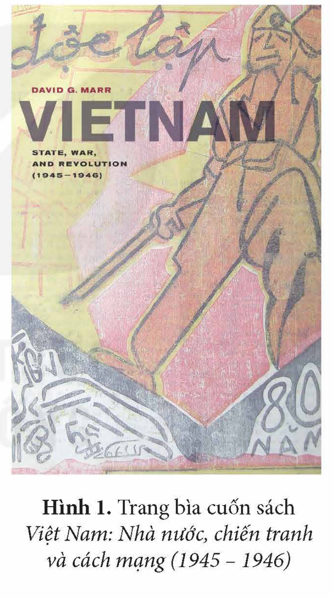
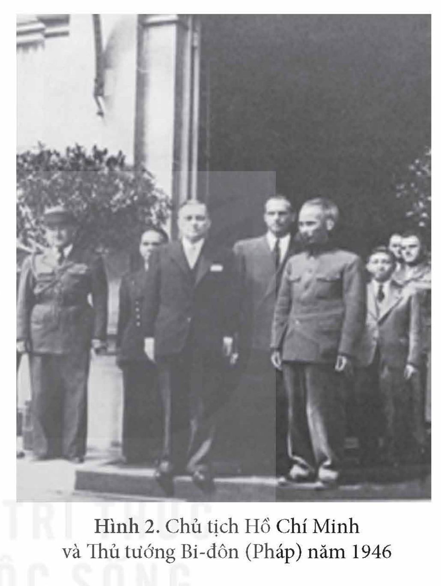
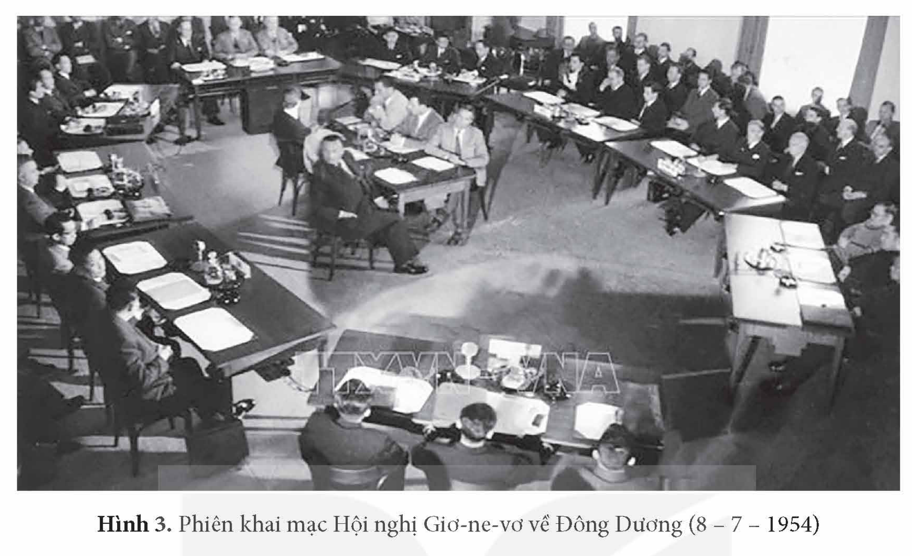
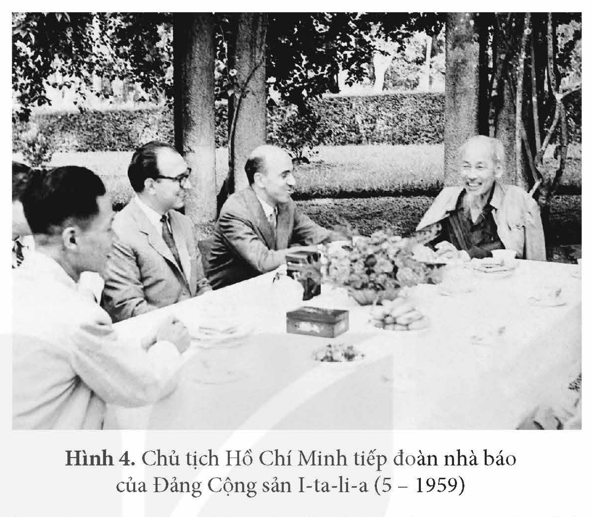
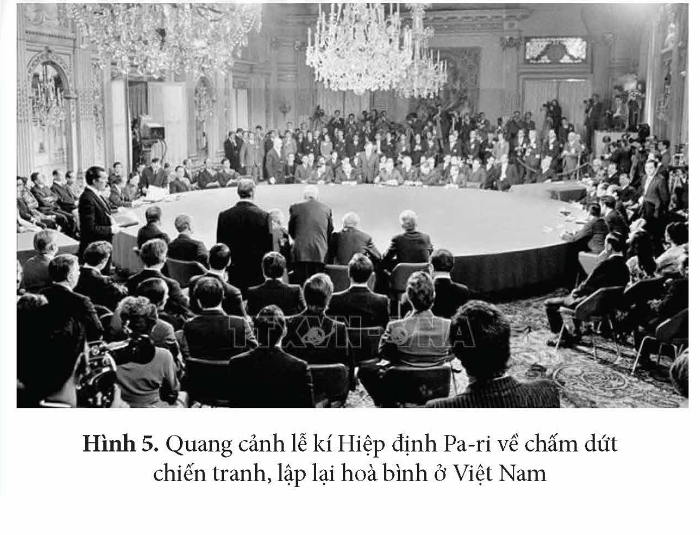

<!-- pdf:79 -->

# BÀI 13: HOẠT ĐỘNG ĐỐI NGOẠI CỦA VIỆT NAM TRONG KHÁNG CHIẾN CHỐNG PHÁP (1945 – 1954) VÀ KHÁNG CHIẾN CHỐNG MỸ (1954 – 1975)

## 🎯 Học xong bài này, em sẽ:

- Nêu được những hoạt động đối ngoại chủ yếu của Việt Nam trong kháng chiến chống Pháp (1945 – 1954).
- Nêu được những hoạt động đối ngoại chủ yếu của Việt Nam trong kháng chiến chống Mỹ (1954 – 1975).

## 🔴 Mở đầu

Trong cuốn sách *Việt Nam: Nhà nước, chiến tranh và cách mạng (1945 – 1946)*, khi viết về hoạt động đối ngoại của Việt Nam, Đa-vít Ma – nhà sử học người Mỹ đã nhận xét: “Việt Nam có kĩ năng xử lí các tình huống ngoại giao phức tạp, sẵn sàng nhượng bộ khi cần thiết để đạt được mục tiêu và sẵn sàng điều chỉnh chính sách cho phù hợp với hoàn cảnh thay đổi. Hoạt động đối ngoại của Việt Nam đóng vai trò to lớn đối với kết quả của các cuộc kháng chiến mà Việt Nam đã đi qua – đó là một yếu tố hết sức quan trọng đóng góp vào chiến thắng cuối cùng của người Việt Nam”.

Vì sao Đa-vít Ma đưa ra nhận xét như vậy? Hãy chia sẻ những điều em biết về hoạt động đối ngoại của Nhà nước Việt Nam Dân chủ Cộng hoà trong kháng chiến chống Pháp (1945 – 1954) và kháng chiến chống Mỹ (1954 – 1975).

*Hình 1. Trang bìa cuốn sách Việt Nam: Nhà nước, chiến tranh và cách mạng (1945 – 1946)*

## 1. Hoạt động đối ngoại của Việt Nam trong kháng chiến chống Pháp (1945 – 1954)

Năm 1945, Nhà nước Việt Nam Dân chủ Cộng hoà vừa mới ra đời đã phải đối diện với rất nhiều thách thức, khó khăn. Trong bối cảnh đó, các hoạt động đối ngoại của Nhà nước Việt Nam Dân chủ Cộng hoà nhằm mục đích bảo vệ vững chắc chính quyền cách mạng, tranh thủ sự ủng hộ quốc tế và tránh đối đầu cùng một lúc với nhiều kẻ thù.

<!-- pdf:80 -->

Chính phủ Việt Nam đã gửi thư, công hàm đề nghị Đại hội đồng Liên hợp quốc và các nước lớn công nhận Nhà nước Việt Nam Dân chủ Cộng hoà.

Với Trung Hoa Dân quốc, Chính phủ Việt Nam Dân chủ Cộng hoà chủ động vừa đấu tranh chính trị, vừa vận động ngoại giao; thực hiện các hoạt động hữu nghị, thân thiện với nhân dân Trung Quốc và hoà hoãn với quân Trung Hoa Dân quốc ở Việt Nam để tranh thủ thời gian củng cố chính quyền cách mạng.

<!-- term: Hiệp định Sơ bộ Việt – Pháp -->
<!-- term: Tạm ước Việt – Pháp -->
Với Pháp, Việt Nam kí *Hiệp định Sơ bộ* (6 – 3 – 1946) đồng ý để quân đội Pháp thay quân đội Trung Hoa Dân quốc làm nhiệm vụ giải giáp quân đội Nhật Bản ở miền Bắc. Sau đó, Chủ tịch Hồ Chí Minh tiếp tục kí với đại diện Chính phủ Pháp bản *Tạm ước Việt – Pháp* (14 – 9 – 1946) để kéo dài thời gian hoà bình, chuẩn bị kháng chiến.

Từ khi cuộc kháng chiến toàn quốc chống thực dân Pháp bùng nổ (12 – 1946), Việt Nam vẫn thể hiện thiện chí hoà bình, đề nghị Chính phủ Pháp tiếp tục mở các cuộc thương lượng, kêu gọi nhân dân Pháp chống chiến tranh.

Việt Nam mở các cơ quan đại diện ngoại giao tại một số nước châu Á và lập các cơ quan thông tin ở một số nước trên thế giới.

*Hình 2. Chủ tịch Hồ Chí Minh và Thủ tướng Bi-đôn (Pháp) năm 1946*

Từ năm 1950, tình hình thế giới và Việt Nam có những thay đổi nhanh chóng. Trong điều kiện đó, hoạt động đối ngoại của Nhà nước Việt Nam Dân chủ Cộng hoà được đẩy mạnh trên nhiều hướng, nhằm tranh thủ sự ủng hộ quốc tế để kết thúc chiến tranh bằng giải pháp ngoại giao khi có điều kiện.

<!-- term: Thiết lập quan hệ ngoại giao năm 1950 -->
Năm 1950, Việt Nam Dân chủ Cộng hoà thiết lập quan hệ ngoại giao với Cộng hoà Nhân dân Trung Hoa, Liên Xô và các nước xã hội chủ nghĩa khác. Đây là một thắng lợi chính trị to lớn, tạo tiền đề cho những thắng lợi quân sự sau này.

<!-- term: Liên minh nhân dân Việt – Miên – Lào -->
Năm 1951, Liên minh nhân dân Việt – Miên – Lào được thành lập trên cơ sở tự nguyện, bình đẳng và tôn trọng chủ quyền của nhau.

Chính phủ Việt Nam Dân chủ Cộng hoà gặp gỡ đại diện Đảng Cộng sản Pháp và nhiều tổ chức quốc tế, thành lập các hội hữu nghị và Uỷ ban Bảo vệ hoà bình thế giới.

<!-- pdf:81 -->

*Hình 3. Phiên khai mạc Hội nghị Giơ-ne-vơ về Đông Dương (8 – 7 – 1954)*

<!-- term: Hiệp định Giơ-ne-vơ về Đông Dương -->
Tháng 5 – 1954, Hội nghị quốc tế về Đông Dương được tổ chức ở Giơ-ne-vơ (Thuỵ Sĩ). Chính phủ Việt Nam Dân chủ Cộng hoà đã kiên trì đấu tranh bảo vệ các quyền dân tộc cơ bản của ba nước Đông Dương. Ngày 21 – 7 – 1954, Hiệp định Giơ-ne-vơ được kí kết. Đây là văn bản pháp lí quốc tế ghi nhận các quyền dân tộc cơ bản của nhân dân các nước Đông Dương.

> ❓ Hãy nêu những hoạt động đối ngoại chủ yếu của Nhà nước Việt Nam Dân chủ Cộng hoà trong kháng chiến chống Pháp (1945 – 1954) và cho biết ý nghĩa của những hoạt động đó.

## 2. Hoạt động đối ngoại của Việt Nam trong kháng chiến chống Mỹ (1954 – 1975)

Sau khi Hiệp định Giơ-ne-vơ về Đông Dương được kí kết, hoạt động đối ngoại của Nhà nước Việt Nam Dân chủ Cộng hoà tập trung đấu tranh đòi thi hành Hiệp định Giơ-ne-vơ, củng cố quan hệ với các nước xã hội chủ nghĩa, mở rộng quan hệ ngoại giao, tranh thủ sự giúp đỡ của cộng đồng quốc tế góp phần đánh bại các chiến lược chiến tranh của Mỹ ở miền Nam.

Việt Nam Dân chủ Cộng hoà phối hợp với Uỷ ban Giám sát quốc tế về Hiệp định Giơ-ne-vơ yêu cầu chính quyền Sài Gòn mở hội nghị hiệp thương về việc tổ chức tổng tuyển cử thống nhất đất nước theo những điều khoản của hội nghị.

Việt Nam Dân chủ Cộng hoà khéo léo cân bằng quan hệ với Liên Xô, Trung Quốc; vận động các nước xã hội chủ nghĩa viện trợ cho công cuộc xây dựng chủ nghĩa xã hội ở miền Bắc, ủng hộ cuộc kháng chiến ở miền Nam.

<!-- pdf:82 -->

Việt Nam Dân chủ Cộng hoà thiết lập quan hệ ngoại giao với Lào, xây dựng quan hệ láng giềng hữu nghị với Cam-pu-chia; ủng hộ cuộc đấu tranh chống chủ nghĩa thực dân của nhân dân các nước Á, Phi Mỹ La-tinh,... phát triển mối quan hệ liên minh chiến đấu chống các lực lượng yêu nước, kháng chiến của Lào, Cam-pu-chia.

<!-- term: Vừa đánh, vừa đàm -->
Cùng với những thắng lợi quân sự, Chính phủ Việt Nam Dân chủ Cộng hoà chủ động kết hợp “vừa đánh, vừa đàm”, cung cấp tư liệu về cuộc chiến tranh phi nghĩa mà Mỹ tiến hành ở miền Nam Việt Nam, tranh thủ sự ủng hộ của nhân dân tiến bộ trên thế giới, đòi Mỹ chấm dứt chiến tranh; đồng thời, tích cực vận động quốc tế công nhận Mặt trận Dân tộc giải phóng miền Nam Việt Nam.

*Hình 4. Chủ tịch Hồ Chí Minh tiếp đoàn nhà báo của Đảng Cộng sản I-ta-li-a (5 – 1959)*

<!-- term: Hiệp định Pa-ri về Việt Nam -->
Trên bàn đàm phán tại Hội nghị Pa-ri, đại diện Chính phủ Việt Nam Dân chủ Cộng hoà và Chính phủ Cách mạng lâm thời Cộng hoà miền Nam Việt Nam lần lượt đưa ra các phương án yêu cầu Mỹ phải chấm dứt chiến tranh, lập lại hoà bình ở Việt Nam. Ngày 27 – 1 – 1973, Hiệp định Pa-ri được kí kết với điều khoản quan trọng: Mỹ và các nước cam kết tôn trọng độc lập, chủ quyền, thống nhất và toàn vẹn lãnh thổ Việt Nam.

> 💡 EM CÓ BIẾT ?

<!-- term: Đàm phán bốn bên tại Hội nghị Pa-ri -->
> Trong Hội nghị Pa-ri, phía Mỹ đòi dùng chiếc bàn hình chữ nhật hoặc hình tròn chia đôi thể hiện cuộc đàm phán chỉ có hai bên: một bên là Mỹ và Việt Nam Cộng hoà, một bên là Việt Nam Dân chủ Cộng hoà và Chính phủ Cách mạng lâm thời Cộng hoà miền Nam Việt Nam. Việt Nam Dân chủ Cộng hoà yêu cầu chiếc bàn hình vuông hoặc tròn có phân chia rõ bốn bên, thể hiện bốn bên tham gia đàm phán. Cuối cùng, hai bên đi đến quyết định chọn chiếc bàn tròn lớn.

*Hình 5. Quang cảnh lễ kí Hiệp định Pa-ri về chấm dứt chiến tranh, lập lại hoà bình ở Việt Nam*

<!-- pdf:83 -->

Hoạt động đối ngoại của Việt Nam Dân chủ Cộng hoà đã góp phần quan trọng đưa cuộc kháng chiến chống Mỹ, cứu nước của nhân dân Việt Nam đến thắng lợi hoàn toàn.

> ❓ Hãy nêu những hoạt động đối ngoại chủ yếu của Nhà nước Việt Nam Dân chủ Cộng hoà trong kháng chiến chống Mỹ (1954 – 1975).

## ✏️ Luyện tập và vận dụng

1. Lập bảng thống kê (theo gợi ý dưới đây vào vở) về một số hoạt động đối ngoại chủ yếu của Nhà nước Việt Nam Dân chủ Cộng hoà trong cuộc kháng chiến chống Pháp và chống Mỹ (1945 – 1975).

| Giai đoạn | Một số hoạt động đối ngoại chủ yếu |
| --- | --- |
| Kháng chiến chống Pháp (1945 – 1954) | ? |
| Kháng chiến chống Mỹ (1954 – 1975) | ? |

2. Sưu tầm tư liệu từ sách, báo, internet về những bài học rút ra từ hoạt động đối ngoại của Nhà nước Việt Nam Dân chủ Cộng hoà trong cuộc kháng chiến chống Pháp và chống Mỹ (1945 – 1975). Theo em, bài học nào có thể vận dụng vào hoạt động đối ngoại của Việt Nam hiện nay?

## 📷 Danh sách hình trong bài

| Mã hình | Trang PDF | Vị trí trong bài | Chú thích gốc |
| --- | --- | --- | --- |
| H12-lich_su-b13-01 | 79 | Mở đầu | Hình 1. Trang bìa cuốn sách Việt Nam: Nhà nước, chiến tranh và cách mạng (1945 – 1946) |
| H12-lich_su-b13-02 | 80 | Mục 1 | Hình 2. Chủ tịch Hồ Chí Minh và Thủ tướng Bi-đôn (Pháp) năm 1946 |
| H12-lich_su-b13-03 | 81 | Mục 1 | Hình 3. Phiên khai mạc Hội nghị Giơ-ne-vơ về Đông Dương (8 – 7 – 1954) |
| H12-lich_su-b13-04 | 82 | Mục 2 | Hình 4. Chủ tịch Hồ Chí Minh tiếp đoàn nhà báo của Đảng Cộng sản I-ta-li-a (5 – 1959) |
| H12-lich_su-b13-05 | 82 | Mục 2 | Hình 5. Quang cảnh lễ kí Hiệp định Pa-ri về chấm dứt chiến tranh, lập lại hoà bình ở Việt Nam |
