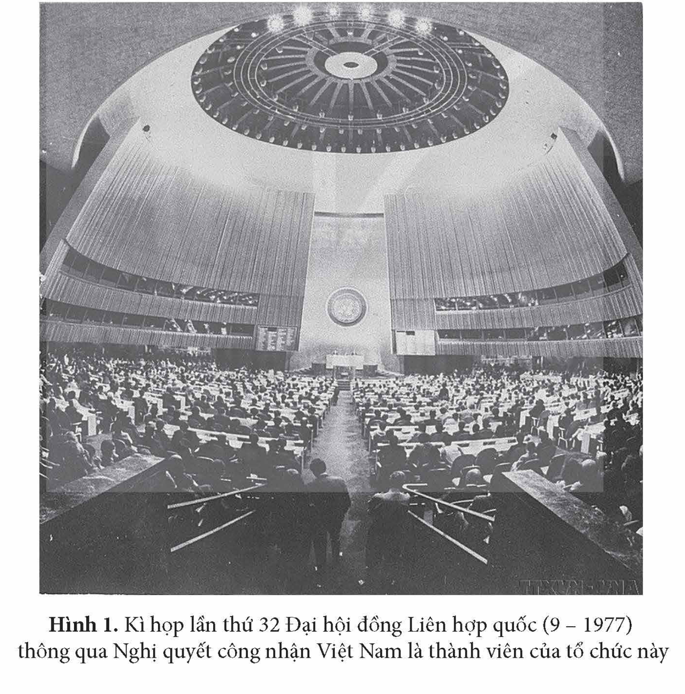
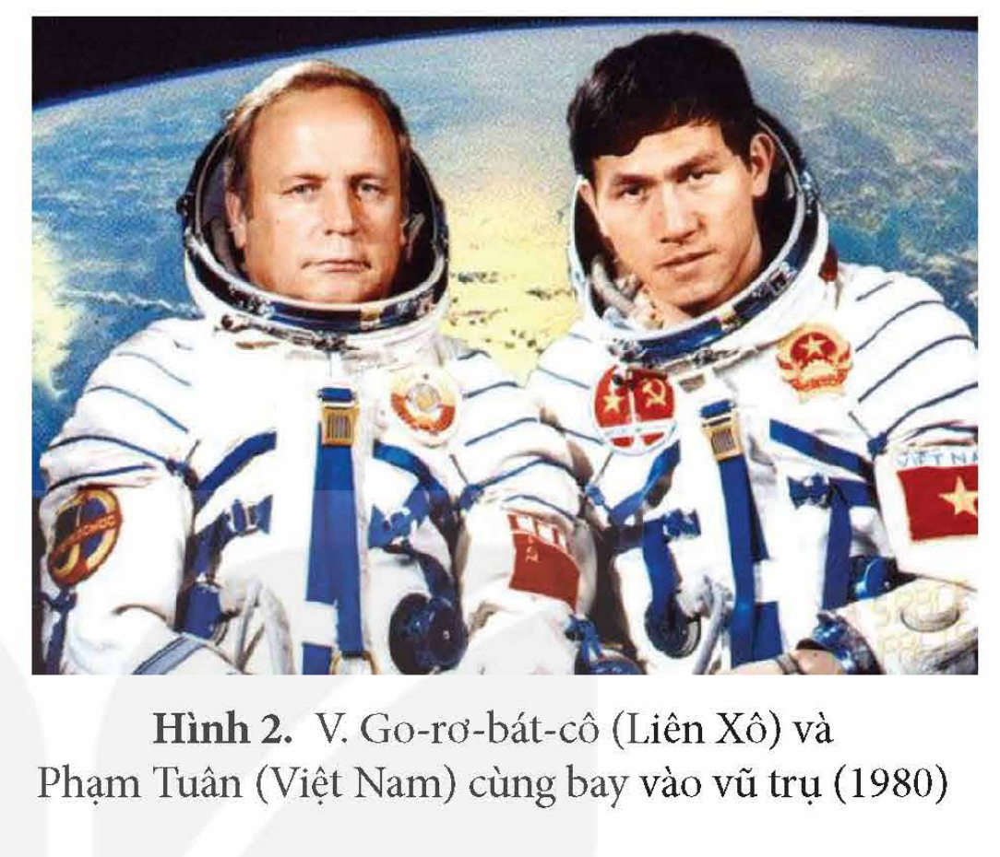
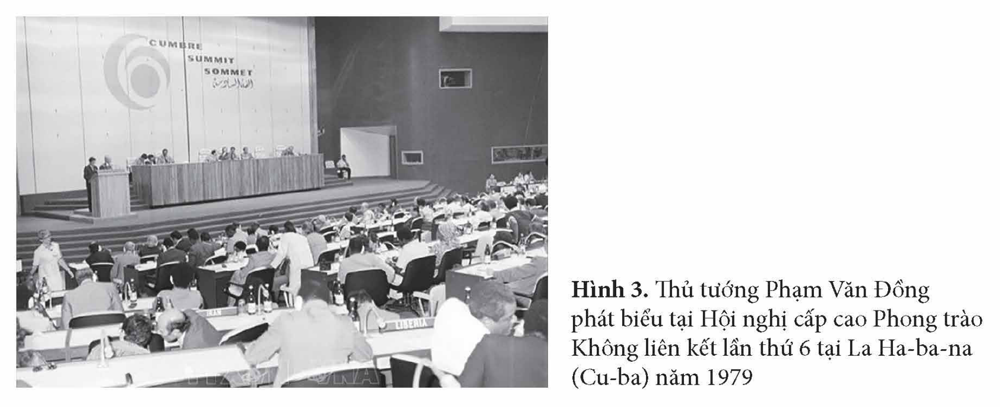
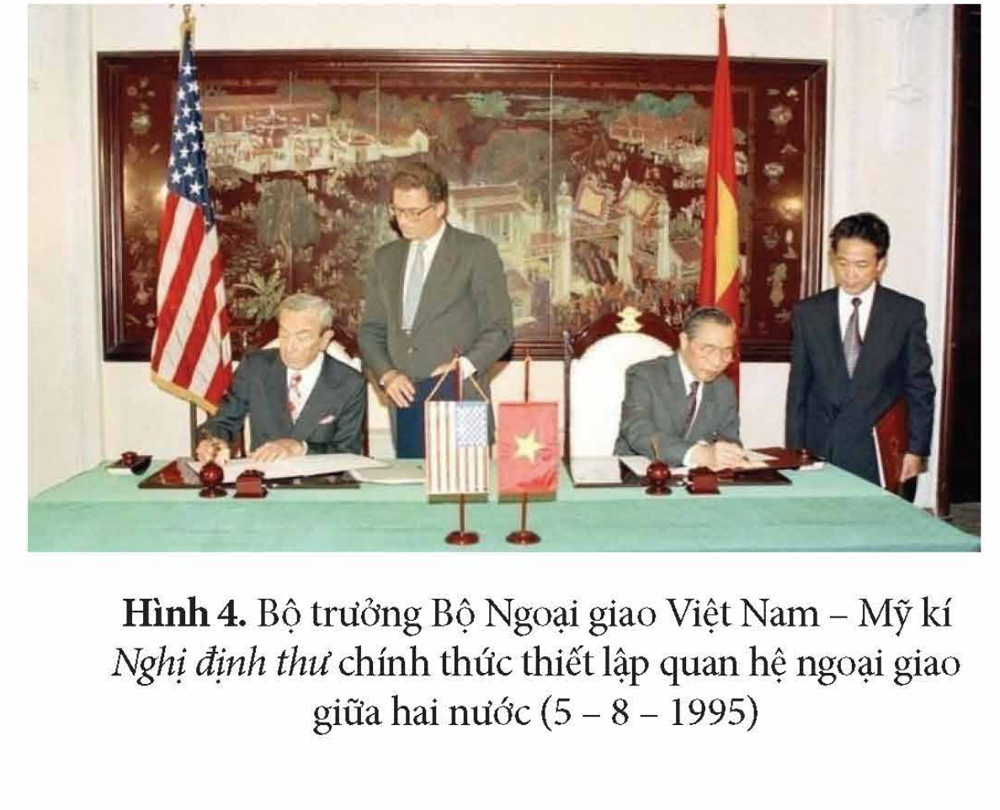
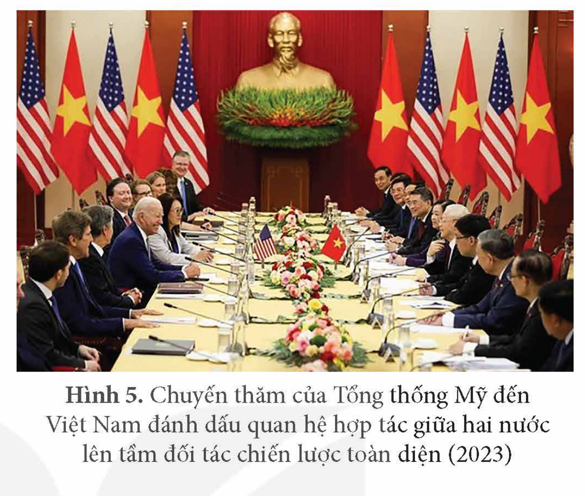
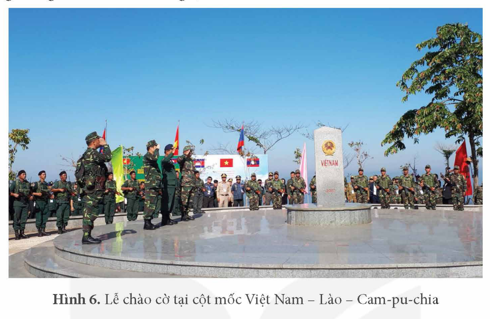
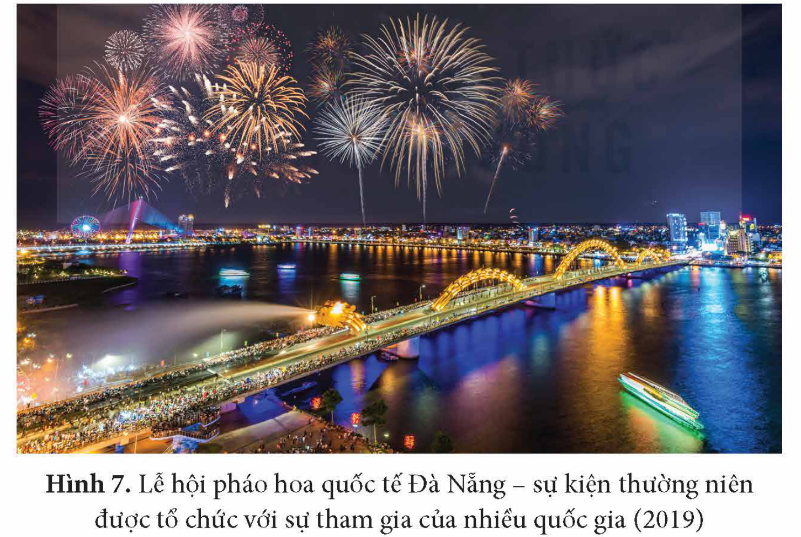

<!-- pdf:84 -->

# BÀI 14: HOẠT ĐỘNG ĐỐI NGOẠI CỦA VIỆT NAM TỪ NĂM 1975 ĐẾN NAY

## 🎯 Học xong bài này, em sẽ:

- Nêu được những hoạt động đối ngoại chủ yếu của Việt Nam trong giai đoạn 1975 – 1985.
- Nêu được những hoạt động đối ngoại chủ yếu của Việt Nam trong giai đoạn từ năm 1986 đến nay.
- Tự hào về truyền thống ngoại giao của cha ông trong lịch sử, góp phần vào việc xây dựng hình ảnh đẹp, thân thiện của đất nước Việt Nam trong cộng đồng quốc tế.

## 🔴 Mở đầu

*Hình 1. Kì họp lần thứ 32 Đại hội đồng Liên hợp quốc (9 – 1977) thông qua Nghị quyết công nhận Việt Nam là thành viên của tổ chức này*

Ngày 20 – 9 – 1977, Việt Nam trở thành thành viên chính thức của Liên hợp quốc. Sự kiện này là một hoạt động đối ngoại quan trọng, tạo điều kiện thuận lợi cho những hoạt động đối ngoại của Việt Nam trong giai đoạn mới. Hãy chia sẻ hiểu biết của em về một số hoạt động đối ngoại chủ yếu của Việt Nam từ năm 1975 đến nay.

<!-- pdf:85 -->

## 1. Hoạt động đối ngoại của Việt Nam trong giai đoạn 1975 – 1985

Trên cơ sở tôn trọng độc lập, chủ quyền, bình đẳng, Việt Nam tích cực thiết lập, mở rộng quan hệ quan hệ và hợp tác với nhiều nước trên thế giới.

*Hợp tác toàn diện với các nước xã hội chủ nghĩa:*

Việt Nam phối hợp với các nước xã hội chủ nghĩa trên diễn đàn quốc tế và đẩy mạnh hợp tác toàn diện, nhất là lĩnh vực kinh tế.

<!-- term: Hội đồng tương trợ kinh tế -->
Việt Nam luôn coi trọng quan hệ hợp tác chặt chẽ với Liên Xô và các nước xã hội chủ nghĩa. Nhiều hiệp ước trên các lĩnh vực chính trị, kinh tế, văn hoá và khoa học – kĩ thuật đã được kí kết. Năm 1978, Việt Nam gia nhập *Hội đồng tương trợ kinh tế* (SEV).

*Hình 2. V. Go-rơ-bát-cô (Liên Xô) và Phạm Tuân (Việt Nam) cùng bay vào vũ trụ (1980)*

Đối với Trung Quốc, Việt Nam tiến hành đàm phán để giải quyết các xung đột về biên giới, lãnh thổ, lãnh hải, kiên quyết bảo vệ toàn vẹn chủ quyền quốc gia.

*Thúc đẩy quan hệ với các nước Đông Nam Á:*

Việt Nam phát triển quan hệ hữu nghị, tình đoàn kết chiến đấu và hợp tác với Lào, Cam-pu-chia; sẵn sàng thiết lập quan hệ hợp tác, cùng tồn tại hoà bình và phát triển với các nước khác ở Đông Nam Á.

Sau năm 1975, lập trường của Việt Nam là không ngừng củng cố quan hệ giữa ba nước Đông Dương. Từ năm 1980, Việt Nam chủ trương thúc đẩy đối thoại, từng bước thiết lập quan hệ ngoại giao với các nước thành viên ASEAN.

*Thiết lập quan hệ với các tổ chức quốc tế và các nước khác:*

Việt Nam tích cực thiết lập quan hệ với nhiều tổ chức quốc tế và nhiều nước trên thế giới và trong khu vực.

Việt Nam tích cực đấu tranh chống chính sách cấm vận của Mỹ, hợp tác giải quyết các vấn đề nhân đạo...; đẩy mạnh quan hệ với các nước tư bản, thành lập cơ quan đại diện ngoại giao ở nhiều nước, gia nhập các tổ chức quốc tế,...

> 💡 EM CÓ BIẾT ?

> Trong những năm 1977 – 1986, hệ thống phát triển Liên hợp quốc đã viện trợ không hoàn lại cho Việt Nam khoảng 527,9 triệu USD.

<!-- term: Phong trào Không liên kết -->
Việt Nam tham gia các hoạt động góp phần phát huy vai trò tích cực của *Phong trào Không liên kết* trong cuộc đấu tranh bảo vệ hoà bình.

<!-- pdf:86 -->

*Hình 3. Thủ tướng Phạm Văn Đồng phát biểu tại Hội nghị cấp cao Phong trào Không liên kết lần thứ 6 tại La Ha-ba-na (Cu-ba) năm 1979*

> ❓ Hãy nêu những hoạt động đối ngoại chủ yếu của Việt Nam trong giai đoạn 1975 – 1985.

## 2. Hoạt động đối ngoại của Việt Nam trong thời kì Đổi mới (từ năm 1986 đến nay)

Trong những năm tiến hành công cuộc Đổi mới, các hoạt động đối ngoại của Việt Nam được triển khai nhằm phục vụ mục tiêu phát triển kinh tế và nâng cao vị thế đất nước trên trường quốc tế.

<!-- term: Định hướng đối ngoại thời kì Đổi mới -->
> TƯ LIỆU. Tại Đại hội đại biểu toàn quốc lần thứ VII (1991), Đảng Cộng sản Việt Nam đưa ra định hướng chung cho hoạt động đối ngoại là: “Hợp tác, bình đẳng và cùng có lợi với tất cả các nước, không phân biệt chế độ chính trị – xã hội khác nhau trên cơ sở nguyên tắc cùng tồn tại hoà bình.”
>
> *(Đảng Cộng sản Việt Nam, Văn kiện Đảng toàn tập, Tập 51, NXB Chính trị quốc gia, 2007, tr. 118)*

*Phá thế bao vây cấm vận, đưa đất nước ra khỏi khủng hoảng:*

Để thoát ra khỏi tình trạng bị bao vây, cô lập, tranh thủ mọi điều kiện thuận lợi cho phát triển kinh tế – xã hội, hoạt động đối ngoại của Việt Nam được triển khai trên nhiều lĩnh vực, trong đó trọng tâm là giải quyết vấn đề Cam-pu-chia.

<!-- term: Hiệp định Pa-ri về Cam-pu-chia -->
Sau khi Hiệp định Pa-ri về Cam-pu-chia được kí kết (10 – 1991), Việt Nam đã bình thường hoá quan hệ với Trung Quốc (1991), với Mỹ (1995), gia nhập ASEAN (1995),...

*Hình 4. Bộ trưởng Bộ Ngoại giao Việt Nam – Mỹ kí Nghị định thư chính thức thiết lập quan hệ ngoại giao giữa hai nước (5 – 8 – 1995)*

<!-- pdf:87 -->

*Củng cố quan hệ với các đối tác truyền thống, mở rộng quan hệ đối ngoại với các đối tác khác:*

Quan hệ giữa Việt Nam với phần lớn các nước trên thế giới đã từng bước được cải thiện và mở rộng từ giữa những năm 80 của thế kỉ XX, sau khi Việt Nam bắt đầu thực hiện công cuộc Đổi mới.

<!-- term: Đối tác chiến lược toàn diện -->
Việt Nam không ngừng củng cố, phát triển mối quan hệ hữu nghị đặc biệt với Lào, Cam-pu-chia và Cu-ba. Với các nước như Trung Quốc, Mỹ, Liên bang Nga, Ấn Độ, Hàn Quốc, Việt Nam đẩy mạnh hợp tác và nâng tầm lên quan hệ đối tác chiến lược toàn diện.

*Hình 5. Chuyến thăm của Tổng thống Mỹ đến Việt Nam đánh dấu quan hệ hợp tác giữa hai nước lên tầm đối tác chiến lược toàn diện (2023)*

Quan hệ giữa Việt Nam và Nhật Bản ngày càng chặt chẽ, được nâng cấp lên quan hệ đối tác chiến lược sâu rộng. Việt Nam cũng tích cực mở rộng và phát triển quan hệ với nhiều nước khác trên thế giới.

*Tích cực, chủ động hội nhập khu vực và thế giới:*

Việt Nam trở thành thành viên có trách nhiệm của nhiều tổ chức quốc tế (ASEAN, WTO,...),...

<!-- term: Hiệp định Thương mại tự do Việt Nam – EU -->
<!-- term: Hiệp định Đối tác kinh tế toàn diện Khu vực -->
Việt Nam kí hiệp định tham gia *Khu vực Mậu dịch tự do ASEAN* (AFTA), kí kết *Hiệp định Thương mại tự do Việt Nam – EU* (EVFTA), *Hiệp định Đối tác kinh tế toàn diện Khu vực* (RCEP),... và nhiều hiệp định quan trọng khác.

Việt Nam tích cực triển khai hoạt động đối ngoại tại các tổ chức, diễn đàn, hội nghị đa phương với đối tác trọng tâm có tầm ảnh hưởng trên nhiều lĩnh vực, ưu tiên là kinh tế, quốc phòng – an ninh.

> 💡 EM CÓ BIẾT ?

> Việt Nam đã tổ chức thành công nhiều hội nghị quốc tế quan trọng thuộc ASEAN, ASEM và APEC.

> 💡 EM CÓ BIẾT ?

<!-- term: Uỷ viên không thường trực Hội đồng Bảo an Liên hợp quốc -->
> Việt Nam hai lần được bầu với số phiếu cao vào vị trí Uỷ viên không thường trực Hội đồng Bảo an Liên hợp quốc nhiệm kì 2008 – 2009 và 2020 – 2021.

*Triển khai các hoạt động đối ngoại nhằm bảo vệ vững chắc chủ quyền lãnh thổ, lãnh hải, biển đảo của Tổ quốc:*

Để đảm bảo hoà bình, ổn định, bảo vệ lãnh thổ, lãnh hải, biển đảo của Tổ quốc, Việt Nam tham gia đàm phán và kí kết các thoả thuận, các hiệp định về phân định biên giới trên bộ, trên biển.

Đối với Trung Quốc, Việt Nam kí kết các hiệp ước về biên giới trên đất liền và phân định vịnh Bắc Bộ, giải quyết những tranh chấp thông qua biện pháp hoà bình.

<!-- pdf:88 -->

Với Lào và Cam-pu-chia, Việt Nam đã đạt được nhiều thoả thuận trong phát triển đường biên giới hoà bình, hữu nghị.

*Hình 6. Lễ chào cờ tại cột mốc Việt Nam – Lào – Cam-pu-chia*

Việt Nam đã đàm phán về ranh giới trên biển với Ma-lai-xi-a, In-đô-nê-xi-a, Phi-líp-pin và và Thái Lan, giải quyết các bất đồng bằng con đường đàm phán, thương lượng.

*Tích cực hợp tác nhằm bảo vệ môi trường, giao lưu văn hoá và hỗ trợ nhân đạo:*

Nhằm hội nhập sâu rộng với khu vực và thế giới, nâng cao vị thế đất nước, Việt Nam cam kết tham gia giải quyết các vấn đề toàn cầu, thúc đẩy gắn kết cộng đồng thông qua giao lưu văn hoá.

*Hình 7. Lễ hội pháo hoa quốc tế Đà Nẵng – sự kiện thường niên được tổ chức với sự tham gia của nhiều quốc gia (2019)*

<!-- term: Nghị định thư Ki-ô-tô -->
Việt Nam tham gia đàm phán quốc tế về biến đổi khí hậu, kí kết *Nghị định thư Ki-ô-tô*, cam kết giảm lượng phát thải khí nhà kính.

Việt Nam tích cực thúc đẩy giao lưu văn hoá với các quốc gia khác thông các lễ hội văn hoá, chương trình ngoại giao văn hoá và trao đổi giáo dục.

<!-- pdf:89 -->

Việt Nam tham gia hỗ trợ nhân đạo, cứu trợ thiên tai cho các quốc gia trong và ngoài khu vực như: Cam-pu-chia, Cu-ba, Nê-pan, In-đô-nê-xi-a, I-rắc, Xi-ri, Thổ Nhĩ Kỳ,... Việt Nam tích cực giúp đỡ thiết bị, vật tư y tế cho một số quốc gia bị ảnh hưởng nặng nề bởi đại dịch COVID-19,...

> ❓ Hãy nêu các hoạt động đối ngoại chủ yếu của Việt Nam từ năm 1986 đến nay.

## ✏️ Luyện tập và vận dụng

1. Lập bảng hệ thống về một số hoạt động đối ngoại chủ yếu của Việt Nam từ năm 1975 đến năm 1985.

| Hoạt động đối ngoại chủ yếu | Những nét chính |
| --- | --- |
| Với các nước xã hội chủ nghĩa | ? |
| Với các nước Đông Nam Á | ? |
| Với các tổ chức quốc tế và các nước khác | ? |

2. Tìm những dẫn chứng về hoạt động đối ngoại của Việt Nam trong giai đoạn từ năm 1985 đến nay để làm rõ nhận định: Hoạt động đối ngoại đã và đang góp phần quan trọng nâng cao vị thế, uy tín của đất nước trong khu vực cũng như trên thế giới.

1. Sưu tầm tư liệu từ sách, báo và internet, hãy viết bài giới thiệu về một hoạt động đối ngoại của Việt Nam mà em ấn tượng nhất.

2. Chia sẻ một số hoạt động của trường em (hoặc địa phương em) nhằm góp phần xây dựng hình ảnh đất nước tươi đẹp, thân thiện trong mắt bạn bè quốc tế.

## 📷 Danh sách hình trong bài

| Mã hình | Trang PDF | Vị trí trong bài | Chú thích gốc |
| --- | --- | --- | --- |
| H12-lich_su-b14-01 | 84 | Mở đầu | Hình 1. Kì họp lần thứ 32 Đại hội đồng Liên hợp quốc (9 – 1977) thông qua Nghị quyết công nhận Việt Nam là thành viên của tổ chức này |
| H12-lich_su-b14-02 | 85 | Mục 1 | Hình 2. V. Go-rơ-bát-cô (Liên Xô) và Phạm Tuân (Việt Nam) cùng bay vào vũ trụ (1980) |
| H12-lich_su-b14-03 | 86 | Mục 1 (chú thích đặt bên phải ảnh) | Hình 3. Thủ tướng Phạm Văn Đồng phát biểu tại Hội nghị cấp cao Phong trào Không liên kết lần thứ 6 tại La Ha-ba-na (Cu-ba) năm 1979 |
| H12-lich_su-b14-04 | 86 | Mục 2 | Hình 4. Bộ trưởng Bộ Ngoại giao Việt Nam – Mỹ kí Nghị định thư chính thức thiết lập quan hệ ngoại giao giữa hai nước (5 – 8 – 1995) |
| H12-lich_su-b14-05 | 87 | Mục 2 | Hình 5. Chuyến thăm của Tổng thống Mỹ đến Việt Nam đánh dấu quan hệ hợp tác giữa hai nước lên tầm đối tác chiến lược toàn diện (2023) |
| H12-lich_su-b14-06 | 88 | Mục 2 | Hình 6. Lễ chào cờ tại cột mốc Việt Nam – Lào – Cam-pu-chia |
| H12-lich_su-b14-07 | 88 | Mục 2 | Hình 7. Lễ hội pháo hoa quốc tế Đà Nẵng – sự kiện thường niên được tổ chức với sự tham gia của nhiều quốc gia (2019) |
