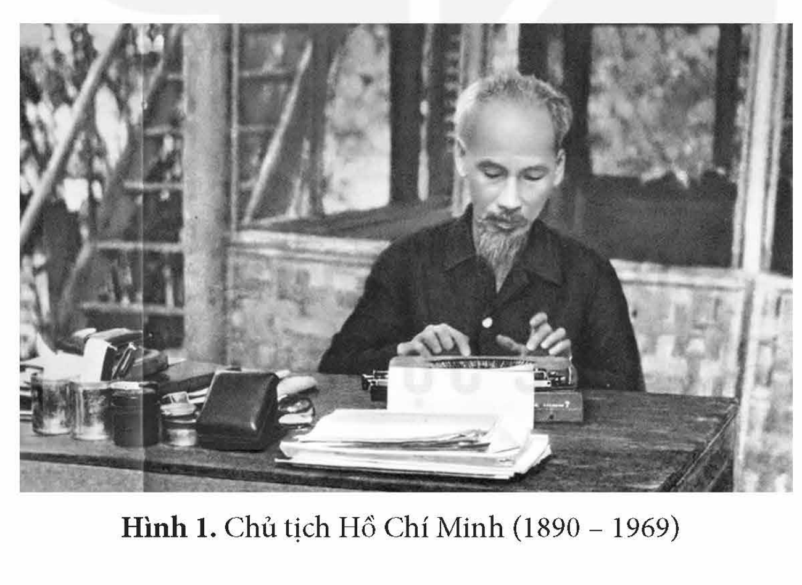
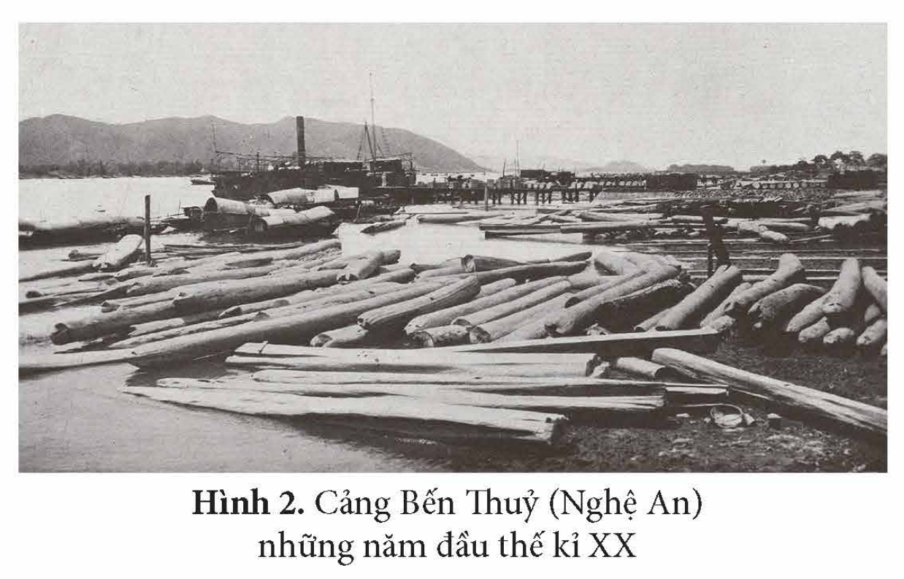
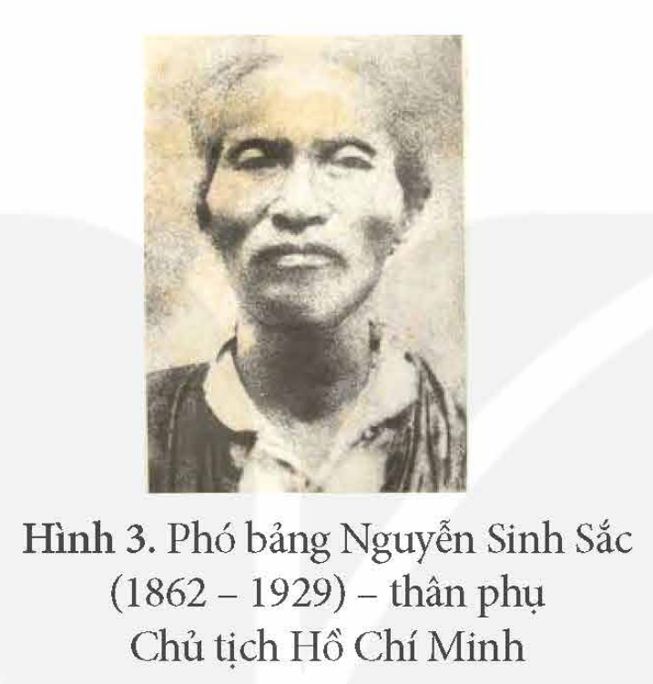
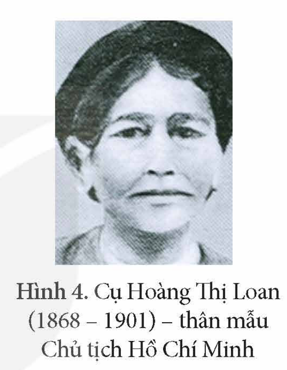
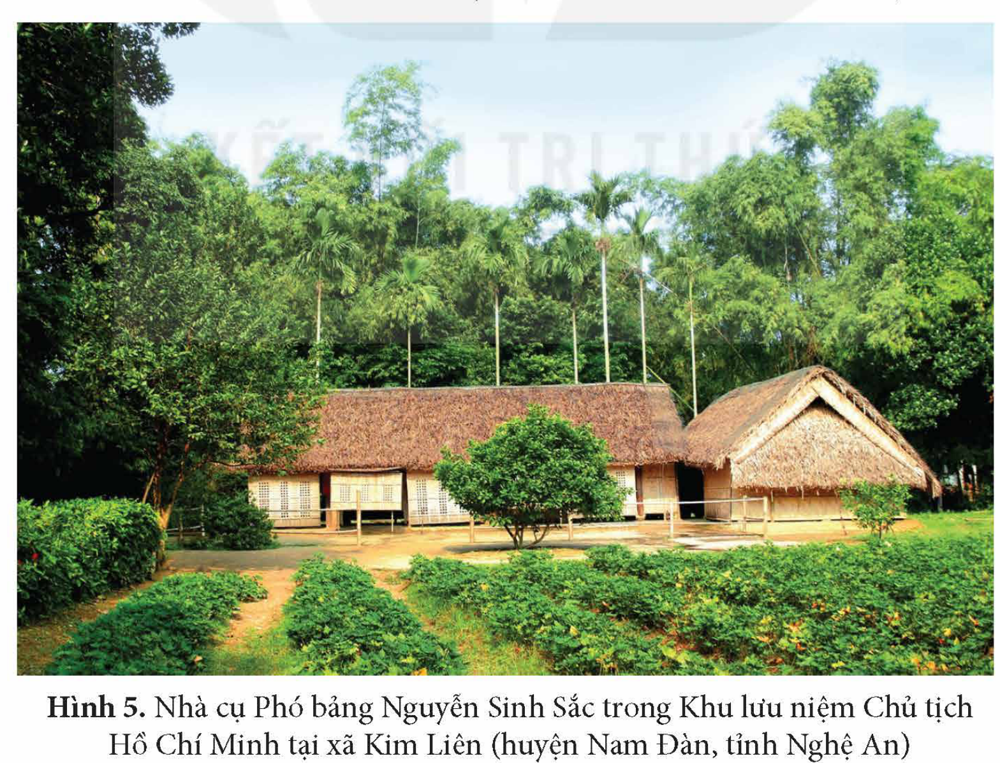
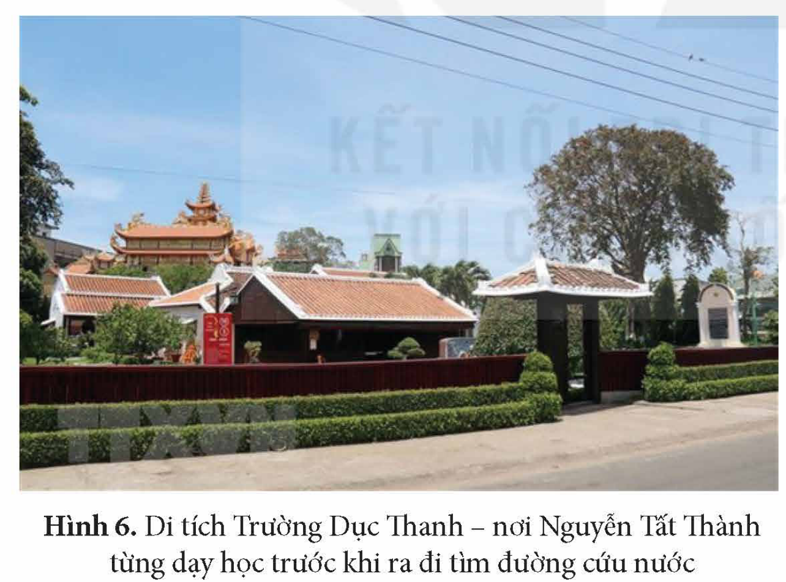

<!-- pdf:90 -->

# BÀI 15: KHÁI QUÁT CUỘC ĐỜI VÀ SỰ NGHIỆP CỦA HỒ CHÍ MINH

## 🎯 Học xong bài này, em sẽ:

- Biết cách sưu tầm và sử dụng tài liệu lịch sử để tìm hiểu về cuộc đời và sự nghiệp của Hồ Chí Minh.
- Nêu được một số yếu tố ảnh hưởng đến cuộc đời và sự nghiệp của Hồ Chí Minh.
- Tóm tắt được những nét cơ bản trong tiểu sử của Hồ Chí Minh.
- Nêu được tiến trình hoạt động cách mạng của Hồ Chí Minh.
<!-- ocr-ok: Đã đối chiếu ảnh p090.png, khung yêu cầu cần đạt bị OCR đọc sai dấu trên nền hoa văn -->

## 🔴 Mở đầu

*Hình 1. Chủ tịch Hồ Chí Minh (1890 – 1969)*

Năm 2020, trong bài diễn văn tại Lễ kỉ niệm 130 năm ngày sinh Chủ tịch Hồ Chí Minh, Tổng Bí thư, Chủ tịch nước Nguyễn Phú Trọng phát biểu: “Cuộc đời 79 mùa Xuân của Chủ tịch Hồ Chí Minh là biểu tượng cao đẹp nhất của chủ nghĩa yêu nước và chủ nghĩa anh hùng cách mạng Việt Nam. Người là kết tinh rạng ngời của đạo đức, trí tuệ, khí phách, lương tri của dân tộc và thời đại.”

Theo em, những yếu tố nào đã góp phần tạo nên “đạo đức, trí tuệ, nhân cách” và sự nghiệp của Chủ tịch Hồ Chí Minh? Hãy chia sẻ những điều em biết về tiến trình hoạt động cách mạng của Người.

<!-- pdf:91 -->

## 1. Những yếu tố ảnh hưởng đến cuộc đời và sự nghiệp Hồ Chí Minh

• *Hoàn cảnh đất nước*

Việt Nam là đất nước có nền văn hiến lâu đời. Trải qua hàng nghìn năm dựng nước và giữ nước, nhân dân Việt Nam đã hun đúc nên truyền thống quý báu như: yêu nước, đoàn kết, nhân nghĩa,...

Từ giữa thế kỉ XIX, thực dân Pháp xâm lược và từng bước áp đặt ách cai trị ở Việt Nam. Dưới chế độ thực dân, nền độc lập dân tộc và quyền tự do của đại bộ phận nhân dân bị tước đoạt.

> TƯ LIỆU 1. “Xứ Đông Dương bị chủ nghĩa tư bản Pháp bóc lột để làm giàu cho một số cá mập! Người ta đưa người Đông Dương vào chỗ chết trong cuộc chém giết của bọn tư bản để bảo vệ những cái gì mà chính họ cũng không hề biết. Người ta đầu độc họ bằng rượu cồn và thuốc phiện. Người ta kìm họ trong ngu dốt...”.
>
> *(Hồ Chí Minh: Toàn tập, Tập 1, NXB Chính trị quốc gia, 2011, tr. 46)*

Cuối thế kỉ XIX – đầu thế kỉ XX, các phong trào yêu nước chống Pháp đều thất bại. Đấu tranh giành độc lập cho dân tộc, tự do và hạnh phúc cho nhân dân là nhiệm vụ cấp bách của dân tộc và cũng là khát vọng của cả cuộc đời Chủ tịch Hồ Chí Minh.

• *Hoàn cảnh quê hương*

<!-- term: Quê hương Nam Đàn -->
Chủ tịch Hồ Chí Minh quê ở huyện Nam Đàn, tỉnh Nghệ An – vùng đất “sơn thuỷ hữu tình”, có truyền thống lịch sử, văn hoá lâu đời, nơi khởi nguồn của nhiều phong trào yêu nước. Vùng đất này đã sản sinh ra nhiều anh hùng dân tộc, danh nhân văn hoá và nhà khoa bảng nổi tiếng trong lịch sử. Vươn lên trong điều kiện tự nhiên khắc nghiệt và thực tiễn dựng nước, giữ nước đã hun đúc nên những phẩm chất của người xứ Nghệ như: cần cù trong lao động, ý chí trong học tập và đoàn kết trong đấu tranh.

> 💡 EM CÓ BIẾT ?

<!-- term: Quê hương Nam Đàn -->
> Vùng đất Nam Đàn (Nghệ An) là nơi lưu nhiều dấu tích lịch sử liên quan đến Mai Thúc Loan dựng cờ khởi nghĩa (đầu thế kỉ VIII), Lê Lợi xây thành Lục Niên (thế kỉ XV); Nguyễn Huệ dừng chân chiêu mộ binh sĩ (cuối thế kỉ XVIII); Vương Thúc Mậu khởi nghĩa hưởng ứng Dụ Cần vương (cuối thế kỉ XIX),...

> TƯ LIỆU 2. “Nghệ An núi cao, sông sâu, phong tục trọng hậu, cảnh tượng tươi sáng, gọi là đất có danh tiếng hơn cả Nam Châu. Người thì thuần hoá mà chăm học, sản vật thì nhiều thức quý của lạ... được khí tốt của sông núi nên sinh ra nhiều bậc danh hiền... thực là nơi hiểm yếu như thành đồng, ao nóng của nước và là then khoá của các triều đại”.
>
> *(Phan Huy Chú, Lịch triều hiến chương loại chí, Tập 1, NXB Khoa học xã hội, 1992, Tập 1, tr. 63)*

<!-- pdf:92 -->

Thời cận đại, Nghệ An có trung tâm công nghiệp Vinh – Bến Thuỷ lớn nhất khu vực Bắc miền Trung, do đó, sớm có điều kiện tiếp thu nhiều tư tưởng mới của thời đại.

*Hình 2. Cảng Bến Thuỷ (Nghệ An) những năm đầu thế kỉ XX*

• *Hoàn cảnh gia đình*

<!-- term: Nguyễn Sinh Sắc -->
Chủ tịch Hồ Chí Minh sinh ra trong một gia đình yêu nước, cha là Phó bảng Nguyễn Sinh Sắc – một nhà nho mẫu mực, mẹ là Hoàng Thị Loan – một người phụ nữ đảm đang, chăm chỉ và rất am hiểu các loại hình văn hoá dân gian.

*Hình 3. Phó bảng Nguyễn Sinh Sắc (1862 – 1929) – thân phụ Chủ tịch Hồ Chí Minh*

*Hình 4. Cụ Hoàng Thị Loan (1868 – 1901) – thân mẫu Chủ tịch Hồ Chí Minh*

*Hình 5. Nhà cụ Phó bảng Nguyễn Sinh Sắc trong Khu lưu niệm Chủ tịch Hồ Chí Minh tại xã Kim Liên (huyện Nam Đàn, tỉnh Nghệ An)*

Dù phải trải qua tuổi thơ vất vả nhưng sự nền nếp, truyền thống hiếu học, giàu tình yêu thương của gia đình đã giúp Chủ tịch Hồ Chí Minh sớm hình thành nhân cách tốt đẹp và có sự đồng cảm với nhân dân lao động.

<!-- pdf:93 -->

> ❓ Khai thác thông tin và các tư liệu 1, 2 trong mục, hãy nêu một số yếu tố ảnh hưởng đến cuộc đời và sự nghiệp của Chủ tịch Hồ Chí Minh.

## 2. Tiểu sử và tiến trình hoạt động cách mạng của Hồ Chí Minh

• *Thời niên thiếu và những hoạt động đầu tiên (1890 – 1911)*

Chủ tịch Hồ Chí Minh (thuở nhỏ tên là Nguyễn Sinh Cung) sinh ngày 19 – 5 – 1890, quê cha ở Làng Sen, quê mẹ ở làng Hoàng Trù, xã Kim Liên (Nam Đàn, Nghệ An). Trước lúc 5 tuổi, Nguyễn Sinh Cung sinh sống tại quê nhà. Năm 1895, Nguyễn Sinh Cung theo cha mẹ vào sinh sống ở Huế. Sau khi mẹ qua đời (1901), Nguyễn Sinh Cung theo cha về quê, lấy tên mới là Nguyễn Tất Thành, được theo học những thầy giáo giỏi ở địa phương. Năm 1906, ông Nguyễn Sinh Sắc vào Huế làm quan, Nguyễn Tất Thành theo cha vào học tại Trường Tiểu học Pháp – Việt Đông Ba và Trường Quốc học Huế. Năm 1909, Nguyễn Tất Thành theo cha đến Bình Định và tiếp tục hoàn thành bậc Tiểu học tại Trường Pháp – Việt Quy Nhơn. Sớm có tinh thần yêu nước, năm 1908, Nguyễn Tất Thành tham gia phong trào chống thuế ở Huế.

<!-- term: Trường Dục Thanh -->
Cuối tháng 8 – 1910, Nguyễn Tất Thành đến Phan Thiết (Bình Thuận), dạy học tại trường Dục Thanh. Tại đây, Nguyễn Tất Thành truyền thụ cho học sinh lòng yêu nước và những trăn trở về vận mệnh của đất nước.

*Hình 6. Di tích Trường Dục Thanh – nơi Nguyễn Tất Thành từng dạy học trước khi ra đi tìm đường cứu nước*

> 💡 EM CÓ BIẾT ?

<!-- term: Trường Dục Thanh -->
> Năm 1906, hưởng ứng lời kêu gọi duy tân của Phan Châu Trinh, một số chí sĩ yêu nước ở Phan Thiết thành lập Công ty nước mắm Liên Thành. Một phần lợi nhuận của công ty này dùng để mở trường Dục Thanh. Tên gọi Dục Thanh đã nói lên mục đích và ý nghĩa của trường, là nơi giáo dục, bồi dưỡng thế hệ trẻ.

<!-- term: Hành trình tìm đường cứu nước -->
Tháng 2 – 1911, Nguyễn Tất Thành rời Phan Thiết vào Sài Gòn, mang theo hoài bão ra nước ngoài, xem thế giới làm như thế nào rồi trở về giúp đồng bào. Sau một thời gian tìm hiểu, ngày 5 – 6 – 1911, Nguyễn Tất Thành (với tên gọi mới là Văn Ba) đã rời Bến Nhà Rồng trên con tàu La-tu-sơ Tơ-rê-vin, bắt đầu hành trình tìm đường cứu nước.

<!-- pdf:94 -->

• *Những năm tháng hoạt động ở nước ngoài (1911 – 1941)*

*Bảng 1. Tóm tắt tiến trình hoạt động cách mạng của Nguyễn Ái Quốc từ năm 1911 đến năm 1941*

<!-- term: Yêu sách của nhân dân An Nam -->
| Giai đoạn | Hoạt động chính |
| --- | --- |
| Từ năm 1911 đến năm 1920 | – Từ năm 1911 đến năm 1917, Nguyễn Tất Thành đến nhiều nước châu Á, châu Âu, châu Phi, tích cực tìm hiểu cuộc sống của nhân dân lao động. – Năm 1917, Nguyễn Tất Thành trở lại hoạt động ở Pháp. Năm 1919, Nguyễn Tất Thành thay mặt những người Việt Nam yêu nước tại Pháp gửi tới Hội nghị Véc-xai bản *Yêu sách của nhân dân An Nam*, trong đó kí tên là Nguyễn Ái Quốc. – Tháng 7 – 1920, Nguyễn Ái Quốc đọc *Sơ thảo lần thứ nhất những luận cương về vấn đề dân tộc và vấn đề thuộc địa* của V. Lê-nin. – Tháng 12 – 1920, Nguyễn Ái Quốc bỏ phiếu tán thành Quốc tế Cộng sản và tham gia thành lập Đảng Cộng sản Pháp, trở thành người Cộng sản đầu tiên của Việt Nam. |
| Từ năm 1921 đến năm 1930 | – Từ năm 1921 đến tháng 6 – 1923, Nguyễn Ái Quốc hoạt động ở Pháp: tham gia thành lập *Hội Liên hiệp các dân tộc thuộc địa*, làm Chủ nhiệm kiêm chủ bút Báo *Người cùng khổ*,... – Tháng 6 – 1923, Nguyễn Ái Quốc rời Pháp đến Liên Xô, tích cực hoạt động trong phong trào cộng sản quốc tế,... – Từ tháng 11 – 1924 đến giữa năm 1927, Nguyễn Ái Quốc rời Liên Xô đến Quảng Châu (Trung Quốc), thành lập *Hội Việt Nam cách mạng Thanh niên*, ra báo *Thanh niên* (1925),... – Từ giữa năm 1927 đến cuối năm 1929, Nguyễn Ái Quốc hoạt động cách mạng ở Pháp, Bỉ, Đức, Xiêm,... – Đầu năm 1930, Nguyễn Ái Quốc triệu tập và chủ trì Hội nghị hợp nhất các tổ chức cộng sản, thành lập Đảng Cộng sản Việt Nam ở Hương Cảng (Trung Quốc), soạn thảo *Cương lĩnh chính trị* đầu tiên của Đảng. |
| Từ năm 1930 đến năm 1941 | – Năm 1933, Nguyễn Ái Quốc hoạt động tại Liên Xô. – Năm 1938, Nguyễn Ái Quốc rời Liên Xô trở lại Trung Quốc và hoạt động cách mạng ở đây. – Ngày 28 – 1 – 1941, sau hơn 30 năm xa Tổ quốc, Nguyễn Ái Quốc trở về nước, trực tiếp lãnh đạo cách mạng Việt Nam. |

<!-- pdf:95 -->

• *Trực tiếp lãnh đạo cách mạng Việt Nam (1941 – 1969)*

*Bảng 2. Tóm tắt tiến trình hoạt động cách mạng của Nguyễn Ái Quốc – Hồ Chí Minh từ năm 1941 đến năm 1969*

| Giai đoạn | Hoạt động chính |
| --- | --- |
| Từ năm 1941 đến năm 1945 | – Nguyễn Ái Quốc triệu tập và chủ trì Hội nghị lần thứ 8 Ban Chấp hành Trung ương Đảng Cộng sản Đông Dương (5 – 1941). – Nguyễn Ái Quốc tham gia thành lập *Việt Nam Độc lập đồng minh* (Việt Minh), tổ chức chỉ đạo xây dựng lực lượng vũ trang, căn cứ địa cách mạng. – Tháng 8 – 1942, Nguyễn Ái Quốc lấy tên là Hồ Chí Minh, sang Trung Quốc tìm sự liên minh quốc tế. Tháng 9 – 1944, Hồ Chí Minh trở về nước tiếp tục lãnh đạo cách mạng. – Tháng 8 – 1945, Hồ Chí Minh cùng Trung ương Đảng, Mặt trận Việt Minh lãnh đạo nhân dân Tổng khởi nghĩa giành chính quyền thắng lợi, và được cử làm Chủ tịch của Chính phủ lâm thời nước Việt Nam Dân chủ Cộng hoà. – Ngày 2 – 9 – 1945, tại Quảng trường Ba Đình (Hà Nội), Hồ Chí Minh đọc *Tuyên ngôn Độc lập*, tuyên bố thành lập nước Việt Nam Dân chủ Cộng hoà. |
| Từ năm 1945 đến năm 1969 | – Chủ tịch Hồ Chí Minh cùng với Trung ương Đảng lãnh đạo cuộc kháng chiến chống thực dân Pháp (1945 – 1954). – Tháng 1 – 1946, Hồ Chí Minh được Quốc hội khoá I đã bầu làm Chủ tịch nước Việt Nam Dân chủ Cộng hoà. Tại Đại hội lần thứ II của Đảng Cộng sản Đông Dương (2 – 1951), Hồ Chí Minh được bầu làm Chủ tịch Ban Chấp hành Trung ương Đảng. – Chủ tịch Hồ Chí Minh cùng với Trung ương Đảng lãnh đạo cuộc kháng chiến chống Mỹ, cứu nước. – Tháng 10 – 1956, Chủ tịch Hồ Chí Minh là Chủ tịch Đảng, kiêm Tổng Bí thư Đảng Lao động Việt Nam. Tại Đại hội lần thứ III của Đảng (9 – 1960), Chủ tịch Hồ Chí Minh tiếp tục được bầu làm Chủ tịch Đảng Lao động Việt Nam. – Ngày 2 – 9 – 1969, Chủ tịch Hồ Chí Minh qua đời tại Hà Nội. |

> ❓ Hãy tóm tắt nét cơ bản và tiến trình hoạt động cách mạng của Nguyễn Ái Quốc – Hồ Chí Minh (1911 – 1969).

## ✏️ Luyện tập và vận dụng

1. Lập trục thời gian (theo ý tưởng của em) thể hiện những nét chính về tiến trình hoạt động cách mạng của Chủ tịch Hồ Chí Minh.

2. Viết bài giới thiệu về một cuốn sách hoặc một bộ phim về Chủ tịch Hồ Chí Minh. Nêu cảm nghĩ của em về cuốn sách hoặc bộ phim đó.

## 📷 Danh sách hình trong bài

| Mã hình | Trang PDF | Vị trí trong bài | Chú thích gốc |
| --- | --- | --- | --- |
| H12-lich_su-b15-01 | 90 | Mở đầu | Hình 1. Chủ tịch Hồ Chí Minh (1890 – 1969) |
| H12-lich_su-b15-02 | 92 | Mục 1 | Hình 2. Cảng Bến Thuỷ (Nghệ An) những năm đầu thế kỉ XX |
| H12-lich_su-b15-03 | 92 | Mục 1 | Hình 3. Phó bảng Nguyễn Sinh Sắc (1862 – 1929) – thân phụ Chủ tịch Hồ Chí Minh |
| H12-lich_su-b15-04 | 92 | Mục 1 | Hình 4. Cụ Hoàng Thị Loan (1868 – 1901) – thân mẫu Chủ tịch Hồ Chí Minh |
| H12-lich_su-b15-05 | 92 | Mục 1 | Hình 5. Nhà cụ Phó bảng Nguyễn Sinh Sắc trong Khu lưu niệm Chủ tịch Hồ Chí Minh tại xã Kim Liên (huyện Nam Đàn, tỉnh Nghệ An) |
| H12-lich_su-b15-06 | 93 | Mục 2 | Hình 6. Di tích Trường Dục Thanh – nơi Nguyễn Tất Thành từng dạy học trước khi ra đi tìm đường cứu nước |
