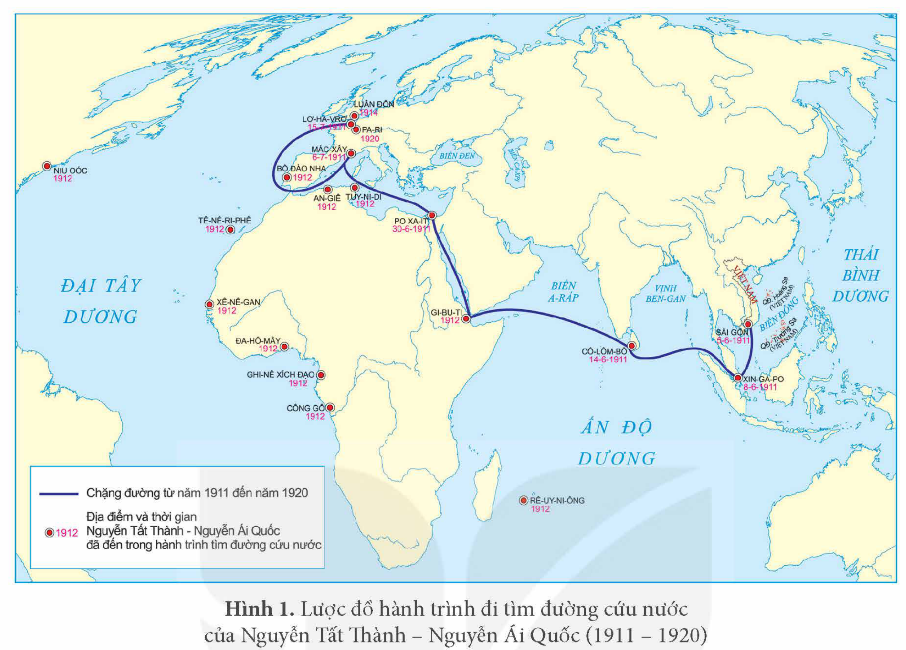
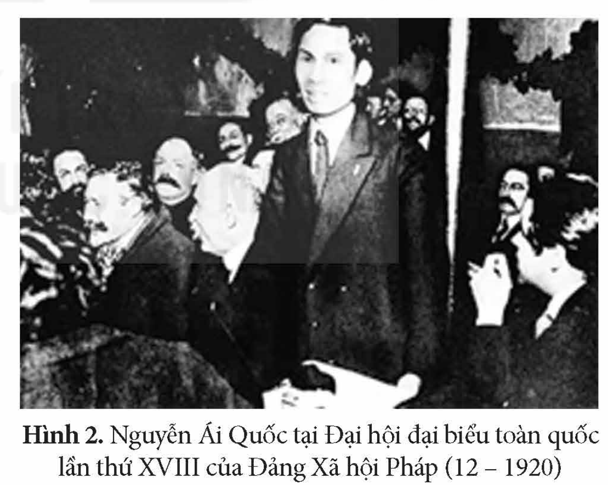
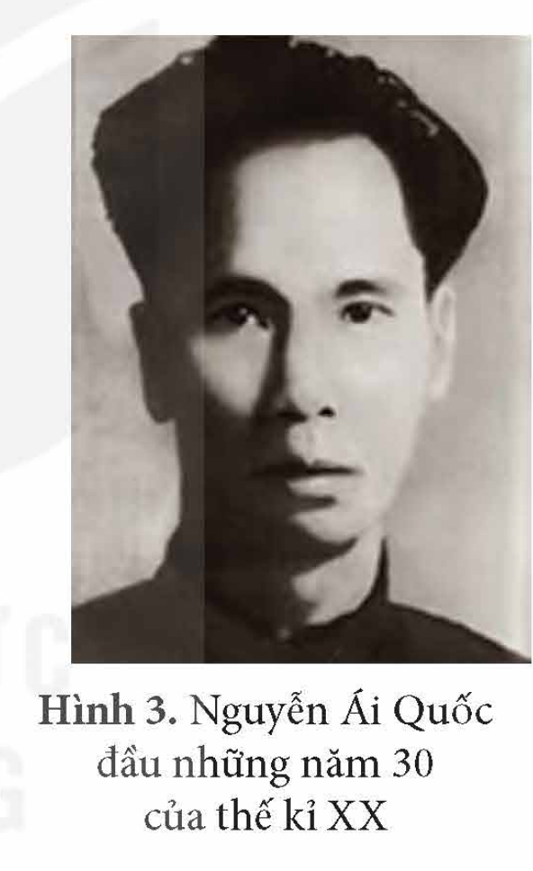
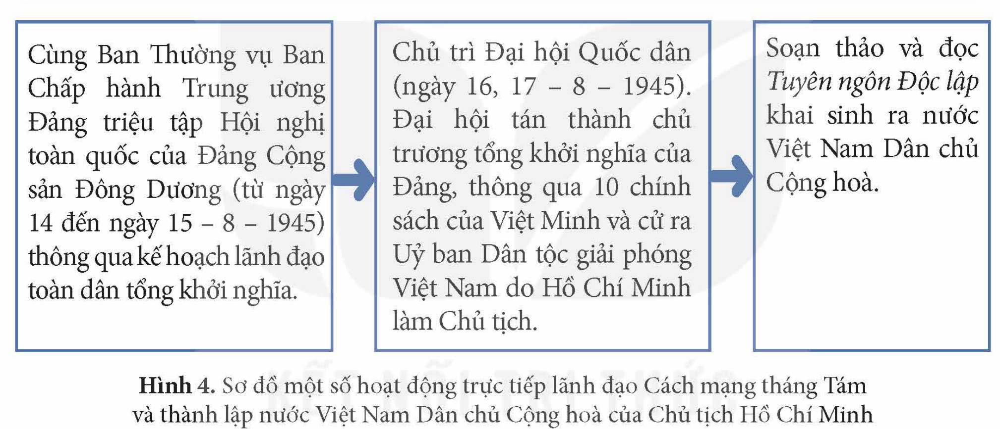
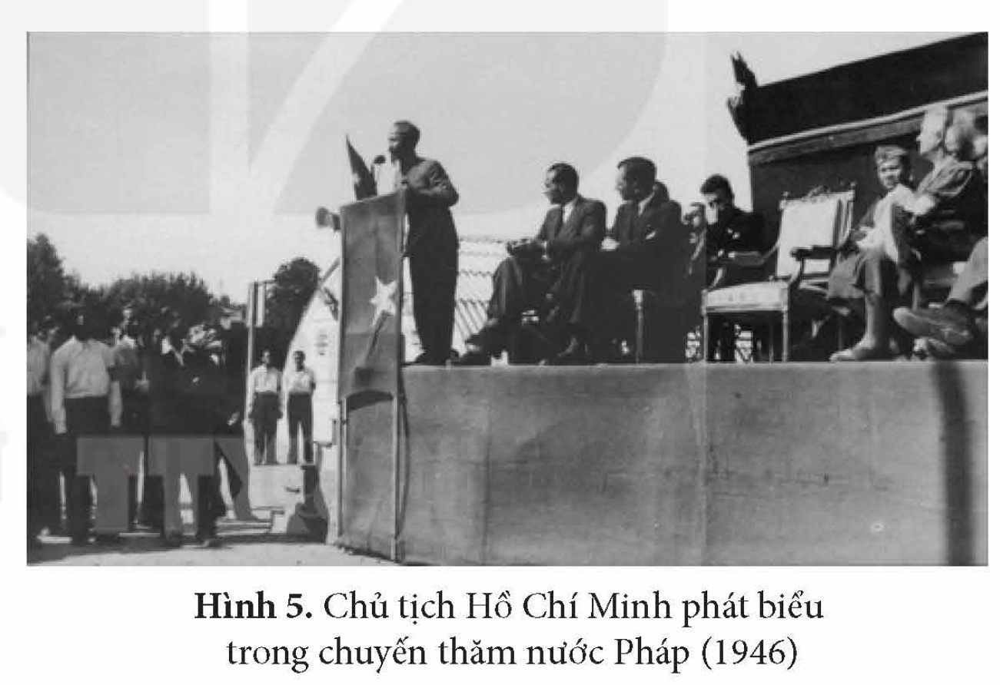
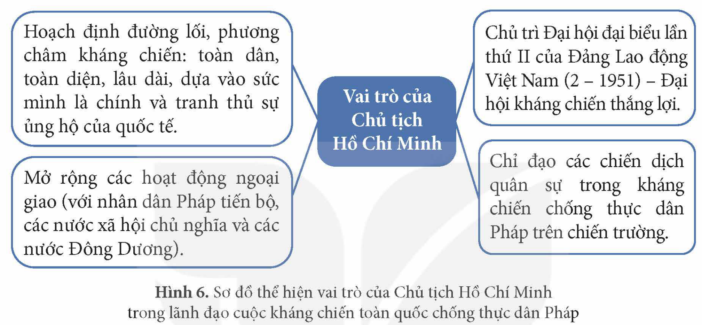
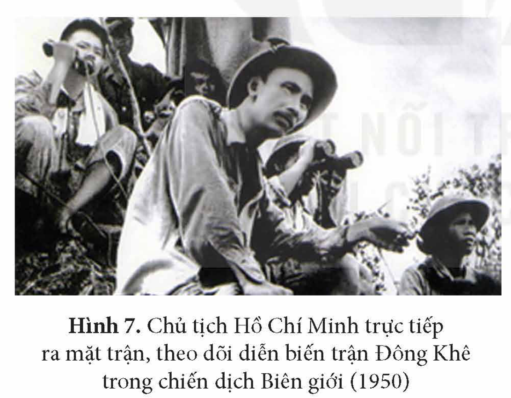
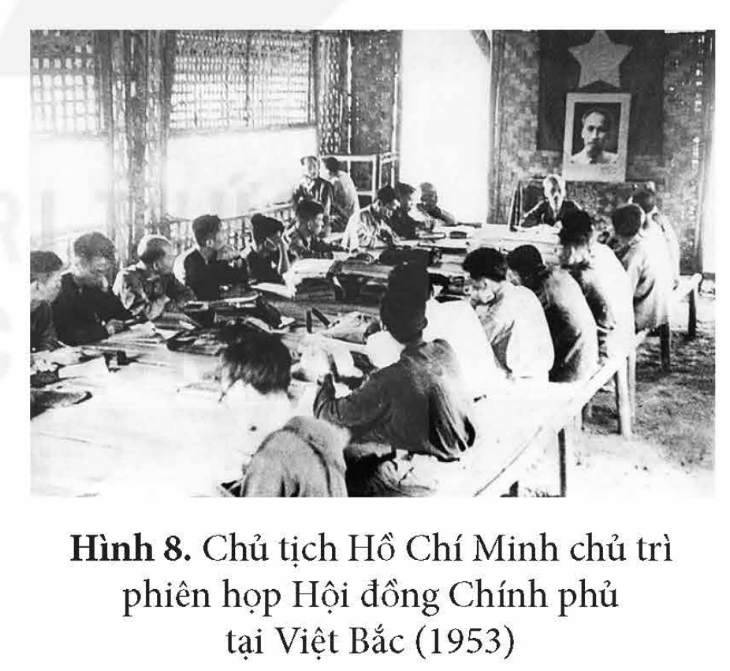
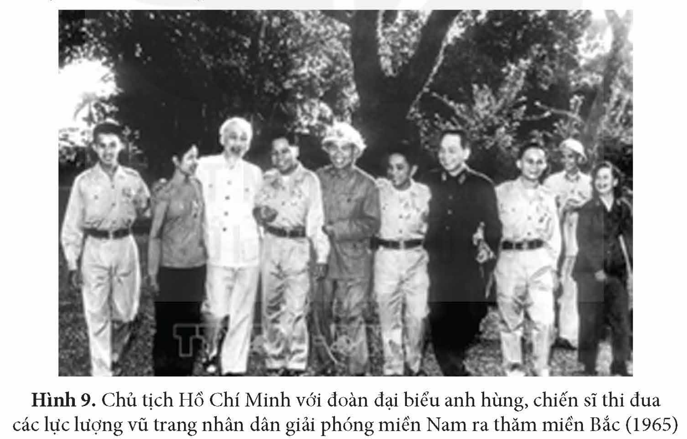
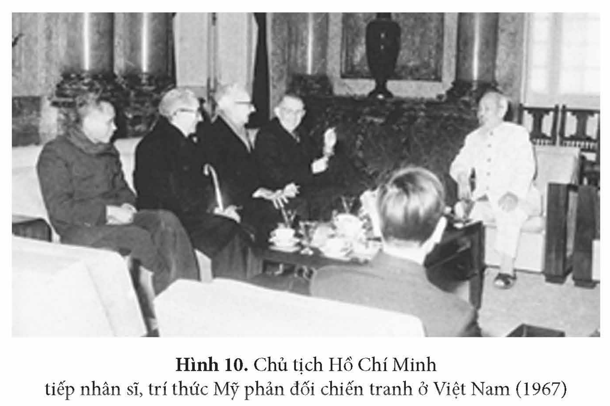

<!-- pdf:96 -->

# BÀI 16: HỒ CHÍ MINH – ANH HÙNG GIẢI PHÓNG DÂN TỘC

## 🎯 Học xong bài này, em sẽ:

- Giới thiệu được hành trình đi tìm đường cứu nước của Hồ Chí Minh trên bản đồ.
- Nêu được nội dung cơ bản của con đường cứu nước của Hồ Chí Minh và ý nghĩa của sự kiện Hồ Chí Minh tìm ra con đường cứu nước.
- Trình bày được quá trình chuẩn bị về chính trị, tư tưởng, tổ chức của Hồ Chí Minh cho sự ra đời của Đảng Cộng sản Việt Nam; nêu được vai trò của Hồ Chí Minh đối với việc thành lập Đảng Cộng sản Việt Nam và ý nghĩa của việc thành lập Đảng Cộng sản Việt Nam.
- Nêu được ý nghĩa của việc thành lập Mặt trận Việt Minh (19 – 5 – 1941) và vai trò của Hồ Chí Minh.
- Nêu được vai trò của Hồ Chí Minh đối với thắng lợi của Cách mạng tháng Tám năm 1945; vai trò của Hồ Chí Minh trong lãnh đạo cuộc kháng chiến chống Pháp (1945 – 1954) và chống Mỹ (1954 – 1969).
- Có ý thức trân trọng công lao, đóng góp của Hồ Chí Minh đối với cách mạng Việt Nam.

## 🔴 Mở đầu

Khoá họp lần thứ 24 của Đại hội đồng Tổ chức Giáo dục, Khoa học và Văn hoá của Liên hợp quốc (UNESCO) năm 1987 đã ban hành nghị quyết với nội dung: “Năm 1990 sẽ đánh dấu 100 năm kỉ niệm Ngày sinh của Chủ tịch Hồ Chí Minh, Anh hùng giải phóng dân tộc và Nhà văn hoá kiệt xuất của Việt Nam”. Nghị quyết là sự công nhận của cộng đồng quốc tế đối với những đóng góp to lớn của Chủ tịch Hồ Chí Minh. Theo em, Chủ tịch Hồ Chí Minh đã có những đóng góp như thế nào đối với lịch sử dân tộc cũng như nhân loại?

## 1. Hành trình tìm đường cứu nước

Hành trình tìm đường cứu nước của Nguyễn Tất Thành bắt đầu từ ngày 5 – 6 – 1911. Trong hành trình đó, Nguyễn Tất Thành đã đi qua nhiều châu lục, tự học tập và dần thấu hiểu bản chất của chủ nghĩa thực dân và các cuộc cách mạng tư sản trên thế giới. Đó là cơ sở để Người đến với chủ nghĩa Mác – Lê-nin.

> TƯ LIỆU 1. “Dù màu da có khác nhau, trên đời này chỉ có hai giống người: giống người bóc lột và giống người bị bóc lột. Mà cũng chỉ có một mối tình hữu ái là thật mà thôi: tình hữu ái vô sản.”
>
> *(Hồ Chí Minh: Toàn tập, Tập 1, NXB Chính trị quốc gia, 2011, tr. 287)*

<!-- pdf:97 -->

*Hình 1. Lược đồ hành trình đi tìm đường cứu nước của Nguyễn Tất Thành – Nguyễn Ái Quốc (1911 – 1920)*

<!-- term: Con đường cách mạng vô sản -->
Trải qua gần 10 năm nghiên cứu, học tập, tháng 7 – 1920, Nguyễn Ái Quốc đọc *Sơ thảo lần thứ nhất những luận cương về vấn đề dân tộc và vấn đề thuộc địa* của Lê-nin đăng trên báo *Nhân đạo*. Luận cương đã giúp Nguyễn Ái Quốc khẳng định con đường giành độc lập và tự do cho dân tộc Việt Nam là đi theo con đường cách mạng vô sản, gắn giải phóng dân tộc với giải phóng giai cấp, độc lập dân tộc với chủ nghĩa xã hội. Tại Đại hội lần thứ XVIII của Đảng Xã hội Pháp (12 – 1920), Nguyễn Ái Quốc đã bỏ phiếu tán thành việc gia nhập Quốc tế Cộng sản, trở thành người cộng sản Việt Nam đầu tiên và một trong những người sáng lập Đảng Cộng sản Pháp.

*Hình 2. Nguyễn Ái Quốc tại Đại hội đại biểu toàn quốc lần thứ XVIII của Đảng Xã hội Pháp (12 – 1920)*

> TƯ LIỆU 2. Lúc đầu, chính là chủ nghĩa yêu nước, chứ chưa phải chủ nghĩa cộng sản đã đưa tôi tin theo Lê-nin, tin theo Quốc tế thứ ba. Từng bước một, trong cuộc đấu tranh, vừa nghiên cứu lí luận Mác – Lê-nin, vừa làm công tác thực tế, dần dần tôi hiểu được rằng chỉ có chủ nghĩa xã hội, chủ nghĩa cộng sản mới giải phóng được các dân tộc bị áp bức và những người lao động trên thế giới khỏi ách nô lệ.
>
> *(Hồ Chí Minh: Toàn tập, Tập 12, NXB Chính trị quốc gia, 2011, tr. 561 – 563)*

<!-- pdf:98 -->

Sự kiện Nguyễn Ái Quốc tìm ra con đường cứu nước có ý nghĩa to lớn đối với sự phát triển của cách mạng Việt Nam. Sự kiện này bước đầu giải quyết được cuộc khủng hoảng về đường lối của phong trào giải phóng dân tộc Việt Nam; mở ra giai đoạn phát triển mới cho phong trào giải phóng dân tộc Việt Nam – giai đoạn gắn phong trào cách mạng Việt Nam với cách mạng thế giới.

> ❓ 1. Giới thiệu hành trình tìm đường cứu nước của Nguyễn Ái Quốc trên lược đồ Hình 1 (tr. 95).
>
> 2. Vì sao Nguyễn Ái Quốc lựa chọn đi theo con đường cách mạng vô sản. Hãy nêu nội dung cơ bản của con đường cứu nước và ý nghĩa của sự kiện Nguyễn Ái Quốc tìm ra con đường cứu nước.

## 2. Sáng lập Đảng Cộng sản Việt Nam

### a) Chuẩn bị về chính trị, tư tưởng và tổ chức cho sự ra đời của Đảng Cộng sản Việt Nam

Sau khi tìm được con đường cứu nước, Nguyễn Ái Quốc tích cực chuẩn bị về chính trị, tư tưởng và tổ chức cho sự ra đời của Đảng Cộng sản Việt Nam.

> TƯ LIỆU 3. “Trước hết phải có đảng cách mệnh, để trong thì vận động và tổ chức quần chúng, ngoài thì liên lạc với dân tộc bị áp bức và vô sản giai cấp mọi nơi... Đảng có vững thì cách mệnh mới thành công, cũng như người cầm lái có vững thì thuyền mới chạy... Bây giờ học thuyết nhiều, chủ nghĩa nhiều nhưng chủ nghĩa chân chính nhất, chắc chắn nhất, cách mệnh nhất là chủ nghĩa Lê-nin”
>
> *(Trích Đường Kách mệnh trong Hồ Chí Minh: Toàn tập, Tập 2, NXB Chính trị quốc gia, 2011, tr. 289)*

*Về chính trị, tư tưởng:* Nguyễn Ái Quốc tích cực tố cáo bản chất áp bức, bóc lột, nô dịch của chủ nghĩa thực dân với nhân dân các nước thuộc địa và kêu gọi, thức tỉnh nhân dân đấu tranh.

Từ giữa năm 1921, tại Pháp, cùng một số nhà cách mạng của các nước thuộc địa khác, Nguyễn Ái Quốc tham gia thành lập *Hội liên hiệp thuộc địa*, sau đó sáng lập tờ báo *Le Paria* (Người cùng khổ). Người viết nhiều bài trên các báo: *Nhân đạo*, *Đời sống công nhân*, *Tạp chí Cộng sản*, *Tập san Thư tín quốc tế*,...

Kế thừa những quan điểm của chủ nghĩa Mác – Lê-nin và xuất phát từ thực tiễn phong trào giải phóng dân tộc ở các nước thuộc địa, Nguyễn Ái Quốc đưa ra những luận điểm quan trọng về cách mạng giải phóng dân tộc:

– Giải phóng dân tộc phải gắn với giải phóng giai cấp; cả hai cuộc giải phóng này chỉ có thể là sự nghiệp của chủ nghĩa cộng sản.

– Cách mạng giải phóng dân tộc ở các nước thuộc địa với cách mạng vô sản ở chính quốc có mối quan hệ chặt chẽ với nhau, cách mạng giải phóng dân tộc ở nước thuộc địa có thể thành công trước cách mạng vô sản ở chính quốc.

<!-- pdf:99 -->

– Khẳng định vai trò của chính đảng vô sản trong thắng lợi của cách mạng.

<!-- term: Hội Việt Nam Cách mạng Thanh niên -->
*Về tổ chức:* Tháng 6 – 1925, Nguyễn Ái Quốc thành lập *Hội Việt Nam Cách mạng Thanh niên* tại Quảng Châu (Trung Quốc) nhằm đào tạo những người yêu nước thành cán bộ truyền bá chủ nghĩa Mác – Lê-nin, lí luận cách mạng giải phóng dân tộc của Nguyễn Ái Quốc vào phong trào yêu nước, phong trào công nhân. Sau khi thành lập, Hội tổ chức các lớp huấn luyện chính trị do Nguyễn Ái Quốc trực tiếp phụ trách. Hoạt động của Hội Việt Nam Cách mạng Thanh niên có ảnh hưởng và thúc đẩy mạnh mẽ sự chuyển biến của phong trào công nhân, phong trào yêu nước Việt Nam, dẫn đến sự ra đời của ba tổ chức cộng sản trong năm 1929. Đó là sự chuẩn bị trực tiếp cho sự ra đời của Đảng Cộng sản Việt Nam.

> ❓ Khai thác thông tin và Tư liệu 3 trong mục, trình bày quá trình chuẩn bị về chính trị, tư tưởng và tổ chức của Nguyễn Ái Quốc cho sự ra đời của Đảng Cộng sản Việt Nam.

### b) Triệu tập, chủ trì Hội nghị thành lập Đảng Cộng sản Việt Nam

Sự xuất hiện của ba tổ chức cộng sản chứng tỏ khuynh hướng vô sản đã giành được ưu thế trong phong trào dân tộc. Tuy nhiên, ba tổ chức đó lại hoạt động riêng rẽ, tranh giành quần chúng, phê phán lẫn nhau. Phong trào cách mạng Việt Nam đứng trước nguy cơ chia rẽ.

Trong giai đoạn này, Nguyễn Ái Quốc đang hoạt động ở Xiêm (Thái Lan) nhưng luôn theo sát tình hình trong nước. Trước nhu cầu cấp bách của phong trào cách mạng, với tư cách là phái viên của Quốc tế Cộng sản, Nguyễn Ái Quốc đã chủ động triệu tập đại biểu các tổ chức cộng sản đến Cửu Long (Hồng Công – Trung Quốc) để tiến hành hợp nhất.

*Hình 3. Nguyễn Ái Quốc đầu những năm 30 của thế kỉ XX*

Hội nghị bắt đầu diễn ra từ ngày 6 – 1 – 1930. Trong hội nghị này, Nguyễn Ái Quốc nêu ra những điểm lớn cần thảo luận và thống nhất gồm: bỏ mọi xung đột cũ, thống nhất các nhóm cộng sản ở Đông Dương; định tên Đảng là Đảng Cộng sản Việt Nam; thảo luận *Chính cương* và *Điều lệ sơ lược* của Đảng; định kế hoạch việc thống nhất trong nước và cử một Ban Chấp hành Trung ương lâm thời.

<!-- term: Cương lĩnh chính trị đầu tiên của Đảng -->
Hội nghị tán thành ý kiến của Nguyễn Ái Quốc, thông qua các văn kiện do Nguyễn Ái Quốc soạn thảo. Trong đó, *Chính cương vắn tắt* và *Sách lược vắn tắt* của Đảng đã phản ánh những vấn đề chiến lược và sách lược của Đảng. Hai văn kiện trên được xem là *Cương lĩnh chính trị* đầu tiên của Đảng Cộng sản Việt Nam.

<!-- term: Cương lĩnh chính trị đầu tiên của Đảng -->
Cương lĩnh chính trị đầu tiên của Đảng Cộng sản Việt Nam do Nguyễn Ái Quốc soạn thảo là một cương lĩnh giải phóng dân tộc sáng tạo, kết hợp đúng đắn vấn đề dân tộc và vấn đề giai cấp.

> ❓ Hãy nêu vai trò của Nguyễn Ái Quốc đối với Hội nghị thành lập Đảng Cộng sản Việt Nam.

<!-- pdf:100 -->

### c) Ý nghĩa của việc thành lập Đảng

<!-- term: Đảng Cộng sản Việt Nam -->
Đảng Cộng sản Việt Nam ra đời là kết quả của sự vận động phát triển và thống nhất của phong trào cách mạng trong cả nước.

<!-- term: Đảng Cộng sản Việt Nam -->
Sự ra đời của Đảng Cộng sản Việt Nam là sản phẩm của sự kết hợp chủ nghĩa Mác – Lê-nin, tư tưởng Nguyễn Ái Quốc với phong trào công nhân và phong trào yêu nước Việt Nam.

> TƯ LIỆU 4. “Việc thành lập Đảng là một bước ngoặt vô cùng quan trọng trong lịch sử cách mạng Việt Nam. Nó chứng tỏ rằng giai cấp vô sản ta đã trưởng thành và đủ sức lãnh đạo cách mạng.”
>
> *(Hồ Chí Minh: Toàn tập, Tập 12, NXB Chính trị quốc gia, 2011, tr. 406)*

<!-- term: Đảng Cộng sản Việt Nam -->
Từ đây, cách mạng Việt Nam được đặt dưới sự lãnh đạo duy nhất của Đảng Cộng sản Việt Nam, một đảng có đường lối cách mạng khoa học và sáng tạo, tổ chức chặt chẽ và đội ngũ cán bộ kiên trung. Cách mạng Việt Nam đã trở thành một bộ phận khăng khít của cách mạng vô sản thế giới.

Đảng Cộng sản Việt Nam là nhân tố hàng đầu quyết định đưa cách mạng Việt Nam đi từ thắng lợi này đến thắng lợi khác.

> ❓ Đảng Cộng sản Việt Nam thành lập có ý nghĩa như thế nào?

## 3. Chuẩn bị và lãnh đạo Cách mạng tháng Tám năm 1945

• *Triệu tập Hội nghị lần thứ 8 Ban Chấp hành Trung ương Đảng Cộng sản Đông Dương (5 – 1941)*

> 📌 KẾT NỐI VỚI VĂN HỌC
>
> Cuộc sống giản dị của Nguyễn Ái Quốc trong những ngày tháng hoạt động cách mạng ở Pác Bó được thể hiện qua những câu thơ:
>
> *Sáng ra bờ suối, tối vào hang,*
> *Cháo bẹ, rau măng vẫn sẵn sàng*
> *Bàn đá chông chênh dịch sử Đảng,*
> *Cuộc đời cách mạng thật là sang.*

<!-- term: Hội nghị Trung ương Đảng lần thứ 8 -->
Ngày 28 – 1 – 1941, Nguyễn Ái Quốc về nước, trực tiếp lãnh đạo cách mạng Việt Nam. Sau một thời gian chuẩn bị, Nguyễn Ái Quốc triệu tập Hội nghị lần thứ 8 Ban Chấp hành Trung ương Đảng Cộng sản Đông Dương tại Pác Bó (Hà Quảng, Cao Bằng) từ ngày 10 đến ngày 19 – 5 – 1941.

<!-- term: Hội nghị Trung ương Đảng lần thứ 8 -->
Dưới sự chủ trì của Nguyễn Ái Quốc, Hội nghị xác định cách mạng Việt Nam hiện tại là cuộc cách mạng giải phóng dân tộc. Hội nghị chủ trương thành lập Mặt trận Việt Nam Độc lập Đồng minh (gọi tắt là Mặt trận Việt Minh) và giúp đỡ nhân dân Lào, Cam-pu-chia thành lập mặt trận riêng.

Về vấn đề chính quyền, Hội nghị chủ trương thành lập Chính phủ Dân chủ Cộng hoà.

<!-- term: Hội nghị Trung ương Đảng lần thứ 8 -->
Hội nghị nhấn mạnh chuẩn bị khởi nghĩa là nhiệm vụ trung tâm của toàn Đảng, toàn dân và xác định tiến trình cách mạng Việt Nam là đi từ khởi nghĩa từng phần tiến lên tổng khởi nghĩa.

<!-- pdf:101 -->

Sau hội nghị, Nguyễn Ái Quốc viết thư gửi đến đồng bào cả nước, kêu gọi đoàn kết đánh đuổi Pháp – Nhật.

• *Chuẩn bị về lực lượng chính trị, lực lượng vũ trang và căn cứ địa cho Cách mạng tháng Tám năm 1945*

Lãnh tụ Nguyễn Ái Quốc – Hồ Chí Minh tích cực tham gia lãnh đạo, chỉ đạo công cuộc chuẩn bị lực lượng về mọi mặt cho Cách mạng tháng Tám năm 1945.

*Lực lượng chính trị*

<!-- term: Mặt trận Việt Minh -->
– Thành lập Mặt trận Việt Minh (5 – 1941).
– Khởi thảo *Chương trình cứu nước* của Việt Minh hướng tới hai mục tiêu: làm cho nước Việt Nam hoàn toàn độc lập, làm cho dân Việt Nam được sung sướng, tự do.

<!-- term: Mặt trận Việt Minh -->
> TƯ LIỆU 5. Tôn chỉ mục đích thành lập của Mặt trận Việt Minh là: “liên hiệp hết thảy các giới đồng bào yêu nước, không phân biệt giàu nghèo, già trẻ, trai gái, không phân biệt tôn giáo, xu hướng chính trị, đặng cùng nhau mưu cuộc dân tộc giải phóng và sinh tồn”. Từ khi Mặt trận Việt Minh ra đời, “toàn bộ phong trào chống phát xít Pháp – Nhật của nhân dân ta mang tên là phong trào Việt Minh, cái tên tiêu biểu cho lòng yêu nước, ý chí quật cường của dân tộc ta”.
>
> *(Theo Ban Nghiên cứu Lịch sử Đảng Trung ương, Cách mạng tháng Tám (1945), NXB Sự thật, 1971, tr. 27)*

*Lực lượng vũ trang*

<!-- term: Đội Việt Nam Tuyên truyền Giải phóng quân -->
– Thành lập Tiểu đội du kích thoát li đầu tiên ở Cao Bằng (11 – 1941), biên soạn các tài liệu huấn luyện quân sự.
– Chỉ thị thành lập *Đội Việt Nam Tuyên truyền Giải phóng quân* (22 – 12 – 1944).

*Căn cứ địa cách mạng*

<!-- term: Khu Giải phóng Việt Bắc -->
– Chọn Cao Bằng làm một trong hai căn cứ địa đầu tiên của cách mạng (đầu năm 1941).
– Quyết định chuyển cơ quan chỉ đạo của cách mạng từ Pác Bó (Cao Bằng) về Tân Trào (Tuyên Quang).
– Quyết định thành lập Khu Giải phóng Việt Bắc (6 – 1945).

*Tranh thủ sự ủng hộ quốc tế*

– Tháng 8 – 1942, lấy tên Hồ Chí Minh, lên đường đi Trung Quốc để tìm cách phối hợp hành động với phong trào chống Nhật của nhân dân Trung Quốc và các lực lượng Đồng minh chống phát xít trên chiến trường châu Á – Thái Bình Dương.
– Tháng 2 – 1945, sang Côn Minh (Trung Quốc) nhằm tìm kiếm sự ủng hộ của quốc tế.

<!-- pdf:102 -->

• *Trực tiếp lãnh đạo Cách mạng tháng Tám và thành lập nước Việt Nam Dân chủ Cộng hoà*

Hồ Chí Minh cùng Trung ương Đảng lãnh đạo Cách mạng tháng Tám năm 1945 giành thắng lợi.

> TƯ LIỆU 6. Trung ương đã quyết định cần tích cực chuẩn bị cho cuộc họp Hội nghị toàn quốc của Đảng và Quốc dân đại hội đại biểu. Bác giục chuẩn bị cho kịp họp hai hội nghị quan trọng này từ tháng 7... Giữa lúc công việc bộn bề như thế, Bác bỗng bị mệt... Lúc nào tỉnh, Bác chỉ nói chuyện tình hình: “Lúc này thời cơ thuận lợi đã tới, dù hi sinh tới đâu, dù phải đốt cháy cả dãy Trường Sơn cũng phải kiên quyết giành cho được độc lập”.
>
> *(Theo Đại tướng Võ Nguyên Giáp, Tổng tập hồi kí, NXB Quân đội nhân dân, 2011, tr. 129 – 130)*

*Hình 4. Sơ đồ một số hoạt động trực tiếp lãnh đạo Cách mạng tháng Tám và thành lập nước Việt Nam Dân chủ Cộng hoà của Chủ tịch Hồ Chí Minh*

| Giai đoạn 1 | Giai đoạn 2 | Giai đoạn 3 |
| --- | --- | --- |
| Cùng Ban Thường vụ Ban Chấp hành Trung ương Đảng triệu tập Hội nghị toàn quốc của Đảng Cộng sản Đông Dương (từ ngày 14 đến ngày 15 – 8 – 1945) thông qua kế hoạch lãnh đạo toàn dân tổng khởi nghĩa. | Chủ trì Đại hội Quốc dân (ngày 16, 17 – 8 – 1945). Đại hội tán thành chủ trương tổng khởi nghĩa của Đảng, thông qua 10 chính sách của Việt Minh và cử ra Uỷ ban Dân tộc giải phóng Việt Nam do Hồ Chí Minh làm Chủ tịch. | Soạn thảo và đọc *Tuyên ngôn Độc lập* khai sinh ra nước Việt Nam Dân chủ Cộng hoà. |

> ❓ 1. Khai thác Tư liệu 5, hãy nêu ý nghĩa của việc thành lập Mặt trận Việt Minh và cho biết vai trò của Hồ Chí Minh đối với sự kiện này.
>
> 2. Nêu vai trò của Hồ Chí Minh đối với thắng lợi của Cách mạng tháng Tám năm 1945.

## 4. Lãnh đạo cuộc kháng chiến chống Pháp (1945 – 1954) và kháng chiến chống Mỹ từ năm 1954 đến năm 1969

### a) Hồ Chí Minh lãnh đạo kháng chiến chống Pháp (1945 – 1954)

• *Lãnh đạo kháng chiến trong những năm 1945 – 1946*

Sau Cách mạng tháng Tám năm 1945 thành công, nước Việt Nam Dân chủ Cộng hoà phải đối phó với nhiều khó khăn, thử thách.

<!-- pdf:103 -->

> TƯ LIỆU 7. “Phận sự tôi như người cầm lái, phải chèo chống như thế nào để đưa chiếc thuyền Tổ quốc vượt khỏi những cơn sóng gió, mà an toàn đi đến bờ bến hạnh phúc của nhân dân”.
>
> *(Hồ Chí Minh: Toàn tập, Tập 4, NXB Chính trị quốc gia, 2011, tr. 191)*

Chủ tịch Hồ Chí Minh cùng Chính phủ đã đề ra và trực tiếp thực hiện nhiều chính sách, biện pháp trên các lĩnh vực.

*Về đối nội,* để giải quyết nạn đói, nạn dốt và khó khăn về tài chính, Chủ tịch Hồ Chí Minh kêu gọi nhân dân cả nước “Nhường cơm sẻ áo” và “Tăng gia sản xuất”, kí sắc lệnh thành lập *Nha Bình dân học vụ* và thành lập *Quỹ Độc lập*, gửi thư kêu gọi các tầng lớp nhân dân hưởng ứng *Tuần lễ vàng* ủng hộ Chính phủ.

Để tạo cơ sở pháp lí cho chính quyền cách mạng và thực hiện quyền làm chủ của nhân dân, ngày 5 – 1 – 1946, Chủ tịch Hồ Chí Minh gửi *Lời kêu gọi quốc dân đi bỏ phiếu*.

*Về đối ngoại,* ngay sau Cách mạng tháng Tám thành công, Chủ tịch Hồ Chí Minh đã gửi thư tới Chủ tịch Hội đồng Liên hợp quốc và nguyên thủ các nước lớn, khẳng định nền độc lập của Việt Nam.

Trước ngày 6 – 3 – 1945, Chủ tịch Hồ Chí Minh cùng Trung ương Đảng và Chính phủ chủ trương kiên trì hoà hoãn với quân Trung Hoa Dân quốc để tập trung đánh Pháp ở Nam Bộ. Sau khi thực dân Pháp và Trung Hoa Dân quốc kí *Hiệp ước Hoa – Pháp*, Chủ tịch Hồ Chí Minh thay mặt Chính phủ Việt Nam Dân chủ Cộng hoà, kí với G. Xanh-tơ-ni – đại diện Chính phủ Pháp *Hiệp định Sơ bộ*. Hiệp định Sơ bộ đã làm thất bại âm mưu câu kết giữa Pháp và Trung Hoa Dân quốc, tạo thêm thời gian hoà bình để củng cố và xây dựng lực lượng.

*Hình 5. Chủ tịch Hồ Chí Minh phát biểu trong chuyến thăm nước Pháp (1946)*

<!-- term: Tạm ước -->
Mặc dù Hiệp định Sơ bộ được kí kết nhưng thực dân Pháp vẫn ra sức phá hoại hiệp định. Chủ tịch Hồ Chí Minh phải trực tiếp sang Pháp vận động ngoại giao. Cuộc đàm phán chính thức giữa Việt Nam và Pháp đã thất bại do dã tâm xâm lược của Pháp. Để cứu vãn tình hình, Chủ tịch Hồ Chí Minh đã chủ động gặp đại diện Chính phủ Pháp và kí bản *Tạm ước* (14 – 9 – 1946) nhằm tiếp tục kéo dài thời gian hoà bình, tạo điều kiện chuẩn bị cho cuộc kháng chiến lâu dài.

<!-- pdf:104 -->

Đối với cuộc kháng chiến chống thực dân Pháp ở Nam Bộ, Chủ tịch Hồ Chí Minh kêu gọi nhân dân cả nước ủng hộ, đồng thời chỉ đạo công cuộc chuẩn bị lực lượng kháng chiến.

Khi mọi nhân nhượng của Việt Nam đã đến giới hạn cuối cùng, tối ngày 19 – 12 – 1946, Chủ tịch Hồ Chí Minh thay mặt Trung ương Đảng và Chính phủ ra *Lời kêu gọi toàn quốc kháng chiến*.

• *Lãnh đạo cuộc kháng chiến toàn quốc chống thực dân Pháp (1946 – 1954)*

*Hình 6. Sơ đồ thể hiện vai trò của Chủ tịch Hồ Chí Minh trong lãnh đạo cuộc kháng chiến toàn quốc chống thực dân Pháp*

- Vai trò của Chủ tịch Hồ Chí Minh:
  - Hoạch định đường lối, phương châm kháng chiến: toàn dân, toàn diện, lâu dài, dựa vào sức mình là chính và tranh thủ sự ủng hộ của quốc tế.
  - Mở rộng các hoạt động ngoại giao (với nhân dân Pháp tiến bộ, các nước xã hội chủ nghĩa và các nước Đông Dương).
  - Chủ trì Đại hội đại biểu lần thứ II của Đảng Lao động Việt Nam (2 – 1951) – Đại hội kháng chiến thắng lợi.
  - Chỉ đạo các chiến dịch quân sự trong kháng chiến chống thực dân Pháp trên chiến trường.

*Hình 7. Chủ tịch Hồ Chí Minh trực tiếp ra mặt trận, theo dõi diễn biến trận Đông Khê trong chiến dịch Biên giới (1950)*

*Hình 8. Chủ tịch Hồ Chí Minh chủ trì phiên họp Hội đồng Chính phủ tại Việt Bắc (1953)*

> ❓ Khai thác thông tin và Tư liệu 7 trong mục, hãy nêu vai trò của Chủ tịch Hồ Chí Minh trong lãnh đạo cuộc kháng chiến chống thực dân Pháp (1945 – 1954).

### b) Lãnh đạo cuộc kháng chiến chống Mỹ từ năm 1954 đến năm 1969

Trong cuộc kháng chiến chống Mỹ, cứu nước, Chủ tịch Hồ Chí Minh đã có đóng góp vô cùng to lớn.

<!-- pdf:105 -->

• *Lãnh đạo xây dựng chủ nghĩa xã hội ở miền Bắc*

Chủ tịch Hồ Chí Minh chủ trì và chỉ đạo xây dựng Nghị quyết Đại hội đại biểu toàn quốc lần thứ III của Đảng Lao động Việt Nam (9 – 1960). Người nêu rõ: Đại hội này là đại hội xây dựng chủ nghĩa xã hội ở miền Bắc và đấu tranh thống nhất nước nhà.

• *Chỉ đạo sự nghiệp đấu tranh giải phóng miền Nam, xác định đường lối và quyết tâm đánh thắng giặc Mỹ xâm lược*

Tháng 1 – 1959, giữa lúc cách mạng miền Nam gặp nhiều khó khăn, Chủ tịch Hồ Chí Minh chủ trì Hội nghị lần thứ 15 Ban Chấp hành Trung ương Đảng Lao động Việt Nam, xác định phương hướng cơ bản cho cách mạng miền Nam.

Trong những năm 1965 – 1968, đế quốc Mỹ đem quân viễn chinh và quân đồng minh trực tiếp tham chiến ở miền Nam và gây chiến tranh phá hoại miền Bắc, Chủ tịch Hồ Chí Minh đã cùng Trung ương Đảng phân tích tình hình, dự báo và thể hiện quyết tâm đánh thắng quân Mỹ xâm lược.

Các bài thơ chúc Tết của Chủ tịch Hồ Chí Minh trong giai đoạn này không chỉ là lời động viên quân dân cả nước mà còn là mệnh lệnh chiến đấu và truyền đạt đường lối kháng chiến của Đảng.

*Hình 9. Chủ tịch Hồ Chí Minh với đoàn đại biểu anh hùng, chiến sĩ thi đua các lực lượng vũ trang nhân dân giải phóng miền Nam ra thăm miền Bắc (1965)*

• *Là biểu tượng đoàn kết và có vai trò to lớn trong đấu tranh ngoại giao*

Chủ tịch Hồ Chí Minh đại diện cho tiếng nói của nhân dân Việt Nam vạch trần tội ác chiến tranh của đế quốc Mỹ. Trong bối cảnh mâu thuẫn giữa Liên Xô và Trung Quốc, Chủ tịch Hồ Chí Minh luôn nỗ lực dùng giải pháp ngoại giao, tranh thủ sự giúp đỡ của nước bạn, đóng góp vào việc khôi phục và tăng cường sự đoàn kết giữa các nước xã hội chủ nghĩa, đồng thời giữ vững đường lối độc lập, tự chủ của cách mạng Việt Nam.

<!-- pdf:106 -->

*Hình 10. Chủ tịch Hồ Chí Minh tiếp nhân sĩ, trí thức Mỹ phản đối chiến tranh ở Việt Nam (1967)*

Những thắng lợi trong cuộc kháng chiến chống thực dân Pháp và đế quốc Mỹ xâm lược đã đưa tên tuổi của Chủ tịch Hồ Chí Minh đi vào lịch sử cách mạng thế giới, trở thành biểu tượng cho cuộc đấu tranh giải phóng dân tộc của các nước thuộc địa trong thế kỉ XX.

> ❓ Hãy nêu vai trò của Chủ tịch Hồ Chí Minh trong lãnh đạo cuộc kháng chiến chống Mỹ từ năm 1954 đến năm 1969.

## ✏️ Luyện tập và vận dụng

1. Lập bảng hệ thống (hoặc vẽ sơ đồ tư duy) về vai trò của Chủ tịch Hồ Chí Minh đối với cách mạng Việt Nam qua các giai đoạn lịch sử.

1. Chủ tịch Hồ Chí Minh đã đúc kết, khái quát và khẳng định chân lí lịch sử: “Không có gì quý hơn độc lập, tự do”. Sưu tầm tư liệu từ sách, báo và internet, hãy viết một bài luận ngắn trình bày suy nghĩ của em về tư tưởng “Không có gì quý hơn độc lập, tự do” trong thời đại ngày nay.

2. Phát biểu ý kiến của em về nhận định: “Dân tộc ta, nhân dân ta, non sông đất nước ta, đã sinh ra Hồ Chủ tịch, Người anh hùng dân tộc vĩ đại và chính Người đã làm rạng rỡ dân tộc ta, nhân dân ta và non sông đất nước ta.” (Điếu văn của Ban Chấp hành Trung ương Đảng đọc trong Lễ truy điệu Chủ tịch Hồ Chí Minh, ngày 9 – 9 – 1969).

## 📷 Danh sách hình trong bài

| Mã hình | Trang PDF | Vị trí trong bài | Chú thích gốc |
| --- | --- | --- | --- |
| H12-lich_su-b16-01 | 97 | Mục 1 | Hình 1. Lược đồ hành trình đi tìm đường cứu nước của Nguyễn Tất Thành – Nguyễn Ái Quốc (1911 – 1920) |
| H12-lich_su-b16-02 | 97 | Mục 1 | Hình 2. Nguyễn Ái Quốc tại Đại hội đại biểu toàn quốc lần thứ XVIII của Đảng Xã hội Pháp (12 – 1920) |
| H12-lich_su-b16-03 | 99 | Mục 2.b | Hình 3. Nguyễn Ái Quốc đầu những năm 30 của thế kỉ XX |
| H12-lich_su-b16-04 | 102 | Mục 3 | Hình 4. Sơ đồ một số hoạt động trực tiếp lãnh đạo Cách mạng tháng Tám và thành lập nước Việt Nam Dân chủ Cộng hoà của Chủ tịch Hồ Chí Minh |
| H12-lich_su-b16-05 | 103 | Mục 4.a | Hình 5. Chủ tịch Hồ Chí Minh phát biểu trong chuyến thăm nước Pháp (1946) |
| H12-lich_su-b16-06 | 104 | Mục 4.a | Hình 6. Sơ đồ thể hiện vai trò của Chủ tịch Hồ Chí Minh trong lãnh đạo cuộc kháng chiến toàn quốc chống thực dân Pháp |
| H12-lich_su-b16-07 | 104 | Mục 4.a | Hình 7. Chủ tịch Hồ Chí Minh trực tiếp ra mặt trận, theo dõi diễn biến trận Đông Khê trong chiến dịch Biên giới (1950) |
| H12-lich_su-b16-08 | 104 | Mục 4.a | Hình 8. Chủ tịch Hồ Chí Minh chủ trì phiên họp Hội đồng Chính phủ tại Việt Bắc (1953) |
| H12-lich_su-b16-09 | 105 | Mục 4.b | Hình 9. Chủ tịch Hồ Chí Minh với đoàn đại biểu anh hùng, chiến sĩ thi đua các lực lượng vũ trang nhân dân giải phóng miền Nam ra thăm miền Bắc (1965) |
| H12-lich_su-b16-10 | 106 | Mục 4.b | Hình 10. Chủ tịch Hồ Chí Minh tiếp nhân sĩ, trí thức Mỹ phản đối chiến tranh ở Việt Nam (1967) |
