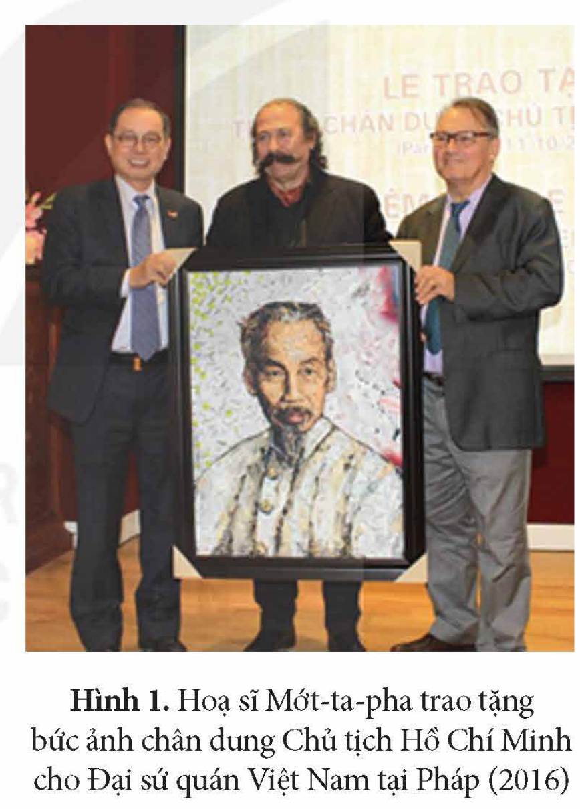
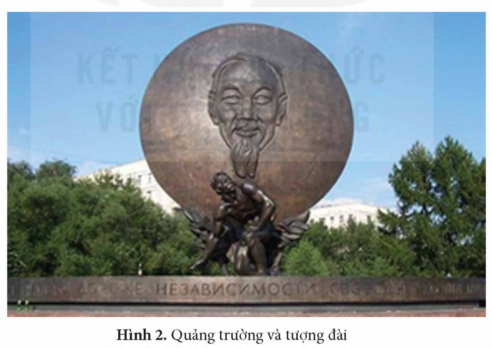
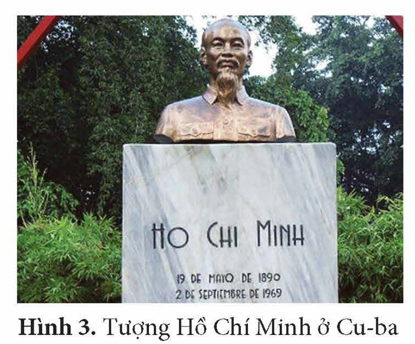
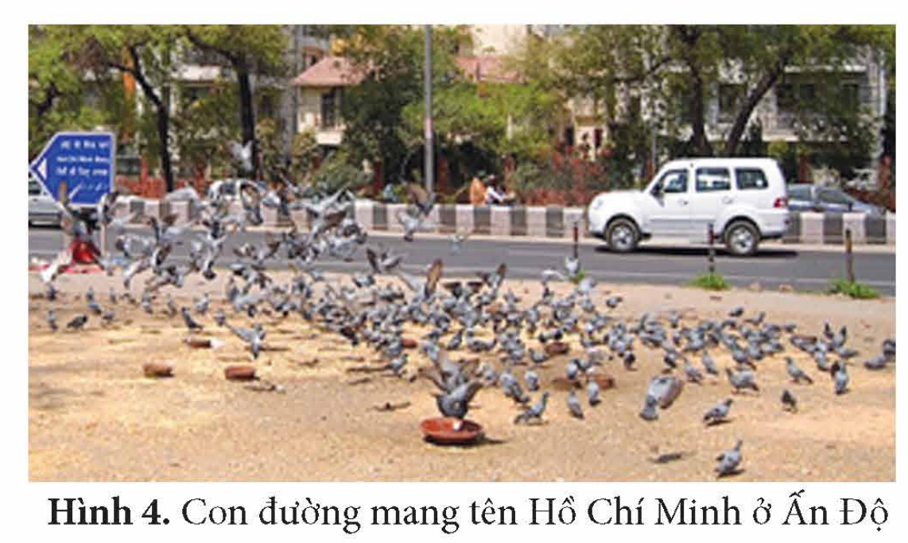
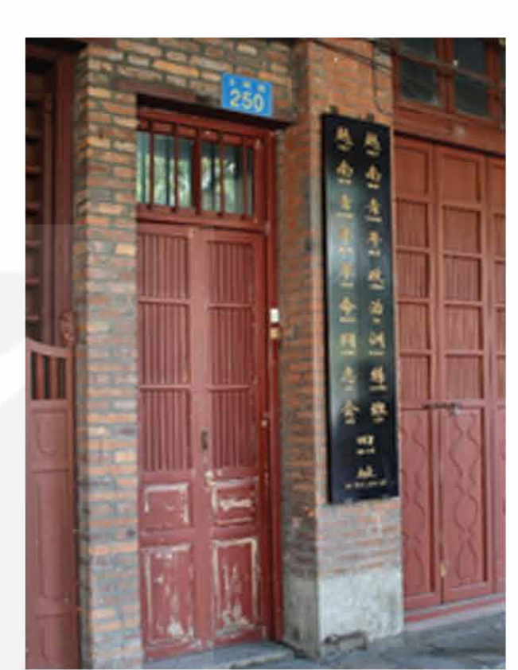
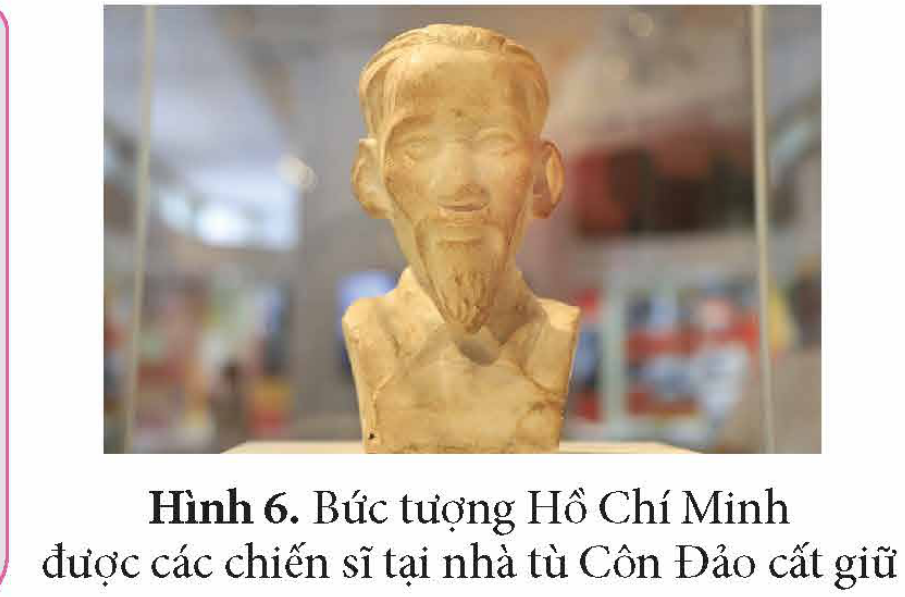
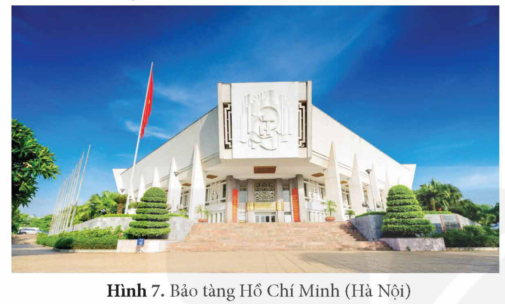
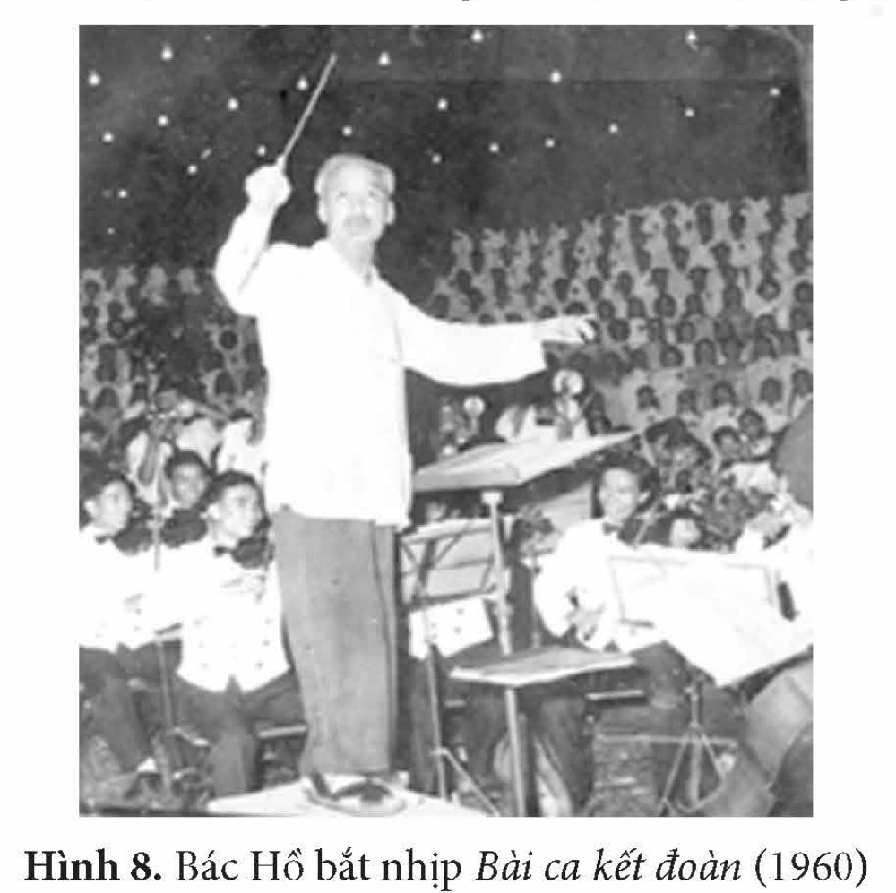

<!-- pdf:107 -->

# BÀI 17: DẤU ẤN HỒ CHÍ MINH TRONG LÒNG NHÂN DÂN THẾ GIỚI VÀ VIỆT NAM

## 🎯 Học xong bài này, em sẽ:

- Nêu được nguyên nhân nhân dân thế giới đánh giá cao những cống hiến và giá trị tư tưởng, văn hoá của Chủ tịch Hồ Chí Minh.
- Nêu được nguyên nhân Chủ tịch Hồ Chí Minh sống mãi trong lòng dân tộc Việt Nam.
- Có ý thức trân trọng những cống hiến và giá trị tư tưởng, văn hoá của Chủ tịch Hồ Chí Minh, tích cực tham gia phong trào học tập và làm theo tư tưởng, đạo đức và phong cách Hồ Chí Minh.

## 🔴 Mở đầu

Hoạ sĩ Mớt-ta-pha (người Pháp) sau khi tìm hiểu về cuộc đời của Chủ tịch Hồ Chí Minh, đã rất cảm phục và quyết định tái hiện chân dung Người. Ông mong muốn thể hiện sức mạnh của đất nước Việt Nam qua hình ảnh Chủ tịch Hồ Chí Minh.

Câu chuyện của hoạ sĩ người Pháp như trên là một ví dụ cho thấy dấu ấn sâu đậm của Chủ tịch Hồ Chí Minh trong lòng nhân dân thế giới. Vì sao thế giới đánh giá cao những cống hiến và giá trị tư tưởng, văn hoá của Chủ tịch Hồ Chí Minh? Vì sao Chủ tịch Hồ Chí Minh “sống mãi” trong lòng dân tộc Việt Nam?

*Hình 1. Hoạ sĩ Mớt-ta-pha trao tặng bức ảnh chân dung Chủ tịch Hồ Chí Minh cho Đại sứ quán Việt Nam tại Pháp (2016)*

## 1. Chủ tịch Hồ Chí Minh trong lòng nhân dân thế giới

<!-- term: Nghị quyết 24C/18.6.5 của UNESCO -->
Tổ chức Giáo dục, Khoa học và Văn hoá của Liên hợp quốc (UNESCO) trong khoá họp lần thứ 24 tại Pa-ri (1987) đã thông qua Nghị quyết 24C/18.6.5 về Kỉ niệm ngày sinh của Chủ tịch Hồ Chí Minh. Nghị quyết ghi nhận năm 1990 sẽ đánh dấu 100 năm Kỉ niệm ngày sinh của Chủ tịch Hồ Chí Minh.

<!-- pdf:108 -->

<!-- term: Nghị quyết 24C/18.6.5 của UNESCO -->
> TƯ LIỆU 1. “... Chủ tịch Hồ Chí Minh, một biểu tượng xuất sắc về sự tự khẳng định dân tộc, đã cống hiến trọn đời mình cho sự nghiệp giải phóng dân tộc của nhân dân Việt Nam, góp phần vào cuộc đấu tranh chung của các dân tộc vì hoà bình, độc lập dân tộc, dân chủ và tiến bộ xã hội.
>
> Nhận thấy những đóng góp quan trọng và nhiều mặt của Chủ tịch Hồ Chí Minh trên các lĩnh vực văn hoá, giáo dục, nghệ thuật chính là sự kết tinh của truyền thống văn hoá hàng nghìn năm của dân tộc Việt Nam và những tư tưởng của Người là hiện thân của những khát vọng của các dân tộc mong muốn được khẳng định bản sắc văn hoá của mình...”.
>
> *(Tập biên bản của Đại hội đồng UNESCO, trích trong UNESCO với sự kiện tôn vinh Chủ tịch Hồ Chí Minh, NXB Chính trị quốc gia, 2014, tr. 72 – 73)*

Hiện nay, tượng và tượng đài tưởng niệm Chủ tịch Hồ Chí Minh đã có mặt tại nhiều quốc gia trên thế giới như: Lào, Phi-líp-pin, Thái Lan, Xin-ga-po, Ấn Độ, Mông Cổ (châu Á); Hung-ga-ri, Nga, Pháp (châu Âu); Ác-hen-ti-na, Chi-lê, Cu-ba, Mê-hi-cô, Pa-na-ma (châu Mỹ);...

> 💡 EM CÓ BIẾT ?

> Năm 1923, nhà báo Ô-xíp Man-đen-xtam gặp Chủ tịch Hồ Chí Minh (lúc đó là Nguyễn Ái Quốc). Ông viết bài *Thăm một chiến sĩ cộng sản quốc tế* đăng trên tạp chí *Ngọn lửa nhỏ*, trong đó có nhận xét: “Trong giọng nói trầm ấm của Nguyễn Ái Quốc, chúng ta như nghe thấy ngày mai, như thấy sự yên tĩnh mênh mông của tình hữu ái toàn thế giới... Nguyễn Ái Quốc cũng đang toả ra một cái gì thật lịch thiệp và tế nhị... Từ Nguyễn Ái Quốc đã toả ra một thứ văn hoá, không phải văn hoá Âu châu, mà có lẽ là một nền văn hoá tương lai.”

*Hình 2. Quảng trường và tượng đài Chủ tịch Hồ Chí Minh tại Liên bang Nga*

Tên của Chủ tịch Hồ Chí Minh cũng đã được đặt cho nhiều quảng trường, trường học và đường phố,... tại nhiều quốc gia trên thế giới, từ châu Á, châu Âu đến châu Phi, châu Mỹ.

<!-- pdf:109 -->

*Hình 3. Tượng Hồ Chí Minh ở Cu-ba*

*Hình 4. Con đường mang tên Hồ Chí Minh ở Ấn Độ*

Tại một số quốc gia, nơi Chủ tịch Hồ Chí Minh từng đến và hoạt động đều có những công trình di tích tưởng niệm như: Khách sạn Ca-tơn (Anh) – nơi Chủ tịch Hồ Chí Minh làm việc và hoạt động cuối năm 1913; Nhà số 9, Thủ đô Pa-ri (Pháp) – nơi Người ở và hoạt động cách mạng những năm 1921 – 1923; Nhà số 248 và 250 (trước là nhà số 13 và 13/1) đường Văn Minh, thành phố Quảng Châu (Trung Quốc) – nơi Hồ Chí Minh mở các lớp đào tạo cán bộ (1925 – 1927); Khu di tích Hồ Chí Minh tại Liễu Châu, Quảng Tây (Trung Quốc),...

*Hình 5. Căn nhà số 13 (nay là 248 – 250) đường Văn Minh, thành phố Quảng Châu*

> ❓ 1. Khai thác thông tin và Tư liệu 1 trong mục, cho biết vì sao UNESCO và nhân dân thế giới đánh giá cao những cống hiến và giá trị tư tưởng, văn hoá của Chủ tịch Hồ Chí Minh?
>
> 2. Nêu một vài ví dụ về dấu ấn của Chủ tịch Hồ Chí Minh trong lòng nhân dân thế giới.

## 2. Hồ Chí Minh “sống mãi” trong lòng nhân dân Việt Nam

Chủ tịch Hồ Chí Minh đã cống hiến trọn đời cho độc lập dân tộc, tự do và hạnh phúc của nhân dân. Người là nhà cách mạng, nhà văn hoá lớn với những đóng góp trên nhiều lĩnh vực. Cuộc đời của Người cũng là tấm gương đạo đức lớn với phong cách cá nhân độc đáo. Vì vậy, mỗi người Việt Nam đều yêu quý, kính trọng và biết ơn Chủ tịch Hồ Chí Minh.

> 💡 EM CÓ BIẾT ?

> Bức tượng Chủ tịch Hồ Chí Minh được các chiến sĩ cách mạng bí mật mang ra nhà tù Côn Đảo. Giám ngục đã phát hiện ra bức tượng, ông rất ngạc nhiên, thán phục tình cảm và niềm tin tưởng tuyệt đối của những người tù cộng sản dành cho Chủ tịch Hồ Chí Minh nên không giao nộp mà giữ lại như một kỉ niệm. Trước khi qua đời, ông giao lại bức tượng cho con trai. Năm 2019, con trai ông đã trao tặng bức tượng cho Đại sứ quán Pháp tại Việt Nam.

*Hình 6. Bức tượng Hồ Chí Minh được các chiến sĩ tại nhà tù Côn Đảo cất giữ*

<!-- pdf:110 -->

<!-- term: Bảo tàng Hồ Chí Minh -->
Sau khi Chủ tịch Hồ Chí Minh qua đời, theo nguyện vọng của nhân dân cả nước, Lăng Chủ tịch Hồ Chí Minh và Bảo tàng Hồ Chí Minh đã được xây dựng. Đến nay, hệ thống bảo tàng và di tích lưu niệm Chủ tịch Hồ Chí Minh đã phát triển với 14 chi nhánh trong cả nước.

Ngoài hệ thống bảo tàng, di tích lưu niệm do Nhà nước quản lí, nhân dân đã lập đền thờ Chủ tịch Hồ Chí Minh ở nhiều nơi trong cả nước.

*Hình 7. Bảo tàng Hồ Chí Minh (Hà Nội)*

> 💡 EM CÓ BIẾT ?

<!-- term: Đường Hồ Chí Minh trên biển -->
> Trong cuộc kháng chiến chống Mỹ, cứu nước, tuyến đường chi viện chiến lược trên biển mang tên Chủ tịch Hồ Chí Minh là con đường huyền thoại, biểu tượng cho khát vọng độc lập, tự do và thống nhất Tổ quốc. Tuyến đường này đã kết nối hậu phương lớn miền Bắc với tiền tuyến lớn miền Nam, vận chuyển kịp thời, hiệu quả vũ khí và lực lượng, góp phần quan trọng vào Đại thắng Xuân năm 1975.

<!-- term: Thành phố Hồ Chí Minh -->
Sau khi đất nước thống nhất, năm 1976, Quốc hội khoá VI đã quyết định đổi tên thành phố Sài Gòn thành Thành phố Hồ Chí Minh. Trong nghị quyết về việc đặt tên, Quốc hội đã nêu rõ: “Xét rằng, nhân dân Thành phố Sài Gòn – Gia Định luôn luôn tỏ lòng kính yêu vô hạn đối với Chủ tịch Hồ Chí Minh và tha thiết với việc thành phố mang tên Người”.

Chủ tịch Hồ Chí Minh là hiện thân của sự kế thừa, kết tinh, phát triển và nâng cao các giá trị văn hoá dân tộc và nhân loại. Vì vậy, Chủ tịch Hồ Chí Minh đã trở thành nguồn cảm hứng sáng tác, đưa đến sự ra đời của nhiều tác phẩm âm nhạc, thơ ca, kịch, nhiếp ảnh, hội hoạ,... ở trong nước và trên thế giới.

*Hình 8. Bác Hồ bắt nhịp Bài ca kết đoàn (1960)*

> 📌 KẾT NỐI VỚI VĂN HỌC
>
> *Người là Cha, là Bác, là Anh*
> *Quả tim lớn lọc trăm dòng máu nhỏ.*
> *(Sáng tháng Năm, Tố Hữu)*
>
> *Người không con mà có triệu con*
> *Nhân dân ta gọi Người là Bác*
> *Cả đời Người là của nước non.*
> *(Quê hương Việt Bắc, Nguyễn Đình Thi)*

<!-- pdf:111 -->

Tư tưởng, đạo đức, phong cách của Chủ tịch Hồ Chí Minh đã trở thành tài sản tinh thần vô giá của Đảng Cộng sản Việt Nam và toàn dân tộc.

> TƯ LIỆU 2. “Chủ tịch Hồ Chí Minh đã để lại cho chúng ta một di sản vô giá về tư tưởng, đạo đức và tác phong. Chúng ta phải ra sức nghiên cứu, học tập để vận dụng đầy đủ trong việc định ra đường lối, chính sách của Đảng, trong hoạt động của Nhà nước, trong nhận thức và hành động của cán bộ, đảng viên và các tầng lớp nhân dân.”
>
> *(Trường Chinh, Chủ tịch Hồ Chí Minh và cách mạng Việt Nam, NXB Thông tin lí luận, 1991, tr. 191)*

<!-- term: Tư tưởng, đạo đức, phong cách Hồ Chí Minh -->
Ngày 7 – 11 – 2006, Bộ Chính trị Đảng Cộng sản Việt Nam khoá X ban hành Chỉ thị 06-CT/TW về tổ chức Cuộc vận động “Học tập và làm theo tấm gương đạo đức Hồ Chí Minh”. Ngày 15 – 5 – 2016, Bộ Chính trị ban hành Chỉ thị 05-CT/TW về “đẩy mạnh học tập và làm theo tư tưởng, đạo đức, phong cách Hồ Chí Minh”. Đến nay, cuộc vận động đã và đang được lan toả đến các thế hệ cán bộ đảng viên và quần chúng nhân dân.

> ❓ 1. Vì sao Chủ tịch Hồ Chí Minh “sống mãi” trong lòng nhân dân Việt Nam?
>
> 2. Khai thác thông tin và Tư liệu 2 trong mục, hãy nêu những dấu ấn của Chủ tịch Hồ Chí Minh trong lòng nhân dân Việt Nam.

## ✏️ Luyện tập và vận dụng

1. “Cuộc đời 79 mùa Xuân của Chủ tịch Hồ Chí Minh là biểu tượng cao đẹp nhất của chủ nghĩa yêu nước và chủ nghĩa anh hùng cách mạng Việt Nam. Người là kết tinh rạng ngời của đạo đức, trí tuệ, khí phách, lương tri của dân tộc và thời đại.”
*(Diễn văn của Tổng Bí thư, Chủ tịch nước Nguyễn Phú Trọng tại Lễ kỉ niệm 130 năm ngày sinh Chủ tịch Hồ Chí Minh)*
Trên cơ sở nhận định trên, hãy phân tích nguyên nhân nhân dân Việt Nam và bạn bè thế giới trân trọng, tưởng nhớ Chủ tịch Hồ Chí Minh.

2. Sưu tầm tư liệu từ sách, báo, internet về cuộc đời, tư tưởng và đạo đức Hồ Chí Minh, hãy viết một bài luận ngắn đề xuất các giải pháp để cuộc vận động “Học tập và làm theo tư tưởng, đạo đức và phong cách Hồ Chí Minh” thực sự có hiệu quả.

## 📷 Danh sách hình trong bài

| Mã hình | Trang PDF | Vị trí trong bài | Chú thích gốc |
| --- | --- | --- | --- |
| H12-lich_su-b17-01 | 107 | Mở đầu | Hình 1. Hoạ sĩ Mớt-ta-pha trao tặng bức ảnh chân dung Chủ tịch Hồ Chí Minh cho Đại sứ quán Việt Nam tại Pháp (2016) |
| H12-lich_su-b17-02 | 108 | Mục 1 | Hình 2. Quảng trường và tượng đài Chủ tịch Hồ Chí Minh tại Liên bang Nga |
| H12-lich_su-b17-03 | 109 | Mục 1 | Hình 3. Tượng Hồ Chí Minh ở Cu-ba |
| H12-lich_su-b17-04 | 109 | Mục 1 | Hình 4. Con đường mang tên Hồ Chí Minh ở Ấn Độ |
| H12-lich_su-b17-05 | 109 | Mục 1 (chú thích đặt bên trái chân ảnh dưới cột văn bản) | Hình 5. Căn nhà số 13 (nay là 248 – 250) đường Văn Minh, thành phố Quảng Châu |
| H12-lich_su-b17-06 | 109 | Mục 2 (chú thích trải sang trái sát viền phải khung Em có biết) | Hình 6. Bức tượng Hồ Chí Minh được các chiến sĩ tại nhà tù Côn Đảo cất giữ |
| H12-lich_su-b17-07 | 110 | Mục 2 | Hình 7. Bảo tàng Hồ Chí Minh (Hà Nội) |
| H12-lich_su-b17-08 | 110 | Mục 2 | Hình 8. Bác Hồ bắt nhịp Bài ca kết đoàn (1960) |
