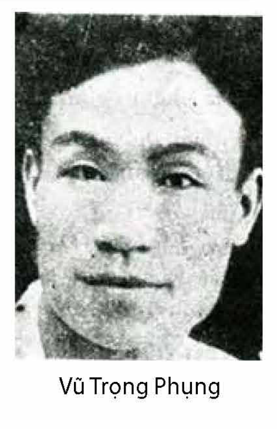
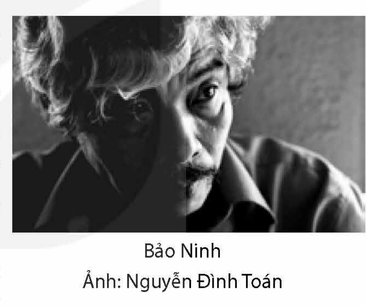

<!-- pdf:11 -->

# BÀI 1: KHẢ NĂNG LỚN LAO CỦA TIỂU THUYẾT

## 🎯 Yêu cầu cần đạt

- Nhận biết và phân tích được một số yếu tố của tiểu thuyết hiện đại như: ngôn ngữ, diễn biến tâm lí, hành động của nhân vật,...
- Phân tích được đề tài, câu chuyện, sự kiện, nhân vật, các chi tiết tiêu biểu và mối quan hệ của chúng trong tính chỉnh thể của tác phẩm tiểu thuyết; phân tích và đánh giá được sự phù hợp của người kể chuyện, điểm nhìn trong việc thể hiện chủ đề của văn bản.
- Nhận biết được những đặc điểm cơ bản của phong cách hiện thực trong tiểu thuyết và trong sáng tác văn học nói chung.
- Nhận biết và phân tích được đặc điểm, tác dụng của biện pháp tu từ nói mỉa, nghịch ngữ.
- Viết được bài văn nghị luận so sánh, đánh giá hai tác phẩm truyện.
- Biết trình bày (dưới hình thức nói) kết quả so sánh, đánh giá hai tác phẩm truyện.
- Biết xây dựng các chuẩn mực giá trị trong cuộc sống; hiểu và đồng cảm với những nỗi buồn thể hiện nhân tính và khát vọng hướng tới sự hoàn thiện của con người.

## ĐỌC

### TRI THỨC NGỮ VĂN

**Tiểu thuyết hiện đại**

**Tiểu thuyết** là loại tác phẩm tự sự quy mô lớn, có khả năng thể hiện các nội dung đa dạng và bao quát một phạm vi hiện thực rất rộng, trải ra trên nhiều không gian, thời gian khác nhau nhưng dành sự chú ý đặc biệt cho đời tư hay số phận của con người cá nhân. Từ những hình thái đầu tiên xuất hiện ở thời cổ đại, tiểu thuyết phát triển theo nhiều hướng khác nhau, tuỳ thuộc vào những tiền đề lịch sử, xã hội, văn hoá, thẩm mĩ nhất định. Đến thời cận đại, hiện đại, tiểu thuyết đạt được bước tiến lớn, trở thành một thể loại chính của đời sống văn học và tác động mạnh mẽ đến sự biến đổi, phát triển của nhiều thể loại khác.

**Tiểu thuyết hiện đại** là loại tiểu thuyết thể hiện một cách tư duy mới, mang tính hiện đại về đời sống, phân biệt với tiểu thuyết cổ điển ra đời trước thời đại tư bản chủ nghĩa. Trong tiểu thuyết hiện đại, giữa các xu hướng tìm tòi khác nhau có khoảng cách rất lớn. Điều này làm cho việc xác định diện mạo tiểu thuyết hiện đại trở nên phức tạp. Tuy nhiên, nếu tạm bỏ qua những nét quá đặc biệt của từng xu hướng, có thể nói đến các đặc điểm lớn sau của tiểu thuyết hiện đại:

<!-- pdf:12 -->

- Nhìn cuộc sống từ góc độ đời tư; quan tâm đến cái thường ngày, cái đang diễn biến với cách tiếp cận gần gũi; không lí tưởng hoá hiện thực.

<!-- term: con người nếm trải -->
- Nhân vật là “con người nếm trải”, không bất biến, có quá trình phát triển nhiều khi quanh co, phức tạp về tính cách, tâm lí.

- Có kết cấu nhiều tầng lớp tuyến tính hoặc phi tuyến tính; có sự đan xen của nhiều bè ngôn ngữ, phản ánh sự tồn tại, xung đột thường xuyên giữa các ý thức xã hội.

- Có khả năng tổng hợp cao mọi kinh nghiệm nghệ thuật của các thể loại văn học khác để hình thức luôn ở trong trạng thái biến đổi không ngừng.

**Phong cách hiện thực**

**Phong cách hiện thực** là phong cách nghệ thuật chú trọng thể hiện mối quan hệ giữa hoàn cảnh xã hội với sự hình thành tính cách con người, quan tâm miêu tả một cách chi tiết, “như thật” những hình ảnh phong phú, phức tạp của hiện thực cuộc sống, thường loại trừ sự “tô vẽ” hay lí tưởng hoá. Phong cách này có lịch sử phát triển lâu dài, tồn tại trong các sáng tác thuộc nhiều thể loại khác nhau của văn học, nghệ thuật như: thơ, truyện (bao gồm tiểu thuyết), kí, kịch, tác phẩm tạo hình,... Trong văn học, phong cách hiện thực đạt đến đỉnh cao với những sáng tác thuộc trường phái hiện thực mà các đại diện tiêu biểu là S. Đích-ken (Ch. Dickens – Anh), H. đờ Ban-dắc (H. de Balzac – Pháp), L. Tôn-xtôi (L. Tolstoy – Nga), Ph. Đốt-xtôi-ép-xki (F. Dostoyevsky – Nga), Lỗ Tấn (Trung Quốc),... Trong văn học Việt Nam nửa đầu thế kỉ XX, phong cách hiện thực gắn với tên tuổi và sáng tác của các nhà văn như Ngô Tất Tố, Nguyễn Công Hoan, Vũ Trọng Phụng, Nam Cao,... Phong cách hiện thực thường được đặt trong tương quan so sánh, đối lập với phong cách lãng mạn – một phong cách ưu tiên việc thể hiện cảm nhận chủ quan, đôi khi lí tưởng hoá đối tượng được đề cập và coi trọng sự tưởng tượng, liên tưởng phóng túng.

**Nói mỉa và nghịch ngữ**

**Nói mỉa** là biện pháp tu từ thể hiện thái độ mỉa mai hay sự đánh giá mang tính phủ định ngầm ẩn của người nói, người viết về sự vật, sự việc được đề cập.

Trong nói mỉa, người nói, người viết tạo ra sự mâu thuẫn cố ý giữa phần hiển ngôn và phần hàm ngôn của một lời nói hay của cả chuỗi phát ngôn. Phần hiển ngôn dường như thể hiện thái độ tán thành, khen ngợi hoặc trung lập, khách quan trước đối tượng được nói tới nhưng phần hàm ngôn lại cho biết một thái độ khác: phủ nhận (ở những mức độ khác nhau) hoặc dè bỉu. Nói mỉa chủ yếu được nhận ra nhờ hiệu quả châm biếm mà lời nói mang lại. Trong các yếu tố tạo nên nói mỉa có thể có nghịch ngữ.

**Nghịch ngữ** là biện pháp tu từ, ở đó, người nói, người viết dùng một cụm từ gây ấn tượng mạnh, làm nổi bật tính chất hai mặt của một tình thế, tâm trạng nào đó, hoặc làm phát lộ sự thật về đối tượng theo quan điểm của mình.

Nghĩa của nghịch ngữ đối lập với nghĩa của các cụm từ khác trong câu hoặc trong các câu khác gần kề, nhấn mạnh sự phát hiện mới hay cảm nhận, liên tưởng chủ quan của người nói, người viết về một đối tượng vốn có thể được nhìn nhận khác hẳn.

Nghịch ngữ thường xuất hiện trong nói mỉa. Ở những trường hợp đó, mỉa mai được nhìn nhận là mục đích của phát ngôn, còn nghịch ngữ được xem là phương tiện thực hiện mục đích này.

<!-- pdf:13 -->

### VĂN BẢN 1: Xuân Tóc Đỏ cứu quốc(*)
<!-- ocr-ok: nhãn VĂN BẢN 1 in nghiêng trên nền màu xanh bị OCR bỏ sót, đã đối chiếu ảnh trang PDF 13 -->

*(Trích Số đỏ)*

**Vũ Trọng Phụng**

- Khi nói về nhân vật văn học có thể gây cho độc giả sự chú ý, tò mò ngay từ cái tên, bạn nghĩ tới những nhân vật nào? Nêu nhận xét về ý nghĩa của việc đặt tên cho các nhân vật trong sáng tác văn học.
- Nêu những hiểu biết của bạn về tiếng cười trào phúng trong sáng tác văn học (đối tượng trào phúng, thủ pháp trào phúng, giọng điệu trào phúng,...).

Tuy giá vé vào cửa là ba đồng hạng bét, số công chúng sáng hôm sau ấy, cũng trên ba nghìn. Sân quần Rollandes Varreau(1) của Hà thành bữa ấy thật đã ghi được một chỗ rẽ ngoặt cho lịch sử thể thao. Người ta đồn rằng có rất nhiều người hâm mộ vì đến chậm, không mua được vé, bèn hoá ra phẫn uất và chết một cách rất thể thao, nghĩa là tự tử dần dần bằng thuốc phiện không có giấm thanh(2), hút vào phổi.

> Chú ý cách giới thiệu về sự kiện qua những chi tiết cụ thể và các yếu tố hé lộ giọng điệu trần thuật chính.

Cụ cố Hồng(3), ông Văn Minh(4), bà Phó Đoan(5), ông Typn(6) và nhiều người, đều đã chán nản lắm, vì bà Văn Minh đã đại bại về giải quần vợt phụ nữ bản xứ. Tuyết cố làm cho ông bố đỡ buồn, kêu rằng cái phần danh dự của gia đình cũng còn có cơ cứu chữa được, vì mọi người còn hi vọng vào Xuân.

> Câu văn này có thể gợi lên ấn tượng gì về nhân vật Xuân Tóc Đỏ?

> (\*) Nhan đề văn bản là một phần tên của chương XX trong tiểu thuyết *Số đỏ*: *Xuân Tóc Đỏ cứu quốc – Xuân Tóc Đỏ vĩ nhân – Nỗi buồn của ông bố vợ không bị đấm*.
> (1) *Rollandes Varreau*: đọc là Rô-lăng-đơ Va-rô; có bản in là *Rollandes Carreau* (Rô-lăng-đơ Ca-rô).
> (2) *Giấm thanh*: giấm gây bằng rượu và một số loại quả.
> (3) *Cụ cố Hồng*: nhân vật nhà giàu nổi tiếng ở đất Hà thành, bố cô Tuyết – người vợ sắp cưới của Xuân Tóc Đỏ.
> (4) *Ông Văn Minh*: nhân vật Tây học, con trai của cụ cố Hồng, là chủ tiệm may Âu hoá – nơi Xuân Tóc Đỏ “khởi nghiệp”.
> (5) *Bà Phó Đoan*: một goá phụ, từng có hai đời chồng (chồng trước là một ông Tây), là dì của vợ Văn Minh.
> (6) *Ông Typn*: hoạ sĩ chuyên vẽ mẫu y phục cho tiệm may Âu hoá của vợ chồng Văn Minh, tên đọc là Típ-phờ-nờ (viết tắt của câu *Tôi yêu phụ nữ*).

<!-- pdf:14 -->

Lúc ấy, trên sân quần có hai cô đầm đương tranh cái giải vô địch phụ nữ Pháp nên những người của hiệu Âu hoá đứng xem cũng không sốt sắng mấy.

Trên khán đài, ngồi giữa những vị quan chức văn võ cao cấp của ba chính phủ, công chúng thấy rõ, từ trái sang phải: quan Toàn quyền(1), quan Thống sứ(2), Đức vua nước nhà(3), S.M. Prajadophick(4) vua Xiêm(5). Tuy vận Âu phục, vua Xiêm cũng đội cái mũ bản xứ bằng kim ngân châu bảo(6), trông như một cái tháp cao, vì nó có đến chín tầng gác, cứ lên cao thì lại nhỏ lại, một thứ biểu tượng của cái nước một triệu con voi. Đằng sau nhà vua, một viên quan hầu Đức và một viên quan hầu Nhật tỏ rằng nước Xiêm đương tiến bộ mạnh mẽ trên đường tự lập. Việc nhà tài tử Luang Brabahol(7) cũng ngồi sau đấy (quán quân(8) quần vợt Xiêm La) tỏ rằng đấng thiếu quân(9) của đất nước triệu tượng(10) cũng sẵn lòng khuyến miễn(11) thể thao. Lại nữa, nếu ai tinh ý, thì cũng thấy rằng mấy ông trị sự Tổng cục thể thao Bắc Kì lúc ấy đương lo sốt vó, đương hoá điên hoá cuồng, vì giờ tranh đấu cái giải chung kết đã sắp đến rồi, mà vẫn chưa thấy mặt hai nhà quán quân cũ, Hải và Thụ(12), ở sân!

> Người kể chuyện đã miêu tả chân dung các nhân vật bằng giọng điệu như thế nào?

Làm thế nào bây giờ?

Tổng cục đã phái rất nhiều người sục sạo khắp bốn phương trời, để họ phải lục lọi cho ra hai cái ông quán quân bí mật ấy, nhưng vô hiệu quả! Chính gia đình của hai ông cũng kêu không biết hai ông đi đâu từ đêm

> Đoạn văn cho thấy điều gì về bản chất của cuộc bài binh bố trận được nhà nước thuộc địa triển khai trước một sự kiện chính trị quan trọng?

> (1) *Toàn quyền*: tức Toàn quyền Đông Dương, một chức vụ cao cấp của quan chức cai trị thuộc địa Pháp, đứng đầu Liên bang Đông Dương.
> (2) *Thống sứ*: tức Thống sứ Bắc Kì – chức vị được lập ra từ năm 1889 do người Pháp nắm giữ, nhằm đại diện quyền lợi của nước Pháp và điều hành việc cai trị ở xứ bảo hộ Bắc Kì (Việt Nam) dưới thời Pháp thuộc.
> (3) *Đức vua nước nhà*: tức là vua nhà Nguyễn, một vị vua phiếm chỉ, thời ở Việt Nam tồn tại chế độ thực dân nửa phong kiến.
> (4) *S.M. Prajadophick*: đọc là S.M. Pra-da-đô-phích.
> (5) *Xiêm*: cũng như Xiêm La, tên ngày trước người Việt thường dùng để chỉ Thái Lan (người, nước Thái Lan).
> (6) *Châu bảo*: như châu báu.
> (7) *Luang Brabahol*: đọc là Lu-ăng Bra-ba-ôn.
> (8) *Quán quân*: người chiếm giải Nhất trong một cuộc thi đấu.
> (9) *Thiếu quân*: vị vua trẻ.
> (10) *Triệu tượng*: triệu voi (*tượng* trong Hán ngữ nghĩa là voi).
> (11) *Khuyến miễn*: khuyên gắng sức, ở đây được hiểu là thái độ nâng đỡ, ủng hộ.
> (12) Hai nhân vật này đã bị Xuân Tóc Đỏ lừa đẩy vào tù, điều đó làm cho cơ hội ra sân thi đấu với quán quân quần vợt Xiêm La của Xuân Tóc Đỏ trở nên hiển nhiên.

<!-- pdf:15 -->

hôm trước... Làng thể thao nhốn nháo lên, kẻ ngạc nhiên sửng sốt, người lo sợ kinh hoàng. Không ai biết rằng lúc ấy, hai ngài vẫn còn nằm trên cái sàn lim có nhiều rệp ở căn phòng đề bô(1) của nhà Sécurité(2). Chính Sở Mật thám mà cũng lại không biết nốt, vì có bao nhiêu nhân viên đều chia nhau đi hộ giá(3) ngoài phố cả, người ta chưa có người và chưa đủ thì giờ xét căn cước và hỏi cung hai kẻ bị bắt kia nữa! Và Tổng cục kết luận rằng đó chính là một sự phá hoẵng(4), một cuộc phản trắc, một vố chơi xỏ lại Tổng cục, cũng như cái thói, cái thông bệnh(5) của những nhà thể thao có danh tiếng xưa nay. Sau cùng Tổng cục đành phải cứu chữa sự sai hẹn của mình trước công chúng, bằng cách mời nhà quán quân quần vợt Xiêm La ra thử tài với Xuân Tóc Đỏ.

Tiếng loa vừa vang lên xong, công chúng vỗ tay hoan nghênh tức khắc. Vì rằng tài nghệ của Hải, Thụ và Xuân, thì người ta đã nhiều lần được mục kích(6) rồi. Nhưng thiên hạ chưa ai được biết cái tài của Luang Brabahol, nhà quán quân Xiêm La! Công chúng Pháp – Nam lại còn được rất hài lòng vì cho rằng sự Tổng cục không đề cử Hải và Thụ mà chỉ bắt Xuân là một người chưa chiếm quán quân năm nào, thì đó chính là một cử động(7) kiêu ngạo rất kín đáo vậy. Cho nên ta không cần phải xét đến cái sung sướng của Văn Minh, ông bầu, khi ông này được ban trị sự của Tổng cục nói rằng người của ông được đại diện cho Hà thành để giữ cái danh dự cho Tổ quốc, trước nhà vô địch Xiêm.

> Lí do sự hài lòng của các đối tượng tham dự sự kiện đã được diễn tả như thế nào?

Công chúng luôn luôn vỗ tay hoan hô Xuân, còn trên khán đài, đức vua Xiêm đã lộ ra mặt rồng tất cả sự thịnh nộ của vị thiên tử thế thiên hành đạo(8) ở cái nước có hàng triệu con voi. Thật là một tiếng sét, vì sự thua kém của

> Sự cường điệu trong cách miêu tả phản ứng của vua Xiêm đem lại hiệu quả nghệ thuật gì?

> (1) *Đề bô*: phiên âm tiếng Việt của từ *dépôt* trong tiếng Pháp, chỉ nhà tạm giữ, tạm lưu.
> (2) *Sécurité*: từ tiếng Pháp trong nguyên văn, đọc là Xê-quy-ri-tê; chỉ Sở Liêm phóng hay Sở Mật thám – một cơ quan mật thám, tình báo và an ninh của chính quyền thực dân.
> (3) *Hộ giá*: đi theo để bảo vệ vua – chúa, ở đây dùng với nghĩa đi theo để bảo vệ các nhân vật quan trọng.
> (4) *Phá hoẵng*: như *phá bĩnh*, chỉ việc gây rối nhằm làm hỏng công việc hay cuộc vui của người khác.
> (5) *Thông bệnh*: bệnh (thói) phổ biến.
> (6) *Mục kích*: thấy tận mắt.
> (7) *Cử động*: như *cử chỉ* hay *hành động* (hiện nay, trong ngữ cảnh này, từ *cử động* thường được thay thế bằng từ *cử chỉ* hay *hành động*).
> (8) *Thế thiên hành đạo*: thành ngữ Hán Việt, chỉ việc thay trời (hay vâng theo mệnh trời) để thi hành việc đúng, việc nghĩa.

<!-- pdf:16 -->

tài tử Vọng Các(1) là rõ rệt quá, và ở séc(2) đầu, Xuân Hà thành được 6 – 1. Đức vua nước nhà, quan Toàn quyền và Thống sứ đều băn khoăn lắm, vì nếu Đông Pháp(3) nhân đó mà được danh tiếng về mặt thể thao thì, đổi lại, về mặt ngoại giao có thể rầy rà, lôi thôi. Than ôi! Đó là cái lợi hại thiên nhiên(4), đích đáng của mọi sự trên cái thế gian này! Đến séc thứ nhì, công chúng thấy Xuân đánh uể oải hình như chấp bên địch. Ông bầu Văn Minh rất lấy làm lo. Kết quả 5 – 7. Những người không nông nổi đều hiểu ngay đó là Xuân để dành sức.

Mấy giơ(5) đầu ở séc thứ ba tỏ rằng hai bên cùng gắng hết sức. Tuy Luang Brabahol đã trổ ra hết tài năng mà cũng không lấn át được Xuân. Đến lúc trọng tài hô 15 – 30, trông tài tử của mình đã nắm phần thua, vua Xiêm tức thì lôi trong túi áo ra cái bản đồ Ấn Độ Chi Na do chính phủ Xiêm vẽ lại, tức là bản đồ nước Xiêm cũ có bờ cõi ở núi Hoành Sơn(6)! Ngài ngắm nghía cái bản đồ mà không nhìn ra cuộc đấu nữa. Viên quan hầu Đức và viên quan hầu Nhật đều cùng ghé tâu một cách thì thào “La guerre! La guerre!(7)”.

Dưới sân, đám công chúng Pháp – Nam ngây thơ, vô lo vô lự, vẫn vỗ tay rầm rộ để ủng hộ Xuân. Viên trọng tài luôn miệng hô:

– Ca răng! Ca răng ta! A văng ta sê vít! A văng ta đờ o(8)!

Sự hồi hộp của mọi người là không thể tả được. Cho nên đám bách tính quần dân(9) kia không biết rằng giữa lúc ấy Đức vua nước nhà, quan Toàn quyền và quan Thống sứ đã đưa mắt nhìn nhau... Rồi ông Giám đốc chính trị Đông Dương sau khi tai nghe một hiệu lệnh của quan Toàn quyền, tức thì bỏ khán đài, chạy xuống sân đi tìm ông bầu của Xuân Tóc Đỏ. Văn Minh rất cảm động khi thấy vị thượng quan ấy của Chính phủ mời mình ra một chỗ vắng, hấp tấp rỉ tai đại khái như thế này:

> Các quan chức nhà nước có động thái gì nhằm cứu vãn tình hình? Các động thái đó mang tính chất khôi hài như thế nào?

> (1) *Vọng Các*: tên phiên âm Hán Việt của Băng-cốc (*Bangkok*), thủ đô nước Thái Lan (danh xưng này hiện ít dùng, trừ trường hợp người viết, người nói muốn thể hiện mục đích tu từ hay giễu nhại).
> (2) *Séc*: phiên âm tiếng Việt của từ *set* trong tiếng Pháp, chỉ đơn vị ván hay hiệp trong cuộc đấu thể thao thuộc các môn như quần vợt, bóng bàn, bóng chuyền,...
> (3) *Đông Pháp*: danh xưng xứ thuộc địa của thực dân Pháp ở Đông Dương (tên tiếng Pháp là *Indochine*).
> (4) *Cái lợi hại thiên nhiên*: cái lợi hại theo lẽ tất yếu (nghĩa trong văn bản).
> (5) *Giơ*: phiên âm tiếng Việt của từ *jeu* trong tiếng Pháp, chỉ một phần của ván hay hiệp ten-nít (quần vợt).
> (6) *Núi Hoành Sơn*: Đèo Ngang – ngọn đèo nằm ở ranh giới giữa hai tỉnh Hà Tĩnh và Quảng Bình.
> (7) *La guerre! La guerre!*: Chiến tranh! Chiến tranh! (Các câu tiếng Pháp trong nguyên văn, đọc là *La ghe-rơ! La ghe-rơ!*).
> (8) *Ca răng! Ca răng ta! A văng ta sê vít! A văng ta đờ o!*: Bốn mươi! Bốn mươi đều! Lợi thế giao bóng! Ra ngoài! (Trong nguyên bản, các câu này ghi phỏng âm tiếng Pháp).
> (9) *Bách tính quần dân*: chỉ quần chúng nhân dân đông đảo (*bách tính* là trăm họ).

<!-- pdf:17 -->

– Chính phủ Bảo hộ và chính phủ Nam triều cử bản chức(1) tới nhờ ngài một việc tối hệ trọng, có quan hệ mật thiết đến vận mệnh của đất nước. Nghĩa là bản chức yêu cầu ngài bảo tài tử(2) của ngài phải nhường, phải thua nhà vô địch Xiêm ngay đi! Tuy mất cái danh dự thắng cuộc, các ngài sẽ được Chính phủ bù cho bằng những cái khác một cách rất hậu hĩ!

Ông bầu Văn Minh còn đứng ngạc nhiên há hốc mồm ra, thì vị quan to lại tiếp luôn:

– Ngài cứ biết nghe đi đã! Cái việc này là rất khẩn cấp, cái thời giờ là rất ngắn ngủi! Nếu An Nam mà được Xiêm La về quần vợt thì thế nào cũng có nạn chiến tranh! Chính phủ Pháp chủ trương hoà bình, các ngài phải trông gương đó mà tránh cho bách tính lương dân(3) cái nạn núi xương, sông máu! Thôi, chốc nữa ta sẽ nói chuyện nhiều.

Bởi thế, giữa lúc công chúng reo ô reo a huyên náo cả một góc trời, giữa lúc viên trọng tài kêu Ca răng ca răng ta, đờ o séc vít thì thừa lúc Xuân Tóc Đỏ quay về với đứa trẻ nhặt bóng, ông bầu Văn Minh liền thất thanh khẽ bảo nó:

– Thua đi! Nhường đi! Được thì chết! Chiến tranh!

> Nhịp điệu trần thuật ở đoạn này có gì đáng chú ý?

Công chúng đương hồi hộp vì 7 – 7, 7 – 8, đương mong giữ cho Hà thành thì sự không ngờ, quả cuối cùng mà Xuân lốp(4) một cái sang bên địch, lại bắn bổng lên không khí rồi rơi vào hàng rào găng! Kết quả thảm khốc 7 – 9 ấy làm cho mấy nghìn con người la ó rầm rĩ để tỏ sự thất vọng công cộng. Nhưng... một hồi kèn La Marseillaise(5) đã nổi lên mừng nhà vô địch Xiêm La, và kết liễu cuộc vui, và để các đức vua và các quý quan của ba chính phủ về Sở Toàn quyền.

Khi đoàn xe hơi có cờ lần lượt đi rồi, công chúng còn đứng lại, đông nghìn nghịt, tốp này định chia buồn với Xuân, tốp kia định trách cứ Xuân. Lại có đám người hô đả đảo Xuân Tóc Đỏ nữa. Cụ Hồng, Tuyết, bà Phó Đoan, bà Văn Minh lúc ấy thất vọng vô cùng. Những nhà chụp ảnh vây quanh Xuân để chụp ảnh. Những ông phóng viên các báo định họp nhau chất vấn cái thái độ của Xuân, vì mọi người rất lấy làm ngờ vực cái giơ cuối cùng. Quả banh ấy có phải là để nhường nhịn không? Sao tài tử Xuân, giáo sư quần vợt, mà lại đến nỗi... quốc sỉ(6) như thế? Chỗ này, chỗ kia, thấy những lời hò hét vang lên:

> (1) *Bản chức*: từ quan lại dùng để tự xưng khi nói với cấp dưới, với dân.
> (2) *Tài tử*: người có tài (thường chỉ đối tượng nam giới), diễn viên có tài hoặc người giỏi một môn thể thao hay văn nghệ nhất định nhưng không xác định đó là lĩnh vực chuyên nghiệp của mình; trong văn bản, từ *tài tử* được dùng với tất cả các nghĩa trên.
> (3) *Lương dân*: người dân lương thiện.
> (4) *Lốp*: phỏng âm từ *lob* trong tiếng Anh, chỉ kĩ thuật bấm bóng hay đánh bóng bổng trong các môn thể thao như quần vợt, bóng đá.
> (5) *La Marseillaise*: tên quốc ca của nước Pháp, đọc là *La Mác-xây-e*.
> (6) *Quốc sỉ*: nỗi sỉ nhục của quốc gia.

<!-- pdf:18 -->

– Quốc sỉ! Về nhà bò! Đi về nhà bò!

Có một vài người Pháp cũng kêu to:

– A bas Xuân! A bas Xuân! Des explications!(1)

> Bạn có liên tưởng gì đến thực tế thường diễn ra sau một sự kiện thể thao hay văn hoá mà bạn được biết?

Thấy ở tình thế hiểm nghèo, ông bầu Văn Minh bèn cùng Xuân Tóc Đỏ trèo lên nóc cái xe hơi của bà Phó Đoan, rồi Xuân Tóc Đỏ cứ việc lắng nghe ông bầu của nó nhắc mà diễn thuyết trước cái đám công chúng mấy nghìn người hung hăng ấy. Nhưng ông bầu lúc ấy đã say sưa về cái việc hệ trọng của mình lắm, bèn nói trước đã:

– Xuân thua không phải bởi vô tài! Chắc thiên hạ đã mục kích rất rõ. Vậy xin thiên hạ hãy bình tĩnh nghe tại sao người của tôi lại phải thua.

Nói xong, ông lại thấy mình và Xuân là to. Cho nên công chúng thấy Xuân Tóc Đỏ có cái giọng trịch thượng của một bậc vĩ nhân như thế này:

– Hỡi công chúng! Mi chưa hiểu rõ những lẽ cực kì to tát nó khiến ta phải đành nhường giải cho nhà vô địch Xiêm La! Quân chúng nông nổi ơi! Mi đã biết đâu cái lòng hi sinh cao thượng vô cùng, (nó vỗ vào ngực) nó khiến ta phải từ chối danh vọng riêng của ta đi, để góp một phần vào việc tiến bộ trong trật tự và hoà bình của Tổ quốc! Giữa cái giờ rất nghiêm trọng này, điều cốt yếu của người xả thân cứu nước không phải là chỉ nghĩ đến mình, nghĩa là không phải là cốt được một ván đánh quần(2), nhưng mà là cốt giữ cái mối thiện cảm của một nước lân bang (nó đấm tay xuống không khí)! Chính phủ Pháp cũng như toàn thể quốc dân Pháp đã bao nhiêu năm nay, vẫn chủ trương và cố duy trì nền hoà bình cho thế giới! Nếu vô tình mà gây hấn, nếu thí dụ có cuộc Việt – Xiêm xung đột, thì cái phần thắng hay bại tuy chưa ai biết, nhưng mà điều chắc chắn, là nó sẽ lôi cuốn cái thế giới vào nạn can qua(3)! Cho nên ngày hôm nay, ta tỉ thí(4) không phải để tranh nhau cái thua, được ở một quả quần. Ta chỉ phụng sự công cuộc ngoại giao của Chính phủ mà thôi! Ta (nó giơ cao tay lên) không muốn cho hàng vạn mạng người làm mồi cho binh đao, mắc lừa bọn buôn súng! (nó đập tay xuống). Hỡi quần chúng! Mi không hiểu gì, mi oán ta! Ta vẫn yêu quý mi mặc lòng mi chẳng rõ lòng ta!... Thôi giải tán đi, và cứ việc an cư lạc nghiệp trong hoà bình và

> Cách xưng hô của nhân vật Xuân Tóc Đỏ có gì đáng chú ý?

> Những ghi chú được đặt trong ngoặc đơn có ý nghĩa nghệ thuật như thế nào?

> (1) *A bas Xuân! A bas Xuân! Des explications!*: Đả đảo Xuân! Đả đảo Xuân! Phải giải thích việc này! (Các câu tiếng Pháp trong nguyên văn, đọc là *A ba Xuân! A ba Xuân! Đê dít-xơ-pli-ca-xi-ông*).
> (2) *Ván đánh quần*: ván quần vợt.
> (3) *Can qua*: chiến tranh (*can* là cái mộc, *qua* là giáo – những binh khí thông dụng trong các cuộc chiến tranh thời xưa).
> (4) *Tỉ thí*: thi đấu, so đọ cao thấp.

<!-- pdf:19 -->

trật tự! Ta không dám tự phụ là bậc anh hùng cứu quốc, nhưng ta phải tránh cho mi nạn chiến tranh rồi! Hoà bình vạn tuế! Hội Quốc liên(1) vạn tuế!

Với cái hùng biện của một người đã thổi loa cho những hiệu thuốc lậu, với cái tự nhiên của một anh lính cờ chạy hiệu rạp hát, lại được ông Văn Minh vặn đĩa kèn(2), Xuân Tóc Đỏ đã chinh phục quần chúng như một nhà chính trị đại tài của Tây phương. Mấy nghìn người bị gọi là mi, không những đã chẳng tức giận chút nào, lại còn vô cùng cảm phục, cho rằng người ta “phải thế nào” người ta mới dám ngôn luận tự do như thế! Cho nên Xuân Tóc Đỏ diễn thuyết vừa xong, tiếng vỗ tay của nhân dân ran lên như mưa rào! Một lần nữa, cái đạo binh(3) các ông thợ ảnh lại xông đến gần nó... Thế rồi, ở chỗ này, thiên hạ sốt sắng hoan hô:

> Có thể dùng những từ ngữ gì để khái quát về tính chất phản ứng của đám đông được thể hiện qua đoạn này?

– Xuân Tóc Đỏ vạn tuế! Sự đại bại vạn tuế!

Như một bậc vĩ nhân nhũn nhặn, nó giơ quả đấm chào loài người, nhảy xuống đất, lên xe hơi. Rồi mấy chiếc xe của các bạn thân của nó mở máy chạy, để lại cái đám công chúng mấy nghìn người bùi ngùi và cảm động.

(Vũ Trọng Phụng, *Số đỏ*, NXB Văn học, Hà Nội, 1988, tr. 187 – 193)

Vũ Trọng Phụng

**Vũ Trọng Phụng** (1912 – 1939) quê ở tỉnh Hưng Yên nhưng sinh ra và sống chủ yếu ở Hà Nội. Ông bước vào làng báo, làng văn từ rất sớm (bắt đầu có truyện đăng báo từ năm 1930), dùng ngòi bút để kiếm sống và chống chọi một cách khó khăn với tình cảnh nghèo túng, bệnh tật triền miên. Trong vòng chưa đầy mười năm hoạt động ở chốn trường văn trận bút, ông đã để lại một khối lượng sáng tác khá lớn, thuộc nhiều thể loại, trong đó nổi bật là phóng sự và tiểu thuyết: *Cạm bẫy người* (phóng sự, 1933), *Kĩ nghệ lấy Tây* (phóng sự, 1934), *Cơm thầy cơm cô* (phóng sự, 1936), *Giông tố* (tiểu thuyết, 1936), *Số đỏ* (tiểu thuyết, 1936), *Vỡ đê* (tiểu thuyết, 1936), *Lấy nhau vì tình* (tiểu thuyết, 1937), *Trúng số độc đắc* (tiểu thuyết, 1938),...

Tác phẩm của Vũ Trọng Phụng, từ các bài báo, tiểu phẩm đến kịch, phóng sự, truyện ngắn, tiểu thuyết,... đều toát lên sự khinh bỉ sâu sắc cái xã hội đương thời mà ông nhìn nhận là đen tối, thối nát. Cảm hứng vạch trần sự thật luôn chi phối ngòi bút của ông. Bằng phong cách nghệ thuật độc đáo, ông đã xây dựng được những hình tượng nhân vật sắc nét, vừa mang tính đặc thù của một thời đại cụ thể, vừa thể hiện rõ bản chất một số trạng huống tồn tại phổ quát của cuộc sống.

Tiểu thuyết ***Số đỏ*** ra mắt độc giả lần đầu tiên trên *Hà Nội báo*, được in nhiều kì (nhưng chưa trọn vẹn), bắt đầu từ số 40 (7/10/1936). Đến năm 1938, tác phẩm được in thành sách tại Nhà in Lê Cường, Hà Nội. Từ đó đến nay, *Số đỏ* (gồm 20 chương) đã được in lại nhiều lần với một số khác biệt về từ ngữ,

> (1) *Hội Quốc liên*: một tổ chức liên chính phủ, thành lập năm 1920, tiền thân của tổ chức Liên hợp quốc.
> (2) *Vặn đĩa kèn*: ý nói nhân vật Văn Minh mớm lời cho Xuân Tóc Đỏ, như bật một đĩa hát.
> (3) *Đạo binh*: toán quân, ở đây dùng với nghĩa hài hước.

<!-- pdf:20 -->

chi tiết, chính tả,... do được khai thác từ các nguồn văn bản khác nhau. Đây là tác phẩm đỉnh cao trong văn nghiệp của Vũ Trọng Phụng và có vị trí quan trọng trong nền tiểu thuyết Việt Nam hiện đại.

Nhân vật chính của tác phẩm là Xuân, biệt danh là Xuân Tóc Đỏ. Từ một đứa trẻ mồ côi, lêu lổng, lang thang, đã trải qua đủ “nghề” thường được xem là “mạt hạng”, Xuân Tóc Đỏ dần bước chân vào xã hội “thượng lưu” nhờ sự nâng đỡ đầy toan tính của bà Phó Đoan – một me Tây(1) dâm đãng. Đầu tiên, Xuân Tóc Đỏ đến làm việc ở tiệm may Âu hoá. Hắn được vợ chồng Văn Minh và những người trong gia đình này hoặc vô tình hoặc cố ý tôn lên làm “nhà cải cách xã hội”, “đốc tờ Xuân”, “giáo sư quần vợt”,... Với đủ danh hiệu “vẻ vang” ấy và với sự láu lỉnh, cơ hội cố hữu, Xuân Tóc Đỏ khiến cô Tuyết say mê và được nhiều nhân vật khác sợ hãi, nể trọng, nhờ cậy, ghi ơn. Xuân Tóc Đỏ đạt đến vinh quang tột đỉnh vào thời điểm vua nước Xiêm sang thăm Việt Nam(2) nhằm thắt chặt quan hệ hữu nghị giữa hai quốc gia, giữa bối cảnh nền chính trị thế giới đang có những biến động khó lường. Với “thành tích” để thua quán quân quần vợt người Xiêm trong trận thi đấu thể thao mang tính ngoại giao, Xuân Tóc Đỏ được tung hô là “vĩ nhân”, “anh hùng cứu quốc” và tiếp tục được một số tổ chức danh giá chào đón, mời làm thành viên danh dự.

***Xuân Tóc Đỏ cứu quốc*** là đoạn trích nửa đầu chương XX – chương cuối cùng của tác phẩm *Số đỏ*.

1. Tóm tắt các sự việc chính được kể trong đoạn trích *Xuân Tóc Đỏ cứu quốc* bằng một sơ đồ phù hợp.
2. Xác định ngôi kể, điểm nhìn đã được nhà văn lựa chọn và ý nghĩa của ngôi kể, điểm nhìn ấy trong việc làm sáng tỏ bản chất hiện thực theo khám phá và quan niệm của ông.
3. Theo bạn, tình huống nào đóng vai trò quan trọng nhất trong việc tạo nên kịch tính và bước ngoặt của toàn bộ sự kiện được kể trong đoạn trích? Hãy phân tích tính chất của tình huống đó.
4. Phân tích nét đặc sắc của cảnh Xuân Tóc Đỏ hùng biện trước công chúng. Những ghi chú được đặt trong ngoặc đơn của người kể chuyện gợi cho bạn liên tưởng đến thể loại văn học nào có đặc điểm hình thức tương tự?
5. Nêu nhận xét khái quát về sự tương đồng và khác biệt giữa ngôn ngữ của người kể chuyện và ngôn ngữ nhân vật ở đoạn trích *Xuân Tóc Đỏ cứu quốc*.
6. Tìm những câu văn có sử dụng biện pháp tu từ nói mỉa và nghịch ngữ trong văn bản.
7. Đoạn trích đã cho thấy điều gì về phong cách hiện thực của nhà tiểu thuyết Vũ Trọng Phụng? Nêu một số thủ pháp được nhà văn sử dụng để tăng cường khả năng bao quát hiện thực cho các trang viết của mình.
8. Bạn suy nghĩ gì về trạng thái bị thôi miên và lên đồng của một xã hội, như thực tế được miêu tả trong đoạn trích?

#### Kết nối đọc – viết

Viết đoạn văn (khoảng 150 chữ) nêu ấn tượng của bạn về khả năng của tiểu thuyết trong việc diễn tả bức tranh đời sống, thời đại qua học đoạn trích *Xuân Tóc Đỏ cứu quốc*.

> (1) *Me Tây*: danh xưng xuất hiện thời Pháp thuộc, có hàm ý khinh miệt, chỉ người đàn bà Việt lấy chồng người Âu – Phi.
> (2) Đây là một sự kiện do nhà văn hư cấu, không phải sự thật lịch sử.

<!-- pdf:21 -->

### VĂN BẢN 2: Nỗi buồn chiến tranh(*)
<!-- ocr-ok: nhãn VĂN BẢN 2 in nghiêng trên nền màu xanh bị OCR bỏ sót và chữ Nỗi buồn đọc nhầm thành Nôi buôn, đã đối chiếu ảnh trang PDF 21 -->

*(Trích)*

**Bảo Ninh**

- “Chiến tranh” – hai tiếng ấy gợi cho bạn những ấn tượng, suy nghĩ gì? Nêu một số kênh thông tin đã đưa lại cho bạn những hiểu biết nhất định về chiến tranh.
- Bạn đã học, đã đọc những tác phẩm văn học nào viết về đề tài chiến tranh? Nêu ấn tượng nổi bật của bạn về một trong số những tác phẩm ấy.

**1.** Nhưng cho đến tận bây giờ và có thể là mãi mãi, Kiên cũng không thể cắt nghĩa được vì sao mà vào cái đêm lạnh giá ấy, đứng trước cửa sổ nhìn màn mưa mỏng đang chầm chậm tràn ngang qua bầu không khí xanh xám run rẩy, uốn ngả theo chiều gió đông bắc, lòng đăm đắm nhớ tới Phương, anh lại chợt nhìn thấy mùa mưa Cánh Bắc, nhìn thấy Ngọc Bơ Rây, truông Gọi Hồn. Vì sao? Vì sao lại gương mặt của từng anh em trong trung đội hiện lên. Và phép mầu nào ngay sau đó đã đẩy lùi thời gian về xa hơn, dựng lại trước mắt anh trận đánh ghê rợn đã xoá sổ tiểu đoàn 27 của anh? Không khí trong căn phòng này khi đấy thật kì lạ, như thể bị hút vào trường hấp dẫn của quá khứ: cùng rung lên, xô giật, đập thình thịch vì sóng xung kích của hàng trăm trái đạn pháo dội cấp tập xuống lòng truông Gọi Hồn. Và tường vách căn phòng rầm rầm run lên trong tiếng động cơ máy bay bổ nhào. Kiên giật mình bật lùi khỏi cửa sổ.

> Yếu tố ngoại cảnh nào đã góp phần làm sống dậy kí ức chiến tranh của nhân vật Kiên?

Hồn phách xiêu lạc, ý thức mờ mịt, lú lẫn, mê mẩn Kiên đi đi lại lại, kí ức loé chớp. Loạng choạng ngồi xuống bên bàn, một cách máy móc anh cầm lấy bút và thay vì viết thư, anh viết một cái gì hoàn toàn khác.

> Kiên đã sống trong trạng thái như thế nào khi bị kí ức chiến tranh khuấy đảo?

Suốt đêm ấy, đến sáng, giữa mớ đồ đạc và bàn ghế tồi tàn, giữa bốn bức tường tróc lở, những sách những báo chồng đống trên sàn nhà bụi bặm, nứt nẻ, những vỏ chai lăn lóc, cái tủ đầy gián, chiếc giường xiêu vẹo bừa bãi chăn màn xơ xác anh đã

> (\*) Do dung lượng giới hạn của sách giáo khoa, một số đoạn ngắn trong nguyên văn đã được lược bớt.

<!-- pdf:22 -->

viết một mạch trọn vẹn với thần hứng không bao giờ còn có lại – thiên truyện đầu tiên trong đời làm sống dậy một cách đặc biệt tàn nhẫn trận tử chiến truông Gọi Hồn với những diễn biến nặng nề của nó và số phận bi thảm của tiểu đoàn anh. Tay mỏi tê, run lên, tim như rách dần, cả hai buồng phổi nghẹt khói thuốc, miệng khô đắng, cổ tắc lại, nấc, anh cắm đầu viết.

> Cái gì để lại ấn tượng nặng nề nhất trong kí ức của Kiên?

[...] Suốt cả ngày Chủ nhật hôm ấy, như thành người ngây, Kiên lang thang trong phố. Một niềm vui buồn thảm tựa như một buổi bình minh pha trộn ánh hoàng hôn soi chiếu những suy nghĩ của Kiên. Toàn bộ cuộc sống bấy lâu nay được rọi sáng trong luồng tâm tưởng ngược chiều thời gian. Những mối bận tâm, những niềm đau khổ, những xót xa cay đắng trong lòng những năm gần đây đã trở nên tầm thường, nhợt nhạt và lúc đó Kiên nghĩ: chúng chẳng còn nghĩa lí gì đối với mình. Kiên tin rằng anh đã phục sinh, nhưng là một sự phục sinh lùi về sâu xa. Sẽ mỗi ngày một lùi xa hơn, sẽ không ngừng phục sinh trong chuỗi dài tái hiện. Có vẻ như anh đã tìm ra cuộc đời mới của mình: đấy chính là cuộc đời đã qua, là tuổi trẻ đã mất đi trong nỗi đau buồn chiến tranh.

> Có thể hiểu như thế nào về ý tưởng: con người Kiên sẽ được “phục sinh trong chuỗi dài tái hiện”?

Buổi chiều vào công viên, anh đi dọc theo những lối sỏi hai bên um tùm cỏ và hoa, bước qua những bụi cây đọng nước, tìm tới một ghế đá bỏ trống gần nơi trai gái đang tình tự, và ngồi im cả giờ nghe gió thầm thổi qua hồ.

Con người nội tâm trong anh cô quạnh, âu sầu không hề cảm thấy gió lạnh chiều tà, lặng lẽ đưa mắt nhìn vượt khỏi tầm mắt, vươn tới cõi xa xăm bên ngoài biên giới của tư duy, đạt đến cõi hoà đồng người sống và người chết, hạnh phúc và khổ đau, hồi ức và ước mơ. Mênh mang trời nước. Mênh mang hương sắc mùa xuân tươi sáng đượm sầu xao xuyến truyền lan theo sóng hồ. Và, trên vùng không gian tinh thần ấy Kiên thấy hiện lên rõ rệt một cách bí ẩn, khó giải thích một đoạn đời, một khung cảnh, một hình ảnh, một gương mặt mà đã từ lâu rồi anh quên lãng. Và sau đó lại những đoạn đời khác, những kỉ niệm khác, lần lượt kế tiếp nhau âm thầm chậm rãi duyệt lại quá khứ... Kí ức về một trưa mùa khô rực rỡ nắng, hoa nở đầy trong những khoảnh rừng thưa... Kí ức một ngày mưa lũ gian truân bên bờ Sa Thầy vào rừng hái măng đào củ... những bờ suối, bãi lau, buôn nhỏ hoang tàn... những gương mặt đàn bà mến thương xa lạ gợi niềm nhớ nhung âu yếm... niềm đau của mối tình... Kí ức xa vời, trập trùng và lặng lẽ. Khắc nghiệt và thẳm sâu như rừng như núi trong lòng anh chiều ấy, một chiều xuân lạnh lẽo

> Tác giả đã miêu tả như thế nào về quá trình phục hiện của thế giới kí ức?

<!-- pdf:23 -->

sáng trong bên lề trống không của trời nước một màu làm cho tâm hồn từ đấy không còn có thể dừng mắt lại ở điểm nào nữa trên cõi không cùng của quá khứ.

Nhiều tháng và có lẽ nhiều năm đã trôi qua. Từng đêm lần hồi, cần mẫn và do dự, bản thảo tiểu thuyết của Kiên dầy dần lên và dần đến đoạn kết, song đồng thời cũng như thể mỗi ngày một thêm dang dở. Những chương sau như là điệp khúc của các chương phía trước. Những khung cảnh và những tình tiết đã có tự phần đầu rốt cuộc lại đang chờ Kiên ở phần chót. Tuy nhiên ấy là bởi dòng trôi của tiểu thuyết này nó như thế, tự nó chứ không phải tự Kiên. Tác phẩm tự nó cấu trúc nên thời gian của nó, tự định hướng, chọn luồng và tự chọn lấy một bến bờ. Còn Kiên, anh chỉ là người viết, bền bỉ và lặng lẽ hoà nhập thân phận mình vào cộng đồng số phận các nhân vật. Nói chung anh hết sức thụ động, hầu như trở thành bất khả tri trước các trang viết của chính mình. Mạch truyện nó thế nào thì buông theo như thế, anh như hoàn toàn cam chịu cái logic bí ẩn của trí nhớ và trí tưởng tượng.

> Dưới tác động của kí ức, kết cấu cuốn tiểu thuyết mà Kiên đang viết phát triển theo chiều hướng nào?

**2.** [...] Khi “nhà văn của phường chúng tôi”(1) từ bỏ khu phố này, anh chẳng hề cho ai hay, mà rồi thực ra cũng chẳng ai người ta để ý. Anh vẫn thường biến mất, khi một tuần, khi hàng tháng. Lần này có thể là hàng năm chăng, thậm chí mãi mãi.

> Sự thờ ơ của người đời đối với Kiên nói lên điều gì?

Chuyện đó chẳng có gì lạ, cũng chẳng khó gì, bởi nếu biết làm cho mình tự do thì con người ta vẫn nhiều vận hội và vẫn có muôn ngả đời để sống, như gió trời.

Hôm anh ta đi, phòng để ngỏ. Vào lúc rạng mai gió bấc tràn về bung màn cửa sổ. Bụi xám mưa phùn thổi vào buồng, phủ lên chút ít đồ đạc sơ sài, những tàn tích của một lối sống đã quá thời. Tro than từ lò sưởi toả phù ra, và giấy má từ mặt bàn, giá sách, từ đống bản thảo chất trong góc tung xoả, vương khắp trên sàn.

Người đàn bà hôm ấy(2) đã ở lại qua đêm trong phòng, tỉnh dậy, còn lại một mình. Âm thầm chị thu dọn căn buồng bừa bộn xơ xác. Tất cả giấy tờ tan tác chị nhặt hết lại, dồn gộp vào với chồng bản thảo, thành cả một toà núi non. Sau đó người ta thấy chị lễ mễ khuân toàn bộ núi giấy ấy lên tầng áp mái, nơi chị ở. [...]

> (1) Biệt danh do dân phố đặt cho Kiên.
> (2) Người đàn bà câm, là hàng xóm của nhân vật Kiên.

<!-- pdf:24 -->

Về sau, khi bằng một cách nào đó, có được trong tay toàn bộ bản thảo trữ trên tầng áp mái trong phòng người đàn bà bị câm, không hiểu sao tôi thấy khá yên tâm với sự đảm bảo thầm lặng của chị để có thể kiên nhẫn lần đọc kĩ càng, thậm chí từng trang. Tất nhiên, tôi cố gắng như thế còn do sự cám dỗ bởi sự tò mò muốn tìm hiểu đôi chút về một nhân vật mà bàn dân thiên hạ trong phố coi là hiện tượng dị biệt, khó cắt nghĩa. [...] Một kẻ được đàn bà ưa thích và cưu mang song lại là một thực thụ ái nam ái nữ về phần hồn. Một tay tiểu tư sản thực thụ cuối cùng của khu phố, phản loạn và cực đoan song cực kì bạc nhược và cực kì do dự. Đại để là như thế, nói chung là chẳng rõ ràng gì. Tuy nhiên, trong thời buổi mà hầu hết chúng ta đều chung một tuyến cảm xúc, tôi thường bị hấp dẫn bởi những nhân cách lạc điệu và vì vậy tôi đã gắng đọc của anh ta, dù rằng thật là cực nhọc.

Thoạt tiên, tôi cũng gắng sắp xếp để tìm lại một trình tự mong có thể đọc được như tôi vẫn thường đọc. Song hoài công. Có vẻ như chẳng một trình tự nào hết. Trang nào cũng hầu như là trang đầu, trang nào cũng có vẻ như trang cuối. Tôi nghĩ, ngay dù có đánh số trang, ngay dù không có những trường đoạn bị đốt, bị mối xông, không có những trang mà tác giả đã loại nhưng vẫn lẫn bản thảo thì đây vẫn là một sáng tác dựa trên cảm hứng chủ đạo của sự rối bời. Tôi không muốn nói là điên rồ.

> Người kể chuyện gặp những khó khăn gì khi đọc những trang bản thảo do “nhà văn của phường chúng tôi” để lại?

Từng trang, từng trường đoạn một thì có thể theo dõi được, đôi khi khá cuốn hút. Những địa danh không còn ai nhớ tới của mặt trận thân thuộc khiến tôi xúc động. Những cận cảnh chiến trận, những tiểu tiết của cuộc sống binh sĩ, những gương mặt đồng đội hiện lên ngắn ngủi, thoáng lướt nhưng đậm nét trên từng trang. Tuy nhiên mạch chuyện không ngừng đứt gãy. Tác phẩm từ đầu đến cuối không hề có nổi một tuyến chung, một bề mặt đại khái nào mà hoàn toàn là những khối thù hình(1). Tất cả đang diễn ra đột nhiên đứt gãy và bị quét sạch khỏi giữa chừng trang giấy y như thể rơi vào một kẽ nứt nào đó của thời gian tác phẩm. Ta vẫn gọi đó là sự mất bố cục, sự thiếu mạch lạc, thiếu bao quát nhiều khi chứng tỏ sự hụt hẫng của tư duy người viết, chứng tỏ cái vẻ “lực bất tòng tâm” của y.

[...] Dần dà chính tôi đã đi đến chỗ cho phép mình đọc theo một phương thức rất tuỳ nghi. Tôi đọc cả núi giấy ấy một cách giản đơn là tờ trước rồi đến tờ sau bất kể trình tự đó là ngẫu nhiên, bất kể đó là một trang bản thảo hay là một

> Theo bạn, “nguyên do” mà người kể chuyện cho rằng mình đã hiểu có thể là gì?

> (1) *Thù hình*: hình ảnh khác biệt.

<!-- pdf:25 -->

lá thư, một trang ghi chép rời ra từ sổ tay, một trang nhật kí, một bản nháp của bài báo. Tôi đọc gộp cả lại, giở lần lượt từng tờ ra mà đọc. Tôi thấy lẫn trong đó những bức ảnh, những bài thơ, những bản nhạc chép tay, những tờ khai lí lịch, giấy chứng nhận huân chương, chứng nhận thương tật, và cả những quân bài quăn nát, lem nhem từ con 2 đến con át...

Cái lối tuỳ tiện ấy có hiệu quả đối với nhận thức của tôi. Trước mắt tôi lúc này tác phẩm bị dẹp bỏ của “nhà văn phường chúng tôi” hiện lên trong một cấu trúc khác, trong sự hoà đồng với cuộc đời thực không hề hư cấu của anh. Tôi đã chép lại hầu như toàn bộ theo đúng cái tình cờ tôi có được ấy, chỉ lược đi những trang không thể đọc nổi vì mực bị phai, vì viết tháu, những trang rõ ràng là trùng lặp, những mẩu thư từ nói chuyện người thứ ba không thể hiểu nổi hoặc những mẩu ghi chép linh tinh tối nghĩa. Không hề có một chữ nào là của tôi trong bản thảo mới, tôi chỉ xoay xoay vặn vặn như một người chơi ru-bích vậy thôi. Nhưng sau khi chép xong, đọc lại, tôi ngỡ ngàng nhận thấy những ý tưởng của mình, những cảm giác của mình, thậm chí cả những cảnh ngộ của mình nữa. Dường như do sự tình cờ của câu chữ và của bố cục, tôi và tác giả đã ngẫu nhiên trở nên hoà đồng tư tưởng, trở nên rất gần nhau. Thậm chí tôi ngờ rằng có quen anh trong chiến tranh.

[...] Nhưng chúng tôi còn có chung một nỗi buồn, nỗi buồn chiến tranh mênh mang, nỗi buồn cao cả, cao hơn hạnh phúc và vượt trên đau khổ. Chính nhờ nỗi buồn mà chúng tôi đã thoát khỏi chiến tranh, thoát khỏi bị chôn vùi trong cảnh chém giết triền miên, trong cảnh khốn khổ của những tay súng, những đầu lê, trong ám ảnh bạo lực và bạo hành, để bước trở lại con đường riêng của mỗi cuộc đời, những cuộc đời có lẽ chẳng sung sướng gì và cũng đầy tội lỗi, nhưng vẫn là cuộc đời đẹp đẽ nhất mà chúng tôi có thể hi vọng, bởi vì đấy là đời sống hoà bình. Đấy chắc chắn là điều mà tác giả thực sự của tác phẩm này muốn nói.

> Giữa người kể chuyện và Kiên có những điểm chung gì?

Tuy nhiên riêng anh thì nỗi buồn chiến tranh do nhiều lí do mà nặng nề hơn nhiều so với tôi. Nỗi buồn ấy ngăn không cho anh cảm thấy một chút nhẹ lòng trong đời sống hiện tại. Ngày tháng của đời anh cứ lùi lại mãi.

Có lẽ ấy là một cảnh ngộ trái khoáy, một sự bi quan bế tắc như ta thường nói, một đời sống tinh thần vô vọng. Nhưng mặc dù thế, tôi tin rằng anh vô cùng hạnh phúc trên con đường hướng mãi về quá khứ. Không bị sự quên lãng xói mòn, tâm hồn anh mãi mãi được sống trong mùa xuân của những tình cảm mà ngày nay đã mai một hoặc đã già cỗi và biến tướng. Anh sẽ được trở lại với tình yêu, tình bạn,

<!-- pdf:26 -->

tình đồng chí, những tình cảm đã giúp chúng ta vượt qua muôn ngàn đau khổ của chiến tranh. Tôi cảm thấy ghen tị với niềm cảm hứng, niềm lạc quan quay ngược về quá khứ của anh. Bởi vì nhờ thế mà anh vĩnh viễn được sống trong những ngày tháng đau thương nhưng huy hoàng, những ngày bất hạnh nhưng chan chứa tình người, những ngày mà chúng ta biết rõ vì sao chúng ta cần phải bước vào chiến tranh, chúng ta cần phải chịu đựng tất cả và hi sinh tất cả. Ngày mà tất cả đều còn rất son trẻ, trong trắng và chân thành.

> Vì sao người kể chuyện lại xem dòng hồi tưởng của Kiên thể hiện “niềm cảm hứng, niềm lạc quan quay ngược về quá khứ”?

(Bảo Ninh, *Nỗi buồn chiến tranh*, NXB Hội Nhà văn, Hà Nội, 1991, tr. 89 – 92, 277 – 283)

Bảo Ninh
Ảnh: Nguyễn Đình Toán

**Bảo Ninh** sinh năm 1952, tên khai sinh là Hoàng Ấu Phương, quê ở tỉnh Quảng Bình. Ông vào bộ đội năm 1969, giải ngũ năm 1975, bước vào làng văn với truyện ngắn *Trại bảy chú lùn* in năm 1987. Tác phẩm chính của ông: *Nỗi buồn chiến tranh* (tiểu thuyết, 1991), *Truyện ngắn Bảo Ninh* (2002), *Lan man trong lúc kẹt xe* (truyện ngắn, 2005), *Chuyện xưa kết đi, được chưa?* (truyện ngắn, 2009), *Tạp bút Bảo Ninh* (2015),...

***Nỗi buồn chiến tranh*** là tên gốc của tiểu thuyết được nhà văn Bảo Ninh hoàn thành năm 1987 và ra mắt độc giả lần đầu tiên với nhan đề *Thân phận của tình yêu* (NXB Hội Nhà văn, Hà Nội, 1990). Tác phẩm đã được dịch ra nhiều thứ tiếng trên thế giới. Với *Nỗi buồn chiến tranh*, nhà văn đã nhận được nhiều giải thưởng danh giá trong nước và quốc tế.

Nhân vật chính của tiểu thuyết là Kiên, một anh bộ đội bước ra từ cuộc chiến với chấn thương tâm hồn nặng nề trước những hi sinh, mất mát, đổ vỡ do chiến tranh gây nên và trước khả năng mai một của trí nhớ cộng đồng về một thời kì lịch sử đặc biệt đã qua. Do những thúc bách nội tâm, anh trở thành người viết – nhà văn, sáng tác “dựa trên cảm hứng chủ đạo của sự rối bời” và cuối cùng đã bỏ lại “cái khối lượng ngốt người” những trang bản thảo để đi đâu không rõ, “như gió trời”.

Trong *Nỗi buồn chiến tranh*, tác giả đã dùng thủ pháp đồng hiện(1) và bút pháp “dòng ý thức”(2) để thể hiện đời sống nội tâm của một nhân vật luôn tự cật vấn đến đau đớn về tâm thế tồn tại trong cuộc đời, về thân phận của tình yêu, về chiến tranh như một môi trường thử thách khốc liệt đối với nhân tính.

> (1) *Thủ pháp đồng hiện*: một thủ pháp của tiểu thuyết hiện đại, gắn với việc tác giả cho xuất hiện cùng lúc các hình ảnh, sự việc vốn xảy ra ở những thời điểm và không gian khác nhau, qua đó soi tỏ bản chất của đối tượng được đề cập. Hoạt động hồi ức ở các nhân vật là cơ sở chính của thủ pháp đồng hiện; trong sáng tác của nhiều loại hình nghệ thuật khác, đặc biệt là điện ảnh, thủ pháp đồng hiện cũng được sử dụng phổ biến.

> (2) *Bút pháp “dòng ý thức”*: cách viết thể hiện mối quan tâm đặc biệt đối với trạng thái chuyển động không ngừng và biến hoá phức tạp của toàn bộ ý thức nhân vật; với bút pháp này, việc miêu tả chi tiết các sự kiện bên ngoài và đảm bảo tính nhất quán, hoàn chỉnh của cốt truyện không còn được xem là vấn đề thiết yếu.

<!-- pdf:27 -->

Đoạn trích được ghép thành từ hai phần ở các vị trí khác nhau của tiểu thuyết *Nỗi buồn chiến tranh* (được người biên soạn sách giáo khoa đánh số). Ở phần 2 (trích những trang cuối cuốn tiểu thuyết), người kể chuyện nói về ấn tượng và suy nghĩ của mình trước “núi giấy” do nhân vật Kiên bỏ lại, qua đó, gián tiếp “tiết lộ bí mật” về kết cấu của chính cuốn tiểu thuyết đang trình hiện trước người đọc – *Nỗi buồn chiến tranh*.

1. Nêu ấn tượng ban đầu của bạn về nét khác biệt của đoạn trích này so với các đoạn trích tiểu thuyết khác đã học.
2. Tóm tắt nội dung từng phần của đoạn trích. Qua các nội dung đó, bạn hiểu thêm điều gì về yếu tố sự kiện vốn được xem là một vật liệu cơ bản dùng để xây dựng tác phẩm truyện (trong đó có tiểu thuyết)?
3. Trạng thái tâm lí thường trực của nhân vật Kiên là gì? Liệt kê những từ ngữ đã được tác giả sử dụng để miêu tả trạng thái tâm lí đó.
4. Trong hồi ức của Kiên, chiến tranh đã hiện lên với “khuôn mặt” như thế nào? Theo hiểu biết của bạn, đây có phải là “khuôn mặt” duy nhất của chiến tranh hay không? Vì sao?
5. Qua đoạn trích, bạn hiểu như thế nào về ý nghĩa của sự nhớ lại đối với đời sống tinh thần một con người?
6. Người kể chuyện đã nêu những nhận xét gì về cuốn tiểu thuyết mà nhân vật Kiên đang viết dở? Nhận xét đó gợi liên hệ tới đặc điểm nào của tiểu thuyết hiện đại?
7. Trong đoạn trích, phần kể lại chuyện Kiên bỏ đi và “tôi” đọc lại bản thảo của Kiên góp phần soi tỏ được điều gì về bản chất nỗi đau buồn của nhân vật chính, về công việc viết tiểu thuyết?
8. Nêu nhận xét khái quát về sự ý thức của tác giả Bảo Ninh đối với việc lựa chọn hình thức viết phù hợp khi thể hiện vấn đề “nỗi buồn chiến tranh”.

#### Kết nối đọc – viết

Viết đoạn văn (khoảng 150 chữ) trình bày cảm nhận của bạn về sự lựa chọn của nhân vật Kiên: nhớ và viết để được phục sinh về tinh thần.

<!-- pdf:28 -->

### Thực hành tiếng Việt

**Biện pháp tu từ nói mỉa, nghịch ngữ: đặc điểm và tác dụng**

**1.** Xác định biện pháp tu từ nói mỉa và phân tích hiệu quả của nó ở từng trường hợp sau đây:

a. *Công chúng luôn luôn vỗ tay hoan hô Xuân, còn trên khán đài, đức vua Xiêm đã lộ ra mặt rồng tất cả sự thịnh nộ của vị thiên tử thế thiên hành đạo ở cái nước có hàng triệu con voi.*

(Vũ Trọng Phụng, *Số đỏ*)

b. *Trên mép ông, ông đã bao công trình mới cấy được từng ấy râu. [...] Thì sau hết, những lông tơ nó cũng dài ra, và trông rõ hơn. Và đến bây giờ, đứng ở hai bên miệng ông, nó thành hình hai cái dấu chua nghĩa (...).*

(Nguyễn Công Hoan, *Đồng hào có ma*)

**2.** Xác định nghịch ngữ trong các câu có hàm ý mỉa mai sau và cho biết căn cứ để thực hiện điều này:

a. *Như một bậc vĩ nhân nhũn nhặn, nó giơ quả đấm chào loài người, nhảy xuống đất, lên xe hơi.*

(Vũ Trọng Phụng, *Số đỏ*)

b. *Bước đường công danh của*

> **Dấu hiệu nhận biết biện pháp tu từ nói mỉa**
>
> - Trong lời nói xuất hiện những từ, cụm từ vốn thể hiện chiều hướng đánh giá tiêu cực về một đối tượng: *hay ho, hay hớm, đẹp mặt, tốt mã, làm cha thiên hạ, ăn trắng mặc trơn, mèo mù vớ cá rán,...* Ví dụ: “**Hay ho** nhỉ?”; “**Đẹp mặt** chưa kìa!”;... Trong các cụm từ in đậm ở hai ví dụ, các yếu tố “hay”, “đẹp” biểu thị sự đánh giá tích cực, nhưng nghĩa của cả từ, cụm từ lại thể hiện một thái độ trái ngược, hàm ý phê phán, chê bai.
> - Người nói, người viết nêu những tình huống, điều kiện phi lí gắn với khả năng, hành động, sự việc đang được nói tới. Ví dụ: “Hắn mà làm được điều đó thì tôi đi đầu xuống đất!”.
> - Có sự pha trộn đáng ngờ giữa kiểu nói lịch sự và nói quá. Ví dụ: “Cám ơn ngài, ngài đã dạy quá lời”; “Kẻ hèn mọn này đâu dám đứng ngang hàng với các vị”.
> - Có sự xuất hiện của yếu tố nhại trong phát ngôn. Ví dụ:
>
> *Hẩu lố(1), mét xì(2) thông mọi tiếng,*
> *Chẳng sang Tàu cũng tếch sang Tây.*
>
> (Trần Tế Xương, *Mai mà tớ hỏng*)
>
> - Có sự thay đổi bất ngờ về cách trần thuật hay giọng điệu trần thuật ngay trong một đoạn văn. Ví dụ: *Ông ta khóc quá, muốn lặng đi thì may có Xuân đỡ khỏi ngã. Nó chật vật mãi cũng không làm cho ông đứng hẳn lên được. Dưới cái khăn trắng to tướng, cái áo thụng trắng loè xoè, ông phán cứ oặt người đi, khóc mãi không thôi.*
> *– Hứt!... Hứt!... Hứt!...*
>
> (Vũ Trọng Phụng, *Số đỏ*)

> (1) *Hẩu lố*: phiên âm từ tiếng Quảng Đông (Trung Quốc), nghĩa là *tốt, được*.
> (2) *Mét xì*: phiên âm từ *merci* trong tiếng Pháp, nghĩa là *cảm ơn*.

<!-- pdf:29 -->

*ông cũng bắt đầu từ chức lí trưởng vượt qua những bậc phó tổng, chánh tổng, rồi cơm rượu, bò lợn và quan phủ, quan tỉnh hiệp sức với nhau đưa ông lên ghế nghị viên.*

(Ngô Tất Tố, *Tắt đèn*)

**3.** Phân tích hiệu quả nghệ thuật của việc sử dụng nghịch ngữ trong các trường hợp sau:

a. *Đá ở đây từ ngàn năm vẫn mai phục hết trong lòng sông, hình như mỗi lần có chiếc thuyền nào xuất hiện ở quãng ầm ầm mà quạnh hiu này, mỗi lần có chiếc nào nhô vào đường ngoặt sông là một số hòn bèn nhổm cả dậy để vồ lấy thuyền.*

(Nguyễn Tuân, *Người lái đò sông Đà*)

b. *Trong lúc ấy, ông nhà báo cấp tiến với xã hội và bảo thủ với gia đình vội vàng lấy bút máy và sổ tay ra ghi chép, coi những lời lẽ quý hoá ấy tựa hồ bật ở miệng một vĩ nhân mà ra...*

(Vũ Trọng Phụng, *Số đỏ*)

> Đọc đoạn trích trên, độc giả nhận thấy tiếng cười mỉa mai bật ra khi tác giả cố tình mô phỏng âm thanh tiếng khóc nấc một cách khác thường, ngược với lối trần thuật có vẻ khách quan trước đó.
>
> **Dấu hiệu nhận biết nghịch ngữ**
>
> - Có sự kết hợp dường như phi lí giữa các từ mang nghĩa đối chọi ngay trong một cụm từ. Người tiếp nhận có thể nhận ra ngay tính chất nghịch ngữ của cụm từ đó mà không cần phải đối chiếu nó với các cụm từ khác trong câu. Ví dụ: *Những việc trắc trở như thế đã làm cho ông già hơn tám mươi tuổi phải **chết một cách bình tĩnh**.*
>
> (Vũ Trọng Phụng, *Số đỏ*)
>
> - Câu có cụm từ mang tính chất của một phụ chú khác thường đối với đối tượng được đề cập trước đó. Ví dụ: *Ông hứa thế; **giả thử cứ cho rằng một vị Toàn quyền Đông Dương mà lại biết giữ lời hứa đi chăng nữa**, thì chúng ta vẫn được phép tự hỏi liệu quan Toàn quyền Va-ren sẽ “chăm sóc” vụ ấy vào lúc nào và ra làm sao.*
>
> (Nguyễn Ái Quốc, *Những trò lố hay là Va-ren và Phan Bội Châu*)
>
> *Lưu ý*: Ở nhiều tác phẩm văn học, nghịch ngữ có thể hiện diện ngay ở nhan đề hay ở tên một số chương mục. Ví dụ: *Thi hài sống* (nhan đề một vở kịch của Lép Tôn-xtôi), *Hạnh phúc của một tang gia* (một phần tên chương XV của tiểu thuyết *Số đỏ* – Vũ Trọng Phụng),...

## VIẾT

### Viết bài văn nghị luận so sánh, đánh giá hai tác phẩm truyện

So sánh hai tác phẩm văn học nhằm làm rõ một quy luật chung nào đó hay để nhìn nhận sâu hơn giá trị của từng tác phẩm là công việc quen thuộc của các nhà nghiên cứu, phê bình văn học. Trong nhà trường phổ thông, điều đó cũng cần được thực hiện ở mức độ phù hợp vì nó có thể giúp bạn rèn luyện khả năng liên hệ, kết nối, huy động kiến thức, thiết lập cái nhìn tổng quan khi đi vào khám phá thế giới tác phẩm văn học. Ở bài học này, trước hết, bạn sẽ được làm quen với công việc nêu trên qua việc viết một bài văn nghị luận so sánh, đánh giá hai tác phẩm truyện.

<!-- pdf:30 -->

**Yêu cầu**

- Nêu được mục đích và cơ sở của việc so sánh, đánh giá hai tác phẩm truyện.
- Trình bày được các thông tin khái quát về hai tác phẩm truyện.
- Làm rõ được những điểm tương đồng và khác biệt giữa hai tác phẩm truyện xét trên một số phương diện nội dung và hình thức cụ thể theo mục đích và phạm vi đã xác định.
- Rút ra được những nhận xét, đánh giá cần thiết, phù hợp về hai tác phẩm truyện căn cứ vào kết quả so sánh.
- Nêu được ý nghĩa của việc đánh giá hai tác phẩm truyện thông qua việc so sánh.

### Bài viết tham khảo

**Mảnh trăng cuối rừng và Những đứa con trong gia đình – hai truyện ngắn tiêu biểu của văn học cách mạng Việt Nam giai đoạn 1954 – 1975**

Mỗi khi nói đến thành tựu của truyện ngắn cách mạng Việt Nam thuộc giai đoạn văn học 1954 – 1975 viết về đề tài chiến tranh, *Mảnh trăng cuối rừng* và *Những đứa con trong gia đình* là hai trong số những tác phẩm thường được các nhà phê bình nhắc đến đầu tiên. Điều đó có liên quan đến vị trí nổi bật của Nguyễn Minh Châu và Nguyễn Thi trong đội ngũ những nhà văn – chiến sĩ, lại cũng xuất phát từ ý nghĩa đại diện của hai truyện ngắn này cho cách tiếp cận hiện thực chiến tranh trong văn học một thời.

> Nêu cơ sở của việc so sánh, đánh giá hai tác phẩm: viết về cùng đề tài, tiêu biểu cho những cách tiếp cận hiện thực chiến tranh của văn học trong một giai đoạn cụ thể.

Ở bài viết này, vấn đề sẽ được làm rõ qua so sánh *Mảnh trăng cuối rừng* và *Những đứa con trong gia đình* chính là sự thống nhất trong cảm hứng sáng tác của các nhà văn cách mạng khi viết về cùng một đề tài, bên cạnh đó là cách họ thể hiện phong cách cá nhân độc đáo ở các tác phẩm cụ thể – một điều không dễ làm trong bối cảnh mọi sáng tác văn học phải mang tính định hướng cao và cần được chuốt nhọn thành “vũ khí”.

> Nêu mục đích của việc so sánh, đánh giá hai tác phẩm.

Hai truyện ngắn đều được viết ra trong khoảng nửa cuối thập niên sáu mươi của thế kỉ XX, lúc cuộc kháng chiến chống đế quốc Mỹ xâm lược của nhân dân ta bước vào giai đoạn quyết liệt. Ở cả hai miền Nam, Bắc lúc đó

> Trình bày luận điểm khái quát về nét chung của hai tác phẩm.

<!-- pdf:31 -->

đều nóng bỏng không khí chiến tranh. Tuy nhiên, nét nổi bật trong đời sống tinh thần của mọi người Việt Nam yêu nước là sự bình tĩnh, tự tin, lạc quan và ý chí quyết tâm. Những điều này được các nhà văn nhận thức một cách sâu sắc và từ đó tác phẩm của họ luôn mang cảm hứng khẳng định mạnh mẽ. Điều đáng nói khác là Nguyễn Minh Châu và Nguyễn Thi không dừng ở việc miêu tả những biểu hiện bên ngoài của đời sống mà luôn tìm cách cắt nghĩa bề sâu của nó, tập trung soi tỏ những điều bí ẩn kì diệu đã làm nên sức mạnh tinh thần to lớn của con người Việt Nam trong hoàn cảnh thử thách khốc liệt.

*Mảnh trăng cuối rừng* được in vào sách lần đầu năm 1970, trong tập *Những vùng trời khác nhau* của Nguyễn Minh Châu. Truyện gồm một câu chuyện “khung” được kể từ ngôi thứ ba và câu chuyện chính được kể từ ngôi thứ nhất xưng “tôi” của nhân vật Lãm. Cả hai câu chuyện đều diễn ra trong bối cảnh đế quốc Mỹ leo thang đánh phá miền Bắc một cách ác liệt. Nhân một chuyến công tác, chiến sĩ lái xe Lãm dự định sẽ đến thăm Nguyệt, người anh chưa biết mặt nhưng đã thấy cảm mến, nhờ sự giới thiệu và đảm bảo của người chị gái làm việc ở cầu Đá Xanh. Tình cờ, cô gái đi nhờ xe Lãm trong đêm lại chính là người anh đang mong được gặp. Tuy không tiện hỏi nhưng Lãm từ chỗ ngờ ngợ đã đi đến chỗ đinh ninh cô gái ấy chính là Nguyệt “của mình”. Qua thử thách cam go trên chặng đường đầy bom lửa, trước vẻ nhẹ nhõm, thanh thoát và sự bình tĩnh, dũng cảm của “người đi nhờ”, ở Lãm dấy lên một cảm giác “gần như mê muội lẫn cảm phục”. Hai người chia tay, không hỏi han thêm gì về nhau và chuyến thăm theo dự định ban đầu đã không thực hiện được. Chuyện hẹn hò vẫn còn để ngỏ cho đến ngày Lãm có dịp đến thăm đơn vị của Nguyệt. Thật oái oăm, đúng thời điểm đó, Nguyệt lại rời đơn vị để đi công tác. Câu chuyện tình yêu giữa hai người giống như một trò ú tim, mang màu sắc “huyền thoại”, nhưng không phải không có cơ sở hiện thực nếu người đọc nghĩ tới bối cảnh thời chiến của nó.

> Trình bày những thông tin cần thiết về từng tác phẩm được so sánh: xuất xứ, bối cảnh câu chuyện, cốt truyện, nhân vật,...

> Thông tin khái quát về *Mảnh trăng cuối rừng*.

Đọc truyện *Những đứa con trong gia đình* của Nguyễn Thi (in lần đầu trong tập *Truyện và kí*, xuất bản năm 1969), độc giả được đến với một vùng không gian khác và gặp những con người khác: không gian sông nước ở miền Tây Nam Bộ và những nhân vật vừa chớm bước vào tuổi thanh niên. Truyện được kể từ ngôi thứ ba và đúng như nhan đề cho biết, nói về chuyện những đứa con trong một gia đình nông dân có truyền thống yêu nước, cách mạng, phải chịu nỗi đau cha mẹ bị kẻ thù giết. Thừa hưởng từ ba, má đức tính can trường, tháo vát, họ dần

> Thông tin khái quát về *Những đứa con trong gia đình*.

<!-- pdf:32 -->

lớn lên trong sự đùm bọc của người chú ruột và bà con làng xóm, luôn cháy bỏng nguyện vọng được đi bộ đội để trả thù nhà, đền nợ nước. Nhờ sự ủng hộ của chú Năm, hai chị em được nhập ngũ cùng một lần. Trước ngày lên đường, họ thu xếp việc nhà thật gọn, khiêng bàn thờ má sang gửi ở nhà chú, hẹn với nhau về việc lập công. Trong một trận chiến đấu, Việt bị thương, ngất đi nhiều lần nhưng mỗi khi hồi tỉnh lại quyết bò đi tìm đồng đội và sẵn sàng chiến đấu. Cuối cùng, Việt đã được anh em tìm thấy để đưa về đơn vị. Mặc dù đã lập chiến công nhưng Việt vẫn nấn ná chưa muốn viết thư gửi chị, vì cho rằng mình chưa làm được bao nhiêu theo tâm nguyện của người mẹ đã khuất.

Qua phần tóm tắt cốt truyện ở trên, có thể thấy cả hai tác phẩm đều cố gắng làm sáng tỏ chủ nghĩa anh hùng bao trùm đời sống tinh thần của cả dân tộc trong cuộc kháng chiến. Nhân vật nào cũng tràn đầy tinh thần cách mạng, dám đương đầu mọi thử thách bằng sự kiên cường, dẻo dai đáng khâm phục. Ở các nhân vật không hề thấy dấu vết của sự ưu tư lựa chọn. Tất cả hành động đều diễn ra có vẻ dễ dàng, tự nhiên, thể hiện sự chi phối triệt để của một đạo lí sống mà mọi thành viên của cộng đồng đều thừa nhận, tin tưởng. Ở truyện *Mảnh trăng cuối rừng*, Nguyệt vẫn kiên tâm chờ đợi Lãm bằng lòng tin tuyệt đối vào sự vun đắp chân tình của tập thể. Cô giúp Lãm dập lửa cứu xe, đẩy Lãm vào chỗ trú an toàn khi bom dội, thản nhiên nói về vết thương của mình với một tinh thần đảm trách vô tư và sự xả thân nhẹ nhõm. Tương tự như vậy, ở truyện *Những đứa con trong gia đình*, mọi hành xử của các nhân vật đều không mang tính đột biến, vì chúng được thực hiện đúng theo điều mọi người nghĩ, như là tất yếu phải thế. Vì vậy, việc hai chị em Chiến, Việt tranh nhau đi bộ đội đã được ông chú tiếp nhận một cách dễ dàng và đơn vị tuyển quân cũng hoàn toàn đồng thuận. Ở một gia đình lấy câu “trung hiếu làm đầu” thì việc thi đua lập công không có gì lạ. Cuốn sổ gia đình do chú Năm lập ra ghi chép đầy đủ mọi việc qua năm tháng, nhưng sự việc nào cũng hướng về đạo lí tự nhiên của đời sống cộng đồng, như sông thì phải chảy về với biển.

> Phân tích cụ thể điểm tương đồng giữa hai tác phẩm: tính chất của sự miêu tả và cảm hứng sáng tác.

Cả hai truyện ngắn không thiếu các chi tiết nói về khuôn mặt hung bạo của chiến tranh: máy bay thường ập tới thình lình, bom cày nát mọi nẻo đường ra tiền tuyến, đánh sập cây cầu Đá Xanh đẹp huyền hoặc (truyện *Mảnh trăng cuối rừng*), giặc chặt đầu những người kháng chiến, đạn ca-nông từ đồn lính bắn vô tội vạ vào làng xóm gây ra cái chết của bao thường dân (truyện *Những đứa con trong gia đình*). Nhưng điều đọng lại ở người đọc luôn là cảm giác tin yêu, ấm áp. Vẻ đẹp thanh tân “giản dị và mát mẻ như sương núi toả ra” của Nguyệt, “mảnh trăng khuyết đứng yên ở cuối trời, sáng trong như một mảnh bạc” (truyện *Mảnh trăng cuối rừng*), mùi hoa cam

<!-- pdf:33 -->

thoang thoảng ở chân vườn nơi chị em Chiến, Việt khiêng bàn thờ má đi qua, điệu cười lỏn lẻn của chàng tân binh Việt (truyện *Những đứa con trong gia đình*) là những hình ảnh làm nên chất thơ của mỗi truyện và cũng thuộc loại hình ảnh mà văn học Việt Nam thời chiến rất dụng công miêu tả. Rõ ràng, một phần do cách tiếp cận hiện thực như vậy, các tác phẩm của Nguyễn Minh Châu, Nguyễn Thi thấm đẫm tính sử thi và cảm hứng lãng mạn, thống nhất với đặc điểm chung của mọi tác phẩm văn học cách mạng được viết vào giai đoạn đó.

Phong cách thời đại tuy chi phối cách viết của từng tác giả nhưng không hoàn toàn lấn át phong cách cá nhân mỗi nhà văn. Để thể hiện ý đồ cắt nghĩa chiều sâu của “tinh thần, ý chí Việt Nam”, Nguyễn Minh Châu nghiêng về tổ chức tác phẩm theo kiểu luận đề và để cho nhân vật trực tiếp nói những lời mang màu sắc chính luận rõ nét: “Trong tâm hồn người con gái nhỏ bé, tình yêu và niềm tin mãnh liệt vào cuộc sống, cái sợi chỉ xanh óng ánh ấy, bao nhiêu bom đạn giội xuống cũng không hề đứt, không thể nào tàn phá nổi ư?”. Trong khi đó, Nguyễn Thi lại dày công chọn lọc các chi tiết nóng hổi tính hiện thực như cuốn sổ gia đình, bàn thờ người mẹ, những cuộc đối thoại trẻ con,... để người đọc nghiệm ra cội rễ của những hành động mà nhân vật đã thực hiện. Đặc biệt, những nét riêng của cảnh sắc và con người miền Tây Nam Bộ đã được tái hiện hết sức rõ nét, khiến người đọc không thể nhầm lẫn. Tuy là truyện ngắn, *Những đứa con trong gia đình* lại có dáng dấp của một tiểu thuyết thu nhỏ với vô vàn đường nét khắc hoạ, tạo hình sống động.

> Phân tích nét riêng trong cách viết của từng tác phẩm – một vấn đề quan trọng cho thấy sự đa dạng của văn xuôi cách mạng Việt Nam giai đoạn 1954 – 1975.

Ở *Mảnh trăng cuối rừng*, tình huống truyện là điều được tác giả hết sức chăm chút. Nguyễn Minh Châu hẳn đã cân nhắc rất nhiều khi chọn tên cho nhân vật: chị Tính, anh Lãm, cô Nguyệt, chị “Nguyệt lão”. Tất cả những danh xưng này đều thể hiện rõ bàn tay “dàn dựng” của nhà văn và có sự hô ứng nhịp nhàng với mọi tình tiết của câu chuyện. Còn ở *Những đứa con trong gia đình*, câu chuyện không được kể theo mạch tuyến tính mà theo dòng hồi ức đứt nối của nhân vật Việt. Ở đây, bút pháp “dòng ý thức” và thủ pháp đồng hiện đã được tác giả vận dụng rất thành công, giúp độc giả “đọc” được bề sâu tâm hồn nhân vật, mặc dù đây không phải là nhân vật suy tưởng. Như vậy, tuy nhập vào dàn đồng ca của văn học thời chiến, hai tác phẩm của hai nhà văn tài năng nổi bật là Nguyễn Minh Châu và Nguyễn Thi vẫn cho thấy rõ cá tính sáng tạo của mỗi người – điều rất có ý nghĩa, nói lên sự đa dạng nhất định của một nền văn học hướng về nhân dân, luôn đề cao trách nhiệm xã hội của người viết.

<!-- pdf:34 -->

*Mảnh trăng cuối rừng* và *Những đứa con trong gia đình* là những sáng tác mang dấu ấn thời đại rõ nét. Giờ đây, viết về cuộc chiến đã qua, các nhà văn có thể có cách tiếp cận khác và sử dụng những phương thức, phương tiện biểu hiện nghệ thuật khác, đa dạng hơn, mới mẻ hơn. Tuy nhiên, không thể phủ nhận rằng những tác phẩm được viết ra trong khói lửa chiến tranh vẫn mang một vẻ đẹp riêng, vì ở vào thời điểm đó, những tác phẩm này đã tìm được sự đồng vọng sâu sắc trong lòng biết bao con người tin tưởng vào sự lựa chọn vì phẩm giá của một dân tộc.

> Kết luận chung về giá trị của các tác phẩm và gợi mở cách nhìn nhận phù hợp về văn học của một giai đoạn đã qua.

(Nhóm biên soạn)

1. Cơ sở của việc lựa chọn so sánh hai tác phẩm *Mảnh trăng cuối rừng* và *Những đứa con trong gia đình* là gì?
2. Tác giả bài viết đã xác định mục đích so sánh hai tác phẩm như thế nào?
3. Các phương diện cơ bản nào của hai tác phẩm đã được đưa ra so sánh?
4. Đánh giá nào về đặc điểm, giá trị của từng tác phẩm được nảy sinh trên cơ sở so sánh?

### Thực hành viết

**Chuẩn bị viết**

- Ở bước đầu làm quen với kiểu bài viết này, nên chọn hai tác phẩm truyện mà bạn nhận thấy giữa chúng có những điểm chung và một trong hai truyện đó bạn đã được học. Hai truyện có thể của cùng một tác giả hoặc của hai tác giả khác nhau, có thể ra đời trong cùng một thời kì hoặc trong hai thời kì cách biệt, có thể thuộc về một nền văn học hoặc thuộc về hai nền văn học có truyền thống riêng,... Gợi ý một số tác phẩm truyện có thể làm thành đối tượng so sánh của bài viết: *Hoàng tử bé* của Ăng-toan đơ Xanh-tơ – Ê-xu-pe-ri (Antoine de Saint – Exupéry) và *Vừa nhắm mắt vừa mở cửa sổ* của Nguyễn Ngọc Thuần, *Những ngày thơ ấu* của Nguyên Hồng và *Thời thơ ấu* của Mác-xim Go-rơ-ki (Maksim Gorky), *Chí Phèo* và *Lão Hạc* của Nam Cao, *Vợ nhặt* của Kim Lân và *Vợ chồng A Phủ* của Tô Hoài,...
- Bạn cần xác định rõ mục đích so sánh của bài viết: Làm sáng tỏ một giá trị nào đó của từng tác phẩm truyện khi xem xét chúng trong tương quan rộng của lịch sử văn học và đời sống văn hoá. Khi xác lập cơ sở so sánh, cần quan tâm trả lời các câu hỏi: Hai tác phẩm có phải là những “mẫu” tiêu biểu, cho phép việc so sánh đạt được kết quả cần thiết hay không? Hai tác phẩm có những điểm gì khiến người đọc dễ liên hệ chúng với nhau?... Bài viết có thể ưu tiên nhấn mạnh sự tương đồng hoặc chỉ tập trung nói về sự khác biệt giữa hai tác phẩm.

<!-- pdf:35 -->

Dù theo định hướng nào, khi nói về sự tương đồng, vẫn cần đề cập sự khác biệt, ngược lại, khi bàn đến sự khác biệt, cần nói về sự tương đồng như một lí do khiến hai tác phẩm có thể được đưa ra so sánh với nhau.

**Tìm ý, lập dàn ý**

*Tìm ý*

Có thể tự đặt ra các câu hỏi như sau để tìm ý:

- Vì sao khi đọc truyện này độc giả thường liên hệ đến truyện kia? (Xác lập cơ sở để so sánh hai tác phẩm truyện với nhau, giúp người viết có thể mở bài một cách thuận lợi.)
- Sự tương đồng giữa hai truyện thể hiện trên những phương diện chủ yếu nào? (Lựa chọn các phương diện chủ yếu cần so sánh ở hai tác phẩm.)
- Điều gì dẫn đến sự “gặp gỡ” đó giữa hai tác phẩm truyện? (Vừa đi sâu cắt nghĩa nguyên nhân của sự tương đồng, vừa tạo được sự gắn kết giữa các đoạn viết về từng tác phẩm.)
- Dù có những điểm tương đồng, sự khác biệt giữa hai truyện vẫn thể hiện rõ. Sự khác biệt đó là gì? (Tìm ra nét độc đáo của từng tác phẩm.)
- Việc so sánh đưa lại được những khám phá mới nào về từng tác phẩm? (Ý nghĩa của việc so sánh hai tác phẩm truyện với nhau.)

*Lập dàn ý*

- Mở bài: Giới thiệu hai tác phẩm truyện được xác định là đối tượng của sự so sánh, đánh giá; nêu mục đích và cơ sở của việc so sánh, đánh giá này.
- Thân bài: Cần triển khai các ý:
  + Thông tin chung về từng tác phẩm: hoàn cảnh ra đời, đề tài, chủ đề, cốt truyện, nhân vật, vị trí của tác phẩm trong đời sống văn học,...
  + Những điểm tương đồng giữa hai tác phẩm truyện và nguyên nhân dẫn đến sự tương đồng ấy (ví dụ: hai tác phẩm cùng đề cập một loại hiện tượng đời sống hay một loại hình nhân vật; hai tác giả có cùng quan điểm thẩm mĩ và cách tiếp cận hiện thực; có hiện tượng tác giả này chịu ảnh hưởng tác giả kia về đề tài, cảm hứng, bút pháp, phong cách sáng tác,...).
  + Những điểm khác biệt giữa hai tác phẩm truyện và điều kiện làm nên sự khác biệt ấy (ví dụ: mỗi nhà văn có quan điểm thẩm mĩ, cách tiếp cận hiện thực và cá tính sáng tạo riêng; mỗi nhà văn chịu ảnh hưởng của một truyền thống văn hoá, văn học khác nhau; đối tượng được miêu tả, câu chuyện được kể lại ở mỗi tác phẩm có điểm đặc thù;...).
  + Đánh giá chung về sự tương đồng, khác biệt giữa hai tác phẩm truyện và khẳng định giá trị độc đáo của mỗi tác phẩm.
- Kết bài: Nêu ý nghĩa của việc đánh giá các tác phẩm truyện khi đặt chúng trong tương quan so sánh.

<!-- pdf:36 -->

**Viết**

- Để làm sáng tỏ các luận điểm, cần chú ý khai thác bằng chứng từ những phương diện khác nhau của hai tác phẩm truyện, bao gồm: đề tài, chủ đề, cảm hứng, cốt truyện, nhân vật, ngôn ngữ, giọng điệu,... Khi trích dẫn văn bản truyện hay một bài phê bình, đánh giá nào đó về truyện, cần đảm bảo yêu cầu chính xác, khách quan.
- Tránh biến bài viết thành một văn bản mang tính chất lắp ghép máy móc, gồm hai “bài” nhỏ phân tích từng tác phẩm riêng biệt.
- Thường xuyên chú ý mạch lạc, liên kết của bài viết và thực hiện việc ngắt đoạn phù hợp để người đọc dễ theo dõi hệ thống luận điểm.

**Chỉnh sửa, hoàn thiện**

- Đối chiếu với yêu cầu của kiểu bài và dàn ý đã lập để thực hiện những chỉnh sửa cần thiết nhằm hoàn thiện văn bản về mặt nội dung.
- Rà soát, khắc phục những lỗi về chính tả, diễn đạt và trình bày để bài viết đáp ứng được những đòi hỏi về chuẩn mực hình thức.

## NÓI VÀ NGHE

**Trình bày kết quả so sánh, đánh giá hai tác phẩm truyện**

**Yêu cầu**

- Nêu tên hai tác phẩm truyện được đưa ra để so sánh, đánh giá và nói rõ lí do chọn hai tác phẩm này.
- Xác định rõ cơ sở so sánh và phạm vi các phương diện cần so sánh ở hai tác phẩm truyện.
- Nêu cách thức đã thực hiện khi so sánh, đánh giá hai tác phẩm truyện.
- Trình bày một số kết quả so sánh, đánh giá nổi bật (có phân tích các dẫn chứng tiêu biểu).
- Khái quát được ý nghĩa của việc so sánh, đánh giá hai tác phẩm truyện.

**Chuẩn bị nói**

*Lựa chọn đề tài*

- Đề tài của bài nói có thể là đề tài của bài viết đã được bạn thực hiện trước đó. Nếu vậy, bạn cần đọc lại bài viết, rút gọn bài viết thành một dàn ý bài nói, có điều chỉnh theo hướng phù hợp với hoạt động nói và nghe.

<!-- pdf:37 -->

- Nếu bạn chọn đề tài mới thì việc chuẩn bị phải công phu hơn. Bạn cần thực hiện nghiêm túc quy trình: Chọn đọc hai tác phẩm phù hợp -> So sánh -> Hình thành luận điểm đánh giá về từng tác phẩm trên cơ sở so sánh -> Xây dựng dàn ý bài nói (viết trên giấy hay thể hiện bằng các slide dùng để trình chiếu).

*Tìm ý và sắp xếp ý*

- Bám sát các yêu cầu về hoạt động nói và nghe của bài học đã nêu ở trên để tự đặt ra những câu hỏi tìm ý phù hợp.
- Ý nói về “cách thức đã thực hiện khi so sánh, đánh giá hai tác phẩm truyện” cần bao gồm các thông tin: Bạn đã tập trung chú ý phương diện nào của hai tác phẩm truyện được đưa ra để so sánh? Việc lập phiếu ghi chép các dữ liệu cần thiết được tiến hành ra sao?
- Các ý cơ bản của bài nói có thể được sắp xếp theo hình thức tuyến tính hoặc được tổ chức dưới dạng một bảng so sánh hay được thể hiện bằng sơ đồ tổng hợp. Tham khảo bảng so sánh sau:

| Phương diện cần phân tích | Truyện A | Truyện B | Nhận xét, đánh giá |
| --- | --- | --- | --- |
| Cốt truyện | | | |
| Hệ thống nhân vật | | | |
| Ngôi kể, điểm nhìn trần thuật | | | |
| Ngôn ngữ, giọng điệu truyện | | | |

*Lưu ý*: Bảng này dành cho việc tìm ý và lập dàn ý, không phải bảng chứa đựng toàn bộ thông tin về bài nói. Khi tổ chức nội dung bài nói, có thể chỉ so sánh, đánh giá hai tác phẩm truyện ở một vài phương diện mà bạn thấy có “vấn đề” cần đặc biệt quan tâm.

**Thực hành nói**

- Bài nói tuân thủ dàn ý đã chuẩn bị với kết cấu gồm ba phần: Mở đầu, Triển khai, Kết luận. Trong khi nói, có thể đưa thêm những ý tưởng mới nảy sinh nhưng tránh sa đà.
- Cần giúp người nghe hiểu rõ tính mục đích của việc so sánh hai tác phẩm truyện với nhau, thường xuyên quan tâm trả lời câu hỏi: So sánh để làm gì?
- Nếu điều kiện cho phép, nên sử dụng bảng hay sơ đồ so sánh hoặc trình chiếu các slide, giúp người nghe có được cái nhìn tổng quan về nội dung trình bày.

<!-- pdf:38 -->

**Trao đổi, đánh giá**

| Người nghe | Người nói |
| --- | --- |
| - Căn cứ vào tên bài nói và mục đích hướng tới của bài nói để nêu nhận xét hay bổ sung các ý cần thiết. - Tuỳ vào hình thức trình bày đã được người nói lựa chọn (sử dụng hay không sử dụng các bảng, sơ đồ, slide,...) để đưa ra đánh giá, đòi hỏi phù hợp. - Yêu cầu người nói trình bày rõ hơn về một số luận điểm chưa được diễn đạt tường minh. - Đính chính những nhầm lẫn (nếu có) của người nói trong việc nêu bằng chứng hay đưa ra kết luận. - Gợi mở những nội dung, phương diện khác cần được so sánh ở hai tác phẩm truyện. | - Tự đánh giá về bài nói của mình trên tinh thần học hỏi. - Thuyết minh thêm về những điểm người nghe muốn hiểu rõ hơn. - Trao đổi lại những ý kiến của người nghe mà mình chưa tán đồng. - Nêu vắn tắt một số khám phá có ý nghĩa khác chưa có dịp trình bày trong bài nói về hai tác phẩm truyện được so sánh. |

## CỦNG CỐ, MỞ RỘNG

1. Bài học đã bổ sung cho hiểu biết của bạn về truyện nói chung và tiểu thuyết hiện đại nói riêng như thế nào?
2. Nêu nhận thức của bạn về khả năng lớn lao của tiểu thuyết trong việc thể hiện bức tranh đời sống và khám phá những bí mật của con người cá nhân.
3. Hai văn bản *Xuân Tóc Đỏ cứu quốc* và *Nỗi buồn chiến tranh* cho thấy điều gì về những hướng tìm tòi, phát triển của tiểu thuyết hiện đại?
4. Khi tiến hành so sánh hai tác phẩm truyện với nhau, cần phải đảm bảo được những nguyên tắc gì? Bạn hiểu như thế nào về ý nghĩa của việc đánh giá các tác phẩm văn học (trong đó có tác phẩm truyện) dựa trên sự so sánh?

## THỰC HÀNH ĐỌC

**Một số điều cần lưu ý khi đọc văn bản:**

- Trải nghiệm phong phú của người gặp nạn trên biển khi một mình đối mặt với sự bí ẩn vô cùng của vũ trụ.
- Những nghịch lí cuộc sống được nhìn qua con mắt một nạn nhân vụ đắm tàu.
- Nét độc đáo trong cách kể chuyện của tác giả tiểu thuyết nhằm khái quát chân lí muôn đời từ những trải nghiệm riêng của nhân vật.

<!-- pdf:39 -->

**Trên xuồng cứu nạn**(*)

*(Trích Cuộc đời của Pi)*

**Y-an Ma-ten (Yann Martel)**(1)

**Chương 78**

Có nhiều kiểu trời. Trời đầy những đám mây trắng lớn, phẳng, tròn và nở rộng trên đầu. Trời tịnh không một gợn mây, xanh ngăn ngắt đến nỗi các giác quan của ta như bị rạn vỡ hết cả. Trời như một tấm chăn dày nghẹt thở đầy chặt mây xám, mà lại không có tí mưa nào. Trời mỏng dính và u ám. Trời phơ phất những vệt mây trắng nho nhỏ như lông cừu. Trời đầy những dải mây mỏng rất cao trông như thể một cục bông lớn bị kéo ra thành sợi. Trời như một đám mù màu sữa không có gì trong đó. Trời dày đặc những đám mây mưa tối đen và cuồn cuộn trôi qua mà không rơi xuống một hạt nào. Trời được vẽ lên một vài đám mây phẳng bẹt trông như những dải cát. Trời như một mảng phông chỉ để làm nổi bật những hiệu quả thị giác trên chân trời: ánh nắng chan hoà đại dương, các mép viền sáng tối thẳng đứng và rõ rệt. Trời như một tấm màn đen của làn mưa rất xa. Trời là các đám mây tầng tầng lớp lớp, có những đám thật dày và đục, có những đám trông như khói toả.

> (\*) Nhan đề văn bản do người biên soạn sách giáo khoa đặt.
> (1) Y-an Ma-ten sinh năm 1963 tại Tây Ban Nha, là công dân Ca-na-đa (Canada), tác giả của một số cuốn tiểu thuyết và truyện ngắn nổi tiếng. Tiểu thuyết *Cuộc đời của Pi* là cuốn sách thứ ba của nhà văn, đã được tặng giải thưởng Man Booker năm 2002. Nhân vật chính của cuốn tiểu thuyết là cậu bé Pít-xin Mô-li-tô Pa-ten (Piscine Molitor Patel), con trai một doanh nhân Ấn Độ, sở hữu vườn thú lớn tại vùng Pông-đi-se-ri (Pondicherry). Để tránh sự chế nhạo của bạn bè vì danh xưng có những cách phát âm và giải thích nghĩa oái oăm, cậu tự giới thiệu mình là Pi (như tên của số $\pi$ trong toán học). Pi có thiên hướng ngưỡng vọng tôn giáo, thấy mình hoàn toàn thoải mái khi cùng một lúc theo cả đạo Hin-đu (Hindu), đạo Hồi lẫn đạo Thiên Chúa. Cậu có niềm tin vững chắc vào sự tồn tại của Thượng đế, vào giá trị vĩnh hằng của tình yêu thương hướng đến mọi sinh linh. Khi tình hình chính trị ở Ấn Độ có những biến động khó lường, bố Pi quyết định đưa cả gia đình sang định cư ở Ca-na-đa, đem theo phần lớn bầy thú trong vườn thú của gia đình trên một con tàu chở hàng Nhật Bản. Con tàu gặp bão và bị đắm ở vùng sâu nhất của Thái Bình Dương. Bố, mẹ, anh trai của Pi, toàn bộ thuỷ thủ đoàn cùng hầu hết bầy thú bị biển sâu nuốt chửng. Pi may mắn sống sót nhờ được ném lên chiếc thuyền cứu hộ. Trên con thuyền nhỏ hẹp, ngoài Pi còn có con hổ Ben-gan (Bengal) tên là Ri-sác Pác-cơ (Richard Parker), một con linh cẩu, một con đười ươi (Nước Cam), một con ngựa vằn và một con chuột. Sau cuộc chiến sinh tồn bạo liệt, ngắn ngủi, cuối cùng, trên thuyền chỉ còn lại Pi và con hổ Pác-cơ. Tận dụng những kiến thức từng học về đời sống của thú hoang và cách chế ngự chúng, Pi đã làm chủ được tình thế, duy trì được sự gắn kết giữa hai sinh mạng cho đến khi chiếc xuồng tơi tả đưa cả hai (đã kiệt quệ sức lực) dạt lên một bờ cát ở Mê-hi-cô (Mexico), sau 227 ngày đêm lênh đênh trên biển. Câu chuyện bắt đầu khi nhân vật nhà văn (có thể hiểu là hoá thân của tác giả) may mắn gặp Pi, lúc này đã vào tuổi trung niên, có vợ và hai con, sống tại Uyn-nơ-péc (Winnipeg), Ca-na-đa, để lắng nghe và ghi chép lại chuyện đời của anh. Cuốn sách *Cuộc đời của Pi* do Trịnh Lữ dịch ra tiếng Việt ra mắt bạn đọc lần đầu năm 2004 đã nhận được giải thưởng về văn học dịch của Hội Nhà văn Hà Nội. Tiểu thuyết này cũng đã được chuyển thể thành phim do Lý An (người Đài Loan) đạo diễn. Năm 2013, tại lễ trao giải Ốt-xca (Oscar) lần thứ 85, bộ phim này đã được đề cử ở 11 hạng mục (xếp thứ 2) và chiến thắng với bốn giải, trong đó có giải Đạo diễn xuất sắc nhất.

<!-- pdf:40 -->

Trời là trận mưa đen ngòm và rát bỏng rơi xuống gương mặt đang cố cười của tôi. Trời chỉ là nước đổ xuống, một trận hồng thuỷ không ngừng làm da tôi nhăn nheo phồng rộp và người tôi lạnh cứng.

Có nhiều loại biển. Biển gầm thét như một con hổ. Biển thì thầm vào tai ta như người bạn rủ rỉ tâm tình. Biển kêu lanh canh như một đồng xu lẻ trong túi quần. Biển sấm sét như những trận đất lở. Biển rít lên như giấy nháp cọ trên mặt gỗ. Biển kêu như người đang nôn mửa. Biển lặng ngắt như chết.

Và ở giữa hai cái đó, giữa trời và biển, là gió và chỉ gió mà thôi.

Rồi còn có đêm, trăng.

Là một kẻ đắm tàu tức là thường trực tại tâm điểm của một vòng tròn. Cho dù mọi vật có vẻ như biến động vô cùng – biển từ thì thầm đến gào thét, trời từ xanh ngắt đến trắng xoá rồi đen ngòm – cái hình học kia không bao giờ thay đổi. Cái nhìn ngây dại của ta luôn luôn là đường bán kính mà thôi. Cái vòng tròn đó mãi mãi lớn lao. Mà thực tế là, những vòng tròn còn nhân bản lên nữa. Một kẻ đắm tàu là kẻ bị mắc cạn trong một màn múa ba lê kì bí của các vòng tròn. Ta là tâm điểm của một vòng tròn, trong khi trên đầu ta, hai vòng tròn đối nghịch cùng đang quay tít xung quanh. Mặt trời quấy rối ta như một đám đông, một đám đông ồn ào, xô đẩy nhau khiến ta phải bịt tai, nhắm mắt, khiến ta muốn lẩn trốn. Mặt trăng quấy rối ta bằng cách nhắc cho ta nhớ đến tình cảnh cô quạnh của mình, ta mở to mắt để lẩn tránh nỗi cô quạnh đó. Khi ta nhìn lên, đôi khi ta tự hỏi không biết ở tâm điểm của trận bão vũ trụ, hay ở tâm điểm của Biển Yên Bình, liệu cũng có ai như ta, cũng đang nhìn lên, cũng đang mắc cạn bởi thứ hình học này, cũng đang tranh đấu với sợ hãi, giận dữ, điên cuồng, vô vọng và vô tình.

Nếu không thế, thì là một kẻ đắm tàu lại là bị mắc kẹt giữa những đối nghịch lạnh lùng và mệt mỏi. Khi có ánh sáng, cái mênh mang của biển khiến ta mù loà và sợ hãi. Khi không có ánh sáng, bóng tối lại làm cho ta sợ như bị nhốt trong một nơi kín mít. Ban ngày, ta nóng nực và mong được mát mẻ, thèm kem, dội nước biển lên người. Ban đêm, ta rét và quấn hai ba cái chăn không đủ ấm. Khi nắng thì ta khô ran và thèm được ướt. Khi mưa thì ta ướt như chuột lội và chỉ thèm được khô ráo. Khi có thức ăn thì có thừa có thãi và ta phải ăn rõ nhiều. Khi đã không có gì thì tịnh chẳng còn gì và ta phải chịu đói. Lúc biển lặng, ta mong nó động lên. Lúc nó nổi sóng và cái vòng tròn giam hãm ta bị những núi nước bẻ gãy, ta lại phải chịu đựng mọi sự thất thường của biển khơi, ngạt thở vì không gian bao la, và chỉ ước gì biển lặng trở lại. Những đối nghịch thường xảy ra vào cùng một lúc. Khi mặt trời thiêu đốt ta đến mức chỉ có thể ngồi im một chỗ, thì cái nắng thiêu đốt đó cũng đang sấy khô những

<!-- pdf:41 -->

dẻo thịt cá phơi trên dây(1) và đang ban phước lành cho những chiếc máy cất nước(2) của mình. Ngược lại, khi trời mưa như trút và làm đầy những bình chứa nước ngọt của ta, thì sự ướt át như thế sẽ làm thiu thối những thực phẩm mà ta đã mất công phơi phóng và cất giấu. Khi thời tiết dữ dằn đã qua đi, và ta biết rằng trời biển đã để ta được sống, thì nỗi vui mừng của ta lại nhanh chóng bị tan đi bởi ý nghĩ tiếc hận rằng biết bao nhiêu nước ngọt như thế đã phí phạm rơi xuống biển và bởi một nỗi lo không biết đó có phải là trận dông mưa cuối cùng hay không, rằng liệu ta có chết khát trước khi trời lại mưa trở lại không.

Cặp đối nghịch tệ hại nhất là buồn chán và sợ hãi. Nhiều khi cuộc đời là một chuỗi những chuyển dịch như quả lắc đồng hồ từ cái này sang cái kia. Biển không một gợn sóng. Trời không một gợn gió. Thời gian như vô tận. Ta thấy buồn chán đến mức chìm hẳn vào một tâm trạng vô tình rất gần với bất tỉnh nhân sự. Rồi biển nổi sóng và quất vào các tình cảm của ta như những làn roi và khiến cho chúng phát cuồng. Nhưng ngay cả hai đối nghịch này cũng không tách biệt với nhau. Trong cơn buồn chán cũng vẫn có những yếu tố hãi hùng: ta bật khóc, ta tràn đầy sợ hãi, ta kêu thét, ta cố tình hành hạ bản thân cho đau đớn. Và trong gọng kìm của tình trạng hãi hùng – ví dụ như trong một cơn bão – ta vẫn cảm thấy buồn chán, một nỗi niềm mỏi mệt sâu thẳm về tất cả mọi chuyện.

Chỉ có cái chết là luôn luôn khích động những cảm xúc của ta, cho dù ta nghĩ về nó lúc đang an toàn và yên ắng, hay đang cảm thấy nó khi cuộc sống đang bị đe doạ và trở nên thật quý giá với ta.

Cuộc sống trên một chiếc xuồng không thật sự là cuộc sống. Nó như một ván cờ đang vào kì chung cục, một ván cờ chỉ còn vài quân. Các toan tính không thể nào đơn giản hơn được nữa, và các rủi ro cũng chẳng thể nào cao hơn được nữa. Nó đặc biệt gian khổ về thể xác, và chết chóc về tinh thần. Ta phải điều chỉnh liên tục nếu muốn sống sót. Rất nhiều thứ có thể vứt bỏ đi được. Ta chộp lấy cảm giác hạnh phúc bất cứ lúc nào có thể được. Ta như rơi xuống tận đáy địa ngục, nhưng vẫn đứng khoanh tay với một nụ cười trên môi, và cảm thấy ta là người may mắn nhất trên thế gian này. Vì sao? Vì dưới chân ta vẫn có được một con cá chết bé tí xíu.

(Y-an Ma-ten, *Cuộc đời của Pi*, Trịnh Lữ dịch, NXB Văn học, Hà Nội, 2004, tr. 379 – 384)

> (1) *Dẻo thịt cá phơi trên dây*: trong những ngày lênh đênh trên biển, để có thực phẩm dự trữ nhằm duy trì mạng sống của mình và con hổ Pác-cơ, Pi đã tìm cách bắt cá, xẻ thịt chúng và phơi trên chiếc bè được buộc cạnh xuồng cứu hộ.
> (2) *Máy cất nước*: công cụ chưng nước ngọt từ nước biển, được chuẩn bị sẵn trên xuồng cứu hộ.

## 📷 Danh sách hình trong bài

| Mã hình | Trang PDF | Vị trí trong bài | Chú thích gốc |
| --- | --- | --- | --- |
| H12-ngu_van-b01-01 | 19 | Văn bản 1 – Tiểu sử tác giả (trang 17) | Vũ Trọng Phụng |
| H12-ngu_van-b01-02 | 26 | Văn bản 2 – Tiểu sử tác giả (trang 24) | Bảo Ninh (Ảnh: Nguyễn Đình Toán) |
