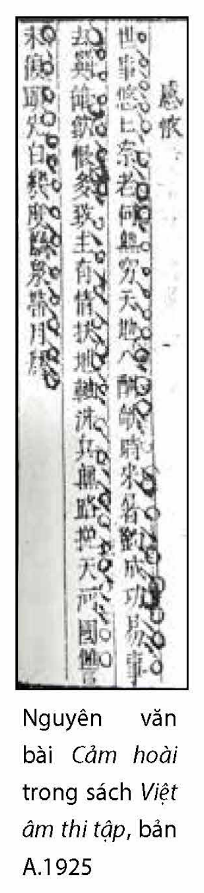
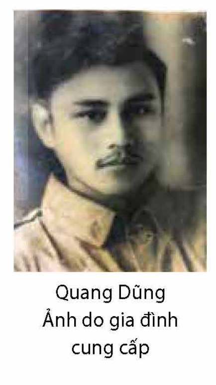
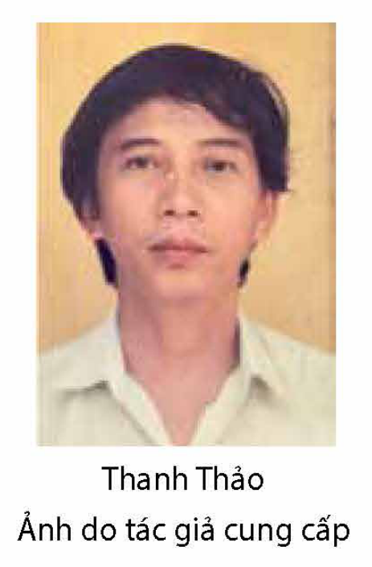

<!-- pdf:42 -->

# BÀI 2: NHỮNG THẾ GIỚI THƠ

## 🎯 Yêu cầu cần đạt

- Nhận biết và phân tích được một số yếu tố của thơ trữ tình hiện đại như: ngôn ngữ, hình tượng, biểu tượng, yếu tố tượng trưng, siêu thực trong thơ,...
- Nhận biết được một số đặc điểm cơ bản của phong cách cổ điển và lãng mạn qua các bài thơ tiêu biểu đã học.
- Vận dụng được kinh nghiệm đọc, trải nghiệm về cuộc sống và kiến thức văn học để đánh giá, phê bình văn bản văn học, thể hiện được suy nghĩ, cảm xúc của cá nhân về văn bản văn học.
- Vận dụng được kiến thức về một số biện pháp tu từ đã học để phân tích, đánh giá tác dụng của việc sử dụng các biện pháp tu từ đó trong một bài thơ.
- Viết được bài văn nghị luận so sánh, đánh giá hai tác phẩm thơ.
- Biết trình bày kết quả so sánh, đánh giá hai tác phẩm thơ.
- Có thái độ ngưỡng mộ đối với những tấm gương sống đẹp vì đất nước, cộng đồng, vì nền nghệ thuật lớn hướng tới con người.

## ĐỌC

### TRI THỨC NGỮ VĂN

**Biểu tượng**

**Biểu tượng** là hình ảnh mang tính ngụ ý, vượt lên chức năng miêu tả, tạo hình đơn giản; chứa đựng nhiều tầng nghĩa phong phú; gợi cảm nhận, suy tư về những điều mang tính phổ quát.

Biểu tượng thường được hình thành trong khoảng thời gian dài nên ý nghĩa không ngừng được bổ sung và có thể “sống” bên ngoài văn bản. Ngoài khả năng khái quát bản chất của một hiện tượng, biểu tượng còn thể hiện được những quan niệm, triết lí sâu sắc về con người, cuộc sống. Do đó, quá trình hình thành biểu tượng luôn chịu sự chi phối của các yếu tố tâm lí, văn hoá,... của dân tộc và thời đại. Trong sáng tác văn học, bên cạnh việc vận dụng những biểu tượng sẵn có, các nhà văn, nhà thơ thường sáng tạo nên những biểu tượng mới mang đậm dấu ấn cá nhân.

<!-- pdf:43 -->

**Yếu tố siêu thực trong thơ**

**Yếu tố siêu thực trong thơ** biểu hiện trước hết qua những hình ảnh có vẻ kì lạ, gắn kết với nhau theo một logic khác thường, phần nào gây cho độc giả cảm giác khó hiểu. Tuy nhiên, từ phía người sáng tác, sự hiện diện của những hình ảnh ấy hoàn toàn mang tính tự nhiên vì chúng gắn với việc “cất lời” của tiềm thức, vô thức. Để khám phá được một hiện thực khác ẩn đằng sau những hiện tượng thông thường dễ thấy, các nhà thơ siêu thực theo đuổi “lối viết tự động”, để ngòi bút “buông” theo sự dẫn dắt của tiềm thức, vô thức, từ đó, xây dựng một thế giới thơ có sự pha trộn giữa chiêm bao và tỉnh thức, giữa ảo giác và thực tế. Yếu tố siêu thực đã xuất hiện thấp thoáng trong một số tác phẩm thơ thời trung đại hoặc thơ dân gian, nhưng chỉ trở thành hiện tượng thẩm mĩ đặc thù trong sáng tác của các nhà thơ theo chủ nghĩa siêu thực hoặc chịu ảnh hưởng sâu đậm của chủ nghĩa này ở thời hiện đại.

**Phong cách cổ điển**

**Phong cách cổ điển** là loại phong cách sáng tác được hình thành từ thời trung đại, chịu sự chi phối của một quan niệm về thế giới có tính đặc thù. Theo phong cách này, cuộc sống con người và vũ trụ được hình dung như một mô hình ổn định, có tôn ti trật tự chặt chẽ, vận động theo quy luật tuần hoàn,... Từ quan niệm về thế giới như vậy, phong cách cổ điển định hình với các đặc trưng cơ bản: nghiêng về thể hiện những đề tài cao nhã; có cảm hứng đặc biệt với cái vĩnh hằng, bất biến; luôn hướng về những mẫu hình lí tưởng, tôn trọng tính quy phạm của cách tổ chức các yếu tố nghệ thuật thành một cấu trúc hoàn mĩ,...

**Phong cách lãng mạn**

Xét theo nghĩa rộng, **phong cách lãng mạn** thường được đặt trong tương quan so sánh với phong cách hiện thực, là hai phong cách nghệ thuật đã từng xuất hiện trong sáng tác văn học từ thời cổ đại. Xét theo nghĩa hẹp, phong cách lãng mạn gắn với sự xuất hiện của chủ nghĩa lãng mạn, một trào lưu văn học – nghệ thuật hình thành ở phương Tây vào khoảng nửa cuối thế kỉ XVIII và nửa đầu thế kỉ XIX. Tuỳ theo cảm hứng, thái độ của người cầm bút, chủ nghĩa lãng mạn được chia thành hai khuynh hướng: khuynh hướng bi quan (hoài nghi thực tại, hoài niệm quá khứ) và khuynh hướng lạc quan (tin tưởng, hướng tới một thế giới tốt đẹp, lí tưởng).

Trong sáng tác văn học, phong cách lãng mạn có các đặc điểm cơ bản: khẳng định cái cao cả, phi thường và phủ định thực tại tầm thường, tù túng; đề cao cá tính sáng tạo, trí tưởng tượng, sự phóng khoáng; chú trọng thế giới nội tâm với những cảm xúc mạnh mẽ, khoáng đạt, tinh tế và ưa dùng các yếu tố tương phản.

<!-- pdf:44 -->

### VĂN BẢN 1: Cảm hoài (Nỗi lòng)
<!-- ocr-ok: nhãn VĂN BẢN 1 in nghiêng trên nền màu xanh bị OCR bỏ sót, đã đối chiếu ảnh trang PDF 44 -->

**Đặng Dung**

- Trong lịch sử và trong cuộc sống đời thường, có những thất bại khiến cho người đời không chỉ cảm thấy buồn thương, tiếc nuối mà còn nể phục, kính trọng. Hãy kể về một thất bại như thế và cho biết điều gì gây ấn tượng với bạn.

**Phiên âm**

*Thế sự du du nại lão hà,*
*Vô cùng thiên địa nhập hàm ca.*
*Thời lai đồ điếu thành công dị,*
*Vận khứ anh hùng ẩm hận đa.*
*Trí chủ hữu hoài phù địa trục,*
*Tẩy binh vô lộ vãn thiên hà.*
*Quốc thù vị báo đầu tiên bạch,*
*Kỉ độ Long Tuyền đới nguyệt ma.*

Nguyên văn bài *Cảm hoài* trong sách *Việt âm thi tập*, bản A.1925

**Dịch nghĩa**

Việc đời dằng dặc, mà ta đã già, biết làm thế nào?
Trời đất mênh mông, thu cả vào cuộc say ca(1).
Gặp thời, người hàng thịt, kẻ đi câu(2) cũng dễ thành công,
Lỡ vận(3), những bậc anh hùng cũng đành nuốt hận.

> (1) Nguyên văn là *hàm ca*, chỉ việc uống rượu say mà hát hoặc việc chìm đắm trong say sưa, ca múa, biểu thị trạng thái tinh thần thống khổ hay phấn khích.
> (2) Nguyên văn là *đồ điếu* (*đồ*: mổ – giết súc vật, người làm nghề giết mổ; *điếu*: câu cá, người câu cá) liên hệ đến sự tích đời Hán (Trung Quốc), thuở hàn vi Phàn Khoái làm nghề bán thịt, Hàn Tín làm nghề câu cá, về sau cả hai đều làm nên nghiệp lớn.
> (3) *Vận*: vận hội, cơ hội; ở đây có nghĩa là cơ may, dịp may.

<!-- pdf:45 -->

Giúp chúa, những muốn xoay trục đất(1),
Rửa binh khí(2), tiếc không có lối kéo sông Ngân(3) xuống.
Thù nước chưa trả được, mà đầu đã bạc,
Bao phen mài gươm Long Tuyền(4) dưới trăng.

**Dịch thơ**

*Thế sự ngổn ngang đã tuổi già,*
*Đất trời bất tận cuộc say ca.*
*Gặp thời đồ điếu công thành dễ,*
*Lỡ vận anh hùng hận xót xa.*
*Phò chúa dốc lòng nâng trục đất,*
*Tẩy binh khôn lối kéo Ngân Hà.*
*Quốc thù chưa trả đầu sao bạc,*
*Bao độ mài gươm ánh nguyệt tà.*

Nguyễn Khắc Phi dịch
(Nguyễn Khắc Phi (Chủ biên), *Kiến thức bổ trợ Ngữ văn 10 Nâng cao*, tập một, NXB Giáo dục, Hà Nội, 2008, tr. 148)

> Hình dung thời gian, không gian ở hai câu thơ đầu.

> Chú ý:
> - Các hình ảnh thể hiện hoàn cảnh, khát vọng, tâm trạng của nhân vật trữ tình.
> - Biện pháp tu từ đối ở hai liên thơ giữa.

**Đặng Dung** (? – 1414) quê ở huyện Thiên Lộc, nay là huyện Can Lộc, tỉnh Hà Tĩnh. Dưới triều nhà Hồ, ông giúp cha là tướng quân Đặng Tất cai quản đất Thuận Hoá(5). Khi quân Minh xâm lược nước ta, ông cùng cha tham gia cuộc khởi nghĩa của Trần Ngỗi, lập nhiều công lớn, trong đó có trận thắng Bô Cô hiển hách. Đáng tiếc là Trần Ngỗi nghe lời gièm pha, nghi kị và giết Đặng Tất. Đặng Dung bỏ Trần Ngỗi, tôn Trần Quý Khoáng làm minh chủ, chỉ huy nghĩa quân giao chiến với quân Minh hàng trăm trận. Năm 1414, khi thua trận, bị giặc Minh bắt giải sang Trung Quốc, ông đã tuẫn tiết trên đường đi.

***Cảm hoài*** là bài thơ duy nhất còn lại của Đặng Dung, được đời sau ca tụng là: “phi hào kiệt chi sĩ bất năng” (“không phải kẻ sĩ hào kiệt thì không làm nổi” – Lý Tử Tấn).

> (1) Nguyên văn là *phù địa trục*, ý nói xoay chuyển tình thế, thay đổi vận mệnh của đất nước.
> (2) Nguyên văn là *tẩy binh*, ý nói chấm dứt chiến tranh, lập lại cuộc sống hoà bình.
> (3) *Sông Ngân*: nguyên văn là *thiên hà*, mượn ý tứ từ câu thơ trong bài *Tẩy binh mã* (*Rửa khí giới*) của Đỗ Phủ: “An đắc tráng sĩ vãn thiên hà/ Tịnh tẩy giáp binh trường bất dụng” (“Ước gì có tráng sĩ kéo nước sông Ngân xuống/ Rửa sạch khí giới, mãi mãi không dùng nữa”).
> (4) *Long Tuyền*: một trong hai thanh gươm quý (trong truyền thuyết Trung Hoa); thường được dùng với nghĩa biểu trưng chỉ hoài bão hành đạo giúp đời, “bình thiên hạ” của những bậc anh hùng hào kiệt thời phong kiến.
> (5) *Thuận Hoá*: tên gọi cũ của vùng đất nay thuộc địa bàn các tỉnh Quảng Bình, Quảng Trị, Thừa Thiên Huế, Đà Nẵng.

<!-- pdf:46 -->

1. Xác định thể thơ và nhân vật trữ tình của bài thơ.
2. Hình ảnh nào trong bốn câu thơ đầu đã gợi ra được hoàn cảnh – tình thế của nhân vật trữ tình? Hoàn cảnh – tình thế đó có đặc điểm gì?
3. Nhân vật trữ tình có những cảm xúc, suy nghĩ gì khi đối diện với hoàn cảnh – tình thế đó?
4. Trong hai câu luận, tác giả đã sử dụng những biểu tượng quen thuộc của thơ trung đại để bày tỏ nỗi lòng. Hãy giải thích ý nghĩa của một số biểu tượng (*xoay trục đất, rửa binh khí, kéo sông Ngân,...*) và nêu cảm nhận về nỗi lòng của nhân vật trữ tình.
5. Phân tích ý nghĩa của hình ảnh người tráng sĩ mài gươm trong hai câu kết.
6. Nêu một số biểu hiện của phong cách cổ điển trong bài thơ.

#### Kết nối đọc – viết

Viết đoạn văn (khoảng 150 chữ) phân tích một biểu tượng mà bạn cho là đặc sắc trong bài thơ *Cảm hoài*.

### VĂN BẢN 2: Tây Tiến
<!-- ocr-ok: nhãn VĂN BẢN 2 in nghiêng trên nền màu xanh bị OCR bỏ sót, đã đối chiếu ảnh trang PDF 46 -->

**Quang Dũng**

- Bạn đã học, đã đọc những bài thơ nào viết về đề tài người lính cách mạng Việt Nam? Đọc diễn cảm một đoạn thơ mà bạn yêu thích.

Sông Mã(1) xa rồi Tây Tiến ơi!
Nhớ về rừng núi nhớ chơi vơi
Sài Khao(2) sương lấp đoàn quân mỏi
Mường Lát(3) hoa về trong đêm hơi

> Chú ý:
> - Hình ảnh khơi nguồn cảm xúc.
> - Các từ ngữ gợi bối cảnh không gian và ấn tượng về đoàn quân Tây Tiến.

> (1) *Sông Mã*: con sông chảy trên lãnh thổ hai nước Lào và Việt Nam.
> (2) *Sài Khao*: một vùng đất thuộc tỉnh Sơn La.
> (3) *Mường Lát*: một vùng đất thuộc tỉnh Thanh Hoá.

<!-- pdf:47 -->

Dốc lên khúc khuỷu dốc thăm thẳm
Heo hút cồn mây súng ngửi trời
Ngàn thước lên cao, ngàn thước xuống
Nhà ai Pha Luông(1) mưa xa khơi
Anh bạn dãi dầu không bước nữa
Gục lên súng mũ bỏ quên đời!
Chiều chiều oai linh thác gầm thét
Đêm đêm Mường Hịch(2) cọp trêu người
Nhớ ôi Tây Tiến cơm lên khói
Mai Châu(3) mùa em thơm nếp xôi

> Nhận diện các yếu tố: nhịp điệu, nhạc điệu, đối và những kết hợp từ ngữ khác lạ trong đoạn thơ.

\*

Doanh trại bừng lên hội đuốc hoa(4)
Kìa em xiêm áo tự bao giờ
Khèn(5) lên man điệu(6) nàng e ấp
Nhạc về Viên Chăn(7) xây hồn thơ
Người đi Châu Mộc(8) chiều sương ấy
Có thấy hồn lau nẻo bến bờ
Có nhớ dáng người trên độc mộc(9)
Trôi dòng nước lũ hoa đong đưa

> Chú ý những hình ảnh gây ấn tượng về thiên nhiên, con người miền Tây Bắc.

\*

> (1) *Pha Luông*: núi thuộc huyện Mộc Châu, tỉnh Sơn La, giáp biên giới Việt – Lào.
> (2) *Mường Hịch*: một vùng đất thuộc tỉnh Sơn La.
> (3) *Mai Châu*: một vùng đất thuộc tỉnh Hoà Bình.
> (4) *Đuốc hoa*: nguyên nghĩa chỉ loại nến có trang trí hoa văn thắp trong đêm tân hôn; ở đây có thể đã được dùng với nghĩa mới, chỉ những ngọn đuốc được thắp sáng trong đêm liên hoan ở doanh trại.
> (5) *Khèn*: nhạc khí của một số dân tộc miền núi phía Bắc nước ta, làm bằng nhiều ống trúc ghép lại.
> (6) *Man điệu*: chỉ điệu nhạc hoặc điệu múa của các dân tộc thiểu số ở miền núi.
> (7) *Viên Chăn*: thủ đô của nước Lào.
> (8) *Châu Mộc* (hay là *Mộc Châu*): một vùng đất thuộc tỉnh Sơn La.
> (9) *Độc mộc*: thuyền dài và hẹp, làm từ một thân cây to.

<!-- pdf:48 -->

Tây Tiến đoàn binh không mọc tóc
Quân xanh màu lá dữ oai hùm
Mắt trừng gửi mộng qua biên giới
Đêm mơ Hà Nội dáng kiều thơm
Rải rác biên cương mồ viễn xứ(1)
Chiến trường đi chẳng tiếc đời xanh
Áo bào(2) thay chiếu, anh về đất
Sông Mã gầm lên khúc độc hành(3)

> Hình dung dáng vẻ, tư thế, cốt cách của đoàn binh Tây Tiến.

\*

Tây Tiến người đi không hẹn ước
Đường lên thăm thẳm một chia phôi
Ai lên Tây Tiến mùa xuân ấy
Hồn về Sầm Nứa(4) chẳng về xuôi.

*Phù Lưu Chanh, 1948*
(*Tuyển tập Quang Dũng*, NXB Văn học, Hà Nội, 1999, tr. 96 – 98)

> Ý nghĩa biểu tượng của hình ảnh “người đi”.

Quang Dũng
Ảnh do gia đình cung cấp
<!-- ocr-ok: chú thích ảnh tác giả ở cột bên phải bị OCR trộn vào dòng văn bản bên trái, đã đối chiếu ảnh trang PDF 48 -->

**Quang Dũng** (1921 – 1988) tên khai sinh là Bùi Đình Diệm, quê ở tỉnh Hà Tây (nay thuộc thành phố Hà Nội). Sau Cách mạng tháng Tám, Quang Dũng vào bộ đội và gia nhập đoàn quân Tây Tiến, một đơn vị được thành lập mùa xuân năm 1947 với nhiệm vụ vừa chiến đấu làm tiêu hao lực lượng quân đội Pháp, vừa tuyên truyền vận động nhân dân tham gia kháng chiến.

Quang Dũng là nghệ sĩ đa tài: sáng tác nhạc, vẽ tranh, viết văn xuôi, làm thơ. Thơ ông hồn hậu mà tinh tế, phóng khoáng; giàu cảm hứng lãng mạn. Đặc biệt, ngôn ngữ thơ vừa mang màu sắc cổ điển vừa mới lạ, hiện đại; đậm chất nhạc và chất hoạ. Các tác phẩm chính: *Rừng biển quê hương* (tập thơ, văn, in chung với Trần Lê Văn, 1957), *Đường lên châu Thuận* (truyện, kí, 1964), *Rừng về xuôi* (truyện, kí, 1968), *Nhà đồi* (truyện, kí, 1970), *Mây đầu ô* (thơ, 1986).

Bài thơ ***Tây Tiến*** (ban đầu có nhan đề là *Nhớ Tây Tiến*) được sáng tác năm 1948, sau khi Quang Dũng chuyển từ binh đoàn Tây Tiến sang đơn vị khác.

> (1) *Viễn xứ*: nơi xa xôi.
> (2) *Áo bào*: áo khoác ngoài được may từ vải dày, có thân dài, ống tay rộng.
> (3) *Khúc độc hành*: nguyên nghĩa khúc nhạc (hát) về chuyến đi đơn độc, ở đây chỉ tiếng gầm đơn độc của dòng sông.
> (4) *Sầm Nứa*: một tỉnh của nước Lào, giáp với hai tỉnh Sơn La và Thanh Hoá của Việt Nam; cũng là một địa bàn hoạt động của đoàn quân Tây Tiến.

<!-- pdf:49 -->

1. Cảm hứng chủ đạo của bài thơ *Tây Tiến* là gì?
2. Đọc đoạn thơ 1 và thực hiện các yêu cầu sau:
   a. Nêu ấn tượng về trạng thái cảm xúc được tác giả thể hiện ở hai câu thơ mở đầu.
   b. Cho biết hình dung của bạn về bức tranh thiên nhiên và con đường hành quân của đoàn binh Tây Tiến.
   c. Phân tích những hình ảnh thể hiện ấn tượng ban đầu của tác giả về đoàn quân Tây Tiến.
   d. Nêu cảm nhận về nhạc điệu trong bốn câu thơ sau:
   *Dốc lên khúc khuỷu dốc thăm thẳm*
   *Heo hút cồn mây súng ngửi trời*
   *Ngàn thước lên cao, ngàn thước xuống*
   *Nhà ai Pha Luông mưa xa khơi*
3. Trong kí ức của nhân vật trữ tình, hình ảnh đêm lửa trại và con người, cuộc sống miền Tây Bắc hiện lên với những nét đặc sắc gì? Những hình ảnh đó đã góp phần làm nổi bật hình tượng người lính Tây Tiến như thế nào?
4. Trong hai đoạn thơ 3, 4, hình tượng đoàn binh Tây Tiến được gợi ra qua những từ ngữ, hình ảnh nào? Khái quát đặc điểm của hình tượng này.
5. Chỉ ra một số biểu hiện của phong cách lãng mạn trong bài thơ. Phân tích một biểu hiện mà bạn cho là đặc sắc.
6. Phân tích một số hình thức tổ chức ngôn ngữ đặc biệt trong bài thơ *Tây Tiến*.
7. Hình tượng người lính Tây Tiến trong bài thơ từng bị phê phán là “xa lạ” với hình ảnh thực tế của anh bộ đội Cụ Hồ thời kì kháng chiến chống thực dân Pháp. Theo bạn, vì sao có sự đánh giá như vậy? Hãy nêu quan điểm của bạn về vấn đề này.

#### Kết nối đọc – viết

Viết đoạn văn (khoảng 150 chữ) trình bày cảm nhận của bạn về một nét đẹp của hình tượng người lính Tây Tiến.

<!-- pdf:50 -->

### VĂN BẢN 3: Đàn ghi ta của Lor-ca(*)
<!-- ocr-ok: nhãn VĂN BẢN 3 in nghiêng trên nền màu xanh bị OCR bỏ sót, đã đối chiếu ảnh trang PDF 50 -->

**Thanh Thảo**

- Theo bạn, sứ mệnh cao cả của người nghệ sĩ là gì? Hãy dẫn ra một câu thơ, câu văn hoặc một câu danh ngôn nói về điều này.
- Bạn đã biết gì về đất nước Tây Ban Nha? Nêu những nét văn hoá đặc trưng của đất nước này.

*“Khi tôi chết hãy chôn tôi với cây đàn”*
Ph.G. Lor-ca

> Lời đề từ gợi điều gì về người nghệ sĩ Lor-ca?

những tiếng đàn bọt nước
Tây Ban Nha áo choàng đỏ gắt
li-la li-la li-la
đi lang thang về miền đơn độc
với vầng trăng chuếnh choáng
trên yên ngựa mỏi mòn

> Chú ý nhạc tính của dòng thơ miêu tả tiếng đàn.

Tây Ban Nha
hát nghêu ngao
bỗng kinh hoàng
áo choàng bê bết đỏ
Lor-ca bị điệu về bãi bắn
chàng đi như người mộng du

> Hình ảnh áo choàng được nhắc lại ở đoạn thơ thứ hai thể hiện điều gì?

> (\*) *Lor-ca*, tên đầy đủ là Phê-đê-ri-cô Gar-xi-a Lor-ca (Federico García Lorca, 1898 – 1936), là nghệ sĩ nổi tiếng của Tây Ban Nha. Từ nhỏ, ông được coi là thần đồng nghệ thuật với nhiều năng khiếu thiên bẩm trên các lĩnh vực: thơ ca, hội hoạ, âm nhạc, sân khấu,... Lor-ca là người sớm có tư tưởng tiến bộ trong việc cách tân nghệ thuật thơ ca, đồng thời tham gia tích cực vào cuộc đấu tranh chống lại thế lực độc tài phát xít Phrăng-cô (Franco). Ngày 16/7/1936, trên đường trở về quê hương, ông bị bọn dân vệ của Phrăng-cô giết và phi tang xác. Cái chết của Lor-ca đã khơi lên một làn sóng phẫn nộ mạnh mẽ trên thế giới đối với bè lũ Phrăng-cô; tên tuổi của Lor-ca trở thành biểu tượng của tinh thần chiến đấu chống lại chủ nghĩa phát xít.
> Thơ của Lor-ca cũng là biểu tượng của tự do và cái đẹp, của dân chủ và nhân quyền, giàu tính tượng trưng, siêu thực. Nhân cách nghệ sĩ của ông được nhiều người biết đến qua câu thơ nổi tiếng: “Khi tôi chết hãy chôn tôi với cây đàn” (câu thơ mở đầu của bài thơ *Ghi nhớ*).

<!-- pdf:51 -->

tiếng ghi ta nâu
bầu trời cô gái ấy
tiếng ghi ta lá xanh biết mấy
tiếng ghi ta tròn bọt nước vỡ tan
tiếng ghi ta ròng ròng
máu chảy

> Những hình ảnh biểu tượng gợi cảm nhận thế nào về tiếng đàn?

không ai chôn cất tiếng đàn
tiếng đàn như cỏ mọc hoang
giọt nước mắt vầng trăng
long lanh trong đáy giếng

đường chỉ tay(1) đã đứt
dòng sông rộng vô cùng
Lor-ca bơi sang ngang
trên chiếc ghi ta màu bạc

> Hình dung về cái chết và sự bất tử của Lor-ca.

chàng ném lá bùa cô gái Di-gan
vào xoáy nước
chàng ném trái tim mình
vào lặng yên bất chợt

li-la li-la li-la...
<!-- ocr-ok: chữ li-la bị OCR đọc nhầm thành h-la H-la, đã đối chiếu ảnh trang PDF 51 -->

(Thanh Thảo, *Khối vuông ru-bích*, NXB Tác phẩm mới, Hà Nội, 1985, tr. 55 – 56)

> (1) *Đường chỉ tay*: những đường vân trong lòng bàn tay. Theo nhân tướng học, đường chỉ tay có thể là dấu hiệu cho thấy tính cách và số phận của mỗi người. Đường chỉ tay đứt chỉ cái chết được báo trước.

<!-- pdf:52 -->

Thanh Thảo
Ảnh do tác giả cung cấp

**Thanh Thảo** tên khai sinh là Hồ Thành Công, sinh năm 1946, quê ở tỉnh Quảng Ngãi. Tốt nghiệp Trường Đại học Tổng hợp Hà Nội, ông vào chiến trường miền Nam tham gia chiến đấu. Sau năm 1975, ông viết báo, tiểu luận phê bình và nhiều thể loại khác, song đóng góp quan trọng nhất của ông vẫn là thơ ca. Thơ Thanh Thảo giàu suy tư, trăn trở về những vấn đề của xã hội và thời đại; thể hiện nỗ lực cách tân thơ ca, tìm kiếm những cách biểu đạt mới qua hình thức câu thơ tự do với nhịp điệu và những liên tưởng phóng khoáng, có sức khơi gợi mạnh mẽ. Tác phẩm chính: *Những người đi tới biển* (1977), *Dấu chân qua trảng cỏ* (1978), *Những ngọn sóng mặt trời* (1981), *Khối vuông ru-bích* (1985), *Từ một đến một trăm* (1988),...

***Đàn ghi ta của Lor-ca*** được rút từ tập *Khối vuông ru-bích*, tập thơ thể hiện rõ nhất phong cách thơ Thanh Thảo: giàu tính chất tượng trưng và siêu thực, thể hiện cái tôi nội cảm, hướng tới vẻ đẹp tinh thần của con người, đặc biệt quan tâm đến những nhân vật lịch sử như Cao Bá Quát, Nguyễn Đình Chiểu, Xéc-gây Ê-xê-nhin (Sergei Yesenin), Gar-xi-a Lor-ca,...

1. Xác định mạch cảm xúc trong bài thơ.
2. Nhạc tính của bài thơ được tạo nên bởi những yếu tố nào? Nhận xét về âm hưởng, giọng điệu của thi phẩm này.
3. Hình tượng Lor-ca được thể hiện như thế nào trong hai đoạn thơ đầu? Những chi tiết nào trong hai đoạn thơ cho thấy mối quan hệ giữa người nghệ sĩ với đất nước Tây Ban Nha?
4. Đọc hai đoạn thơ 3, 4 và thực hiện các yêu cầu sau:
   a. Chỉ ra và phân tích hiệu quả của biện pháp tu từ được tác giả sử dụng khi miêu tả tiếng đàn.
   b. Nêu ý nghĩa của những hình ảnh mang tính biểu tượng trong hai đoạn thơ.
5. Phân tích những hình ảnh đan xen giữa thực và ảo thể hiện cái chết và sự bất tử của Lor-ca trong hai đoạn thơ cuối. Câu thơ kết có thể đem lại ấn tượng và cảm xúc gì cho người đọc?
6. Xác định yếu tố tượng trưng, yếu tố siêu thực trong bài thơ và nhận xét về tác dụng của chúng.
7. Bài thơ gợi cho bạn suy nghĩ gì về sức mạnh của nghệ thuật trong đời sống?

#### Kết nối đọc – viết

Viết đoạn văn (khoảng 150 chữ) trình bày cảm nhận của bạn về một nét đặc sắc trong hình thức biểu đạt của bài thơ.

<!-- pdf:53 -->

<!-- pdf:54 -->

### Thực hành tiếng Việt

**Tác dụng của một số biện pháp tu từ trong thơ**

**1.** Xác định và phân tích tác dụng của biện pháp tu từ nhân hoá trong các câu thơ sau:

a. *Chiều chiều oai linh thác gầm thét*
*Đêm đêm Mường Hịch cọp trêu người*

(Quang Dũng, *Tây Tiến*)

b. *Trời thu thay áo mới,*
*Trong biếc, nói cười thiết tha.*

(Nguyễn Đình Thi, *Đất nước*)

**2.** Xác định và phân tích tác dụng của biện pháp tu từ ẩn dụ trong các câu thơ sau:

*Tây Tiến đoàn binh không mọc tóc*
*Quân xanh màu lá dữ oai hùm*
*Mắt trừng gửi mộng qua biên giới*
*Đêm mơ Hà Nội dáng kiều thơm*

(Quang Dũng, *Tây Tiến*)

**3.** Xác định và phân tích tác dụng của biện pháp tu từ điệp ngữ trong các câu thơ sau:

a. *Dốc lên khúc khuỷu dốc thăm thẳm*
*Heo hút cồn mây súng ngửi trời*
*Ngàn thước lên cao, ngàn thước xuống*
*Nhà ai Pha Luông mưa xa khơi*

(Quang Dũng, *Tây Tiến*)

b. *tiếng ghi ta nâu*
*bầu trời cô gái ấy*
*tiếng ghi ta lá xanh biết mấy*
*tiếng ghi ta tròn bọt nước vỡ tan*
*tiếng ghi ta ròng ròng*
*máu chảy*

(Thanh Thảo, *Đàn ghi ta của Lor-ca*)

**4.** Xác định và phân tích tác dụng của biện pháp tu từ đối trong các câu thơ sau:

a. *Gặp thời đồ điếu công thành dễ,*
*Lỡ vận anh hùng hận xót xa.*
*Phò chúa dốc lòng nâng trục đất,*
*Tẩy binh khôn lối kéo Ngân Hà.*

(Đặng Dung, *Cảm hoài*, Nguyễn Khắc Phi dịch)

b. *Sài Khao sương lấp đoàn quân mỏi*
*Mường Lát hoa về trong đêm hơi*

(Quang Dũng, *Tây Tiến*)

<!-- pdf:55 -->

## VIẾT

### Viết bài văn nghị luận so sánh, đánh giá hai tác phẩm thơ

Mục tiêu của kiểu bài so sánh, đánh giá hai tác phẩm thơ là chỉ ra những điểm tương đồng và khác biệt giữa các đối tượng so sánh, từ đó nêu được những giá trị đặc sắc, các yếu tố cách tân và đóng góp mới mẻ của từng tác giả, tác phẩm. Đây là kiểu bài đặt ra nhiều thử thách đối với người viết trong việc xác định cơ sở và các phương diện cần so sánh, đánh giá; việc lựa chọn cách triển khai nội dung phù hợp để so sánh, đánh giá thoả đáng về hai tác phẩm thơ.

**Yêu cầu**

- Giới thiệu ngắn gọn về hai tác phẩm thơ, nêu được những cơ sở lựa chọn hai tác phẩm để so sánh, đánh giá.
- Làm sáng tỏ những điểm tương đồng và khác biệt giữa hai bài thơ được chọn để so sánh; có bằng chứng cụ thể, đa dạng từ hai tác phẩm.
- Đưa ra những nhận xét, đánh giá thuyết phục về ý nghĩa và những đóng góp riêng, đặc sắc của mỗi tác phẩm thơ dựa trên các nội dung được so sánh.
- Nêu khái quát kết quả và ý nghĩa của việc so sánh, đánh giá.

### Bài viết tham khảo

**Cảm hứng mùa thu trong Thu vịnh và Đây mùa thu tới**
<!-- ocr-ok: chữ nghiêng Thu vịnh và Đây mùa thu tới bị OCR đọc nhầm thành Thu cịnh và Đâu mùa thu tới, đã đối chiếu ảnh trang PDF 55 -->

Ở xứ Bắc, mùa thu vẫn được coi là mùa đẹp nhất trong năm và đã trở thành cảm hứng bất tận của các nhà thơ từ xưa đến nay. Mỗi bài thơ viết về mùa thu đều đem đến cho người đọc những cảm nhận về vẻ đẹp của bức tranh thu, cùng những sắc điệu riêng của tâm hồn thi nhân thể hiện trong cảnh thu, tình thu. Nói đến những thi phẩm về mùa thu phải kể đến hai bài thơ nổi tiếng của hai nhà thơ lớn là *Thu vịnh* (Nguyễn Khuyến) và *Đây mùa thu tới* (Xuân Diệu). Ở đó, mỗi nhà thơ đã gửi gắm những cảm nhận và nỗi niềm, vừa có sự gặp gỡ vừa có điểm đặc sắc, hấp dẫn riêng.

> Giới thiệu hai bài thơ và định hướng so sánh.

<!-- pdf:56 -->

Một trong những nét đặc trưng của cảnh sắc thiên nhiên mùa thu xứ Bắc là cái hanh hao của trời đất, cái se lạnh của gió thu, độ trong trẻo của không gian, khiến cho lòng người luôn thấy nao nao và dễ khơi gợi những hoài niệm. Có phải thế chăng mà hai bài thơ mùa thu của Nguyễn Khuyến và Xuân Diệu đều có nét gặp gỡ là cảnh thu, tình thu đẹp nhưng buồn. Nỗi buồn của các thi nhân thấm đẫm trong cảnh vật và biểu hiện trong những hình thức nghệ thuật tinh tế, đặc sắc. Với *Thu vịnh*, ngay từ khổ thơ đầu, những hình ảnh thu đầy sức gợi đã được mở ra:

> Phân tích điểm tương đồng của hai bài thơ.

*Trời thu xanh ngắt mấy tầng cao,*
*Cần trúc lơ phơ gió hắt hiu.*
*Nước biếc trông như tầng khói phủ,*
*Song thưa để mặc bóng trăng vào.*

Còn ở *Đây mùa thu tới*, cũng vẫn là những nét dáng của mùa thu xứ Bắc, khơi gợi bao niềm cảm xúc:

– *Đây mùa thu tới – mùa thu tới*
*Với áo mơ phai dệt lá vàng.*
<!-- ocr-ok: câu thơ in nghiêng bị OCR đọc nhầm thành Với áo tơ phụ đệt lá oàng, đã đối chiếu ảnh trang PDF 56 -->

– *Thỉnh thoảng nàng trăng tự ngẩn ngơ...*
*Non xa khởi sự nhạt sương mờ...*

Mặc dù mỗi bài thơ miêu tả hình ảnh mùa thu ở những không gian khác nhau, nhưng ta đều gặp trong bức tranh thu cái sắc thu thanh nhẹ, trong sáng, se sắt thấm vào từng đường nét của không gian, cảnh vật. Cả hai bức tranh đều là những nét chấm phá tinh tế, gợi cảm giác mơ màng, một nỗi buồn man mác trong tâm hồn các thi nhân.

Song cảnh thu, tình thu trong hai bài thơ lại có nhiều nét khác biệt vì đó là sản phẩm nghệ thuật của hai nhà thơ, sống ở hai thời đại, với những quan điểm thẩm mĩ khác nhau. Nguyễn Khuyến là nhà Nho uyên bác nhưng bất đắc chí; ông là quan nhà Nguyễn nhưng do chán ghét thời thế nên đã cáo quan trở về, sống giản dị, gắn bó với đồng quê và cuộc sống thôn quê. Còn Xuân Diệu là một trí thức Tây học, sống trong một thời đại mà nhu cầu giải phóng cái tôi cá nhân đang trỗi dậy mạnh mẽ, đồng thời lớp thanh niên trí thức ngày ấy đã sớm mở lòng để cảm sâu được những biến chuyển của thế giới xung quanh. Bởi vậy, qua hai bài thơ, người đọc có thể cảm nhận được dấu ấn của thời đại và dấu ấn tâm hồn hai nghệ sĩ.

> Giới thiệu nét riêng và chỉ ra yếu tố tạo nên sự khác biệt của đối tượng so sánh.

<!-- pdf:57 -->

Cảnh thu trong bài *Thu vịnh* là cảnh thu của làng quê Việt Nam, dưới cái nhìn của một bậc đại trí đã lui về ẩn dật nơi thôn dã. Bức tranh thu hiện lên trong không gian thu hẹp về chiều rộng, mở ra bằng chiều cao với sắc trời “xanh ngắt mấy tầng cao” đặc trưng của mùa thu xứ Bắc, với đường nét đơn sơ, màu sắc thanh đạm, không khí hiu hắt, ao thu nước biếc với sương khói phủ nhạt nhoà. Trăng thân mật và lặng lẽ đến với thi nhân như một tri kỉ:

*Song thưa để mặc bóng trăng vào.*

> Phân tích nét riêng trong cảnh và tình của bài *Thu vịnh*.

Hoa mùa thu đang nở nhưng lại gợi về “hoa năm ngoái” và âm thanh thì lạc lõng với tiếng ngỗng trời không biết từ đâu bay tới:

*Mấy chùm trước giậu hoa năm ngoái,*
*Một tiếng trên không ngỗng nước nào.*

Cảnh thu vừa thực, vừa ảo và ngưng đọng trong một nỗi hoài niệm bàng bạc cả không gian và thời gian. Tình thu man mác, đượm buồn vấn vương với những sắc màu và thanh âm của mùa thu. Thế nhưng thi hứng dạt dào trước cảnh thu lại đến cùng một nỗi “thẹn”:

*Nhân hứng cũng vừa toan cất bút,*
*Nghĩ ra lại thẹn với ông Đào.*

Nỗi “thẹn với ông Đào” cũng là một cách biểu hiện nỗi đau nhân thế trước mùa thu của xứ sở. Ông Đào là Đào Tiềm (Đào Uyên Minh), một nhà thơ Trung Quốc nổi tiếng về tài thơ lẫn khí phách khi ông đã từ quan một cách dứt khoát. Còn cụ Nguyễn thì dù đã từ quan về quê mà dường như tâm vẫn có chút gì chưa an, trí vẫn có điều gì chưa dứt, vẫn còn những nỗi niềm, tâm tư bộn bề vương vấn trong lòng. Nỗi thẹn ở đây có thể được Nguyễn Khuyến nhìn nhận là thẹn về nhân cách, khí tiết. Cảm xúc thu trong *Thu vịnh* vì thế mà đượm buồn trong không gian thu, da diết trong sắc thu, bàng bạc trong âm thanh mùa thu và đầy day dứt trong nỗi niềm thi nhân.

Cảnh thu trong *Đây mùa thu tới* của Xuân Diệu mang nhiều dấu ấn nơi phố phường và phảng phất hình ảnh mùa thu Hà Nội. Nếu hồn thu trong *Thu vịnh* là cây trúc thì hồn thu trong *Đây mùa thu tới* là cây liễu:

*Rặng liễu đìu hiu đứng chịu tang,*
*Tóc buồn buông xuống lệ ngàn hàng;*

<!-- pdf:58 -->

Nỗi buồn mùa thu được miêu tả đầy trực cảm, cảnh buồn nhưng vẫn khiến lòng thi nhân náo nức “Đây mùa thu tới, mùa thu tới”. Mùa thu đến và đi gợi cảm xúc về dòng thời gian đang trôi chảy nên cảnh sắc không ngưng đọng như cảnh thu trong thơ Nguyễn Khuyến. Sự vận động của thời gian, sự tàn phai của cái đẹp in đậm trong những hình ảnh: “sắc đỏ rũa màu xanh”, “rét mướt luồn trong gió”, “đôi nhánh khô gầy xương mỏng manh”,... Cảnh thu hiện lên qua cảm nhận của một hồn thơ hiện đại và được thể hiện bằng những hình ảnh thơ giàu tính cảm giác, thấm đẫm tinh thần cô đơn của thi nhân. Đây quả là điều chưa từng bắt gặp trong thơ cổ điển.

> Phân tích nét riêng của bài *Đây mùa thu tới* trong sự đối sánh với bài *Thu vịnh*.
<!-- ocr-ok: thẻ chỉ dẫn bên lề bị OCR trộn với dòng văn bản bên trái, đã đối chiếu ảnh trang PDF 58 -->

Cảnh thu trong thơ Nguyễn Khuyến vắng lặng, chỉ có cái tôi trữ tình của thi nhân đang trải lòng mình. Cảnh thu trong thơ Xuân Diệu cũng vắng vẻ đìu hiu, nhưng vẫn có bóng dáng con người, tất nhiên với Xuân Diệu phải là bóng dáng thiếu nữ:

*Ít nhiều thiếu nữ buồn không nói*
*Tựa cửa nhìn xa, nghĩ ngợi gì.*

Tình thu của cụ Nguyễn buồn, xót xa, day dứt; tình thu của chàng thi sĩ Xuân Diệu có buồn, cô đơn, nhưng tràn đầy khao khát về sự sống trần thế, tha thiết giao cảm với đời. Quan điểm thẩm mĩ của Nguyễn Khuyến do vậy mang đậm sắc màu cổ điển và một phong vị ẩn dật, còn Xuân Diệu là một nhà thơ lãng mạn, một nhà thơ hiện đại với thế giới quan mới mẻ và bao nhiêu đổi thay trong nếp sống, nếp cảm để tạo nên những vần thơ lay thức các giác quan và rạo rực lòng người.

> Khẳng định vị trí, giá trị và sức hấp dẫn của hai bài thơ.

Hai bài thơ của Nguyễn Khuyến và Xuân Diệu cho đến nay đều là những thi phẩm đặc sắc về mùa thu của quê hương, đất nước Việt Nam, đem đến cho người đọc những cảm xúc tinh tế trước những hình ảnh đầy gợi cảm của thiên nhiên và những nỗi niềm, tâm sự gửi gắm trong đó. Cả hai tâm hồn lớn đều yêu tha thiết mùa thu của xứ Bắc, nhưng do điệu tâm hồn và quan điểm thẩm mĩ khác nhau mà cảnh thu, tình thu của mỗi bài thơ mang một vẻ đẹp riêng, bồi đắp cho mỗi chúng ta tình yêu quê hương xứ sở nồng nàn, sâu sắc.

> Nêu ý kiến khẳng định về kết quả và ý nghĩa của việc so sánh.

(Bài làm của học sinh, có chỉnh sửa)

<!-- pdf:59 -->

1. Trong bài viết, tác giả đã dựa trên những cơ sở nào khi chọn hai bài thơ để so sánh, đánh giá?
2. Bài viết triển khai các nội dung so sánh, đánh giá như thế nào? Bạn có nhận xét gì về hiệu quả của cách triển khai đó?
3. Theo bạn, có thể có những cách trình bày nào khác về các nội dung so sánh, đánh giá trong bài viết?

### Thực hành viết

**Chuẩn bị viết**

- Trước hết, cần xác định được những cơ sở để triển khai các nội dung so sánh, gắn với đặc trưng của thể loại thơ (đề tài, phong cách sáng tác, bút pháp nghệ thuật,...). Từ những cơ sở đã xác định, cần lựa chọn các bài thơ tiêu biểu với những điểm tương đồng và khác biệt có ý nghĩa.
- Phạm vi lựa chọn để so sánh, đánh giá rất mở và linh hoạt. Hai bài thơ đó có thể của hai tác giả hoặc của một tác giả.
- Xác định được các phương diện cần so sánh: đối tượng cụ thể được miêu tả, thể hiện, cảm hứng, cái nhìn nghệ thuật, bút pháp,...
- Một số đề tài gợi ý:
  + So sánh, đánh giá hai tác phẩm thơ thuộc các giai đoạn văn học, xu hướng văn học khác nhau: *Tiếng nói tri âm trong Độc Tiểu Thanh kí (Nguyễn Du) và Đàn ghi ta của Lor-ca (Thanh Thảo)*,...
  + So sánh, đánh giá bút pháp và cảm hứng nghệ thuật trong các tác phẩm thơ: *Cảm hứng về đất nước trong Đất nước (Nguyễn Đình Thi) và Việt Bắc (Tố Hữu)*,...
  + So sánh, đánh giá các hình tượng: *Hình tượng người lính trong Đồng chí (Chính Hữu) và Tây Tiến (Quang Dũng)*; *Hình tượng người phụ nữ trong Tự tình II (Hồ Xuân Hương) và Thuyền và biển (Xuân Quỳnh)*,...
  + So sánh, đánh giá về hình thức nghệ thuật: *Cách thể hiện nỗi nhớ trong Tây Tiến (Quang Dũng) và Tiếng hát con tàu (Chế Lan Viên)*,...

**Tìm ý, lập dàn ý**

*Tìm ý*

Dựa vào yêu cầu của kiểu bài, định hướng từ bài viết tham khảo và đề tài đã xác định, có thể nêu các câu hỏi sau để tìm ý:

- So sánh, đánh giá hai bài thơ dựa trên cơ sở nào? Việc xác định cơ sở để so sánh, đánh giá dựa trên nội dung (hiện thực đời sống, tư tưởng, tình cảm của tác giả,...) và hình thức nghệ thuật của các tác phẩm (thể loại, ngôn ngữ, kết cấu, giọng điệu, hình ảnh, chi tiết, thủ pháp nghệ thuật,...). Chẳng hạn, ở bài viết tham khảo, tác giả so sánh, đánh giá cảm hứng mùa thu trong hai bài thơ *Thu vịnh* và *Đây mùa thu tới* ở cả hai bình diện nội dung miêu tả (cảnh thu, tình thu) và cách thể hiện (chọn hình ảnh, không gian,...).

<!-- pdf:60 -->

- Điểm tương đồng giữa hai tác phẩm thơ là gì? Ở bài viết tham khảo, tác giả đã làm rõ điểm tương đồng trong cảm hứng mùa thu của hai bài thơ là cảnh thu đẹp và tình thu buồn, tất cả được thể hiện bằng những hình ảnh chấm phá, giàu sức gợi.
- Đâu là điểm khác biệt giữa hai bài thơ? Ở bài viết tham khảo, tác giả đã phân tích sự khác biệt trong cảnh thu, tình thu của hai bài thơ; bút pháp miêu tả và quan điểm thẩm mĩ của hai tác giả trong hai thời đại.
- Yếu tố nào tạo nên những điểm tương đồng và khác biệt của hai bài thơ? Điểm tương đồng và khác biệt thường xuất phát từ những yếu tố thuộc về đặc trưng của thơ ca và phong cách nghệ thuật riêng của mỗi nhà thơ, hoặc xu hướng và bút pháp thi ca của từng giai đoạn sáng tác. Ở bài viết tham khảo, tác giả đã phân tích, lí giải điểm tương đồng và khác biệt trong cảm hứng về cảnh thu, tình thu của hai bài thơ là sự đồng điệu của tâm hồn thi nhân trước vẻ đẹp của mùa thu đất nước; sự khác biệt là do hai nhà thơ thuộc hai thời đại, hai phong cách thơ.
- Đánh giá thế nào về giá trị của mỗi bài thơ? Qua so sánh, bài viết tham khảo đã khẳng định vị trí, giá trị và sức hấp dẫn của hai bài thơ viết về mùa thu đối với người đọc bao thế hệ cũng như ý nghĩa của việc cảm nhận hai bài thơ từ góc độ so sánh.

*Lập dàn ý*

Từ hướng tìm ý nêu trên, cần xem xét, sắp xếp lại hệ thống ý thật hợp lí để có dàn ý hoàn chỉnh.

Mở bài: Giới thiệu ngắn gọn về hai bài thơ và nêu cơ sở lựa chọn để so sánh, đánh giá.

Thân bài:

Có nhiều cách trình bày nội dung so sánh, đánh giá. Người viết cần linh hoạt trong việc lựa chọn cách trình bày phù hợp với hiểu biết và hứng thú của bản thân, điều này sẽ góp phần quan trọng vào thành công của bài viết. Có thể triển khai các nội dung so sánh, đánh giá theo những cách sau:

- Cách 1: Lần lượt phân tích từng bài thơ, sau đó chỉ ra điểm tương đồng, sự gặp gỡ và những điểm khác biệt, lí giải nguyên nhân của sự tương đồng và khác biệt đó; đồng thời đánh giá về giá trị và đóng góp của mỗi bài thơ. Cách này dễ làm nhưng nhiều khi bị trùng lặp ý và mục đích so sánh không được làm nổi bật.
- Cách 2: Phân tích bài thơ thứ nhất theo các phương diện đã xác định, khi phân tích bài thơ thứ hai sẽ so sánh với bài thơ thứ nhất theo từng phương diện và lí giải nguyên nhân của những điểm tương đồng và khác biệt giữa hai bài thơ, từ đó, đánh giá về giá trị và đóng góp của mỗi bài thơ. Cách này cũng dễ thực hiện và tránh bị trùng lặp, thể hiện được ý so sánh, nhưng mạch so sánh khi trình bày bài thơ thứ nhất dễ bị chìm.
- Cách 3: So sánh lần lượt các phương diện đã lựa chọn đối với hai bài thơ, chỉ ra điểm tương đồng và khác biệt; lí giải nguyên nhân sự tương đồng và khác biệt đó; đánh giá về giá trị và đóng góp của mỗi bài thơ từ các nội dung so sánh. Cách này làm nổi bật được tính chất so sánh nhưng dễ làm mờ tính liền mạch, chỉnh thể của mỗi bài thơ, đòi hỏi người viết phải có khả năng tư duy tổng hợp và lập luận chặt chẽ, có sự tinh nhạy trong phát hiện vấn đề.

Kết bài: Khẳng định ý nghĩa của việc so sánh, đánh giá; nêu cảm nhận và ấn tượng của bản thân về các bài thơ.

<!-- pdf:61 -->

**Viết**

- Vận dụng kinh nghiệm đã tích luỹ được qua việc thực hành viết bài so sánh, đánh giá hai tác phẩm truyện ở bài học trước để viết Mở bài và Kết bài ngắn gọn, gây được ấn tượng đối với người đọc về ý nghĩa của việc so sánh, đánh giá; triển khai Thân bài theo các ý đã xác định và cách triển khai bài viết so sánh, đánh giá.
- Thể hiện khả năng cảm thụ văn học tinh tế trong quá trình phân tích, so sánh; lựa chọn dẫn chứng phù hợp, tiêu biểu với từng nội dung so sánh, kết hợp với ý kiến lí giải, đánh giá; diễn đạt mạch lạc, sáng sủa, có cảm xúc.
- Có những sáng tạo riêng của cá nhân trong quá trình phân tích, đánh giá về những điểm tương đồng và khác biệt giữa hai bài thơ (qua những phát hiện sâu sắc hoặc qua cách diễn đạt độc đáo) để tăng sức thuyết phục và hấp dẫn cho bài viết.

**Chỉnh sửa, hoàn thiện**

Đọc kĩ bài viết, đối chiếu với yêu cầu của kiểu bài và dàn ý để có hướng chỉnh sửa. Ngoài việc soát lỗi chính tả, lỗi diễn đạt (từ ngữ, câu văn, đoạn văn,...), cần tập trung vào việc làm rõ cơ sở và các phương diện so sánh khi triển khai nội dung bài viết.

## NÓI VÀ NGHE

**Trình bày kết quả so sánh, đánh giá hai tác phẩm thơ**

**Yêu cầu**

- Giới thiệu được hai bài thơ và lí do lựa chọn hai bài thơ đó để so sánh, đánh giá.
- Phân tích những điểm tương đồng và khác biệt giữa hai bài thơ xét theo một số phương diện đã xác định.
- Có những nhận xét, đánh giá thuyết phục về giá trị và đóng góp của mỗi bài thơ dựa trên kết quả so sánh.
- Nêu được những ý kiến trao đổi xác đáng giúp người nói và người nghe có cái nhìn đầy đủ, toàn diện hơn về hai bài thơ được so sánh.

**Chuẩn bị nói**

Bài nói nhằm truyền tải đến người nghe kết quả của việc so sánh, đánh giá hai tác phẩm thơ đã thực hiện ở phần Viết. Để đạt được mục tiêu này, cần chuẩn bị bài nói theo những yêu cầu sau:

- Tóm tắt nội dung bài viết so sánh, đánh giá hai tác phẩm thơ.
- Đánh dấu những luận điểm hoặc thông tin chính của bài viết. Ghi chú những dẫn chứng quan trọng cần được nêu lên khi trình bày từng luận điểm.
- Xác định những từ ngữ then chốt gắn với từng luận điểm để dễ triển khai, đảm bảo cho bài nói có trọng tâm.

<!-- pdf:62 -->

- Chuẩn bị các phương tiện kĩ thuật hỗ trợ và hình ảnh minh hoạ (nếu có) với các thông tin chắt lọc về mỗi bài thơ.

**Thực hành nói**

- Mở đầu: Giới thiệu được hai bài thơ và lí do lựa chọn để so sánh, đánh giá. Việc giới thiệu có thể được dẫn dắt theo lối trực tiếp hoặc gián tiếp; lí do trình bày có thể là lí do khách quan hay chủ quan, nhưng cần nêu được những cơ sở để so sánh.
- Triển khai:
  + Trình bày được những điểm tương đồng và khác biệt giữa hai bài thơ trên một số phương diện đã xác định.
  + Đánh giá được giá trị và đóng góp của mỗi bài thơ dựa trên kết quả so sánh.
- Kết luận: Nêu ý nghĩa của việc so sánh, đánh giá trong tiếp nhận văn bản thơ.

**Trao đổi, đánh giá**

| Người nghe | Người nói |
| --- | --- |
| - Nhận xét về độ chính xác và đầy đủ của các nội dung so sánh giữa hai tác phẩm thơ, cách sử dụng ngôn ngữ và các yếu tố phi ngôn ngữ của người nói. Nếu có khía cạnh nào chưa rõ, yêu cầu người nói giải thích thêm. - Bổ sung hoặc chia sẻ một số nội dung giúp người nói có cái nhìn đầy đủ, toàn diện hơn về hai bài thơ được so sánh, đánh giá (chẳng hạn có thể trình bày thêm cơ sở để so sánh, cách thức trình bày các nội dung so sánh,...). | - Cần làm rõ thêm những ý mà người nghe chưa rõ. - Tiếp thu góp ý hoặc trao đổi lại với một số ý kiến nhận xét, đánh giá của người nghe về nội dung và cách thực hiện bài nói. |

## CỦNG CỐ, MỞ RỘNG

1. Tìm đọc một bài thơ trung đại Việt Nam, nêu đề tài, chủ đề, thể thơ và chỉ ra một vài biểu hiện của phong cách cổ điển được thể hiện trong bài thơ đó.
2. Giới thiệu một bài thơ có phong cách lãng mạn và chỉ ra một số biểu hiện nổi bật của phong cách đó trong bài thơ.
3. Tìm đọc một bài thơ có yếu tố siêu thực (chẳng hạn, *Đây thôn Vĩ Dạ* của Hàn Mặc Tử, *Tì bà* của Bích Khê, *Lá diêu bông* của Hoàng Cầm,...). Chỉ ra và nêu ý nghĩa của một số hình ảnh siêu thực trong bài thơ đó.
4. Hãy so sánh, đánh giá hình tượng người lính được thể hiện trong tác phẩm *Tây Tiến* (Quang Dũng) và một bài thơ cùng đề tài mà bạn đã được học hoặc đọc thêm.

<!-- pdf:63 -->

## THỰC HÀNH ĐỌC

**Một số điều cần lưu ý khi đọc văn bản:**

- Các hình ảnh thơ có tính chất biểu tượng.
- Đặc điểm của thể thơ, ngôn ngữ, hình tượng thơ.
- Những phát hiện, suy ngẫm của tác giả về sự phong phú, bí ẩn kì diệu của tình yêu và tâm hồn con người.

**Bài thơ số 28**(*)
<!-- ocr-ok: số 28 kèm dấu (*) bị OCR đọc dính thành 280, đã đối chiếu ảnh trang PDF 63 -->

**Ra-bin-đơ-ra-nát Ta-go (Rabindranath Tagore)**(1)

Đôi mắt băn khoăn của em buồn,
Đôi mắt em muốn nhìn vào tâm tưởng của anh
Như trăng kia muốn vào sâu biển cả.
Anh đã để cuộc đời anh trần trụi dưới mắt em,
Anh không giấu em một điều gì
Chính vì thế mà em không biết gì tất cả về anh.
Nếu đời anh chỉ là viên ngọc
anh sẽ đập nó ra làm trăm mảnh
và xâu thành một chuỗi
quàng vào cổ em.
Nếu đời anh chỉ là một đoá hoa
tròn trịa, dịu dàng và bé bỏng
anh sẽ hái nó ra để đặt lên mái tóc em.

> (\*) Bài thơ được in trong *Người làm vườn*, một tập thơ nổi tiếng gồm 85 bài, không có nhan đề, chỉ đánh số thứ tự. Tác giả sáng tác tập thơ bằng tiếng Ben-gan (Bengal), sau đó tự dịch sang tiếng Anh và xuất bản năm 1914. Tác phẩm đã được dịch ra nhiều thứ tiếng trên thế giới.
> (1) Ra-bin-đơ-ra-nát Ta-go (1861 – 1941) là nhà thơ vĩ đại của Ấn Độ, danh nhân văn hoá thế giới. Ông để lại một di sản nghệ thuật đồ sộ, bao gồm nhiều thể loại nhưng nổi tiếng nhất là thơ. Ông là tác giả đầu tiên của châu Á được trao giải Nô-ben Văn học. Thơ Ta-go thể hiện tình yêu cuộc sống tha thiết, mãnh liệt; giàu ý nghĩa triết lí và tư tưởng nhân văn; sử dụng thành công những hình ảnh thiên nhiên mang ý nghĩa biểu tượng, các hình thức liên tưởng so sánh và biện pháp tu từ điệp ngữ.

<!-- pdf:64 -->

Nhưng em ơi, đời anh là một trái tim
Nào ai biết chiều sâu và bến bờ của nó.
Em là nữ hoàng của vương quốc đó
Ấy thế mà em có biết gì biên giới của nó đâu.
Nếu trái tim anh chỉ là những phút giây lạc thú
Nó sẽ nở ra thành một nụ cười nhẹ nhõm
Và em thấu suốt rất nhanh
Nếu trái tim anh chỉ là khổ đau
Nó sẽ tan ra thành lệ trong
Và lặng im phản chiếu nỗi niềm u ẩn.
Nhưng em ơi, trái tim anh lại là tình yêu
Nỗi vui sướng, khổ đau của nó là vô biên.
Những đòi hỏi và sự giàu sang của nó là trường cửu.
Trái tim anh cũng ở gần em như chính đời em vậy,
Nhưng chẳng bao giờ em biết trọn nó đâu.

(*Ta-go – Tuyển tập thơ*, Đào Xuân Quý dịch, NXB Văn hoá – Thông tin, Hà Nội, 2000, in trong *Ngữ văn 11 Nâng cao*, tập hai, NXB Giáo dục Việt Nam, Hà Nội, 2018, tr. 169)

## 📷 Danh sách hình trong bài

| Mã hình | Trang PDF | Vị trí trong bài | Chú thích gốc |
| --- | --- | --- | --- |
| H12-ngu_van-b02-01 | 44 | Văn bản 1 – Cảm hoài (trang 42) | Nguyên văn bài *Cảm hoài* trong sách *Việt âm thi tập*, bản A.1925 |
| H12-ngu_van-b02-02 | 48 | Văn bản 2 – Tiểu sử tác giả (trang 46) | Quang Dũng (Ảnh do gia đình cung cấp) |
| H12-ngu_van-b02-03 | 52 | Văn bản 3 – Tiểu sử tác giả (trang 50) | Thanh Thảo (Ảnh do tác giả cung cấp) |
