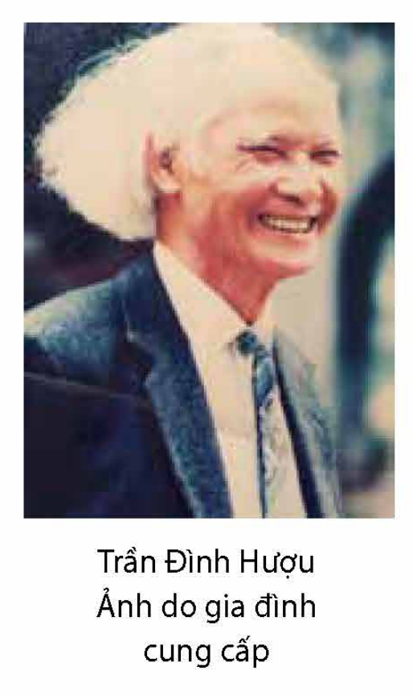
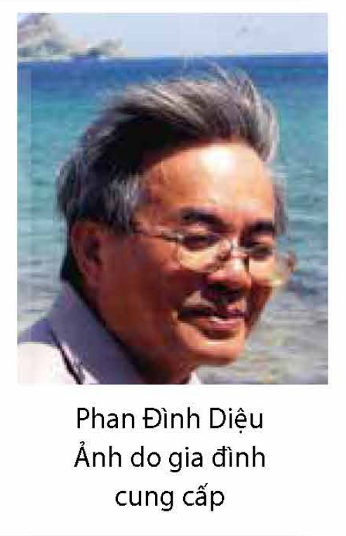
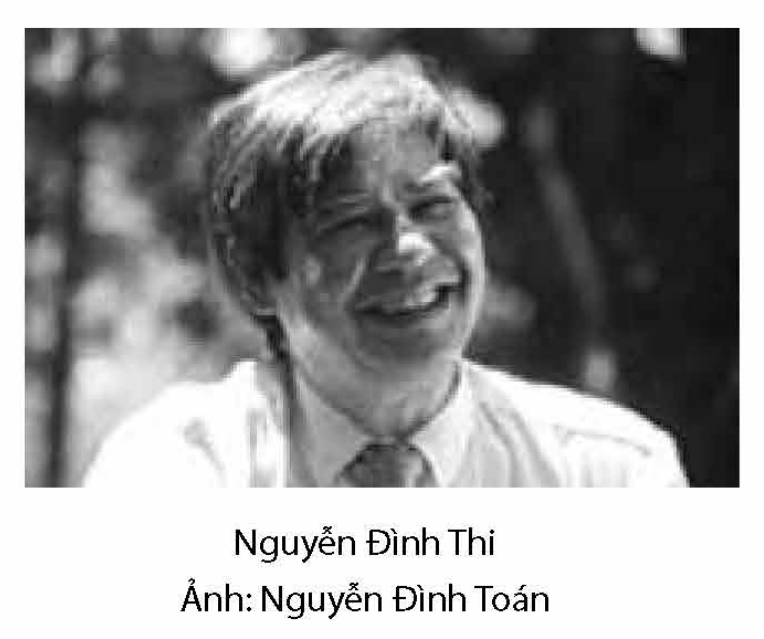

<!-- pdf:65 -->

# BÀI 3: LẬP LUẬN TRONG VĂN BẢN NGHỊ LUẬN

## 🎯 Yêu cầu cần đạt

- Nhận biết, phân tích được nội dung của luận đề, luận điểm, lí lẽ và bằng chứng tiêu biểu, độc đáo trong văn bản; chỉ ra mối liên hệ của chúng; đánh giá được mức độ phù hợp giữa nội dung nghị luận với nhan đề của văn bản.
- Nhận biết được mục đích của người viết, biết tiếp nhận, đánh giá, phê bình nội dung văn bản với tư duy phê phán, dựa trên trải nghiệm và quan điểm của người đọc.
- Phân tích và đánh giá được việc sử dụng một số thao tác như chứng minh, bình luận, bác bỏ, giải thích, phân tích, so sánh trong văn bản nghị luận.
- Nhận biết được lỗi logic và lỗi câu mơ hồ, biết cách sửa lỗi và rút kinh nghiệm.
- Viết được bài văn nghị luận về một vấn đề liên quan đến tuổi trẻ (quan niệm sống, định hướng tương lai, cách ứng xử trong các mối quan hệ,...).
- Biết thuyết trình về một vấn đề liên quan đến tuổi trẻ.
- Có ý thức bảo tồn và phát huy các giá trị của văn hoá dân tộc.

## ĐỌC

### Tri thức Ngữ văn

**Lập luận trong văn bản nghị luận**

<!-- term: văn bản nghị luận -->
**Lập luận** là sử dụng lí lẽ và bằng chứng để thuyết phục người đọc về một vấn đề. Giá trị của văn bản nghị luận được quyết định bởi ý nghĩa của vấn đề đặt ra (luận đề) và nghệ thuật lập luận (cách dùng lí lẽ và bằng chứng) của người viết.

**Các thao tác được sử dụng trong văn bản nghị luận**

<!-- term: văn bản nghị luận -->
Văn bản nghị luận thường dùng các thao tác như **chứng minh**, **bình luận**, **bác bỏ** để phục vụ trực tiếp cho mục đích thuyết phục. **Chứng minh** là dùng lí lẽ và bằng chứng giúp người đọc thấy rằng ý kiến được nêu là hoàn toàn có cơ sở, đáng tin cậy. Tuỳ đề tài cụ thể, người viết chọn bằng chứng từ thực tế cuộc sống hoặc từ tài liệu khoa học, báo chí, tác phẩm văn học, nghệ thuật,... **Bình luận** là đánh giá về sự đúng – sai, hay – dở,
<!-- pdf:66 -->
tốt – xấu, tích cực – tiêu cực của một quan điểm, ý kiến, sự việc, hành động,... nhằm thể hiện rõ chủ kiến của người viết. **Bác bỏ** là chỉ ra sự sai lầm, phiến diện hoặc thiếu chính xác của một quan điểm, ý kiến, từ đó củng cố điều được người viết xem là lẽ phải, chân lí.

Bên cạnh đó, văn bản nghị luận cũng có thể dùng những thao tác như giải thích, phân tích, so sánh giúp làm rõ các khía cạnh của vấn đề nghị luận.

**Giải thích** là cắt nghĩa về đối tượng (sự vật, hiện tượng, khái niệm,...) một cách chi tiết, tỉ mỉ, tạo điều kiện cho người đọc hiểu rõ vấn đề được bàn luận trong văn bản. **Phân tích** là chia tách đối tượng thành nhiều bộ phận, giúp người đọc nhìn thấy rõ hơn các yếu tố và mối quan hệ giữa các yếu tố tạo nên nó. **So sánh** là đặt đối tượng này bên cạnh đối tượng khác để nhận ra điểm tương đồng và khác biệt giữa chúng, qua đó, làm nổi bật nét đặc thù của đối tượng được bàn luận.

Trong bài văn nghị luận, các thao tác trên đây thường được phối hợp với nhau một cách linh hoạt nhằm đạt hiệu quả thuyết phục cao nhất.

**Lỗi logic của câu**

**Câu mắc lỗi logic** là câu có sự mâu thuẫn trong nội dung biểu đạt hoặc vênh lệch giữa các vế câu xét trên phương diện hình thức. Ví dụ: *Hội chợ quốc tế lần này có sự tham gia của các công ti đến từ Mỹ, Nhật Bản, Hàn Quốc, Trung Quốc, Xin-ga-po (Singapore) và nhiều nước châu Âu khác*. Câu này đã vô tình mặc định rằng: Mỹ, Nhật Bản, Hàn Quốc, Trung Quốc, Xin-ga-po là những nước châu Âu. Điều này khiến cho câu hỏng về logic.

**Lỗi câu mơ hồ**

**Câu mơ hồ** là câu khiến người đọc có thể hiểu theo những cách khác nhau. Ví dụ: *Tôi đồng ý với những đánh giá về truyện ngắn của ông ấy*. Khó xác định câu này muốn đề cập những ý kiến của ông ấy đánh giá về truyện ngắn hay có những ý kiến của người khác đánh giá về truyện ngắn do ông ấy sáng tác.

<!-- pdf:67 -->

### Văn bản 1: Nhìn về vốn văn hoá dân tộc(*)

*(Trích)*

**Trần Đình Hượu**

**Trước khi đọc**

- Hãy chia sẻ hiểu biết của bạn về một số di tích văn hoá tiêu biểu của nước ta. Theo bạn, đặc điểm nổi bật ở những di tích ấy là gì?
- Trong xu thế hội nhập hiện nay, vì sao người Việt Nam cần có hiểu biết về văn hoá truyền thống của dân tộc mình?

**(1)** Trong lúc chờ đợi kết luận khoa học của các ngành chuyên môn, chúng tôi xin đưa ra một số nhận xét về vài ba mặt của cái vốn văn hoá dân tộc; không phải cái hình thành vào thời kì định hình mà là cái ổn định dần, tồn tại cho đến trước thời cận – hiện đại. Chúng tôi không nghĩ đó là đặc sắc văn hoá dân tộc nhưng chắc chắn có liên quan gần gũi với nó. [...]

> 💡 [Chỉ dẫn đọc] Cách nêu vấn đề nghị luận.
<!-- ocr-ok: thẻ chỉ dẫn đọc bên phải trên trang PDF 67 -->

**(2)** Giữa các dân tộc, chúng ta không thể tự hào là nền văn hoá của ta đồ sộ, có những cống hiến lớn lao cho nhân loại, hay có những đặc sắc nổi bật. Ở một số dân tộc hoặc là một tôn giáo, hoặc là một trường phái triết học, một ngành khoa học, một nền âm nhạc, hội hoạ,... phát triển rất cao, ảnh hưởng phổ biến và lâu dài đến toàn bộ văn hoá, thành đặc sắc văn hoá của dân tộc đó, thành thiên hướng văn hoá của dân tộc đó. Ở ta, thần thoại không phong phú – hay là có nhưng một thời gian nào đó đã mất hứng thú lưu truyền? Tôn giáo hay triết học cũng đều không phát triển. Người Việt Nam không có tâm lí kiền thành(1), cuồng tín tôn giáo, mà cũng không say mê tranh biện triết học. Các tôn giáo đều có mặt, nhưng thường là biến thành một lối thờ cúng, ít ai quan tâm đến giáo lí. Không có một ngành khoa học, kĩ thuật, giả khoa học(2) nào phát triển

> 💡 [Chỉ dẫn đọc] Chú ý luận điểm được nêu và cách lập luận để làm sáng tỏ luận điểm.

> (\*) Nhan đề văn bản lấy theo sách giáo khoa *Ngữ văn 12 Nâng cao*, tập một, NXB Giáo dục Việt Nam, Hà Nội, 2018, tr. 193.
>
> (1) *Kiền thành*: cung kính một cách thực lòng, chân thành.
>
> (2) *Giả khoa học* (tiếng Anh: *pseudoscience*): còn gọi là *nguỵ khoa học*, chỉ các bộ môn không phải khoa học, nhưng có bề ngoài giống như khoa học.

<!-- pdf:68 -->

đến thành có truyền thống. Âm nhạc, hội hoạ, kiến trúc đều không phát triển đến tuyệt kĩ(1). Trong các ngành nghệ thuật, cái phát triển nhất là thơ ca. Hầu như người nào cũng có thể, cũng có dịp làm dăm ba câu thơ. Nhưng số nhà thơ để lại nhiều tác phẩm thì không có. Xã hội có trọng văn chương, nhưng [...] bản thân các nhà thơ cũng không ai nghĩ cuộc đời, sự nghiệp của mình là ở thơ ca. Chưa bao giờ trong lịch sử dân tộc, một ngành văn hoá nào đó trở thành đài danh dự, thu hút, quy tụ cả nền văn hoá.

Thực tế đó cho ta biết khuynh hướng, hứng thú, sự ưa thích, nhưng hơn thế, còn cho ta biết sự hạn chế của trình độ sản xuất, của đời sống xã hội. Đó là văn hoá của dân nông nghiệp định cư, không có nhu cầu lưu chuyển, trao đổi, không có sự kích thích của đô thị. [...]

**(3)** Người Việt Nam có thể coi là ít tinh thần tôn giáo. Họ coi trọng hiện thế(2) trần tục hơn thế giới bên kia. Không phải người Việt Nam không mê tín, họ tin có linh hồn, ma quỷ, thần Phật. Nhiều người thực hành cầu cúng. Nhưng về tương lai, họ lo cho con cháu hơn là linh hồn của mình. Tuy là coi trọng hiện thế nhưng cũng không bám lấy hiện thế, không quá sợ hãi cái chết (*sống gửi thác về*). Trong cuộc sống, ý thức về cá nhân và sở hữu không phát triển cao. Của cải vẫn được quan niệm là của chung, giàu sang chỉ là tạm thời, tham lam giành giật cho nhiều cũng không giữ mãi mà hưởng được. Người ta mong ước thái bình, an cư lạc nghiệp để làm ăn cho no đủ, sống thanh nhàn, thong thả, có đông con nhiều cháu, ước mong về hạnh phúc nói chung là thiết thực, yên phận thủ thường(3), không mong gì cao xa, khác thường, hơn người. Con người được ưa chuộng là con người hiền lành, tình nghĩa. Không chuộng trí mà cũng không chuộng dũng. Dân tộc chống ngoại xâm liên tục nhưng không thượng võ. [...] Trong tâm trí nhân dân thường có Thần và Bụt mà không có Tiên. Thần uy linh bảo quốc hộ dân và Bụt hay cứu giúp mọi người; còn Tiên nhiều phép lạ, ngao du ngoài thế giới thì xa lạ. Không ca tụng trí tuệ mà ca tụng sự khôn khéo. Khôn khéo là ăn đi trước, lội nước theo sau, biết thủ thế, giữ mình, gỡ được tình thế khó khăn. Đối với cái dị kỉ(4), cái mới, không dễ hoà hợp nhưng cũng không cự tuyệt đến cùng, chấp nhận cái gì vừa phải, hợp với mình nhưng cũng chần chừ, dè dặt, giữ mình.

> 💡 [Chỉ dẫn đọc] Cách nói có tính khẳng định của tác giả về các nội dung được bàn luận.

> (1) *Tuyệt kĩ*: sự khéo léo đạt tới mức độ cao nhất.
>
> (2) *Hiện thế*: cuộc đời hiện tại nơi trần thế.
>
> (3) *Yên phận thủ thường*: bằng lòng với thân phận và chỉ muốn giữ nếp sống bình thường như đã có, không cầu tiến thủ, không muốn gì hơn.
>
> (4) *Dị kỉ*: khác với mình.

<!-- pdf:69 -->

Cái đẹp vừa ý là xinh, là khéo. Ta không háo hức cái tráng lệ, huy hoàng, không say mê cái huyền ảo, kì vĩ. Màu sắc chuộng cái dịu dàng, thanh nhã, ghét sặc sỡ. Quy mô chuộng sự vừa khéo, vừa xinh, phải khoảng(1). Giao tiếp, ứng xử chuộng hợp tình, hợp lí, áo quần, trang sức, món ăn đều không chuộng sự cầu kì. Tất cả đều hướng vào cái đẹp dịu dàng, thanh lịch, duyên dáng và có quy mô vừa phải.

Không có công trình kiến trúc nào, kể cả của vua chúa, nhằm vào sự vĩnh viễn. Hình như ta coi trọng Thế hơn Lực, quý sự kín đáo hơn sự phô trương, sự hoà đồng hơn rạch ròi trắng đen. Phải chăng đó là kết quả của ý thức lâu đời về sự nhỏ yếu, về thực tế nhiều khó khăn, nhiều bất trắc?

**(4)** Nhìn vào lối sống, quan niệm sống, ta có thể nói người Việt Nam sống có văn hoá, người Việt Nam có nền văn hoá của mình. Những cái thô dã(2), những cái hung bạo đã bị xoá bỏ để có cái nền nhân bản. *Tinh thần chung của văn hoá Việt Nam là thiết thực, linh hoạt, dung hoà*. Không có khát vọng để hướng đến những sáng tạo lớn mà nhạy cảm, tinh nhanh, khôn khéo gỡ các khó khăn, tìm được sự bình ổn.

Những cái vừa nói là cái đã lắng đọng, đã ổn định, chắc chắn là kết quả của sự dung hợp của cái vốn có, của văn hoá Phật giáo, văn hoá Nho giáo, cái được dân tộc sàng lọc, tinh luyện để thành bản sắc của mình. Phật giáo, Nho giáo tuy từ ngoài du nhập vào nhưng đều để lại dấu ấn sâu sắc trong bản sắc dân tộc. Có điều, để thích ứng với cái vốn có, Phật giáo không được tiếp nhận ở khía cạnh trí tuệ, cầu giải thoát, mà Nho giáo cũng không được tiếp nhận ở khía cạnh nghi lễ tủn mủn, giáo điều khắc nghiệt. Đạo giáo hình như không có nhiều ảnh hưởng trong văn hoá nhưng tư tưởng Lão – Trang thì lại ảnh hưởng nhiều đến lớp trí thức cao cấp, để lại dấu vết khá rõ trong văn học.

> 💡 [Chỉ dẫn đọc] Chú ý thái độ của tác giả khi bàn về văn hoá Việt Nam.

Con đường hình thành bản sắc dân tộc của văn hoá không chỉ trông cậy vào sự tạo tác của chính dân tộc đó mà còn trông cậy vào khả năng chiếm lĩnh, khả năng đồng hoá những giá trị văn hoá bên ngoài. Về mặt đó, lịch sử chứng minh là dân tộc Việt Nam có bản lĩnh.

(Trần Đình Hượu, *Đến hiện đại từ truyền thống*, NXB Văn hoá, Hà Nội, 1996, in trong *Ngữ văn 12 Nâng cao*, tập một, Sđd, tr. 194 – 196)

> (1) *Phải khoảng*: vừa phải.
>
> (2) *Thô dã*: còn mang những nét nguyên sơ, tự nhiên, thiếu sự tinh khéo; ở đây dùng để chỉ phần hoang dã chưa được cải tạo, tồn tại trong từng con người và trong cuộc sống.

<!-- pdf:70 -->

**Trần Đình Hượu** (1926 – 1995) quê ở tỉnh Nghệ An, là chuyên gia nghiên cứu tư tưởng phương Đông, văn hoá, văn học Việt Nam thời trung đại và giai đoạn giao thời. Ông có tư tưởng nghiên cứu độc lập, đã nêu được những vấn đề có ý nghĩa phương pháp luận quan trọng đối với việc tìm hiểu, đánh giá nền tư tưởng, văn hoá, văn học truyền thống, đồng thời gợi ra được những hướng nghiên cứu mới mẻ về các mẫu hình nhà Nho và loại hình tác giả trong văn học trung đại Việt Nam. Các tác phẩm tiêu biểu của ông: *Văn học Việt Nam giai đoạn giao thời 1900 – 1930* (Chủ biên, 1988), *Nho giáo và văn học Việt Nam trung cận đại* (1995), *Đến hiện đại từ truyền thống* (1996), *Các bài giảng về tư tưởng phương Đông* (2001),...

Văn bản ***Nhìn về vốn văn hoá dân tộc*** trích phần II của tiểu luận *Về vấn đề tìm đặc sắc văn hoá dân tộc* công bố năm 1986. Số thứ tự các phần của văn bản được hiệu chỉnh trên cơ sở số thứ tự ở nguyên bản.

Trần Đình Hượu (Ảnh do gia đình cung cấp)

**Sau khi đọc**

1. Ở văn bản này, tác giả đã nêu vấn đề gì để nghị luận? Chỉ ra mối liên hệ giữa vấn đề đó với nhan đề của văn bản.
2. Đặc điểm của văn hoá Việt Nam được tác giả khái quát bằng những luận điểm nào? Tác giả căn cứ vào đâu để khái quát như vậy?
3. “Giữa các dân tộc, chúng ta không thể tự hào là nền văn hoá của ta đồ sộ, có những cống hiến lớn lao cho nhân loại, hay có những đặc sắc nổi bật.” – luận điểm này đã được tác giả chứng minh như thế nào? Lập luận của tác giả có sức thuyết phục không? Vì sao?
4. Khi nghiên cứu về văn hoá Việt Nam, tác giả đã bộc lộ thái độ gì? Bạn suy nghĩ như thế nào về thái độ nghiên cứu đó?
5. Nêu và phân tích một số thao tác nghị luận được tác giả sử dụng nhằm làm tăng tính thuyết phục cho văn bản.
6. Theo bạn, trong bài viết, kết luận nào về văn hoá Việt Nam là quan trọng nhất? Kết luận đó gợi cho bạn những suy nghĩ gì?

#### Kết nối đọc – viết

Từ câu chủ đề “Trong quá trình hiện đại hoá đất nước, việc tìm hiểu truyền thống văn hoá dân tộc là rất cần thiết.”, hãy viết tiếp để hoàn thành đoạn văn diễn dịch (khoảng 150 chữ).

<!-- pdf:71 -->

### Văn bản 2: Năng lực sáng tạo
<!-- ocr-ok: nhãn VĂN BẢN 2 nằm trong khung màu trang PDF 71 -->

*(Trích)*

**Phan Đình Diệu**

**Trước khi đọc**

- Gần đây, có những thành tựu sáng tạo nổi bật nào của con người mà bạn biết? Điểm chung nhất của những thành tựu đó là gì?

[...] Khó tìm được một định nghĩa rõ ràng nào cho khái niệm *sáng tạo* và *năng lực sáng tạo*. Các từ điển thường chỉ cho ta một vài biểu hiện khái quát và phiến diện về nội dung phong phú của các khái niệm đó. Ta biết hoạt động sáng tạo là một loại hoạt động tinh thần riêng có của con người, mà sản phẩm của nó thường là những phát minh hoặc phát hiện mới mẻ, độc đáo của tư duy và trí tưởng tượng. Có người nói “... sáng tạo là nhìn cùng một việc như mọi người nhưng nghĩ về một điều nào đó khác”. Tính mới, tính độc đáo là những tính chất cốt yếu của kết quả sáng tạo; khả năng tư duy và trí tưởng tượng là những năng lực cần thiết cho sáng tạo; có nhà khoa học đã tổng kết thành công thức “thiên tài sáng tạo là bằng ý thức đổi mới, không lệ thuộc nếp cũ nhân với bình phương của trí tưởng tượng và khả năng trừu tượng hoá” (F. Ba-li-ba – F. Balbar, nhà vật lí Pháp, khi nói về thiên tài của A. Anh-xtanh – A. Einstein). Điều cốt lõi trong một tiến trình sáng tạo là việc xuất hiện các ý tưởng (*ideas*) từ trong suy nghĩ và tưởng tượng của nhà nghiên cứu. Nhà khoa học nổi tiếng H. Poanh-ca-rê (H. Poincaré) từng nói “trong sáng tạo khoa học, ý tưởng chỉ là những ánh chớp, nhưng ánh chớp đó là tất cả”. Và ta hiểu, ánh chớp không xuất hiện trong trời yên biển lặng, ánh chớp sáng tạo cũng chỉ có thể loé lên một cách đột biến và tức thời như sự bùng phát của những tích tụ trí tuệ đến tột cùng. Mỗi chúng ta, dù là nhà văn, nhà thơ, nhà soạn nhạc hay nhà mĩ thuật, là người làm toán hay vật lí, sinh học, nhà kinh tế hay quản lí, trong cuộc đời trải nghiệm sáng tạo của mình hẳn đã có lúc bất ngờ được hưởng hạnh phúc cảm nhận ánh hào quang xuất hiện những ánh chớp như vậy. Vâng, những ánh chớp ý tưởng; có ý tưởng, có nhiều ý tưởng là sẽ có kết quả sáng tạo; nhà nghiên cứu không thể

> 💡 [Chỉ dẫn đọc] Tác giả đã giải thích như thế nào về khái niệm sáng tạo và năng lực sáng tạo?

> 💡 [Chỉ dẫn đọc] Ý tưởng có vai trò như thế nào trong sáng tạo của con người?
<!-- ocr-ok: thẻ chỉ dẫn đọc bên phải trên trang PDF 71 -->

<!-- pdf:72 -->

đặt kế hoạch cho sự xuất hiện các ánh chớp mà chỉ có thể bằng lao động cần mẫn của mình tạo nên trạng thái tích tụ những “gió mây giông bão” trí tuệ để hi vọng một lúc bất thần nào đó xuất hiện các ánh chớp mà thôi.

Xưa nay, khi nói đến sáng tạo, thường ta chỉ xem đó là hoạt động riêng của một lớp người được gọi là “trí thức”, như các nhà khoa học, các nhà thơ, nhà văn, các nghệ sĩ,... Và bây giờ, bỗng nhiên ta nghe nói đến “kinh tế tri thức”, đến năng lực sáng tạo như là yếu tố quyết định của khả năng cạnh tranh trong nền kinh tế đó. Và phải chăng khả năng cạnh tranh đó chỉ có thể tạo nên bởi các “nhà” trí thức? Sức cạnh tranh của một nền kinh tế phải được tạo nên trước hết từ những lực lượng trực tiếp tham gia vào các hoạt động sản xuất, kinh doanh của nền kinh tế, trong những lực lượng đó tất nhiên là có, nhưng không phải chỉ có, các nhà trí thức. Vậy thì, cái năng lực sáng tạo để làm nên sự giàu có và sức cạnh tranh của nền kinh tế mới phải là từ mọi thành phần của nền kinh tế đó, tức là từ mọi người trong xã hội. Trong nền kinh tế mới, mọi người đều tham gia sáng tạo, và *mọi người đều có năng lực sáng tạo*, đó là điểm mới đầu tiên mà tôi nhận thức được trong quá trình đổi mới tư duy của mình. Nói mọi người đều sáng tạo thì có vẻ khó tin, nhưng “đổi mới tư duy” ở đây đòi hỏi trước hết phải xác lập niềm tin đó: anh là người sáng tạo, tôi là người sáng tạo, mỗi người đều sáng tạo; sáng tạo, có năng lực sáng tạo là thuộc tính tự nhiên của con người. Trong danh sách mười chìa khoá hàng đầu để phát triển năng lực sáng tạo cá nhân do tổ chức CoachVille(1) đề xuất, điều *tin rằng mình là người sáng tạo* được xem là chìa khoá quan trọng số một. Chín chìa khoá tiếp theo là: hãy mở rộng những điều mà mình quan tâm để có thêm nhiều nhận thức mới, kinh nghiệm mới; hãy thu thập thêm nhiều rung cảm, ấn tượng, nhiều thông tin mới chuẩn bị cho sáng tạo; hãy tìm kiếm các mối quan hệ liên kết, kể cả các mối liên hệ ít ngờ nhất; từ bỏ những thói quen thường ngăn cản ta đến với những điều mới; tạo cho mình một môi trường thoải mái theo sở thích; bố trí thời gian thuận tiện cho mọi hoạt động, có nghỉ ngơi thư giãn, có suy nghĩ, nhớ rằng có những quãng thời gian dài không nghĩ được gì, nhưng cũng có thể có những “năm phút” làm nên sự khác biệt; cần có đức kiên trì; mở rộng mọi giác quan để tiếp nhận mọi tri thức trực giác; và cuối cùng là biết quên đi nhiều điều mà mình đã biết để luôn có một trí tuệ nguyên lành với đôi mắt tươi sáng.

> 💡 [Chỉ dẫn đọc] Phạm vi của hoạt động sáng tạo.

> 💡 [Chỉ dẫn đọc] Những yếu tố nào quyết định năng lực sáng tạo của con người?

> (1) *CoachVille*: một tổ chức chuyên đào tạo, huấn luyện các chuyên gia, được Thô-mớt-xơ Lê-ô-na (Thomas Leonard) thành lập vào năm 2000.

<!-- pdf:73 -->

[...] Cái chung nhất của sáng tạo là tìm kiếm những cái mới, một tri thức mới hay một cách vận dụng mới của những tri thức đã có, một phương pháp mới hay một giải pháp mới cho một vấn đề tưởng rằng đã cũ, nói gọn lại là tìm những đóng góp mới để giải quyết các vấn đề mà con người gặp phải trong cuộc sống. Có những sáng tạo lớn làm nên những tên tuổi lẫy lừng, nhưng phải chăng đối với đại đa số con người bình thường chúng ta, phấn đấu trở thành người sáng tạo, chúng ta không hi vọng sẽ có tên tuổi được thế giới thừa nhận, mà chỉ mong được vui hưởng chút hạnh phúc thầm lặng của một sự thoả mãn tinh thần, của một đời sống có ý nghĩa mà thôi.

Sáng tạo là một loại lao động phức tạp và vất vả. Ta nhớ câu nói nổi tiếng của nhà phát minh Ê-đi-xơn (Edison)(1): “Trong mỗi phát minh có 1% cảm hứng và 99% việc đổ mồ hôi”. Vậy để con người có thể hăng say sáng tạo hẳn phải có những động lực mạnh mẽ. Ham hiểu biết, tìm kiếm cái hay cái đẹp đã từng là động lực thúc đẩy sự nghiệp sáng tạo của biết bao thế hệ các nhà bác học, văn nhân, nghệ sĩ. Rồi kinh tế thị trường xuất hiện cùng với chủ nghĩa tư bản, và thị trường với cơ chế cạnh tranh ngày càng khốc liệt dần trở thành nguồn động lực cho sáng tạo, sáng tạo trong sản xuất, trong phát triển công nghệ, trong quản lí kinh doanh,... Và đến ngày nay, kinh tế thế giới đã phát triển đến giai đoạn của “kinh tế tri thức” toàn cầu hoá với một thị trường mở rộng ra phạm vi toàn thế giới, yếu tố “năng lực sáng tạo” trở thành chìa khoá chính cho mọi quốc gia đi vào tiến trình hội nhập, thì việc chăm lo tạo dựng và phát huy năng lực sáng tạo không còn là việc của từng cá nhân, mà trở thành vấn đề chiến lược của mọi quốc gia. [...]

> 💡 [Chỉ dẫn đọc] Bản chất chung của mọi hoạt động sáng tạo và ý nghĩa của nó.

Sáng tạo cho đến nay vẫn là năng lực riêng có của con người. Sáng tạo thường là việc riêng của từng bộ óc, từng con người. Nhưng sự tiếp xúc, trao đổi giữa các bộ óc, thường giúp cho các ý tưởng gặp gỡ, đối sánh, chọn lựa, ý tưởng làm nảy sinh ý tưởng,... cho nên sáng tạo cũng có thể được coi là kết quả của tập thể. Ngoài ra còn có sự tham gia đắc lực của công nghệ thông tin và truyền thông trong việc cung cấp các kho thông tin và tri thức ngày càng phong phú và các phương tiện xử lí tri thức ngày càng tinh tế. Đó là sự cộng năng sức mạnh của công nghệ tri thức hiện đại với trí tuệ sáng tạo riêng có của con người để làm nên năng lực sáng tạo chung của dân tộc. Năng lực sáng tạo là vấn đề hưng vong của quốc gia,

> 💡 [Chỉ dẫn đọc] Vai trò của năng lực sáng tạo trong nền kinh tế tri thức.

> 💡 [Chỉ dẫn đọc] Điều kiện phát triển năng lực sáng tạo của con người trong bối cảnh cuộc sống hiện đại.

> (1) *Ê-đi-xơn* (1847 – 1931): là nhà phát minh và sáng chế người Mỹ.

<!-- pdf:74 -->

đất nước; nó cũng là vấn đề thành bại của mỗi tổ chức, doanh nghiệp; và cũng là vấn đề sống còn của mỗi cá nhân. Lợi ích chung và lợi ích riêng hoà hợp một cách hữu cơ trong cùng một nhiệm vụ là nâng cao năng lực sáng tạo chung đó. Ta hi vọng là với tiềm năng vốn có, với những nhận thức mới về cuộc sống mới và thế giới mới, với những hiểu biết mới về những yêu cầu đối với tri thức trong thời đại mới, chúng ta sẽ tạo dựng được một năng lực sáng tạo hùng hậu, đủ đưa đất nước ta tiến kịp thế giới, tiến cùng thế giới, trong thời đại mới.

(Nhiều tác giả, *Một góc nhìn của trí thức*, tập bốn, NXB Trẻ, Thành phố Hồ Chí Minh, 2004, tr. 200 – 205)

**Phan Đình Diệu** (1936 – 2018) quê ở tỉnh Hà Tĩnh, là nhà toán học xuất sắc, am hiểu nhiều lĩnh vực khoa học, có công đầu trong việc định hướng phát triển ngành Tin học tại Việt Nam. Bên cạnh các hoạt động chuyên môn, ông còn là nhà hoạt động xã hội có tư tưởng đổi mới, là tác giả của nhiều bài báo quan trọng đề cập các vấn đề nóng hổi của đất nước trong thời kì hội nhập, phát triển.

Trong cuốn *Một góc nhìn của trí thức*, tập bốn, văn bản trên có nhan đề *Năng lực sáng tạo: làm sao để có?*. Năm 2021, văn bản được in lại trong cuốn *Trên đường đến những chuẩn mực khoa học* (NXB Hà Nội) với nhan đề ***Năng lực sáng tạo***.

Phan Đình Diệu (Ảnh do gia đình cung cấp)

**Sau khi đọc**

1. Theo bạn, luận đề của văn bản có được thể hiện rõ ở nhan đề không? Nhận xét mức độ phù hợp giữa nội dung của văn bản và nhan đề.
2. Khi bàn về năng lực sáng tạo của con người, tác giả đã triển khai những luận điểm nào? Nêu mối quan hệ giữa các luận điểm đó.
3. Nhận xét về cách sử dụng lí lẽ và bằng chứng của tác giả. Việc trích dẫn các câu nói của một số nhà khoa học nổi tiếng có phải là một cách nêu bằng chứng không? Vì sao?
4. Những thao tác nghị luận nào được tác giả sử dụng để làm nổi bật vấn đề năng lực sáng tạo của con người? Phân tích tác dụng của việc phối hợp các thao tác đó.
5. Trong bối cảnh cuộc sống hiện đại, năng lực sáng tạo có vai trò như thế nào đối với mỗi người và đối với đất nước?
6. Tác giả thể hiện tư tưởng gì khi bàn về vấn đề năng lực sáng tạo của con người?

#### Kết nối đọc – viết

Viết đoạn văn (khoảng 150 chữ) trả lời câu hỏi: *Phải chăng sự sáng tạo sẽ giúp cuộc sống của mỗi người có thêm ý nghĩa?*

<!-- pdf:75 -->

### Văn bản 3: Mấy ý nghĩ về thơ

*(Trích)*

**Nguyễn Đình Thi**

**Trước khi đọc**

- Trong các bài nghiên cứu, phê bình về thơ bạn đã đọc, bạn thích nhất bài nào? Vì sao?

**(1)** Từ trước đến nay đã có nhiều định nghĩa về thơ, nhưng lời định nghĩa nào cũng vẫn không đủ. Có người nghĩ rằng thơ là những lời đẹp. Nhưng đâu phải như vậy. Dưới ngọn bút của Hồ Xuân Hương, những chữ tầm thường của lời nói hằng ngày, nôm na mách qué, đã trở thành những lời thơ được truyền tụng mãi. Và Nguyễn Du không những để lại những câu thơ như “Mai cốt cách, tuyết tinh thần”, mà còn viết:

> 💡 [Chỉ dẫn đọc] Chú ý một số quan niệm về thơ được tác giả nêu lên và nhận xét.

*Thoắt trông lờn lợt màu da,*
*Ăn chi to béo đẫy đà làm sao!*(1)
<!-- ocr-ok: câu thơ in nghiêng trên trang PDF 75 bị OCR đọc nhầm "da" thành "dn", "sao" thành "sno" -->

Cũng không phải thơ là ở những đề tài “đẹp”, phong hoa tuyết nguyệt của các cụ ngày xưa, hoặc những nhớ mong sầu luỵ của các chàng và nàng một thời trước Cách mạng. Nhà thơ Pháp Bô-đơ-le (Baudelaire) đã làm bài thơ nổi tiếng về cái xác chó chết đầy giòi bọ, và ở thời chúng ta, cái xe đạp, khẩu ba dô ca(2), cho đến cái ba lô trên vai chiến sĩ, bóng dây thép gai hung ác của đồn giặc, đều có thể đem nói trong thơ. Nhà thơ ngày nay không đi tìm cái muôn đời viển vông bên ngoài cuộc sống thực của con người.

Một nhà phê bình cho rằng thơ khác với các thể văn khác ở chỗ thơ in sâu vào trí nhớ. Một câu, hoặc một bài thơ hay thì có đặc điểm là ghi ngay vào trí nhớ của ta, làm cho ta không quên được nữa. Văn xuôi trái lại, trôi qua trí nhớ của ta. Cái hay của một đoạn văn xuôi còn lại sau khi đã quên hết đoạn văn ấy. Còn đặc tính của bài thơ là in lại, từ gọi từ, câu gọi câu, đọc từ trước phải đến từ sau, đọc câu trước phải đến câu sau, không thể nào khác.

> (1) Câu thơ trong *Truyện Kiều* của Nguyễn Du. Có bản chép là *Ăn chi cao lớn đẫy đà làm sao!*
>
> (2) *Ba dô ca*: vũ khí thường được bộ đội ta sử dụng trong kháng chiến chống thực dân Pháp, hình ống, phóng đạn theo nguyên lí phản lực, chủ yếu dùng để bắn xe tăng và các mục tiêu kiên cố.

<!-- pdf:76 -->

Nhưng những nhận xét tài tình trên đây của nhà phê bình vẫn chưa cắt nghĩa được vì sao thơ có hiệu quả làm cho ta nhớ. Và cũng có những cái ta rất nhớ, ví dụ những công thức toán học, nhưng lại không phải là thơ.

**(2)** Đầu mối của thơ có lẽ ta đi tìm bên trong tâm hồn con người chăng? Ta nói trời xanh hôm nay nên thơ, nhưng chính ra là lòng chúng ta mang một nỗi niềm vui buồn nào mà muốn làm thơ hoặc đọc thơ về trời xanh. Mưa phùn buổi chiều gợi những câu thơ nào nhớ nhung, nhưng chính nỗi nhớ nhung gặp buổi chiều mưa mà muốn thì thầm những câu thơ chưa thành hình rõ.

> 💡 [Chỉ dẫn đọc] Câu hỏi tu từ được dùng nhằm mục đích gì?

[...] Làm thơ, ấy là dùng lời và những dấu hiệu thay cho lời nói, tức là chữ – để thể hiện một trạng thái tâm lí đang rung chuyển khác thường. Làm thơ là đang sống, không phải chỉ nhìn lại sự sống, làm một câu thơ yêu, tâm hồn cũng rung động như khi có người yêu trước mặt. Bài thơ là những câu, những lời diễn lên, làm sống ngay lên một tình cảm, một nỗi niềm trong lòng người đọc. Bài thơ là sợi dây truyền tình cảm cho người đọc. Ta nói truyền sang hình như người đọc chỉ đứng yên mà nhận. Nhưng kì thực, cái trạng thái tâm lí truyền sang ấy là người đọc tự tạo cho mình, khi nhìn những chữ, khi nghe những lời, khi mọi sợi dây của tâm hồn rung lên vì chạm thấy những hình ảnh, những ý nghĩ, những mong muốn, những tình cảm mà lời và chữ của bài thơ kéo theo đằng sau như vùng sáng xung quanh ngọn lửa.

**(3)** Nói đến hình ảnh trong thơ. Thơ là tiếng nói đầu tiên, tiếng nói thứ nhất của tâm hồn khi đụng chạm với cuộc sống. Toé lên ở những nơi giao nhau của tâm hồn với ngoại vật, trước hết là những cảm xúc. Cảm xúc là phần thịt xương hơn cả của đời sống tâm hồn.

> 💡 [Chỉ dẫn đọc] Chỉ ra các ý được triển khai ở phần 3.

Thơ phải có tư tưởng, có ý thức, vì bất cứ cảm xúc, tình tự(1) nào của con người cũng dính liền với sự suy nghĩ. Nhưng tư tưởng trong thơ là tư tưởng dính liền với cuộc sống, ở trong cuộc sống. Tư tưởng của thơ nằm ngay trong cảm xúc, tình tự. Không ai đọc thơ riêng bằng tri thức(2) mà yêu thơ. Hiểu thơ kì thực là vấn đề của cả tâm hồn.

Nên thơ không nói bằng ý niệm thuần tuý. Nói bằng ý niệm chúng ta sẽ có triết học, luận lí [...] chứ không có thơ. Thơ tìm nói với một sự suy nghĩ toàn diện hơn là suy nghĩ riêng theo luận lí. Thơ muốn lay động những chiều sâu của tâm hồn, đem cảm xúc mà đi thẳng vào sự suy nghĩ.

> (1) *Tình tự*: ở đây dùng với nghĩa tình cảm.
>
> (2) *Tri thức*: lí trí (nghĩa trong văn bản).

<!-- pdf:77 -->

*Trên trời có đám mây xanh*
*Ở giữa mây trắng, xung quanh mây vàng*
*Ước gì anh lấy được nàng...*
<!-- ocr-ok: ca dao in nghiêng trên trang PDF 77 bị OCR đọc nhầm "mây" thành "mẫu/mâu", "vàng" thành "oàng", "Ước" thành "Lớc" -->

Nhà luận lí ngồi khảo cứu mãi xem vì sao mà chuyện mây trắng mây vàng lại đưa đến chuyện anh với nàng. Luận lí chưa hiểu, nhưng cả tâm hồn chúng ta đã hiểu và âm vang theo.

[...] Người làm thơ bất chợt trong lòng mình một ý nghĩ hay tình cảm, dù thành thực và sâu sắc, cũng không vội dừng lại, đem những tiếng có vần điệu chăng lưới bắt lấy ý nghĩ hay tình cảm ấy. Anh ta còn phải thấy được những hình ảnh trong ý nghĩ hay tình cảm của mình, thì tiếng nói của anh mới truyền cảm sâu sắc được cho người khác.

“Tìm hình ảnh”, nói như vậy tưởng chừng việc làm thơ là đào vào trong tâm hồn mình, cố gắng nặn nọt. Cũng có trường hợp như vậy, nhưng thực ra đáng lẽ là nhà thơ đi giữa cuộc đời, mở rộng cả tâm hồn mình thì mỗi con mắt nhìn gặp trên đường, mỗi cảnh ngộ, mỗi con người cho đến mỗi tiếng nghe thấy, mỗi giọt nắng, mỗi chiếc lá tự nhiên mà vào trong lòng, để rồi động sâu đến tư tưởng và tình cảm. Trong việc làm thơ bấy giờ, hình ảnh tự nhiên hiện lên trước nhất.

Những hình ảnh còn tươi nguyên, mà nhà thơ tìm thấy, bao giờ cũng mới mẻ, đột ngột lạ lùng. Vì nhà thơ nhìn bằng con mắt của người đầu tiên. Đó là những hình ảnh mới tinh, chưa có vết nhoà của thói quen, không bị rập khuôn vào những ý niệm trừu tượng định trước. Mượn câu nói của một nhà văn Pháp, nhà thơ bao giờ cũng là ngôi thứ nhất. Nhưng những hình ảnh mới lạ ấy đều ở trong đời thực, chúng ta đều thấy. Hình ảnh của thơ vừa làm ta ngạc nhiên, vừa đã quen với chúng ta tự bao giờ. Câu thơ đột ngột làm cho ta nhận thấy những cái gần gũi nhất với chúng ta. Trước kia, ta vẫn gặp mà không biết nhìn.

**(4)** [...] Chữ và tiếng trong thơ phải còn có một giá trị khác, ngoài giá trị ý niệm. Người làm thơ chọn chữ và tiếng không những vì ý nghĩa của nó, cái nghĩa thế nào là thế ấy, đóng lại trong một khung sắt. Điều kì diệu của thơ là mỗi tiếng, mỗi chữ, ngoài cái nghĩa của nó, ngoài công dụng gọi tên sự vật, bỗng tự phá tung mở rộng ra, gọi đến xung quanh nó những cảm xúc, những hình ảnh không ngờ, toả ra xung quanh nó một vùng ánh sáng động đậy. Sức mạnh nhất của câu thơ là ở sức gợi ấy. Câu thơ hay, có cái gì làm rung những chiếc cốc kia trên bàn,

> 💡 [Chỉ dẫn đọc] Người viết chuyển sang bàn luận về khía cạnh nào của thơ?
<!-- ocr-ok: thẻ chỉ dẫn đọc bên phải trên trang PDF 77 -->

<!-- pdf:78 -->

làm động ánh trăng kia trên bờ đê. “Chim hôm thoi thót về rừng”(1)... Chúng ta đọc mà thấy rõ buổi chiều như hơi thở tắt dần, câu thơ không còn là một ý, một bức ảnh gắng gượng chụp lại cảnh chiều, nó đã bao phủ một vầng linh động truyền sang lòng ta cái nhịp phập phồng của buổi chiều. Mỗi chữ như một ngọn nến đang cháy, những ngọn nến ấy xếp bên nhau thành một vùng sáng chung. Ánh sáng không những ở đầu ngọn nến, nó ở tất cả xung quanh những ngọn nến. Ý thơ không những trong những chữ, nó vây bọc xung quanh. Người xưa nói: *Thi tại ngôn ngoại*(2).

Cái kì diệu ấy của tiếng nói trong thơ, có lẽ chăng ta tìm nó trong nhịp điệu, trong nhạc của thơ. Nhịp điệu của thơ không những là nhịp điệu bằng bằng, trắc trắc, lên bổng xuống trầm như tiếng đàn êm tai, một người ngoại quốc không biết tiếng ta cũng có thể nghe thấy được. Nhạc của thơ không giới hạn ở thứ nhạc ngoài tai ấy. Thơ có một thứ nhạc nữa, một thứ nhịp điệu bên trong, một thứ nhịp điệu của hình ảnh, tình ý, nói chung là của tâm hồn. Ngâm thơ véo von mới làm cho ta nghe thấy tiếng bổng trầm của bằng trắc, chép thơ, đọc thơ bằng mắt, hoặc đọc lên như khi ta nói, có lẽ dễ cho chúng ta nghe thấy hơn tiếng nhịp điệu thực của thơ. Đó là nhịp điệu hình thành của những cảm xúc, hình ảnh, liên tiếp hoà hợp, mà những tiếng và chữ gọi ra như những ngân vang dài, ngay những khoảng lung linh giữa chữ, những khoảng im lặng cũng là nơi trú ngụ kín đáo của sự xúc động.

Đường đi của thơ là con đường đưa thẳng vào tình cảm, không quanh co, qua những chặng, những trung gian, những cột cây số. Văn xuôi lôi cuốn người như dòng nước, đưa ta đi lần lượt, từ điểm này qua điểm khác. Thơ, trái lại, chỉ chọn một ít điểm chính, bấm vào những điểm ấy thì toàn thể động lên theo.

Thơ là tổng hợp, kết tinh. Văn xuôi được phép không mười phần hoàn hảo, nhưng thơ thì luôn luôn đòi hỏi sự toàn bích.

**(5)** Cuối cùng, tôi muốn nói tới vấn đề thơ tự do, thơ không vần. Theo tôi, những luật lệ của thơ, từ âm điệu, đến vần, đều là những võ khí rất mạnh trong tay người làm thơ. Nhưng không phải hễ thiếu những võ khí ấy là trận đánh nhất định thua. Thiếu võ khí ấy, trận đánh gay go thêm nhiều, nhưng người làm thơ vẫn có thể thắng.

> 💡 [Chỉ dẫn đọc] Tác giả quan niệm như thế nào về vần và các khía cạnh hình thức khác trong thơ?
<!-- ocr-ok: thẻ chỉ dẫn đọc bên phải trên trang PDF 78 -->

> (1) Câu thơ trong *Truyện Kiều* của Nguyễn Du.
>
> (2) *Thi tại ngôn ngoại*: tương tự cách nói *ý tại ngôn ngoại* (ý ở ngoài lời). Ở đây tác giả dùng với nghĩa ý thơ ở ngoài lời.

<!-- pdf:79 -->

Câu chuyện vần hay không vần ở thơ ta gần đây cũng được đem ra bàn cãi. Có bạn cho rằng thơ Việt Nam, khác với thơ các nước, không thể thiếu vần. Tiếng Việt Nam có đứng riêng hẳn như thế không? Thơ Việt Nam có thể bỏ vần mà vẫn Việt Nam hay không? Thiết tưởng cách đáp hay hơn là để cho tìm tòi, thử thách. Không có lí luận nào bằng sự thử thách của thực tại.

Riêng tôi nghĩ rằng, không có vấn đề thơ tự do, thơ có vần và thơ không có vần. Chỉ có thơ thực và thơ giả, thơ hay và thơ không hay, thơ và không thơ. Mỗi thể thơ có một khả năng, một thứ nhịp điệu riêng của nó, nhưng nếu theo dõi những thời lớn của thơ đi cùng nhịp với những thời kì lớn của lịch sử, thì một thời đại mới của nghệ thuật thường bao giờ cũng tạo ra một hình thức mới. Thơ của một thời mới, trong những bước đầu, ít khi chịu những hình thức đều đặn, cố định. Nó chạy tung về những chân trời mở rộng để tìm kiếm, thử sức mới của nó. Rồi thời đại vững lại, thơ nảy nở trong những hình thức trong sáng đã tìm thấy.

Những hình thức ấy gồm có những phát minh mới, cùng với những hình thức cũ, nhưng bao giờ cũng đã tái tạo và nâng cao đến một độ khác hẳn xưa.

[...] Tôi cho rằng chúng ta không nên lo thơ đi vào hình thức này hay hình thức khác. Mà trước hết nên lo sao thơ phải nói lên được những tình cảm, tư tưởng mới của thời đại. Dùng bất cứ hình thức nào, miễn là thơ diễn tả được đúng tâm hồn con người mới ngày nay.

Vượt khỏi tất cả mọi luật lệ, không phải thơ trở nên buông thả, bừa bãi. Sự cẩu thả, buông lỏng chưa bao giờ đi đôi được với nghệ thuật. Nhưng câu chuyện luật lệ trong thơ cũng như câu chuyện kỉ luật trong cách mạng. Kỉ luật của những tổ chức cách mạng chưa bao giờ dựa trên sự trừng phạt đe doạ mà tồn tại được, kỉ luật ấy phải tự giác mới bền vững. Nghệ thuật có kỉ luật sắt của nó, nhưng đó không thể là những trói buộc, lề lối định sẵn bên ngoài. Nó phải là sự tự kiểm soát, tự chủ từ bên trong sự sáng tác mà ra. Bỏ những luật lệ máy móc bên ngoài, những luật lệ bản thân của nghệ thuật, những luật lệ từ bên trong mà ra, chỉ càng quan trọng hơn. Đạp đổ bức tường giam trước mặt rồi, giới hạn chỉ còn do sức đi xa của mình.

*12/9/1949*

(*Tuyển tác phẩm văn học Nguyễn Đình Thi, Tiểu luận – bút kí*, NXB Văn học, Hà Nội, 2001, in trong *Ngữ văn 12 Nâng cao*, tập một, Sđd, tr. 50 – 54)

<!-- pdf:80 -->

**Nguyễn Đình Thi** (1924 – 2003) quê ở thành phố Hà Nội, là nhạc sĩ, nhà thơ, nhà văn, nhà viết kịch, nhà phê bình văn học, đã có những đóng góp quan trọng cho việc xây dựng nền văn học cách mạng Việt Nam. Sáng tác của ông khá đa dạng về thể loại, nhưng nổi bật nhất là thơ, với những cách tân đáng chú ý trên phương diện hình thức. Các tác phẩm chính: *Xung kích* (tiểu thuyết, 1951), *Người chiến sĩ* (thơ, 1956), *Mấy vấn đề văn học* (tiểu luận, phê bình, 1956), *Bài thơ Hắc Hải* (thơ, 1958), *Con nai đen* (kịch, 1961), *Vỡ bờ* (tiểu thuyết, tập I – 1962, tập II – 1970), *Công việc của người viết tiểu thuyết* (tiểu luận, phê bình, 1964), *Dòng sông trong xanh* (thơ, 1974), *Rừng trúc* (kịch, 1978), *Nguyễn Trãi ở Đông Quan* (kịch, 1979), *Tia nắng* (thơ, 1983), *Trong cát bụi* (thơ, 1992), *Sóng reo* (thơ, 2001),...

***Mấy ý nghĩ về thơ*** là tiểu luận được Nguyễn Đình Thi viết từ năm 1949, sau đó in trong tập *Mấy vấn đề văn học*.

Nguyễn Đình Thi (Ảnh: Nguyễn Đình Toán)

**Sau khi đọc**

1. Tóm lược nội dung từng phần của văn bản (theo số thứ tự) và nêu mối quan hệ giữa các phần.
2. Ở phần 1 của văn bản, những quan niệm nào về thơ đã được tác giả nêu lên để nhận xét? Mục đích của việc nhận xét đó là gì?
3. Chỉ ra các luận điểm thể hiện quan niệm của tác giả về thơ, phân tích cách triển khai một luận điểm tiêu biểu.
4. Theo tác giả, điều gì đóng vai trò quan trọng trong sáng tạo thơ? Tác giả đã dùng những thao tác nghị luận nào để làm sáng tỏ điều đó?
5. Tác giả cho rằng: “chúng ta không nên lo thơ đi vào hình thức này hay hình thức khác... Dùng bất cứ hình thức nào, miễn là thơ diễn tả được đúng tâm hồn con người mới ngày nay”. Bạn có tán thành quan điểm đó không? Vì sao?
6. Theo bạn, nội dung nghị luận của văn bản còn có ý nghĩa đối với thực tế sáng tác thơ hiện nay nữa không? Vì sao?
7. Từ văn bản này, bạn rút ra được điều gì bổ ích cho bản thân trong việc hiểu bản chất của thơ và việc đọc thơ?

#### Kết nối đọc – viết

Viết đoạn văn (khoảng 150 chữ) trình bày cách hiểu của bạn về ý kiến: “Bài thơ là sợi dây truyền tình cảm cho người đọc”.

<!-- pdf:81 -->

### Thực hành tiếng Việt: Lỗi logic, lỗi câu mơ hồ và cách sửa

**1.** Chỉ ra lỗi logic trong các câu sau và sửa lại:

a. *Là nhà thơ mới nhất trong các nhà Thơ mới, Vội vàng của Xuân Diệu như một bản tuyên ngôn về cách sống của cái tôi cá nhân.*

b. *Sử dụng điện gió vừa bảo vệ được môi trường, vừa không tốn nhiên liệu như nhà máy nhiệt điện.*

c. *Loan không thích nghệ thuật, vì cô ấy không biết làm thơ.*

**2.** Trong các câu sau, có câu mắc lỗi về ngữ pháp, có câu mắc lỗi về logic. Hãy phân tích loại lỗi của từng câu và sửa lại:

a. *Không chỉ say mê làm thơ, ông tôi còn rất thích sáng tác bằng thể lục bát và song thất lục bát.*

b. *Ăn nhiều rau quả vừa tốt cho sức khoẻ lại vừa giảm nguy cơ mắc một số bệnh.*

c. *Hoàng Phủ Ngọc Tường – một cây bút viết kí được Nguyễn Tuân đánh giá rất cao.*

d. *Bên cạnh từ đơn và từ ghép, tiếng Việt còn có bộ phận từ Hán Việt.*

> **Nhận biết lỗi logic của câu và cách sửa**
>
> Các biểu hiện của câu mắc lỗi logic và cách sửa:
>
> - Có sự lẫn lộn các bình diện khi nói về đối tượng. Ví dụ: *Trong các phóng sự phản ánh hiện thực đời sống Việt Nam trước Cách mạng, Vũ Trọng Phụng là cây bút xuất sắc nhất*.
>
> Ở câu này, người viết đã gộp hai bình diện khác nhau (tác giả và tác phẩm) làm một, khiến hai vế câu không có sự tương thích. Cách sửa: Quy các ý về cùng một bình diện (hoặc bình diện tác phẩm, hoặc bình diện tác giả).
>
> - Có sự mâu thuẫn giữa các ý trong câu. Ví dụ: *Việc làm kịp thời này lẽ ra phải được tiến hành từ tháng trước*.
>
> Đã nói là *kịp thời* thì không thể nói *lẽ ra phải được tiến hành trước đó*; ngược lại, nếu nói *lẽ ra phải được tiến hành trước đó* thì không thể cho là *kịp thời*. Cách sửa: Lược bỏ một trong hai ý (hoặc ý gắn với từ *kịp thời*, hoặc ý gắn với cụm từ *lẽ ra*).
>
> - Đặt các đối tượng không cùng cấp độ trong quan hệ đồng đẳng. Ví dụ: *Báo in, báo điện tử, các phương tiện truyền thông, đài phát thanh, đài truyền hình,... đều có vai trò quan trọng trong cuộc sống hiện đại*.
>
> Phương tiện truyền thông đã bao hàm cả báo in, báo điện tử, đài phát thanh, đài truyền hình, vì vậy, không thể đặt ngang hàng với những phương tiện cụ thể đã được nó bao hàm. Để sửa chữa, cần phân chia cấp độ rành mạch cho các đối tượng được nhắc tới.

<!-- pdf:82 -->

**3.** Đọc các câu sau và thực hiện yêu cầu:

a. Nêu những khả năng hiểu khác nhau về từng câu và lí giải căn cứ của mỗi cách hiểu.

b. Sửa lại để mỗi câu chỉ được hiểu theo một nghĩa.

- *Các cảnh sát truy tìm tên tội phạm không để lại dấu vết.*
- *Trong vườn hoa cúc nở rộ rực một màu vàng.*
- *Bầu trời in xuống dòng sông xanh ngắt một màu.*
- *Doanh nghiệp làm ăn có lãi rất nhiều.*

**4.** Nêu và phân tích các cách hiểu có thể có về những câu thơ sau, từ đó cho biết các câu thơ ấy có mắc lỗi câu mơ hồ hay không.

- *Anh mang tình em đi*
  *Qua những đèo lẻ nắng*
  *Những sông trưa không đò*
  *Những đường mưa ngẩn trắng*
  (Lê Đạt, *Sáng soi*)

- *Giọt nước mắt vầng trăng*
  *Long lanh trong đáy giếng*
  (Thanh Thảo, *Đàn ghi-ta của Lor-ca*)

- *Đất đá ong khô nhiều suối lệ*
  *Em đã bao ngày lệ chứa chan?*
  (Quang Dũng, *Mắt người Sơn Tây*)

> *Lưu ý*: Khi sửa lỗi, cần nắm bắt đúng điều người viết muốn biểu đạt để chọn hướng sửa phù hợp. Trong văn bản văn học, có những câu “phi logic” được tác giả chủ động sử dụng với ý đồ nghệ thuật riêng. Ở đây, không thể nói tác giả đã mắc lỗi.
>
> **Nhận biết lỗi câu mơ hồ và cách sửa**
>
> Lỗi câu mơ hồ tồn tại ở câu có cấu trúc được diễn giải theo những cách khác nhau, dẫn đến những cách hiểu nghĩa khác nhau. Ví dụ:
>
> - Câu *Giải bài không được xem đáp án*, có thể được hiểu là *giải bài không được thì xem đáp án* hoặc *khi giải bài thì không được xem đáp án*.
> - Câu *Những ngôi nhà cao tầng được xây dựng ở một khu đô thị mới rất hiện đại*, có thể được hiểu là *những ngôi nhà cao tầng rất hiện đại được xây dựng ở một khu đô thị mới* hoặc *những ngôi nhà cao tầng được xây dựng ở một khu đô thị mới, hiện đại*.
>
> Để sửa lỗi câu mơ hồ, trước hết, phải xác định được ý cần biểu đạt, tiếp đó, đọc lại câu để biết cần thêm từ ngữ hay dấu câu vào vị trí nào nhằm biểu đạt đúng ý đã xác định.
>
> *Lưu ý*: Cần phân biệt câu mơ hồ do sơ suất của người viết với những câu đa nghĩa trong văn bản văn học thể hiện sự sáng tạo nghệ thuật của nhà văn, nhà thơ.

<!-- pdf:83 -->

## VIẾT: Viết bài văn nghị luận về một vấn đề liên quan đến tuổi trẻ (những hoài bão, ước mơ)

Trong đời sống, có nhiều vấn đề thu hút sự quan tâm, khơi gợi những suy nghĩ về bổn phận, tác động tích cực đến việc hình thành nhân cách của giới trẻ. Qua việc bàn luận một cách thấu đáo những vấn đề như vậy, người viết không chỉ có điều kiện phát triển, hoàn thiện kĩ năng nghị luận, mà còn xác lập nền móng nhận thức vững vàng, định hướng cho cách lựa chọn hành động của bản thân.

**Yêu cầu**

- Nêu được vấn đề có ý nghĩa, liên quan đến những hoài bão, ước mơ của tuổi trẻ để bàn luận.
- Trình bày được hệ thống luận điểm hợp lí, chặt chẽ; sử dụng lí lẽ sắc bén, bằng chứng xác đáng; biết phối hợp hiệu quả các thao tác: chứng minh, bình luận, bác bỏ, giải thích, phân tích, so sánh để tăng sức thuyết phục cho bài viết.
- Nêu và phản bác được ý kiến trái chiều có thể có về vấn đề được bàn luận nhằm củng cố quan điểm của người viết.
- Kết bài gây ấn tượng đối với người đọc, thúc giục tuổi trẻ hành động.

### Bài viết tham khảo: Giá trị của tuổi trẻ
<!-- ocr-ok: nhãn Bài viết tham khảo nằm trong khung màu trang PDF 83 -->

**Nguyễn Lân Dũng**(1)

Những người trẻ tuổi là tác nhân lớn nhất của sự thay đổi trong một xã hội. Tuổi trẻ chắc chắn là một trong những khoảng thời gian đẹp nhất trong cuộc đời của mỗi người. Bạn tràn đầy năng lượng, ước mơ và có rất nhiều khát vọng. Nhưng cũng có nhiều thách thức đang chờ bạn.

> 💡 [Chỉ dẫn đọc] Giới thiệu trực tiếp vấn đề nghị luận.
<!-- ocr-ok: thẻ chỉ dẫn đọc bên phải trên trang PDF 83 -->

> (1) Nguyễn Lân Dũng sinh năm 1938, quê ở tỉnh Hưng Yên, là giáo sư sinh học; tác giả của nhiều bài báo bàn về những vấn đề thời sự của đất nước, nhất là về giáo dục.

<!-- pdf:84 -->

**Xây dựng tương lai cho tuổi trẻ**

> 💡 [Chỉ dẫn đọc] Nêu luận điểm thứ nhất (bằng một tiểu mục).
<!-- ocr-ok: thẻ chỉ dẫn đọc bên phải trên trang PDF 84 -->

Tôi đã từng gặp không ít bạn trẻ tài giỏi, kể cả những thanh niên nghèo hoặc các bạn không có tay chân nguyên vẹn. Trịnh Xuân Mười, con thứ mười của một hộ nông dân nghèo ở Diên Châu, Nghệ An, một mình vào Tây Nguyên lập nghiệp khi còn rất trẻ. Từ chỗ làm thuê cho gia đình trồng bơ anh đã lớn lên cùng với cây bơ và chẳng bao lâu trở thành “vua bơ” như mọi người đặt tên cho anh. Anh đã tạo ra bốn giống bơ quý mang tên: XM1, XM2, XM3 và XM4. Anh trở thành tỉ phú nhờ bán các giống bơ quý này và sáng kiến trồng bơ làm cây che bóng cho cà phê. Anh còn cùng tôi sang Úc mang về giống bơ quý có thể bảo quản lâu ngày để xuất khẩu. Ngày nay giống bơ Úc đã mọc trên khắp Tây Nguyên.

> 💡 [Chỉ dẫn đọc] Triển khai nội dung nghị luận (sử dụng bằng chứng).
<!-- ocr-ok: thẻ chỉ dẫn đọc bên phải trên trang PDF 84 -->

Tôi cũng đã gặp, đã biết những bạn trẻ như Nguyễn Ngọc Bảo Khanh ở Hà Nội, chỉ có một cánh tay rưỡi mà từ nhỏ đã học giỏi, biết vẽ, biết chơi pi-a-nô, biết ném bóng rổ và đặc biệt là đã có thể viết tự truyện bằng tiếng Anh; như Lê Thị Thắm ở Thanh Hoá, sinh ra không có hai tay, viết bằng chân mà đã tốt nghiệp đại học, trở thành cô giáo dạy tiếng Anh miễn phí cho các bạn trẻ trong làng.

Nhiều tài liệu nước ngoài cho rằng: Giá trị của tuổi trẻ nằm ở sự chăm chỉ, nỗ lực, dũng cảm; ở sự phấn đấu, sáng tạo, cống hiến.

Có lẽ không có gì sai. Có tác giả đã viết: Thanh niên là trụ cột của một xã hội và do đó họ quyết định tương lai của bất kì xã hội nào. Thanh niên là xương sống của bất kì quốc gia nào. Có tác giả viết: Tuổi trẻ sống bằng hi vọng, tuổi già sống bằng kí ức.

> 💡 [Chỉ dẫn đọc] Triển khai nội dung nghị luận (nêu lí lẽ).
<!-- ocr-ok: thẻ chỉ dẫn đọc bên phải trên trang PDF 84 -->

Tuổi trẻ là quãng thời gian vô cùng quan trọng trong cuộc đời mỗi người. Tuổi trẻ của một quốc gia là những nhà lãnh đạo của ngày mai. Vì vậy điều quan trọng là phải giáo dục họ những giá trị tốt đẹp, sự mạnh mẽ cũng như những suy nghĩ sâu sắc.

Tuổi trẻ là niềm vui. Tuổi trẻ khoẻ mạnh về thể chất, hay tò mò, thích mạo hiểm và tận hưởng cuộc sống. Đây cũng là điều cần khuyến khích ở họ.

Chúng ta đang sống trong một thế giới bận rộn, nhiều thứ đã thay đổi, bao gồm cả quan điểm và kì vọng. Một số người lớn nghĩ rằng giới trẻ ngày nay là một thế hệ nghiện công nghệ, không muốn làm việc và chỉ tập trung vào việc vui chơi. Định kiến về tuổi trẻ như vậy dường như đã ăn sâu,

> 💡 [Chỉ dẫn đọc] Nêu ý kiến trái chiều để phản bác.
<!-- ocr-ok: thẻ chỉ dẫn đọc bên phải trên trang PDF 84 -->

<!-- pdf:85 -->

xuất hiện với chúng ta hết lần này đến lần khác. Và thử thách của các bạn trẻ bắt đầu từ đây: phải làm sao để cho xã hội thấy giá trị và tiềm năng thực sự của tuổi trẻ.

[...] Rất đáng suy nghĩ về câu nói này của Phrăng-cơ-lin D. Ru-dơ-ven (Franklin D. Roosevelt): “Không phải lúc nào chúng ta cũng có thể xây dựng tương lai cho tuổi trẻ của mình, nhưng chúng ta có thể xây dựng tuổi trẻ cho tương lai”. Thật ý nghĩa biết bao! Thanh niên đóng một vai trò quan trọng trong sự phát triển của đất nước và xã hội. Nếu cần mô tả những người trẻ tuổi trong ba “từ”, đó sẽ là: sức mạnh, thay đổi và hi vọng. Tuổi trẻ cần được tham gia vào các hoạt động sáng tạo và đổi mới, tham gia vào quá trình ra quyết định và phải có nhiều cơ hội hơn để lên tiếng trong cộng đồng, trường học và gia đình, bởi thế tiếng nói của tuổi trẻ luôn cần được lắng nghe.

> 💡 [Chỉ dẫn đọc] Sử dụng ý kiến của người có uy tín để củng cố quan điểm đã nêu.

**Học cách đặt mục tiêu**

> 💡 [Chỉ dẫn đọc] Nêu luận điểm thứ hai (bằng một tiểu mục).
<!-- ocr-ok: thẻ chỉ dẫn đọc bên phải trên trang PDF 85 -->

Công nghệ đang giúp bảo vệ tương lai của giới trẻ. Công nghệ sẽ là trung tâm của hầu hết các công việc trong tương lai, và các kĩ năng công nghệ tiên tiến và điện toán, chẳng hạn như kiến thức về trí tuệ nhân tạo, sẽ được săn đón nhiều hơn. Không hề sợ hãi về một tương lai không chắc chắn, phần lớn những người trẻ tuổi lạc quan về tác động của công nghệ và đổi mới.

Theo khảo sát của Diễn đàn Kinh tế Thế giới, 78,6% người được hỏi ý kiến cho rằng công nghệ đang “tạo ra” chứ không phải đang “phá huỷ” việc làm. Giới trẻ ngày nay rất muốn trở thành một phần của thế giới. Họ cho rằng có một “hệ sinh thái khởi nghiệp” và “tinh thần khởi nghiệp” đang là chìa khoá mở ra tương lai cho các bạn trẻ.

Vào ngày Quốc tế Thanh thiếu niên năm 2020, người ta nêu khẩu hiệu: “Tuổi trẻ gắn kết hành động toàn cầu”, một khẩu hiệu nhằm làm nổi bật cách thức những người trẻ tuổi tham gia ở cấp địa phương, quốc gia và toàn cầu. Những thách thức toàn cầu, như đại dịch virus Corona hoặc biến đổi khí hậu, cũng như các vấn đề địa phương, sẽ ảnh hưởng đến tương lai. Đã đến lúc cần xem xét mức độ ảnh hưởng đến nhóm dân số trẻ nhất và đưa ra các giải pháp. Những người từ 14 – 29 tuổi đại diện cho một thế hệ lớn nhất trong lịch sử.

> 💡 [Chỉ dẫn đọc] Triển khai luận điểm bằng cách sử dụng các loại bằng chứng khác nhau.
<!-- ocr-ok: thẻ chỉ dẫn đọc bên phải trên trang PDF 85 -->

Mối nguy hiểm lớn hơn đối với hầu hết giới trẻ không nằm ở việc đặt mục tiêu quá cao và không đạt được mục tiêu mà là đặt mục tiêu quá thấp và đạt được mục tiêu của mình.

<!-- pdf:86 -->

Cha mẹ muốn con mình thành công ở trường học để đạt được thành công trong cuộc sống sau này. Các giáo viên cũng muốn như vậy vì họ có tham vọng giúp những người trẻ này thực hiện ước mơ của mình và có những lựa chọn trong cuộc sống để hạnh phúc trong khi đóng góp tích cực cho xã hội. Vì vậy, cần phát triển các chương trình để kích hoạt điều này, thấm nhuần quan điểm rằng mọi thứ chúng ta làm ở trường học và ở nhà đều phải nhằm tới việc mang lại món quà có ý nghĩa nhất có thể cho con cái chúng ta – món quà của một nền giáo dục ưu việt. Một số trường học nói về thành tích cao trong học tập, điều này có thể giúp một số người đạt được mục tiêu của họ, nhưng một trường học với triết lí khuyến khích tất cả mọi người có tham vọng còn hơn thế nữa. Đó là việc phát triển một khái niệm học tập rộng lớn hơn, vượt xa các kĩ năng, kiến thức và hiểu biết về các môn học truyền thống. Nó thúc đẩy học sinh, sinh viên xem xét bản chất của việc biết những gì chúng ta biết. Nó khuyến khích tuổi trẻ thách thức và phê bình những gì chúng đang được chứng kiến để phát triển, hiểu biết sâu sắc hơn về thế giới và tất cả những gì xảy ra trong thế giới đó. Xô-cơ-rát (Socrates) đã từng nói: “Cuộc sống không được thử thách không đáng sống đối với một con người”.

> 💡 [Chỉ dẫn đọc] Triển khai luận điểm bằng giải thích, phân tích, bình luận.

Cuộc sống thường cho chúng ta thấy, một số người có tài năng nhưng ít tham vọng để thúc đẩy tiến lên sẽ dẫn đến lãng phí tiềm năng. Đó là hạt giống của động lực, khả năng phục hồi và sự bền bỉ kết hợp với các giá trị đạo đức mạnh mẽ được nuôi dưỡng trong môi trường học tập tốt nhất và khuyến khích những đặc điểm này phát triển để tạo ra những con người trưởng thành toàn diện, tự tin và tích cực cho một tương lai tốt đẹp.

Thời còn đi học, Giêm Đai-xơn (James Dyson) đã xuất sắc khi thi chạy đường dài: “Tôi chạy khá giỏi, không phải vì thể chất tốt mà vì tôi có nhiều quyết tâm hơn. Tôi học được sự quyết tâm từ đó”. Giêm Đai-xơn đã mất năm năm và tạo ra hơn 5 000 mẫu trước khi tung ra máy hút bụi không dùng túi. Tuy nhiên, không có nhà sản xuất hoặc nhà phân phối nào xử lí sản phẩm của Đai-xơn ở Anh, vì nó sẽ làm xáo trộn thị trường có giá trị cho loại máy có túi đựng bụi. Đai-xơn đã tung sản phẩm này tại Nhật Bản thông qua bán hàng theo danh mục. Ông đã đối mặt và vượt qua nhiều thách thức trước khi công ti của ông trở nên thành công trên toàn cầu như ngày nay.

> 💡 [Chỉ dẫn đọc] Sử dụng bằng chứng để củng cố lí lẽ.
<!-- ocr-ok: thẻ chỉ dẫn đọc bên phải trên trang PDF 86 bị OCR đọc nhầm "củng cố lí lẽ" thành "&ongcoooe" -->

Mai-cơn Gioóc-đan (Michael Jordan), vận động viên bóng rổ nổi tiếng đã không có một khởi đầu dễ dàng. Anh ấy bị chế giễu vì quá lùn để chơi ở cấp độ cao và anh ấy không được chọn, nhưng anh đã học được từ gia đình và từ các giáo viên của

<!-- pdf:87 -->

mình là không bao giờ được bỏ cuộc và với một tầm nhìn đầy tham vọng và một suy nghĩ tích cực, anh đã có thể vượt qua các trở ngại.

Như vậy, tuổi trẻ đồng nghĩa với thay đổi, tiến bộ và tương lai. Suy cho cùng, tuổi trẻ là đối mặt với những thách thức và tạo ra hoặc tái tạo ra không gian cho sự phát triển toàn diện trong tương lai. Nó có nghĩa là biến vấn đề thành cơ hội và giải pháp và là động lực của xã hội.

> 💡 [Chỉ dẫn đọc] Khái quát vấn đề nghị luận.
<!-- ocr-ok: thẻ chỉ dẫn đọc bên phải trên trang PDF 87 -->

(Theo Nguyễn Lân Dũng, *Giá trị của tuổi trẻ*, báo *Đại đoàn kết*, ngày 17/3/2023)

1. Ở bài viết tham khảo, vấn đề gì liên quan đến tuổi trẻ được nêu để bàn luận? Người viết đặt mình vào vị trí nào để trình bày quan điểm về vấn đề này?
2. Bài viết triển khai mấy luận điểm? Cách phối hợp giữa lí lẽ và bằng chứng được thể hiện như thế nào ở từng luận điểm?
3. Chỉ ra những thao tác nghị luận đã được phối hợp sử dụng trong bài viết.

### Thực hành viết

**Chuẩn bị viết**

Để viết bài văn nghị luận đáp ứng được yêu cầu của bài học, bạn phải chọn một đề tài có liên quan đến cuộc sống của tuổi trẻ hiện nay (quan niệm sống, định hướng tương lai, việc học tập và rèn luyện, cách ứng xử trong các mối quan hệ,...). Có thể tìm kiếm đề tài từ các cuốn sách, các phương tiện truyền thông hoặc từ chính những trải nghiệm đời sống của bản thân. Gợi ý một số đề tài: Tác động của cách mạng công nghiệp 4.0 đến xu hướng chọn nghề của giới trẻ; Nhu cầu thưởng thức âm nhạc, phim ảnh của giới trẻ; Ý thức về giới của các bạn trẻ; Quyền được thử và sai lầm của giới trẻ; Sống theo sở thích cá nhân và sống để phụng sự xã hội,...

**Tìm ý, lập dàn ý**

***Tìm ý***

Kết hợp tham khảo bài viết với việc tìm hiểu đề tài đã xác định, có thể nêu các câu hỏi như sau để suy nghĩ, tìm ý:

- Cần giải thích điều gì ở vấn đề vừa nêu? Trong đề tài bài viết, có thể có các khái niệm, câu chữ cần được giải thích cặn kẽ thì mới bàn luận đúng hướng. Chẳng hạn, ở bài viết tham khảo, vấn đề bản chất của tuổi trẻ, các giá trị của tuổi trẻ đã được tác giả quan tâm giải thích trước khi nêu lí lẽ cần thiết.

<!-- pdf:88 -->

- Có những khía cạnh nào của vấn đề cần bình luận? Người viết có thể đánh giá sự đúng đắn của vấn đề hoặc nêu những ý kiến khác với quan điểm của mình để bình luận. Ở bài viết tham khảo, tác giả đã bình luận về tiềm năng của tuổi trẻ; những thách thức đối với tuổi trẻ trong thời đại khoa học công nghệ; thái độ thấu hiểu, đồng cảm cần có của người đi trước đối với thế hệ trẻ.
- Cần có định hướng hành động như thế nào sau khi nhận thức được ý nghĩa của vấn đề? Tuỳ vào vấn đề đời sống và các luận điểm đã triển khai, người viết đề xuất phương hướng hành động. Bài viết tham khảo nêu trách nhiệm của xã hội đối với tuổi trẻ cũng như những điều người trẻ cần làm để phát triển bản thân.

***Lập dàn ý***

Theo hướng trên, người viết sẽ tìm và ghi nhanh một số ý theo thứ tự các câu hỏi. Sau đó sắp xếp lại cho hợp lí để có dàn ý hoàn chỉnh.

**Mở bài:** Giới thiệu vấn đề liên quan đến tuổi trẻ, nêu quan điểm của người viết về vấn đề đó.

**Thân bài:**

- Giải thích từ ngữ, khái niệm để làm rõ bản chất vấn đề cần bàn luận liên quan đến tuổi trẻ.
- Trình bày các khía cạnh của vấn đề (Vì sao vấn đề này thiết yếu đối với tuổi trẻ? Vấn đề gợi cho tuổi trẻ những suy nghĩ và hành động như thế nào? Cần có những điều kiện gì để tuổi trẻ thực hiện yêu cầu mà vấn đề nêu ra?,...). Với từng luận điểm, cần dùng lí lẽ và bằng chứng phù hợp để lập luận nhằm tạo nên sức thuyết phục của bài viết.
- Bình luận về sự đúng đắn, thiết thực của vấn đề, bác bỏ ý kiến trái ngược để củng cố quan điểm của mình.

**Kết bài:** Khái quát lại ý nghĩa của vấn đề, liên hệ với đời sống thực tại, rút ra bài học cho bản thân.

**Viết**

- Khi viết bài, cần bám sát dàn ý để triển khai tuần tự các luận điểm, đảm bảo tính mạch lạc và sự liên kết chặt chẽ giữa các câu, các đoạn.
- Bàn về vấn đề liên quan đến tuổi trẻ, bạn cần viết với tâm thế của người trong cuộc, viết như trả lời những câu hỏi vẫn thường đặt ra cho bản thân, liên quan đến học tập và rèn luyện; cuộc sống hiện tại và định hướng tương lai; những ưu thế của tuổi trẻ hoặc khó khăn cần vượt qua,... Trong lập luận, cần khai thác dẫn chứng gắn với các mặt trong đời sống tuổi trẻ, từ những trải nghiệm của bản thân, tránh theo khuôn mẫu, công thức chung chung.
- Luôn chú ý phối hợp các thao tác thường được sử dụng trong bài nghị luận (giải thích, phân tích, chứng minh, bình luận, so sánh, bác bỏ) để triển khai các luận điểm của phần Thân bài. Trong quá trình viết từng đoạn văn triển khai luận điểm, có thể dùng các yếu tố như tự sự, biểu cảm để tăng sức hấp dẫn và thuyết phục cho bài văn.

<!-- pdf:89 -->

- Cần nhận thức rõ: Vấn đề liên quan đến tuổi trẻ không đồng nghĩa với vấn đề của riêng tuổi trẻ. Vấn đề được chọn làm đề tài của bài viết cũng có thể liên quan đến mọi thành viên của cộng đồng. Tuy nhiên, khi viết bài, cần biết triển khai luận điểm từ góc nhìn của tuổi trẻ và chú ý khai thác những điều có liên quan trực tiếp hay gián tiếp đến tuổi trẻ.

**Chỉnh sửa, hoàn thiện**

Đối chiếu với yêu cầu của kiểu bài và dàn ý để có hướng chỉnh sửa. Ngoài việc soát lỗi chính tả, lỗi diễn đạt (từ ngữ, câu văn, đoạn văn), cần tập trung chú ý các phương diện sau đây:

- Vấn đề đời sống liên quan đến tuổi trẻ được trình bày như thế nào ở phần Mở bài? Người viết đã thể hiện rõ quan điểm của mình về vấn đề chưa?
- Các khía cạnh của vấn đề được triển khai thành các luận điểm ở phần Thân bài đã đầy đủ chưa? Có hiện tượng mất cân đối giữa các luận điểm trong bài không?
- Các thao tác nghị luận được sử dụng và phối hợp với nhau như thế nào?
- Phần Kết bài đã liên hệ với đời sống, nêu được phương hướng hành động sau khi nhận thức được ý nghĩa của vấn đề chưa?

Lần lượt bám vào các phương diện nêu trên để rà soát. Nếu thấy luận điểm nào còn mờ nhạt, lí lẽ và bằng chứng chưa đầy đủ, các thao tác nghị luận chưa rõ ràng, tương quan giữa các luận điểm thiếu cân đối,... thì phải chỉnh sửa hoặc bổ sung để hoàn thiện bài viết.

## NÓI VÀ NGHE: Thuyết trình về một vấn đề liên quan đến tuổi trẻ

**Yêu cầu**

- Nêu được vấn đề có ý nghĩa để thuyết trình.
- Xác định được mối liên hệ giữa vấn đề với đời sống của giới trẻ.
- Làm rõ được từng khía cạnh của vấn đề, đánh giá được tính tích cực hay tiêu cực của các cách nhìn nhận về vấn đề.
- Đảm bảo tính cụ thể, chính xác của các thông tin liên quan đến vấn đề.
- Rút ra được ý nghĩa của việc thuyết trình về vấn đề.

<!-- pdf:90 -->

**Chuẩn bị nói**

***Lựa chọn đề tài***

Bên cạnh những đề tài đã được gợi ý ở phần *Viết*, bạn có thể tham khảo thêm một số đề tài khác, chẳng hạn:

- Tuổi trẻ hiện nay cần nhận thức như thế nào về vấn đề cống hiến và hưởng thụ?
- Ứng xử như thế nào với các thế hệ khác nhau trong gia đình và trong cộng đồng cho phù hợp?
- Vấn đề việc làm đặt ra với giới trẻ trong bối cảnh trí tuệ nhân tạo có thể làm thay phần việc của con người ở một số lĩnh vực.
- Vai trò của kĩ năng mềm đối với tuổi trẻ.

***Tìm ý và sắp xếp ý***

Nếu lựa chọn đề tài đã triển khai ở phần *Viết*, bạn cần dựa vào nội dung bài viết để lập dàn ý cho bài thuyết trình. Chú ý điều chỉnh cho phù hợp với hoạt động nói và nghe. Còn nếu chọn đề tài mới thì bạn cần tìm ý và xây dựng dàn ý cho bài thuyết trình. Để có hướng tìm ý, bạn hãy nêu một số câu hỏi xoáy vào các khía cạnh trọng tâm sau:

- Bản chất của vấn đề là gì?
- Vấn đề có liên quan như thế nào đến đời sống của giới trẻ?
- Những khía cạnh nào của vấn đề cần làm rõ?
- Cần định hướng hoạt động như thế nào sau khi đã nhận thức rõ về vấn đề?

Xây dựng dàn ý của bài thuyết trình bằng cách sắp xếp những ý đã tìm được vào các phần Mở đầu, Triển khai, Kết thúc một cách hợp lí.

**Thực hành nói**

- Bài nói đảm bảo các phần: *Mở đầu* (giới thiệu vấn đề liên quan đến tuổi trẻ, chọn cách giới thiệu gây được chú ý cho người nghe); *Triển khai* (đi sâu vào từng khía cạnh của vấn đề, làm rõ sự liên quan của từng khía cạnh đó đối với đời sống của giới trẻ, lí giải và nêu cách thức ứng xử,...); *Kết luận* (làm rõ ý nghĩa của việc thuyết trình về vấn đề).
- Việc nhận xét vấn đề tuy cần thiết, nhưng cần tiết chế, tránh làm cho bài thuyết trình (vốn ưu tiên cho việc cung cấp thông tin) biến thành bài nghị luận (chủ yếu đánh giá, bàn luận về vấn đề).

**Trao đổi, đánh giá**

- Người nghe có thể nhận xét về sự cần thiết của vấn đề được đề cập, sức thuyết phục của bài thuyết trình, độ chính xác của các thông tin đã nêu, cách sử dụng ngôn ngữ và các yếu tố phi ngôn ngữ của người nói. Nếu có khía cạnh nào chưa rõ, yêu cầu người nói giải thích thêm.
- Người nói cần làm rõ thêm những ý mà người nghe nêu thắc mắc, trao đổi lại các ý kiến đánh giá về nội dung và cách thực hiện bài thuyết trình.

<!-- pdf:91 -->

## CỦNG CỐ, MỞ RỘNG

1. Các văn bản đọc của bài (*Nhìn về vốn văn hoá dân tộc*, *Năng lực sáng tạo*, *Mấy ý nghĩ về thơ*) giúp bạn hiểu như thế nào về mối quan hệ giữa luận đề và các luận điểm trong bài văn nghị luận?
2. Dựa vào các văn bản đọc trong bài, hãy làm rõ tầm quan trọng của vấn đề lập luận trong văn nghị luận.
3. So sánh nội dung nghị luận và các thao tác được sử dụng ở hai văn bản *Năng lực sáng tạo* và *Mấy ý nghĩ về thơ*.
4. Cho đề tài: *Tư duy và tưởng tượng là những năng lực quan trọng mà tuổi trẻ cần trau dồi để có được khả năng sáng tạo*.
   a. Tìm ý và lập dàn ý cho đề tài trên.
   b. Viết thành văn phần Mở bài và ý tiếp theo thuộc phần Thân bài.
   c. Chuyển dàn ý bài viết thành dàn ý bài thuyết trình, dựa vào đó để tập luyện nói.
5. Tìm đọc thêm hai văn bản nghị luận xã hội và hai văn bản nghị luận văn học đề cập những vấn đề liên quan đến nội dung các văn bản đọc trong bài. Lập bảng, ghi ngắn gọn những thông tin cơ bản: luận đề, các luận điểm, các thao tác lập luận của từng văn bản.

## THỰC HÀNH ĐỌC: Cảm hứng và sáng tạo

**Một số điều cần lưu ý khi đọc văn bản:**

- Vấn đề cảm hứng và vai trò của cảm hứng được bàn luận trong văn bản; tầm quan trọng của vấn đề đó đối với đời sống của cá nhân và cộng đồng.
- Cách diễn giải về cảm hứng; vai trò của cảm hứng trong sáng tạo; phạm vi ảnh hưởng của cảm hứng đối với cá nhân, cộng đồng; mối quan hệ giữa cảm hứng và trí tuệ, giữa cảm hứng và tự do,...
- Quan điểm, thái độ của tác giả khi bàn về vấn đề cảm hứng trong hoạt động sáng tạo của con người.

<!-- pdf:92 -->

**Cảm hứng và sáng tạo**

*(Trích)*

**Nguyễn Trần Bạt**(1)

[...] Cảm hứng thường được biểu hiện dưới hình thức của văn hoá, nó là một trạng thái tinh thần được phát tán, lan truyền, ảnh hưởng rất nhanh và hiệu quả thông qua văn hoá. [...] Mọi sáng tạo không chỉ theo đuổi ngôn ngữ hay cái vỏ hình thức bên ngoài mà còn phải theo đuổi tinh thần cơ bản thuộc về con người để tạo ra giá trị phổ quát có tính chất kích thích sự phát triển của đời sống, của tâm hồn con người. Chính cái tinh thần cơ bản ấy là yếu tố quan trọng nhất khơi dậy sự đồng cảm của con người. Sự lan toả các giá trị văn hoá giúp con người hiểu nhau dễ hơn, truyền tải chất lượng tâm hồn con người dễ hơn, và do đó, tác động thúc đẩy sự phát triển giữa các quốc gia diễn ra một cách dễ dàng hơn. Có như thế mới thoả mãn nhu cầu tham gia tích cực của mỗi người vào các cộng đồng công dân khác, tức là giúp con người có ích trong nhiều nền văn hoá khác nhau. Một con người có ích là một con người góp phần vào sự phát triển ở những nơi mà anh ta đến, tức là tại nhiều nền văn hoá mà người đó có mặt.

Cảm hứng có thể xúc tiến khả năng phát triển nhưng cũng có thể xúc tiến khả năng phá hoại khi nó không được cân bằng. Cảm hứng không được cân bằng là biểu hiện của sự mất cân đối trong đời sống tinh thần và trạng thái này rất nguy hiểm. [...] Đó là biểu hiện đáng sợ nhất của sự giận dữ đầy cảm hứng của những con người không biết mình đang làm gì và không kiểm soát được chính mình. Do đó, vấn đề đặt ra là làm thế nào để xác lập được sự cân đối giữa năng lực và cảm hứng của con người. [...]. Tôi cho rằng, chỉ có trí tuệ mới có thể cân bằng được cảm hứng. Con người phải biết tự cân bằng cảm hứng của mình bằng trí tuệ của mình. Con người không thể để cho cảm hứng của mình được thể hiện một cách tuỳ tiện, mù quáng, nhưng con người cũng không được để cho cảm hứng bị tiêu diệt. Bởi vì, khi không còn cảm hứng, con người trở nên khô khốc trong sự tỉnh táo, mất cảm hứng là mất đi động lực phát triển các giá trị tinh thần. Hiện tượng này thường xảy ra ở những xã hội mà tính đa dạng của cuộc sống bị hạn chế hay bị tiêu diệt. Trong cuộc sống đã từng tồn tại những xã hội như thế, đó là xã hội mà

> (1) *Nguyễn Trần Bạt* (1946 – 2020) quê ở tỉnh Nghệ An, là luật sư, doanh nhân, nhà nghiên cứu xã hội. Một số tác phẩm tiêu biểu: *Suy tưởng* (2005), *Cải cách và sự phát triển* (2005), *Văn hoá và con người* (2006), *Cội nguồn cảm hứng* (2008), *Đối thoại với tương lai* (2010), *Tình thế và giải pháp* (2015), *Không gian tinh thần* (2019).

<!-- pdf:93 -->

mọi cảm hứng đều bị dồn nén, con người không muốn làm gì cả, con người bằng lòng với sự nghèo khổ, thậm chí thiêng liêng hoá sự nghèo khổ của mình. Việc dồn nén các cảm hứng đã tạo ra mặt trái của nó là chủ nghĩa hoài cổ, chủ nghĩa yêu chuộng quá khứ và đấy là một trong những nguyên nhân gây ra sự chậm phát triển...

Như vậy, cảm hứng là nhân tố vô cùng quan trọng đối với sự phát triển. Một con người không có cảm hứng, một dân tộc không có cảm hứng thì sẽ luôn luôn lười biếng và không còn khát vọng để đi tìm cái mới ngoài những thứ mà mình đã có, và do đó, không thể phát triển được. Tất cả các dân tộc đều phải ý thức một cách rõ ràng về việc gieo trồng cảm hứng phát triển xã hội và tất nhiên, quá trình này buộc phải bắt đầu từ việc khích lệ cảm hứng của mỗi cá nhân. Điều đó đồng nghĩa với việc phải xây dựng chế độ dân chủ để tự do trở thành cảm hứng cơ bản khích lệ con người tham gia một cách hiệu quả vào tiến trình phát triển của cá nhân và của cả cộng đồng.

Vậy thông qua cảm hứng, tự do biến thành sự sáng tạo như thế nào? Con người sáng tạo thông qua năng lực tưởng tượng của mình và cảm hứng chính là chất men nuôi dưỡng năng lực tưởng tượng ấy. Như vậy, rõ ràng, tự do là chất xúc tác cho mọi sáng tạo của con người, và con người không thể sáng tạo được nếu không có tự do. Tự do tạo ra cảm hứng làm chất men nuôi dưỡng năng lực tưởng tượng, đồng thời nó khuyến khích sự phát triển năng lực tưởng tượng và làm bùng nổ năng lực sáng tạo ở mỗi người. Có một thế giới tưởng tượng tràn ngập trong mình, con người mới có đam mê sáng tạo. Nói cách khác, con người chỉ sáng tạo được nếu tự nguyện lao động, nếu yêu mến cái mình đang làm, yêu mến cuộc sống và đất nước mình đang sống. Tự do là không gian của mọi sự sáng tạo từ văn hoá, nghệ thuật cho đến khoa học công nghệ,... Mi-ken-lăng-giơ (Michelangelo) từng nằm ngửa trên các quang treo mấy năm ròng để vẽ bức hoạ *Sáng tạo thế giới* trên nóc vòm nhà thờ Xích-xtin (Sixtine) nổi tiếng ở I-ta-li-a (Italia). Nếu không có thiên thần nhập vào trong tâm hồn của Mi-ken-lăng-giơ, nếu Mi-ken-lăng-giơ không bay trong tự do, không để mình bay lên cùng với sự thăng hoa của trí tưởng tượng thì làm sao ông có thể tìm thấy hạnh phúc bằng cách nằm ngửa trên quang treo để vẽ ra tác phẩm mà hàng trăm năm sau con người vẫn còn tấm tắc, trầm trồ? Chính cảm hứng và năng lực tưởng tượng phong phú làm nên sự đa dạng các giá trị tinh thần, nơi con người có thể nhặt được sự sáng tạo ở trong bất kì góc tối nào của cuộc sống.

Nói đến sự sáng tạo không thể không nói đến cái đẹp vì sáng tạo chính là cái đẹp. Cái đẹp tồn tại ở ngay bên trong mỗi con người nếu con người biết yêu cái đẹp.

<!-- pdf:94 -->

Cái đẹp là thông điệp của sự hợp lí, sự cao thượng, thậm chí có thể khẳng định cái đẹp là biểu hiện cao nhất của trạng thái phát triển của con người, tức là sự sáng tạo. [...] Nước Pháp sẽ giảm đi biết bao nhiêu sự vẫy gọi nếu như chúng ta bỏ đi của Pa-ri (Paris) sông Xen (Seine), điện Lu-vrơ (Louvre), điện Păng-tê-ông (Panthéon),... Cho nên cái đẹp là biểu hiện tổng hợp của cuộc đời, là biểu hiện cao nhất không chỉ của sự thịnh vượng mà của cả sự bất tử. Trong đó, vượt lên tất cả, con người là sự tổng hợp cao quý nhất, là hiện thân cao nhất của cái đẹp. Bức tượng Đa-vít (David) luôn được ca ngợi là một trong những biểu tượng đẹp nhất của nghệ thuật tạo hình theo phong cách cổ điển chính vì nó thể hiện vẻ đẹp cân đối và hoàn mĩ nhất của con người.

Cái đẹp bao giờ cũng tồn tại cùng với sự đa dạng và tự nhiên của đời sống tinh thần con người. Nếu con người không có trí tưởng tượng, không nhận biết được vẻ đẹp bằng chính tâm hồn mình thì con người không biết cách tạo ra vẻ đẹp và càng không thể có được nó. Mỗi người chỉ có một tâm hồn, một đời sống tinh thần, do vậy, nếu nó khô cứng, đơn điệu hoặc méo mó thì con người không thể có động lực làm bất cứ việc gì mà cảm thấy hạnh phúc. Nếu xây dựng các tiêu chuẩn để con người trở thành những kẻ ngốc nghếch và đơn điệu, hay nếu làm cho con người méo mó và mất đi sự đa dạng tinh thần vốn có thì đấy là tội diệt chủng về mặt tinh thần. Xét trên quan điểm phát triển, sự diệt chủng về mặt tinh thần là một tội ác chống lại loài người bởi nó tiêu diệt khả năng sáng tạo của con người. Thế giới vẫn lên án tội ác diệt chủng về mặt sinh học nhưng dường như chưa nhận ra một sự diệt chủng khác còn nguy hiểm hơn, đó là sự diệt chủng con người về mặt tinh thần. Vì thế, phải xây dựng con người ở giá trị cá nhân của nó. Tôn trọng giá trị cá nhân con người là tôn trọng cuộc đời và giá trị của chính mình, của người khác và tôn trọng sự trong sạch của đời sống xã hội. Khi xác nhận được giá trị của mình thì con người mới có giá trị đóng góp cho xã hội. [...]

Tóm lại, cảm hứng và sáng tạo luôn đi liền với nhau, gắn kết với nhau bởi xúc tác là tự do. Có thể nói, chính cảm hứng và tình yêu tự do đã tạo ra những thành tựu và những dấu ấn có giá trị vĩnh cửu trong tiến trình phát triển của xã hội loài người.

(Nguyễn Trần Bạt, *Cội nguồn cảm hứng*, NXB Hội Nhà văn – Công ti TNHH Phát hành sách Sài Gòn, Hà Nội, 2011, tr. 37 – 47)

## 📷 Danh sách hình trong bài

| Mã hình | Trang PDF | Vị trí | Chú thích gốc |
|---|---|---|---|
| H12-ngu_van-b03-01 | 70 | Văn bản 1 (Tiểu sử Trần Đình Hượu) | Trần Đình Hượu (Ảnh do gia đình cung cấp) (trang 67) |
| H12-ngu_van-b03-02 | 74 | Văn bản 2 (Tiểu sử Phan Đình Diệu) | Phan Đình Diệu (Ảnh do gia đình cung cấp) (trang 71) |
| H12-ngu_van-b03-03 | 80 | Văn bản 3 (Tiểu sử Nguyễn Đình Thi) | Nguyễn Đình Thi (Ảnh: Nguyễn Đình Toán) (trang 77) |
