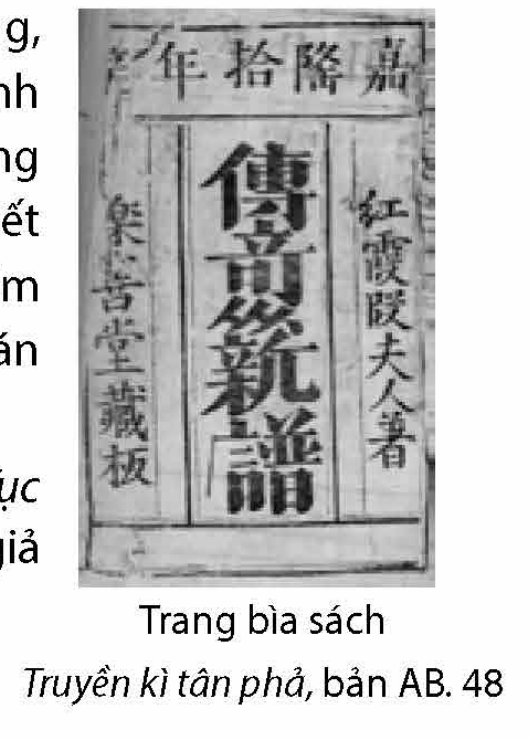
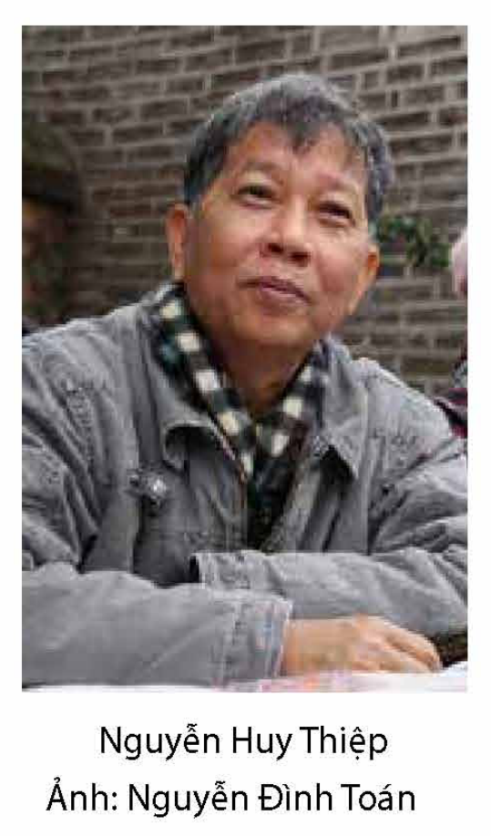

<!-- pdf:95 -->
# BÀI 4: YẾU TỐ KÌ ẢO TRONG TRUYỆN KỂ

## 🎯 Yêu cầu cần đạt

- Nhận biết và phân tích được một số yếu tố của truyện truyền kì như: đề tài, nhân vật, ngôn ngữ, thủ pháp nghệ thuật,...; đánh giá vai trò của yếu tố kì ảo trong truyện truyền kì, liên hệ với vai trò của yếu tố này trong các thể loại truyện khác.
- Vận dụng được kinh nghiệm đọc, trải nghiệm về cuộc sống và kiến thức văn học để đánh giá, phê bình, thể hiện cảm xúc, suy nghĩ của cá nhân về văn bản văn học.
- Vận dụng được kiến thức đã học để phân tích, đánh giá nghệ thuật sử dụng điển cố trong tác phẩm văn học.
- Viết được bài văn nghị luận về việc tiếp nhận ảnh hưởng và sáng tạo trong một (hoặc một nhóm) tác phẩm văn học.
- Biết trình bày bài nói so sánh, đánh giá các tác phẩm văn học, qua đó làm nổi bật những yếu tố vay mượn, cải biến, sáng tạo của một tác phẩm so với tác phẩm mà nó chịu ảnh hưởng.
- Có ý thức và thái độ trân trọng, yêu quý, bảo vệ thiên nhiên; có lối sống hoà hợp với thế giới tự nhiên.

## ĐỌC

### Tri thức Ngữ văn

**Truyện truyền kì**

**Truyện truyền kì** là thể loại văn xuôi tự sự có nguồn gốc từ văn học Trung Quốc, được tiếp nhận và phát triển ở các nước thuộc khu vực chịu ảnh hưởng văn hoá Hán. Thuật ngữ *truyền kì* xuất hiện vào cuối đời Đường, dùng để định danh một loại truyện mới, được phát triển từ loại truyện chí quái, chí dị vốn hình thành trước đó.

Truyện truyền kì phát triển trên nền tảng thần thoại, truyền thuyết,... của văn học dân gian và những tín ngưỡng văn hoá trong đời sống tinh thần của các dân tộc. Trong truyện truyền kì, yếu tố kì ảo được sử dụng như một phương thức nghệ thuật có tính đặc thù nhằm thể hiện các vấn đề của thực tại.

**Yếu tố kì ảo trong truyện truyền kì**

Trong truyện truyền kì, **yếu tố kì ảo** hiện diện ở mọi thành phần cấu tạo chủ yếu của tác phẩm như nhân vật, sự việc và cả ở thủ pháp nghệ thuật.

<!-- pdf:96 -->
- **Nhân vật kì ảo**: Nhân vật có thể có năng lực siêu nhiên, xuất thân kì lạ, diện mạo khác thường, hành tung biến hoá,... Trong truyện truyền kì, nhân vật kì ảo và nhân vật phàm trần đối thoại, tương tác,... với nhau một cách tự nhiên, không có sự cách biệt. Thân phận (khác thường, lạ lùng) của con người cũng trở thành một đối tượng phản ánh đặc biệt, nhằm thể hiện các ý niệm, khắc hoạ bức tranh phong phú về đời sống. Nếu như nhân vật trong thần thoại, truyền thuyết, truyện cổ tích và truyện chí quái thường thuộc về một tuyến nhất định (xấu – tốt, cao cả – thấp hèn,...), đơn điệu (có tính chức năng, thực thi bổn phận,...) thì nhân vật trong truyện truyền kì được chú trọng xây dựng với những góc cạnh đa dạng, thể hiện dụng ý nghệ thuật thâm thuý.

- **Sự việc kì ảo**: Các biến cố, sự kiện, hành động,... kì ảo liên kết với nhau thành chuỗi, tạo nên cốt truyện có tính chất li kì, huyền hoặc. Sự việc kì ảo thường xảy ra trong một không gian và thời gian khác lạ, bất thường. Về không gian, có không gian cõi tiên với cảnh tượng kì thú; không gian âm phủ với khung cảnh hãi hùng; thiên nhiên sóng cuộn gió gào gợi cảm giác sợ hãi;... Về thời gian, có thời gian ban đêm mang đến ấn tượng huyền bí; thời gian hư ảo gợi ấn tượng về sự tĩnh tại, vĩnh hằng;... Cốt truyện của truyện truyền kì thường gắn chặt với các yếu tố văn hoá, tín ngưỡng, truyền thống lịch sử,... của từng dân tộc.

<!-- term: thủ pháp kì ảo -->
- *Thủ pháp nghệ thuật*: Sự kết hợp linh hoạt giữa yếu tố kì ảo (thường được nhận diện tương đối gồm *kì* – kì lạ, khác thường, siêu phàm,... và *quái* – quái dị, ma quỷ, yêu tinh,...) với yếu tố thực là thủ pháp quan trọng của truyện truyền kì. Biểu hiện cụ thể là sự hoà trộn không gian các cõi (thần tiên, trần tục, âm phủ,...); sự thống nhất về thời gian thực và mộng, biến động xoay vần và tĩnh tại bất biến. Việc sử dụng giấc mộng, đan xen thực tại với hồi ức,... cũng là thủ pháp khá phổ biến giúp các tác giả tạo dựng nên một thế giới nghệ thuật có tính phức hợp.

Truyện truyền kì chủ yếu hướng đến các nội dung xã hội – lịch sử. Do đó, yếu tố kì ảo được tác giả sử dụng như một phương thức nhằm lí giải một nội dung hiện thực nhất định; yếu tố kì ảo tham gia vào câu chuyện đã tạo nên sự lôi cuốn, sức hấp dẫn, sự li kì,... của tác phẩm. Trong truyện hiện đại, yếu tố kì ảo vẫn được các nhà văn tiếp tục khai thác, sử dụng theo nhiều cách thức khác nhau.

**Đặc điểm ngôn ngữ trong truyện truyền kì**

Truyện truyền kì thường có sự đan xen tản văn với biền văn và vận văn. Trong một truyện, có thể xuất hiện nhiều “tác phẩm” biền văn hoặc thơ ca được dẫn một cách trực tiếp hoặc gián tiếp, phụ thuộc vào tình tiết, diễn biến của câu chuyện hoặc đối thoại giữa các nhân vật.

Những **đặc điểm nổi bật của ngôn ngữ truyện truyền kì**: thường sử dụng lối nói so sánh – ẩn dụ; ưa hình thức biểu đạt cầu kì, khoa trương, phóng đại; chuộng ngôn từ hoa mĩ; dùng nhiều điển cố, hình ảnh biểu trưng;... Nhìn chung, tính văn chương, giá trị biểu cảm của tác phẩm được tác giả truyện truyền kì đặc biệt chú trọng.

<!-- pdf:97 -->
### Văn bản 1: Hải khẩu linh từ (Đền thiêng cửa bể) (Trích – Đoàn Thị Điểm)
<!-- ocr-ok: đã kiểm trang 97 — chữ VĂN BẢN 1 nằm trong băng màu nghiêng nên OCR nhận sai -->

> ❓ **Trước khi đọc**
> - Hãy chia sẻ cảm nhận về một số truyện dân gian có yếu tố kì ảo mà bạn từng đọc.
> - Kể tên một số truyện truyền kì có yếu tố kì ảo mà bạn biết. Bạn có ấn tượng với tác phẩm nào nhất? Vì sao?

Nguyễn Cơ – cung phi(1) triều Trần là con gái nhà quan. Nàng có tiểu tự(2) là Bích Châu, tính tình đứng đắn, dung nhan tươi tắn, lại thông hiểu âm luật [...]. Vua Duệ Tông(3) biết tiếng, cho kén vào cung.

Một hôm, đúng tiết Trung thu trời đẹp, vua mở yến hội các phi tần. Đứng tựa hiên ngọc, nhà vua đưa mắt ngóng nhìn bốn hướng, thấy cảnh lâu đài tấp nập, mọi nơi ca múa, ánh đèn chói lọi cùng ánh trăng lồng bóng vào nhau. Rồi nhân lúc rượu nồng, nhà vua nảy ra thi hứng, ngẫu nhiên thành một vế đối:

> 💡 [Chỉ dẫn đọc] Giới thiệu lai lịch, chân dung nhân vật chính.
<!-- ocr-ok: đã kiểm trang 97 — thẻ chỉ dẫn đọc trong khung màu bên phải khiến OCR trộn dòng -->

– *Thu thiên hoạ các quải ngân đăng, nguyệt trung đan quế*(4).

Nhà vua ngâm nga một lát, rồi ngoảnh nhìn Nguyễn Cơ mà bảo:

– Nàng có thể đối lại câu ấy chăng?

Nguyễn Cơ liền dời gót sen, hé môi đào chúm chím chậm rãi ứng khẩu(5):

– *Xuân sắc trang đài khai bảo kính, thuỷ để phù dung*(6).
<!-- ocr-ok: đã kiểm trang 97 — câu đối chữ Hán in nghiêng khiến OCR nhận sai chữ trang/thuỷ -->

Nghe nàng ứng đối, nhà vua khen ngợi hồi lâu, rồi ban cho đôi ngọc long kim nhĩ(7) và nhân câu đối của nàng có hai chữ “phù dung” liền lấy hai chữ đó đặt tên cho nàng. Từ đó Phù Dung Nguyễn Cơ được vua yêu quý hơn tất cả các cung phi.

> (1) *Cung phi*: chỉ chung các phi tần, cung nữ trong hoàng cung.
> (2) *Tiểu tự*: tên chữ (tự), một trong số những danh xưng của các nhân vật thời xưa (huý, tự, hiệu, thuỵ,...).
> (3) *Duệ Tông*: tức Trần Duệ Tông (1337 – 1377), vua thứ mười triều Trần, là người phế truất Dương Nhật Lễ (tức Hôn Đức công, kẻ tiếm ngôi Trần Dụ Tông).
> (4) *Gác tía trời thu treo đèn bạc, quế đỏ ở trong trăng.*
> (5) *Ứng khẩu*: ứng đối trực tiếp.
> (6) *Đài trang xuân sắc mở gương trong, phù dung nơi đáy nước.* (*Phù dung*: hoa phù dung, tượng trưng cho vẻ đẹp kiêu sa.)
> (7) *Ngọc long kim nhĩ*: vòng đeo tai bằng vàng, nạm ngọc hình rồng.

<!-- pdf:98 -->
Bấy giờ Nguyễn Cơ thấy chính sự quốc gia tiếp theo thói tệ thời Hôn Đức nên ngày càng suy kém, bèn viết bài biểu *Kê minh thập sách*(1) dâng lên. Đại khái, nội dung của bài đó như sau:

*“Trộm nghĩ dời củi khỏi bếp tranh(2), để phòng cháy trước khi chưa cháy, dùng dâu ràng cửa tổ(3) để ngừa mưa trước lúc chưa mưa. Dân tình dễ chìm đắm vào sự yên vui, còn thế vận khó lòng giữ được luôn bình trị [...]. Thần là kẻ thiếp hèn mọn, tên tự Bích Châu, lúc nhỏ sinh ở bồng môn(4), khi lớn được hầu nơi tiêu thất [...].*
<!-- ocr-ok: đã kiểm trang 98 — bài biểu in nghiêng toàn đoạn khiến OCR nhận sai nhiều dấu -->

*Xin bày tỏ mười điều băn khoăn tấc dạ:*
<!-- ocr-ok: đã kiểm trang 98 — dòng in nghiêng khiến OCR nhận sai chữ bày/mười/tấc -->

*Một là, năng giữ cỗi gốc của nước, trừ hà bạo(5) thì lòng người yên vui.*
<!-- ocr-ok: đã kiểm trang 98 — dòng in nghiêng khiến OCR nhận sai chữ yên vui -->

*Hai là, giữ phép xưa bỏ phiền nhiễu thì kỉ cương không rối.*

*Ba là, nén kẻ quyền thần, để ngăn ngừa chính sự mọt nát.*

*Bốn là, thải bớt kẻ nhũng lạm(6) để trừ tệ khoét đục của dân.*

*Năm là, xin cổ động Nho phong(7), khiến cho đuốc lửa cùng ánh mặt trời soi sáng.*

*Sáu là, mở đường cho người nói thẳng, để cho cánh cửa của lòng thành cùng với đường can gián đều mở toang.*

*Bảy là, cách kén quân, nên chú trọng vào dũng lực hơn là cao lớn.*

*Tám là, chọn tướng nên cầu người thao lược mà không căn cứ vào thế gia(8).*

*Chín là, khí giới quý hồ bền sắc, không chuộng văn hoa.*

*Mười là, trận pháp(9) cốt cho tề chỉnh, cần chi điệu múa.*
<!-- ocr-ok: đã kiểm trang 98 — dòng in nghiêng khiến OCR nhận sai chữ tề/chi -->

*Mười điều kể trên rất là thiết thực, phơi bày tấm lòng trung, mong được bề trên soi xét. Hay tất làm, dở tất bỏ, vua nghĩ đến chăng! Nước được trị, dân được yên, thiếp mong lắm vậy!”*

Tờ sớ dâng lên, vua vui thích quá, vỗ vào cây đàn mà reo lên:

– Không ngờ một nữ tử lại thông tuệ dường này! Thật là một Từ phi(10) ở trong cung của trẫm vậy.

Tuy nhiên nhà vua vẫn còn do dự, chưa đem thi hành [...].

> (1) *Kê minh thập sách*: mười kế sách (khuyên vua) trong buổi dậy sớm để coi việc triều chính. *Kê minh* (gà gáy) là tên bài thơ trong *Kinh thi* (Trung Quốc), thuật lời một phi tần khuyên vua dậy sớm để chăm lo việc nước.
> (2), (3) *Dời củi khỏi bếp tranh, dùng dâu ràng cửa tổ*: dẫn điển trong *Hán thư* (Trung Quốc), ý nói phòng ngừa từ trước để tránh những hậu hoạ.
> (4) *Bồng môn*: cửa liếp lều tranh, chỉ sự nghèo hèn; đối với “tiêu thất” ở sau: buồng lụa, phòng son, chỉ sự quyền quý, cao sang.
> (5) *Hà bạo*: hà khắc, bạo ngược.
> (6) *Nhũng lạm*: nhũng nhiễu, lạm quyền.
> (7) *Nho phong*: phong cách, trào lưu Nho học.
> (8) *Thế gia*: ở đây có nghĩa là gia thế lớn, dòng dõi xuất thân cao quý.
> (9) *Trận pháp*: phép tắc bài binh bố trận.
> (10) *Từ phi*: Từ Huệ phi của Đường Thái Tông (Trung Quốc), là một cung phi hiền đức, từng can gián vua không nên xa xỉ và ham việc động binh.

<!-- pdf:99 -->
*(Lược một đoạn: Năm Long Khánh thứ tư – 1376, có bề tôi tâu trình việc quân Chiêm Thành quấy phá bờ cõi, vua muốn đem quân trừ diệt. Quan Ngự sử Lê Tích can gián “vua không nên lấy giận riêng mà khởi binh”. Bích Châu biết vua không nghe lời nói thẳng và tỏ rõ ý khinh địch, bèn làm biểu dâng lên, nói rõ lẽ thiệt hơn, trong đó nhấn mạnh: bậc thánh nhân nên rộng lượng, đạo trị nước nên chú ý cái gốc, nên nghỉ việc binh để dân chúng yên vui).*

Tờ biểu dâng lên, vua không trả lời, lại hạ lệnh duyệt binh, định đến tháng Chạp kéo quân đi đánh. Nàng thấy lời can không được vua nghe theo, so sức mình, lượng sức giặc, tấm lòng lo nước nhớ vua đăm chiêu ra sắc mặt. Nàng than:

– Nghĩa là vua tôi, ơn là chồng vợ, đã không lấy lòng trung can gián nổi để giữ nền bình trị, lại không khéo lấy lời ngay để ngăn lòng hiếu chiến, thật là sống thừa trong cõi đất trời vậy.

Từ đó, nàng không để lòng đến sự trang điểm, ăn ngủ không yên, cố ý nài xin được đi hộ giá. Vua chuẩn y lời tâu ấy. Đúng ngày, nhà vua đem hai mươi vạn quân lên đường. Bóng cờ rợp trời, thuyền bè đầy sông, ba quân thuận dòng mà tiến, thẳng tới địa giới Kỳ Hoa(1). Các phụ lão nghe tin quân nhà vua đến, tranh nhau dâng lụa cùng thức ăn, đứng xếp hàng ở bờ sông chào đón và tâu:

– Thần miếu ở phía trước rất hiển linh, các tàu thuyền qua lại nếu đến đó lễ bái thì sẽ được thuận buồm xuôi gió, không thì một mái chèo, một mảnh buồm đều bị đắm xuống đáy biển hết!

Vua uỷ lạo các phụ lão, cho lui về, rồi hạ lệnh tạm đóng quân ở bên bãi vắng. Khi ấy đang cuối mùa đông, mưa tuyết mới tạnh, trăng mờ mờ sáng, tiếng gió tiêu điều, cá bơi lượn đớp bóng cây mai, chim về tổ đan cành cổ thụ. Nàng Bích Châu cuốn rèm gấm lên, ngồi tựa mạn thuyền một mình, nàng rót rượu ngon, đốt hương thơm, bao nhiêu cảnh trời biển thiên nhiên đều thu vào trong tầm mắt. Lúc gần nửa đêm, Bích Châu ngửa mặt lên xem tượng trời(2), thấy một đám mây đen từ phương đông lại, lấn vào ngôi sao thứ tư bắc cực(3) rất gấp. Nàng sợ hãi chỉ vào sao ấy mà nói:

– Ngôi sao kia ứng vào phận phi tần, chả biết yêu khí nơi nào dám đến xâm phạm? Có lẽ sao kia khinh ta không có thanh gươm Bao Công(4) hay sao?

> 💡 [Chỉ dẫn đọc] Những chi tiết gợi sự linh thiêng, huyền bí có tác động như thế nào tới cảm xúc của bạn?
<!-- ocr-ok: đã kiểm trang 99 — thẻ chỉ dẫn đọc trong khung màu bên phải khiến OCR tách dòng -->

> (1) *Kỳ Hoa*: tên vùng đất nay thuộc huyện Kỳ Anh, tỉnh Hà Tĩnh.
> (2) *Tượng trời*: nguyên văn là *thiên tượng*, chỉ chung các biểu hiện, đặc điểm thiên văn, khí tượng,...
> (3) *Sao thứ tư bắc cực*: ở đây chỉ nhóm sao Bắc Đẩu, gồm bảy ngôi sao, ở thiên cầu bắc, mỗi sao có tên gọi riêng. Sao thứ tư có tên Hán Việt là Thiên Quyền.
> (4) *Thanh gươm Bao Công*: ý nói công minh chính trực. Bao Công (Bao Chửng) người đời Tống (Trung Quốc), nổi tiếng là người cương trực, liêm khiết, có tài xử án.

<!-- pdf:100 -->
Nói xong, nàng liền đóng cửa sổ đi nằm, trằn trọc không yên giấc. Chợt nghe tứ bề đã điểm trống canh tư. Nàng ngồi dậy bói một quẻ *Kinh dịch*(1), trúng vào quẻ “Phục” biến sang quẻ “Di” [...].

[...] Khi mặt trời chiếu vào cửa sổ trong thuyền, thì thuyền quân tiến đến cửa biển. Bỗng một trận gió lốc cuồn cuộn thổi vào thuyền vua, lớp lớp cờ đào bị gió cuốn sang phía tây nam. Nàng nói:

– Trận gió ấy lạ thay! Tiếng ào ào, sắc ảm đạm, chắc là một thứ gió gian tà!

Vua hỏi:

– Là nghĩa thế nào?

Nàng tâu:

– [...] Xin nhà vua cấp tốc chỉnh bị(2) sáu quân(3) để đối phó.

Nàng nói chưa dứt lời, quả nhiên gió bão nổi lên, sóng biển gào thét. Nhà vua hạ lệnh thả neo để lánh trận gió mạnh. Cuối canh ba bỗng có một người nanh to râu xồm, diện mạo hung tợn, đầu đội mũ lưu tinh, mình mặc áo gấm vảy, bước dài, cúi đầu, nghiêng mình, lắc lư đi thẳng đến trước mặt vua thi lễ. Vua hỏi:

– Ngươi là ai? Đêm khuya tới đây chắc có điều gì muốn nói?

Người ấy thưa:

– Tôi là đô đốc vùng biển nam(4), làm quan nơi giang hồ, hiện còn thiếu người nội trợ. Nghe nói, bệ hạ cung tần rất nhiều, nay ngẫu nhiên gặp nhau, cho nên nổi cơn sóng mạnh để thay câu thơ *Hoa đường*(5). Vậy xin nhà vua ban cho nàng Từ Vân, tôi sẽ kết cỏ(6) để báo đáp. Nếu bệ hạ chỉ để làm của riêng thì tôi không thể nào bỏ qua được.

Vua gật đầu, sực tỉnh giấc. Vua liền cho vời phi tần đến, kể lại giấc mộng. Các cung phi đều tái mặt, nhìn nhau im lặng, không ai nói gì cả. Trong lúc đó, nàng Bích Châu chứa chan nước mắt, nghẹn ngào nói chẳng ra lời, quỳ trước mặt vua, tâu:

– Ngôi đền thiêng kia, các phụ lão đã trình tâu; cái nguy sóng gió đó, chứng nghiệm đã báo. Nếu không phải là oan khiên ngày trước, cũng tất là nghiệp chướng

> (1) *Kinh dịch*: một trong ngũ kinh, bộ sách triết học cổ Trung Hoa, luận về quy luật của trời đất và xã hội thông qua các quẻ bói. Quẻ “Phục” và quẻ “Di” có ý nghĩa trở lại và di dưỡng. Văn bản lược một đoạn, nói việc Bích Châu luận quẻ bói, cho rằng hành quân không có lợi, sau quả đúng như vậy.
> (2) *Chỉnh bị*: chỉnh đốn cho đầy đủ, hoàn bị.
> (3) *Sáu quân*: chỉ quân đội nói chung. Nguyên văn là *lục quân*: theo *Chu lễ* (Trung Quốc), quân đội của thiên tử gồm sáu quân, mỗi quân có 12 500 người.
> (4) *Biển nam*: biển phương nam; ở đây chỉ vùng biển phía nam nước Đại Việt thời bấy giờ.
> (5) *Hoa đường*: một bài thơ trong *Kinh thi* (Trung Quốc), nói chuyện con gái vua được gả cho chư hầu.
> (6) *Kết cỏ*: dẫn điển xưa, kể chuyện một ông già, kết cỏ làm vướng chân giặc để trả ơn người cứu con gái mình; ý nói tìm mọi cách để báo ơn.

<!-- pdf:101 -->
ngày nay. Thiếp không dám tham luyến phồn hoa, tiếc thân bồ liễu, xin trả cho xong cái nợ trước mắt kia.

Vua buồn rầu nói:

– Lành dữ có mệnh, phúc hoạ do trời. Thiêng như Kiềm Doanh(1) cũng không tự chủ trương được. Này xem, Diệt Minh(2) là một tráng sĩ đã chém được con thuồng luồng cướp ngọc bích, Kính Chi(3) là một văn nhân còn giết được loài trai bể quen thói hiếp đáp, huống chi trẫm là một ông vua vạn thặng lẽ nào không tự chủ được, lại tin lời mê hoặc để nàng mắc luỵ oan?

Nàng khẩn khoản:

– Thiếp tuy là phận gái, vả cũng theo đòi bút nghiên, có tin mê những việc ma quỷ đâu! Nhưng khốn, việc đã đến nơi, thế không thể đừng được. Ví bằng nấn ná e lại xảy ra tai biến to, có khi hải thuyền bị tan vỡ hết. Vả lại, khi hành quân, tướng sĩ là trọng, ân ái là nhẹ; đời xưa có người giết vợ, vứt con, cũng là do sự vạn bất đắc dĩ.

Vua nghe nàng nói, lòng thêm buồn bã, không nỡ rời bỏ nàng. Chính lúc ấy gió gào cuộn đất, sóng vỗ ngút trời, đã mấy phen thuyền rồng chực lật úp. Nàng khóc, tâu:

<!-- ocr-ok: đã kiểm trang 101 — thẻ chỉ dẫn đọc bên phải đè ngang đoạn văn nên OCR gộp dòng -->
– Có duyên may được hầu chăn gối, dám tiếc cái chết để nghĩa phụ phàng; không phải Cai trướng(4) ngậm oan, cũng khác Ngôi đình(5) nuốt giận, chỉ hiềm:

> 💡 [Chỉ dẫn đọc] Dự đoán về hành động, ứng xử của nhân vật Bích Châu.
<!-- ocr-ok: đã kiểm trang 101 — thẻ chỉ dẫn đọc trong khung màu bên phải -->

*Ra quân chưa thắng thân xuôi trước,*
*Luống để anh hùng nước mắt tuôn!(6)*
<!-- ocr-ok: đã kiểm trang 101 — hai câu thơ in nghiêng khiến OCR nhận sai chữ thắng/anh -->

Đó là điều di hận của thiếp vậy. Sau khi thiếp chết, xin bệ hạ sửa văn, nghỉ võ, kén dùng người hiền, làm điều nhân nghĩa, dựng chước dài lâu cho nước nhà. Được như thế thì u hồn(7) thiếp có thể ngậm cười nơi chín suối!

Nói xong, nàng nhảy xuống biển. Trong gió gào sóng cuộn, còn nghe văng vẳng tiếng nàng:

– Đa tạ quân vương, từ nay xin vĩnh biệt...

> (1) *Kiềm Doanh*: tên một vị thần (theo truyền thuyết Trung Hoa).
> (2) *Diệt Minh*: nhân vật trong truyền thuyết Trung Hoa. Diệt Minh mang ngọc qua sông, bỗng sông nổi sóng, có hai con thuồng luồng bám vào thuyền, Diệt Minh rút gươm chém chết, sông liền lặng sóng.
> (3) *Kính Chi*: tức Hứa Tốn, người đời Tấn (Trung Quốc), học đạo tiên, chu du giang hồ, dùng phép thuật để trừ hại cho dân, từng giết yêu quái là một con trai biển thường hiếp đáp dân lành.
> (4) *Cai trướng*: màn trướng (doanh trại chỉ huy quân đội) ở Cai Hạ (Trung Quốc). Hạng Vũ bị Hán Cao tổ vây ở Cai Hạ, tình thế nguy cấp, Vũ vẫn uống rượu ngâm thơ cùng vợ là Ngu Cơ. Ngu Cơ hoạ lại một bài rồi tự vẫn.
> (5) *Ngôi đình*: đình Mã Ngôi (Trung Quốc). Đời Đường, An Lộc Sơn dấy loạn, đánh phá vào kinh đô. Khi Đường Huyền Tông chạy đến đình Mã Ngôi thuộc đất Thục, tướng sĩ cho rằng tai hoạ loạn lạc là do Dương Quý Phi và Dương Quốc Trung (anh họ Quý Phi), bèn lùng giết cả nhà Quốc Trung và ép vua xử chết Quý Phi.
> (6) Dịch hai câu thơ của Đỗ Phủ vịnh nhân vật Khổng Minh Gia Cát Lượng thời Tam Quốc (Trung Quốc).
> (7) *U hồn*: linh hồn chịu oan khuất.

<!-- pdf:102 -->
Vua và các phi tần kinh hoàng luống cuống, ai cũng thương khóc. Bỗng chốc, gió tan mưa tạnh, biển hết sóng cồn. Vua sai thuỷ quân mò tìm không thấy tung tích nàng đâu cả.

Nhà vua liền đặt lễ tế, đọc bài văn chiêu hồn [...].

Nhà vua tế xong, ba quân văn võ đều khóc sướt mướt. Vua lập tức hạ lệnh lên đường, tiến sâu vào cửa động Ỷ Mang(1), trúng phải quỷ kế của Bà Ma(2), toàn quân và nhà vua bị hãm ở trong động ấy, khiến bụi trần dậy đất, cáo hổ đầy đường.

\*

Nhưng rồi vận suy đã hết. Bĩ cực thái lai(3). Lòng trời quyến cố(4) nhà Lê mở ra vận hội lớn. Đến triều Thánh Tông trị vì, khoảng niên hiệu Hồng Đức, ngoài biên thuỳ lại có giặc ngoại xâm. Vua nghe tin, bảo tả hữu:

– [...] Ngày nay, hôn chúa Chiêm Thành kiêu căng khinh mạn, đảo ngược luân thường, tàn hại sinh dân, nếu không đem quân đi trị tội, thì làm sao cứu được dân lành?

Rồi hạ chiếu xuất quân, vua thân hành thống suất thuỷ binh tiến phát. Khi ấy gặp mùa xuân khí trời ấm áp, buồm gấm gió đưa, thuyền rồng êm sóng. Hai bên bờ sông chim oanh học nói, ngang mặt nước cò diệc lặn bơi [...].

Chưa đầy một tháng, thuỷ quân đã kéo đến cửa bể Kỳ Hoa. Bỗng nhiên mưa gió mịt mù, sóng biển dâng trào. Vua hạ lệnh cho các chiến thuyền theo thứ tự đóng lại. Trông sang bên kia bờ, cây to rợp đất, khí uất ngang trời, vua bèn cho dời thuyền đến gần xem. Thì ra đó là một toà miếu cổ, hương khói nghi ngút, hoa thơm ngào ngạt, cáo chuột ra vào trong bụi rậm, chim sẻ ríu rít nơi lau lách, hành khách treo tiền giấy trên cành cây, người làng gác thuyền bên cạnh đền. Vua hỏi dân sở tại, biết rõ đầu đuôi chuyện trước, liền chỉ vào miếu truyền rằng:

– Đã lâu nay nghe tiếng nhà ngươi luôn luôn làm nhiều điều ngang ngược. Nay quân của trẫm đi qua đây, còn dám làm điên cuồng như thế, dẫu âm dương cách biệt nhưng phép nước trong tay ta. Nhà ngươi há lại không biết việc mộc yêu(5), cổ quái(6) chăng? Nay phải hối lại lỗi xưa, nếu không thì một phiến gạch vụn, một nắm tro tàn cũng bị phá tan thành đất phẳng.

> 💡 [Chỉ dẫn đọc] Dự đoán về diễn biến câu chuyện.
<!-- ocr-ok: đã kiểm trang 102 — thẻ chỉ dẫn đọc trong khung màu bên phải -->

> (1) *Ỷ Mang*: một địa danh thuộc đất Chiêm Thành ngày trước.
> (2) *Bà Ma*: tên một vị tướng của Chiêm Thành, lập mưu vây hãm quân nhà Trần, dẫn đến thất bại của nhà Trần trong lần chinh phạt này.
> (3) *Bĩ cực thái lai*: hết vận hạn trắc trở tới thời kì phát triển thuận lợi; *Bĩ* (khó khăn), *Thái* (sáng sủa, hanh thông) là tên hai quẻ trong *Kinh dịch*.
> (4) *Quyến cố*: yêu mến, chiếu cố.
> (5) *Mộc yêu*: yêu quái ẩn trong cây cối.
> (6) *Cổ quái*: yêu ma ẩn trong cái trống.

<!-- pdf:103 -->
<!-- pdf:104 -->
Nói xong, tiếng sóng càng mạnh, khi ấy mặt trời đã lặn, bóng trăng lên cao, đêm khuya thỉnh thoảng nghe tiếng người thuyền chài hát văng vẳng ở trong cảng nhỏ. Vua băn khoăn không ngủ, ngồi xem sách. Gần lúc gà gáy, vua tựa án rồng chợp mắt thiu thiu, bỗng thấy một người con gái, nhan sắc rất đẹp, từ dưới nước hiện lên, lạy khóc mà nói:

– Thiếp là cung nhân đời Trần Duệ Tông, không bị chìm đắm ở bến Đố Phụ(1) và cũng không bị nước cuốn ở Tiêm Đài(2), chỉ là hồng nhan bạc mệnh, chiếc bóng một mình, phiêu lưu vào trong tay yêu quái. Từ khi về nơi thuỷ quốc(3), ở lẫn với loài hôi tanh, xấu hổ làm vợ họ Trương(4), bi luỵ làm tù nước Sở(5), ngậm sầu như biển, coi ngày bằng năm, giận thân không thể hoá ra hồn tinh vệ(6), chỉ đau lòng mà thốt ra phú *Li tao*(7). May sao ngày nay gặp đức Thánh hoàng, dám xin cả gan tâu bày, mong được ra tay tế độ, vớt kẻ trầm luân, để cho tiện thiếp lại được trông thấy ánh sáng mặt trời. Đó là ân lớn của bệ hạ tái tạo vậy.

Vua nghe nói xót thương mà bảo:

– Nỗi oan của phu nhân cũng như Liễu Thị(8), có nghĩa hơn Tào Nga(9), ngàn đời về sau cũng lấy làm đau lòng cắn răng! Chỉ hiềm, âm dương cách biệt, thuỷ bộ đôi đường, dẫu có rừng gươm núi giáo cũng chưa rõ làm cách gì để cứu vớt?

Nàng thưa:

– Việc này rất dễ. Bệ hạ nhân từ tín nghĩa khắp cả đến mọi loài vật. Tên đô đốc Nam Minh kia, tội ác đầy rẫy, sóng biển không rửa hết. Ngoài biển Nam Minh có Quảng Lợi vương là vị thống trị nó, xin bệ hạ gửi cho Quảng Lợi vương một lá thư

> (1) *Đố Phụ*: bến sông Đố Phụ ở đất Lâm Thanh (Trung Quốc). Tương truyền, vợ Lưu Bá Ngọc đời Tấn tính hay ghen, Bá Ngọc làm thơ khen ngợi nữ thần sông Lạc, bà giận, gieo mình xuống sông chết, hoá làm thuỷ thần bến sông ấy. Phụ nữ qua bến đều phải bỏ trang sức, không được trang điểm, nếu không thuỷ thần sẽ nổi sóng gió cuốn đi.
> (2) *Tiêm Đài*: đài làm trên sông. Sách *Liệt nữ truyện* (Trung Quốc) chép rằng: Sở Chiêu Vương đi ra ngoài chơi, để phu nhân ở lại Tiêm Đài. Nước sông dâng to, vua sai người về đón nhưng quên không mang vật làm tin nên phu nhân không chịu đi; nước sông lên ngập đài, bà bị chết đuối.
> (3) *Thuỷ quốc*: lãnh vực ở dưới nước, chỉ sông biển.
> (4) *Làm vợ họ Trương*: điển tích này hiện có nhiều thuyết khác nhau. Phỏng đoán là Trương Kỷ, người thời Tam Quốc (Trung Quốc), bị ép uổng trong hôn nhân, số phận gặp nhiều ngang trái. Cũng có thể tác giả dẫn điển về “người con gái Nam Xương” có số phận bất hạnh, vợ của nhân vật Trương Sinh trong tác phẩm của Nguyễn Dữ.
> (5) *Làm tù nước Sở*: thời Xuân Thu (Trung Quốc), Chung Nghi theo tướng nước Sở đi đánh nước Tấn, bị quân Tấn bắt giam.
> (6) *Tinh vệ*: tên một loài chim ở bãi biển. Truyền thuyết Trung Hoa chép chuyện con gái Viêm đế chết đuối ở biển, hoá làm chim tinh vệ, mỗi ngày đều ngậm đá vụn và cành cây nhỏ để lấp biển.
> (7) *Li tao*: tên tác phẩm của Khuất Nguyên (Trung Quốc). Khuất Nguyên tận trung với nước Sở, vì can gián Sở vương mà bị đuổi, nước Sở bị diệt vong. Khuất Nguyên viết *Li tao*, thể hiện chí hướng và nỗi u uất của mình.
> (8) *Liễu Thị*: tương truyền là người đời Đường, xuất thân ca nương, có tài sắc; từng có mối tình duyên với nhà thơ Hàn Hoằng. Về sau, do xã hội biến loạn, nàng phải chịu nhiều nỗi oan khiên, bèn xuống tóc nương nhờ cửa Phật.
> (9) *Tào Nga*: tương truyền vào đời Đông Hán (Trung Quốc), khi Tào Nga mười bốn tuổi, cha bị chết đuối, nàng khóc thương thảm thiết rồi gieo mình xuống sông; ít ngày sau, người ta thấy thi thể nàng ôm xác cha nổi lên.

<!-- pdf:105 -->
trách rằng, thiếu sự ngăn phòng kẻ dưới, tự khắc Quảng Lợi vương phải trị tội tên hung thần kia.

Rồi nàng liền dâng ngọc minh châu mà bảo:

> 💡 [Chỉ dẫn đọc] Chú ý nội dung đối thoại qua thư trao đổi giữa Quảng Lợi vương và Lê Thánh Tông.
<!-- ocr-ok: đã kiểm trang 105 — thẻ chỉ dẫn đọc trong khung màu bên phải -->

– Ngọc châu này gọi tên là triệt hải(1), soi thấy cả nơi âm u, kính dâng lên để thay thông thiên tê(2) ở Ngưu Chử(3)...

Nói xong nàng biến mất. Vua duỗi tay ra nhặt lấy ngọc châu, chợt tỉnh giấc thì tiếng chuông đã báo sáng. Nhà vua sai thị thần là Nguyễn Trọng Ý viết một phong thư, bắn ra ngoài biển, treo ngọc minh châu nhìn ra, quả nhiên thấy lầu son gác tía, thành đồng ao nóng, con cháu ngư long cưỡi ngựa đi kiệu, qua lại dưới thành, không lúc nào ngớt bóng. Khi ấy có Kình hiệu uý(4) đi tuần tiễu về, nhặt được bức thư mà nhà vua đã niêm phong cẩn thận, vội vàng đem vào tâu.

\*

Chính lúc ấy Quảng Lợi vương ngồi ở điện Linh Đức, sai Long thượng thư(5) mở ra đọc. Thư rằng:

“Thường nghe: ban phúc người thiện, ra tai kẻ dâm, đạo trời nhanh như tiếng dùi với trống; ban thưởng người tốt, phạt tội kẻ xấu, vương chính(6) vững như chất đá cùng vàng, trên dưới như nhau, xưa nay một lẽ. Nay trẫm nối ngôi chính truyền của tổ tiên, đem quân đánh Chiêm Thành là do tội ác của chúng, trời đất thần người đều không tha thứ. Quân thuyền trăm vạn tiến phát, ba nghìn thuỷ lộ mở đường. Hoàng việt(7) vẫy thì cá tôm chìm lặn, loài vật cũng biết sợ hãi; bạch mao(8) trỏ thì gió mây biến sắc, ai là không sợ giản thư(9)? Ấy thế mà bầy tôi diều hâu độc dữ của ông còn dám chống lại đội quân chim cắt tung cánh(10) của trẫm, y làm yêu làm quái, hiếp oan cung nữ vua Trần, tham sắc tham tài, lại nhiễu hại tính mệnh dân lành. Kẻ kia tất hung hăng quá lắm, sao ngài cứ lặng ngắt ngồi yên? Phải sáng suốt soi gian, đừng để kẻ tiểu nhân lẫn với người quân tử; nên quyết đoán việc làm, nghiêm dùng quốc pháp, giết bọn gian tà. Xin gửi phong thư, chờ mong phúc bút”.

> (1) *Triệt hải*: nước biển (hải) trong thấu suốt (triệt); ở đây ví viên ngọc châu như chiếc gương thần, có thể soi thấu tất cả.
> (2) *Thông thiên tê*: chiếc gương trong suốt như băng, có thể soi thấu mọi chỗ trong trời đất. Xem thêm cước chú 3 (Ngưu Chử).
> (3) *Ngưu Chử*: một bến sông trên dòng Trường Giang, thuộc tỉnh An Huy (Trung Quốc). Truyền rằng, Ôn Kiệu người đời Tấn, qua bến sông này, dùng gương thần soi thấy ở đó có nhiều loài thuỷ tộc rất kì quái.
> (4) *Kình hiệu uý*: tướng cá kình.
> (5) *Long thượng thư*: thượng thư rồng.
> (6) *Vương chính*: nền chính trị tốt đẹp; nói tắt của *nhân chính* (nền chính trị theo đường lối nhân nghĩa) và *vương đạo* (đạo đức tốt đẹp của bậc quân vương), theo tư tưởng Nho học của Mạnh Tử.
> (7) *Hoàng việt*: cái búa vàng.
> (8) *Bạch mao*: cờ có gắn lông trắng. Chu Vũ Vương (Trung Quốc) khi đánh nhà Trụ từng dùng hoàng việt và bạch mao để chỉ huy quân sĩ.
> (9) *Giản thư*: tờ lệnh của vua.
> (10) *Chim cắt tung cánh*: ý nói đội quân có sức mạnh như chim cắt tung cánh.

<!-- pdf:106 -->
Quảng Lợi vương nghe đọc xong, mặt rồng nổi giận, nói:

– Người nào cai quản địa phương ấy?

Ngao ngự sử(1) ở trong triều ban nhảy ra tâu:

– Đó là hải khẩu Giao đô đốc vậy. Y là cành vàng lá ngọc, chịu trách nhiệm trông coi một phương trời, chuyên quyền phóng túng, tham sắc đẹp, ăn hối lộ.

Quảng Lợi vương đập gươm xuống bàn nói:

– Quả nhân ít đức, dùng người không xứng đáng; lũ các ngươi a dua để cho y làm rối loạn kỉ cương, mang tiếng với trần gian; tội ác của y không khác gì tứ hung(2) và ngũ cẩu(3), thực đáng sợ vậy! Nay phải phanh thây để làm răn cho hạng người tham bạo.

Khi ấy Côn thừa tướng(4) đứng lên tâu:

– Đức xấu của Giao đô đốc tung khắp cả trên trần gian và dưới âm ti, nếu chỉ dùng hình pháp(5) trị y, chưa đủ làm cho mọi người hả dạ. Nay không gì hơn là, viết thư trả lời, rồi sai tướng đi bắt để làm tội một cách công khai, cho tỏ rõ hiến chương(6) của chúng ta rất nghiêm ngặt.

Quảng Lợi vương cho là phải, liền hạ lệnh cho Ngạc tổng binh(7), Miết tòng sự(8) đem vài nghìn lính mặc áo giáp, đội mũ trụ đi tróc nã Giao đô đốc. Lại sai Lí hàn lâm(9) thảo thư, Long các thần(10) sửa lại, Quy đốc bưu(11) sung chức giang sứ(12) mang thư ra đầu bãi biển. Vua sai học sĩ Lương Thế Vinh nhặt lấy xem. Đó là một lá thư viết vào lụa, mở ra đọc, thấy thư viết:

“Thường nghe: khí mùa xuân ấm áp, hang tối chưa kịp thấm nhuần; ánh mặt trời soi chung, chậu úp không thể thấu đến. Vì trời đất còn có chỗ thiếu sót mà tạo hoá cũng phần nhiều không đều. Tôi đây thẹn rằng, tài hèn lạm giữ chức cao, hết lòng cầu tìm người hiền tài, mong có sự phò giúp của lương tá. Vốn đã biết, vương đạo phải công bằng rất mực, nhưng khốn nỗi gian tà còn che lấp thông minh. Cho nên phiên trấn xa xôi, còn có cường thần làm bậy... Dẫu là hai nơi âm dương cách biệt, nhưng ba thước gươm sáng chẳng dung gian tà.

Kính cẩn trả lời, dám mong xét đến”.

> (1) *Ngao ngự sử*: ngự sử cá ngao.
> (2) *Tứ hung*: bốn kẻ hung bạo thời vua Thuấn trong truyền thuyết Trung Hoa, sau đều bị Thuấn trị tội.
> (3) *Ngũ cẩu*: năm con chó; chỉ năm kẻ gian tà đời Đường (Trung Quốc), hùa theo bè đảng của Vũ Tam Tư làm loạn.
> (4) *Côn thừa tướng*: thừa tướng cá côn.
> (5) *Hình pháp*: chỉ chung pháp luật và hình phạt theo quy định.
> (6) *Hiến chương*: chỉ luật lệ, phép tắc của quốc gia.
> (7) *Ngạc tổng binh*: tổng binh cá sấu.
> (8) *Miết tòng sự*: tòng sự ba ba.
> (9) *Lí hàn lâm*: hàn lâm cá chép.
> (10) *Long các thần*: các thần giao long.
> (11) *Quy đốc bưu*: đốc bưu rùa.
> (12) *Giang sứ*: người sứ đi tuần vùng sông bể.

<!-- pdf:107 -->
Đọc xong thư ấy, vua trao lại cho quần thần cùng xem. Khi mọi người để mắt trông ra ngoài biển đều thấy: đi trước là Ngạc tổng binh, theo sau có các loại cá lớn, các loài rùa, ba ba,... như sấm như sét tiến thẳng vào hải phận của Giao thần(1). Miết tòng sự dõng dạc tuyên chỉ:

> 💡 [Chỉ dẫn đọc] Chú ý những chi tiết miêu tả việc thực thi luật pháp ở thuỷ cung.
<!-- ocr-ok: đã kiểm trang 107 — thẻ chỉ dẫn đọc trong khung màu bên phải -->

– Tên Giao thần kia, nhỏ mọn tài hèn, hùng phiên trọng nhậm(2); không giữ lòng chính trực, lại quen thói tà dâm, dấn thân nơi nguồn lợi tham ô, chìm đắm vào ba đào sắc dục. Thật là đáng đem ra chém giết, dùng chính trăm hình(3); nhưng nghĩ đến đánh dẹp có công hãy khoan bát nghị(4) đày lên lục địa, cho được toàn sinh. Khâm thử(5)!

[...] Giao thần cụp đuôi biến mất.

Bỗng chốc, sóng biếc lặng im, non xanh phơi bóng, “hòn ngọc Minh Châu”(6) lúc trước không biết hiện thân vào nơi nào, chỉ thấy pha lê nhấp nhánh, hương hài nổi lên, vẻ đẹp vẫn y nguyên, nhan sắc bình sinh không thay đổi. Vua cho lấy lễ hoàng hậu mai táng, làm văn tế, dâng lên lễ điện(7) rồi đề lên tường bên trái miếu ấy bài thơ:

*Một vị hiền phi của vua Trần,*
*Hi sinh vì nước quản chi thân.*
*Đào hoa chìm nổi cơn giông tố,*
*Đỗ Nhược(8) mơ màng giấc mộng xuân.*
*Dòng nước vô tình chôn Sở phụ(9),*
*Hương hồn nào chỗ viếng Tương quân(10).*
*Than ôi! Trăm vạn quân hùng mạnh,*
*Lại kém thư sinh một hịch văn!*
<!-- ocr-ok: đã kiểm trang 107 — bài thơ in nghiêng khiến OCR nhận sai nhiều từ -->

Đề thơ xong, nhà vua chỉnh đốn quân lữ lên đường. Quân đi đến đâu như gió mùa thu bẻ cành khô, núi Thái Sơn đè quả trứng, bắt sống tù trưởng, hát khúc khải hoàn. Khi vua kéo quân về, gặp lúc mặt trời xế chiều, thuyền quân lại đi qua nơi cũ, nhân tiện đóng quân ở dưới đền.

Đêm ấy trăng sáng sao thưa, nước trời hoà sắc, vua hồi tưởng lại việc thần thuồng luồng nổi sóng, bà Duệ phi quyên sinh, ngậm ngùi than thở:

> (1) *Giao thần*: thần thuồng luồng.
> (2) *Hùng phiên trọng nhậm*: (được giao) trọng trách lớn ở nơi phiên dậu trọng yếu.
> (3) *Dùng chính trăm hình*: ở đây có nghĩa đáng bị trừng trị cả trăm lần theo luật pháp.
> (4) *Bát nghị*: sách *Chu lễ* (Trung Quốc) ghi chép về “bát nghị” – tám phép để xét khoan giảm trong xử án.
> (5) *Khâm thử*: từ có tính khuôn mẫu, kết thúc các sắc lệnh của vua, hàm ý mọi người phải tôn trọng chấp hành.
> (6) *Ngọc Minh Châu*: ở đây chỉ nàng Bích Châu.
> (7) *Lễ điện*: bày rượu và tế phẩm dâng cúng thần linh.
> (8) *Đỗ Nhược*: tên một bến sông, dẫn điển xưa, nói ý niệm về cuộc đời tựa như giấc mộng.
> (9) *Sở phụ*: phu nhân nước Sở, xem cước chú 2 ở tr. 100.
> (10) *Tương quân*: bà phi sông Tương. Theo truyền thuyết Trung Hoa, vua Thuấn đi tuần phương nam, chết ở núi Thương Ngô; hai bà phi của vua đi tìm, trông về Thương Ngô mà khóc rồi trầm mình xuống sông, hoá làm thần sông ấy.

<!-- pdf:108 -->
– Quốc gia hưng vượng tất có điềm lành, quốc gia suy đồi tất có điềm dữ, điềm lành hay điềm dữ thật có liên quan đến đức của ông vua tốt hay xấu.

Nói xong, trong lòng nhà vua bồi hồi không ngớt. Ngọn đèn lờ mờ, đồng hồ nhỏ giọt, chợt nhà vua thấy một mĩ nhân vẻ mặt đoan trang, mặc áo trắng, đến trước vái chào mà thưa:

– Nhờ ơn Thánh hoàng tế độ u hồn, nay thiếp đã lên tiên, tiêu diêu nơi mây trắng. Thượng đế thương lòng trung thành của thiếp, sai giáng linh xuống trần, được trông coi hoạ phúc một phương. Thiếp đã mở xem tiên tích, biết bệ hạ là Tiêu Điện tiên đồng, ngày sau được gặp, sẽ ngậm vành đáp tạ để trả ơn to như núi cao biển rộng của người. Duy có một điều thắc mắc về câu kết bài thơ ngự đề vàng ngọc ở trên tường, làm cho thiếp không được yên lòng về chỗ vua tôi, chồng vợ.

> 💡 [Chỉ dẫn đọc] Chú ý sự lặp lại của yếu tố “giấc mộng” trong diễn biến của câu chuyện.
<!-- ocr-ok: đã kiểm trang 108 — thẻ chỉ dẫn đọc trong khung màu bên phải -->

Vua gật đầu nói:

– Phu nhân lúc nào trong lòng cũng nhớ đến vua, thực là một người anh kiệt trong đám nữ lưu. Trẫm sẽ vì phu nhân mà đổi lại câu ấy.

Nói rồi vua cầm bút định viết, liền sực tỉnh dậy, hoá ra một giấc chiêm bao. Sáng hôm sau, vua cho quét vôi câu cũ mà viết lại rằng:

*Muôn thuở cương thường không hổ thẹn,*
*Thư cưu(1) gợn sóng dưới chân đền.*

Sau khi về đến kinh đô, nhà vua hạ chiếu cho lập đền thờ phu nhân, cấp ruộng tế và cắt người coi đền, lại sắc phong thần, trong đó có hai chữ “Chế Thắng”(2). Mãi đến đời nay khói hương vẫn còn nghi ngút, rất là linh ứng.

**Ngô Lập Chi** dịch
(Chỉnh lí theo: Nguyễn Đăng Na, *Văn xuôi tự sự Việt Nam thời trung đại*, tập một, *Truyện ngắn*, NXB Giáo dục, Hà Nội, 1999, tr. 329 – 343)

> (1) *Thư cưu*: loài chim nước, sống thành đôi, không rời nhau. Bài *Quan thư* trong *Kinh thi* (Trung Quốc) có câu thơ nói về loài chim này, thể hiện sự hoà hợp lứa đôi.
> (2) *Chế Thắng*: vua Lê Thánh Tông ban sắc phong nàng Bích Châu là Chế Thắng phu nhân; theo nghĩa chữ Hán, *chế thắng* có ý nghĩa văn chương là tạo ra khuôn phép đẹp đẽ.

> 📚 **Thông tin tác giả & tác phẩm**
>
> **Đoàn Thị Điểm** (1705 – 1748) biệt hiệu Hồng Hà nữ sĩ, người huyện Văn Giang, tỉnh Hưng Yên, sinh ra trong một gia đình có truyền thống khoa bảng. Cha và anh đều đỗ đạt và làm nghề dạy học; bản thân bà cũng từng mở trường và có công dạy học cho cung nữ trong phủ chúa Trịnh. Đoàn Thị Điểm là người tài sắc, biết nghề làm thuốc, văn chương nổi tiếng đương thời. Tác phẩm còn lại của bà gồm có *Truyền kì tân phả* và bản dịch (diễn âm) *Chinh phụ ngâm khúc* (nguyên tác Hán văn của Đặng Trần Côn).
>
> *Truyền kì tân phả* (Cuốn phả mới về truyện “Truyền kì”) còn có tên khác là *Tục Truyền kì lục* (Ghi chép nối tiếp sách “Truyền kì”). Tên truyện cho thấy rõ ý của tác giả

<!-- pdf:109 -->
> là muốn tiếp nối *Truyền kì mạn lục* của Nguyễn Dữ. Bản gốc *Truyền kì tân phả* đã thất lạc, hiện còn biết được một số dị bản. Bản lưu truyền hiện nay do nhà sách Lạc Thiện xuất bản (đầu thế kỉ XIX).
>
> *Hải khẩu linh từ* (*Đền thiêng cửa bể*) là một truyện trong *Truyền kì tân phả*, kể về nhân vật chính là nàng Bích Châu, một cung phi đời Trần, là người tài sắc đức độ, luôn quan tâm chính sự. Truyện được viết dựa trên một số sự kiện lịch sử có thật với những tên người, tên đất xác thực nhưng phần hư cấu nghệ thuật vẫn hết sức đậm nét. Ở đây, tác giả đã đưa vào nhiều yếu tố kì ảo để chuyển đổi hình thức các sự kiện nhằm thể hiện tư tưởng và quan niệm thẩm mĩ riêng của mình.
>
> Riêng về nhân vật lịch sử Bích Châu, do các tài liệu ghi chép quá ít nên còn có những nghi vấn nhất định. Các thông tin về bà chủ yếu dưới dạng truyền tụng. Theo đó, bà sống trong khoảng đời vua Trần Dụ Tông (1336 – 1369), quê ở huyện Hải Hậu, tỉnh Nam Định; là con gái của một vị tướng họ Nguyễn (Nguyễn Tướng công). Bích Châu còn có tên tự là Bích Lưu (theo chữ Hán, *bích – châu – lưu* đều có nghĩa là các loại ngọc quý), dung mạo xinh đẹp, giỏi văn chương. Sau khi được tuyển vào cung, Bích Châu thường được vua Dụ Tông gọi là Nguyễn Cơ (*cơ* có nghĩa là người con gái quý phái). Đời Lê, vua Lê Thánh Tông có làm thơ viếng cảnh ngôi đền thờ bà. Việc bà được các triều đại phong kiến cấp sắc phong và cho thờ phụng ở vị trí thượng đẳng thần là một trong những cơ sở cho phép đoán định chuyện về Bích Châu là câu chuyện người thật, việc thật. Đền Hải Khẩu (nhân dân thường gọi là đền Bà Hải) thờ Chế Thắng phu nhân Nguyễn Thị Bích Châu nay ở thôn Hải Khẩu, thuộc huyện Kỳ Anh, tỉnh Hà Tĩnh. Đền có từ trước đời Lê (có tài liệu cho rằng đền do Lê Thánh Tông cho lập), được trùng tu nhiều lần, đến nay vẫn được nhân dân hương khói thờ phụng với lòng thành kính. Hiện chưa xác định rõ tên thôn “Hải Khẩu” có từ bao giờ nên các bản dịch tác phẩm đều dịch nhan đề theo nghĩa chữ Hán là “cửa bể”.

> ❓ **Sau khi đọc**
> 1. Lập bảng thống kê các sự kiện, nhân vật, chi tiết,... có tính chất linh thiêng, kì ảo xuất hiện trong văn bản.
> 2. Thông qua lời can gián, suy nghĩ và hành động của nàng Bích Châu, bạn có nhận xét gì về phẩm chất, đức tính của mẫu hình người phụ nữ mà tác giả đã xây dựng trong truyện?
> 3. Sự đan xen giữa yếu tố lịch sử và yếu tố kì ảo trong câu chuyện đã đóng vai trò như thế nào trong việc thể hiện thông điệp của tác phẩm?
> 4. Trong số các chi tiết, sự việc kì ảo trong *Đền thiêng cửa bể*, theo bạn, chi tiết hoặc sự việc nào hấp dẫn hơn cả? Vì sao?
> 5. Nêu suy nghĩ của bạn về quan điểm hiện thực của tác giả thể hiện qua:
>    a. Việc miêu tả “bộ máy nhà nước” của Quảng Lợi vương.
>    b. Nội dung hai bức thư trao đổi của vua Lê Thánh Tông và Quảng Lợi vương.
> 6. Trình bày nhận xét về nghệ thuật sử dụng ngôn ngữ đối thoại trong văn bản.
> 7. Bình luận về chi tiết nàng Bích Châu hiển linh giúp vua thắng trận và việc nàng được lập đền thờ.

#### Kết nối đọc – viết

Viết đoạn văn (khoảng 150 chữ) nêu cảm nhận của bạn về hình tượng nhân vật Bích Châu trong tác phẩm.

<!-- pdf:110 -->
### Văn bản 2: Muối của rừng (Trích – Nguyễn Huy Thiệp)
<!-- ocr-ok: đã kiểm trang 110 — chữ VĂN BẢN 2 nằm trong băng màu nghiêng nên OCR bỏ sót -->

> ❓ **Trước khi đọc**
> - Nêu một số tác phẩm văn học hiện đại có yếu tố kì ảo mà bạn biết. Hãy chia sẻ cảm nghĩ của bạn về yếu tố kì ảo ở một tác phẩm trong số đó.
> - Theo bạn, con người cần phải ứng xử với thiên nhiên như thế nào?

**(Lược một đoạn:** *Rừng mùa xuân xanh ngắt và trong lành. Được con trai tặng khẩu súng săn ưng ý, ông Diểu mặc quần áo ấm, đội mũ lông, đi giày cao cổ, mang theo nắm xôi nếp, đi vào rừng. Bỏ qua những con chim xanh, gà rừng gặp bên lối mòn, ông Diểu đi sâu vào rừng tìm bắn con thú xứng tầm).*
<!-- ocr-ok: đã kiểm trang 110 — đoạn lược thuật in nghiêng khiến OCR nhận sai một số từ -->

[...] Ông Diểu ngồi im dễ đến nửa giờ. Mưa xuân mỏng và mịn. Thời tiết ấm. Dễ đến rất lâu ông Diểu mới lại có dịp ngồi yên thế này, không nghĩ gì, không buồn không vui, không lo lắng, cũng không tính toán. Sự tĩnh lặng bình thản của rừng xuyên suốt qua ông.

Ào một cái, từ trong rừng dâu da bỗng như có tiếng quẫy động của một con vật khổng lồ. Ông Diểu biết là con đầu đàn đã đến. Con khỉ này cũng gớm lắm đây. Nó xuất hiện với một nghi lễ vương chủ. Tự tin đến thô bạo. Ông Diểu mỉm cười và chăm chú nhìn.

Sau tiếng động vài phút thì con đầu đàn đến thật. Nó văng mình rất nhanh đến nỗi gần như không có phút nghỉ ở mỗi chặng dừng. Ông Diểu thán phục vì sự nhanh nhẹn dẻo dai của nó. Thoắt một cái, nó biến mất. Một nỗi xót xa khiến ông nhói lòng: số phận của bậc đế vương không trùng với số phận ông. Niềm vui nhen lên từ khi ở nhà ra đi trong ông vơi đi một nửa.

> 💡 [Chỉ dẫn đọc] Chi tiết nói về sự chuyển đổi tâm trạng đột ngột của nhân vật có thể báo hiệu điều gì?
<!-- ocr-ok: đã kiểm trang 110 — thẻ chỉ dẫn đọc trong khung màu bên phải -->

Khi con khỉ đầu đàn biến mất thì ào ra một đàn khỉ đến hai chục con từ rất nhiều hướng. Con vắt vẻo trên cao, con đánh đu ngang cành. Có con lại nhảy xuống đất. Ông Diểu thấy ba con khỉ cứ quấn lấy nhau: con khỉ đực, con khỉ cái và đứa con nó.

<!-- pdf:111 -->
Ý nghĩ con khỉ đực sẽ là con mồi bám lấy ông Diểu tức thì. Cái thằng bố ô trọc ấy! Đồ phong tình phóng đãng(1)! Vị gia trưởng cộc cằn! Nhà lập pháp(2) bẩn thỉu! Tên bạo chúa khốn nạn!

Ông Diểu thấy nóng bừng người. Ông bỏ mũ và áo bông ra đặt dưới lùm cây. Ông để cả nắm cơm xuống đất. Ông từ từ dịch chuyển sang chỗ đất trũng thấp hơn. Ông nhìn kĩ và thấy con khỉ canh gác là con khỉ cái. Thế là thuận lợi rồi. Bởi giống cái bao giờ cũng dễ phân tâm. Đấy, thấy chưa? Đang canh gác mà đi bắt rận ở người thì còn gì nữa? Với giống cái thì thân thể mình là quan trọng nhất. Điều ấy thật giản dị và đẹp. Nhưng điều ấy lại đầy xót xa...

Ông Diểu tính toán rồi luồn theo hướng ngược gió với con khỉ cái canh gác. Phải tiếp cận đàn khỉ đến hai chục mét thì mới bắn được. Ông bò nhanh và rất khéo léo. Xác định được con mồi rồi là ông chắc chắn thành công. Thiên nhiên đã dành cho ông chứ không ai khác chính con khỉ ấy. Thậm chí ông biết dù ông có đi mạnh chân một chút, gây nên một sự bất cẩn nhố nhăng nào đó cũng chẳng hề gì. Điều ấy tưởng như phi lí mà thật bình thường.

> 💡 [Chỉ dẫn đọc] Theo dõi sự tương phản giữa suy nghĩ của nhân vật và đời sống của đàn khỉ trong rừng.
<!-- ocr-ok: đã kiểm trang 111 — thẻ chỉ dẫn đọc trong khung màu bên phải -->

Tuy nghĩ vậy nhưng mà ông Diểu vẫn cứ tiếp cận đàn khỉ một cách thận trọng. Ông biết thiên nhiên đầy rẫy bất ngờ. Thận trọng chẳng bao giờ thừa.

Ông Diểu tì súng vào một chạc cây. Cái bộ ba trong gia đình khỉ không hề biết rằng tai hoạ đến gần. Con khỉ bố vắt vẻo trên cây bứt quả ném xuống dưới đất cho hai mẹ con. Trước khi ném, bao giờ nó cũng chọn quả ngon chén trước. Hành động ấy thật là đê tiện. Ông Diểu bóp cò. Tiếng súng dữ dội đến nỗi đàn khỉ lặng đi dễ đến một phút. Con khỉ đực buông tay ngã nhào xuống đất nặng nề.

Sự hỗn loạn của cả đàn khỉ khiến cho ông Diểu sợ hãi run lên. Ông vừa làm điều ác. Chân tay ông rủn ra, giống cảm giác như người vừa mới làm xong việc nặng. Đàn khỉ thoắt biến vào rừng. Con khỉ mẹ và con khỉ con cũng chạy theo đàn. Được một đoạn, con khỉ mẹ bỗng quay trở lại. Con khỉ đực bị đạn vào vai, nó gượng dậy, nhưng lại vật xuống.

> (1) *Phóng đãng*: buông thả, không có ý thức kiềm chế mình trong các sinh hoạt.
> (2) *Nhà lập pháp*: định ra luật pháp, đây chỉ người có quyền định ra mọi phép tắc, quy định.

<!-- pdf:112 -->
Con khỉ cái tiến đến gần con khỉ đực một cách thận trọng, nó nhìn ngó xung quanh. Sự im lặng này thật đáng ngờ. Nhưng rồi con khỉ đực cất tiếng gọi nó, tiếng gọi buồn thảm đau đớn. Nó dừng lại lắng nghe với vẻ khiếp sợ hoảng loạn.

– Chạy đi!

Ông Diểu rên lên khe khẽ. Nhưng con khỉ cái tuồng như muốn liều thí mạng, nó đến gần nâng con khỉ đực nhỏm lên.

> 💡 [Chỉ dẫn đọc] Chú ý sự mâu thuẫn trong các hành động của nhân vật.
<!-- ocr-ok: đã kiểm trang 112 — thẻ chỉ dẫn đọc trong khung màu bên phải -->

Ông Diểu tức giận giương súng. Hành động hi sinh thân mình của con khỉ cái làm ông căm ghét. Đồ gian dối, mày chứng minh tấm lòng cao thượng hệt như một bà trưởng giả! Sự tan rã đạo đức bắt đầu từ những tấn kịch thế này, lừa ông sao được?

Khi ông Diểu chuẩn bị bóp cò thì con khỉ cái quay lại nhìn ông. Đôi mắt nó sợ hãi kinh hoàng. Nó vứt phịch con khỉ đực xuống đất rồi chạy biến đi. Ông Diểu thở phào rồi khẽ bật cười. Ông nhô hẳn người ra khỏi chỗ nấp.

– Sai lầm rồi!

Ông Diểu rủa thầm vì ông vừa bước ra thì con khỉ cái quay lại tức thì. “Nó biết mình là người thì thôi hỏng việc!”. Y như rằng, con khỉ cái vừa lén nhìn ông vừa lao đến chỗ con khỉ đực. Nó ghì lấy con khỉ đực vào lòng rất nhanh và khéo. Cả hai lăn tròn trên đất. Bây giờ thì con khỉ cái chắc chắn sẽ điên cuồng như một mụ ngốc. Nó sẽ cuồng nhiệt hi sinh bởi lòng cao thượng của nó sẽ được thiên nhiên tính điểm. Ông đã lộ mặt là tên ám sát! Dù chết nó vẫn nhe răng để cười. Bất luận thế nào ông cũng sẽ đau đớn, sẽ thao thức, thậm chí ông sẽ chết sớm hai năm nếu ông bắn nó lúc này. Tất cả chỉ vì ra khỏi chỗ nấp sớm mất hai phút.

> 💡 [Chỉ dẫn đọc] Chú ý sự thay đổi điểm nhìn và cách đánh giá về ông Diểu.
<!-- ocr-ok: đã kiểm trang 112 — thẻ chỉ dẫn đọc trong khung màu bên phải -->

– Thôi Diểu ơi... – Ông buồn bã nghĩ, – với đôi chân thấp khớp thế này thì làm sao mày chạy nhanh bằng lòng tận tuỵ, thuỷ chung của khỉ?

Như trêu ngươi, hai con khỉ vừa chạy vừa dìu lấy nhau, con khỉ cái thỉnh thoảng lại huơ huơ đôi chân vòng kiềng trông vừa tức cười lại vừa dâm đãng. Ông Diểu bực mình lấy đà ném mạnh khẩu súng văng về phía trước. Ông mong muốn con vật hoảng sợ buông mồi.

Từ mô đá, bỗng nhiên con khỉ con xuất hiện. Nó túm lấy dây súng của ông kéo lê trên đất. Ba con khỉ vừa bò vừa chạy cuống cuồng. Ông Diểu ngớ ra một lát rồi phá lên cười: tình thế của ông thật là lố bịch!

> 💡 [Chỉ dẫn đọc] Theo dõi sự tự khám phá của ông Diểu về chính mình.
<!-- ocr-ok: đã kiểm trang 112 — thẻ chỉ dẫn đọc trong khung màu bên phải -->

<!-- pdf:113 -->
Nhặt đất đá ném theo lũ khỉ, ông Diểu vừa đuổi vừa la. Lũ khỉ hết sức kinh hoàng, hai con chạy về phía núi, còn con khỉ nhỏ chạy về phía vực. “Mất súng thì hỏng!”. Ông Diểu nghĩ thế và đuổi theo con khỉ nhỏ. Khoảng cách rút ngắn đến mức nếu không vì mắc nền đá lởm chởm, ông lao nhoài ra là tóm ngay được khẩu súng.

Việc ông Diểu dồn con khỉ nhỏ đến bờ miệng vực đưa đến hậu quả khôn lường. Giữ chặt dây súng, nó lăn xuống miệng vực không chút chần chừ. Vì ít kinh nghiệm, nó không tìm ra giải pháp nào khác trong trường hợp ấy.

Ông Diểu tái mặt, mồ hôi toát ra như tắm. Ông đứng trên miệng vực nhìn xuống rùng mình. Từ dưới sâu hun hút vang lên tiếng rú thê thảm của con khỉ nhỏ. Trong kí ức của ông chưa hề có tiếng rú nào tương tự thế này. Ông Diểu lùi lại kinh hoàng. Từ dưới miệng vực, sương mù dâng lên cuồn cuộn, trông vừa kinh dị, vừa đầy tử khí. Sương mù len vào từng chân bụi cây và xoá rất nhanh cảnh vật. Ông Diểu chạy lùi trở lại. Phải lâu lắm, có lẽ từ thời thơ ấu, ông Diểu mới lại có lần chạy như ma đuổi thế này.

> 💡 [Chỉ dẫn đọc] Hình dung cảnh tượng được miêu tả ở đoạn này.
<!-- ocr-ok: đã kiểm trang 113 — thẻ chỉ dẫn đọc trong khung màu bên phải -->

Đến chân núi đá, ông Diểu kiệt sức. Ông ngồi phệt xuống nhìn về phía vực. Bây giờ sương mù đã trùm kín nó. Ông sực nhớ ra đây là khu vực đáng sợ nhất trong thung lũng, khu vực mà cánh thợ săn đặt tên cho là Hõm Chết. Ở hõm sâu này, gần như đều đặn, năm nào cũng có người bị sương mù giăng bẫy làm cho toi mạng.

“Hay là ma?” – Ông Diểu nghĩ. “Cô hồn của những bà cô ông mãnh thường biến thành hình khỉ trắng?”.

Con khỉ này màu trắng. Nó đoạt súng của ông bất thường đến nỗi ông cũng ngờ vực là sao sự thực có thể giản đơn như vậy?

> 💡 [Chỉ dẫn đọc] Vì sao khi đối mặt với Hõm Chết, nhân vật lại nghĩ đến “ma”? Theo dõi tâm trạng của ông Diểu trước những “sự lạ” tiếp theo.
<!-- ocr-ok: đã kiểm trang 113 — thẻ chỉ dẫn đọc trong khung màu bên phải -->

– “Ta có mê không?” – Ông Diểu nhìn quanh. – “Tất cả như trong mộng mị?” – Ông đứng dậy nhìn lên vách núi bàng hoàng. Phía núi đá ngược chiều Hõm Chết, bầu trời quang đãng không hề vướng gợn sương mù, tất cả cảnh vật lộ rõ từng đường nét.

Có tiếng kêu thảng thốt. Ông Diểu trông lên thì bỗng thấy con khỉ đực bị thương nằm vắt ở trên mỏm đá. Không thấy con khỉ cái. Ông mừng quá tìm hướng leo lên.

Núi đá dốc và trơn. Leo lên nguy hiểm và vất vả lắm. Ông Diểu lượng sức: “Nhưng dù thế nào thì ta cũng phải tóm được chú mày!”. Ông Diểu bình tĩnh bám vào các khe đá nứt leo lên.

<!-- pdf:114 -->
Được khoảng chục mét, ông Diểu thấy nóng bừng người. Lựa chỗ đứng thuận tiện, ông cởi bỏ giày và quần áo ngoài để lên một chạc cây duối. Trên mình mỗi chiếc quần lót, ông thấy thoải mái. Ông leo thoăn thoắt và càng không ngờ sức mình có thể nhanh nhẹn dẻo dai đến thế.

Con khỉ đực bị thương nằm trên ngọn đá phẳng lì và khá chông chênh. Dưới phiến đá, một khe nứt rộng đến gang tay tách nó ra khỏi vách núi. Ông Diểu rùng mình, cảm tưởng như bất cứ lúc nào tảng đá cũng có thể lăn nhào khỏi vị trí ấy làm ông kinh hãi. Thiên nhiên oái oăm lại muốn thử thách thêm lòng dũng cảm của ông sao đó.

Ông Diểu lấy hai cùi tay làm tựa để co người lên. Con khỉ tuyệt đẹp, lông mịn và vàng. Nó nằm sấp mình, hai tay cào trên phiến đá như muốn tìm cách nhích lên. Máu đỏ bết bên vai nó.

> 💡 [Chỉ dẫn đọc] Điều gì khiến ông Diểu chưa chịu bỏ cuộc?
<!-- ocr-ok: đã kiểm trang 114 — thẻ chỉ dẫn đọc trong khung màu bên phải -->

Ông Diểu đặt tay lên mình con khỉ và thấy nó nóng hầm hập. “Dễ đến hơn yến...”. Ông Diểu luồn tay xuống dưới ngực con khỉ nâng lên ước lượng. Từ trong ngực nó phát ra tiếng “hừm” nho nhỏ nghe rất đáng sợ, tựa như thần Chết bực mình cáu kỉnh vì sự can thiệp của ông với nó. Ông Diểu rút phắt tay lại. Con khỉ run bắn, nó đưa đôi mắt đờ dại nhìn ông cầu khẩn. Ông Diểu bỗng thấy thương hại. Viên đạn phá vỡ bả vai của nó, làm trồi ra hẳn đoạn xương dài đến bốn phân. Mỗi khi đoạn xương va chạm, con khỉ quằn quại trông rất đau lòng.

– “Để thế không ổn!” – Ông Diểu vơ lấy một nắm cỏ Lào vò nát. Ông cho vào miệng nhai kĩ. Ông đắp nắm lá vào miệng vết thương con khỉ. Nắm lá sẽ có tác dụng cầm máu cho nó. Con khỉ co rúm người lại và nghiêng đôi mắt ươn ướt nhìn ông. Ông Diểu tránh nhìn vào đôi mắt nó.

Một lát, con khỉ rúc hẳn vào hai lòng tay ông Diểu. Miệng nó phát ra âm thanh lắp bắp nghe như tiếng của trẻ con. Ông biết nó đang van xin và tìm một sự giúp rập. Ông rất khó chịu.

– “Thà mày chống cự thì tốt cho tao” – Ông Diểu nhìn vào cái đầu ngoan ngoãn của con khỉ nhỏ cau mày. – “Mình đâm già rồi... Nó biết người già thì dễ mủi lòng. Bây giờ tao biết lấy gì băng bó cho mày hở khỉ?”.

> 💡 [Chỉ dẫn đọc] Ông Diểu đã chứng kiến những “sự lạ” nào? Dự đoán những hoạt động tiếp theo của nhân vật.
<!-- ocr-ok: đã kiểm trang 114 — thẻ chỉ dẫn đọc trong khung màu bên phải -->

Ông Diểu suy nghĩ. Ông đành cởi chiếc quần lót đang mặc. Ông dùng chiếc quần lót ấy để băng vết thương cho nó. Vết thương cầm máu, con khỉ không còn rên nữa.

<!-- pdf:115 -->
Cứ thế trần truồng, ông Diểu vừa bế vừa đỡ con khỉ tìm đường tụt xuống chân núi. Thoắt nhiên, đất đá từ lưng chừng núi sụt xuống rào rào như có sức mạnh nào đấy xô đẩy.

Núi lở!

Ông Diểu thót mình và bám thật chặt vào tảng đá, kinh hãi. Đoạn đường mà ông leo lên lúc nãy loáng cái chỉ còn một vết chém thẳng phẳng lì. Ông Diểu không còn thấy cây duối để quần áo và giày đâu nữa. Đi xuống đường ấy bây giờ thật nguy hiểm. Đành phải vòng ra sau núi. Xa hơn nhưng lại an toàn.

Ông Diểu lần mò đến hơn hai tiếng đồng hồ mới xuống được đến chân núi. Thật chưa bao giờ ông lại vất vả và mệt đến thế. Người ông đầy vết sây sát. Con khỉ sống không ra sống, chết không ra chết. Kéo nó trên đất thì quá đau lòng, mà bế ẵm nó trên tay thì không đủ sức.

Đến chỗ lùm cây dây leo nấp chờ ban sáng, ông Diểu dừng lại để tìm mũ áo và nắm xôi nếp. Ở đấy đùn lên một đống mối to gần bằng cây rạ. Đống mối nhớp nháp một thứ đất mới đỏ au, trên đấy đầy những cánh mối ướt rụi. Khốn nạn, dây vào tổ mối thì những đồ vật của ông thành cám! Thở dài thất vọng, ông Diểu quay lại bế con khỉ lên.

> 💡 [Chỉ dẫn đọc] Ông Diểu đang đối diện với tình thế gì?
<!-- ocr-ok: đã kiểm trang 115 — thẻ chỉ dẫn đọc trong khung màu bên phải -->

\*

“Chẳng lẽ lại cứ nồng nỗng thế này về nhà thì thật khả ố!” – Ông Diểu bực mình. – “Mình sẽ thành một trò cười cho thiên hạ mất...”.

Ông Diểu cứ vừa đi vừa nghĩ và đâm loanh quanh một lúc mới nhận ra con đường.

– “Thì đã sao nào” – Ông bỗng bật cười. – “Hỏi ai bắn được con khỉ thế này? Phải yến rưỡi thịt... Lông vàng như nhuộm... Bắn được con vật như thế này thì dẫu mảnh giáp không còn cũng đáng!”.

Có tiếng động khẽ đằng sau. Ông Diểu giật mình quay lại và nhận ra con khỉ cái. Thấy ông, nó thoắt biến vào bụi rậm. Hoá ra con khỉ cái theo ông từ khi ông ở trên núi mà ông không biết. Ông thấy là lạ. Đi được một quãng, ông Diểu quay lại thì vẫn thấy nó lẽo đẽo đằng sau. Thật khốn nạn quá! Ông Diểu đặt con khỉ đực xuống đất rồi nhặt đất đá đuổi con khỉ cái. Nó kêu the thé rồi chạy biến đi. Chỉ được một lúc, ông Diểu ngó lại thì vẫn thấy nó lẵng nhẵng bám theo.

> 💡 [Chỉ dẫn đọc] Theo bạn, tình huống này có thường xảy ra không?
<!-- ocr-ok: đã kiểm trang 115 — thẻ chỉ dẫn đọc trong khung màu bên phải -->

<!-- pdf:116 -->
Cái bộ ba ấy cứ thế lầm lũi xuyên rừng. Con khỉ cái cũng thật kiên trì. Ông Diểu bỗng thấy bị xúc phạm ghê gớm. Tựa như ông bị theo dõi, bị đòi ăn vạ.

Bây giờ, cả con khỉ đực cũng đã nhận ra tín hiệu vẫy gọi của đồng loại nó. Nó cứ giãy giụa, nó làm cho ông khổ vô cùng. Ông Diểu mệt lả, ông không còn sức giữ con khỉ nữa. Hai tay con khỉ cào trên ngực ông toé máu. Cuối cùng, không thể chịu nổi, ông đành tức giận ném nó xuống đất.

Con khỉ đực nằm dài trên vạt cỏ ướt. Ông Diểu buồn bã ngồi nhìn. Cách đó không xa, con khỉ cái cũng thập thò sau một gốc cây theo dõi.

Ông Diểu thấy buồn tê tái đến tận đáy lòng. Ông nhìn cả hai con khỉ và thấy cay cay nơi sống mũi. Hoá ra ở đời, trách nhiệm đè lên lưng mỗi sinh vật quả thật nặng nề.

– “Thôi tao phóng sinh cho mày!” – Ông Diểu ngồi yên một lát rồi bỗng đứng dậy nhổ bãi nước bọt xuống dưới chân mình. Lưỡng lự giây phút rồi ông vội vã bỏ đi. Hình như chỉ chờ có thế, con khỉ cái vọt ngay ra khỏi chỗ nấp, chạy vội đến chỗ con khỉ đực nằm.

Ông Diểu rẽ sang một lối đi khác. Ông muốn tránh sẽ gặp người. Lối này đầy những bụi gai ngáng đường nhưng hoa tử huyền nhiều không kể xiết. Ông Diểu dừng lại sững sờ. Loài hoa tử huyền cứ ba chục năm mới nở một lần. Người nào gặp hoa tử huyền sẽ gặp may mắn. Hoa này màu trắng, vị mặn, bé bằng đầu tăm, người ta vẫn gọi hoa này là muối của rừng. Khi rừng kết muối, đấy là điềm báo đất nước thanh bình, mùa màng phong túc(1).

> 💡 [Chỉ dẫn đọc] Chú ý chi tiết hoa tử huyền.
<!-- ocr-ok: đã kiểm trang 116 — thẻ chỉ dẫn đọc trong khung màu bên phải -->

Ra khỏi thung lũng, ông Diểu đi xuống cánh đồng. Mưa xuân dịu dàng nhưng rất mau hạt. Ông cứ trần truồng như thế, cô đơn như thế mà đi.

Chỉ một lát sau, bóng ông nhoà vào màn mưa.

Chỉ ít ngày nữa sang tiết Lập hạ. Trời sẽ ấm dần.

1986
(*Truyện ngắn Nguyễn Huy Thiệp*,
NXB Văn học – Công ti cổ phần Văn hoá Đông A, Hà Nội, 2020, tr. 109 – 114)

> (1) *Phong túc*: giàu có, đầy đủ.

<!-- pdf:117 -->

> 📚 **Thông tin tác giả & tác phẩm**
>
> **Nguyễn Huy Thiệp** (1950 – 2021) quê ở thành phố Hà Nội, tốt nghiệp Trường Đại học Sư phạm Hà Nội năm 1972, từng dạy học mười năm ở miền núi Tây Bắc. Xuất hiện trên văn đàn với những truyện ngắn in trên báo *Văn nghệ* thời kì Đổi mới, ngay lập tức, ông trở thành một hiện tượng gây tranh luận sôi nổi. Đến nay, ông đã được nhìn nhận là một cây bút xuất sắc của văn học Việt Nam hiện đại.
>
> Nguyễn Huy Thiệp sáng tác cả kịch, tiểu thuyết, thơ và viết tiểu luận nhưng truyện ngắn mới là thành tựu đặc sắc nhất của ông. Nổi bật ở truyện ngắn Nguyễn Huy Thiệp là cái nhìn sắc lạnh về hiện thực và lịch sử; bút pháp cô đọng, dồn nén và ngôn ngữ giàu tính đối thoại, thể hiện được sự phồn tạp, bí ẩn của đời sống.
>
> Các tác phẩm tiêu biểu: *Tướng về hưu* (tập truyện ngắn, 1987), *Những ngọn gió Hua Tát* (tập truyện ngắn, 1989), *Như những ngọn gió* (tuyển tập truyện ngắn và kịch, 1995), *Tuổi hai mươi yêu dấu* (tiểu thuyết, 2003), *Giăng lưới bắt chim* (tập tiểu luận, 2006),...
>
> *Muối của rừng* được in lần đầu trên báo *Văn nghệ* năm 1987, thể hiện quan niệm của Nguyễn Huy Thiệp về mối quan hệ giữa con người với đời sống tự nhiên. Đây cũng là một chủ đề nổi bật mà Nguyễn Huy Thiệp quan tâm thể hiện trong nhiều sáng tác khác, trên cơ sở quan sát sự trượt dài của con người trong đời sống khi đánh mất bản tính tự nhiên tốt đẹp. Xét về mặt nghệ thuật, cách kể chuyện từ nhiều điểm nhìn và sử dụng một số chi tiết kì ảo có thể được xem là nét đặc sắc đáng chú ý của truyện ngắn này.

> ❓ **Sau khi đọc**
> 1. Giữa nhan đề *Muối của rừng* và nội dung câu chuyện có liên hệ với nhau như thế nào?
> 2. Hành trình đi săn của ông Diểu cũng là hành trình trải nghiệm và nhận thức. Bạn hãy kể tóm tắt hành trình đó bằng sơ đồ.
> 3. Ông Diểu đã có những ý nghĩ gì khi chứng kiến đời sống của đàn khỉ trong khu rừng mùa xuân? Bạn có đồng tình với những ý nghĩ đó không? Vì sao?
> 4. Từ lúc đến Hõm Chết, những sự việc kì lạ đã làm cho ông Diểu thay đổi cảm xúc và suy nghĩ như thế nào?
> 5. Bạn nghĩ gì về chi tiết “hoa tử huyền” xuất hiện ở cuối truyện?
> 6. Phân tích sự tương phản về diện mạo và tình thế của ông Diểu được kể ở đầu truyện và cuối truyện, từ đó, làm rõ thông điệp của tác phẩm.
> 7. Những chi tiết kì ảo trong *Muối của rừng* có điểm gì khác với chi tiết kì ảo trong *Đền thiêng cửa bể*?

#### Kết nối đọc – viết

Viết đoạn văn (khoảng 150 chữ) trình bày suy nghĩ của bạn về vai trò của yếu tố kì ảo trong truyện ngắn *Muối của rừng*.

<!-- pdf:118 -->
### Thực hành tiếng Việt: Nghệ thuật sử dụng điển cố trong tác phẩm văn học

**1.** Dựa vào việc tìm hiểu các cước chú trong văn bản *Đền thiêng cửa bể*, hãy xác định các điển cố trong đoạn trích sau:

*Trộm nghĩ dời củi khỏi bếp tranh, để phòng cháy trước khi chưa cháy, dùng dâu ràng cửa tổ để ngừa mưa trước lúc chưa mưa. Dân tình dễ chìm đắm vào sự yên vui, còn thế vận khó lòng giữ được luôn bình trị [...]. Thần là kẻ thiếp hèn mọn, tên tự Bích Châu, lúc nhỏ sinh ở bồng môn, khi lớn được hầu nơi tiêu thất [...].*

*Xin bày tỏ mười điều băn khoăn tấc dạ:*

*Một là, năng giữ cỗi gốc của nước, trừ hà bạo thì lòng người yên vui.*

*Hai là, giữ phép xưa bỏ phiền nhiễu thì kỉ cương không rối.*

*Ba là, nén kẻ quyền thần, để ngăn ngừa chính sự mọt nát.*

*Bốn là, thải bớt kẻ nhũng lạm để trừ tệ khoét đục của dân.*

*Năm là, xin cổ động Nho phong, khiến cho đuốc lửa cùng ánh mặt trời soi sáng.*

*Sáu là, mở đường cho người nói thẳng, để cho cánh cửa của lòng thành cùng với đường can gián đều mở toang.*

*Bảy là, cách kén quân, nên chú trọng vào dũng lực hơn là cao lớn.*

*Tám là, chọn tướng nên cầu người thao lược mà không căn cứ vào thế gia.*

*Chín là, khí giới quý hồ bền sắc, không chuộng văn hoa.*

*Mười là, trận pháp cốt cho tề chỉnh, cần chi điệu múa.*
<!-- ocr-ok: đã kiểm trang 118 — câu in nghiêng khiến OCR nhận sai chữ tề/chi -->

*Mười điều kể trên rất là thiết thực, phơi bày tấm lòng trung, mong được bề trên soi xét. Hay tất làm, dở tất bỏ, vua nghĩ đến chăng! Nước được trị, dân được yên, thiếp mong lắm vậy!*

*Gợi ý*: Tìm đoạn trích ở tr. 95; theo dõi những cước chú có liên quan để nhận diện được các điển cố. (Điển cố có thể được tác giả sử dụng dưới hình thức nhân danh, địa danh.)

**2.** Nhận xét về tác dụng của việc dùng điển cố trong đoạn văn sau:

*Thiếp là cung nhân đời Trần Duệ Tông, không bị chìm đắm ở bến Đố Phụ và cũng không bị nước cuốn ở Tiêm Đài, chỉ là hồng nhan bạc phận, chiếc bóng một mình, phiêu lưu vào trong tay yêu quái. Từ khi về nơi thuỷ quốc, ở lẫn với loài hôi tanh, xấu hổ làm vợ họ Trương, bi luỵ làm tù nước Sở, ngậm sầu như biển, coi ngày bằng năm, giận thân không thể hoá ra hồn tinh vệ, chỉ đau lòng mà thốt ra phú Li tao. May sao ngày nay gặp đức Thánh hoàng, dám xin cả gan tâu bày, mong được ra tay tế độ, vớt kẻ trầm luân, để cho tiện thiếp lại được trông thấy ánh sáng mặt trời. Đó là ân lớn của bệ hạ tái tạo vậy.*

(Đoàn Thị Điểm, *Đền thiêng cửa bể*, Ngô Lập Chi dịch)

<!-- pdf:119 -->
*Gợi ý*: Tương tự như bài tập 1, trước hết, cần nhận diện được các điển cố xuất hiện trong đoạn văn. Thử diễn đạt lại nội dung đoạn văn theo cách không dùng các điển cố. Cần so sánh đoạn văn vừa viết với đoạn văn “gốc” để rút ra những nhận xét cần thiết theo yêu cầu của bài tập.

**3.** “Hoa Quả Sơn” và “Thuỷ Liêm Động” trong những câu sau có phải là điển cố không? Nêu tác dụng của việc sử dụng hai “địa danh” đó.

*Cân nhắc kĩ, ông tính đi men chân núi đá vôi sang rừng dâu da săn khỉ. Chắc ăn hơn mà đỡ tốn sức. Đây là Hoa Quả Sơn, Thuỷ Liêm Động của thung lũng này. Ở rừng dâu da, khỉ có hàng bầy.*

(Nguyễn Huy Thiệp, *Muối của rừng*)

*Gợi ý*: “Hoa Quả Sơn” và “Thuỷ Liêm Động” là những địa danh xuất hiện trong tác phẩm *Tây du kí* (Trung Quốc); kết nối với nội dung của *Tây du kí* để hình dung về khung cảnh của Hoa Quả Sơn và Thuỷ Liêm Động. Diễn đạt lại ý của câu thứ ba mà không dùng các địa danh này.

## VIẾT: Viết bài văn nghị luận về việc vay mượn – cải biến – sáng tạo trong một tác phẩm văn học

Theo dõi lịch sử văn học, chúng ta thường gặp hiện tượng: người sáng tác vay mượn một số yếu tố của những tác phẩm ra đời trước đó (cùng nền văn học hay khác nền văn học) để sáng tạo nên tác phẩm mới. Trong đó, rất phổ biến là việc vay mượn nhiều yếu tố của văn học dân gian – loại hình sáng tác thường được xem là cội nguồn của văn học viết. Vay mượn không đồng nghĩa với việc “bê nguyên xi” những gì đã có mà luôn đi kèm với sự cải biến (hay biến đổi, cách tân), sáng tạo để chất liệu cũ có thể giúp người viết thể hiện được cảm quan nghệ thuật mới, ý tưởng sáng tác mới của mình. Đây là một đối tượng khám phá thú vị. Theo yêu cầu viết của bài này, khi bàn về giá trị một tác phẩm, cần tập trung phân tích hiện tượng vay mượn – cải biến – sáng tạo. Định hướng này sẽ giúp bạn có cái nhìn rộng mở hơn về tác phẩm với tư cách là sản phẩm của việc kế thừa, giao thoa, tương tác, sáng tạo diễn ra không ngừng trong đời sống văn học.

**Yêu cầu**

- Giới thiệu chung về tác phẩm được lựa chọn; mối quan hệ giữa tác phẩm đó với tác phẩm mà nó đã chịu ảnh hưởng.
- Chỉ ra và phân tích được các phương diện, khía cạnh chủ yếu của sự tiếp nhận, chịu ảnh hưởng,... trong tác phẩm.
- Chỉ ra và phân tích được những điểm cách tân, sáng tạo của tác giả khi tiếp nhận ảnh hưởng từ tác phẩm khác.
- Đánh giá giá trị của tác phẩm xét trên phương diện tiếp nhận và sáng tạo dựa vào các dẫn chứng cụ thể.

<!-- pdf:120 -->
### Bài viết tham khảo: Mẫu gốc(*) Sơn Tinh, Thuỷ Tinh và sáng tạo của Hoà Vang trong truyện ngắn Sự tích những ngày đẹp trời (Trích – Nguyễn Thị Nương)

*Sơn Tinh, Thuỷ Tinh* là một thần thoại đã được truyền thuyết hoá, nằm trong chuỗi truyền thuyết về thời Hùng Vương. Tình huống hấp dẫn, hình tượng độc đáo khiến *Sơn Tinh, Thuỷ Tinh* trở thành một trong những mẫu gốc có ảnh hưởng sâu rộng trong đời sống của nhân dân và trong văn học viết [...]. Trong số đó, sự hồi sinh độc đáo và thú vị nhất của mẫu gốc *Sơn Tinh, Thuỷ Tinh* được thể hiện ở truyện ngắn *Sự tích những ngày đẹp trời* của Hoà Vang. Người cầm bút “mang hồn cổ tích” này thực sự đã tạo nên một sinh mệnh mới cho câu chuyện xưa.

> 💡 [Chỉ dẫn đọc] Giới thiệu tác phẩm, mối quan hệ giữa hai tác phẩm thuộc hai kiểu loại văn bản.
<!-- ocr-ok: đã kiểm trang 120 — thẻ chỉ dẫn đọc trong khung màu bên phải -->

### 1. Biến đổi chủ đề và cốt truyện

[...] Viết *Sự tích những ngày đẹp trời*, Hoà Vang vẫn dựa trên nền cơ bản của cốt truyện cũ, không thay đổi những chi tiết, sự kiện đã hằn sâu trong tâm thức của bao nhiêu thế hệ, nhưng đã chuyển hướng tác phẩm của mình sang một chủ đề hoàn toàn mới: khám phá vẻ đẹp bí ẩn, kì diệu của tình yêu; sự phong phú, phức tạp của tâm hồn con người. Xuất phát từ cảm hứng này, Hoà Vang đã tạo dựng một cốt truyện với hàng loạt xung đột mới: xung đột giữa Thuỷ Tinh và vua Hùng, xung đột giữa Thuỷ Tinh và đám thuỷ thần thuộc hạ, xung đột giữa bổn phận và khát vọng tình yêu trong tâm hồn Mị Nương,... Đặc biệt, mâu thuẫn Sơn Tinh và Thuỷ Tinh đã hoàn toàn bị lược bỏ [...].

> 💡 [Chỉ dẫn đọc] Chủ đề và cốt truyện của hai tác phẩm: sự biến đổi, tính hợp lí của sự biến đổi.
<!-- ocr-ok: đã kiểm trang 120 — thẻ chỉ dẫn đọc trong khung màu bên phải -->

Trong mẫu gốc, yếu tố đóng vai trò quyết định sự thành, bại của hai vị thần trong chuyện hôn nhân là thời gian sính lễ được mang tới sớm hay muộn. Tác giả dân gian đã miêu tả về các món lễ vật rất cụ thể, song nhiều tác giả đời sau đã không chú ý đến chi tiết đặc sắc này. Tiếp nối mạch chủ đề của mẫu gốc, hầu hết các tác phẩm đều tập trung phát triển các chi tiết miêu tả cuộc chiến giữa hai vị thần.

Lựa chọn chủ đề ca ngợi tình yêu, Hoà Vang đã không đi theo hướng đó mà chú trọng khám phá nguyên nhân làm nảy sinh bi kịch tình yêu Thuỷ Tinh – Mị Nương. Vì vậy, chi tiết vua Hùng thách cưới được nhà văn lựa chọn làm đầu mối của

<!-- term: mẫu gốc -->
> (\*) *Mẫu gốc*: nguyên mẫu, nguồn trực tiếp mà các sáng tạo về sau khai thác với những biến đổi và sáng tạo riêng.

<!-- pdf:121 -->
hệ thống xung đột mới. Tác giả đặc biệt chú ý cách ứng xử “thiếu công bằng” của nhà vua đối với Thuỷ Tinh khi yêu cầu sính lễ toàn là các sản vật của Đất, của Núi. Tính chất thiên vị của các lễ vật vốn ẩn chứa thái độ của nhân dân với Thuỷ Tinh, kẻ đại diện cho sức mạnh đáng sợ và đáng ghét của thiên tai, lũ lụt. Giờ đây, sự thiên vị này đã được chuyển hẳn sang vua Hùng, người đứng đầu trăm họ. Điều thú vị là thái độ đó lại được Hoà Vang lí giải theo một hướng mới, độc đáo và cũng rất logic. Căn nguyên chính là “sai lầm” của Thuỷ Tinh: chàng trai đã vội vã bày tỏ với vua Hùng những cảm xúc nồng cháy của trái tim đang yêu [...]. Trọng trách với trăm họ khiến nhà vua khó có thể lắng nghe và trân quý tiếng nói bộc bạch tình yêu của Thuỷ Tinh hơn tiếng nói hứa hẹn bổn phận của Sơn Tinh. Và lễ vật thách cưới đã được đưa ra, rành mạch, dứt khoát, hàm chứa sự ưng thuận với lời cầu hôn của Thần Núi và cả lời chối từ dành cho Thần Nước. Xung đột đầu tiên giữa vị vua “trọng việc hơn trọng tình” với chàng trai “luỵ tình” đã làm tan vỡ giấc mơ hạnh phúc của Thuỷ Thần và cũng mở ra các tuyến xung đột khác.

Nương theo dòng chính của cốt truyện xưa, Hoà Vang đã sáng tạo thêm nhiều tình tiết mới. Thế giới đơn giản, sáng rõ của thần thoại, truyền thuyết được thay thế bằng thế giới phức tạp, đa chiều của cuộc sống hiện đại [...]. Sáng tạo những xung đột mới, những tình tiết mới, Hoà Vang đã mang lại khả năng phản ánh hiện thực phong phú và gia tăng sức cuốn hút cho cốt truyện.

### 2. Biến đổi nhân vật

Do biến đổi chủ đề nên vị trí trong cốt truyện và tính cách của các nhân vật trong *Sự tích những ngày đẹp trời* đều có sự thay đổi. Hình tượng trung tâm giờ đây không còn là người anh hùng trị thuỷ Sơn Tinh mà là cặp đôi Thuỷ Tinh – Mị Nương. Diện mạo tính cách của từng nhân vật cũng được nhà văn khắc hoạ phong phú hơn, con người hơn.

***2.1. Nhân vật Thuỷ Tinh***

Truyền thuyết *Sơn Tinh, Thuỷ Tinh* dựng nên hình tượng Thuỷ Tinh như một ẩn dụ cho sức mạnh hung bạo của tự nhiên, sức tàn phá khủng khiếp của lũ lụt. Các tác phẩm sau này cũng thường giữ nguyên hình ảnh một Thuỷ Tinh dữ tợn, hung ác, thù dai. Nó phản ánh thái độ của người xưa đối với nạn lụt lội từng đem đến bao thảm hoạ. [...]

Phải đến *Sự tích những ngày đẹp trời* của Hoà Vang, nhân vật Thuỷ Tinh mới hoàn toàn “thoát xác” khỏi hình vóc cũ để hiện lên với vẻ đẹp hoàn hảo của một người tình lí tưởng. Dáng vẻ bên ngoài đẹp và buồn, cường tráng mà hào hoa; tâm hồn sôi nổi, nồng nhiệt mà vẫn dịu dàng, điềm đạm trước người yêu. Điều kì lạ là sự thay đổi này trái ngược hẳn với cách hình dung truyền thống mà vẫn tự nhiên và đầy sức thuyết phục. Có lẽ vì nhân vật đã được tắm trong thứ ánh sáng huyền diệu của tình yêu; được đặt vào một “lĩnh vực” mà sự phức tạp, bí ẩn, bất ngờ,... mặc nhiên tồn tại!

<!-- pdf:122 -->
Hình tượng Thần Biển của Hoà Vang gắn liền với cả một thế giới cảm xúc yêu đương nồng nàn, mê đắm. Từ những rung động đầu tiên nơi nguồn suối, những nhớ nhung cồn cào ngoài biển cả, niềm hân hoan lúc lên đường đến Phong Châu, nỗi bồn chồn, khắc khoải đợi phút giây gặp mặt... cho đến cảm giác bàng hoàng và nỗi đau đớn âm thầm, dữ dội khi để mất người yêu. Trái tim chàng cháy rực ngọn lửa tình yêu có thể làm sôi sục ba tầng nước của Thuỷ Tinh cung.

Bị nỗi đau khổ, nhớ thương giày vò, hành hạ, nếu có một phút giây chàng không kiềm chế được nỗi đau và “điên cuồng triển hết sức mình động biển”, thì cơn hồng thuỷ ấy sẽ tức khắc biến núi Tản, Phong Châu,... thành “nghìn trùng sóng vỗ mãi mãi”. Nhưng chưa bao giờ Thuỷ Tinh có mặt trong những cuộc báo thù của muôn loài thuỷ tộc vì nỗi sợ này: “Tôi sẽ mất em, nỗi nhớ em, lòng mong muốn hướng về em, mất hết, mất vĩnh viễn...”. Chỉ cần được nhớ thương, thậm chí đau khổ vì nỗi thương nhớ ấy, đối với chàng, cũng đã là hạnh phúc. Ngay trong cuộc trùng phùng mà Thuỷ Tinh ngày đêm mong ước, thậm chí coi đó là niềm hi vọng để sống, chàng vẫn một niềm gìn giữ, trân trọng hạnh phúc của người con gái mình yêu thương. Vì sự thanh thản của tâm hồn nàng, chàng có thể hi sinh mọi khát khao của riêng mình. Theo lời Mị Nương, chàng quay về biển cả, để nuôi giữ ngọn Hoả Tâm nồng ấm cho đại dương mãi “trong sạch, phóng khoáng, quyến rũ, tràn đầy tình yêu”. Ngòi bút Hoà Vang đã “khai sinh” một Thuỷ Thần hoàn toàn mới – biểu tượng của người tình lí tưởng.

> 💡 [Chỉ dẫn đọc] Nhân vật Thuỷ Tinh và những biến đổi so với mẫu gốc.
<!-- ocr-ok: đã kiểm trang 122 — thẻ chỉ dẫn đọc trong khung màu bên phải -->

***2.2. Nhân vật Mị Nương***

Trong mẫu gốc, Mị Nương chỉ được giới thiệu như một “nguyên cớ đẹp” dẫn đến cuộc giao tranh của hai vị thần hùng mạnh. Các tác giả trung đại cũng không chú ý miêu tả nhân vật này... Vì thế, đối với Hoà Vang, Mị Nương như khối ngọc còn ẩn mình trong đá. Và tay thợ tài hoa ấy đã dồn cả tài năng, tâm huyết để tạc nên một hình tượng Mị Nương của riêng mình. Nàng đích thực là người con gái của nước Việt xưa: nết na, hiền thục, vâng theo khuôn phép, một niềm trong bổn phận làm con, làm vợ. Mị Nương trọng chồng, tin chồng, nhất nhất chiều theo mọi sự sắp đặt của chồng. Nhưng tâm hồn nàng đã không hoàn toàn “yên ngủ” trong cuộc sống “tuyệt vời hạnh phúc, mẫu mực”. Mị Nương vẫn ấp ủ trong lòng những “chút riêng nhỏ âm thầm” mà ngay cả vị Thần Núi khôn ngoan, đầy thiên lương cũng không thấu hết. Nàng nhớ tuổi hoa niên, thèm sống lại những khoảnh khắc trong ngần, phóng khoáng giữa thiên nhiên, sống thực với mình, không bị kiềm toả bởi lễ nghi, địa vị. Nhà văn đã mượn nỗi nhớ thương muôn thuở trong lòng những người con gái lấy chồng xa để mở ra thế giới tâm hồn phong phú, tinh tế của nhân vật này. Đó cũng là cách Hoà Vang tiếp nối dòng cảm hứng ngợi ca sức sống của nhân tính và sức hút mãnh liệt của nhân thế. Cùng với nỗi nhớ nhà, còn có sự

<!-- pdf:123 -->
thức dậy của những khao khát vô hình mà chính Mị Nương cũng khó lòng nhận diện. Nó tồn tại trong vô thức, tự thuở nàng còn hồn nhiên trong niềm vui trẻ thơ, cất lên tiếng hát giữa lòng con suối đầu nguồn.

[...] Dù đã bao năm tận mắt chứng kiến cuộc báo thù hung bạo của Thuỷ Thần, nhìn thấy người đời vẽ “tên chúa trùm nạn lụt” với bộ mặt xanh lét, đôi mắt ti hí gian xảo, đầu úp một con ốc vặn xoắn hèn mọn..., nàng vẫn nhận ra con người thực của Thuỷ Tinh “chàng trai tuyệt vời đẹp và buồn”. Tiếng gọi thốt lên từ đáy lòng sau bấy nhiêu thời gian xa cách đã để lộ tình yêu mà nàng từng giấu kín với cả bản thân mình!

> 💡 [Chỉ dẫn đọc] Sáng tạo mới về nhân vật của Hoà Vang so với truyền thuyết.
<!-- ocr-ok: đã kiểm trang 123 — thẻ chỉ dẫn đọc trong khung màu bên phải -->

Trong tình yêu Thuỷ Tinh, Mị Nương đã tìm lại trọn vẹn bản thân mình nhưng nàng chưa từng có ý nghĩ vượt qua một ranh giới nào của khuôn phép. Nàng ngỡ mình sẽ chẳng bao giờ phải sống trong cảm giác có lỗi với người chồng mẫu mực. Thuỷ Tinh cũng không hề muốn làm xáo trộn cuộc sống êm đềm, hạnh phúc của nàng. Nàng không thể có được sự bình yên như cũ nhưng cuộc sống của nàng phong phú hơn, đẹp hơn, giàu ý nghĩa hơn. Nàng đón đợi những hạt mưa Thuỷ Tinh trong vắt bên khuôn cửa sổ. Và ngay trong những vách gỗ của lâu đài Thần Núi, nàng âm thầm lắng nghe tiếng vọng rì rầm của muôn ngàn con sóng “nghe, mà cồn cào tưởng đến biển, mà khát khao được thấy biển một lần”. Để rồi cuối cùng, tâm hồn Mị Nương thăng hoa trong khát vọng tình yêu thuần khiết, tìm về với Biển. Phải nói, đây là một trong những trang viết đậm chất cổ tích nhất, mà cũng hiện đại nhất của Hoà Vang [...].

[...] Trong *Sự tích những ngày đẹp trời*, Hoà Vang mang lại ánh sáng lung linh cho câu chuyện bằng lời kể giàu chất thơ, giàu cảm hứng lãng mạn. Ông không ngại ngần dùng lối nói du dương, những câu văn nhiều vần điệu có khả năng hồi sinh tư duy hồn nhiên, lãng mạn của người đọc, đưa họ về với tuổi hoa niên, yêu và xúc động trước “những lời có cánh” như mạch nước trong ngần, mát lành, róc rách,... Nhiều câu văn, đoạn văn cứ ngân nga mãi trong lòng người. Giọng kể trong *Sự tích những ngày đẹp trời* cũng vang lên với nhiều cung bậc, nhiều âm sắc. Có chất giọng khi thì sôi nổi, nồng nàn; khi trầm buồn, khi thiết tha của người tình Thuỷ Tinh. Có giọng điệu trầm tĩnh, ấm áp của một Sơn Tinh trí tuệ và bao dung; có giọng điệu vừa trẻ trung, thơ ngây, nũng nịu vừa đằm thắm của nàng công chúa nề nếp, đoan trang – biết mình yêu và được yêu. Nhưng ấn tượng sâu đậm nhất vẫn là giọng của người kể chuyện với tấm lòng trẻ thơ đã làm sống dậy những cảm xúc trong sáng, mơ mộng và tạo nên một thế giới cổ tích hoàn hảo. [...]

> 💡 [Chỉ dẫn đọc] Dùng luận điểm bàn về ngôn ngữ nghệ thuật để kết luận.
<!-- ocr-ok: đã kiểm trang 123 — thẻ chỉ dẫn đọc trong khung màu bên phải -->

(Nguyễn Thị Nương, http://nguvan.hnue.edu.vn, ngày 11/10/2020)

<!-- pdf:124 -->
> ❓ **Sau khi đọc bài viết tham khảo**
> 1. Theo tác giả bài viết, trong truyện ngắn *Sự tích những ngày đẹp trời*, Hoà Vang đã kế thừa và làm biến đổi những phương diện cơ bản nào của “mẫu gốc”?
> 2. Khi bàn về sự “biến đổi” của nhân vật ở truyện ngắn so với nhân vật ở “mẫu gốc”, theo bạn, tác giả bài viết đã có những phát hiện mới mẻ nào?
> 3. Nêu nhận xét ngắn gọn về cách đánh giá của tác giả bài viết đối với những điểm sáng tạo của Hoà Vang trong việc biến đổi các yếu tố kì ảo.
> 4. Qua việc tìm hiểu bài viết tham khảo, hãy chia sẻ thu hoạch của bạn trong việc rèn kĩ năng viết bài nghị luận về vấn đề tiếp thu, cải biến, sáng tạo trong một tác phẩm văn học.

### Thực hành viết

**Chuẩn bị viết**

- Chọn một tác phẩm (thơ, truyện ngắn, truyện thơ, tiểu thuyết,...) có biểu hiện tương đối rõ sự vay mượn – biến đổi (hay tiếp nhận – sáng tạo),... so với tác phẩm có trước.
- Chú ý chỉ ra được những phương diện vay mượn – biến đổi trong tác phẩm. Sắp xếp các dẫn chứng thông qua lập biểu khảo sát.
- Xác định phạm vi nội dung và trọng tâm bài viết (vấn đề nghị luận); đặt nhan đề cho bài viết của mình.

*Một số gợi ý:*

- Trong số các tác phẩm văn học viết mà bạn đã biết, có thể có những tác phẩm vay mượn cốt truyện, nhân vật, sự kiện, hình tượng,... từ một tác phẩm văn học dân gian. Hãy nêu một vài ví dụ tiêu biểu.
- Nhiều tác phẩm văn học Việt Nam đã vay mượn cốt truyện, chịu ảnh hưởng ở các mức độ và phương diện khác nhau của tác phẩm văn học nước ngoài. Lựa chọn để trình bày về một trường hợp như vậy.
- Sử dụng điển cố là một trong những biểu hiện của hiện tượng vay mượn và cải biến trong tác phẩm văn học. Hãy trình bày về một trường hợp sử dụng điển cố mà bạn cho là độc đáo.

**Tìm ý, lập dàn ý**

*Tìm ý*

Có thể tự đặt ra các câu hỏi xếp theo nhóm như sau để tìm ý:

- Có những thông tin nổi bật gì cần giới thiệu liên quan đến nhan đề, thể loại, tác giả, ý nghĩa của tác phẩm “nguồn” và tác phẩm chịu ảnh hưởng?

<!-- pdf:125 -->
- Sự tiếp nhận có ý thức được thể hiện rõ trên những phương diện nào (thể loại, cốt truyện, điển cố,... hay cảm hứng, quan điểm, phong cách,...)? Trong đó, phương diện nào cần được đặc biệt nhấn mạnh?
- Bạn nhận diện sự tiếp nhận (chịu ảnh hưởng, vay mượn) dựa trên những yếu tố hoặc cơ sở nào?
- Tác dụng, ý nghĩa của sự cải biến, cách tân là gì?
- Nên đánh giá về mức độ, phạm vi, tính chất,... của sự vay mượn và biến đổi như thế nào cho thoả đáng?

*Lập dàn ý*

- Mở bài: Giới thiệu ngắn gọn các thông tin về tác giả, tác phẩm, trọng tâm vấn đề (khía cạnh nào của sự vay mượn – biến đổi) mà bài viết bàn luận.
- Thân bài: Cần triển khai các ý chính sau đây:
  + Nhận diện về phạm vi, tính chất của việc tiếp nhận, chịu ảnh hưởng.
  + Phân tích, đánh giá sự vay mượn, tiếp nhận, chịu ảnh hưởng trên các phương diện cụ thể.
  + Phân tích, đánh giá những điểm biến đổi, sáng tạo của tác giả trong quá trình vay mượn.
  *Lưu ý*: Việc sắp xếp hệ thống ý chính cần linh hoạt, phụ thuộc vào ý tưởng triển khai mạch nghị luận. Ví dụ, có thể sắp xếp theo cấu trúc: các phương diện chỉ vay mượn mà không biến đổi, vay mượn nhưng biến đổi một phần, vay mượn về mặt hình thức nhưng biến đổi hoàn toàn về nội dung,...
- Kết bài: Ý nghĩa của việc tìm hiểu về sự vay mượn và biến đổi trong tác phẩm. Nêu đánh giá chung và hướng khám phá, tìm tòi tiếp theo.

**Viết**

- Triển khai các ý thành một hoặc một vài đoạn văn. Chú ý sự phù hợp về dung lượng (độ dài) của ý chính (vay mượn – biến đổi) và các ý phụ.
- Hệ thống các dẫn chứng (trích dẫn, số liệu thống kê,...) gắn với từng luận điểm cần rõ ràng, xác đáng. Biết trích dẫn ý kiến từ các tài liệu tham khảo một cách hợp lí, trình bày theo đúng quy định.
- Tổ chức liên kết hệ thống ý một cách chặt chẽ.
- Lựa chọn từ ngữ thích hợp, nhất là hệ thống các từ ngữ thể hiện sự so sánh, đánh giá.

<!-- pdf:126 -->
**Chỉnh sửa, hoàn thiện**

- Đọc lại và kiểm tra bài viết cẩn thận, từ chỉnh thể văn bản đến chi tiết là câu văn; chú ý các yêu cầu cụ thể của kiểu bài.
- Kiểm tra tính logic của mạch ý đã triển khai; tính hợp lí của dẫn chứng; sự khách quan trong bàn luận, so sánh, đánh giá,... về mức độ vay mượn, tiếp thu, sáng tạo của tác giả.
- Rà soát, chỉnh sửa các lỗi về chính tả, từ ngữ, ngữ pháp; kiểm tra sự liên kết giữa các câu trong đoạn và giữa các đoạn trong bài viết.

## NÓI VÀ NGHE: Trình bày về việc vay mượn – cải biến – sáng tạo trong một tác phẩm văn học

**Yêu cầu**

- Giới thiệu ngắn gọn những thông tin chính về vấn đề được chọn: tác phẩm, tác giả; nội dung đặt ra liên quan đến chủ đề bài nói.
- Lựa chọn được một hoặc một vài phương diện nổi bật của sự vay mượn trong tác phẩm (như cốt truyện, nhân vật, tình tiết,...) để phân tích, qua đó, nêu những phát hiện về sự vay mượn – cải biến – sáng tạo của tác giả so với “nguyên mẫu”.
- Đánh giá chung về ý nghĩa của vấn đề đặt ra trong bài nói.

**Chuẩn bị nói**

*Lựa chọn đề tài*

Đề tài của bài trình bày có thể là đề tài mà bạn đã thực hiện ở phần *Viết*. Nên lựa chọn đề tài phù hợp với điều kiện đọc và tra cứu tài liệu tham khảo của bạn.

*Tìm ý và sắp xếp ý*

Một số câu hỏi tìm ý:

- Nội dung chính của bài nói là gì? Tác giả, tác phẩm nào sẽ được tập trung phân tích?
- Tác phẩm được chọn chịu ảnh hưởng từ tác phẩm nào có trước? Căn cứ xác định có quan hệ vay mượn – cải biến ở đây là gì?
- Đâu là phương diện cho thấy rõ nhất sự tiếp nhận ảnh hưởng từ “nguyên mẫu”? Bài nói sẽ nhấn mạnh điểm gì khi đề cập vấn đề này?
- Các biểu hiện chính của việc vay mượn là gì? Nên đánh giá thế nào về mức độ, tính chất của mối quan hệ vay mượn – cải biến ở trường hợp này?

<!-- pdf:127 -->
- Tác giả có những sáng tạo nổi bật gì khi tiếp nhận ảnh hưởng và vay mượn chất liệu cho sáng tác của mình?
- Việc vay mượn – cải biến – sáng tạo của tác giả nói lên được điều gì về bối cảnh văn học lúc tác phẩm ra đời?

Nếu bài nói được xây dựng dựa trên bài viết đã thực hiện, cần lựa chọn từ bài viết những ý (luận điểm) quan trọng nhất, thể hiện được những tìm tòi, khám phá riêng của mình; đồng thời sắp xếp các ý đã chọn theo một trình tự logic, phù hợp với tính chất của bài nói.

**Thực hành nói**

*Mở đầu*: Giới thiệu vấn đề trình bày, đối tượng và phạm vi nội dung sẽ được đề cập.

*Triển khai*: Lần lượt trình bày các luận điểm chính, phối hợp nhịp nhàng giữa lời nói và nội dung của các slide trình chiếu (nếu có).

*Kết luận*: Tóm lược vấn đề đã trình bày; nêu nhận định, đánh giá khái quát về sự vay mượn – cải biến – sáng tạo của tác giả; ý nghĩa, giá trị thực tế của việc vay mượn – cải biến – sáng tạo được thể hiện trong tác phẩm.

**Trao đổi, đánh giá**

| Người nghe | Người nói |
|---|---|
| - Đánh giá về tính hệ thống, hợp lí của vấn đề mà bài trình bày đề cập; sự hấp dẫn của vấn đề vay mượn – cải biến – sáng tạo được bài trình bày lựa chọn. - Trao đổi về nội dung, mức độ thuyết phục của bài trình bày, những điểm cần làm rõ, những điểm cần rút kinh nghiệm,... - Nhận xét về sự chuẩn bị, cách trình bày của người nói. | - Trao đổi về các góp ý, đề nghị,... của người nghe theo đúng trọng tâm. Có thể xem đây là cơ hội để giải thích thêm các ý tưởng mà bài trình bày của mình chưa thể hiện hết. - Có thể đặt ra các câu hỏi với người đối thoại, nhằm mục đích hướng tới nhận thức hợp lí nhất về những vấn đề, phương diện cùng quan tâm. - Với những vấn đề, phương diện còn có cách hiểu, cách lí giải khác nhau, cần ghi nhớ để xin ý kiến gợi ý, giải đáp từ chuyên gia. |

## CỦNG CỐ, MỞ RỘNG

**1.** Bài học đã đưa lại cho bạn những hiểu biết gì về đặc điểm nổi bật của truyện truyền kì thời trung đại?

**2.** Yếu tố kì ảo trong truyện truyền kì và yếu tố kì ảo trong một số thể loại văn học khác (truyền thuyết, truyện cổ tích, truyện ngắn hiện đại,...) có những điểm giống, khác nhau như thế nào?

**3.** Tìm đọc một tác phẩm văn học hiện đại có yếu tố kì ảo, viết bài giới thiệu ngắn gọn về tác phẩm đó.

<!-- pdf:128 -->
## THỰC HÀNH ĐỌC: Bến trần gian (Lưu Sơn Minh)

> 💡 **Một số điều cần lưu ý khi đọc văn bản:**
> - Ý nghĩa biểu tượng của “bến trần gian”.
> - Suy tư của tác giả về đời sống tâm linh của con người từng trải qua nhiều mất mát vì chiến tranh.
> - Yếu tố kì ảo trong truyện ngắn và tác dụng của việc sử dụng yếu tố này.

**Lưu Sơn Minh**(1)

Anh đã đi mấy chục năm, vượt qua bao nhiêu khuôn mặt chỉ để đêm nay tới đây và gọi “Đò ơi!”.

Dòng sông không hiểu đang chảy hay đã ngừng chảy từ lâu. Chỉ có ánh trăng rụt rè sáng một nửa sông phía bên kia không bị bóng cây si che lấp [...]. Hồi còn bé, bà thường kể cho anh nghe ngoài sông đêm có tiếng ma gọi đò, tiếng gọi như một lời khẩn cầu có sức hút huyền bí đến lạ lùng. Bao nhiêu cô gái đã chạy ra bến và chèo một mạch qua sông rồi lại chèo về, cứ thế cho đến sáng. Sau đó, chẳng còn ai dám lấy họ nữa.

Bóng anh trôi nhè nhẹ ven sông, đổ lên những thân cây đẫm sương. Mấy chục năm, cây cỏ vẫn thế. Anh cứ trôi, trôi mãi... và cất tiếng gọi: “Đò... ơi, đò...”.

\*

Bà cụ Lăng lọm khom đi ra sau vườn. Đêm nay trăng sáng quá, bà không sao ngủ được. Bà nhớ lại đêm trước ngày thằng Lăng đi bộ đội. Sau khi dự hội diễn ở ngoài đình trở về, nó lặng lẽ ngồi đầu hè thổi sáo. Bà thì ngồi trong nhà ngắm nhìn đứa con trai duy nhất. Bóng nó đổ xuống sân lừng lững. Bà thấy mắt mình nhoà đi, hình như bà khóc... Cái bóng cứ tự nhiên mờ dần dưới chân Lăng. “Chết... mất bóng thì mày thành ma hở Lăng?”... Bà vội giụi mắt, không, cái bóng Lăng vẫn còn nguyên ở dưới sân. Đúng, bà nhớ lắm, nó quay lại cười với bà: “U đi ngủ đi, con ngồi thêm chút nữa rồi con cũng đi ngủ. Đêm nay trăng sáng quá”...

> (1) *Lưu Sơn Minh* sinh năm 1974 tại thành phố Hà Nội, thành công nổi bật với những truyện viết về đề tài lịch sử. Các tác phẩm chính: *Mưa sâm cầm* (tập truyện ngắn, 1999), *Trần Khánh Dư* (tiểu thuyết, 2016), *Trần Quốc Toản* (tiểu thuyết, 2017).

<!-- pdf:129 -->
Ngoài vườn, cây nhài lặng lẽ thơm. Hồi thằng Lăng đi rồi, con Thuỳ mang cây nhài ra trồng ở vườn. Nó bảo bà: “Con chờ anh Lăng suốt đời”. Chiều chiều, nó sang nhà nấu cơm quét tước giúp bà. Thế mà bây giờ con bé đã một nách năm đứa con [...]. Bà biết con bé vẫn thỉnh thoảng lẻn ra ngoài bờ sông khóc. Bà lập cập mở cánh cổng ra ngoài bờ sông, trăng đã lên cao tít trên kia.

\*

Anh đã đi mấy chục năm mà vẫn luẩn quẩn trong rừng. Cho tới một hôm, trong cuộc viễn du vô định, anh gặp một ông già râu tóc bạc phơ. Ông bảo: “Lại đây con, ta biết con lang thang đã lâu lắm rồi. Ta cho con cái lá này, con hãy gài vào vành tai. Cái lá sẽ giữ cho linh hồn con không tan ra khi quay về chốn cũ. Từ giờ con sẽ bay được. Lên đường đi con. Hãy tìm về nơi con đã ra đi...”.

Và suốt chục ngày trời, anh trôi nhẹ nhàng qua những làng mạc, những cánh đồng khô cằn và phì nhiêu, những con sông và núi đồi. Anh trôi qua tất cả, vậy mà đến con sông này thì anh không thể vượt qua được nữa. Phải có một con đò đón anh qua sông. Và thế là anh gọi “Đò... ơi, đò”.

\*

Thuỳ ngồi trên bến sông khóc. Đã lâu chị mới lại được ngồi một mình ở đây. Chị mong đêm nay bà cụ Lăng ngủ yên. Mọi khi đêm nào chị khóc ngoài này bà cũng ra an ủi. [...]

Thuỳ đứng phắt dậy, chị cần phải qua sông, chị cần phải rời bỏ cuộc sống này đi tìm Lăng của chị. Không cần suy nghĩ gì nữa, chị với lấy chèo và chèo cắm cúi. Gió thổi nhẹ vào tóc chị, vào gáy chị. Thuỳ như thấy đang quay về thời con gái...

\*

Đúng rồi... có một con thuyền nhỏ. Thế là công anh gọi đò không uổng phí.

Nhanh lên cô lái ơi!

Anh không nhìn xuống dòng sông nữa, anh nhìn sang bên kia sông, nơi anh trở về, u, u ơi... Mấy chục năm rồi, nhanh lên, tôi không thể đứng đây được nữa tôi phải về với u tôi. Tự nhiên anh liếc vội vào gốc si. Chẳng hiểu có ma không nhưng anh cứ thấy rờn rợn, nhanh lên cô lái ơi...

\*

Thuỳ thoáng giật mình. “Bây giờ mà có ai nhìn thấy mình thì mang tiếng quá”. Chị tháo chiếc khăn vuông trên vai che kín khuôn mặt và chèo tiếp. Giờ thì chị lại chèo quá chậm. Có lẽ đúng ra là chị không chèo mà để mặc cho con thuyền trôi từ từ.

<!-- pdf:130 -->
Cứ như thế, gió sẽ đưa chị đến một bến bờ, không thời gian, không còn những ràng buộc. Lăng sẽ đón chị ở đó. Mà... cũng có thể anh không còn ở nơi ấy nữa, nhưng chị cứ đi, con thuyền sẽ trôi theo những xoáy nước của định mệnh. Gió đêm nay thổi mạnh và con thuyền trôi từ bờ này sang bờ kia thẳng băng như theo một con đường định sẵn. Đuôi thuyền dần dần khuất hẳn trong bóng tối của cây si cổ thụ... Bến nào đấy ơi!...

\*

Anh lượn đi lượn lại trên bờ một cách sốt ruột: “Sao cô ta lại chèo chậm như thế?”. Mà hình như cô ta không chèo nhưng con thuyền vẫn từ từ trôi về phía anh [...]. Lá si rụng nhè nhẹ và đôi lúc có một quả si rụng xuống cái miếu thờ phía bên kia đánh bộp.

Con thuyền cứ chầm chậm trôi.

Và cuối cùng thì nó cũng chạm vào bờ đất. Anh hấp tấp nhảy xuống đò. Trời ơi, cô lái bịt kín mặt bằng một cái khăn vuông. Đôi mắt quen lắm, hay là... anh không dám nghĩ nữa. Có cái gì giống ánh nhìn vô cảm của cô gái chết đuối ngày xưa. Thôi chết, khéo đây đúng là con đò ma rồi. Anh ngồi rúm lại phía cuối thuyền, giọng nghèn nghẹt “Cô cho tôi qua”. Dường như không nghe thấy, cô lái đò quay mũi thuyền và lại chậm chạp chèo về. Anh miên man nhìn lên những rặng cây quen thuộc.

\*

Thuỳ vừa thấy mũi thuyền chạm vào bến thì nghe tiếng gọi “Thuỳ ơi, về đi con”. Lại bà cụ Lăng rồi. U không cho con đi tìm anh Lăng ư, bao giờ cũng thế, khi nào con muốn về với Lăng thì u lại níu con lại với xóm làng. “U ơi”... Thuỳ bật khóc, chị quay mũi thuyền và chèo về. Chị biết rằng thế này có nghĩa là lại sống như những ngày vừa rồi. Thuỳ quờ tay lên mũi thuyền rút mấy que hương. Chị vừa châm hương vừa lầm rầm khấn. “Lăng ơi, em không thể đi với anh được, em còn phải trông nom u, với cả... còn anh ấy và các con em...”.

\*

Anh vẫn ngồi núp phía cuối thuyền. Cô lái đò hình như đang lầm bẩm gì đó. Anh chỉ có thể nhìn thấy những chấm đỏ ẩn hiện ở phía trước. Anh muốn nhảy xuống sông để chạy trốn. Đúng cô ta là ma rồi, chỉ có ma mới khóc không ra tiếng và nói không ra tiếng. Nhưng dường như chân anh cứng lại, dính chặt vào thuyền. Mùi khói hương thơm nhè nhẹ đưa về phía anh. Bất giác anh sờ lên vành tai, chiếc lá vẫn còn. Sắp hết khoảng tối của bóng cây, anh khẽ xoay người cho đỡ mỏi nhưng không được. Chẳng biết rồi con thuyền ma này sẽ đưa anh về đâu. Anh hét lên:

<!-- pdf:131 -->
“Hãy buông tha tôi ra, xin đừng đưa tôi về xứ của ma, tôi còn phải về thăm u, mấy chục năm rồi...”.

Nhưng không có tiếng động nào phát ra nổi, ngay cả lưỡi anh cũng như hoá đá. Anh cuống cuồng nhìn qua hai bên, nhất định chỉ vì khói hương của loài ma mị này mà anh bị dính chặt ở đây...

\*

Thuỳ cập con thuyền vào bờ. Bà cụ Lăng thì thào: “Mẹ cha mày, mày định bỏ mà đi hả con? Làm thân con gái thì phải chịu, mày trốn sao nổi...”.

Thuỳ sà vào lòng bà và khóc. Bà cụ lập cập quờ tìm tay Thuỳ: “Thôi con, về nhà đi. Bọn trẻ nó dậy mà không thấy mày lại khóc hết nước mắt. U hiểu mày, thằng Lăng nó biết thế này cũng mát ruột con ạ. Về đi...”.

Thuỳ neo thuyền vào cái cây ven sông và lầm lũi biến dần vào bóng đêm.

Còn lại một mình, bà cụ Lăng thở dài chậm chạp trở về nhà, vừa đi vừa đấm lưng “Rõ khổ con bé, thằng chồng phải cái nóng tính. Đẻ lắm thì nuôi nhiều, khổ sở quá rồi hay cáu, mai lại phải sang bảo nó một nhời”...

\*

Con đò vừa cập bến, anh ngạc nhiên thấy cô lái nhảy lên bờ và khóc trong lòng một bà cụ rất lâu. Thế rồi cô ấy biến mất vào những rặng cây ven sông. Còn bà cụ thì lập cập chống gậy quay về. Cái dáng đi quen thuộc của những người quanh năm còng lưng vì hạt lúa. Bao nhiêu mùa lúa còng xuống vì thóc thì cái dáng người cũng còng xuống bấy nhiêu. Ơ, nhưng mà... ai trông như là u ấy nhỉ? Thôi khéo đúng là u rồi. U vẫn cầm cái gậy đánh chó ngày xưa, cái gậy con chặt ở bụi trúc sau nhà. Đúng rồi, u ơi, con bị trói ngoài này... Anh không hề cảm thấy rằng mấy nén hương đầu thuyền đã lụi...

\*

Hình như có tiếng ai gọi dưới sông, mà giọng người làng này. Lạ nhỉ, đã về đến đây, không lên bờ còn ngồi dưới ấy mà gọi. Bà cụ Lăng lại quay ra bến sông “Ai đó... ơ... ới?”.

– Con đây mà u.

Ơ kìa, đúng thằng Lăng ngồi ở trên thuyền... Bà đánh rơi cái gậy khỏi tay và lật bật chạy xuống bến...

– Sao mày ngồi đấy hả Lăng, lên với u đi.

<!-- pdf:132 -->
Lăng ngẩng đầu lên:

– Con bị ngửi hương ma nên hoá đá ở đây rồi.

– Đâu, làm gì có ma?

– Cô lái đò lúc nãy là ma đấy u ơi!

– Mày khéo mơ ngủ rồi con ạ, nó là cái Thuỳ đấy mà!

– Thuỳ hả u? – Anh cuống cuồng vùng dậy – U, bây giờ cô ấy đâu rồi, u kéo con lên với!

Bà cụ đưa tay ra. Lăng cầm vào tay mẹ. Chợt bà cụ thảng thốt kêu lên:

– Sao tay mày lạnh thế, Lăng?

Lăng vụt lên bờ, anh chơi vơi trên những đám cỏ đầm đìa ánh trăng.

– Thôi rồi, mày là ma hả Lăng?

Và Lăng đột nhiên thấy lờ mờ trong trí nhớ rằng anh đã chết. Anh đã trúng đạn từ lâu rồi, mấy chục năm trước hồn anh cứ luẩn quẩn trong rừng cho đến ngày gặp ông già tóc bạc. Anh kêu lên:

– U ơi, thế người chết là ma hả u?

– Ừ, chết rồi phải thành ma chứ còn gì nữa! Thế ai rắc vàng cho mày mà mày biết nẻo về đây?

Và Lăng kể cho mẹ nghe những tháng ngày, những năm, mấy chục năm phiêu bạt, chuyện ông già và chiếc lá.

Bà cụ lặng người đi. Đâu đây có tiếng chó nhà ai sủa nhăng nhẳng nghe là lạ...

– Người chết thì phải đi thôi con ạ, đừng luẩn quẩn trần gian làm gì nữa. Bây giờ mày chỉ làm người ta sợ thôi!

– U ơi, u để cho con tới thăm Thuỳ đã!

Bà cụ kéo vội dải yếm lên chùi mắt.

– Không được, mày mà đến thì nó cũng sợ mày. Với cả còn chồng con nó nữa. Lăng, quay về xứ ma đi, mày không được ở lại để làm hại người sống [...].

Lăng dật dờ mấy vòng, chẳng rõ anh có khóc không bởi đêm nay sương rơi nhiều quá. Bãi cỏ ven sông ướt đẫm.

– U, u có nhớ con không?

Bà cụ Lăng quay mặt đi.

<!-- pdf:133 -->
– Không, đi nhanh lên con, mặt trời sắp lên rồi. Cái lá ấy sẽ làm mày trở thành kẻ bị mọi người thù ghét. Bao giờ giỗ thì u lại khấn mày về với u, thế rồi Tết nhất lại về. Con xuống dưới ấy cũng có anh có em, cả thày mày nữa...

Lăng từ từ gỡ chiếc lá ra khỏi vành tai.

– U ơi, u cố ăn uống cho khoẻ, u nhớ...

Cả một đoạn sông tối hẳn lại, hình như có những đám mây vừa kéo ngang bầu trời. Bà cụ Lăng sụm xuống...

\*

Buổi sáng ngày mười sáu là một buổi sáng đẹp trời. Thuỳ chạy sang nhà bà cụ Lăng từ sớm. Lúc chị thắp mấy nén hương lên bàn thờ thì thấy trong khung ảnh Lăng có một chiếc lá màu xám, kiểu màu của lá rụng đã lâu. Thuỳ vội vào nhà trong tìm bà cụ.

– U ơi, u khóc hở u?
<!-- ocr-ok: đã kiểm trang 133 — câu thoại ngắn chỉ 5 từ đơn nên OCR dính chữ Uơi,ukhóc -->

– Đâu, tao có khóc đâu – Bà cụ chối đây đẩy.

– Đúng u khóc, u lại nhớ anh Lăng hở u?

– Mẹ cha mày – Bà cụ giụi mắt – Tao đang lo vợ chồng mày cãi nhau, chốc tao định sang bảo nó một nhời.

– Sáng nay anh ấy xin lỗi con rồi, u ạ.

– Rõ khéo trẻ con, có với nhau năm mặt con rồi mà cứ như là...

Thuỳ khẽ kêu lên “U...” rồi giấu mặt vào lòng bà “Thế mà lại sắp giỗ anh Lăng rồi u nhỉ...”.

Bà cụ Lăng không nói gì, bà mải nhìn ra vườn. Ngoài ấy cây ổi thằng Lăng trồng đang xào xạc. Chốc bà phải ra vườn hái mấy quả vào thắp hương cho nó. “Tội nghiệp thằng bé, u nhớ mày lắm, Lăng ơi”. Hai giọt nước mắt chậm chạp lăn trên gò má răn reo rồi rơi xuống tóc Thuỳ.

... Hình như ngoài sông người ta bảo đêm qua có ai lôi thuyền nhà chị Thuỳ ra ngoài này rồi lại thắp hương trên mũi thuyền mà chị ấy không biết... Nắng lên...

Tháng Tư năm Quý Dậu
(Lưu Sơn Minh, *Mưa sâm cầm*, NXB Văn học, Hà Nội, 2002, tr. 57 – 67)

## 📷 Danh sách hình trong bài

| Mã hình | Trang PDF | Vị trí | Chú thích gốc |
|---|---|---|---|
| H12-ngu_van-b04-01 | 108 | Văn bản 1 (Tiểu sử Đoàn Thị Điểm — Chữ đầu dòng chú thích nhô sang trái quá mép phải đoạn văn phía trên) | Trang bìa sách Truyền kì tân phả, bản AB. 48 (trang 104) |
| H12-ngu_van-b04-02 | 117 | Văn bản 2 (Tiểu sử Nguyễn Huy Thiệp) | Nguyễn Huy Thiệp (Ảnh: Nguyễn Đình Toán) (trang 113) |
