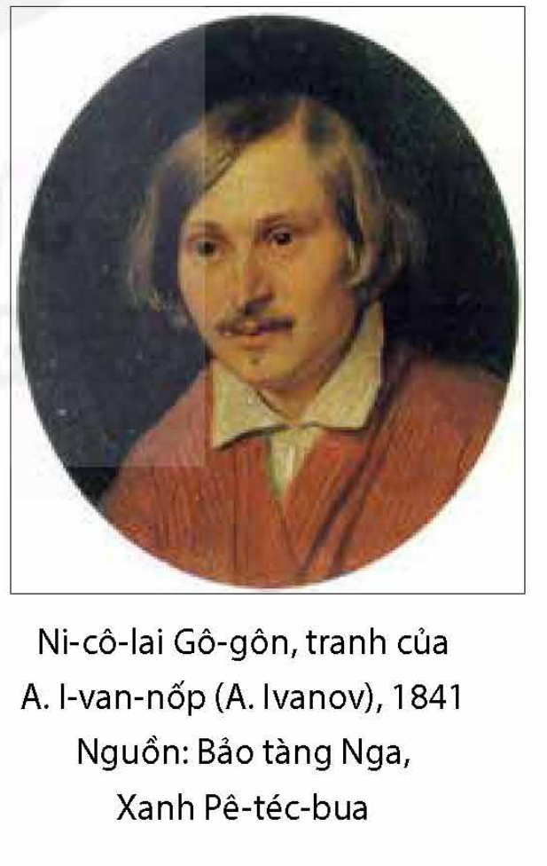
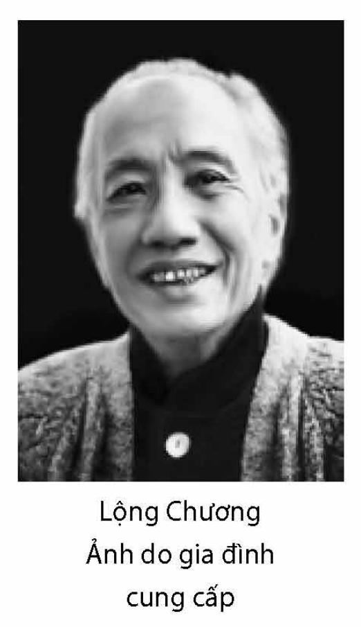
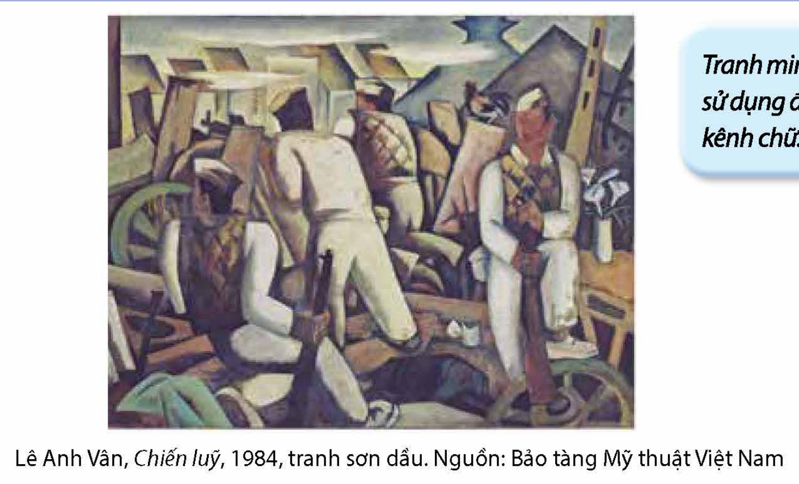

<!-- pdf:134 -->

# BÀI 5: TIẾNG CƯỜI CỦA HÀI KỊCH

## 🎯 Yêu cầu cần đạt

- Nhận biết và phân tích được một số yếu tố của hài kịch như: ngôn ngữ, xung đột, hành động, nhân vật, kết cấu, tình huống, thủ pháp trào phúng,...
- Phân tích và đánh giá được khả năng tác động của hài kịch đối với người đọc, người xem và tiến bộ xã hội.
- Viết được báo cáo kết quả nghiên cứu về một vấn đề tự nhiên hoặc xã hội; có sử dụng sơ đồ, bảng biểu, có thuyết minh các hình ảnh minh hoạ, có sử dụng trích dẫn, cước chú và biết trình bày phần tài liệu tham khảo.
- Biết trình bày báo cáo kết quả nghiên cứu (dưới hình thức thuyết trình) về một vấn đề tự nhiên hoặc xã hội.
- Biết ứng xử phù hợp với tình thế xã hội; biết sống có khát vọng, vui tươi, chân thực, tự nhiên.

## ĐỌC

### Tri thức Ngữ văn

**Hài kịch**

**Hài kịch** là một thể loại kịch, dùng tiếng cười để chế giễu những thói tật, hiện tượng đáng phê phán (vụ lợi, kệch cỡm, cực đoan, lạc hậu, ảo tưởng,...) vốn đi chệch các chuẩn mực tốt đẹp của con người và cộng đồng. Tiếng cười hài kịch cất lên từ sự vênh lệch, không tương thích giữa mục đích và phương tiện thực hiện, bản chất và biểu hiện, hành động và hoàn cảnh, tham vọng cá nhân và các khả năng thực hiện,... tức là từ những cái ngộ nghĩnh, ngược đời, bất hợp lí. Hài kịch có thể được triển khai theo các hướng khác nhau tuỳ theo tính chất của tiếng cười nhằm vào đối tượng: từ tiếng cười bông đùa, hài hước đến tiếng cười châm biếm, mỉa mai hay tiếng cười lật tẩy, tố cáo, đả kích,... Bằng tiếng cười phủ nhận “những thiếu sót không nên có”, hài kịch muốn làm thay đổi cách nhìn của người đọc, người xem về một hiện tượng xã hội nào đó, khẳng định lối sống lành mạnh, lạc quan, hợp với lẽ phải và tiến bộ xã hội. Bởi vậy, hài kịch nhất thiết phải đưa ra một kết cục có hậu, vui vẻ đối với người đọc, người xem.

<!-- pdf:135 -->

**Nhân vật, tình huống, xung đột, hành động và kết cấu hài kịch**

**Nhân vật trong hài kịch** là những nhân vật tiêu biểu cho một thói tật đáng cười, đáng phê phán, hoặc những nhân vật thường xuyên lầm lẫn, có cách ứng xử không phù hợp với hoàn cảnh thực tế. **Nhân vật hài kịch** hiếm khi là kẻ cùng hung cực ác, mà phổ biến hơn là người có khiếm khuyết, sai lầm cần khắc phục. Những nhân vật hài kịch như vậy có tính cách nhất quán, được xây dựng theo lối cường điệu, tô đậm nét đáng cười, chứ không được khai thác qua toàn bộ tiểu sử. Trong hài kịch còn có thể xuất hiện một số nhân vật châm chích, pha trò hài hước, hay nhân vật đại diện cho một lực lượng đối kháng tiến bộ nào đó, song đó thường chỉ là những nhân vật phụ.

**Tình huống hài kịch** là những tình huống hài hước diễn ra trong cuộc sống sinh hoạt, thế sự với những toan tính đời thường, làm nổi bật những thói tật đáng cười của con người. Tình huống hài kịch còn có thể là những tình huống hiểu lầm, trớ trêu, dở khóc dở cười, song không bi đát và luôn có thể được giải quyết tốt đẹp.

**Xung đột trong hài kịch** thường được xây dựng trên cơ sở mâu thuẫn giữa những tham vọng, toan tính vật chất, mưu kế tầm thường, bất chấp đạo đức, lẽ phải,... (phần nhiều là ảo tưởng) với những chuẩn mực và tiến bộ xã hội. Xung đột trong hài kịch dù căng thẳng đến mấy, cũng luôn có khả năng được giải quyết theo hướng cái xấu, cái không hoàn thiện bị phủ nhận, cái tốt đẹp, tiến bộ được khẳng định. **Hành động trong hài kịch** chủ yếu là hành động bên ngoài, những toan tính, mưu mô của nhân vật đều bộc lộ hết ra lời (hài kịch không nhấn mạnh trăn trở nội tâm – hành động bên trong). Hành động trong hài kịch hướng tới tô đậm nét tính cách chủ đạo của nhân vật hay tính chất cực đoan của những mưu mô, toan tính, chứ không phải làm nổi bật sự kiện, bởi vậy, diễn biến hành động qua mỗi hồi kịch thường mở ra các bình diện khác nhau của cái đáng cười hơn là thúc đẩy xung đột đi tới hồi kết. **Kết cấu hài kịch** thông thường được tổ chức trên cơ sở một hành động kịch nhất quán: mở đầu bằng việc giới thiệu các nhân vật với thói tật và những toan tính, mưu mô, ảo tưởng của họ; thắt nút theo cách đưa các nhân vật vào tình huống khó xử, đẩy xung đột đi tới đỉnh điểm theo đà thắng thế của toan tính, ảo tưởng; giải quyết xung đột bằng một mưu mẹo hay một yếu tố ngẫu nhiên để bước vào kết thúc với sự sụp đổ của những toan tính, ảo tưởng đáng cười.

**Thủ pháp trào phúng và ngôn từ trong hài kịch**

**Thủ pháp trào phúng** bao gồm các cách thức bất ngờ làm bật lên tiếng cười giễu cợt, mỉa mai, châm biếm, hạ thấp đối tượng. Hài kịch thường sử dụng những thủ pháp trào phúng như: tạo tình huống hiểu lầm hài hước, trớ trêu; phóng đại cử chỉ, điệu bộ, thói tật; tạo tương phản gây cười (hoán đổi các cảnh, các vị trí nhân vật, đồ vật một cách nghịch lí, cải trang lộ liễu, đột ngột biến dạng bất cân xứng,...). Về **ngôn từ**, cả trong chỉ dẫn sân khấu, cách gọi tên nhân vật, cũng như trong lời đối thoại, độc thoại, hài kịch sử dụng

<!-- pdf:136 -->

rất nhiều biện pháp như: cường điệu, tương phản, lặp, nhại, chơi chữ, nói bóng gió, nói lái, nói quá, nói lỡ, nói không ra tiếng,... Đối thoại trong hài kịch có khi được tổ chức theo kiểu đối chọi chan chát, “ăn miếng trả miếng” trong tình huống các nhân vật tố cáo lẫn nhau; có khi được triển khai xoay quanh tình huống “ông nói gà, bà nói vịt” thể hiện sự lệch kênh về ý thức; cũng có khi đột ngột bỏ lửng lời thoại khiến người đọc, người xem bật cười.

### Văn bản 1: Nhân vật quan trọng(\*) (Trích *Quan thanh tra* – Ni-cô-lai Gô-gôn)

**Trước khi đọc**

Khoác lác, ảo tưởng, theo bạn, có phải là một thói tật đáng cười? Vì sao?

**Đọc văn bản**

**Tóm tắt hài kịch *Quan thanh tra*:**

**Hồi I:** Thị trưởng một thị trấn tỉnh lẻ ở nước Nga đột ngột triệu tập quan chức địa phương để tuyên bố về việc nhận được mật báo: có một quan thanh tra cấp cao bí mật tới thị trấn. Cả bọn kinh hãi, bởi có “đốt đuốc giữa ban ngày” cũng không thấy có việc gì trong thị trấn có thể coi là tử tế: thị trưởng công khai hà hiếp dân chúng, cùng với chánh án, công khai nhận quà biếu hối lộ; chánh án để toà án bẩn thỉu, giấy má lẫn với roi ngựa đi săn, bồi thẩm thì luôn say xỉn; chủ sự bưu vụ chuyên đọc trộm thư từ; viên kiểm học Lu-ca Lu-kích (Luka Lukitr) bê trễ công việc, coi giáo dục là “nghề chết tiệt”; trưởng viện tế bần Ác-tê-mi Phi-líp-pô-vích (Artemi Philippovitr) bỏ mặc người bệnh “tự ốm, tự khỏi”, song lại do thám mọi chuyện để viết thư tố cáo kẻ khác; còn vợ thị trưởng An-na An-đrê-ép-na (Anna Andreevna) và con gái thị trưởng Ma-ri-a An-tô-nốp-na (Maria Antonovna) là những kẻ đầu óc rỗng tuếch, đài các rởm, chỉ biết đua đòi học làm sang và hãnh tiến,... Theo bẩm báo của hai gã địa chủ chuyên ngồi lê đôi mách, cả bọn tưởng một người khách dừng chân tại quán trọ thị trấn “không chịu trả tiền, cũng không chịu đi” là quan thanh tra, nên sửa soạn đến mời.

**Hồi II:** I-van A-lếch-xan-đrô-vích Khơ-lét-xta-cốp (Ivan Alexandrovitr Khlestacov)(1) vốn là một nhân viên thư kí quèn, “đoảng vị, không được việc gì”, tại văn phòng của một vụ ở Pê-téc-bua

> (\*) Nhan đề văn bản do người biên soạn sách giáo khoa đặt.
>
> (1) *Khơ-lét-xta-cốp*: họ của nhân vật trong tiếng Nga có gốc từ “khơ-li-ô-xtơ” (хлёст) – có nghĩa là “kẻ khoác lác không ngượng mồm, chuyên ngồi lê đôi mách”.

<!-- pdf:137 -->

(Petersburg). Anh ta từng sống chui lủi để trốn tiền trọ, phải rời khỏi thủ đô về tỉnh lẻ, sa vào bài bạc, cháy túi, song vẫn luôn giữ diện mạo bảnh bao, mơ ước “sống trên đời chỉ cốt để hái những bông hoa khoái lạc”. Đang khi Khơ-lét-xta-cốp hết tiền, đói khát, bị mắc kẹt ở quán trọ, thì đám quan chức trong thị trấn, tưởng gã là quan thanh tra, tới khúm núm cung phụng. Thị trưởng mời Khơ-lét-xta-cốp thăm thú những địa điểm trong thị trấn đã được chuẩn bị trước và chuyển đến ở nhà mình để dễ bề bố trí cảnh sát canh gác, ngăn không cho tiếp xúc với những người bị hà hiếp, oan khuất.

**Hồi III:** Khơ-lét-xta-cốp hồn nhiên nhập vai quan thanh tra, đi thăm thú, tiệc tùng, rồi chuyển đến ở nhà thị trưởng. Việc được thết đãi linh đình tạo cảm hứng cho gã khoác lác về vị thế sang trọng và danh tiếng tưởng tượng của mình. Vợ và con gái thị trưởng sán lại làm thân. Lũ quan tham trong thị trấn lại thêm phần sợ hãi.

**Hồi IV:** Quan chức, những kẻ tò mò và cả những người bị oan khuất trong thị trấn lũ lượt xin vào gặp Khơ-lét-xta-cốp. Gã thoạt đầu còn sượng sùng vay tiền đám quan chức, tiến tới đòi hỏi, quát nạt để ăn hối lộ công khai của cả người bị hiếp đáp. Khơ-lét-xta-cốp còn tận dụng cơ hội để tán tỉnh cả vợ lẫn con gái thị trưởng. Sau khi cao hứng cầu hôn với con gái ông ta, Khơ-lét-xta-cốp lo bại lộ chân tướng, lấy cớ phải tạm rời thị trấn “đến nhà ông chú giàu sụ”, yêu cầu cung cấp xe cộ, hành trang, tiền bạc, để nhanh chóng cao chạy xa bay.

**Hồi V:** Thị trưởng vênh váo, ra oai với đám dưới quyền, say sưa với việc con gái mình sẽ kết hôn với “quan lớn” thanh tra, gia đình sẽ chuyển về thủ đô, sẽ thật thần thế, danh giá. Đang khi các nhân vật “có máu mặt” trong thị trấn đến chúc mừng gia đình thị trưởng, thì chủ sự bưu vụ đột ngột báo tin Khơ-lét-xta-cốp không phải là quan thanh tra. Chủ sự bưu vụ đưa ra cho mọi người xem bức thư của Khơ-lét-xta-cốp gửi cho anh bạn nhà báo (tên là Giẻ Rách) kể ra sự thật về chuyện hiểu nhầm, nhận xét châm biếm về thị trưởng và hết thảy các nhân vật. Thị trưởng vỡ mộng, cay đắng nói với mọi người: “Các ngài cười gì? Các ngài đang cười giễu chính mình đấy!”. Đúng lúc đó, một viên hiến binh thình lình xuất hiện, tuyên bố: Quan thanh tra đích thực vừa mới đến thành phố, yêu cầu tất cả tới trình diện. Lời tuyên bố “như sét đánh” làm cho tất cả kinh hoàng, đờ ra như hoá đá, chuyển vào *Lớp Câm* – kết thúc vở hài kịch.

*Nhân vật quan trọng* là đoạn trích từ lớp VI, hồi III của hài kịch *Quan thanh tra*.

**HỒI III**

**LỚP VI**

*(Các vai trên, thêm An-na An-đrê-ép-na và Ma-ri-a An-tô-nốp-na)*

**THỊ TRƯỞNG** – Xin giới thiệu gia đình tôi: Đây là nhà tôi và cháu gái.

**KHƠ-LÉT-XTA-CỐP** *(cúi chào)* – Thưa bà, tôi rất sung sướng được cái hân hạnh đặc biệt gặp bà.

**AN-NA AN-ĐRÊ-ÉP-NA** – Dạ, chúng tôi còn vui mừng hơn khi được gặp một người như tôn ông...

> 💡 **[Chỉ dẫn đọc]** Đối thoại xã giao thái quá của các nhân vật thể hiện điều gì?

<!-- pdf:138 -->

**KHƠ-LÉT-XTA-CỐP** *(điệu bộ giả tạo)* – Xin lỗi bà, trái hẳn lại, tôi mới là người vui mừng hơn.

**AN-NA AN-ĐRÊ-ÉP-NA** – Đâu phải thế! Ông nói như thế thực là quá khen chúng tôi. Xin rước ông ngồi ạ!

**KHƠ-LÉT-XTA-CỐP** – Được đứng bên cạnh bà đã là hạnh phúc lắm rồi; nhưng nếu bà muốn thì tôi xin phép ngồi ạ. Được ngồi gần bà tôi sướng quá đấy ạ.

**AN-NA AN-ĐRÊ-ÉP-NA** – Xin lỗi ông, quả thực tôi không dám nhận những lời khen của ông. Ông quen ở thủ đô, nay phải đi Vôi-a-gi-rốp-ca(1), chắc khó chịu lắm đấy nhỉ?

**KHƠ-LÉT-XTA-CỐP** – Thực khó chịu quá sức tưởng tượng. Tôi quen sống trong cái xã hội thượng lưu, *comprenez vous?*(2), vậy mà bỗng phải đi đường xa: nào hàng quán bẩn thỉu, nào dân đen ngu dốt tối tăm... Xin thú thực là nếu không gặp được dịp may mắn như thế này... *(nhìn kĩ An-na An-đrê-ép-na và làm điệu bộ giả tạo trước mặt mụ)*, nó đền bù lại tất cả...

> 💡 **[Chỉ dẫn đọc]** Lưu ý thái độ của Khơ-lét-xta-cốp với “dân đen”, cũng như chính bản thân mình.

**AN-NA AN-ĐRÊ-ÉP-NA** – Như vậy quả thực ông phải vất vả, khó chịu nhiều lắm.

**KHƠ-LÉT-XTA-CỐP** – Nhưng thưa bà, trong giờ phút này, tôi lại thấy rất dễ chịu.

**AN-NA AN-ĐRÊ-ÉP-NA** – Ông cứ nói quá! Ông làm vinh dự cho tôi nhiều lắm, tôi thật không xứng chút nào.

**KHƠ-LÉT-XTA-CỐP** – Vì lẽ gì không xứng kia ạ? Thưa bà, bà rất xứng đáng...

**AN-NA AN-ĐRÊ-ÉP-NA** – Tôi ở chốn quê mùa...

**KHƠ-LÉT-XTA-CỐP** – Nhưng, thưa bà, thôn quê cũng có những dòng sông nhỏ, những trái đồi xinh chứ, tất nhiên ai lại đi so sánh thôn quê với Pê-téc-bua! Chà, Pê-téc-bua! Thực đấy, đời sống ở thủ đô sao mà... Có lẽ bà tưởng tôi là một anh chàng thư kí nhì nhằng? Không, quan vụ trưởng là bạn thân với tôi đấy. Ngài vỗ vai tôi thế này, nói: “Người anh em, lại đằng nhà ăn với mình!”. Mỗi ngày tôi chỉ đến vụ có hai phút, đủ để ra lệnh làm như thế này,

> 💡 **[Chỉ dẫn đọc]** Khơ-lét-xta-cốp sơ ý bộc lộ thân phận thật của mình qua lời khoác lác thế nào?

> (1) *Vôi-a-gi-rốp-ca*: đúng tiếng Pháp phải là *voyage* – cuộc du hành. An-na An-đrê-ép-na học đòi nói tiếng Pháp, nhưng lại nói “tiếng bồi”, nửa đầu Pháp (“vôi-a-gi”), nửa sau Nga (“rốp-ca” – “cơ-man-đi-rốp-ca”, nghĩa là chuyến công tác).
>
> (2) Tiếng Pháp trong nguyên bản: *Bà hiểu không?*. Khơ-lét-xta-cốp nói tiếng Pháp đúng hơn An-na An-đrê-ép-na, có lẽ y học lỏm được ở thủ đô.

<!-- pdf:139 -->

làm như thế kia! Ở đấy đã có một viên công chức, một anh thạo việc bàn giấy, cứ cầm bút một cái xoạch, xoạch... thảo như bay tất cả công văn cho tôi. Họ muốn cử tôi làm quan phó đoàn(1) tuyển cử. Nhưng tôi nghĩ nhận chức ấy làm quái gì. Lại còn một thằng hầu lúc nào cũng cầm bàn chải chạy theo khi tôi lên cầu thang: “Ông I-van A-lếch-xan-đrô-vích, ông cho phép con đánh hầu ông” *(Nói với viên thị trưởng)*. Kìa, sao các ông lại đứng thế? Xin mời các ông ngồi!

**THỊ TRƯỞNG** – Dạ, theo ngạch bậc, chúng tôi phải đứng ạ.

**ÁC-TÊ-MI PHI-LÍP-PÔ-VÍCH** – Chúng tôi đứng cũng được ạ.

**LU-CA LU-KÍCH** – Ông cứ mặc chúng tôi, xin đừng bận tâm ạ.

**KHƠ-LÉT-XTA-CỐP** – Không cần ngạch bậc, lễ nghi gì cả. Mời các ông cứ ngồi. *(Thị trưởng và cả bọn ngồi)*. Tôi không thích lễ nghi phiền phức đâu nhé: trái lại, bao giờ tôi cũng cố tìm cách lẩn tránh cho không ai biết mình. Nhưng không tài nào lẩn tránh được chứ lị, không biết làm cách nào! Tôi vừa có mặt ở đâu, đã thấy có người nói: “Kìa ông I-van A-lếch-xan-đrô-vích đi kia kìa”. Có lần họ lại tưởng tôi là tổng tư lệnh. Thế là bọn lính từ trong bốt vội vàng nhảy xổ ra, bồng súng chào. Sau đó viên sĩ quan vốn biết tôi lắm, nói với tôi rằng: “Kìa, người anh em, thế mà bọn mình cứ tưởng lầm đằng ấy là tổng tư lệnh”.

**AN-NA AN-ĐRÊ-ÉP-NA** – Thế kia đấy!

**KHƠ-LÉT-XTA-CỐP** – Tôi quen nhiều đào hát lắm. Vì tôi cũng có đi xem nhiều vở ca kịch vui... Tôi thường gặp các nhà văn. Tôi là bạn cánh hẩu của Pu-skin (Pushkin). Nhiều lần tôi bảo hắn là: “Thế nào người anh em Pu-skin?”. Hắn ta trả lời: “Bình thường, người anh em ạ, vẫn như mọi khi thôi”... Hắn là con người rất độc đáo.

> 💡 **[Chỉ dẫn đọc]** Chú ý sự vênh lệch của việc gắn tên tuổi Pu-skin với thể loại “ca kịch vui”.

**AN-NA AN-ĐRÊ-ÉP-NA** – Như vậy là ông cũng viết văn nữa kia à? Làm nhà sáng tác chắc thú vị lắm thì phải. Chắc ông cũng gửi bài đăng trên các tạp chí chứ?

**KHƠ-LÉT-XTA-CỐP** – Phải, tôi cũng có cho đăng trên tạp chí nhiều bài. Tôi viết nhiều tác phẩm lắm: *Đám cưới chàng Phi-ga-rô (Figaro)*, *Rô-be (Robe) con quỷ*, *Noóc-ma (Norma)*(2).

> (1) Đây chỉ là một chức quan hạng thứ tám, trong số mười bốn nấc thang công chức ở nước Nga lúc đó. Khơ-lét-xta-cốp, vốn là một công chức hạng bét, chỉ biết khoác lác từ những gì nghe lỏm được về cuộc sống thượng lưu, tưởng rằng đây đã là cấp bậc cao lắm rồi.
>
> (2) *Đám cưới chàng Phi-ga-rô* là vở nhạc kịch của Mô-da (Mozart, 1756 – 1791) viết theo hài kịch bất hủ cùng tên của nhà viết kịch Pháp thế kỉ XVIII Bô-mác-se (Beaumarchais, 1732 – 1799); *Rô-be con quỷ* là vở nhạc kịch của Mây-rơ-bi-ơ (Mayrbeer, 1791 – 1864); *Noóc-ma* là vở nhạc kịch của Ben-li-ni (Bellini, 1801 – 1835). Khơ-lét-xta-cốp nhận vơ tất cả những tác phẩm này là của mình.

<!-- pdf:140 -->

Tôi không nhớ tên nhiều tác phẩm khác. Tôi viết mọi tác phẩm cũng là do tình cờ thôi. Tôi có muốn đâu, nhưng ban giám đốc nhà hát bảo tôi: “Người anh em, làm ơn viết cho tôi cái gì đi chứ!”. Tôi nghĩ thầm: “Được lắm, người anh em ạ”. Thế rồi hình như chỉ một buổi tối là tôi viết xong tất cả, ai cũng phải kinh ngạc. Tôi suy nghĩ thực dễ dàng lạ lùng. Tất cả những tác phẩm kí tên nam tước Brăm-bê-út, *Chiến hạm Hi vọng*, *Điện tín Mát-xcơ-va (Moskva)*(1),... tất cả đều do tôi viết.

> 💡 **[Chỉ dẫn đọc]** Khơ-lét-xta-cốp đã bộc lộ thực chất trình độ hiểu biết văn chương của mình như thế nào?

**AN-NA AN-ĐRÊ-ÉP-NA** – Vậy ra ông là nam tước Brăm-bê-út à?

**KHƠ-LÉT-XTA-CỐP** – Cố nhiên: tôi chữa thơ cho tất cả bọn họ. Thằng Xmiếc-đin (Smirdin)(2) phải tặng tôi bốn chục nghìn rúp để tôi làm việc ấy cho nó đấy.

**AN-NA AN-ĐRÊ-ÉP-NA** – Như vậy, đúng ông là tác giả cuốn *Iu-ri Mi-lốt-xláp-xki (Yuri Miloslavsky)*(3) rồi.

**KHƠ-LÉT-XTA-CỐP** – Phải, đó là sáng tác của tôi.

**AN-NA AN-ĐRÊ-ÉP-NA** – Tôi đoán đúng ngay mà.

**MA-RI-A AN-TÔ-NỐP-NA** – Mẹ ơi, nhưng trên đó đề tên tác giả là Da-gốt-xkin (Zagoskin) cơ mà!
<!-- ocr-ok: OCR bỏ sót dòng đầu do vướng mũi tên hộp chỉ dẫn đọc, đã đối chiếu ảnh trang PDF 140 -->

> 💡 **[Chỉ dẫn đọc]** Chú ý lời thoại của các nhân vật về cuốn sách.
<!-- ocr-ok: OCR bỏ sót dòng hai của hộp chỉ dẫn đọc, đã đối chiếu ảnh trang PDF 140 -->

**AN-NA AN-ĐRÊ-ÉP-NA** – Đấy, thấy chưa, tao biết mà, đến ở đây mà mày cũng sắp cãi đấy.

**KHƠ-LÉT-XTA-CỐP** – Ờ đúng đấy, chính Da-gốt-xkin là tác giả cuốn sách đó, nhưng còn một cuốn *Iu-ri Mi-lốt-xláp-xki* khác nữa kia, cuốn ấy mới là của tôi.

**AN-NA AN-ĐRÊ-ÉP-NA** – Vậy cuốn tôi đọc đúng là cuốn ông viết đấy. Ông viết hay quá đi mất thôi!

**KHƠ-LÉT-XTA-CỐP** – Thú thật là tôi sống bằng nghề văn đấy. Tôi có cái nhà đẹp nhất ở Pê-téc-bua. Ai cũng biết: nhà của ông I-van A-lếch-xan-đrô-vích *(Nói với cả bọn)*. Các ông ạ, sau này nếu có dịp các ông đến Pê-téc-bua mời các ông vui lòng lại chơi, lại chơi nhà tôi. Tôi cũng hay mở những cuộc khiêu vũ gia đình lắm.

> (1) *Nam tước Brăm-bê-út* (Brambeus, 1818 – 1858) là bút danh của nhà văn, nhà báo Xen-cốp-xki (Senkovsky, 1800 – 1858), chủ bút tạp chí *Thư viện đọc* (1834 – 1856), nổi tiếng hay sửa chữa, can thiệp thô bạo vào các bài đăng trên tạp chí; *Chiến hạm Hi vọng* là truyện của nhà văn lãng mạn Bét-xtu-giép – Mác-lin-xki (Bestuzhev – Marlinsky, 1797 – 1837); *Điện tín Mát-xcơ-va* là tạp chí nổi tiếng truyền bá tư tưởng tự do, xuất bản từ năm 1825 đến 1834.
>
> (2) *Xmiếc-đin* (1795 – 1897) là ông chủ xuất bản của nhiều ấn phẩm nổi tiếng thời đó ở thủ đô Pê-téc-bua, trong đó có tạp chí *Thư viện đọc*. Thời đó, nhuận bút cho tác giả nổi tiếng như Pu-skin thường chỉ khoảng hơn một nghìn rúp, Khơ-lét-xta-cốp khuếch khoác số tiền trả cho việc “chữa thơ” thành bốn mươi nghìn rúp.
>
> (3) Tiểu thuyết lịch sử *Iu-ri Mi-lốt-xláp-xki* là tác phẩm của nhà văn Da-gốt-xkin. Ở thời điểm vở kịch của Gô-gôn ra đời, cuốn tiểu thuyết này đang được tung hô, mặc dù về nghệ thuật không được giới phê bình đánh giá cao. An-na An-đrê-ép-na, hiểu biết lõm bõm về văn chương, gán luôn cho Brăm-bê-út là tác giả cuốn tiểu thuyết này. Khơ-lét-xta-cốp, không hề hay biết, nhận tất là của mình.

<!-- pdf:141 -->

**AN-NA AN-ĐRÊ-ÉP-NA** – Tôi chắc rằng những cuộc khiêu vũ do ông mở, tráng lệ huy hoàng không thể tả được.

**KHƠ-LÉT-XTA-CỐP** – Còn phải nói! Này nhé, thí dụ, trên bàn, tôi cho bày một quả dưa hấu đáng giá bảy trăm rúp(1). Xúp nấu xong để nguyên trong xoong từ thành Pa-ri (Paris) nước Pháp được chở thẳng sang bằng tàu thuỷ, khi mở nắp xoong ra, hơi bốc lên nghi ngút chưa từng thấy ở trên đời này. Ngày nào tôi cũng dự những cuộc khiêu vũ. Rồi thì chúng tôi họp nhau chơi bài câm, quan thượng thư Bộ ngoại giao, các vị đại sứ đặc mệnh toàn quyền nước Anh, nước Pháp, nước Đức(2) và tôi. Chơi có thể nói là mệt lử đi như sắp chết mới thôi. Khi về nhà, chạy nhanh lên tầng gác thứ tư, chỉ kịp nói với mụ đầu bếp: “Này, Ma-ru-xca (Maruska), đưa áo khoác đây”. Tôi nói lảm nhảm gì ấy nhỉ? À, quên mất, tôi ở ngay gác hai. Chỉ có mỗi một cầu thang để leo lên thôi... Mỗi khi tôi ngủ dậy, ai mà ghé nhìn chỗ hành lang nhà tôi thì sẽ thấy lạ lắm. Bá tước, hoàng thân lúc nhúc xô đẩy nhau, nói lào xào như ong ấy, chỉ nghe thấy tiếng giè... giè... giè... Đôi khi có cả quan thượng thư... *(Thị trưởng và mọi người khác khúm núm đứng cả dậy)*. Họ viết thư cho tôi đề: “Kính gửi cụ lớn”. Có lần tôi điều khiển cả một vụ. Câu chuyện kể cũng lạ: một hôm quan vụ trưởng biến đi đâu mất, không ai biết là đi nơi nào. Cố nhiên thế là mọi người bàn tán xôn xao: ai thế chân bây giờ? Vô số anh nguyên soái cũng muốn tấp tếnh leo lên, nhưng, xin các anh, khó lắm, không cáng đáng được đâu. Mới nhìn tưởng dễ nhưng đi sâu vào xem, chà, hắc búa lắm! Không biết làm cách nào, họ phải cậy cục tìm đến tôi. Thế là lập tức ngoài phố nhan nhản những phái viên được cử đến chỗ tôi, hết phái viên, phái viên lại phái viên,... các ông thử tưởng tượng xem, có đến ba vạn năm nghìn phái viên, hoàn cảnh khó xử quá, tôi xin hỏi các ông làm thế nào? Họ nói: “I-van A-lếch-xan-đrô-vích, xin mời ông ra điều khiển vụ ngay”. Thú thật là lúc ấy tôi cũng hơi bối rối, mặc cả quần áo ngủ ra tiếp, định bụng từ chối, nhưng lại nghĩ nếu mình làm thế thì việc sẽ đến tai hoàng thượng; rồi công việc làm ăn của mình lại... Thế là tôi nói: “Thưa các ngài, được, xin vui lòng, tôi nhận nhiệm vụ, tôi nhận, làm thì làm, tôi nhận, nhưng đối với tôi ấy à, không lơ mơ đâu nhé, không. Tôi để ý đấy nhé! Tôi...”. Mà thật, khi tôi qua bên vụ, thật đúng như động đất ấy, tất cả mọi người đều sợ, cứ run bắn người lên như chiếc lá ấy. *(Thị trưởng và mọi người đều run cầm cập vì hoảng sợ; Khơ-lét-xta-cốp càng nói càng hăng)*. Hừ! Tôi không thích đùa đâu nhé. Tôi làm cho tất cả bọn chúng nó khiếp vía lên. Ngay đến Quốc vụ viện còn phải hãi tôi kia. Chứ sao? Tôi thế. Tôi chả xem thằng nào là gì... Tôi nói với tất cả bọn họ: tự tôi biết tôi là ai, tự tôi. Đâu cũng tôi,

> 💡 **[Chỉ dẫn đọc]** Qua lời khoác lác của Khơ-lét-xta-cốp, có thể nhận ra điều gì được giới thượng lưu quan tâm?
<!-- ocr-ok: OCR đọc lỗi chữ trong hộp chỉ dẫn đọc cột phải, đã đối chiếu ảnh trang PDF 141 -->

> 💡 **[Chỉ dẫn đọc]** Vì sao Khơ-lét-xta-cốp *càng nói càng hăng*?
<!-- ocr-ok: OCR đọc lỗi chữ trong hộp chỉ dẫn đọc cột phải, đã đối chiếu ảnh trang PDF 141 -->

> (1) Lương thư kí văn phòng thời đó là bốn trăm rúp một năm, dưa hấu bảy trăm rúp là không tưởng.
>
> (2) Thực ra hồi này chưa có đại sứ Đức ở Nga.

<!-- pdf:142 -->

đâu cũng tôi. Ngày nào tôi cũng vào trong điện. Chỉ mai kia là tôi sẽ được thăng đại thống ch... *(Trượt chân, suýt ngã xuống sàn, nhưng cả bọn công chức kính cẩn đỡ y lên)*.

**THỊ TRƯỞNG** *(lại gần, toàn thân run cầm cập, cố gắng lắp bắp)* – Hừ... hừ... qua... qua... qua... qua...

**KHƠ-LÉT-XTA-CỐP** *(nói nhanh dõng dạc)* – Cái gì?

**THỊ TRƯỞNG** – Hừ... hừ... qua... qua... qua... qua...

**KHƠ-LÉT-XTA-CỐP** *(vẫn nói với giọng cũ)* – Tôi chẳng hiểu gì cả? Ông nói lăng nhăng cái gì ấy.

**THỊ TRƯỞNG** – Qua... qua... qua... quan lớn ngài có muốn nghỉ ngơi không ạ? Buồng đây ạ, có đủ mọi thứ cần dùng!

**KHƠ-LÉT-XTA-CỐP** – Thật dấm dớ, nghỉ với chẳng ngơi. Ừ thì nghỉ, xin sẵn sàng... Các ông ạ, bữa ăn vừa rồi khá lắ... ắm... Tôi bằng lòng lắm. Tôi bằng lòng lắm. Cá thu nạc muối ngon tuyệt, cá thu nạc muối ngon tuyệt!

*Đi ra, vào buồng bên cạnh, thị trưởng theo sau.*

(Ni-cô-lai Gô-gôn, *Quan thanh tra*, Vũ Đức Phúc dịch(1), NXB Lao động – Trung tâm Văn hoá Ngôn ngữ Đông Tây, Hà Nội, 2009, tr. 62 – 69)

Ni-cô-lai Gô-gôn, tranh của A. I-van-nốp (A. Ivanov), 1841
Nguồn: Bảo tàng Nga, Xanh Pê-téc-bua

**Ni-cô-lai Gô-gôn** (1809 – 1852) là nhà văn, nhà soạn kịch nổi tiếng của văn học Nga nửa đầu thế kỉ XIX. Gô-gôn sinh ra trong một gia đình quý tộc ở tỉnh Pôn-ta-va (Poltava), nay thuộc U-crai-na (Ukraina). Năm 1828, ông tới Pê-téc-bua, làm trợ lí ở Vụ bất động sản hoàng gia một thời gian. Gô-gôn bắt đầu viết văn và trở nên nổi tiếng với tập truyện đầu tay mang nhiều hương vị dân gian *Những buổi tối ở thôn gần Đi-can-ka (Dikanka)* (1831 – 1832). Năm 1832, ông làm quen với Pu-skin, được nhà thơ đánh giá cao và được khơi gợi nhiều ý tưởng sáng tạo. Năm 1834, Gô-gôn được bổ làm trợ giảng về lịch sử thời trung cổ tại Trường Đại học Tổng hợp Pê-téc-bua. Trong khoảng thời gian 1836 – 1847, Gô-gôn sống nhiều ở nước ngoài (Đức, Thuỵ Sĩ, Pháp, Bỉ, Ý). Bắt đầu từ năm 1845, nhà văn rơi vào một cuộc khủng hoảng tinh thần, sa vào khuynh hướng tôn giáo thần bí. Năm 1852, Gô-gôn từ bỏ văn nghiệp, giam mình cầu nguyện, tuyệt thực, rồi mất tại nhà một người bạn ở Mát-xcơ-va.

Gô-gôn nổi tiếng trong lịch sử văn học thế giới với những tác phẩm như: *Ta-rát Bun-ba – Taras Bulba* (truyện, 1835), *Những điền chủ cổ xưa* (truyện, 1835), *Bức chân dung* (truyện, 1835), *Nhật kí người điên* (truyện, 1835), *Cái mũi* (truyện, 1836), *Quan thanh tra* (hài kịch, 1836), *Chiếc áo khoác* (truyện, 1842), *Những linh hồn chết* (tiểu thuyết, 1842). Phần nhiều những tác phẩm hiện thực của Gô-gôn thể hiện cơn mê sảng của thực tại đương thời với những hình tượng con người bị đồ vật hoá, thảm hại,

> (1) Văn bản được người biên soạn sách giáo khoa chỉnh sửa một số câu chữ cho sát hơn với nguyên tác.

<!-- pdf:143 -->

trống rỗng, tồn tại như những bóng ma và luôn ám ảnh về sự báo ứng. Giọng văn trào phúng của Gô-gôn, một mặt, thể hiện thái độ phủ nhận thực tại nhố nhăng đương thời “qua tiếng cười thế gian thấy rõ và những giọt nước mắt thế gian không trông thấy”(1); mặt khác, lại đau đáu niềm hi vọng vào một thực tại khác xứng đáng hơn với cuộc sống con người.

Hài kịch năm hồi *Quan thanh tra* của Gô-gôn được sáng tác trên cơ sở một giai thoại do Pu-skin gợi ý. Vở hài kịch là một đỉnh cao trong sự nghiệp sáng tác của Gô-gôn và ảnh hưởng lớn tới sự phát triển của sân khấu hài kịch thế giới. *Quan thanh tra* không chỉ là vở hài kịch đả kích “tất cả những gì tệ hại của nước Nga” đầu thế kỉ XIX, mà còn khơi dậy nỗi đau về sự tồn tại trống rỗng, phi lí của con người và niềm hi vọng vào một cuộc sống tốt đẹp hơn. *Nhân vật quan trọng* là một trong những lớp kịch đặc sắc nhất trong *Quan thanh tra*.

**Sau khi đọc**

1. Dựa vào phần tóm tắt hài kịch *Quan thanh tra*, hãy xác định tình huống hiểu lầm của vở kịch.
2. Đối chiếu hoàn cảnh thực tế của Khơ-lét-xta-cốp (qua phần tóm tắt hồi II của vở kịch) với cuộc sống “thượng lưu” mà nhân vật khoe khoang trong đoạn trích, hãy lí giải nhân vật này đáng cười ở điểm nào.
3. Thị trưởng cùng viên kiểm học Lu-ca Lu-kích, trưởng viện tế bần Ác-tê-mi Phi-líp-pô-vích thể hiện thái độ thế nào trước sự khoác lác, ra oai của Khơ-lét-xta-cốp? Vì sao?
4. Nhân vật An-na An-đrê-ép-na và Ma-ri-a An-tô-nốp-na đóng vai trò gì trong việc tạo ra tiếng cười trong đoạn trích?
5. Xác định các thủ pháp trào phúng được tác giả sử dụng trong đoạn trích. Phân tích một thủ pháp nổi bật trong số đó.
6. Qua việc đọc đoạn trích *Nhân vật quan trọng* và phần tóm tắt hài kịch *Quan thanh tra*, hãy nêu những điểm đặc sắc về xung đột và kết cấu của vở kịch.
7. Theo bạn, “thói Khơ-lét-xta-cốp” bắt nguồn từ đâu và có thể gây ra những hậu quả gì? Nêu suy nghĩ của bạn về nhận định của Gô-gôn: “Ít ai tránh được việc trở nên giống Khơ-lét-xta-cốp, dù chỉ một lần trong đời”(2).

#### Kết nối đọc – viết

Viết đoạn văn (khoảng 150 chữ) nêu suy nghĩ của bạn về cách khắc phục “thói Khơ-lét-xta-cốp”.

> (1) N. Gô-gôn, *Toàn tập tác phẩm*, tập 6, NXB Viện Hàn lâm Liên Xô, 1951, tr. 134.
>
> (2) N. Gô-gôn, *Toàn tập tác phẩm*, tập 4, NXB Viện Hàn lâm Liên Xô, 1951, tr. 101.

<!-- pdf:144 -->

### Văn bản 2: Giấu của(\*) (Trích *Quẫn* – Lộng Chương)
<!-- ocr-ok: tiêu đề văn bản 2 kèm nhãn cấu trúc, đã đối chiếu ảnh trang PDF 144 -->

**Trước khi đọc**

Hãy chia sẻ trải nghiệm của bạn khi xem một bộ phim hài, một vở hài kịch, hoặc đọc một truyện cười.

**Đọc văn bản**

**CẢNH VÀO TRÒ**

*Bóng tối dày đặc.*

*Tiếng đồng hồ tích tắc như tiếng mọt đục trong đêm. Có tiếng động bước chân thận trọng, cánh cửa ngang “két” nhẹ. Một luồng ánh sáng đèn rọi vụt loé và chạy lướt chung quanh phòng, soi sáng từng mảng đồ đạc đủ các kiểu, cổ kim đông tây... Rồi luồng sáng vươn lên tường, chiếu thẳng vào tấm ảnh bán thân một người đàn bà nạ dòng, cặp mắt trừng trừng nhìn thẳng, miệng loe một nụ cười ngây thộn: Ảnh bà Đại Cát.*

*Vẫn luồng ánh sáng ấy bỗng nhảy vọt sang tường đối diện, cắm thẳng vào tấm ảnh bán thân một người đàn ông đeo mục kính (loang loáng trong kính ảnh) để râu vuông sơm tựa một đốt ngón tay dính giữa nhân trung, làm cho cái miệng ông ta như rúm lại, giống kiểu người chúm môi thổi sáo: Ảnh ông Đại Cát.*

> 💡 **[Chỉ dẫn đọc]** Lời chỉ dẫn sân khấu ở đây có những điểm gì đáng chú ý?

*Tiếp đến là hai bóng người dắt tay nhau từ cửa ngang tối om, rón rén đi ra lượn quanh dưới hai tấm ảnh.*
<!-- ocr-ok: chữ in nghiêng chỉ dẫn sân khấu bị OCR đọc nhầm, đã đối chiếu ảnh trang PDF 144 -->

*Hai bóng người đó chính là ông bà Đại Cát.*

**ÔNG ĐẠI CÁT** – *Bật lên tiếng cười như ho.* Hự! Hự! Mợ xem... không suy suyển một li!

*Luồng ánh sáng thu lại, chiếu thẳng vào hai người, soi rõ hai cặp chân đứng ríu vào nhau. Hai ống quần trắng của bà Đại Cát hơi rung rung.*

**BÀ ĐẠI CÁT** – Cậu ạ... tôi thấy để đây... nó... nó lộ... lộ là!

> (\*) Nhan đề đoạn trích do người biên soạn sách giáo khoa đặt.

<!-- pdf:145 -->

**ÔNG ĐẠI CÁT** – Lộ gì? Hở mà kín, kín mà hở, không ai ngờ được!

**BÀ ĐẠI CÁT** – Thì cứ cất trong két ở ngay đầu giường mình có hơn không!

**ÔNG ĐẠI CÁT** – Để trong két, con Trinh nó mở ra luôn, có bao nhiêu nó biết cả...

Đến lúc phải khai vốn, nó lại khai ra hết thì hỏng bét! *Yên lặng một giây.*

Ơ hay... làm sao mợ lại run cầm cập thế?

**BÀ ĐẠI CÁT** – Tôi... run đâu! *Hai chân vẫn run.*

Cậu thử nghĩ xem còn giấu ở đâu kín hơn nữa không?

**ÔNG ĐẠI CÁT** – Không đâu hơn cả! Giấu đâu cũng không lọt được với cụ cố nhà này. Bà cụ lục lọi cả ngày...

**BÀ ĐẠI CÁT** – Cậu này... hay là treo nó lên buồng ngủ?

**ÔNG ĐẠI CÁT** – Treo ai lên buồng ngủ?

**BÀ ĐẠI CÁT** – Treo cậu và tôi...

**ÔNG ĐẠI CÁT** – Sao lại treo mợ và tôi lên buồng ngủ?

**BÀ ĐẠI CÁT** – Là tôi bảo treo hai cái ảnh ấy chứ!

**ÔNG ĐẠI CÁT** – À... Không được!

> 💡 **[Chỉ dẫn đọc]** Chú ý thủ pháp gây cười được vận dụng trong đoạn đối thoại.

Ảnh đang treo ở dưới này lại vác lên đấy, có khác gì lạy ông tôi ở đây không? Cứ để ngay trước mắt thiên hạ... thế mới cao tay. Họ không công tư hợp doanh(1) ảnh của mình đâu!

**BÀ ĐẠI CÁT** – Hay là đem chôn?

**ÔNG ĐẠI CÁT** – Chôn? Chôn mợ và tôi ấy à?

**BÀ ĐẠI CÁT** – Khéo khỉ! Là chôn... cái khoản kia ấy chứ!

**ÔNG ĐẠI CÁT** – Không được! Chôn xuống đào lên lỉnh kỉnh, nhỡ con U Trinh nó biết...

**BÀ ĐẠI CÁT** – *Lưỡng lự một giây.* Cậu này... Thế còn vòng xuyến tư trang có đúng là...

> (1) *Công tư hợp doanh*: nhà nước và tư nhân cùng góp vốn kinh doanh.

<!-- pdf:146 -->

**ÔNG ĐẠI CÁT** – Đúng rồi... Tư trang không phải là vốn kinh doanh, không sợ!

*Luồng ánh sáng đèn chạy vút qua hai tấm ảnh.*
<!-- ocr-ok: chữ in nghiêng chỉ dẫn sân khấu bị OCR đọc nhầm, đã đối chiếu ảnh trang PDF 146 -->

**BÀ ĐẠI CÁT** – Thế cậu cho nốt chỗ này vào... *Dúi vào tay chồng một gói nhỏ.*

**ÔNG ĐẠI CÁT** – Đưa đây. *Cầm gói.* Mợ khiêng với tôi cái kỉ, để tôi trèo...

*Hai người khiêng lúng túng, khiến ông Đại Cát đánh rơi đèn. Căn phòng tối mù.*

**BÀ ĐẠI CÁT** – *Buột miệng kêu to.* Ối trời ơi... Làm sao thế này?

**ÔNG ĐẠI CÁT** – Suỵt! Im... khẽ chứ. Mợ định đánh thức cả nhà dậy đấy à?

**BÀ ĐẠI CÁT** – Nhưng tối quá cậu ơi... Đèn đâu... bấm lên.

**ÔNG ĐẠI CÁT** – Đang mò đây. Đâu mất rồi không biết?

**BÀ ĐẠI CÁT** – Mất gì? Mất à?

*Hai người cùng mò, đâm phải nhau.*
<!-- ocr-ok: chữ in nghiêng chỉ dẫn sân khấu bị OCR đọc nhầm, đã đối chiếu ảnh trang PDF 146 -->

**ÔNG ĐẠI CÁT** – Khỉ!

Đứng yên để người ta mò thì không, cũng lại bò ra... để mà tru lên thế...

*Bà Đại Cát vẫn quờ quạng, sờ phải mặt chồng.*
<!-- ocr-ok: chữ in nghiêng chỉ dẫn sân khấu bị OCR đọc nhầm, đã đối chiếu ảnh trang PDF 146 -->

**BÀ ĐẠI CÁT** – *Lại rú lên.* Úi trời!

**ÔNG ĐẠI CÁT** – *Cũng rú lên.* Úi trời... Cào cả vào mặt người ta rồi.

> 💡 **[Chỉ dẫn đọc]** Hai nhân vật đã rơi vào tình thế hài hước như thế nào?

Mợ ngồi im đấy, để tôi bật đèn lên vậy.

*Dò dẫm ra chỗ bật điện. Đèn ống nhấp nháy, rồi bùng lên. Ánh sáng xanh lè. Bà Đại Cát vẫn còn phủ phục dưới đất. Hai vợ chồng mặc quần áo ngủ, lếch thếch, trông đến thiểu não.*

**ÔNG ĐẠI CÁT** – Ô hay, mợ còn phục vị ra đấy làm gì nữa?

**BÀ ĐẠI CÁT** – *Lẩy bẩy chống gối đứng dậy.* Cái gói... đâu?
<!-- ocr-ok: chữ in nghiêng chỉ dẫn sân khấu bị OCR đọc nhầm, đã đối chiếu ảnh trang PDF 146 -->

**ÔNG ĐẠI CÁT** – Đây! Tôi giữ thì mất làm sao được mà mợ lo! *Nhặt đèn bấm.*

**BÀ ĐẠI CÁT** – *Ngồi phịch xuống sập, cào lại mái tóc, tay còn run.*

Ối chao ơi, sung sướng quá! Đang buôn đang bán thì đùng đùng chuyển hướng cơ. Cậu làm khổ lây cả tôi.

**ÔNG ĐẠI CÁT** – *Nheo mắt nhìn vợ.* Lại sắp sửa...
<!-- ocr-ok: chữ in nghiêng chỉ dẫn sân khấu bị OCR đọc nhầm, đã đối chiếu ảnh trang PDF 146 -->

**BÀ ĐẠI CÁT** – *Nặng giọng.* Sắp sửa làm sao?

<!-- pdf:147 -->

**ÔNG ĐẠI CÁT** – Nói chứ... mợ chẳng khác gì thằng mù sờ voi chỉ thấy cái đuôi.

Tình hình mậu dịch quốc doanh bành trướng như thế, các luồng hàng đều tập trung quản lí như thế, mợ bảo còn tung hoành buôn bán như trước làm sao được nữa mà không chuyển sang sản xuất. Đến sừng sỏ như tay bác Tứ Hải, buôn bán khét tiếng xưa nay, đã từng chọi cả với nhà buôn Pháp mà cũng còn phải chịu phép đóng cửa hiệu, hùn vốn làm nhà máy da... nữa là mình!

**BÀ ĐẠI CÁT** – Thế bây giờ mới công tư hợp doanh bằng hết.

**ÔNG ĐẠI CÁT** – *Vẻ khó chịu.* Ô là là... mợ chẳng hiểu gì cả!

**BÀ ĐẠI CÁT** – *Dằn dỗi.* Phải, tôi không hiểu. Cứ như vợ chồng Đại Hưng thế mà khôn. Buôn bán cầm chừng rồi rút dần vốn về, găm chặt vào lưng, thế mà lại hay.

**ÔNG ĐẠI CÁT** – Hay à? Cái trò tháu cáy không bịt mắt được ai đâu. [...]

*Vừa lúc ấy có tiếng động lạch cạch bên trong cửa. Bà Đại Cát nắm lấy tay chồng.*

**BÀ ĐẠI CÁT** – Cái gì... thế? *Im lặng, lại lịch kịch.*

Khéo không con U Trinh... nó rình... đấy.

*Ông Đại Cát xua tay, gật gật, rón rén đi tới cửa ngang, khe khẽ nắm quả đấm, mở ào một cái bất ngờ. Không có ai, bên trong tối om. Bà Đại Cát trừng trừng theo dõi. Ông Đại Cát trù trừ đứng nhìn vào trong tối một giây, rồi cương quyết bật đèn bước vào. Bỗng ông giật thót người, nhảy lùi lại. Bà Đại Cát đứng bật lên.*

**BÀ ĐẠI CÁT** – Cái gì... thế... cậu?

**ÔNG ĐẠI CÁT** – *Cười gượng.* Hề, hề... con chuột to quá.

*Đúng lúc đó, chiếc đồng hồ treo rung nhè nhẹ và dõng dạc reo bốn tiếng. Hai vợ chồng Đại Cát đứng lặng nghe đến tiếng ngân cuối của đồng hồ.*
<!-- ocr-ok: chữ in nghiêng chỉ dẫn sân khấu bị OCR đọc nhầm, đã đối chiếu ảnh trang PDF 147 -->

**ÔNG ĐẠI CÁT** – *Bàng hoàng.* Sắp sáng rồi... *Tự thấy sự thất thần của mình, vội lấy lại vẻ cứng cỏi.* Ô hay, sao mình lại hốt hoảng thế nhỉ? Phải giấu nốt chỗ này đi chứ.

*Giơ gói cầm ở tay.*
<!-- ocr-ok: chữ in nghiêng chỉ dẫn sân khấu bị OCR đọc nhầm, đã đối chiếu ảnh trang PDF 147 -->

Mợ ra đứng canh con U Trinh ở cửa ngang để tôi làm...

**BÀ ĐẠI CÁT** – *Chưa định thần.* Cậu ạ... hay là để... mai xem sao...

> 💡 **[Chỉ dẫn đọc]** Trạng thái tâm lí luôn thay đổi của hai nhân vật cho thấy điều gì đang ám ảnh họ?

**ÔNG ĐẠI CÁT** – Còn xem gì nữa. Mai con Trinh nó về rồi đấy.

<!-- pdf:148 -->

Không, không nhanh tay lên, nhỡ đợt thí điểm này mà xong, các ông ấy tấn công ào ạt cho một trận, thì lại trở tay không kịp... Thôi, mợ cứ ra canh đi...

**BÀ ĐẠI CÁT** – Nhưng tôi đứng một mình ngoài ấy, tôi sợ lắm!

**ÔNG ĐẠI CÁT** – Sợ gì? Ô hay...

**BÀ ĐẠI CÁT** – Hay tôi đóng cửa lại, tôi đứng canh ở bên trong?

**ÔNG ĐẠI CÁT** – *Bật cười.* Khỉ ơi là khỉ! Thôi cũng được, mợ ra đóng cửa lại.

*Bà Đại Cát rón rén đi ra cửa ngang...*
<!-- ocr-ok: chữ in nghiêng chỉ dẫn sân khấu bị OCR đọc nhầm, đã đối chiếu ảnh trang PDF 148 -->

**BÀ ĐẠI CÁT** – *Nửa chừng quay lại.* Cậu này...

**ÔNG ĐẠI CÁT** – *Đang định bê cái kỉ đi.* Cái gì nữa?

**BÀ ĐẠI CÁT** – Ảnh tôi và ảnh cậu xếp chật cả rồi, còn nhét vào đâu được nữa?

**ÔNG ĐẠI CÁT** – Ừ nhỉ!

*Nhìn lên hai cái ảnh suy nghĩ. Nhìn ra chung quanh. Dừng lại trước tấm ảnh cụ Đại Lợi to tướng, ngồi trên ghế bành lần tràng hạt.*
<!-- ocr-ok: chữ in nghiêng chỉ dẫn sân khấu bị OCR đọc nhầm, đã đối chiếu ảnh trang PDF 148 -->

Được rồi, cho vào ảnh mẹ... *Rón rén.*

Được thêm bà lão làm thần giữ của càng vững! *Giục vợ.* Mợ ra đóng cửa lại.

*Bà Đại Cát lại rón rén đi ra cửa ngang, nhè nhẹ đóng cửa lại.*
<!-- ocr-ok: chữ in nghiêng chỉ dẫn sân khấu bị OCR đọc nhầm, đã đối chiếu ảnh trang PDF 148 -->

**ÔNG ĐẠI CÁT** – *Ngắm lướt tấm ảnh mẹ treo giữa nhà, trên cái tủ chè, rồi quay lại bảo vợ, giọng lạc hẳn.*

Tắt đèn đi... sáng quá.

*Bà Đại Cát như một cái máy, quờ tay tắt đèn, căn phòng trở lại tối om. Hai bóng trắng vợ chồng Đại Cát chập chờn trong đêm dày đặc. Luồng ánh sáng đèn rọi loé lên vàng ệch cắm thẳng vào tấm ảnh cụ Đại Lợi. Tấm ảnh chơi vơi giữa khoảng không với đôi má chảy xệ và cặp mắt quằm quặm.*
<!-- ocr-ok: chữ in nghiêng chỉ dẫn sân khấu bị OCR đọc nhầm, đã đối chiếu ảnh trang PDF 148 -->

*Màn từ từ hạ. Hết cảnh vào trò.*

> 💡 **[Chỉ dẫn đọc]** Chú ý các chi tiết về tấm ảnh của cụ Đại Lợi trong cảnh hạ màn.

(Nhiều tác giả, *Nhà hoạt động sân khấu Lộng Chương – Sống để cho đi*, NXB Sân khấu, Hà Nội, 2021, tr. 15 – 21)

<!-- pdf:149 -->

Lộng Chương
Ảnh do gia đình cung cấp

**Lộng Chương** (1918 – 2003) tên khai sinh là Phạm Văn Hiền, quê ở tỉnh Hải Dương, là đạo diễn sân khấu, nhà văn, nhà viết kịch tiêu biểu thuộc thế hệ văn nghệ sĩ trưởng thành từ cuộc kháng chiến chống thực dân Pháp. Trong khoảng thời gian từ cuối những năm 1940 đến cuối những năm 1990, ông đã sáng tác, viết lại, chỉnh lí hàng trăm vở kịch thuộc nhiều thể loại, nổi bật là: *A Nàng* (kịch thơ, 1960), *Đôi ngọc lưu li* (chèo, 1962), *Tình sử Loa thành* (tuồng, 1979),... Ông thành công nhất ở lĩnh vực hài kịch với các vở tiêu biểu như: *Mối lo của cụ Cửu* (1950), *Hỏi vợ* (1958), *Yểm bùa trừ sâu* (1959), *Quẫn* (1960), *Cửa mở hé* (1969),... Lộng Chương đã được trao Giải thưởng Hồ Chí Minh về Văn học nghệ thuật năm 2000.

*Quẫn* là vở hài kịch gồm năm hồi, được công diễn trong hơn hai mươi năm, với khoảng 2 000 buổi diễn, và trở thành tác phẩm kinh điển của hài kịch hiện đại Việt Nam. Năm 2018, nhân kỉ niệm 100 năm ngày sinh của Lộng Chương, vở kịch lại được công diễn trên sân khấu Nhà hát Lớn Hà Nội và thu hút được sự quan tâm của cả giới kịch nghệ lẫn công chúng.

**Tóm tắt vở kịch:** *Quẫn* thể hiện một vấn đề mang đậm tính thời sự của xã hội miền Bắc Việt Nam những năm 60 của thế kỉ XX. Trước chủ trương công tư hợp doanh, các thành viên trong gia đình nhà tư sản dân tộc Đại Cát có những suy nghĩ khác nhau. Ông bà Đại Cát tìm mọi cách để che giấu và tẩu tán khối gia sản tích cóp được lâu nay, trước khi chuyển xưởng dệt của gia đình thành xưởng dệt công tư hợp doanh. Hai ông bà một mặt giấu vàng sau mấy bức ảnh trong phòng khách, mặt khác đi sắm sửa của hồi môn cho con gái để tẩu tán tài sản. Mẹ Đại Cát – cụ Đại Lợi và em gái Đại Cát – bà Đại Hưng biết tin này, cũng đòi được chia tài sản. Con gái Đại Cát là Thuý Trinh và người yêu cô – Hùng là những thanh niên hăng hái tham gia lao động kiến thiết, tin tưởng vào đường lối phát triển kinh tế của nhà nước. U Trinh – người làm công trong gia đình, tình cờ biết được chỗ hai ông bà Đại Cát giấu của, đã mách với Thuý Trinh và Hùng. Cuối cùng, Thuý Trinh và người yêu đã thuyết phục được cha mẹ chấp thuận không “giấu của” nữa. Ông bà Đại Cát cũng nhận ra rằng mình đã “quẫn”.

Đến nay, mặc dù đường lối phát triển kinh tế của đất nước đã đổi khác và vấn đề xã hội được đặt ra trong *Quẫn* đã không còn tính thời sự, nhưng giá trị của tác phẩm này ở phương diện nghệ thuật hài kịch vẫn được giới chuyên môn và đông đảo khán giả, độc giả khẳng định.

*Giấu của* là đoạn trích từ *Cảnh vào trò* của vở hài kịch *Quẫn*.

**Sau khi đọc**

1. Xác định tình huống gây cười trong đoạn trích *Giấu của*.
2. Phân tích tính trào phúng trong ngôn ngữ đối thoại của hai nhân vật.
3. Theo bạn, trạng thái “quẫn” của hai nhân vật ông Đại Cát và bà Đại Cát được thể hiện qua những lời nói, cử chỉ và hành động nào?
4. Việc lặp đi lặp lại chi tiết về những tấm ảnh trong lời chỉ dẫn sân khấu ở phần đầu và phần cuối đoạn trích gợi cho bạn suy nghĩ gì?

<!-- pdf:150 -->

5. Bạn thấy hai nhân vật “đáng cười” trong đoạn trích này đáng ghét hay đáng thương? Tại sao?
6. Hãy chỉ ra xung đột giữa thực tế và lí tưởng được thể hiện trong đoạn trích.
7. Nếu là đạo diễn dàn dựng đoạn trích này trên sân khấu, bạn sẽ lưu ý diễn viên những điểm gì?

#### Kết nối đọc – viết

Viết đoạn văn (khoảng 150 chữ) phân tích một chi tiết hài hước trong đoạn trích *Giấu của*.

## VIẾT

### Viết báo cáo nghiên cứu về một vấn đề tự nhiên, xã hội

Ở lớp 10 và lớp 11, bạn đã tập viết báo cáo nghiên cứu về một vấn đề tự nhiên, xã hội theo các đề tài mang tính cụ thể, giới hạn ở một số đối tượng đơn lẻ. Đến với bài học này, cùng hướng về một vấn đề tự nhiên, xã hội, bạn sẽ được hướng dẫn lựa chọn các đề tài mang tính khái quát hơn để viết báo cáo nghiên cứu. Bên cạnh việc vận dụng các kĩ năng và thao tác nghiên cứu cơ bản từng được làm quen, với yêu cầu viết ở đây, bạn sẽ phải xây dựng những luận điểm thể hiện được khả năng làm chủ của mình trước một khối lượng dữ liệu phong phú và phức tạp về đối tượng.

**Yêu cầu**

- Giới thiệu được đề tài nghiên cứu về một vấn đề tự nhiên, xã hội; nêu được câu hỏi nghiên cứu (vấn đề) chính cần giải quyết.
- Trình bày được kết quả nghiên cứu thông qua hệ thống luận điểm sáng rõ, phù hợp với các dữ liệu đã thu thập.
- Thể hiện được cái nhìn toàn cảnh về vấn đề nghiên cứu và quan điểm của người viết.
- Biết vận dụng các thao tác nghiên cứu cơ bản, khai thác các nguồn tham khảo đáng tin cậy.
- Sử dụng hiệu quả sơ đồ, bảng biểu; có thuyết minh các hình ảnh minh hoạ; có sử dụng trích dẫn, cước chú và biết trình bày phần tài liệu tham khảo theo đúng quy định.

<!-- pdf:151 -->

#### Bài viết tham khảo

**Mĩ thuật Việt Nam thời mở cửa(\*)**
*(Trích)*

*Nguyễn Quân(1)*

### 1. Đặt vấn đề

Trong thập niên 1990 – 2000, một thập niên có thể được định danh bằng cụm khái niệm *mở cửa – hội nhập – hình thành thị trường*, hình ảnh văn hoá nghệ thuật Việt Nam đến với thế giới trước tiên là qua mĩ thuật. Mĩ thuật chính là “cửa sổ đổi mới”, “hình ảnh đổi mới” của văn nghệ Việt Nam thời kì này. Chỉ trong vài năm, không gian hoạt động của mĩ thuật Việt Nam đã mở rộng khắp thế giới, tạo ra một khái niệm mĩ thuật Việt Nam hiện đại trong cộng đồng nghệ thuật khu vực và quốc tế. Đây là hiện tượng cần được khái quát, phân tích thấu đáo, có thể bắt đầu từ việc nhận diện các đặc điểm nổi bật trong sự phát triển của mĩ thuật.

> 💡 **[Chỉ dẫn đọc]** Giới thiệu vấn đề nghiên cứu.
<!-- ocr-ok: thẻ chỉ dẫn đọc ngắn kèm nhãn [Chỉ dẫn đọc], đã đối chiếu ảnh trang PDF 151 -->

### 2. Giải quyết vấn đề

*Thẩm mĩ dân tộc – hiện đại – mở cửa* là thẩm mĩ chủ đạo của giai đoạn đổi mới. Khuynh hướng mạnh mẽ này được triển khai bởi một lớp nghệ sĩ khá đông đảo. *Cửa mở hai chiều* là đặc điểm nổi bật.

> 💡 **[Chỉ dẫn đọc]** Trình bày các kết quả nghiên cứu.
>
> 💡 **[Chỉ dẫn đọc]** Nêu luận điểm thứ nhất.
<!-- ocr-ok: thẻ chỉ dẫn đọc ngắn kèm nhãn [Chỉ dẫn đọc], đã đối chiếu ảnh trang PDF 151 -->

Ở *chiều mở vào*, ta thấy các nghệ sĩ tìm về nghệ thuật dân tộc thời tiền thực dân, thời trước khi có Trường Mỹ thuật Đông Dương cũng như trước khi có ảnh hưởng của nghệ thuật hiện thực xã hội chủ nghĩa châu Âu. Các nghệ sĩ tìm cảm hứng ở điêu khắc đình, chùa Việt Nam giàu đời sống tinh thần và sự mô tả đời thường linh hoạt, sắc bén. Họ cũng trở lại với nghệ thuật Chăm, Tây Nguyên, tranh thờ của các dân tộc miền núi,... để nhìn thấy những phong cách tạo hình cổ điển phương Đông, thẩm mĩ sơ khai hồn nhiên cũng như đời sống tâm linh bí ẩn. Họ nghiền ngẫm truyền thống và lịch sử mĩ thuật Việt Nam để làm chỗ dựa vượt qua những giáo điều trường quy và quan phương. Chất liệu giấy dó được đưa lên thành một chất liệu quan trọng như lụa, và trở nên rất phổ biến như một thứ “đặc sản Việt Nam”.

> (\*) Văn bản nguyên là một phần nhỏ của công trình nghiên cứu quy mô về mĩ thuật Việt Nam thế kỉ XX, được người biên soạn sách giáo khoa bổ sung các đề mục, làm thành nội dung cốt yếu của một báo cáo nghiên cứu độc lập, hoàn chỉnh.
>
> (1) Nguyễn Quân sinh năm 1948, quê ở tỉnh Phú Thọ, là hoạ sĩ, nhà nghiên cứu – phê bình mĩ thuật Việt Nam.

<!-- pdf:152 -->

Chiều mở vào thứ hai, quan trọng không kém, là *mở vào nội giới cá nhân*. Nghệ sĩ coi việc thể hiện nội giới của mình, tìm hiểu nó, làm nó phát lộ trung thực trên tác phẩm quan trọng hơn vấn đề đề tài, hình tượng hay đối tượng mô tả. Sau thời gian ngự trị của chủ nghĩa tập thể, cái tôi trở lại là miền đất màu mỡ cho cảm hứng và trách nhiệm nghệ thuật. Miền quê, tuổi thơ, các mô típ cổ kính, xa vắng, những tiểu cảnh nông thôn, những không gian “không nhìn thấy bằng mắt thường” và sự tự vấn, dằn vặt, ẩn ức,... đi vào tác phẩm nhiều hơn, trong những bố cục mới lạ. Khuynh hướng “nội giới hoá”, “cá nhân hoá” này cũng cho phép và đòi hỏi nghệ sĩ tìm nhiều cách thể hiện khác nhau, nhờ vậy bề ngoài thị giác của các tác phẩm trở nên đa dạng hơn nhiều. Đi liền với cái tôi là cái mới – cái khác. Chính sự thôi thúc này đã thúc đẩy mĩ thuật biến đổi. Vì thế, sự đổi mới lần này là cuộc đấu tranh tự thân của nghệ thuật, trong khi cuộc đổi thay lần trước, từ mĩ thuật Đông Dương sang mĩ thuật Kháng chiến – Cách mạng, là hệ quả của cách mạng tư tưởng và xã hội nhiều hơn là từ bản thân nghệ thuật.

> 💡 **[Chỉ dẫn đọc]** Làm rõ các khía cạnh của luận điểm thông qua phân tích, đánh giá những dữ liệu thực tế.

*Chiều mở ra* cũng có hai chiều đan xen nhau. *Modernism*(1) thế kỉ XX đến với Việt Nam chậm trễ sáu, bảy mươi năm khi những thành tựu của nó đã trở thành cổ điển. Trong vòng hơn mười năm, các nghệ sĩ Việt Nam đã tìm hiểu và thử nghiệm lại, tiêu hoá những thành tựu một trăm năm của “phần bên kia thế giới” với một thái độ vừa vồ vập vừa dè chừng. Chỉ có nghệ thuật trừu tượng được du nhập đầy đủ như một thể loại hơn là một “chủ nghĩa”. Ngoài ra, các trường phái khác từ Tượng trưng, Dã thú, Biểu hiện, Siêu thực, Lập thể tới Trừu tượng – Biểu hiện, Pop-art hay Conceptual Art (nghệ thuật ý niệm),... cùng các bậc thầy của nó không thực sự tạo ra các dòng tương đương mà chỉ vang vọng, để dấu ấn trong từng tác phẩm hay tác giả. Nếu như tới đầu những năm 1980 các bậc đàn anh còn e dè, ngỡ ngàng trước các trường phái, các *-isme* này thì thế hệ đổi mới đã “thuộc lòng” và tìm cách rút tỉa cho mình những gì thích hợp với thể tạng mỗi cá nhân mà không băn khoăn về phong cách hay hệ tư tưởng nữa.

> 💡 **[Chỉ dẫn đọc]** Nêu luận điểm thứ hai.
>
> 💡 **[Chỉ dẫn đọc]** Đưa ra các dữ liệu để làm tăng sức thuyết phục của luận điểm.
<!-- ocr-ok: thẻ chỉ dẫn đọc ngắn kèm nhãn [Chỉ dẫn đọc], đã đối chiếu ảnh trang PDF 152 -->

Chiều mở ra thứ hai bắt đầu rầm rộ từ giữa những năm 1990, với sự *hội nhập, sống chung, đều bước* với những gì đang diễn ra bên ngoài biên giới. Mĩ thuật trở thành môn nghệ thuật cởi mở nhất và cũng hội nhập thực chất nhất với các hoạt động quốc tế và khu vực, đã trở thành bình thường ở Việt Nam cũng như bên ngoài đất nước. Đó là lợi thế to lớn nhưng cũng là áp lực to lớn của lớp nghệ sĩ đổi mới thứ hai và thứ ba.

> (1) *Modernism*: thuật ngữ tiếng Anh, thường được dịch là *chủ nghĩa hiện đại*, chỉ một trào lưu văn học, nghệ thuật hình thành từ cuối thế kỉ XIX, phát triển mạnh ở các nước phương Tây đầu thế kỉ XX sau đó lan khắp thế giới, chủ trương “phản truyền thống”, đẩy mạnh những cách tân nhằm mở rộng giới hạn biểu đạt của các phương tiện nghệ thuật, thể hiện nhận thức mới về đời sống trong thời đại đầy xáo trộn, đổ vỡ.

<!-- pdf:153 -->

Lê Anh Vân, *Chiến luỹ*, 1984, tranh sơn dầu. Nguồn: Bảo tàng Mỹ thuật Việt Nam

> 💡 **[Chỉ dẫn đọc]** Tranh minh hoạ được sử dụng để hỗ trợ cho kênh chữ.
<!-- ocr-ok: thẻ chỉ dẫn đọc ngắn kèm nhãn [Chỉ dẫn đọc], đã đối chiếu ảnh trang PDF 153 -->

### 3. Kết luận

Như đã trình bày ở trên, chính khuynh hướng *dân tộc – hiện đại – mở cửa* đã xác định diện mạo mĩ thuật Việt Nam trong giai đoạn đổi mới. Xét xa hơn, cuối những năm 1970, cái cây mĩ thuật Việt Nam bung ra nhiều cành nhánh về mọi phía. Dòng sông từ ngọn nguồn luồn lách qua núi rừng lan toả về đồng bằng với nhiều nhánh rẽ uốn khúc ra biển. Một phần tư cuối thế kỉ là giai đoạn trưởng thành đầy đủ của nền mĩ thuật hiện đại trong sự bừng tỉnh của đất nước tiến vào thời đại mới, vào cuộc mưu sinh nhằm đuổi kịp nhân loại vì phồn vinh và tự do, dân chủ. Tính đa dạng, phức hợp và sự đan xen là đặc điểm phát triển của nó. Sự phong phú là kết quả của quá trình phát triển ấy. Những khuynh hướng thẩm mĩ khác nhau, những thủ pháp nghệ thuật rộng mở làm nên diện mạo mới của nền mĩ thuật. Và cái tôi độc đáo, sự mở cửa “hai chiều” vừa khám phá cái tôi vừa khám phá thế giới, tạo ra nhiều phong cách cá nhân.

> 💡 **[Chỉ dẫn đọc]** Trình bày kết luận. Nêu đánh giá, mở rộng vấn đề.

(Theo Nguyễn Quân, *Mĩ thuật Việt Nam thế kỉ 20*, NXB Tri thức, Hà Nội, 2010, tr. 113, 125 – 127, 136)

**Tài liệu tham khảo**

1. Nhiều tác giả (2007), *Hai mươi năm mĩ thuật Việt Nam thời kì đổi mới 1986 – 2006*, NXB Mỹ thuật, Hà Nội.
2. Viện Mỹ thuật – Đại học Mỹ thuật Hà Nội (2005), *Mĩ thuật Việt Nam hiện đại*, NXB Mỹ thuật, Hà Nội.
3. Nguyễn Quân (2004), *Con mắt nhìn cái đẹp*, NXB Mỹ thuật, Hà Nội.

**Sau khi đọc**

1. Nhan đề của bài báo cáo nghiên cứu cho chúng ta biết những thông tin gì về đề tài nghiên cứu, nội dung nghiên cứu và phạm vi nghiên cứu?
2. Báo cáo nghiên cứu đã triển khai những luận điểm nào? Tìm câu chủ đề thể hiện nội dung chính của mỗi luận điểm. Các cứ liệu đã được sử dụng như thế nào để làm nổi bật từng luận điểm đó?
3. Hãy nêu các đặc điểm của ngôn ngữ được sử dụng trong báo cáo nghiên cứu.
4. Tranh minh hoạ được sử dụng có tác dụng gì?
5. Bạn có nhận xét gì về tính chất của các tài liệu tham khảo?

<!-- pdf:154 -->

#### Thực hành viết

**Chuẩn bị viết**

**Lựa chọn đề tài**

Cụm từ “một vấn đề tự nhiên, xã hội” trong tên kiểu bài có phạm vi chỉ định rất rộng. Mặc dù đi sâu nghiên cứu lĩnh vực mĩ thuật, bài viết tham khảo vẫn thuộc về kiểu bài được nói ở đây, do nó chạm đến những vấn đề xã hội rộng lớn, làm nền cho sự phát triển của mĩ thuật. Theo tinh thần đó, đề tài bạn chọn hoàn toàn có thể hướng về những gì liên quan đến cuộc sống và hoạt động học tập của bản thân, miễn nó thử thách được khả năng thu thập, xử lí dữ liệu từ nhiều nguồn, khả năng nêu những luận điểm thể hiện tầm nhìn bao quát về đối tượng hay vấn đề.

Gợi ý một số đề tài:

- Hành động của giới trẻ trong phong trào tái chế vật liệu đã qua sử dụng để bảo vệ môi trường.
- Vai trò của những người có ảnh hưởng rộng trên mạng xã hội đối với cuộc sống của thanh niên hiện nay.
- Tác động của những khám phá mang tính chất bước ngoặt trong công nghệ đến xu hướng lựa chọn nghề nghiệp của học sinh cuối cấp Trung học phổ thông.
- Sự lan toả của chủ nghĩa tối giản trong phong cách sống của một số thành phần dân cư.
- Vai trò của một xu hướng hay trường phái nghệ thuật trong việc làm thay đổi cách sống và thị hiếu của tầng lớp thanh niên.
- Những xu hướng hay hiện tượng âm nhạc đang được học sinh quan tâm và tán thưởng.

**Thu thập, phân tích và đánh giá thông tin**

Với định hướng viết báo cáo nghiên cứu ở bài học này, việc thu thập, phân tích, đánh giá nguồn thông tin phong phú về đề tài có tầm quan trọng đặc biệt. Cần rút ra những bài học bổ ích trên phương diện này từ bài viết tham khảo – một báo cáo nghiên cứu được triển khai dựa trên khối lượng dữ liệu lớn, có được nhờ tác giả theo dõi sát sao thực tế và đọc nhiều tài liệu tham khảo liên quan.

**Xây dựng đề cương**

Bạn đã được học các bước xây dựng đề cương cho báo cáo nghiên cứu ở sách giáo khoa *Ngữ văn 10*, tập một, tr. 117 – 118 và tiếp tục thực hành ở sách giáo khoa *Ngữ văn 11*, tập một,

<!-- pdf:155 -->

tr. 147 – 148. Khi xây dựng đề cương cho báo cáo nghiên cứu một vấn đề có tính khái quát, cần lưu ý rằng các luận điểm phải được triển khai một cách rõ ràng, có hệ thống, giúp người đọc dễ nắm bắt. Trong mỗi luận điểm có thể có nhiều ý với các cấp độ lớn nhỏ khác nhau. Bạn cần vạch ra các ý này càng chi tiết càng tốt trong đề cương.

**Viết**

Trên cơ sở đề cương, cần triển khai luận điểm thành những đoạn văn. Hãy chú ý đến cách trình bày cứ liệu, cách viết câu chủ đề, cách kết nối các đoạn văn với nhau,... Đặc trưng của báo cáo nghiên cứu được thực hành ở đây là người viết cần trình bày được những đặc điểm của vấn đề nghiên cứu và lí giải những đặc điểm đó từ nhiều góc độ. Chẳng hạn, ở bài viết tham khảo, tác giả đã đưa ra hai luận điểm về “chiều mở vào” và “chiều mở ra”. Ở mỗi luận điểm, tác giả lại trình bày hai ý chính, với những giải thích cụ thể.

*Lưu ý:*

- Báo cáo nghiên cứu về một vấn đề tự nhiên hoặc xã hội có tính tổng hợp, khái quát có thể không nổi bật vì tính mới mẻ, đột phá, nhưng cũng không phải là một sự tổng hợp thông tin đơn giản. Khi trình bày các luận điểm, người viết phải đồng thời cho thấy cách tiếp cận riêng của mình.
- Một báo cáo nghiên cứu tốt về một vấn đề có tính khái quát còn đòi hỏi người viết thể hiện được quan điểm của mình đối với vấn đề nghiên cứu. Quan điểm đó có thể thể hiện qua các đánh giá, bình luận trực tiếp, hay qua tính định hướng, gợi mở của bài viết. Chẳng hạn, ở bài viết tham khảo, nhiều luận điểm có thể được coi là những gợi ý để tìm hiểu vấn đề sâu hơn hoặc rộng hơn.
- Trong quá trình viết, bạn cần chú ý sắp xếp và trình bày các phương tiện hỗ trợ như sơ đồ, bảng biểu, tranh ảnh,... phù hợp với nội dung được thể hiện ở kênh chữ.

**Chỉnh sửa, hoàn thiện**

Tiến hành rà soát và hoàn thiện bài viết trên hai phương diện:

- Về nội dung, các tiểu mục của bài viết cần tường minh, đầy đủ, các luận điểm được triển khai rõ ràng.
- Về hình thức, bài viết được trình bày đúng quy cách của một báo cáo nghiên cứu, đặc biệt là có các tài liệu tham khảo được tách thành phần riêng; các phương tiện phi ngôn ngữ được thể hiện hợp lí; chính tả, diễn đạt đảm bảo chuẩn mực.

<!-- pdf:156 -->

## NÓI VÀ NGHE

**Trình bày báo cáo kết quả nghiên cứu về một vấn đề tự nhiên hoặc xã hội**

**Yêu cầu**

- Giới thiệu được vấn đề nghiên cứu và lí do lựa chọn vấn đề đó.
- Trình bày được kết quả nghiên cứu một cách khái quát và có hệ thống.
- Kết hợp hiệu quả phương tiện ngôn ngữ và phi ngôn ngữ để nội dung trình bày được rõ ràng và hấp dẫn.

**Chuẩn bị nói**

*Người nói* cần xác định rõ mục tiêu: đưa đến cho người nghe một cái nhìn khái quát về nghiên cứu của mình và thu thập được những phản hồi, trao đổi của người nghe về nghiên cứu đó.

Quá trình chuẩn bị về nội dung và phương tiện cho bài trình bày đã được hướng dẫn cụ thể trong sách giáo khoa *Ngữ văn 10*, tập một, tr. 119 và *Ngữ văn 11*, tập một, tr. 149 – 150.

Với bài trình bày kết quả báo cáo nghiên cứu một vấn đề tự nhiên hoặc xã hội có tính tổng hợp, khái quát, người nói cần chú ý sắp xếp cách trình bày và thời gian trình bày các luận điểm sao cho phù hợp với thời gian thuyết trình, giúp người nghe có một cái nhìn tổng quan về vấn đề. Ngoài ra, do tính chất tổng hợp, khái quát của đề tài, người nói cần chuẩn bị chu đáo các phương tiện phi ngôn ngữ hỗ trợ cho bài nói để tạo điều kiện thuận lợi cho người nghe tiếp nhận thông tin.

*Người nghe* có thể tìm hiểu sơ lược về vấn đề sẽ được người nói trình bày trước khi nghe và dự kiến nêu một số câu hỏi có liên quan trực tiếp đến vấn đề. *Lưu ý:* Vấn đề có tính tổng hợp, khái quát, nên các câu hỏi sa đà vào các chi tiết vụn vặt sẽ không phù hợp.

**Thực hành nói**

- *Mở đầu:* Giới thiệu ngắn gọn vấn đề nghiên cứu và lí do chọn vấn đề.
- *Triển khai:* Trình bày kết quả nghiên cứu, sử dụng các phương tiện hỗ trợ, chú ý theo dõi sự phản ứng người nghe trong quá trình trình bày và có điều chỉnh nếu cần thiết.
- *Kết luận:* Tóm tắt lại kết quả nghiên cứu, đưa ra đánh giá khái quát, mở rộng, liên hệ,...; bày tỏ thái độ sẵn sàng tiếp nhận các trao đổi của người nghe.

**Trao đổi, đánh giá**

| Người nghe | Người nói |
| --- | --- |
| - Nhận xét ngắn gọn về bài trình bày về cả nội dung và hình thức. - Nêu ý kiến trao đổi, đặt câu hỏi xung quanh vấn đề được thuyết trình. | - Bàn luận về các nhận xét và trả lời câu hỏi của người nghe. - Xác định hướng tiếp tục hoàn thiện bài báo cáo đã thực hiện. |

<!-- pdf:157 -->

## CỦNG CỐ, MỞ RỘNG

1. Tổng hợp và đối chiếu các thông tin cơ bản về hai văn bản hài kịch đã được học trong bài theo các gợi ý sau: nhân vật, xung đột, tình huống, hành động, kết cấu, thủ pháp trào phúng, ngôn từ (có thể lập bảng).
2. Thảo luận về đề tài: Theo bạn, điều gì làm nên sức sống của một vở hài kịch qua các thời đại khác nhau và trong các bối cảnh tiếp nhận khác nhau?
3. Tìm đọc thêm một số vở hài kịch; nêu nhận xét khái quát về nét đặc sắc nghệ thuật của từng vở hài kịch đã đọc.
4. Xác định một vấn đề tự nhiên hoặc xã hội có tính tổng hợp, khái quát; thu thập tài liệu, lập đề cương và trao đổi kết quả chuẩn bị trong nhóm học tập.

## THỰC HÀNH ĐỌC

**Một số điều cần lưu ý khi đọc văn bản:**

- Đặc điểm của nhân vật hài kịch xuất hiện trong đoạn trích.
- Các thủ pháp trào phúng được tác giả sử dụng.
- Tình huống gây cười và chi tiết về sự “cẩn thận hão”.

**Cẩn thận hão(\*)**
*(Trích Thợ cạo thành Xê-vin – Séville)*

*Bô-mác-se(1)*

**Tóm tắt vở kịch *Thợ cạo thành Xê-vin*:**

Ở thành phố Xê-vin thuộc Tây Ban Nha, Rô-din (Rosine), cô gái xinh đẹp dòng dõi quý tộc lâm vào cảnh mồ côi, bị người đỡ đầu là bác sĩ Bác-tô-lô (Bartholo) giam lỏng với âm mưu lấy nàng làm vợ nhằm thừa kế số tài sản lớn. Chàng bá tước An-ma-vi-va (Almaviva) và Rô-din phải lòng nhau khi tình cờ chạm mặt trên đường. Nhờ sự giúp đỡ của người đầy tớ cũ láu lỉnh là Phi-ga-rô (Figaro),

> (\*) Nhan đề văn bản do người biên soạn sách giáo khoa lấy theo phụ đề của vở kịch.
>
> (1) *Bô-mác-se* (1732 – 1799) tên đầy đủ là Pi-e Ô-guýt-xtanh Ca-rông đờ Bô-mác-se (Pierre-Augustin Caron de Beaumarchais), nhà soạn kịch nổi tiếng người Pháp thời kì cuối của chế độ quân chủ chuyên chế, trước cuộc Đại cách mạng tư sản năm 1789. Từng kinh qua nhiều nghề nghiệp, nếm trải cuộc sống cả trong cung đình lẫn ngoài xã hội, Bô-mác-se đã đem những điều mình quan sát được vào trong những vở hài kịch với tiếng cười tiễn đưa cái cũ và chào đón cái mới. Hài kịch của Bô-mác-se được xem là đỉnh cao của sân khấu Pháp thế kỉ XVIII. Các tác phẩm tiêu biểu: *Thợ cạo thành Xê-vin* (1775), *Đám cưới Phi-ga-rô* (1784).

<!-- pdf:158 -->

hiện đang làm thợ cạo kiêm thầy lang và thường xuyên qua lại nhà bác sĩ, chàng bá tước đã có cơ hội tiếp cận Rô-din và chiếm được lòng tin yêu của nàng. Chàng muốn giải cứu Rô-din khỏi tay bác sĩ và cưới nàng làm vợ.

Đoạn trích thuộc phần cuối của vở kịch. Bác-tô-lô và Ba-din (Bazile) – nhạc sĩ và thầy dạy nhạc của Rô-din, đồng thời là một kẻ hám lợi – mưu tính để Bác-tô-lô kết hôn với Rô-din ngày hôm đó. Tuy nhiên, nhờ sự mưu trí của Phi-ga-rô, tình thế được xoay chuyển. Viên chưởng khế và Ba-din đã đến ngôi nhà mà Bác-tô-lô cho Phi-ga-rô thuê, làm phép cưới và làm chứng cho lễ cưới của An-ma-vi-va và Rô-din. Khi Bác-tô-lô nhận ra sự đảo ngược của tình thế ra thì đã quá muộn.

**HỒI THỨ TƯ**

**LỚP VII**

*(Viên chưởng khế, Đôn(1) Ba-din, các diễn viên trên)*
<!-- ocr-ok: chữ in nghiêng chỉ dẫn sân khấu bị OCR đọc nhầm, đã đối chiếu ảnh trang PDF 158 -->

**PHI-GA-RÔ** – Bẩm ông lớn, đây là viên chưởng khế của chúng ta.

**BÁ TƯỚC** – Và ông bạn Ba-din cùng đi!

**BA-DIN** – Ôi! Tôi trông thấy gì thế này!

**PHI-GA-RÔ** – Do sự tình cờ nào, ông bạn ơi?...

**BA-DIN** – Do sự biến cố nào, thưa các ngài?...

**CHƯỞNG KHẾ** – Có phải đây là cô dâu, chú rể?

**BÁ TƯỚC** – Phải, ông ạ. Đáng lẽ ông phải phối hợp cô nương Rô-din với tôi đêm nay, ở nhà ông thợ cạo Phi-ga-rô; nhưng chúng tôi ưng chọn mái nhà này vì những lí do mà ông sẽ biết. Ông có đem theo hôn ước của chúng tôi đấy chứ?

**CHƯỞNG KHẾ** – Vậy ra tôi được vinh dự nói chuyện với ông lớn bá tước An-ma-vi-va!

**PHI-GA-RÔ** – Đúng vậy.

**BA-DIN** – *(Nói riêng)* Nếu vì thế mà lão đã đưa cho ta chìa khoá cổng.

**CHƯỞNG KHẾ** – Là vì tôi có hai khế ước hôn nhân, bẩm ông lớn; ta đừng có lầm lẫn: đây là của ông lớn, còn đây là của ngài Bác-tô-lô, với cô nương... cũng Rô-din? Hai cô, hiển nhiên là hai chị em ruột cùng một tộc danh?

**BÁ TƯỚC** – Ta cứ kí đi. Đôn Ba-din sẽ vui lòng làm người chứng thứ hai cho chúng ta. *(Họ kí.)*

> (1) *Đôn* (nguyên văn *Don*) là danh xưng đặt trước tên của các quý tộc Tây Ban Nha, tương đương với “ngài”.

<!-- pdf:159 -->

**BA-DIN** – Nhưng mà, bẩm ông lớn... tôi không hiểu...

**BÁ TƯỚC** – Ba-din tiên sinh ơi, chuyện cỏn con cũng làm ngài lúng túng, và tất cả đều làm ngài ngạc nhiên.

**BA-DIN** – Bẩm ông lớn... nhưng nếu ông bác sĩ...

**BÁ TƯỚC** *(Ném cho y một túi tiền)* – Còn làm bộ ngây thơ! Kí mau lên nào!

**BA-DIN** *(Ngạc nhiên)* – A!

**PHI-GA-RÔ** – Kí thì có khó khăn gì nào?

**BA-DIN** *(Cân nhắc túi tiền)* – Chả khó khăn gì nữa; là vì tôi, một khi tôi đã hứa lời, thì phải có những lí do nặng đồng cân... *(Y kí.)*

**LỚP VIII**

*(Bác-tô-lô, một thẩm phán, những cảnh binh, những gia nhân cầm đuốc, các diễn viên trên)*

**BÁC-TÔ-LÔ** *(Trông thấy bá tước hôn bàn tay Rô-din và Phi-ga-rô ôm hôn Đôn Ba-din một cách kệch cỡm; lão kêu lên và túm lấy cổ viên chưởng khế)* – Rô-din với lũ ăn cắp này! Bắt tất cả! Tôi tóm cổ được một đứa đây rồi.

**CHƯỞNG KHẾ** – Chưởng khế của ngài đây mà.

**BA-DIN** – Chưởng khế của ngài đây mà. Ngài đùa đấy à?

**BÁC-TÔ-LÔ** – À! Đôn Ba-din, ô hay, sao mà ông lại có mặt ở đây?

**BA-DIN** – Đúng ra là: ngài, sao ngài lại không có mặt ở đây?

**THẨM PHÁN** *(Trỏ Phi-ga-rô)* – Khoan; tôi quen biết anh này. Anh đến làm cái trò nhà này, vào những giờ bất tiện?

**PHI-GA-RÔ** – Giờ bất tiện? Ông thấy rõ là bây giờ gần buổi sáng cũng ngang với gần buổi chiều. Vả chăng, tôi thuộc đám tuỳ tùng của ông lớn bá tước An-ma-vi-va tướng công.

**BÁC-TÔ-LÔ** – An-ma-vi-va!

**THẨM PHÁN** – Vậy ra không phải kẻ trộm?

**BÁC-TÔ-LÔ** – Hãy mặc kệ chuyện đó. Bất cứ nơi nào khác, thưa ngài bá tước, tôi đều là kẻ hầu ông lớn, nhưng ngài thấy rằng ưu thế của tước vị ở đây không có uy lực gì. Xin ngài làm ơn có lòng tốt rút lui đi cho.

<!-- pdf:160 -->

**BÁ TƯỚC** – Phải, đúng lẽ là tước vị ở đây không có uy lực gì, nhưng cuộc sống một cái có rất nhiều uy lực, đó là sự ưu đãi mà cô nương đây vừa mới ban cho tôi hơn ngài, bằng cách tự nguyện trao thân gửi phận cho tôi.

**BÁC-TÔ-LÔ** – Ông ta nói gì, Rô-din?

**RÔ-DIN** – Ông ấy nói thực. Vì cớ gì mà ông ngạc nhiên? Há chẳng phải là, ngay đêm nay, tôi phải được báo thù một kẻ lừa dối? Tôi đã được báo thù.

**BA-DIN** – Tôi đã bảo ngài rằng chính là bá tước đấy mà, ngài bác sĩ ơi!

**BÁC-TÔ-LÔ** – Tôi cần quái gì? Hôn nhân tức cười! Những người chứng đâu?

**CHƯỞNG KHẾ** – Không thiếu cái gì cả. Tôi đã được hai ngài này làm chứng tá.

**BÁC-TÔ-LÔ** – Thế nào, Ba-din!... ông đã kí à?

**BA-DIN** – Ngài bảo làm thế nào? Con người quỷ quái đó lúc nào túi cũng đầy những lí lẽ không cưỡng được.

**BÁC-TÔ-LÔ** – Tôi cóc cần những lí lẽ của ông ta. Tôi sẽ sử dụng uy quyền của tôi.

**BÁ TƯỚC** – Ông đã mất uy quyền đó vì đã lạm dụng.

**BÁC-TÔ-LÔ** – Cô gái còn vị thành niên.

**PHI-GA-RÔ** – Cô vừa mới tự thoát li rồi.

**BÁC-TÔ-LÔ** – Ai nói với anh, đồ trùm bịp bợm?

**BÁ TƯỚC** – Cô nương đây dòng dõi quý tộc và nhan sắc xinh đẹp, tôi là người quý hiển, trẻ tuổi và giàu có, cô nương là vợ tôi; với danh nghĩa đó, nó làm cả khi chúng tôi vinh hạnh ngang nhau, người ta định tranh giành với tôi chăng?

**BÁC-TÔ-LÔ** – Không đời nào người ta cướp được cô ấy khỏi tay tôi.

**BÁ TƯỚC** – Cô ấy không còn ở dưới quyền lực của ông nữa. Tôi đặt cô dưới quyền của pháp luật; và ngài đây, mà chính ông đã đưa đến, sẽ che chở cô khỏi sự cường bạo mà ông định dùng để đối xử với cô. Những vị thẩm phán chân chính, là những cột trụ nâng đỡ tất cả những kẻ bị áp bức.

**THẨM PHÁN** – Hẳn thế rồi. Và sự kháng cự vô ích để chống với một cuộc hôn nhân vẻ vang bậc nhất, đủ chứng tỏ lòng lo sợ của ông ta về việc quản lí không tốt những tài sản của cô con đỡ đầu, mà ông ta sẽ phải thanh toán.

**BÁ TƯỚC** – Ồ! Ông ta chỉ việc đồng ý mọi việc, là tôi sẽ không đòi hỏi ông ta gì cả.

**PHI-GA-RÔ** – Ngoài cái biên lai nhận một trăm ê-quy của tôi; ta không nên loạn trí.

<!-- pdf:161 -->

**BÁC-TÔ-LÔ** *(Cáu)* – Tất cả đều chống lại ta... ta đã rúc đầu vào một cái tổ ong!

**BA-DIN** – Tổ ong nào? Không chiếm được người đàn bà, nhưng bác sĩ ơi, xin hãy tính rằng tiền của hãy còn, phải rồi, hãy còn mà.

**BÁC-TÔ-LÔ** – Ê! Để tôi yên nào, Ba-din! Ông chỉ nghĩ đến tiền. Tôi, tôi cần quái gì tiền! Ừ thì, tôi vẫn giữ được tiền; nhưng ông tưởng đó là động cơ quyết định tôi chăng? *(Lão kí.)*

**PHI-GA-RÔ** *(Cười)* – A! Ha! Ha! Ông lớn ơi, họ cùng một dòng cả.

**CHƯỞNG KHẾ** – Nhưng mà, các ngài ơi, tôi chả còn hiểu gì cả. Không phải là hai chị em cùng một tên họ hay sao!

**PHI-GA-RÔ** – Thưa ngài, không, họ chỉ là một người.

**BÁC-TÔ-LÔ** *(Đau khổ)* – Thế mà tôi đã cất thang của họ đi, để cho việc cưới xin được chắc chắn hơn! Chà! Tôi bị nguy hại vì thiếu cẩn mật.

**PHI-GA-RÔ** – Vì thiếu lương tri. Ta nên chân thực đi bác sĩ ạ: khi tuổi trẻ và tình yêu đồng tình để lừa gạt một ông già, thì tất cả những việc ông ta làm để ngăn ngừa, đều có thể gọi tên rất chí lí là *Cẩn thận hão*.

(*Kiệt tác sân khấu thế giới*, Bô-mác-se, *Thợ cạo thành Xê-vin*, Trọng Đức dịch, NXB Sân khấu, Hà Nội, 2006, tr. 157 – 163)

## 📷 Danh sách hình trong bài

| Mã hình | Trang PDF | Vị trí | Chú thích gốc |
|---|---|---|---|
| H12-ngu_van-b05-01 | 142 | Văn bản 1: Nhân vật quan trọng (tiểu sử tác giả) | Ni-cô-lai Gô-gôn, tranh của A. I-van-nốp (A. Ivanov), 1841 (Nguồn: Bảo tàng Nga, Xanh Pê-téc-bua) (trang 138) |
| H12-ngu_van-b05-02 | 149 | Văn bản 2: Giấu của (tiểu sử tác giả) | Lộng Chương (Ảnh do gia đình cung cấp) (trang 145) |
| H12-ngu_van-b05-03 | 153 | Viết: Bài viết tham khảo (cạnh chữ: Chữ cuối dòng chú thích 'Bảo tàng Mỹ thuật Việt Nam' nằm thẳng dưới hộp chỉ dẫn đọc bên phải tranh) | Lê Anh Vân, Chiến luỹ, 1984, tranh sơn dầu. Nguồn: Bảo tàng Mỹ thuật Việt Nam (trang 149) |
