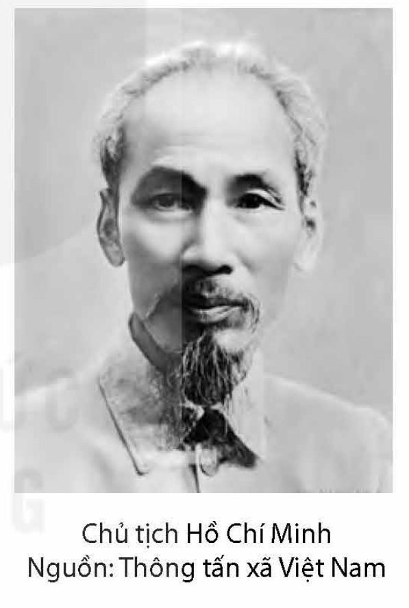
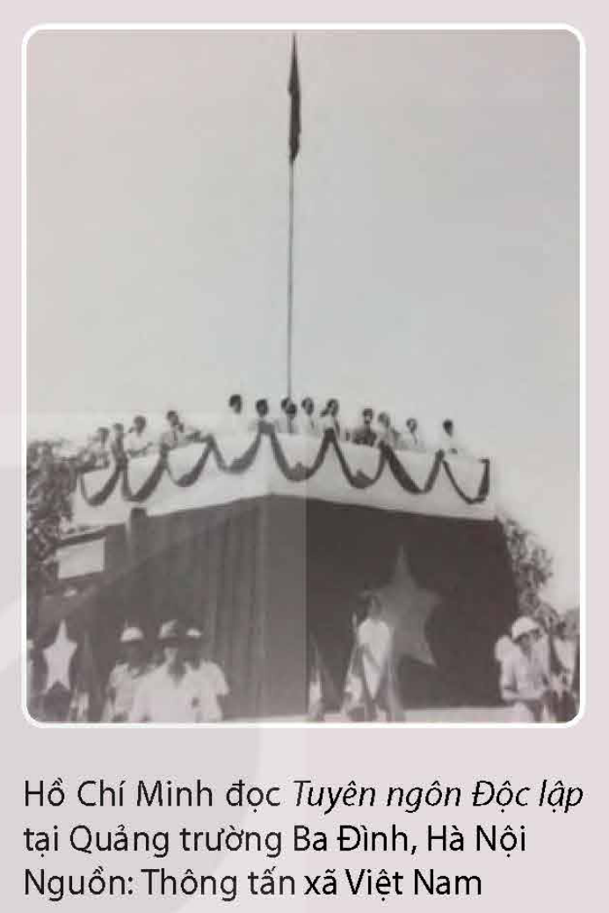
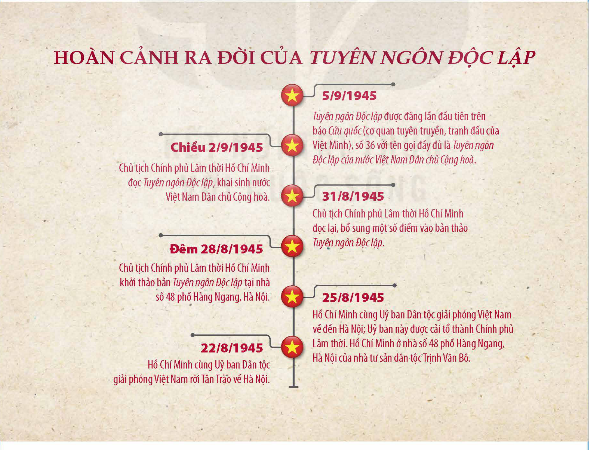
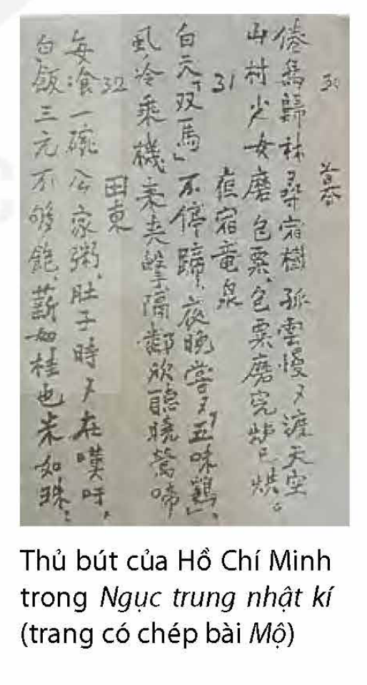

<!-- pdf:6 -->

# BÀI 6: HỒ CHÍ MINH – “VĂN HOÁ PHẢI SOI ĐƯỜNG CHO QUỐC DÂN ĐI”

## 🎯 Yêu cầu cần đạt

- Vận dụng được những hiểu biết về tác gia Hồ Chí Minh để đọc hiểu một số tác phẩm của Người; nhận biết và phân tích được quan điểm của tác giả về lịch sử, văn hoá được thể hiện trong văn bản.
- Nhận biết và phân tích được vai trò của cách lập luận và ngôn ngữ biểu cảm trong văn bản nghị luận.
- Vận dụng được kiến thức về lịch sử văn học và kĩ năng tra cứu để sắp xếp một số tác phẩm, tác giả lớn theo tiến trình lịch sử văn học; biết đặt tác phẩm trong bối cảnh sáng tác và bối cảnh hiện tại để có đánh giá phù hợp.
- Phân tích và đánh giá được hiệu quả của việc dùng các biện pháp tu từ và cách diễn đạt thể hiện tính khẳng định, phủ định trong văn bản nghị luận.
- Viết được báo cáo kết quả của bài tập dự án; có sử dụng sơ đồ, bảng biểu, có thuyết minh các hình ảnh minh hoạ, có sử dụng trích dẫn, cước chú và biết trình bày phần tài liệu tham khảo.
- Biết trình bày kết quả của bài tập dự án, sử dụng các phương tiện hỗ trợ phù hợp.
- Biết thể hiện lòng tôn kính đối với vị lãnh tụ vĩ đại của đất nước và có ý thức học tập, phấn đấu noi theo tấm gương sống vì dân, vì nước của Người.

## ĐỌC

### Tri thức Ngữ văn

**Quan điểm sáng tác**

**Quan điểm sáng tác** là hệ thống tư tưởng, nguyên tắc chi phối hoạt động sáng tác của nhà văn, do chính nhà văn xác định dựa trên những trải nghiệm đời sống và nghệ thuật của mình. Quan điểm sáng tác có thể được chính nhà văn phát biểu một cách tường minh nhưng nhiều khi được độc giả khái quát lên dựa vào sự ổn định trong cách

> (\*) Ý kiến phát biểu của Chủ tịch Hồ Chí Minh tại Hội nghị Văn hoá toàn quốc năm 1946, được tường thuật trên báo *Cứu quốc*, số 416, ngày 25/11/1946.

<!-- pdf:7 -->

nhà văn lựa chọn đề tài, xác định chủ đề, bày tỏ thái độ trước đối tượng miêu tả và vận dụng các phương thức, phương tiện nghệ thuật.

Đối với các nhà văn cách mạng, quan điểm sáng tác thường được tuyên bố công khai, gắn với sự lựa chọn một thái độ chính trị dứt khoát, do đặc điểm của thời đại cách mạng quy định. Chính điều này làm nên tính đặc thù của những sáng tác thuộc loại hình văn học cách mạng mà thơ văn Hồ Chí Minh là một ví dụ tiêu biểu.

**Đánh giá một tác giả, tác phẩm văn học**

Khi đánh giá một tác giả, tác phẩm văn học, cần huy động kiến thức nhiều mặt và phải dựa trên những tiêu chí xác đáng. Điều quan trọng là phải đặt đối tượng vào tiến trình văn học (văn học dân tộc, văn học thế giới) để nhận ra mức độ đóng góp về nội dung tư tưởng và nghệ thuật của tác giả, tác phẩm đó. Những tác giả, tác phẩm lớn thường đạt được thành tựu quan trọng trong việc tổng hợp kinh nghiệm nghệ thuật phong phú của các giai đoạn văn học đã qua, tạo được bước phát triển có ý nghĩa cho văn học ở giai đoạn mới. Tuy khó tránh khỏi một số hạn chế do sự ràng buộc của thời đại, nhưng những tác giả, tác phẩm thực sự có tầm vóc thường chạm được vào các vấn đề nhân sinh vĩnh cửu, để tiếp tục đồng hành cùng bao lớp người đọc đến sau.

**Tính khẳng định, phủ định trong văn bản nghị luận**

Trong văn bản nghị luận, **tính khẳng định** và **tính phủ định** luôn song hành. Tính khẳng định gắn với nội dung thuyết phục người đọc tin vào sự đúng đắn của một luận đề, quan điểm, cách ứng xử, lựa chọn, niềm tin nào đó. Ngược lại, tính phủ định gắn với ý đồ phản bác những luận đề, quan điểm, cách ứng xử, lựa chọn, niềm tin mà tác giả cho là sai trái hoặc không phù hợp. Đằng sau sự khẳng định luôn ẩn chứa thái độ phủ định một đối tượng đối lập, còn sự phủ định thì luôn được thể hiện dựa trên thái độ khẳng định một đối tượng khác.

Để tăng cường tính khẳng định hoặc phủ định cho văn bản nghị luận, người viết thường sử dụng nhiều biện pháp thuộc các cấp độ khác nhau như: từ ngữ, cú pháp, phép tu từ, lập luận (trong đó có lí lẽ, bằng chứng). Loại biện pháp có thể giống nhau nhưng hiệu quả đạt được thì trái ngược, do tính chất riêng của các yếu tố ngôn ngữ và ý đồ tư tưởng gắn với biện pháp đó. Ví dụ, cùng sử dụng những từ ngữ thể hiện thái độ đánh giá, nếu hướng đến việc khẳng định, người viết sẽ chọn những từ ngữ khác hẳn với khi hướng đến việc phủ định. Tương tự, cùng sử dụng bằng chứng nhưng bằng chứng nhằm mục đích phủ định không thể giống bằng chứng được đưa ra để khẳng định vấn đề.

<!-- pdf:8 -->

### Văn bản 1: Tác gia Hồ Chí Minh

**Trước khi đọc**

- Bạn từng biết những sáng tác văn học nghệ thuật nào về lãnh tụ Hồ Chí Minh? Hãy chia sẻ cảm nghĩ của bạn về những sáng tác ấy.
- Kể tên các tác phẩm của tác gia Hồ Chí Minh mà bạn đã được học ở cấp Tiểu học và Trung học cơ sở.

**Đọc văn bản**

## I. TIỂU SỬ

Chủ tịch Hồ Chí Minh
Nguồn: Thông tấn xã Việt Nam

**Hồ Chí Minh** (1890 – 1969) thời thơ ấu có tên là Nguyễn Sinh Cung, lúc trưởng thành có tên là Nguyễn Tất Thành, xuất thân từ một gia đình nhà Nho có tinh thần yêu nước, quê ở làng Sen, thuộc xã Kim Liên, huyện Nam Đàn, tỉnh Nghệ An. Sau thời gian học chữ Hán trong gia đình (thuở nhỏ), học chữ quốc ngữ và tiếng Pháp tại Trường Quốc học Huế, vào năm 1910, anh thanh niên Nguyễn Tất Thành vào Phan Thiết dạy học ở Trường Dục Thanh một thời gian ngắn rồi tiếp tục vào Sài Gòn (nay là Thành phố Hồ Chí Minh). Đầu tháng 6 năm 1911, dưới tên Văn Ba, Nguyễn Tất Thành xuống tàu sang Pháp và một số nước phương Tây, vừa lao động vất vả để mưu sinh, vừa tích cực tham gia các hoạt động yêu nước, cách mạng. Năm 1919, sau khi thay mặt Hội những người Việt Nam yêu nước gửi tới Hội nghị Véc-xây (Versailles)(1) bản *Yêu sách của nhân dân An Nam*, nhà cách mạng trẻ tuổi lấy tên mới là Nguyễn Ái Quốc và nổi lên như một nhân tố trung tâm của các hoạt động cứu nước Việt Nam diễn ra trên đất Pháp. Năm 1920, Nguyễn Ái Quốc tham gia Đại hội đại biểu toàn quốc lần thứ XVIII của Đảng Xã hội Pháp, bỏ phiếu ủng hộ việc thành lập Đảng Cộng sản Pháp, tiếp đó, thực hiện nhiều

> 💡 **[Chỉ dẫn đọc]** Chú ý những sự kiện nổi bật, quan trọng trong cuộc đời hoạt động cách mạng của tác gia Hồ Chí Minh.

> (1) *Hội nghị Véc-xây*: hội nghị của các nước Đồng minh chiến thắng trong Chiến tranh thế giới lần thứ nhất (1914 – 1918), họp ở thành phố Véc-xây (Pháp).

<!-- pdf:9 -->

hoạt động đa dạng, hiệu quả nhằm chống chủ nghĩa thực dân và đoàn kết các dân tộc thuộc địa. Từ năm 1923 đến năm 1941, Nguyễn Ái Quốc chủ yếu hoạt động ở Liên Xô, Trung Quốc và Thái Lan. Trong thời gian này, vai trò lãnh đạo cách mạng Việt Nam của Nguyễn Ái Quốc được thể hiện rõ qua việc chủ trì Hội nghị hợp nhất các tổ chức cộng sản trong nước và thành lập Đảng Cộng sản Việt Nam, diễn ra đầu tháng 2 năm 1930 tại Hương Cảng (tức Hồng Kông), Trung Quốc. Cuối tháng 1 năm 1941, vị lãnh tụ cách mạng về nước, thành lập Mặt trận Việt Minh (tên gọi tắt của tổ chức Việt Nam Độc lập Đồng minh), lấy tên là Hồ Chí Minh (tháng 8 năm 1942), trực tiếp lãnh đạo phong trào đấu tranh giành độc lập của nhân dân ta. Sau khi Cách mạng tháng Tám thành công, ngày 2/9/1945, tại Quảng trường Ba Đình (Hà Nội), Hồ Chí Minh đọc bản *Tuyên ngôn Độc lập*(1) khai sinh nước Việt Nam Dân chủ Cộng hoà. Trong hai cuộc kháng chiến chống thực dân Pháp và đế quốc Mỹ, ở cương vị Chủ tịch nước, Hồ Chí Minh đã lãnh đạo cuộc cách mạng của nhân dân Việt Nam giành được những thắng lợi to lớn, khẳng định vị thế độc lập, tự chủ của nước ta trên trường quốc tế. Hồ Chí Minh qua đời vào ngày 2/9/1969 tại Hà Nội.

> 💡 **[Chỉ dẫn đọc]** Vai trò lãnh tụ cách mạng Việt Nam của Hồ Chí Minh được khẳng định dựa trên cơ sở nào?

Là nhà yêu nước và nhà cách mạng vĩ đại của dân tộc Việt Nam, Hồ Chí Minh luôn được nhân dân ta biết ơn, kính trọng và ngưỡng mộ. Hồ Chí Minh có uy tín quốc tế rất cao, thường được đánh giá là một trong những nhà cách mạng hay chính khách tạo nên nhiều ảnh hưởng nhất trên thế giới trong thế kỉ XX. Năm 1990, Tổ chức Giáo dục, Khoa học và Văn hoá Liên hợp quốc (UNESCO) đã suy tôn Hồ Chí Minh là *Anh hùng giải phóng dân tộc Việt Nam, nhà văn hoá lớn*.

> 💡 **[Chỉ dẫn đọc]** Liên hệ đến những đánh giá khái quát về Hồ Chí Minh mà bạn đã từng biết.

## II. SỰ NGHIỆP VĂN HỌC

Hồ Chí Minh đã để lại một di sản văn học phong phú và có giá trị nhiều mặt, kết quả của việc huy động tài năng văn chương phục vụ cho cuộc đấu tranh cách mạng. Ở Hồ Chí Minh, **sự nghiệp văn học** gắn bó máu thịt với sự nghiệp cách mạng.

### 1. Quan điểm sáng tác

Quan điểm sáng tác của Hồ Chí Minh được thể hiện tập trung, nhất quán trong nhiều bài phát biểu, nói chuyện và trong các tác phẩm văn, thơ cụ thể. Trên cơ sở

> 💡 **[Chỉ dẫn đọc]** Quan điểm sáng tác của Hồ Chí Minh có những điểm gì nổi bật?

> (1) Trên báo *Cứu quốc*, số 36, ngày 5/9/1945, tên văn bản được ghi đầy đủ là *Tuyên ngôn Độc lập của nước Việt Nam Dân chủ Cộng hoà*.

<!-- pdf:10 -->

nhận thức sâu sắc về tác dụng lớn lao của báo chí, văn học, nghệ thuật trong việc cảm hoá, giáo dục con người và tuyên truyền, vận động cách mạng, Hồ Chí Minh đòi hỏi mỗi tác phẩm phải trở thành vũ khí, mang tính chiến đấu cao, đạt hiệu quả thiết thực, dễ tiếp nhận với đại chúng, có thể “soi đường cho quốc dân đi”. Trong bài thơ *Khán “Thiên gia thi” hữu cảm* (*Cảm tưởng đọc “Thiên gia thi”*), Hồ Chí Minh đã nêu yêu cầu dứt khoát đối với thơ của thời đại cách mạng:

*Hiện đại thi trung ưng hữu thiết,*
*Thi gia dã yếu hội xung phong.*

*(Nay ở trong thơ nên có thép,*
*Nhà thơ cũng phải biết xung phong.)*(1)

Trong *Thư gửi các hoạ sĩ nhân dịp triển lãm hội hoạ 1951*, Hồ Chí Minh cũng phát biểu ý tương tự:

*Văn hoá nghệ thuật cũng là một mặt trận.*
*Anh chị em là chiến sĩ trên mặt trận ấy*(2).

Từ kinh nghiệm viết báo của mình, Hồ Chí Minh nhiều lần nhắc nhở người cầm bút phải chú ý tự đặt ra và giải quyết các câu hỏi chính: *Viết cho ai? Viết để làm gì? Viết cái gì? Viết như thế nào?*(3) Các câu hỏi này đề cập cùng lúc những vấn đề lớn của hoạt động giao tiếp bằng văn bản (trước hết là văn bản nghị luận, văn bản thông tin): hình dung cụ thể về đối tượng tiếp nhận; xác định sáng rõ mục đích hướng tới; lựa chọn được nội dung phù hợp; tìm được hình thức truyền tải thông tin, thông điệp có hiệu quả.

Khi nêu quan điểm sáng tác như vậy, Hồ Chí Minh muốn hướng tới việc xây dựng một nền văn hoá, văn học mới phục vụ quần chúng lao động và đấu tranh vì những mục tiêu cao cả của cách mạng – điều được chính tác giả tuân thủ nghiêm ngặt trong những tác phẩm mang tính chất tuyên truyền, vận động của mình. Trong bối cảnh đặc biệt của lịch sử, việc ưu tiên “đưa nghệ thuật vào chính trị”(4) đã cho thấy sự toàn tâm, toàn ý của Hồ Chí Minh đối với sự nghiệp cách mạng và giải phóng dân tộc.

> 💡 **[Chỉ dẫn đọc]** Cơ sở hình thành quan điểm sáng tác của Hồ Chí Minh là gì?

> (1) Viện Văn học, *Suy nghĩ mới về Nhật kí trong tù – Nhật kí trong tù (Bản dịch trọn vẹn)*, NXB Giáo dục, Hà Nội, 1993, tr. 575 – 576.
>
> (2), (4) *Thư gửi các hoạ sĩ nhân dịp triển lãm hội hoạ 1951*, in trong *Hồ Chí Minh toàn tập*, tập 7 (1951 – 1952), NXB Chính trị Quốc gia Sự thật, Hà Nội, 2011, tr. 246.
>
> (3) Vấn đề này được Hồ Chí Minh trình bày trong các tài liệu: *Bài giảng Cách viết tại lớp chỉnh Đảng Trung ương ngày 17/8/1953*, in trong *Hồ Chí Minh toàn tập*, tập 8 (1953 – 1954), NXB Chính trị Quốc gia Sự thật, Hà Nội, 2011, tr. 205 – 212; *Bài nói chuyện tại Đại hội lần thứ III của Hội Nhà báo Việt Nam*, in trong *Hồ Chí Minh toàn tập*, tập 13 (1961 – 1962), NXB Chính trị Quốc gia Sự thật, Hà Nội, 2011, tr. 463 – 466.

<!-- pdf:11 -->

Do có cuộc đời hoạt động cách mạng phong phú và phạm vi giao tiếp rộng rãi, lại sẵn tư chất nghệ sĩ và tài năng nghệ thuật lớn, việc đa dạng hoá sáng tác đã được Hồ Chí Minh thực hiện một cách hết sức tự nhiên. Ở bộ phận thơ trữ tình viết theo cảm hứng thẩm mĩ, nhiều lúc tác giả hướng về các nội dung cá nhân, thể hiện những suy nghĩ thâm trầm trước bao câu hỏi mang tính muôn đời về tồn tại.

### 2. Thành tựu sáng tác

Sáng tác của Hồ Chí Minh có thể được chia thành ba bộ phận chính: văn chính luận, truyện và kí, thơ.

**Văn chính luận** chiếm khối lượng lớn nhất trong di sản văn học của Hồ Chí Minh, gồm những tác phẩm được viết ra nhằm đáp ứng kịp thời mọi yêu cầu của hoạt động chính trị, cách mạng. Văn chính luận của Hồ Chí Minh luôn chứa chan nhiệt huyết, thể hiện tinh thần bám sát cuộc sống cách mạng để nắm bắt những vấn đề có ý nghĩa bức thiết đối với vận mệnh dân tộc và vận mệnh của tầng lớp cần lao trên toàn thế giới. Nhiều tác phẩm trực tiếp chất vấn, tố cáo các thế lực thực dân, đế quốc, kêu gọi nhân dân và các dân tộc bị áp bức tham gia đấu tranh cách mạng, đấu tranh vì chân lí độc lập, tự do. Tác phẩm *Bản án chế độ thực dân Pháp* được viết bằng tiếng Pháp dưới bút danh Nguyễn Ái Quốc, xuất bản năm 1925, đã tấn công mãnh liệt vào chủ nghĩa thực dân, vạch trần tội ác của thực dân Pháp đối với các dân tộc thuộc địa cũng như tính bịp bợm trong luận điệu mà chúng thường rêu rao về sự “khai hoá”. Bản *Tuyên ngôn Độc lập* (1945) với lập luận chặt chẽ, lí lẽ sắc bén và những bằng chứng “không ai chối cãi được”, là tiếng nói hùng hồn khẳng định quyền hưởng tự do, độc lập, quyền tự làm chủ vận mệnh của một dân tộc đã can trường đấu tranh chống lại mọi sự nô dịch do ngoại bang áp đặt. Rất nhiều tác phẩm chính luận khác của Hồ Chí Minh như *Lời kêu gọi toàn quốc kháng chiến* (19/12/1946), *Không có gì quý hơn độc lập, tự do* (17/7/1966), *Di chúc* (1965 – 1969),... âm vang tiếng nói của non sông, của lịch sử, luôn có sức động viên, cổ vũ rất lớn, có thể khơi dậy được sức mạnh của toàn dân tộc.

> 💡 **[Chỉ dẫn đọc]** Liên hệ đến những tác phẩm chính luận của Hồ Chí Minh đã được học hoặc đã đọc.

**Truyện, kí** là một bộ phận sáng tác thực sự đặc sắc của Hồ Chí Minh, tuy có số lượng không nhiều. Nổi bật trong đó là những truyện ngắn được viết bằng tiếng Pháp, ra đời vào những năm hai mươi của thế kỉ XX: *Pa-ri (Paris)*, *Lời than vãn của Bà Trưng Trắc*, *“Vi hành”*, *Những trò lố*

> 💡 **[Chỉ dẫn đọc]** Truyện, kí của Hồ Chí Minh chủ yếu được viết trong những khoảng thời gian nào?

<!-- pdf:12 -->

*hay là Va-ren (Varenne) và Phan Bội Châu*,... Các truyện ngắn này có phong cách rất hiện đại so với những sáng tác văn xuôi trong nước viết cùng thời điểm, thể hiện ở một số mặt như: xây dựng tình huống, dẫn chuyện, tổ chức ngôn ngữ đối thoại, khắc hoạ chân dung nhân vật, sử dụng các thủ pháp châm biếm, đả kích,... Nội dung các tác phẩm đều nhằm vào việc lật tẩy thói nô lệ đê hèn của những kẻ tay sai, bộ mặt giả nhân giả nghĩa của bọn thực dân, phơi bày thực trạng đời sống tối tăm của tầng lớp cần lao, ca ngợi những tấm gương xả thân vì đất nước, dân tộc,...

Trong truyện, kí của Hồ Chí Minh, *Vừa đi đường vừa kể chuyện* (kí tên T. Lan, công bố lần đầu trên báo *Nhân Dân* năm 1961) là tác phẩm mang tính tự truyện đáng chú ý. Tác phẩm này thể hiện hình tượng *cái tôi* của tác giả rất sinh động: trẻ trung, hồn nhiên, giản dị, có tinh thần dân chủ, yêu quý con người, say mê hoạt động, có khả năng quan sát và phát hiện vấn đề nhạy bén, sắc sảo,... Ở đây, những sự kiện liên quan đến các hoạt động của tác giả thường được đặt trên cái nền rộng lớn là cuộc sống của quần chúng nhân dân – lực lượng đóng vai trò chính trong mọi cuộc cách mạng.

**Thơ** là mảng sáng tác thể hiện rõ nhất phẩm chất nghệ sĩ của Hồ Chí Minh, phần lớn đã được đưa vào trong hai tập: *Ngục trung nhật kí* (*Nhật kí trong tù*, in lần đầu năm 1960) và *Thơ Hồ Chủ tịch* (1967). *Ngục trung nhật kí* gồm 133 bài thơ chữ Hán (không kể bốn câu mang tính chất đề từ), được viết trong thời kì Hồ Chí Minh bị chính quyền Quốc dân đảng ở Trung Quốc giam cầm (từ mùa thu năm 1942 đến mùa thu năm 1943). *Ngục trung nhật kí*, như nhan đề cho thấy, trước hết là một tập nhật kí, ghi lại những trải nghiệm, nỗi lòng và suy ngẫm của tác giả suốt thời gian bị đoạ đày trong tù ngục nơi đất khách. Tập thơ có phẩm chất nghệ thuật cao, thể hiện được tầm vóc của một nhà thơ lớn và các giá trị cao quý của một nhân cách lỗi lạc. Tập *Thơ Hồ Chủ tịch* đã sưu tầm được những tác phẩm tiêu biểu của Hồ Chí Minh sáng tác trong thời kì tiền khởi nghĩa và trong hai cuộc kháng chiến chống thực dân Pháp, chống đế quốc Mỹ. Ở đây, dù là thơ chữ Hán hay thơ tiếng Việt, dù là thơ mừng xuân, tuyên truyền, vận động hay thơ trữ tình, tất cả đều thể hiện rõ tình cảm yêu nước, thương dân nồng cháy, niềm tin không thể lay chuyển vào tương lai, sự cẩn trọng, thanh thoát trong mọi ứng xử và phong thái điềm đạm, ung dung của tác giả trước những biến cố lớn lao trong thời đại cách mạng.

> 💡 **[Chỉ dẫn đọc]** Liên hệ đến những bài thơ của Hồ Chí Minh đã được học hoặc đã đọc.

<!-- pdf:13 -->

### 3. Phong cách nghệ thuật

<!-- term: phong cách nghệ thuật -->
Trong các tác phẩm mang tính văn chương đậm nét của mình, Hồ Chí Minh đã thể hiện một phong cách nghệ thuật hết sức đa dạng. Tác giả đã thực sự làm chủ các ngôn ngữ và thể loại được sử dụng. Do viết về nhiều vấn đề, đối tượng khác nhau và hướng đến những lớp độc giả khác nhau, mỗi tác phẩm hay loại tác phẩm của Hồ Chí Minh lại có một nét riêng về cấu trúc, ngôn ngữ, giọng điệu.

> 💡 **[Chỉ dẫn đọc]** Chú ý nguyên nhân dẫn đến sự đa dạng về cấu trúc, ngôn ngữ và giọng điệu trong các tác phẩm ngôn từ của Hồ Chí Minh.

Văn chính luận của Hồ Chí Minh đã kế thừa được truyền thống tốt đẹp của thể văn này trong nền văn học dân tộc, lại học hỏi được nhiều kinh nghiệm ở văn chính luận các nước phương Tây, vì vậy, luôn đạt được sức thuyết phục rất cao. Khi hướng về kẻ thù của cách mạng, các tác phẩm có lập luận đanh thép, lí lẽ sắc bén và những chứng cứ không thể chối cãi, mang tinh thần duy lí, tư duy khoa học rất rõ. Khi hướng về đồng bào, đồng chí, điểm nổi bật ở các tác phẩm là giọng điệu chân thành, thân mật, ở sự hoà quyện giữa lí và tình, khiến người đọc thấy “thấm từng tiếng, ấm vào lòng mong ước”(1).

Ở truyện, kí, khi viết bằng tiếng Pháp và hướng đến độc giả Pháp, Hồ Chí Minh (dưới bút danh Nguyễn Ái Quốc) thường chọn cách viết hiện đại, có sử dụng một số thủ pháp quen thuộc trong văn học phương Tây như kể chuyện dưới hình thức viết thư hoặc để nguyên dạng một số từ ngữ của người bản xứ thuộc địa. Chất hài hước kiểu Pháp (humour) thấm đượm trong ngôn ngữ kể chuyện, đối thoại. Việc chuyển cảnh, chuyển đoạn được thực hiện linh hoạt, đột ngột, giàu tính điện ảnh, đưa người đọc đến những khám phá thú vị về đối tượng được nói tới. Còn khi viết bằng tiếng Việt cho độc giả là quần chúng trong nước, Hồ Chí Minh thường dùng cách kể dung dị, gãy gọn, hóm hỉnh và chú ý việc nêu bài học một cách trực tiếp.

> 💡 **[Chỉ dẫn đọc]** Giữa hai mảng truyện, kí của Hồ Chí Minh có sự khác nhau như thế nào?
<!-- ocr-ok: OCR đọc lỗi chữ trong hộp chỉ dẫn đọc cột phải, đã đối chiếu ảnh trang PDF 13 -->

Về thơ Hồ Chí Minh, có sự phân biệt rõ giữa thơ tuyên truyền, kêu gọi với thơ trữ tình. Thơ tuyên truyền, kêu gọi luôn có nội dung sáng rõ (mặc dù có thể được biểu đạt bằng ẩn dụ) và hình thức ngôn ngữ bình dị, dễ hiểu, rất phù hợp với đại chúng. Trong khi đó, thơ trữ tình, nhất là thơ được viết bằng chữ Hán, lại thường mang đậm màu sắc cổ điển

> 💡 **[Chỉ dẫn đọc]** Bạn liên hệ đến những bài thơ đã học, đã đọc nào cho thấy sự đa dạng trong phong cách thơ Hồ Chí Minh?

> (1) Trong bài thơ *Sáng tháng Năm*, Tố Hữu đã viết: “Giọng của Người, không phải sấm trên cao/ Thấm từng tiếng, ấm vào lòng mong ước...” (Hà Minh Đức giới thiệu, *Tố Hữu tác phẩm*, NXB Văn học, Hà Nội, 1979, tr. 296).

<!-- pdf:14 -->

ở cấu tứ, cách sử dụng nhãn tự, ở tình cảm đặc biệt dành cho thiên nhiên (nhất là cho trăng) và ở phong thái hiền triết phương Đông của nhân vật trữ tình. Tất nhiên, màu sắc cổ điển luôn có sự gắn quyện hài hoà với màu sắc hiện đại, do tư tưởng của người viết là tư tưởng của nhà cách mạng luôn tin vào ngày mai tươi sáng, vào sự vận động tích cực của cuộc sống.

Nhìn chung, sự đa dạng trong phong cách nghệ thuật Hồ Chí Minh phản ánh sự phong phú của một cuộc đời hoạt động cách mạng không mỏi mệt và sự đa diện của một tài năng văn chương đích thực. Bên cạnh đó, sự thống nhất cao độ trong phong cách nghệ thuật Hồ Chí Minh lại phản ánh sự thống nhất toàn vẹn ở con người tác giả như một hình mẫu nhân cách đặc biệt, kết tinh được nhiều giá trị đẹp đẽ của dân tộc và nhân loại, của truyền thống và hiện đại.

**Sau khi đọc**

1. Những tri thức về tiểu sử Hồ Chí Minh trong văn bản đã đem lại cho bạn cảm xúc, suy nghĩ gì?
2. Bạn hiểu như thế nào về sự thống nhất giữa sự nghiệp cách mạng và sự nghiệp văn học ở tác gia Hồ Chí Minh?
3. Khi nêu công khai quan điểm sáng tác của mình, Hồ Chí Minh muốn hướng tới điều gì? Dựa trên sự suy luận và những kiến thức đã học, hãy cho biết quan điểm sáng tác của Hồ Chí Minh đã có tác động như thế nào đến xu hướng phát triển của nền văn học cách mạng Việt Nam.
4. Vì sao có thể nói Hồ Chí Minh đã để lại cho hậu thế một di sản văn học lớn? Trong di sản văn học đó, bộ phận nào chiếm ưu thế về khối lượng? Điều này có thể được giải thích như thế nào?
5. Hãy tìm một số bằng chứng khẳng định sức tác động mạnh mẽ của những tác phẩm do Hồ Chí Minh viết ra trong suốt cuộc đời cống hiến cho sự nghiệp cách mạng.
6. Tìm trong văn bản những câu hay những ý lí giải tính đa dạng của phong cách nghệ thuật Hồ Chí Minh.
7. Bạn có cảm nhận và đánh giá như thế nào về tài năng văn học và phẩm chất nghệ sĩ của Hồ Chí Minh?

#### Kết nối đọc – viết

Viết đoạn văn (khoảng 150 chữ) nêu những thu hoạch bổ ích nhất của bạn khi đọc văn bản *Tác gia Hồ Chí Minh*.

<!-- pdf:15 -->

### Văn bản 2: Tuyên ngôn Độc lập (Hồ Chí Minh)

**Trước khi đọc**

- Bạn đã biết những tác phẩm nào trong văn học Việt Nam từng được nhìn nhận như là “tuyên ngôn độc lập”? Điều gì khiến cho những tác phẩm ấy được nhìn nhận như vậy?
- Trình bày khái quát về phong trào đấu tranh giải phóng dân tộc ở Việt Nam nửa đầu thế kỉ XX theo những gì bạn đã được học.

Hồ Chí Minh đọc *Tuyên ngôn Độc lập* tại Quảng trường Ba Đình, Hà Nội
Nguồn: Thông tấn xã Việt Nam

**Đọc văn bản**

“Tất cả mọi người đều sinh ra bình đẳng. Tạo hoá cho họ những quyền không ai có thể xâm phạm được, trong những quyền ấy, có quyền được sống, quyền tự do và quyền mưu cầu hạnh phúc”.

> 💡 **[Chỉ dẫn đọc]** Chú ý nội dung câu được trích dẫn và sự “suy rộng” của tác giả Hồ Chí Minh.

Lời bất hủ ấy ở trong bản *Tuyên ngôn Độc lập* năm 1776 của nước Mỹ. Suy rộng ra, câu ấy có ý nghĩa là: Tất cả các dân tộc trên thế giới đều sinh ra bình đẳng; dân tộc nào cũng có quyền sống, quyền sung sướng và quyền tự do.

Bản *Tuyên ngôn Nhân quyền và Dân quyền* của Cách mạng Pháp năm 1791 cũng nói:

“Người ta sinh ra tự do và bình đẳng về quyền lợi, và phải luôn luôn được tự do và bình đẳng về quyền lợi”.

Đó là những lẽ phải không ai chối cãi được.

> 💡 **[Chỉ dẫn đọc]** Việc tác giả nêu “những lẽ phải không ai chối cãi được” nhằm mục đích gì?

Thế mà hơn tám mươi năm nay, bọn thực dân Pháp lợi dụng lá cờ tự do, bình đẳng, bác ái, đến cướp đất nước ta, áp bức đồng bào ta. Hành động của chúng trái hẳn với nhân đạo và chính nghĩa.

<!-- pdf:16 -->

Về chính trị, chúng tuyệt đối không cho dân ta một chút tự do dân chủ nào.

Chúng thi hành những pháp luật dã man. Chúng lập ba chế độ khác nhau ở Trung, Nam, Bắc để ngăn cản việc thống nhất nước nhà của ta, để ngăn cản dân ta đoàn kết.

> 💡 **[Chỉ dẫn đọc]** Những chứng cứ về hành động “trái hẳn với nhân đạo và chính nghĩa” của thực dân Pháp đã được tập hợp theo hệ thống nào?

Chúng lập ra nhà tù nhiều hơn trường học. Chúng thẳng tay chém giết những người yêu nước thương nòi của ta. Chúng tắm các cuộc khởi nghĩa của ta trong những bể máu.

Chúng ràng buộc dư luận, thi hành chính sách ngu dân.

Chúng dùng thuốc phiện, rượu, cồn, để làm cho nòi giống ta suy nhược.

Về kinh tế, chúng bóc lột dân ta đến tận xương tuỷ, khiến cho dân nghèo nàn, thiếu thốn, nước ta xơ xác, tiêu điều.

Chúng cướp không ruộng đất, rừng mỏ, nguyên liệu.

Chúng giữ độc quyền in giấy bạc, xuất cảng và nhập cảng.

Chúng đặt ra hàng trăm thứ thuế vô lí, làm cho dân ta, nhất là dân cày và dân buôn, trở nên bần cùng.

Chúng không cho các nhà tư sản ta được giàu lên. Chúng bóc lột công nhân ta một cách vô cùng tàn nhẫn.

Mùa thu năm 1940, phát xít Nhật đến xâm lăng Đông Dương để mở thêm căn cứ đánh Đồng minh, thì bọn thực dân Pháp quỳ gối đầu hàng, mở cửa nước ta rước Nhật. Từ đó, dân ta chịu hai tầng xiềng xích: Pháp và Nhật. Từ đó, dân ta càng cực khổ, nghèo nàn. Kết quả là cuối năm ngoái sang đầu năm nay(1), từ Quảng Trị đến Bắc Kì hơn hai triệu đồng bào ta bị chết đói.

Ngày 9 tháng 3 năm nay, Nhật tước khí giới của quân đội Pháp. Bọn thực dân Pháp hoặc bỏ chạy, hoặc đầu hàng. Thế là chẳng những chúng không “bảo hộ” được ta, trái lại, trong năm năm, chúng đã “bán” nước ta hai lần cho Nhật.

> 💡 **[Chỉ dẫn đọc]** Thực chất việc “bảo hộ” của thực dân Pháp đã bị vạch trần như thế nào?

Trước ngày 9 tháng 3, biết bao lần Việt Minh đã kêu gọi người Pháp liên minh để chống Nhật. Bọn thực dân Pháp đã không đáp ứng, lại thẳng tay khủng bố Việt Minh hơn trước. Thậm chí đến khi thua chạy, chúng còn nhẫn tâm giết nốt số đông tù chính trị ở Yên Bái và Cao Bằng.

> (1) Cuối năm 1944, đầu năm 1945.

<!-- pdf:17 -->

Tuy vậy, đối với người Pháp, đồng bào ta vẫn giữ một thái độ khoan hồng và nhân đạo. Sau cuộc biến động ngày 9 tháng 3, Việt Minh đã giúp cho nhiều người Pháp chạy qua biên thuỳ, lại cứu cho người Pháp ra khỏi nhà giam Nhật và bảo vệ tính mạng, tài sản cho họ.

Sự thực là từ mùa thu năm 1940, nước ta đã thành thuộc địa của Nhật, chứ không phải thuộc địa của Pháp nữa. Khi Nhật hàng Đồng minh thì nhân dân cả nước ta đã nổi dậy giành chính quyền, lập nên nước Việt Nam Cộng hoà Dân chủ(1).

> 💡 **[Chỉ dẫn đọc]** Dự đoán những luận điểm sẽ được triển khai sau việc tác giả khái quát về “sự thực” sự bảo hộ của thực dân Pháp.

Sự thực là dân ta đã lấy lại nước Việt Nam tự(2) tay Nhật, chứ không phải tự tay Pháp.

Pháp chạy, Nhật hàng, vua Bảo Đại thoái vị. Dân ta đã đánh đổ các xiềng xích thực dân gần một trăm năm nay để gây nên nước Việt Nam độc lập. Dân ta lại đánh đổ chế độ quân chủ mấy mươi thế kỉ mà lập nên chế độ Dân chủ Cộng hoà.

Bởi thế cho nên, chúng tôi – Lâm thời Chính phủ(3) của nước Việt Nam mới – đại biểu cho toàn dân Việt Nam, tuyên bố thoát li hẳn quan hệ thực dân với Pháp, xoá bỏ hết những hiệp ước mà Pháp đã kí về nước Việt Nam, xoá bỏ tất cả mọi đặc quyền của Pháp trên đất nước Việt Nam.

Toàn dân Việt Nam, trên dưới một lòng quyết liệt chống lại âm mưu của bọn thực dân Pháp.

Chúng tôi tin rằng các nước Đồng minh đã công nhận những nguyên tắc dân tộc bình đẳng ở các hội nghị Tê-hê-răng (Teheran)(4) và Cựu Kim Sơn(5), quyết không thể không nhận quyền độc lập của dân Việt Nam(6).

> 💡 **[Chỉ dẫn đọc]** Việc nhắc đến những điều được các nước Đồng minh công nhận có ý nghĩa gì?
<!-- ocr-ok: OCR đọc dính chữ trong hộp chỉ dẫn đọc cột phải, đã đối chiếu ảnh trang PDF 17 -->

> (1) Bản in trên báo *Cứu quốc*, số 36, ngày 5/9/1945 ghi là: “lập nên nước Việt Nam Cộng hoà Dân chủ”.
>
> (2) *Tự*: từ.
>
> (3) *Lâm thời Chính phủ*: tức Chính phủ Lâm thời, được lập ra ngày 25/8/1945 theo đề nghị của Hồ Chí Minh, trên cơ sở cải tổ Uỷ ban Dân tộc giải phóng Việt Nam vốn ra đời trước đó theo quyết định của Quốc dân đại hội Tân Trào họp trong các ngày 16, 17, 18/8/1945.
>
> (4) *Hội nghị Tê-hê-răng*: hội nghị do đại diện của ba nước Liên Xô, Mỹ, Anh tổ chức từ ngày 28/11 đến ngày 01/12/1943 tại thủ đô của nước I-ran (Iran) để thảo luận kế hoạch tiêu diệt các lực lượng vũ trang của phát xít Đức, mở mặt trận thứ hai ở châu Âu trước ngày 01/5/1945 và thông qua nghị quyết đảm bảo nền hoà bình lâu dài trên thế giới sau chiến tranh.
>
> (5) *Hội nghị Cựu Kim Sơn*: hội nghị quốc tế diễn ra từ ngày 25/4 đến ngày 26/6/1945 với sự tham gia của đại diện năm mươi nước, tổ chức tại thành phố Xan Phran-xít-xcô (San Francisco) thuộc tiểu bang Ca-li-phoóc-ni-a (California) của Hoa Kỳ để thông qua Hiến chương Liên hợp quốc và thành lập tổ chức Liên hợp quốc. Tên thành phố Xan Phran-xít-xcô thường được những người Hoa sang định cư ở đây từ thế kỉ XIX gọi là Cựu Kim Sơn (Cựu Kim Sơn nghĩa là “núi vàng xưa”).
>
> (6) Bản in trên báo *Cứu quốc*, số 36, ngày 5/9/1945 ghi là: “quyết không thể không nhận quyền độc lập của dân Việt Nam”.

<!-- pdf:18 -->

Một dân tộc đã gan góc chống ách nô lệ của Pháp hơn tám mươi năm nay, một dân tộc đã gan góc đứng về phe Đồng minh chống phát xít mấy năm nay, dân tộc đó phải được tự do! Dân tộc đó phải được độc lập!

Vì những lẽ trên, chúng tôi – Chính phủ Lâm thời của nước Việt Nam Dân chủ Cộng hoà – trịnh trọng tuyên bố với thế giới rằng:

“Nước Việt Nam có quyền hưởng tự do và độc lập, và sự thực đã thành một nước tự do và độc lập. Toàn thể dân Việt Nam quyết đem tất cả tinh thần và lực lượng, tính mệnh và của cải để giữ vững quyền tự do và độc lập ấy.”.

> 💡 **[Chỉ dẫn đọc]** Hai điều được đề cập trong lời “tuyên bố với thế giới” có mối quan hệ với nhau như thế nào?

(*Hồ Chí Minh toàn tập*, tập 4 (1945 – 1946), NXB Chính trị Quốc gia Sự thật, Hà Nội, 2011, tr. 1 – 3)

**HOÀN CẢNH RA ĐỜI CỦA *TUYÊN NGÔN ĐỘC LẬP***

- **22/8/1945:** Hồ Chí Minh cùng Uỷ ban Dân tộc giải phóng Việt Nam rời Tân Trào về Hà Nội.
- **25/8/1945:** Hồ Chí Minh cùng Uỷ ban Dân tộc giải phóng Việt Nam về đến Hà Nội; Uỷ ban này được cải tổ thành Chính phủ Lâm thời. Hồ Chí Minh ở nhà số 48 phố Hàng Ngang, Hà Nội của nhà tư sản dân tộc Trịnh Văn Bô.
- **Đêm 28/8/1945:** Chủ tịch Chính phủ Lâm thời Hồ Chí Minh khởi thảo bản *Tuyên ngôn Độc lập* tại nhà số 48 phố Hàng Ngang, Hà Nội.
- **31/8/1945:** Chủ tịch Chính phủ Lâm thời Hồ Chí Minh đọc lại, bổ sung một số điểm vào bản thảo *Tuyên ngôn Độc lập*.
- **Chiều 2/9/1945:** Chủ tịch Chính phủ Lâm thời Hồ Chí Minh đọc *Tuyên ngôn Độc lập*, khai sinh nước Việt Nam Dân chủ Cộng hoà.
- **5/9/1945:** *Tuyên ngôn Độc lập* được đăng lần đầu tiên trên báo *Cứu quốc* (cơ quan tuyên truyền, tranh đấu của Việt Minh), số 36 với tên gọi đầy đủ là *Tuyên ngôn Độc lập của nước Việt Nam Dân chủ Cộng hoà*.

<!-- pdf:19 -->

*Tuyên ngôn Độc lập* được viết vào thời điểm đặc biệt của lịch sử dân tộc, khi nhân dân ta dưới sự lãnh đạo của Việt Minh vừa giành được chính quyền trong cả nước sau hơn tám mươi năm bị nô lệ. Tuy nhiên, đó cũng là lúc những thách thức to lớn đang chờ phía trước: thực dân Pháp đang nuôi dã tâm tái chiếm nước ta với sự tiếp tay của một số nước đế quốc thuộc phe Đồng minh. Vì vậy, bên cạnh việc tuyên bố chấm dứt chế độ thực dân, phong kiến ở nước ta và mở ra kỉ nguyên độc lập, tự do của dân tộc, *Tuyên ngôn Độc lập* còn đưa ra lời cảnh báo mạnh mẽ đối với các thế lực thực dân, đế quốc đang âm mưu tước đoạt nền độc lập mà nhân dân ta phải đổ bao xương máu mới gây dựng được.

*Tuyên ngôn Độc lập* là một trong những văn kiện quan trọng nhất của lịch sử Việt Nam hiện đại. Đây cũng là áng văn chính luận mẫu mực trên nhiều phương diện, vừa tiếp nối, vừa phát triển lên tầm cao mới truyền thống của văn chính luận trong văn học Việt Nam.

**Sau khi đọc**

1. Xác định bố cục bản *Tuyên ngôn Độc lập* và nêu tóm tắt nội dung của từng phần.
2. Một tuyên ngôn chính trị thường phải xác lập được cơ sở pháp lí vững chắc. Trong bản *Tuyên ngôn Độc lập*, vấn đề này đã được thể hiện như thế nào?
3. Nhận xét tầm bao quát của tác giả về đối tượng tiếp nhận bản *Tuyên ngôn Độc lập* và tình thế lịch sử của đất nước vào thời điểm văn bản ra đời. Theo bạn, để hiểu thấu đáo vấn đề này, kiến thức lịch sử nào cần được vận dụng?
4. Nêu mục đích và hiệu quả của việc trích dẫn hai bản tuyên ngôn nổi tiếng trên thế giới ở đầu văn bản. Việc trích dẫn đó cho thấy điều gì về tư tưởng và tầm văn hoá của chính người viết?
5. Phân tích sức thuyết phục của phần văn bản triển khai luận điểm vạch trần các luận điệu xảo trá và tội ác của thực dân Pháp đối với đất nước, nhân dân ta và “tuyên bố thoát li hẳn quan hệ thực dân với Pháp”. Yếu tố biểu cảm được tác giả vận dụng như thế nào khi đề cập nội dung này?
6. Làm sáng tỏ mối tương quan giữa các nội dung khẳng định và phủ định trong văn bản. Bạn có nhận xét gì về các biện pháp được tác giả sử dụng nhằm làm tăng tính khẳng định hoặc tính phủ định cho từng luận điểm?
7. Sự cảnh báo đối với những toan tính thâm độc của các thế lực thực dân, đế quốc được thể hiện như thế nào trong văn bản? Tác giả đã nêu luận điểm gì để tác động vào cách nhìn của cộng đồng quốc tế về nước Việt Nam mới, dẫn đến việc “công nhận quyền độc lập của dân Việt Nam”?
8. Nêu nhận xét khái quát về vị thế, trí tuệ và tình cảm của cả một dân tộc được thể hiện qua *Tuyên ngôn Độc lập*.

#### Kết nối đọc – viết

Viết đoạn văn (khoảng 150 chữ) nêu suy nghĩ của bạn về khả năng tác động lớn lao của *Tuyên ngôn Độc lập*.

<!-- pdf:20 -->

### Văn bản 3, 4: Mộ (Chiều tối), Nguyên tiêu (Rằm tháng Giêng) (Hồ Chí Minh)

**Trước khi đọc**

- Theo vốn văn học của bạn, thời điểm hoàng hôn có vị trí như thế nào trong cảm hứng sáng tạo của các nhà thơ xưa và nay?
- Hãy cho biết hình dung của bạn về nội dung sáng tác của những nhà thơ vốn lấy lí tưởng cách mạng làm lẽ sống.

**Đọc văn bản**

**Mộ**
*(Chiều tối)*

**Phiên âm**

*Quyện điểu quy lâm tầm túc thụ,*
*Cô vân mạn mạn độ thiên không;*
*Sơn thôn thiếu nữ ma bao túc,*
*Bao túc ma hoàn, lô dĩ hồng.*
<!-- ocr-ok: thơ chữ Hán phiên âm in nghiêng bị OCR đọc nhầm dấu, đã đối chiếu ảnh trang PDF 20 -->

**Dịch nghĩa**

Cánh chim mỏi mệt(1) trở về rừng tìm cây để ngủ,
Chòm mây lẻ loi(2) lững lờ(3) trôi qua tầng không;
Thiếu nữ xóm núi xay ngô,
Ngô xay vừa xong, lò đã cháy rực(4) (lò đã được đốt lên).

Thủ bút của Hồ Chí Minh trong *Ngục trung nhật kí* (trang có chép bài *Mộ*)

> (1) Dịch từ *quyện* (mỏi, mỏi mệt); *quyện* trong Hán ngữ có bộ “nhân”, thường nói về trạng thái tinh thần của con người.
>
> (2) Dịch từ *cô* (lẻ, lẻ loi, đơn độc); *cô* trong Hán ngữ thường chỉ tâm thế của con người; khác với các từ *đơn*, *nhất* thường để chỉ số lượng hoặc sự tồn tại.
>
> (3) Dịch từ *mạn mạn* (chậm rãi, lững lờ); hình dung trạng thái vận động nhẹ nhàng, trong không gian tĩnh lặng, rộng lớn.
>
> (4) Dịch từ *hồng* (đốt, hơ, sưởi – động từ); dễ nhầm với từ đồng âm *hồng* có nghĩa là màu hồng, màu đỏ (tính từ).

<!-- pdf:21 -->

**Dịch thơ**

*Chim mỏi về rừng tìm chốn ngủ,*
*Chòm mây trôi nhẹ giữa tầng không;*
*Cô em xóm núi xay ngô tối,*
*Xay hết, lò than đã rực hồng.*
<!-- ocr-ok: thơ dịch in nghiêng bị OCR đọc nhầm, đã đối chiếu ảnh trang PDF 21 -->

*Nam Trân dịch*
(Viện Văn học, *Suy nghĩ mới về Nhật kí trong tù – Nhật kí trong tù (Bản dịch trọn vẹn)*, Sđd, tr. 361 – 362)

> 💡 **[Chỉ dẫn đọc]** Hình dung cảnh ngộ nhân vật trữ tình phải trải qua trên đường đi đày.
<!-- ocr-ok: OCR đọc lỗi dòng cuối hộp chỉ dẫn đọc cột phải, đã đối chiếu ảnh trang PDF 21 -->

**Nguyên tiêu**
*(Rằm tháng Giêng)*

**Phiên âm**

*Kim dạ nguyên tiêu nguyệt chính viên,*
*Xuân giang xuân thuỷ tiếp xuân thiên.*
*Yên ba thâm xứ đàm quân sự,*
*Dạ bán quy lai nguyệt mãn thuyền.*
<!-- ocr-ok: thơ chữ Hán phiên âm in nghiêng bị OCR đọc nhầm, đã đối chiếu ảnh trang PDF 21 -->

*1948*

**Dịch nghĩa**

Đêm nay, rằm tháng Giêng, trăng vừa đúng độ tròn đầy(1),
Sông xuân, nước xuân tiếp liền với trời xuân(2).
Ở nơi khói sóng vắng lặng(3), bàn bạc việc quân,
Nửa đêm trở về, ánh trăng ăm ắp(4) đầy thuyền.

**Dịch thơ**

*Rằm xuân lồng lộng trăng soi,(5)*
*Sông xuân nước lẫn màu trời thêm xuân.(6)*
*Giữa dòng bàn bạc việc quân,*
*Khuya về bát ngát trăng ngân đầy thuyền.*
<!-- ocr-ok: thơ dịch in nghiêng bị OCR đọc nhầm, đã đối chiếu ảnh trang PDF 21 -->

*Xuân Thuỷ dịch*
(*Thơ Hồ Chủ tịch*, NXB Văn học, Hà Nội, 1967, tr. 60)

> 💡 **[Chỉ dẫn đọc]** Chú ý hiện tượng điệp từ ở câu 2, mối tương quan giữa tính chất không gian và hoạt động của con người ở câu 3.

> (1) Dịch từ *viên* (tròn, tròn trịa, tròn đầy); ở đây thể hiện ý niệm về sức sống căng tràn (*viên mãn*).
>
> (2) *Xuân*: mùa xuân, sức sống mùa xuân. Cả ba từ *xuân* trong câu thơ đều có chức năng làm định ngữ cho danh từ, thể hiện sức sống, khí sắc của thiên nhiên, đất trời.
>
> (3) Dịch cụm từ *yên ba thâm xứ*; hình ảnh thường gợi không gian mênh mang, tĩnh lặng trong thơ cổ. Lục Du (Trung Quốc): “Yên ba thâm xứ ngoạ cô bồng,/ Túc tửu tỉnh thời văn đoạn hồng” (Khói sóng miền sâu thuyền cô lẻ,/ Giật mình tỉnh rượu ngỗng trời kêu); Cao Bá Quát: “Thế sự thăng trầm quân mạc vấn/ Yên ba thâm xứ hữu ngư châu” (Thế sự thăng trầm người chớ hỏi/ Miền sâu khói sóng chiếc thuyền câu);...
>
> (4) Dịch từ *mãn* (đầy, tràn đầy); trong nguyên văn, từ *mãn* được dùng như động từ (tràn xuống và làm đầy ăm ắp).
>
> (5) Theo một số tài liệu, ở bản dịch đầu tiên, câu này là: “Rằm xuân trăng đẹp trăng tươi”.
>
> (6) Theo một số tài liệu, ở bản dịch đầu tiên, câu này là: “Sông xuân nước gợn màu trời thêm xuân”.

<!-- pdf:22 -->

*Mộ* là bài thơ số 30(\*) trong tập *Ngục trung nhật kí* của Hồ Chí Minh. Tác phẩm được viết vào khoảng những tháng đầu của thời gian Người bị cầm tù lần thứ hai ở Trung Quốc (1942 – 1943), ở cuối chặng chuyển lao từ Tĩnh Tây đến Thiên Bảo. Tác phẩm thể hiện cảm xúc của nhà thơ trong hoàn cảnh bị xiềng xích, giữa không gian núi rừng buổi chiều tối.

Bài thơ *Nguyên tiêu* được sáng tác trong giai đoạn đầu của cuộc kháng chiến chống thực dân Pháp tại chiến khu Việt Bắc. Theo một số tư liệu, bài thơ được Hồ Chí Minh ứng tác sau một cuộc họp bàn về chiến dịch, giữa khung cảnh núi rừng; tác phẩm được nhà thơ Xuân Thuỷ dịch ứng khẩu ngay tại thời điểm đó. Giữa bản dịch phổ biến sau này và bản dịch lần đầu có khác nhau đôi chút.

*Mộ* và *Nguyên tiêu* là các tác phẩm được sáng tác theo thể tứ tuyệt, tuy được viết ở những hoàn cảnh khác nhau nhưng đều thể hiện rõ đặc trưng, phong cách cổ điển mà hiện đại của thơ chữ Hán Hồ Chí Minh.

**Sau khi đọc**

1. Nhận xét về nghệ thuật miêu tả thiên nhiên (hình ảnh, bút pháp,...) trong hai câu thơ đầu của mỗi bài thơ.
2. Dựa vào hoàn cảnh sáng tác của mỗi tác phẩm, hãy chỉ ra tác động của thời điểm chiều tối và đêm trăng rằm tháng Giêng đến cảm xúc và tâm trạng nhà thơ trong mỗi bài.
3. Hãy làm rõ sự vận động của thời gian, của các hình ảnh được thể hiện trong hai bài thơ *Mộ* và *Nguyên tiêu*, qua đó, nêu cảm nhận về cách nhìn cuộc sống của tác giả.
4. Cả hai bài thơ đều có bút pháp hội hoạ đặc sắc. Bạn có đồng ý với ý kiến nhận xét này không? Vì sao?
5. Đối chiếu các bản dịch thơ với nguyên văn của mỗi bài thơ (thông qua các bản dịch nghĩa), từ đó chỉ ra những chỗ các bản dịch thơ có thể chưa diễn đạt hết sắc thái và ý nghĩa của nguyên văn.
6. Bức tranh về cuộc sống con người được miêu tả ở hai câu sau bài thơ *Mộ* gợi cho bạn cảm nhận gì về tâm trạng và đời sống tâm hồn của người tù – nhà thơ?
7. Hình ảnh ánh trăng đầy thuyền trong hai câu sau bài thơ *Nguyên tiêu* có thể đưa đến những suy nghĩ gì về mối tương quan giữa người chiến sĩ và người nghệ sĩ ở nhân vật trữ tình?
8. Chỉ ra dấu ấn của phong cách cổ điển trong mỗi tác phẩm.

#### Kết nối đọc – viết

Viết đoạn văn (khoảng 150 chữ) phân tích giá trị đặc sắc của hình ảnh lò than rực hồng (*Mộ*) hoặc hình ảnh trăng đầy thuyền (*Nguyên tiêu*).

> (\*) Số thứ tự của bài thơ do tác giả tự ghi trong nguyên văn.

<!-- pdf:23 -->

### Văn bản 5: Những trò lố hay là Va-ren(1) và Phan Bội Châu(2) (Nguyễn Ái Quốc)
<!-- ocr-ok: tiêu đề văn bản 5 kèm nhãn cấu trúc và số cước chú, đã đối chiếu ảnh trang PDF 23 -->

**Trước khi đọc**

- Bạn hiểu thế nào là trò lố? Trước một trò lố, người ta thường có những phản ứng như thế nào?
- Bạn đã biết gì về Phan Bội Châu và sự kính trọng mà nhân dân ta dành cho ông?

**Đọc văn bản**

Do sức ép của công luận ở Pháp và ở Đông Dương, ông Va-ren đã nửa chính thức hứa sẽ chăm sóc vụ Phan Bội Châu. Ông hứa thế; giả thử cứ cho rằng một vị Toàn quyền Đông Dương mà lại biết giữ lời hứa đi chăng nữa, thì chúng ta vẫn được phép tự hỏi liệu quan Toàn quyền Va-ren sẽ “chăm sóc” vụ ấy vào lúc nào và ra làm sao.

> 💡 **[Chỉ dẫn đọc]** Đoạn mở đầu có gì đặc biệt? Chú ý những biểu hiện của sự trào lộng trong ngôn ngữ trần thuật.
<!-- ocr-ok: OCR đọc dính chữ trong hộp chỉ dẫn đọc cột phải, đã đối chiếu ảnh trang PDF 23 -->

Trước hết, ngài chỉ muốn chăm sóc đến khi nào yên vị thật xong xuôi ở bên ấy đã.

Nhưng ngài lại chỉ vừa mới xuống tàu, mà hành trình từ Mác-xây (Marseille) đến Sài Gòn kéo chừng bốn tuần lễ cơ. Như vậy có nghĩa là trong bốn tuần lễ đó, Phan Bội Châu vẫn bị giam trong tù.

\*

Đến Sài Gòn thì ông Va-ren, có gì mà không lường trước được, sẽ bị quấn quýt lấy, lôi kéo đi, giằng co, ru vỗ, ấp ủ trong mớ bòng bong những buổi chiêu đãi, những cuộc tiếp với rước, những lời chúc với tụng. Tiếp đấy là một cuộc tuần du(3) linh đình qua khu phố bản xứ, giữa hàng nghìn người da vàng đã được nước Pháp

> 💡 **[Chỉ dẫn đọc]** Hình dung cảnh tượng đón quan Toàn quyền đến Đông Dương.
<!-- ocr-ok: OCR đọc lỗi chữ trong hộp chỉ dẫn đọc cột phải, đã đối chiếu ảnh trang PDF 23 -->

> (1) *Va-ren* (1870 – 1947): chính khách Pháp, tên đầy đủ là A-lếch-xăng-đrơ Cờ-lốt Va-ren (Alexandre Claude Varenne), đảm nhiệm chức Toàn quyền Đông Dương từ năm 1925 đến năm 1928.
>
> (2) Phan Bội Châu bị thực dân Pháp bắt cóc tại Thượng Hải (Trung Quốc) vào ngày 30/6/1925, sau đó bị giải về nước xử án. Sự kiện này làm dấy lên phong trào đòi thả Phan Bội Châu phát triển sôi nổi trong cả nước, gây sức ép lớn cho Chính phủ bảo hộ của thực dân Pháp ở Đông Dương.
>
> (3) *Tuần du*: đi xem xét tình hình các nơi trong nước; đây vốn là hoạt động của nhà vua, được tác giả gắn với hoạt động của Va-ren để tỏ ý châm biếm, xem Va-ren chẳng khác gì một ông vua ở xứ thuộc địa.

<!-- pdf:24 -->

hàng phục bằng sức mạnh của lưỡi lê, nay giao phó vận mệnh trong tay quan Toàn quyền. Và đó cũng là lần đầu tiên trong đời mình, hai con mắt của ông Va-ren được thấy hiển hiện cái huyền diệu của một thành phố Đông Dương, dưới lòng đường, trên vỉa hè, trong cửa tiệm. Những cu li(1) *xe*(2) kéo xe tay phóng cật lực, đôi bàn chân trần giẫm lạch bạch trên mặt đường nóng bỏng; những quả dưa hấu bổ phanh đỏ lòm lòm; những xâu lạp xường lủng lẳng dưới mái hiên các hiệu cơm; cái rốn một chú khách(3) trưng ra giữa trời; một viên quan uể oải bước qua, tay phe phẩy cái quạt, ngực đeo tấm Bắc Đẩu bội tinh(4) hình chữ thập. Thật là lộn xộn! Thật là nhốn nháo!

> 💡 **[Chỉ dẫn đọc]** Chú ý giọng điệu của người kể chuyện.
<!-- ocr-ok: thẻ chỉ dẫn đọc ngắn kèm nhãn [Chỉ dẫn đọc], đã đối chiếu ảnh trang PDF 24 -->

Bỗng dưng tất cả dừng lại, dưới cây đũa thần, hay đúng hơn dưới ngọn roi gân bò(5) mà viên đội xếp Tây vừa vung lên vừa quát tháo: “Cái giống tởm nhà mày! Có cút đi không, cái giống tởm!”. Thế là cái đám đông lúc nhúc đứng sắp hàng, vừa yên lại vừa lặng, hai bên lề đường.

> 💡 **[Chỉ dẫn đọc]** Có gì đặc biệt trong cách tác giả diễn tả thái độ dân chúng?
<!-- ocr-ok: OCR đọc lỗi chữ trong hộp chỉ dẫn đọc cột phải, đã đối chiếu ảnh trang PDF 24 -->

Gì thế nhỉ? Xe ô tô quan Toàn quyền sắp đi qua đấy... Xe kia rồi! Lại cả ông Toàn quyền đây rồi!

– Quan có cái mũ hai sừng trên chóp sọ! Một chú bé con thầm thì.

– Ồ! Cái áo dài đẹp chửa! Một chị con gái thốt ra.

– Ngài sắp diễn thuyết đấy! Một anh sinh viên kêu lên.

– Đôi bắp chân ngài bọc ủng! Một bác cu li xe thở dài.

– *Rậm râu, sâu mắt*(6)! Một nhà Nho lầm bầm.

Thế là ô tô ông Va-ren chạy qua giữa hai hàng rào con người, lưng khom lại khi ngài đến gần. Cùng lúc, một tiếng rào rào nổi lên: *“Lạy quan lớn! Bẩm lạy quan lớn ạ!”*(7).

Trong khi đó thì Phan Bội Châu vẫn nằm tù.

\*

> (1) *Cu li*: người lao động làm thuê những việc nặng nhọc như khuân vác, kéo xe,... dưới thời thực dân Pháp cai trị nước ta (*cu li* là phiên âm tiếng Việt của từ *coolie* trong tiếng Pháp).
>
> (2) Từ *xe* được viết bằng tiếng Việt trong nguyên văn tiếng Pháp.
>
> (3) *Khách* (khẩu ngữ): tên gọi chung người Hoa kiều ở Việt Nam, được dùng phổ biến thời trước Cách mạng tháng Tám.
>
> (4) *Bắc Đẩu bội tinh*: tên gọi mà trước đây người Việt dùng để chỉ loại huân chương cao quý nhất của Nhà nước Pháp, được Na-pô-lê-ông Bô-na-pác (Napoléon Bonaparte) đặt ra năm 1802 để tặng thưởng cho những cá nhân hoặc tổ chức (cả dân sự và quân sự) có đóng góp đặc biệt cho nước Pháp.
>
> (5) *Roi gân bò*: roi làm bằng những sợi gân bò quấn chéo nhau.
>
> (6) *Rậm râu, sâu mắt*: trong nguyên văn, cụm từ này được viết bằng tiếng Việt, có dịch ra tiếng Pháp và được chính tác giả giải thích là “ngạn ngữ nước Nam, chỉ đồ bất lương”.
>
> (7) Trong nguyên văn, hai câu này được viết bằng tiếng Việt, có dịch ra tiếng Pháp nhưng không kèm theo lời bình luận.

<!-- pdf:25 -->

Từ Sài Gòn ra Hà Nội, ông Va-ren sẽ dừng lại Huế. Triều đình An Nam, do hoàng đế hay hình bóng hoàng đế dẫn đầu sẽ tất tưởi đi nghênh tiếp hiện thân tôn nghiêm của nước Pháp. Đức Kim thượng(1) Khải Định sẽ thỉnh ông Va-ren thăm hoàng cung, và ông Va-ren sẽ vào. Hoàng thượng Khải Định sẽ thỉnh ông Va-ren dự yến, và ông Va-ren sẽ ăn. Đến lúc tráng miệng, hoàng thượng đứng dậy, ngài uy nghi tiến đến gần quan Toàn quyền; đưa những ngón tay dài và mảnh, lấp lánh châu ngọc đỏ xanh, ngài cài lên ngực ông Va-ren loại tưởng lệ(2) phong tặng cao quý nhất của hoàng triều: Nam Long bội tinh(3), và thế là ông Va-ren được gắn mề đay(4).

> 💡 **[Chỉ dẫn đọc]** Chú ý thủ pháp tương phản và trùng điệp.
<!-- ocr-ok: thẻ chỉ dẫn đọc ngắn kèm nhãn [Chỉ dẫn đọc], đã đối chiếu ảnh trang PDF 25 -->

Trong khi đó thì Phan Bội Châu vẫn nằm tù.

\*

Nhưng chúng ta hãy theo dõi, theo dõi bằng đôi cánh của trí tưởng tượng, những trò lố chính thức của ông Va-ren. Hãy theo ông đến tận Hà Nội, tận cổng nhà lao chính, tận xà lim(5), nơi người đồng bào tôn kính của chúng ta đang rên xiết.

> 💡 **[Chỉ dẫn đọc]** Cách dẫn dắt sự theo dõi của độc giả ở đây có điểm gì đáng chú ý?

Ôi thật là một tấn kịch! Ôi thật là một cuộc chạm trán! Con người đã phản bội giai cấp vô sản Pháp, tên chính khách đã bị đồng bọn đuổi ra khỏi tập đoàn, kẻ đã ruồng bỏ quá khứ, ruồng bỏ lòng tin, ruồng bỏ giai cấp mình, lúc này mặt đối mặt với người kia, con người đã hi sinh cả gia đình và của cải để xa lánh khỏi thấy mặt bọn cướp nước mình, sống xa lìa quê hương, luôn luôn bị lũ này săn đuổi, bị chúng nhử vào muôn nghìn cạm bẫy, bị chúng kết án tử hình vắng mặt, và giờ đây đang bị, vẫn chúng, đeo gông lên vai, đày đoạ trong nhà giam, ngày đêm bị bóng dáng của máy chém như một bóng ma ám kề bên cổ.

Giữa kẻ phản bội nhục nhã và bậc anh hùng, vị thiên sứ, đấng xả thân vì độc lập, được hai mươi triệu con người trong vòng nô lệ tôn sùng, giữa hai con người đó xảy ra chuyện gì đây?

> (1) *Đức Kim thượng*: vua đang trị vì.
>
> (2) *Tưởng lệ*: khen thưởng để khuyến khích.
>
> (3) *Nam Long bội tinh*: còn gọi là *Đại Nam Long tinh* hay *Nam Việt Long bội tinh*, là một cơ chế phong thưởng cho triều thần nhà Nguyễn và người Pháp tại Việt Nam dưới thời Pháp thuộc (cơ chế phong thưởng này được đề ra dưới triều vua Đồng Khánh, dựa trên thể thức phong thưởng Bắc Đẩu bội tinh của Pháp).
>
> (4) *Mề đay*: huân chương hoặc huy chương do chính quyền thực dân hoặc triều đình phong kiến trao thưởng ở Việt Nam trong thời kì Pháp thuộc (*mề đay* là phiên âm tiếng Việt của từ *médaille* trong tiếng Pháp).
>
> (5) *Xà lim*: buồng hẹp của nhà tù dùng để giam riêng từng người (*xà lim* là phiên âm tiếng Việt của từ *cellule* trong tiếng Pháp).

<!-- pdf:26 -->

– Tôi đem tự do đến cho ông đây! Va-ren tuyên bố vậy, tay phải giơ ra bắt tay Phan Bội Châu, còn tay trái thì nâng cái gông to kệch đang xiết chặt Bội Châu trong nhà tù ảm đạm.

“Nhưng, có đi phải có lại, tôi yêu cầu ông lấy danh dự hứa với tôi là sẽ trung thành với nước Pháp, hãy cộng tác, hãy hợp lực với nước Pháp để tiến hành ở Đông Dương một sự nghiệp khai hoá và công lí.

“Ông Phan Bội Châu, tôi biết rõ tâm hồn cao thượng và cuộc đời đầy hi sinh, nhiều nguy nan của ông, và chính tôi, tôi xin là người đầu tiên, với tư cách là Toàn quyền Đông Dương, được bày tỏ tấm lòng rất mực quý trọng ông. Song những ý tưởng hào hiệp nhất phải chăng bao giờ cũng hay nhất? Phải chăng bao giờ cũng thực hiện được? Than ôi, không đâu, ông ạ! Vả lại, trời ơi! Tại sao chúng ta lại cứ cố chấp cãi lộn nhau mãi thế này, trong lúc ông và tôi, tay nắm chặt tay, chúng ta có thể làm được biết bao công việc tốt đẹp cho xứ Đông Dương này? Chúng ta có thể cùng nhau làm cho nước ông trở thành một quốc gia tân tiến lớn, một xứ tự trị, một nước Pháp ở châu Á!

> 💡 **[Chỉ dẫn đọc]** Theo dõi hành động và lời nói của Va-ren.

“Ồ! Ông nghe tôi, ông Phan Bội Châu này! Ông hãy để mặc đấy những ý nghĩ phục thù của ông, hãy từ bỏ đi những mưu đồ xưa cũ, và, thôi, chớ tìm cách xúi giục đồng bào ông nổi lên chống lại chúng tôi nữa; trái lại, ông hãy bảo họ cộng tác với người Pháp, và, làm như vậy là ông sẽ được tất cả, được cho đất nước ông, được cho bản thân ông!

“Về chuyện này, tôi có thể kể ông nghe gương của một trong những trợ thủ cũ của ông, là ông Nguyễn Bá Trác(1); ông biết đấy, ông này đã biết điều rồi và hiện nay thì đã đứng về phía chúng tôi. Nhưng nếu gương của người đồng bào ông, ông cho là chưa đủ, thì tôi xin kể gương đồng bào của chính tôi cho ông nghe, gương các bạn học của tôi từ hồi còn nhỏ, các chiến hữu của tôi, Guy-xta-vơ (Gustave), A-lếch-xăng-đrơ (Alexandre), A-ri-xtít (Aristide), An-be (Albert), Pôn (Paul) và Lê-ông (Léon)(2). Những vị ấy, ngày nay lừng danh cả, đều đã lần lượt đốt cháy những cái mà mình đã tôn thờ và đang tôn thờ những cái mà mình đã đốt cháy. Như vậy các vị ấy có sao không? Chẳng sao cả. Nền dân chủ của chúng tôi, nhờ Chúa!

> (1) *Nguyễn Bá Trác* (1881 – 1945): nhân vật lịch sử từng tham gia phong trào Đông du do Phan Bội Châu khởi xướng, sau về nước viết báo, làm biên khảo và đảm nhiệm một số chức vụ trong triều đình nhà Nguyễn.
>
> (2) Trong nguyên văn, tác giả không nêu đầy đủ tên các nhân vật mà chỉ nêu họ để nhấn mạnh sự quen biết giữa tác giả và những người được nói tới. Nhưng ở phần cước chú, tác giả đã nêu cụ thể tên họ của từng người: Guy-xta-vơ Héc-vê (Gustave Hervé), A-lếch-xăng-đrơ Min-lơ-răng (Alexandre Millerand), A-ri-xtít Bờ-ri-ăng (Aristide Briand), An-be Tô-ma (Albert Thomas), Pôn Bông-cu (Paul Boncour), Lê-ông Giu-hô (Léon Jouhaux). Họ đều là đảng viên của Đảng Xã hội Pháp như Va-ren nhưng bị cho là đã phản bội quyền lợi của giai cấp công nhân để leo lên những chức vụ cao trong Chính phủ.

<!-- pdf:27 -->

Rất là tốt! Thật thế, nền dân chủ hào hùng của nước Pháp, mà hôm nay tôi được vinh dự thay mặt giữa các ông, khoan dung với những người, như tôi, đã đoạn tuyệt với những lầm lạc của tuổi trẻ.

“Nhưng sao thế, ông hãy nhìn tôi này, ông Phan Bội Châu! Trước tôi là đảng viên Xã hội đấy, và giờ đây thì tôi làm Toàn quyền...!”.

Ừ thì Phan Bội Châu nhìn Va-ren. Nhưng, lạ chưa! Những lời nói của Va-ren hình như lọt vào tai Bội Châu chẳng khác gì “nước đổ lá khoai”(1), và cái im lặng dửng dưng của Bội Châu suốt buổi gặp gỡ hình như làm cho Va-ren sửng sốt cả người.

> 💡 **[Chỉ dẫn đọc]** Hình dung phản ứng của Phan Bội Châu.
<!-- ocr-ok: thẻ chỉ dẫn đọc ngắn kèm nhãn [Chỉ dẫn đọc], đã đối chiếu ảnh trang PDF 27 -->

Không phải vì một bên nói tiếng Nam, một bên nói tiếng Tây: đã có một viên quan ở đấy làm thông ngôn cơ mà. Nhưng cứ xét bình tình, thì đó chỉ là vì Bội Châu không hiểu Va-ren cũng như Va-ren không hiểu Bội Châu.

\*

Cuộc gặp gỡ chấm dứt ở đấy, hay ít ra là không ai biết được gì hơn nữa. Chỉ có anh lính dõng(2) An Nam bồng súng chào ở cửa ngục là cứ bảo rằng, nhìn qua chấn song, có thấy một sự thay đổi nhẹ trên nét mặt người tù lừng tiếng. Anh quả quyết – cái anh chàng ranh mãnh đó – rằng có thấy đôi ngọn râu mép người tù nhếch lên một chút rồi lại hạ xuống ngay, và cái đó chỉ diễn ra có một lần thôi.

Nếu quả thật thế, thì có thể là lúc ấy Bội Châu có mỉm cười, mỉm cười một cách kín đáo, vô hình và im lặng, như cánh ruồi lướt qua vậy(3).

T.B. – Một nhân chứng thứ hai của cuộc hội kiến Va-ren – Phan Bội Châu (xin chẳng dám nêu tên nhân chứng này) lại quả quyết rằng Bội Châu đã nhổ vào mặt Va-ren; cái đó thì cũng có thể.(4)

*Phạm Huy Thông dịch*
(*Hồ Chí Minh toàn tập*, tập 2 (1924 – 1929), NXB Chính trị Quốc gia Sự thật, Hà Nội, 2011, tr. 183 – 188)

> (1) Một ngạn ngữ mà nông dân Bắc Kì ưa thích. Lá khoai trơn và không thấm nước đổ lên chảy tuột đi ngay. Nông dân Pháp thì nói: “Không cắn câu!” (chú thích của tác giả trong nguyên văn).
>
> (2) *Lính dõng*: lính địa phương ở nông thôn nước ta thời Pháp thuộc.
>
> (3) “Cười ruồi”: lời ví von quen thuộc của người Nam, dùng để tả cái cười bí ẩn của người da vàng. Tiếng Pháp có nói: “cỡ chân ruồi”, “chim ruồi”, “tàu ruồi” (chú thích của tác giả trong nguyên văn).
>
> (4) Trong văn bản, nhiều chỗ Phan Bội Châu chỉ được gọi là Bội Châu. Ở phần cuối văn bản, Va-ren cũng không được gọi kèm với đại từ “ông”. Đây là cách gọi trống không dùng trong quan hệ giao tiếp “thân mật”, nhưng ở đây có sự phân biệt: thể hiện sự quý mến, gần gũi đối với Phan Bội Châu và sự coi thường đối với Va-ren.

<!-- pdf:28 -->

*Những trò lố hay là Va-ren và Phan Bội Châu* được tác giả viết bằng tiếng Pháp, đăng trên báo *Người cùng khổ (Le Paria)*(1) số 36 – 37, tháng 9, 10/1925 với bút danh Nguyễn Ái Quốc.

Truyện ngắn lấy cảm hứng từ việc kết nối hai sự kiện diễn ra trong cùng một khoảng thời gian: Va-ren – đảng viên Đảng Xã hội Pháp – chuẩn bị sang Đông Dương nhậm chức Toàn quyền và nhà cách mạng Phan Bội Châu bị thực dân Pháp bắt, toan tử hình (sau rút xuống án khổ sai chung thân). Thông qua việc kết nối này, cùng lúc tác giả vừa đả kích sự phản bội của Va-ren đối với lí tưởng đấu tranh của Đảng Xã hội Pháp vừa ca ngợi một người con anh hùng của dân tộc Việt Nam. Câu chuyện mang tính chất hư cấu, được kể “bằng đôi cánh của trí tưởng tượng” nhưng phản ánh đúng bản chất của các sự kiện có thật và dự báo một tiền đồ không hứa hẹn sẽ sáng sủa hơn của xứ Đông Dương khi có “ngài” Toàn quyền mới. Viết *Những trò lố hay là Va-ren và Phan Bội Châu* cũng là một cách Nguyễn Ái Quốc góp tiếng nói từ nước Pháp ủng hộ phong trào đấu tranh đòi thả Phan Bội Châu đang dâng cao tại Việt Nam.

**Sau khi đọc**

1. Truyện ngắn *Những trò lố hay là Va-ren và Phan Bội Châu* ra đời trong hoàn cảnh đặc biệt như thế nào?
2. Tác phẩm được chia thành năm phần rõ rệt. Hãy khái quát nội dung của từng phần.
3. Cảm hứng trào lộng được thể hiện ở những phương diện nào của tác phẩm?
4. Tìm những chi tiết làm rõ sự tương phản giữa hai nhân vật Va-ren và Phan Bội Châu. Sự tương phản đó được thể hiện trên những bình diện nào?
5. Câu chuyện tưởng tượng về việc Va-ren sang Việt Nam nhậm chức và gặp Phan Bội Châu được kể từ những điểm nhìn nào?
6. Nêu cảm nhận của bạn về ngôn ngữ, giọng điệu của tác phẩm.
7. Phần kết thúc của tác phẩm có điểm gì đáng chú ý? Theo bạn, còn có những phương án kết thúc nào khác có thể nghĩ đến (xét theo góc nhìn của người sáng tác)?
8. Qua tác phẩm này, bạn có suy nghĩ gì về tài năng văn chương của Nguyễn Ái Quốc?

#### Kết nối đọc – viết

Viết đoạn văn (khoảng 150 chữ) trình bày cảm nhận, suy nghĩ của bạn về một thủ pháp trào lộng đã được tác giả sử dụng hoặc về đoạn kết của tác phẩm *Những trò lố hay là Va-ren và Phan Bội Châu*.

> (1) *Báo “Người cùng khổ”*: cơ quan tuyên truyền của Hội liên hiệp thuộc địa, do Nguyễn Ái Quốc và một số nhà cách mạng của các nước thuộc địa sáng lập tại Pa-ri, hoạt động trong khoảng thời gian từ tháng 4/1922 đến tháng 4/1926.

<!-- pdf:29 -->

### Thực hành tiếng Việt: Một số biện pháp làm tăng tính khẳng định, phủ định trong văn bản nghị luận

1. Trong *Tuyên ngôn Độc lập*, sau khi trích dẫn hai bản tuyên ngôn nổi tiếng của nước Mỹ và nước Pháp, tác giả Hồ Chí Minh đã viết:

*Đó là những lẽ phải không ai chối cãi được.*

*Thế mà hơn tám mươi năm nay, bọn thực dân Pháp lợi dụng lá cờ tự do, bình đẳng, bác ái, đến cướp đất nước ta, áp bức đồng bào ta. Hành động của chúng trái hẳn với nhân đạo và chính nghĩa.*

Phân tích cách tác giả làm tăng tính khẳng định của các luận điểm ở những câu trên.

2. Đọc đoạn văn sau và thực hiện các yêu cầu:

*Sự thực là từ mùa thu năm 1940, nước ta đã thành thuộc địa của Nhật, chứ không phải thuộc địa của Pháp nữa. Khi Nhật hàng Đồng minh thì nhân dân cả nước ta đã nổi dậy giành chính quyền, lập nên nước Việt Nam Cộng hoà Dân chủ.*

*Sự thực là dân ta đã lấy lại nước Việt Nam tự tay Nhật, chứ không phải tự tay Pháp.*

(Hồ Chí Minh, *Tuyên ngôn Độc lập*)

a. Tác giả muốn phủ định, đồng thời khẳng định điều gì trong đoạn văn?

> **Nhận biết một số biện pháp làm tăng tính khẳng định, phủ định trong văn bản nghị luận**
>
> - **Biện pháp làm tăng tính khẳng định**
>   - Sử dụng các từ ngữ mang nghĩa khẳng định: *chắc chắn, tất nhiên, rõ ràng, chỉ có thể, không thể chối cãi,...*
>   - Sử dụng những từ ngữ thể hiện quy mô áp đảo, phạm vi bao quát (không trừ cá thể nào) hoặc trạng thái ổn định: *tất cả, mọi, toàn thể, luôn luôn, thường xuyên,...*
>   - Sử dụng phổ biến kiểu câu khiến, thể hiện ý khẳng định. Ví dụ: *Chúng ta phải đứng lên! Bất kì đàn ông, đàn bà, bất kì người già, người trẻ, không chia tôn giáo, đảng phái, dân tộc. Hễ là người Việt Nam thì phải đứng lên đánh thực dân Pháp để cứu Tổ quốc.* (Hồ Chí Minh, *Lời kêu gọi toàn quốc kháng chiến*)
>   - Sử dụng biện pháp tu từ điệp ngữ nhấn mạnh ý được khẳng định. Ví dụ: *Một dân tộc đã gan góc chống ách nô lệ của Pháp hơn tám mươi năm nay, một dân tộc đã gan góc đứng về phe Đồng minh chống phát xít mấy năm nay, dân tộc đó phải được tự do! Dân tộc đó phải được độc lập!* (Hồ Chí Minh, *Tuyên ngôn Độc lập*)
> - **Biện pháp làm tăng tính phủ định**
>   - Sử dụng các từ ngữ mang nghĩa phủ định: *chưa từng, không, không hề, chẳng, chẳng bao giờ,...*
>   - Sử dụng những từ ngữ biểu thị ý nghĩa hạn chế: *không mấy, chẳng bao nhiêu, ít khi,...*

<!-- pdf:30 -->

b. Xuất phát từ nội dung thực hành tiếng Việt của bài học, hãy xác định từ khoá của đoạn văn và cho biết vì sao bạn lại xác định như vậy.

3. Liệt kê những danh từ, cụm danh từ, đại từ đã được Hồ Chí Minh sử dụng trong *Tuyên ngôn Độc lập* để chỉ thực dân Pháp. Từ ngữ nào được sử dụng nhiều nhất? Điều đó đã làm tăng tính phủ định của một số luận điểm trong văn bản như thế nào?

4. Lập bảng tổng hợp các từ ngữ thể hiện ý nghĩa khẳng định và phủ định được dùng trong *Tuyên ngôn Độc lập* của Hồ Chí Minh. Nhận xét về hiệu quả biểu đạt của lớp (nhóm) từ ngữ này trong văn bản.

5. Đọc lại ba văn bản ở Bài 3: *Nhìn về vốn văn hoá dân tộc*, *Năng lực sáng tạo*, *Mấy ý nghĩ về thơ* và tìm dẫn chứng cho thấy các tác giả đã sử dụng một số biện pháp phù hợp nhằm làm tăng tính khẳng định, phủ định của văn bản.

>   - Sử dụng phổ biến kiểu câu hỏi thể hiện ý nghi ngờ, chất vấn. Ví dụ: *Huống nay trên dải đất văn hiến rộng lớn như thế này, há trong đó lại không có lấy một người tài danh nào ra phò giúp cho chính quyền buổi ban đầu của trẫm hay sao?* (Ngô Thì Nhậm, *Cầu hiền chiếu*)
>   - Sử dụng các danh từ, đại từ thể hiện thái độ đánh giá tiêu cực (coi thường, khinh bỉ, căm ghét,...) để chỉ đối tượng bị đả kích. Ví dụ: *Dân ta bị Tây nó giết mòn, giết mỏi. Giết cách này không chết hết, thì nó giết cách khác. Nó lấy rượu và a phiến làm cho dân ta chết nhiều. Nó bắt đi đào sông, đào đường, bị nước độc mà chết. Nó bắt đi lính đi làm nô lệ bên các xứ đen mà chết. Nay nó lại nhận chìm cả xứ!* (Nguyễn Ái Quốc, *Nhân đức của Pháp*)

## VIẾT

### Viết báo cáo kết quả của bài tập dự án

**Bài tập dự án** là loại bài tập đòi hỏi bạn (hoặc nhóm học tập của bạn) phải dành thời gian thích đáng ngoài giờ lên lớp để nghiên cứu về một đề tài, chủ đề cụ thể. Sau khi thực hiện các yêu cầu của bài tập dự án, bạn cần viết báo cáo kết quả để trình bày, phục vụ cho việc nghiệm thu. Tuỳ từng bài tập dự án mà bạn chọn cho bản báo cáo một cách triển khai riêng, tuy nhiên, tất cả báo cáo đều phải thể hiện được cảm quan nhạy bén, khả năng nghiên cứu độc lập, sự sáng tạo của người thực hiện bài tập dự án.

<!-- pdf:31 -->

**Yêu cầu**

- Xác định rõ nội dung của bài tập dự án và mục đích thực hiện bài tập dự án.
- Trình bày khái quát các yếu tố chính chi phối việc thực hiện thành công bài tập dự án.
- Miêu tả và tự đánh giá được những kết quả nổi bật của bài tập dự án, có sử dụng các phương tiện phi ngôn ngữ phù hợp.
- Đề xuất được hướng sử dụng hợp lí kết quả của bài tập dự án.
- Nêu được ý nghĩa của việc thực hiện bài tập dự án đối với bản thân (cá nhân hoặc nhóm thực hiện) và đối với việc thúc đẩy sự tìm hiểu, giải quyết các vấn đề có liên quan.

#### Bài viết tham khảo

**BÁO CÁO KẾT QUẢ BÀI TẬP DỰ ÁN**

**Sưu tầm tài liệu hỗ trợ cho việc học tập, tìm hiểu về tác gia Hồ Chí Minh**

> 💡 **[Chỉ dẫn đọc]** Tên bài tập dự án làm thành một phần của nhan đề bài viết.
<!-- ocr-ok: thẻ chỉ dẫn đọc ngắn kèm nhãn [Chỉ dẫn đọc], đã đối chiếu ảnh trang PDF 31 -->

*Người thực hiện bài tập dự án: Nhóm A*
*Nhóm trưởng: Nguyễn Thanh T.*

## I. THÔNG TIN CHUNG VỀ BÀI TẬP DỰ ÁN

1. Yêu cầu của bài tập dự án: Sưu tầm tài liệu hỗ trợ cho việc học tập, tìm hiểu về tác gia Hồ Chí Minh.

> 💡 **[Chỉ dẫn đọc]** Nêu các thông tin chung về bài tập dự án.

2. Thời gian thực hiện: 2 tuần (từ... đến...).

3. Xác định các công việc cụ thể

- Sưu tầm tranh, ảnh, video clip về cuộc đời hoạt động cách mạng của Chủ tịch Hồ Chí Minh.
- Sưu tầm các tác phẩm văn học tiêu biểu của Chủ tịch Hồ Chí Minh.
- Sưu tầm các tài liệu tiêu biểu viết về con người, sự nghiệp cách mạng, sự nghiệp văn học của Chủ tịch Hồ Chí Minh.
- Thiết kế các bản đồ, bảng tổng hợp, infographic thể hiện khái quát những thông tin về Chủ tịch Hồ Chí Minh.

<!-- pdf:32 -->

- Tổ chức các tài liệu đã sưu tầm và tự làm thành một sản phẩm hoàn chỉnh.
- Tổ chức triển lãm sản phẩm và thuyết minh về sản phẩm đã thực hiện.

4. Phân công công việc

Các thành viên trong nhóm đã đăng kí thực hiện những công việc hợp sở trường của bản thân và tham gia với những mức độ khác nhau vào các công việc khác.

5. Xác định các bước tiến hành

- Bước 1: Sưu tầm tài liệu.
- Bước 2: Phân loại tài liệu.
- Bước 3: Tổ chức tài liệu thành sản phẩm hoàn chỉnh.
- Bước 4: Giới thiệu sản phẩm của bài tập dự án.

## II. KẾT QUẢ CHÍNH CỦA BÀI TẬP DỰ ÁN

1. Đã sưu tầm được một khối lượng tranh, ảnh, video clip phong phú về các chặng đường hoạt động cách mạng của Chủ tịch Hồ Chí Minh từ năm 1911 đến năm 1969, kèm theo tranh, ảnh về quê hương của Người và ngôi nhà sàn trong Phủ Chủ tịch.

> 💡 **[Chỉ dẫn đọc]** Trình bày kết quả chính của bài tập dự án – nội dung trọng tâm của báo cáo.

- *Cách sưu tầm:* chụp; scan; tải tranh, ảnh trên sách, báo, internet.
- *Cách xử lí tài liệu:* ghi rõ nội dung và nguồn tranh, ảnh, video clip; sắp xếp theo trình tự thời gian, nhấn mạnh những hoạt động, sự kiện nổi bật; tạo album lớn để chứa tranh, ảnh; phóng to những bức tiêu biểu.

2. Đã sưu tầm được những ấn phẩm in các tác phẩm văn, thơ tiêu biểu của Chủ tịch Hồ Chí Minh (được viết dưới các bút danh khác nhau), trong đó có những tác phẩm được dạy học trong nhà trường phổ thông.

- *Cách sưu tầm:* khai thác từ tủ sách gia đình, mượn hoặc mua thêm những tác phẩm thuộc tủ sách dùng cho nhà trường.
- *Cách xử lí tài liệu:* xếp các tác phẩm vào từng nhóm: văn chính luận, truyện và kí, thơ (chữ Hán và tiếng Việt); lập danh mục (theo quy ước chung) các ấn phẩm đã sưu tầm được; tạo văn bản riêng liệt kê các bút danh đã được Chủ tịch Hồ Chí Minh sử dụng.

3. Đã sưu tầm được một số tác phẩm tiêu biểu viết về sự nghiệp cách mạng và sự nghiệp văn học của Chủ tịch Hồ Chí Minh (chủ yếu thuộc mảng sáng tác thơ văn và mảng nghiên cứu – phê bình về các tác phẩm được dạy học trong nhà trường phổ thông).

<!-- pdf:33 -->

- *Cách sưu tầm:* tìm các tuyển tập, chuyên luận, tạp chí chuyên ngành để chọn bài.
- *Cách xử lí tài liệu:* scan hoặc đánh máy lại các bài viết đã chọn theo khổ giấy thống nhất để dễ dàng đóng thành tập; phân loại các bài viết theo nhóm và đặt đề mục phù hợp cho từng nhóm bài; lập danh mục những bài nghiên cứu, phê bình cần đọc.

4. Đã xây dựng được niên biểu về Chủ tịch Hồ Chí Minh dưới hình thức infographic và lập được bản đồ đánh dấu bước chân của Người trên hành trình cách mạng.

- *Cách lập niên biểu:* Tham khảo những niên biểu về Chủ tịch Hồ Chí Minh trong các sách chuyên đề; chọn hình thức infographic phù hợp để thể hiện các thông tin, đảm bảo tính trực quan, tính hệ thống, tính thẩm mĩ.
- *Cách tạo các bản đồ:* Có thể sử dụng bản đồ thế giới và bản đồ Việt Nam có sẵn, đánh dấu đỏ (chấm tròn hoặc ngôi sao) những nơi Chủ tịch Hồ Chí Minh đã từng ở và hoạt động (có ghi rõ địa danh, thời gian hoạt động).

5. Đã lên các phương án trưng bày sản phẩm của bài tập dự án như một chỉnh thể, tuỳ vào những không gian và điều kiện trưng bày khác nhau, đảm bảo thống nhất, mạch lạc, hấp dẫn (Khi không trưng bày, sản phẩm có thể được xếp gọn để bảo quản).

6. Nhóm thực hiện bài tập dự án đã cử người thuyết minh về kết quả (2 – 3 người phối hợp với nhau). Việc thuyết minh sẽ được thực hiện tuỳ tình hình thực tế.

## III. VẤN ĐỀ SỬ DỤNG, LƯU TRỮ KẾT QUẢ BÀI TẬP DỰ ÁN

- Kết quả của bài tập dự án có thể được sử dụng vào nhiều thời điểm khác nhau với những mục đích khác nhau, tuỳ theo kế hoạch hoạt động giáo dục và dạy học của nhà trường: thời điểm học Bài 6 trong sách giáo khoa *Ngữ văn 12*, tập hai; thời điểm tổ chức lễ kỉ niệm ngày sinh nhật Bác; thời điểm phát động các phong trào thi đua; thời điểm hưởng ứng các hoạt động nghiên cứu, tìm hiểu,...

> 💡 **[Chỉ dẫn đọc]** Nêu hướng sử dụng kết quả bài tập dự án – điều đóng vai trò khẳng định ý nghĩa thiết thực của hoạt động.

- Người sử dụng có thể là cá nhân hoặc tập thể; việc sử dụng có thể diễn ra theo các hình thức: xem triển lãm, mượn tài liệu (với những cam kết cần thiết),...
- Kết quả của bài tập dự án có thể được lưu lại trong không gian riêng của lớp học hoặc trong thư viện của nhà trường.

<!-- pdf:34 -->

## IV. MỘT SỐ KINH NGHIỆM VỀ VIỆC THỰC HIỆN BÀI TẬP DỰ ÁN

- Nội dung bài tập dự án phải có ý nghĩa thiết thực, tạo được động lực làm việc cho người thực hiện và sự ủng hộ tích cực của các đối tượng liên quan.

> 💡 **[Chỉ dẫn đọc]** Rút kinh nghiệm về việc thực hiện bài tập dự án – điều góp phần làm nên thành công của hoạt động kiểu này ở lần sau.

- Dự án được thực hiện trong thời gian ngắn, vì vậy, vấn đề phân công công việc một cách hợp lí cho từng thành viên tham gia (nếu bài tập dự án được thực hiện theo hình thức nhóm) cần được chú trọng, đảm bảo phát huy tích cực các sáng kiến cá nhân – điều có thể đưa lại cho bài tập dự án những kết quả thú vị, bất ngờ.
- Việc thực hiện bài tập dự án thường cần đến sự hỗ trợ của nhiều cá nhân, tập thể có liên quan. Vì vậy, việc gây dựng các quan hệ công việc thế nào cho hiệu quả là điều cần được đặc biệt quan tâm.

## V. TỰ ĐÁNH GIÁ VỀ KẾT QUẢ BÀI TẬP DỰ ÁN

Bài tập dự án đã được nhóm A thực hiện thành công trong thời gian tương đối ngắn, theo sát kế hoạch đã vạch ra. Tuy chưa thể hiện rõ tính độc đáo nhưng kết quả đạt được phù hợp với điều kiện và phạm vi tìm hiểu, tra cứu của người thực hiện. Sản phẩm của bài tập dự án có thể giúp cho việc học tập về tác gia Hồ Chí Minh theo sách giáo khoa *Ngữ văn* lớp 12 đạt được hiệu quả tích cực.

> 💡 **[Chỉ dẫn đọc]** Tự đánh giá kết quả của bài tập dự án – điều cho thấy sự chủ động cao của người thực hiện khi nhìn nhận về sản phẩm hoạt động của mình.

*Thay mặt nhóm thực hiện bài tập dự án*
*Nguyễn Thanh T.*

(Nhóm biên soạn)

**Sau khi đọc**

1. Nhận xét về cấu trúc của văn bản báo cáo được dùng làm bài viết tham khảo ở trên. Có nên xem kiểu cấu trúc này là một mô hình cần được áp dụng phổ biến hay không? Vì sao?
2. Trong văn bản, nội dung nào đã được ưu tiên trình bày? Sự ưu tiên đó đã hợp lí chưa?
3. Theo bạn, văn bản có điều gì cần điều chỉnh, bổ sung? Vì sao?
4. Nếu có đòi hỏi văn bản báo cáo phải sử dụng các yếu tố phi ngôn ngữ, bạn sẽ gợi ý cho người viết báo cáo xử lí vấn đề này như thế nào?

<!-- pdf:35 -->

#### Thực hành viết

**Chuẩn bị viết**

- Cần hình dung đầy đủ về cả quá trình thực hiện bài tập dự án, từ việc nhận đề tài hay trao đổi về đề tài đến việc phân công nội dung hoạt động cho từng thành viên (nếu dự án được thực hiện theo nhóm) và việc điều chỉnh, sắp xếp, tổ chức các sản phẩm cụ thể đã làm được.

- Đề tài bài tập dự án có thể do giáo viên đưa ra hoặc do chính học sinh tự đề xuất. Khi đề xuất, bạn cần đọc lại phần lời dẫn đặt dưới tên kiểu bài để hình dung thế nào là một bài tập dự án, ý nghĩa của nó và cách thực hiện. Đề tài nên gắn với các nội dung học tập trong sách giáo khoa và phù hợp với điều kiện học tập cụ thể của bạn. Một số gợi ý: Các thời kì phát triển của văn học viết Việt Nam từ nguồn gốc đến nay và những tác giả, tác phẩm tiêu biểu ở từng thời kì; Các nhà thơ thuộc phong trào Thơ mới 1932 – 1945 có tác phẩm được học trong chương trình Ngữ văn phổ thông; “Theo dấu chân những người lính Tây Tiến” (những tranh, ảnh, hiện vật về các hoạt động và địa bàn hoạt động của quân đoàn Tây Tiến, phục vụ cho việc học bài thơ *Tây Tiến* của Quang Dũng); “Đêm hài kịch” (từ văn bản hài kịch đến buổi diễn hài kịch trên sân khấu); Lập thư viện ảnh về những cảnh quan, con người được đề cập trong các tác phẩm kí có mặt trong sách giáo khoa *Ngữ văn*; Xây dựng video clip về những vấn đề, sự việc được nói đến ở các văn bản thông tin trong sách giáo khoa *Ngữ văn* cấp Trung học phổ thông; “Đường Bác Hồ đi cứu nước” (xác lập bản đồ về hành trình hoạt động cách mạng của Hồ Chí Minh); Dựng hoạt cảnh *Bác Hồ và trăng*,...

**Tìm ý, lập dàn ý**

**Tìm ý**

Tất cả các ý được dùng cho bài viết đều mang tính chất của những thông tin khách quan, hình thành dựa trên việc miêu tả khái quát những gì bạn hoặc nhóm của bạn đã thực hiện trên thực tế. Cần bám vào các yêu cầu của kiểu bài viết để xác định những ý nào cần được triển khai:

- *Nội dung bài tập dự án; mục đích, sự cần thiết của việc thực hiện bài tập dự án* (Bài tập đòi hỏi phải làm gì? Tại sao cần thực hiện bài tập dự án này? Bài tập dự án giúp ích gì cho việc học tập? Bài tập yêu cầu người thực hiện phải có được kĩ năng và phẩm chất nào?...).
- *Các bước triển khai bài tập dự án; sự phân công công việc cho các thành viên tham gia (nếu bài tập dự án do nhóm thực hiện); kế hoạch nghiệm thu kết quả ở từng bước* (Bài tập dự án được thực hiện trong khung thời gian nào? Tính hợp lí của sự phân công công việc nhằm khai thác thế mạnh của từng thành viên được thể hiện ra sao? Việc kết nối công việc và đánh giá kết quả ở từng bước đã được quan tâm đúng mức chưa?...).
- *Các kết quả đạt được nổi bật của bài tập dự án; tính sáng tạo, tính mới trong các kết quả; việc đảm bảo tính trung thực trong việc tạo ra sản phẩm cho bài tập dự án* (Kết quả đạt được đáng nói nhất của bài tập dự án là gì? Tính mới, tính sáng tạo của kết quả bài tập dự án được thể hiện như thế nào? Có hiện tượng “khai khống” kết quả và vi phạm bản quyền trong việc tạo ra sản phẩm hay không?...).
- *Hướng sử dụng kết quả của bài tập dự án* (Kết quả bài tập dự án có thể được sử dụng khi học bài nào hay khi thực hiện hoạt động gì trong nhà trường? Kết quả này có thể được chia sẻ như thế nào và được lưu trữ ở đâu?).

<!-- pdf:36 -->

- *Những việc cần làm tiếp sau khi hoàn thành bài tập dự án* (Bài tập dự án đã hoàn thành có khả năng gợi mở những bài tập dự án mới không? Trong kết quả của bài tập dự án còn có vấn đề nào chưa được giải quyết trọn vẹn? Hướng giải quyết một số vấn đề nảy sinh sau quá trình thực hiện bài tập dự án là gì?).
- *Bài học kinh nghiệm của người (cá nhân hoặc nhóm) thực hiện bài tập dự án* (Nguyên nhân đạt được hay chưa đạt được kết quả mong muốn khi thực hiện bài tập dự án là gì? Cần chấn chỉnh hay phát huy điểm nào ở khâu tổ chức? Vấn đề tương thích giữa nội dung bài tập dự án và thời gian thực hiện cần được ý thức như thế nào?...).

**Lập dàn ý**

Nghiên cứu kĩ phần *Yêu cầu* của kiểu bài vì trình tự sắp xếp các yêu cầu cụ thể trong đó đã gợi ý về cách lập dàn ý cho bài viết.

**Viết**

- Cần bám theo dàn ý đã lập để viết. Các phần, đoạn cần được trình bày tách bạch, dễ theo dõi. Cuối bản báo cáo có thể ghi tên người viết báo cáo (với tư cách cá nhân hay tư cách người đại diện cho nhóm thực hiện bài tập dự án).
- Cần sử dụng ngôn ngữ khách quan cho báo cáo, hạn chế tối đa những câu văn mang tính biểu cảm. Các thông tin phải đảm bảo tính xác thực, có thể đưa kèm một số bảng, sơ đồ, hình minh hoạ,...
- Luôn quan tâm đến vấn đề bản quyền khi sử dụng các tài liệu của người khác đã công bố hay chưa công bố (ghi chú rõ ràng xuất xứ những tài liệu được sử dụng).

**Chỉnh sửa, hoàn thiện**

- Dựa theo yêu cầu của kiểu bài để bổ sung các thông tin còn thiếu; lược bỏ bớt những đoạn miêu tả dài dòng ít có giá trị thông tin hay những câu biểu cảm không cần thiết.
- Nếu bài tập dự án được một nhóm thực hiện, bản báo cáo cần được thông qua các thành viên trong nhóm để có những điều chỉnh phù hợp.

## NÓI VÀ NGHE

**Trình bày kết quả của bài tập dự án**

**Yêu cầu**

- Nêu tên của bài tập dự án và người thực hiện (cá nhân hoặc nhóm).
- Trình bày được thông tin cơ bản về quá trình thực hiện bài tập dự án với các bước cụ thể.
- Làm nổi bật được các kết quả chính thể hiện đóng góp riêng của người thực hiện bài tập dự án, kèm theo các minh chứng chọn lọc được trình bày bằng các hình thức, phương tiện phù hợp.
- Gợi mở được hướng sử dụng kết quả bài tập dự án và nêu các công việc cần tiếp tục thực hiện có liên quan đến bài tập dự án.
- Rút ra được bài học kinh nghiệm từ việc thực hiện bài tập dự án.

<!-- pdf:37 -->

**Chuẩn bị nói**

**Lựa chọn đề tài**

Đề tài bài nói cũng là đề tài của báo cáo kết quả bài tập dự án đã hoàn thành theo yêu cầu ở phần *Viết*.

**Tìm ý và sắp xếp ý**

Việc tìm ý và sắp xếp ý cho bài nói cần bám sát những gì đã thể hiện trong bài viết đã có. Do thời gian thuyết trình hạn chế nên bạn chỉ chọn lọc từ bài viết những thông tin cơ bản nhất.

Việc sắp xếp ý cần bám theo trình tự đã thể hiện ở phần *Yêu cầu* của hoạt động nói và nghe.

**Thực hành nói**

Tương tự các bài nói khác, bài trình bày về kết quả của bài tập dự án có thể được chia thành ba phần lớn: *Mở đầu*, *Triển khai*, *Kết luận*. Khi nói, chú ý phân bố thời lượng hợp lí cho từng phần, trong đó, việc trình bày kết quả đạt được của bài tập dự án cần được ưu tiên. Tuy nhiên, cũng tuỳ vào việc thực hiện bài tập dự án trên thực tế mà chọn nhấn mạnh vào điểm nào có ý nghĩa nhất, bổ ích nhất đối với người nghe. Chẳng hạn, nếu phần lớn các thành viên trong lớp thiếu kinh nghiệm ở bước phân công công việc thì có thể nói kĩ hơn về vấn đề này. Hoặc nếu còn nhiều người gặp lúng túng trong việc sử dụng các phương tiện phi ngôn ngữ hay chọn hình thức báo cáo (một người hay một nhóm người phối hợp với nhau khi trình bày) thì khi nói, bạn có thể phân tích thêm về tính hợp lí của cách bạn đã chọn để mọi người tham khảo.

**Trao đổi, đánh giá**

Khi trao đổi, đánh giá, cần có sự phân biệt tương đối giữa kết quả thực tế đạt được của bài tập dự án với việc trình bày về kết quả đó, mặc dù giữa hai vấn đề này có mối quan hệ chặt chẽ.

| Người nghe | Người nói |
| --- | --- |
| - Nêu nhận xét về nội dung bài nói, cách thể hiện bài nói, có đối chiếu với kết quả thực tế của việc thực hiện bài tập dự án. - Đặt các câu hỏi cần thiết về việc thực hiện bài tập dự án. - Đề xuất các hướng thực hiện khác, mang tính khả thi đối với bài tập dự án, giúp cho người thực hiện rút kinh nghiệm về sau. - Gợi ý hướng sử dụng kết quả của bài tập dự án vào hoạt động học tập (tiếp nối ý có thể đã được người nói đề cập). | - Tiếp nhận một cách tích cực các ý kiến phản hồi, góp ý. - Làm rõ một số vấn đề còn khiến người nghe băn khoăn, thắc mắc. - Mở rộng thêm ý nói về vấn đề rút kinh nghiệm sau khi thực hiện một bài tập dự án. |

<!-- pdf:38 -->

## CỦNG CỐ, MỞ RỘNG

1. Bài học giúp bạn hiểu thêm điều gì về sự thống nhất cao độ giữa sự nghiệp cách mạng của Chủ tịch Hồ Chí Minh với toàn bộ tác phẩm Người đã viết (trong đó có sáng tác văn học)?
2. Sự đa dạng của phong cách văn chương Hồ Chí Minh đã được thể hiện như thế nào qua các văn bản được học trong bài?
3. Tìm đọc trọn vẹn tập *Ngục trung nhật kí* và các tuyển tập thơ chữ Hán, thơ tiếng Việt của Hồ Chí Minh. Học thuộc lòng một số bài thơ bạn thấy tâm đắc và sưu tầm những tài liệu viết về các bài thơ đó.
4. Tìm đọc các cuốn sách sưu tầm mảng sáng tác truyện, kí của Hồ Chí Minh và phân loại sơ bộ những tác phẩm truyện, kí đó theo các tiêu chí: thể loại, đề tài, bút pháp (cách viết).
5. Chọn đọc các tác phẩm chính luận tiêu biểu của Hồ Chí Minh, ghi chép về hoàn cảnh ra đời của từng tác phẩm và trích ra những câu, những đoạn văn mà bạn thấy đáng chú ý nhất.
6. Tìm hiểu cách tổ chức hệ thống tư liệu về Chủ tịch Hồ Chí Minh trong các phòng trưng bày chuyên đề hoặc trong các viện bảo tàng mà bạn có dịp ghé thăm. Phác thảo ý tưởng về cách tổ chức những tư liệu mà bạn hoặc các bạn trong lớp có được về Người trong không gian học tập phù hợp (ở nhà hoặc ở lớp).
7. Thảo luận với các bạn trong nhóm học tập hoặc trong lớp về một số dự án cần thực hiện để phục vụ cho hoạt động học tập theo nội dung sách giáo khoa *Ngữ văn* lớp 12.

## THỰC HÀNH ĐỌC

**Một số điều cần lưu ý khi đọc văn bản:**

- Tìm hiểu hoàn cảnh sáng tác của từng bài thơ và sự chi phối của hoàn cảnh đó đến cấu tứ và nội dung trữ tình ở mỗi bài.
- Phát hiện được các đặc điểm nổi bật trong phong cách thơ trữ tình của Hồ Chí Minh thể hiện qua hai bài thơ.
- Nhận ra được vẻ đẹp tư tưởng, tâm hồn và tài năng văn chương của người viết thể hiện qua các bài thơ.

<!-- pdf:39 -->

**Vọng nguyệt(\*)**
*(Ngắm trăng)*

*Hồ Chí Minh*

**Phiên âm**

*Ngục trung vô tửu diệc vô hoa,*
*Đối thử lương tiêu nại nhược hà?*
*Nhân hướng song tiền khán minh nguyệt,*
*Nguyệt tòng song khích khán thi gia.*
<!-- ocr-ok: thơ chữ Hán phiên âm in nghiêng bị OCR đọc nhầm, đã đối chiếu ảnh trang PDF 39 -->

**Dịch nghĩa**

Trong tù không có rượu, cũng không có hoa,
Trước đêm trăng đẹp này, biết phải làm thế nào?
Người hướng ra ngoài song cửa ngắm trăng sáng,
Trăng theo tới khe cửa ngắm nhà thơ.

**Dịch thơ**

*Trong tù không rượu cũng không hoa,*
*Cảnh đẹp đêm nay, khó hững hờ;*
*Người ngắm trăng soi ngoài cửa sổ,*
*Trăng nhòm khe cửa ngắm nhà thơ.*

*Nam Trân dịch*
(Viện Văn học, *Suy nghĩ mới về Nhật kí trong tù – Nhật kí trong tù (Bản dịch trọn vẹn)*, Sđd, tr. 341 – 342)

**Cảnh khuya**

*Hồ Chí Minh*

*Tiếng suối trong như tiếng hát xa,*
*Trăng lồng cổ thụ bóng lồng hoa.*
*Cảnh khuya như vẽ người chưa ngủ,*
*Chưa ngủ vì lo nỗi nước nhà.*

*1947*
(*Thơ Hồ Chủ tịch*, Sđd, tr. 40)

> (\*) Trong nguyên văn tập *Ngục trung nhật kí*, bài thơ này được tác giả đánh số thứ tự 20.

## 📷 Danh sách hình trong bài

| Mã hình | Trang PDF | Vị trí | Chú thích gốc |
|---|---|---|---|
| H12-ngu_van-b06-01 | 8 | Văn bản 1: Tác gia Hồ Chí Minh (Mục I. Tiểu sử) | Chủ tịch Hồ Chí Minh (Nguồn: Thông tấn xã Việt Nam) (trang 6) |
| H12-ngu_van-b06-02 | 15 | Văn bản 2: Tuyên ngôn Độc lập (Trước khi đọc) | Hồ Chí Minh đọc Tuyên ngôn Độc lập tại Quảng trường Ba Đình, Hà Nội (Nguồn: Thông tấn xã Việt Nam) (trang 13) |
| H12-ngu_van-b06-03 | 18 | Văn bản 2: Tuyên ngôn Độc lập (Cuối văn bản đọc — Khung sơ đồ nền màu kem tràn sát viền trái và viền phải của khung văn bản đọc) | Hoàn cảnh ra đời của Tuyên ngôn Độc lập (trang 16) |
| H12-ngu_van-b06-04 | 20 | Văn bản 3, 4: Mộ (Chiều tối) | Thủ bút của Hồ Chí Minh trong Ngục trung nhật kí (trang có chép bài Mộ) (trang 18) |
