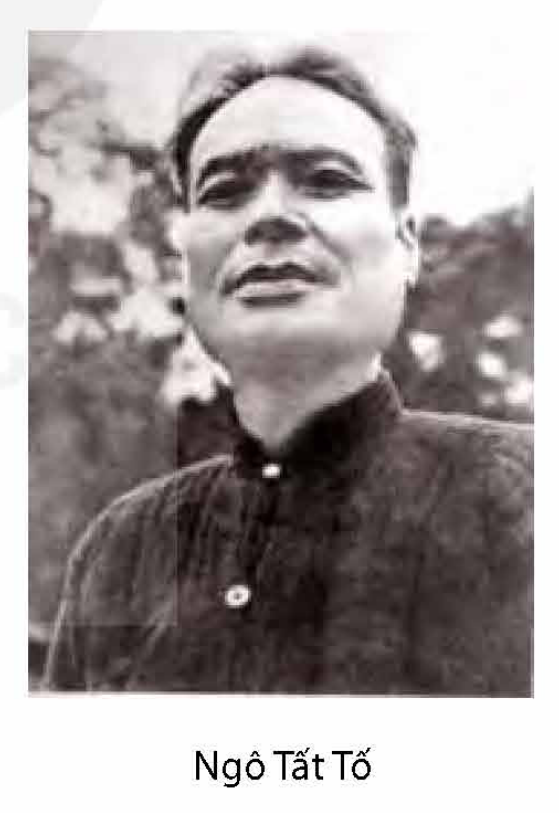
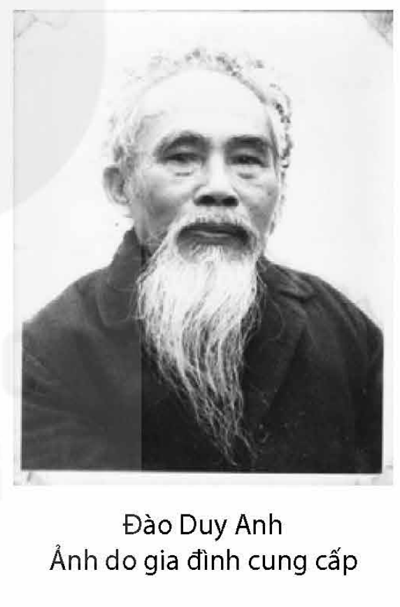

<!-- pdf:40 -->

# BÀI 7: SỰ THẬT TRONG TÁC PHẨM KÍ

## 🎯 Yêu cầu cần đạt

- Nhận biết và phân tích được một số yếu tố của phóng sự và hồi kí như: tính phi hư cấu, một số thủ pháp nghệ thuật (miêu tả, trần thuật); sự kết hợp của các chi tiết, sự kiện hiện thực với trải nghiệm, thái độ và đánh giá của người viết;...
- Phân tích, đánh giá được khả năng tác động của tác phẩm kí đối với người đọc và tiến bộ xã hội.
- Hiểu được đặc điểm cơ bản của ngôn ngữ trang trọng và ngôn ngữ thân mật để vận dụng một cách hiệu quả trong giao tiếp.
- Viết được bài văn nghị luận xã hội bàn về một vấn đề liên quan đến tuổi trẻ.
- Biết trình bày ý kiến về một vấn đề liên quan đến tuổi trẻ.
- Có cái nhìn tỉnh táo về hiện thực; biết trân trọng những quyết định, hành động hướng về lí tưởng cao đẹp.

## ĐỌC

### Tri thức Ngữ văn

**Phóng sự**(1)

**Phóng sự** xuất hiện trên cơ sở sự phát triển của báo chí hiện đại, thường được xem là một thể loại thuộc loại hình kí. Phóng sự cung cấp cho người đọc cái nhìn chân thực về một sự việc, hiện tượng, thường là đặc biệt, có ý nghĩa thời sự, diễn ra trong đời sống xã hội đương thời. Phóng sự thể hiện tính chiến đấu cao khi dùng sự thật để phản bác những nhận thức còn sai lệch và khẳng định điều tốt đẹp trong đời sống, tác động tích cực đến nhận thức của người đọc. Tính chân thực về thời gian, địa điểm, sự kiện, con người và chi tiết là những đặc điểm cốt lõi của một bài phóng sự.

Để đảm bảo sự xác thực và độ tin cậy của thông tin, người viết phóng sự thường dùng những biện pháp nghiệp vụ báo chí như điều tra, phỏng vấn, ghi chép tại chỗ,...

> (1) Phóng sự thường được chia thành hai loại: phóng sự văn học và phóng sự báo chí. Ở đây chỉ nói về phóng sự văn học.

<!-- pdf:41 -->

Với phóng sự, ngoài các tư liệu thực tế xác thực, nhà văn còn có thể sử dụng các thủ pháp hư cấu ở một mức độ nhất định nhằm làm cho câu chuyện và các sự kiện được kể trở nên hấp dẫn hơn. Do vậy, bên cạnh việc đáp ứng những yêu cầu về mặt thông tin, phóng sự còn thể hiện tính thẩm mĩ, mang dấu ấn phong cách cá nhân người viết trong việc mô tả sự việc, hiện tượng; sử dụng nghệ thuật trần thuật, biện pháp tu từ, ngôn ngữ giàu hình ảnh, cảm xúc,...

**Hồi kí**

**Hồi kí** là thể loại thuộc loại hình kí, có giá trị tư liệu cao, kể lại từ điểm nhìn chủ quan về những sự kiện, biến cố đã xảy ra trong quá khứ mà tác giả là nhân vật trung tâm hoặc là người tham dự, chứng kiến. Hồi kí luôn đề cao tính xác thực của những gì được kể. Câu chuyện về con người và sự việc trong hồi kí giúp độc giả vừa thấy rõ trải nghiệm phong phú và thế giới tinh thần riêng của người viết, vừa hình dung được diện mạo chân thực của đời sống lịch sử – xã hội và văn hoá một thời đã qua. Người viết hồi kí thường tập trung ghi chép, soi tỏ phần hiện thực mà mình hiểu rõ với tư cách là chứng nhân.

Trong hồi kí, tác giả là người kể chuyện ngôi thứ nhất, trực tiếp trình bày, mô tả về con người và sự việc. Cùng với điều đó, quy luật vận động riêng của trí nhớ đã làm cho hồi kí mang đậm tính chủ quan – một đặc điểm quan trọng tạo nên sức hút riêng của thể loại này.

**Ngôn ngữ trang trọng và ngôn ngữ thân mật**

<!-- term: ngữ cảnh -->
**Ngôn ngữ trang trọng** là phong cách ngôn ngữ được sử dụng trong ngữ cảnh giao tiếp có tính nghi thức, tồn tại ở cả dạng viết và nói. Trong phong cách ngôn ngữ này, chủ thể phát ngôn thường dùng những từ ngữ, câu thể hiện các ý tưởng, thông tin khách quan và thái độ lịch sự, tôn trọng đối với người tiếp nhận. Câu trong ngôn ngữ trang trọng thường đầy đủ thành phần và có thể được tổ chức theo cấu trúc tầng bậc phức tạp.

**Ngôn ngữ thân mật** là phong cách ngôn ngữ được sử dụng trong giao tiếp thường ngày, tồn tại ở cả dạng viết và nói. Trong ngôn ngữ thân mật, chủ thể phát ngôn thường dùng những từ ngữ, câu thể hiện thái độ thân thiện, gần gũi với người tiếp nhận; ở một số trường hợp đặc biệt, có thể dùng tiếng lóng, biệt ngữ xã hội, từ ngữ địa phương,... Câu trong ngôn ngữ thân mật thường ngắn và có thể rút gọn thành phần.

<!-- pdf:42 -->

### Văn bản 1: Nghệ thuật băm thịt gà
*(Trích Việc làng)*

**Ngô Tất Tố**

**Trước khi đọc**

- Theo bạn, ngoài lĩnh vực nghệ thuật chuyên nghiệp, người ta thường dùng từ “nghệ thuật” và “nghệ sĩ” để chỉ hoạt động hoặc con người như thế nào?
- Bạn hãy phân biệt tập tục (phong tục, tập quán) và hủ tục. Nêu ví dụ để làm rõ ý kiến của mình.

**Đọc văn bản**

Từ khi thôi học, tính ra đã gần mười năm, bây giờ tôi mới lại gặp Lăng Vân. Những chuyện tích lại trong một thời gian khá dài, lúc ấy được dịp xuất hiện, nó đã làm cho chúng tôi đều phải quên ngủ, tuy đêm đã khuya.

> 💡 **[Chỉ dẫn đọc]** Chú ý cách tác giả dẫn dắt vào không gian của câu chuyện.

Ngoài sân trời tối như mực và mưa sùi sụt, nước mưa rả rích giội xuống đầu thềm, như thêm vẻ chứa chan cho mối tình cửu biệt(1).

Gà bắt đầu gáy. Dưới bếp bỗng có tiếng người khậm khoặc(2). Rồi thấy bóng đèn lập loè. Một lát sau, nghe có tiếng gà đập cánh phành phạch và kêu quang quác. Tôi ngạc nhiên hỏi:

– Người nhà đã sắp làm cơm đấy sao?

Lăng Vân lắc đầu:

– Không! Sáng mai nhà tôi phải chứa hàng xóm(3).

Chứa xóm cố nhiên không phải là một đầu đề để nói chuyện. Chúng tôi lảng ra chuyện khác. Đồng hồ điểm hai tiếng, mới cùng trùm chăn nằm ngủ.

> (1) *Cửu biệt*: cách xa lâu ngày.
> (2) *Khậm khoặc*: tiếng ho khan (thường chỉ người ho lâu ngày chưa khỏi), khi ho âm thanh bị cản ở cổ họng.
> (3) *Chứa hàng xóm*: mời dân làng đến nhà mình theo lệ của làng.

<!-- pdf:43 -->

Giấc ngủ của tôi đương ngon, thình lình bị tan bởi mấy tiếng lộc cộc của guốc, và gậy nện xuống thềm gạch. Tôi bừng mắt ra, trời đã sáng rõ, trong nhà lố nhố mấy ông cụ già khăn áo tề chỉnh, Lăng Vân đang xoắn xoe chào mời các cụ một cách cung kính. Giữ lễ xã giao với người lạ, tôi vội tung chăn ngồi dậy và đương lúng túng chưa biết nên ở đó hay lánh đi đâu, Lăng Vân đã bưng đến chỗ tôi ngồi một bộ bàn chè, một siêu nước sôi, bảo tôi cứ việc pha nước và uống tự nhiên.

Người đến mỗi lúc một đông. Già có, trẻ có, đứng bóng có. Toàn là đàn ông tất cả. Trong nhà giường phản chật hết, người nhà phải quét cái thềm mưa ướt rờm rợp, rồi trải chiếu lên, để làm chỗ ngồi cho mấy ông tí nhau(1).

Hàng xóm vẫn lục tục kéo đến với những bàn chân đất lấm bê bết. Ai cũng như nấy, sau khi đã đến bể nước giội qua, người ta đi nhón lên thềm, chùi chân vào cái chổi rơm làm phép, rồi bước xàm xạp lên chiếu.

– Sao không lấy gì mà che, lại đi đội trời thế kia! Nước mưa ướt cả đồ lễ!

Tiếng thét dõng dạc của một ông già ở phản bên kia vừa dứt, thì ở dưới sân, một người vừa lù lù bưng mâm xôi gà lên thềm và đặt vào chiếc phản giữa. Rồi một người khác đệ luôn lên đó hai chai rượu lớn. Con gà cũng không nhỏ lắm, ước chừng một người ăn cố mới hết. Cỗ xôi vừa kín cái lòng mâm đồng, nó phải độ bốn đấu gạo! Còn hai chai rượu thì đầy ăm ắp, hạng chai ba phần tư lít.

> 💡 **[Chỉ dẫn đọc]** Việc đan xen giữa yếu tố miêu tả, tự sự và ngôn ngữ đối thoại có tác dụng, hiệu quả như thế nào?

Mọi người ngồi yên, một ông đàn anh ra lệnh:

– Hàng xóm đã đến đông đủ! Thằng Mới đem làm cỗ đi!

Thì ra cái người đội mâm xôi gà lúc nãy chính là mõ(2) làng. Hắn dạ một tiếng thật dài rồi khép nép đứng tựa bên cột:

– Thưa các cụ làm bao nhiêu cỗ?

Ông đàn anh ấy lại lên giọng:

– Mày trông xem có bao nhiêu người kiến tại(3).

Thằng Mới liếc mắt một lượt từ trong nhà ra đến ngoài thềm, rồi thưa:

– Bẩm ba mươi người tất cả.

> (1) *Tí nhau*: trẻ con (hàm ý vui đùa, thân mật).
> (2) *Mõ*: người chuyên đánh mõ rao việc làng thời trước, thường phải hứng chịu thái độ coi thường, định kiến của cộng đồng.
> (3) *Kiến tại*: trông thấy tại chỗ.

<!-- pdf:44 -->

Ở đầu dãy phản tay phải, thấy có tiếng hỏi:

– Hàng xóm ta mươi mấy suất, cụ còn nhớ không?

Rồi có tiếng đáp:

– Năm ngoái bảy mươi tám suất, năm nay mới thêm năm suất thế là tám mươi ba suất cả thảy.

Ông đàn anh vừa rồi nhìn vào thằng Mới:

– Vậy thì phải làm hai mươi ba cỗ, tám cỗ kiến tại, một cỗ chứa(1), một cỗ cho mày, còn mười ba cỗ làm phần(2).
<!-- ocr-ok: OCR đọc nhầm dấu trong từ "cỗ" thành "cô", đã đối chiếu ảnh trang PDF 44 -->

Câu nói của ông ấy khiến tôi hết sức ngạc nhiên. Một con gà và bấy nhiêu xôi mà làm đến mấy chục cỗ, thì làm ra sao? Chắc là còn có món gì khác nữa. Tôi nghĩ như thế.

Nhưng mà không. Chẳng có chi hết. Người nhà chỉ bưng lên thềm hai thúng đĩa bát, một con dao, một cái thớt, một liễn nước mắm và hai chồng mâm.

Thằng Mới lễ mễ bưng mâm xôi gà ra thềm. Hắn nhấc con gà sang chiếc mâm khác, rồi chữa cỗ xôi hình tròn ra hình vuông.

Ồ lạ! Con gà làm được hơn hai chục cỗ, thật là một kì công! Tôi phải giả vờ đứng dậy ra sân để đến tận nơi mà coi cho rõ.

Thằng Mới đặt thử con dao lên mặt cỗ xôi, hắn tính lẩm bẩm giây lát, rồi xắn một chiều làm sáu, một chiều làm bốn. Sau khi lấy một miếng xôi véo ra từng tí để phụ vào các miếng kia, hắn nhấc mâm xôi sang một bên cạnh và kéo cái thớt vào chỗ trước mặt. Cái thớt khí trũng, hắn gọi thằng nhỏ đổi cho cái khác và hắn lẩm bẩm một mình:

– Băm thịt gà cần phải dao sắc, thớt phẳng. Nếu mà dao cùn thớt trũng thì thịt sẽ bong hết da!

Vừa nói, hắn vừa với sang thúng đĩa lấy đủ chục chiếc, bày la liệt trên mặt thềm. Thằng nhỏ đã xách lên đó chiếc thớt mới nguyên, sắc gỗ nghiến còn đỏ đòng đọc.

Nhanh nhảu, hắn sờ ngón tay vào lưỡi con dao, xem có bén không. Và hắn lật cái trôn bát liếc luôn ba lượt thật mạnh. Bấy giờ mới giở đến bộ lòng gà. Mề, gan, tim, phổi, các thứ đều được thái riêng và được bày riêng vào một góc đĩa. Tuy nó chỉ một dúm con con, nhưng trong mười đĩa không đĩa nào thiếu một thứ nào.

> (1) *Cỗ chứa*: cỗ dành phần cho chủ nhà.
> (2) *Cỗ làm phần*: cỗ chia phần mang về cho người vắng mặt.

<!-- pdf:45 -->

Rồi hắn nhấc cả con gà ra thớt. Bắt đầu chặt lấy cái sỏ(1), sau mới chặt đến miếng phao câu. Thình lình thấy hắn đứng lên ngoảnh mặt vào phía mấy ông đàn anh:

– Thưa trình các cụ, hôm nay sỏ gà pha mấy? Phao gà pha mấy?

Một ông trong bọn nhìn qua vào đám nhiều tuổi, hình như để đếm đầu người, rồi đáp:

– Ở đây chỉ có năm cụ và bốn ông đàn anh. Vậy thì sỏ gà pha năm, phao gà pha bốn.

> 💡 **[Chỉ dẫn đọc]** Chú ý cách kể, miêu tả chi tiết cùng thủ pháp “gây tò mò” về quá trình băm thịt gà.

Hắn lại ngồi xuống chỗ cũ. Trước hết ghè dao vào giữa hai miếng mỏ gà, để cắt cái sỏ ra làm hai mảnh. Rồi hắn úp cả đôi mảnh xuống thớt, chặt mảnh mỏ dưới làm đôi và mảnh mỏ trên làm ba. Tôi không biết những miếng thịt này có đều nhau không, chỉ thấy tất cả năm miếng, miếng nào cũng có dính một tí mỏ.

Tiếp đến cuộc pha phao câu. Công việc tuy không lấy gì làm khó, nhưng hắn làm cũng vẫn có vẻ khác người. Bốn miếng phao gà, miếng nào cũng có đầu bầu, đầu nhọn, chẳng khác một cái chũm cau(2) chẻ tư.

Sỏ gà bày vào một đĩa, phao gà bày vào một đĩa. Hắn lại cắt lấy hai chiếc cánh gà, chặt luôn làm hơn mười miếng và bày với đôi chân gà làm một đĩa nữa.

Bây giờ thì đến mình gà. Hắn lách lưỡi dao vào sườn con gà, cắt riêng hai cái tỏi gà(3) bỏ ra góc mâm. Rồi, lật ngửa con gà lên thớt, hắn ướm dao vào giữa xương sống và giơ dao chém luôn hai nhát theo chiều dài cái xương ấy. Con gà bị tách ra làm hai mảnh. Mỗi mảnh đều có một nửa xương sống. Một tay giữ thỏi thịt gà, một tay cầm con dao phay, hắn băm lia lịa như không chú ý gì hết. Nhưng mà hình như tay hắn đã có cỡ sẵn, cho nên con dao của hắn giơ lên, không nhát nào cao, không nhát nào thấp. Mười nhát như một, nó chỉ lên khỏi mặt thớt độ một gang, và cách cái ngón tay hắn độ vài ba phân. Tiếng dao công cốc đụng vào mặt thớt, nhịp nhàng như tiếng mõ của phường chèo(4), không lúc nào mau, cũng không có lúc nào thưa. Mỗi tiếng cốc là một miếng thịt gà văng ra. Miếng nào như miếng ấy, đứt suốt từ xương đến da, không còn dính nhau mảy may.

> 💡 **[Chỉ dẫn đọc]** Các chi tiết miêu tả động tác, âm thanh khi băm thịt gà có tác dụng gì?

> (1) *Sỏ*: thủ, đầu.
> (2) *Chũm cau*: núm hình chóp trên đầu trái cau.
> (3) *Tỏi gà*: đùi gà chặt ra (giống hình củ tỏi).
> (4) *Phường chèo*: tổ chức phần nhiều mang tính tự phát, gồm một nhóm người chuyên biểu diễn chèo lưu động trong không gian văn hoá Việt Nam ngày trước, chủ yếu hoạt động ở nông thôn.

<!-- pdf:46 -->

Trông những miếng thịt gà của hắn bốc ra góc mâm, mới đẹp làm sao! Không giập, không nát, không bong da, nó giống như tập cánh con bươm bướm. Nếu để trước môi mà thổi, có thể bay được mười thước.

Băm xong con gà, hắn móc túi lấy một nắm tăm. Mỗi miếng thịt gà, hắn xâu cho một cái tăm vào giữa. Rồi hắn cắm vào mâm xôi. Cứ mỗi tảng xôi là bốn xâu thịt. Thịt vừa hết, xôi cũng vừa kháp. Té ra cái mình con gà, hắn đã băm được chín mươi hai miếng.

Lăng Vân cười và hỏi tôi:

– Anh đã chịu nghề băm thịt gà của ông Mới làng tôi chưa? Nhà hắn ba đời làm cái nghề ấy, thì mới thạo được như thế. Người khác dễ ai làm nổi!

> 💡 **[Chỉ dẫn đọc]** Đoạn kết tạo ấn tượng thế nào cho người đọc?
<!-- ocr-ok: thẻ chỉ dẫn đọc bên phải bị OCR đọc dính vào văn bản chính, đã đối chiếu ảnh trang PDF 46 -->

Tôi chịu lắm. Và tôi muốn dâng cho ông Mới ấy cái chức nghệ sĩ.

(Ngô Tất Tố, *Việc làng*, NXB Hội Nhà văn – Công ti cổ phần Văn hoá và Truyền thông Nhã Nam, Hà Nội, 2014, tr. 37 – 44)

Ngô Tất Tố

**Ngô Tất Tố** (1893 – 1954) quê ở làng Lộc Hà, phủ Từ Sơn, tỉnh Bắc Ninh, nay là xã Mai Lâm, huyện Đông Anh, thành phố Hà Nội. Ông là một nhà Nho tinh thông cổ học, dịch giả và nhà nghiên cứu về tư tưởng triết học, văn học cổ; đồng thời là nhà báo, nhà văn có lối viết mới mẻ và sức viết dồi dào. Ngô Tất Tố được đánh giá là một trong những nhà văn hàng đầu của dòng văn học hiện thực trước Cách mạng tháng Tám năm 1945, với những tác phẩm viết về đề tài nông thôn và người nông dân. Các tác phẩm chính: tiểu thuyết *Tắt đèn* (đăng báo năm 1936, in sách năm 1939), *Lều chõng* (đăng báo năm 1939, in sách năm 1940) và phóng sự *Việc làng* (đăng báo năm 1940, in sách năm 1941),... Ngô Tất Tố được truy tặng Giải thưởng Hồ Chí Minh về Văn học nghệ thuật năm 1996.

***Việc làng*** là thiên phóng sự tái hiện toàn diện và rõ nét về đời sống nông thôn Việt Nam đầu thế kỉ XX, trong bối cảnh chính quyền thực dân phong kiến lợi dụng những tập tục lạc hậu ở thôn quê để thực hiện chính sách ngu dân, bóc lột. Tác phẩm gồm 17 chương, xâu chuỗi theo một chủ đề chung, nhằm ghi lại, phân tích và phơi bày những hủ tục nhiêu khê, quái gở đang duy trì ở nông thôn và những hậu quả nghiêm trọng của nó. Những hủ tục ấy đã đẩy người dân quê vào cảnh cùng quẫn và tạo cơ hội để bọn cường hào, địa chủ nhũng nhiễu dân lành.

***Nghệ thuật băm thịt gà*** thuộc chương IV của phóng sự *Việc làng*. Trong đoạn trích, nhà văn đã dùng lối ghi chép tại chỗ để tái hiện một cách khách quan và sinh động cảnh “chứa hàng xóm” ở thôn quê, trong đó nổi bật là việc nhân vật mõ làng băm thịt gà.

<!-- pdf:47 -->

**Sau khi đọc**

1. Nhan đề của văn bản có thể gợi lên những suy luận, phán đoán gì về nội dung được đề cập trong bài phóng sự?
2. Các sự việc chính trong văn bản được tác giả thuật lại theo trình tự nào? Nhận xét về cách quan sát, ghi chép hiện thực của tác giả.
3. Cảnh anh mõ làng băm thịt gà trong cuộc chia cỗ phản ánh hiện thực gì ở nông thôn Việt Nam xưa?
4. Nhận xét về tác dụng của việc sử dụng ngôi kể thứ nhất trong bài phóng sự.
5. Chỉ ra và phân tích những yếu tố tạo nên giọng điệu của bài phóng sự.
6. Theo bạn, những nội dung được đề cập trong văn bản còn có ý nghĩa đối với thực tiễn hiện nay không? Lí giải ý kiến của bạn.
7. Hãy khái quát đặc điểm cơ bản của thể loại phóng sự qua văn bản *Nghệ thuật băm thịt gà*.

#### Kết nối đọc – viết

Viết đoạn văn (khoảng 150 chữ) trình bày cảm nhận về một khía cạnh nội dung hoặc nghệ thuật của văn bản *Nghệ thuật băm thịt gà* mà bạn tâm đắc.

### Văn bản 2: Bước vào đời
*(Trích Nhớ nghĩ chiều hôm)*

**Đào Duy Anh**

**Trước khi đọc**

- Theo bạn, trong giai đoạn “bước vào đời”, việc định hướng tương lai của mỗi cá nhân thường chịu tác động của những yếu tố nào?

**Đọc văn bản**

Đến buổi xế chiều của cuộc đời, những đêm khó ngủ, tôi thường nhớ lại những ngày mình mới vào đời, không thể không nhớ đến cái sự kiện có thể nói là đã định hướng cho cả cuộc đời của tôi từ trước đến sau, tức là cuộc đón tiếp cụ Phan Bội Châu ở Đồng Hới một buổi trưa cuối năm 1925.

> 💡 **[Chỉ dẫn đọc]** Chú ý cách giới thiệu sự kiện của tác giả.

<!-- pdf:48 -->

Tôi dạy ở trường tiểu học tỉnh lị Quảng Bình, từ năm 1923 chỉ biết chăm chỉ dạy học và đọc sách mà học thêm để mở mang tri thức, mong một ngày kia có thể kiếm được công việc gì khác ở một nơi trung tâm văn hoá chính trị có cuộc sinh hoạt rộng rãi hơn tỉnh hẻo lánh này. Ở đây thành phần trí thức chỉ vẻn vẹn mấy chục người công chức của bốn năm cơ quan lệ thuộc chính phủ thực dân và chưa đến mười người quan lại của hai dinh Bố chính, Án sát lệ thuộc vào triều đình Việt Nam. Ngoài thì giờ làm việc ở công sở, ngày nghỉ và ban tối, người ta thường rủ nhau tụm năm tụm bảy mà đánh bạc, chỉ lác đác có mấy người qua lại trụ sở Hội Quảng tri(1) để uể oải giở xem vài tờ báo hằng ngày cho đỡ buồn, hay ngày nghỉ và buổi chiều tụ tập ở quanh sân quần vợt do Hội Quảng tri mới xây được để trao đổi chuyện phiếm hằng ngày mà chờ phiên mình chơi. Ngoài ra còn có một nhóm văn nghệ nhỏ thỉnh thoảng họp nhau ngâm thơ và dạy nhau đánh đàn, nhóm ấy có cả thành phần công chức và thành phần quan lại tham dự.

Ở cái bầu không khí êm đềm uể oải ấy, mãi đến năm 1925 mới thỉnh thoảng được các báo xuất bản ở Hà Nội và Sài Gòn đem đến một vài tin tức có tính chất chính trị gây nên một ít chấn động nhẹ nhàng, ví như tin Nguyễn An Ninh du học ở Pháp về cho ra tờ báo *Tiếng chuông rạn* (*La cloche fêlée*) để đả kích chế độ thực dân, tin Phan Châu Trinh bị an trí(2) ở Pa-ri trong mười lăm năm trở về Sài Gòn được đồng bào hoan nghênh nhiệt liệt, tin Phan Bội Châu bôn tẩu cách mạng ở nước ngoài hai chục năm bỗng bị bọn mật thám bắt ở Thượng Hải đem về Hà Nội giam ở nhà lao Hoả Lò. Sau những sự kiện ấy báo chí ở Hà Nội và Sài Gòn bỗng đổi hướng mà chú trọng bình luận về chính trị. Hội Quảng tri Đồng Hới quyết định mua thêm báo chí, chỉnh đốn tủ sách và phòng đọc cho nên trụ sở của Hội cũng được người ta lui tới đông hơn trước, và có thể nói là có sức hấp dẫn mạnh hơn những đám đánh bạc, chỉ còn họp được những tay cờ bạc bất trị chẳng biết đến trời đất ở ngoài thế giới của thần đỏ đen. Đến mùa đông năm 1925, những tin tức của báo Hà Nội đăng hằng ngày về cuộc xử án Phan Bội Châu ở trước Hội đồng Đề hình không thể không lôi cuốn sự chú ý hăm hở của giới trí thức Đồng Hới, đã bắt đầu nhận thấy ngoài những người công chức và quan lại ngoan ngoãn làm việc hằng ngày để bảo vệ nồi gạo, còn có những người không sợ cái sống nguy hiểm của đời hoạt động cách mạng. Những bài biện hộ của hai trạng sư Bô-na (Bona) và La-rơ (Larre) cùng những lời tự biện của Phan Bội Châu

> 💡 **[Chỉ dẫn đọc]** Tác giả đã gợi lại bối cảnh chính trị – xã hội Việt Nam giữa thập niên hai mươi của thế kỉ XX như thế nào?

> (1) *Hội Quảng tri*: một tổ chức ra đời trong phong trào Duy tân đầu thế kỉ XX nhằm quảng bá tri thức, khơi dậy lòng yêu nước và tinh thần dân tộc; tập hợp các nhà trí thức ở miền Trung Việt Nam.
> (2) *An trí*: một biện pháp cưỡng chế hành chính của thực dân Pháp trước Cách mạng tháng Tám năm 1945 áp dụng đối với những người hoạt động cách mạng, buộc họ đến một nơi cách li với xã hội.

<!-- pdf:49 -->

vạch lại trước mắt mọi người những bước đường cách mạng của cụ ở trong nước, ở Nhật Bản và ở Trung Quốc trong suốt phần tư đầu thế kỉ XX.

Cuộc xử án Phan Bội Châu biến thành cuộc xử án chế độ thực dân có tác dụng nhắc cho quốc dân biết rằng trong khi thực dân Pháp và bọn quan lại tay sai hoành hành áp bức bóc lột nhân dân ta, thì có những nhà ái quốc mà Phan Bội Châu là người tiêu biểu nhất, hi sinh tất cả để đi tìm đường cách mạng cứu nước cứu dân. Cái tin Phan Bội Châu bị kết án tử hình khiến quốc dân sôi lòng căm phẫn và trong cả nước nổi lên phong trào đòi “ân xá”(1) Phan Bội Châu, buộc Chính phủ Pháp phải dùng chính sách mị dân cử một đảng viên Đảng Xã hội làm Toàn quyền để thực hiện việc “ân xá”. Để hạn chế ảnh hưởng của nhà ái quốc vĩ đại, chính phủ thực dân muốn đem an trí cụ ở Huế, nơi mà tình hình chính trị trầm trầm và sự tồn tại của triều đình bù nhìn khiến chúng tưởng có thể dễ hạn chế tầm ảnh hưởng của cụ hơn. Chúng có biết đâu rằng sự có mặt của cụ Phan ở đây là đủ nhắc nhở cho quốc dân, nhất là giới thanh niên, nhận thức nhiệm vụ của mình phải làm thế nào để tiếp tục được sự nghiệp cách mạng mà ông cha mình còn bỏ dở.

Phan Bội Châu được “ân xá”, chính phủ thực dân định đưa ngay cụ từ nhà lao Hoả Lò thẳng về Huế, không dám để cho cụ tự do ở Hà Nội tiếp xúc nhân dân. Nhưng trước sự đấu tranh của nhân dân Hà Nội, chúng phải để cho cụ Phan được tự do ngay ở Hà Nội và dùng xe riêng do nhân dân Hà Nội chuẩn bị mà về Huế. Trên đường đi thế nào xe cũng phải nghỉ trưa ở Đồng Hới, được tin ấy chúng tôi, một số những người tích cực ở Đồng Hới, bàn nhau lấy danh nghĩa Hội Quảng tri để đón tiếp cụ và mời cụ dùng cơm trưa. Thế là lòng khao khát được thấy cụ Phan của chúng tôi đã được thoả mãn.

Sau khi dùng cơm trưa xong với một số ít đại biểu, cụ Phan đến dự cuộc đón tiếp thân mật ở hội quán Hội Quảng tri. Mặc dầu có một số hội viên dè dặt sợ bọn cầm quyền người Pháp chú ý không dám tham dự, số người đến dự cuộc đón tiếp, cả công chức và nhân dân, ngồi chật cả phòng hội quán. Cụ Phan mặc áo dài Trung Quốc, bộ áo cụ vẫn mặc trong thời hoạt động ở nước ngoài. Người cụ cao lớn vượt lên trên cử toạ, cái trán cao, cái đầu hói, cái mặt chữ điền với lông mày rậm và chòm râu đen, khiến thấy rõ phong thái của một bậc vừa hiền giả vừa chí sĩ, mà hai mắt sáng quắc ở sau cặp kính trắng gọng đen có vẻ rất dịu hiền nhìn mọi người một cách rất trìu mến, cho thấy được cả tấm lòng thương nhớ của nhà ái quốc đã xa cách đồng bào mấy chục năm nay.

> 💡 **[Chỉ dẫn đọc]** Hình dung về nhân vật được tái hiện trong kí ức của tác giả.

> (1) *Ân xá*: miễn giảm trách nhiệm hình sự hoặc hình phạt đối với người phạm tội theo đặc ân của nhà nước.

<!-- pdf:50 -->

Giọng nói của cụ sang sảng như chuông nổi lên giữa bầu không khí lặng phắc khiến mọi người như nín thở mà hớp lấy từng lời. Ngoài cái ấn tượng, cái cảm xúc mà từ nhỏ đến bây giờ tôi chưa từng có, tôi không nhớ rõ cụ đã nói những gì, duy còn mường tượng cụ có nhắc đến tập sách cụ viết ở hải ngoại, đề là *Dư cửu niên lai sở trì chi chủ nghĩa*(1) có chương “Súc chủng đãi thời”(2), để khuyên chúng tôi là hội viên Hội Quảng tri nên học cho nhiều để hấp thụ nhiều kiến thức mới mà nước nhà sẽ phải cần đến để bước lên cõi văn minh.

Đêm hôm ấy tôi thao thức không ngủ được. Tôi vốn không có ý ở mãi Đồng Hới mà chôn vùi tuổi thanh niên của mình trong cái nghề gọi là “gõ đầu trẻ” ở một nơi hẻo lánh như thế, nhưng còn chờ thi bằng Tú tài để có thể cầm tay được cái lợi khí tương đối khá mà kiếm ăn, rồi mới đi tìm việc làm ở Hà Nội hay Sài Gòn. Đến bây giờ thì cảm thấy mình không chờ được nữa mà phải thoát ngay chốn ao tù để tìm nơi trời cao biển rộng hơn. Tôi quyết định đi Sài Gòn để viết báo. Ngoài những báo *La cloche fêlée* bấy giờ đã bị đóng cửa, nhờ các báo chữ Pháp tiến bộ ở Sài Gòn như báo *L’Écho Annamite*(3) của Nguyễn Phan Long, tôi được biết qua tình hình ngôn luận ở Sài Gòn mà nhận thấy nó có phần hấp dẫn hơn tình hình ngôn luận ở Hà Nội còn bị đè nén dưới ách kiểm duyệt. Thi thoảng tôi được một người bạn đang dạy học tư ở Sài Gòn gửi cho một số báo *Việt Nam hồn* xuất bản ở Pa-ri. Tiếp đó, cuộc vận động bầu cử Viện Nhân dân đại biểu ở Trung Kì dẫn đến cuộc thắng lợi của các phần tử tiến bộ lại làm vững thêm quyết tâm của tôi. Trong số những vị dân biểu tiến bộ ấy có những nhà Nho ái quốc mới từ Côn Lôn về. Đứng đầu là cụ Huỳnh Thúc Kháng và mấy người công chức và quan lại từ chức để ra hoạt động kinh tế và chính trị, trong số những người này có ông Nguyễn Đơn Quý [Nguyễn Đan Quế] người Thanh Hoá tôi được quen từ hồi trước, ông này vốn làm huấn đạo(4), đã không nhận đổi sang làm công chức sau khi chính phủ thực dân bỏ nền giáo dục chữ Hán, tự nguyện từ chức về nông thôn ở Sóc Sơn huyện Vĩnh Lộc, tự tay cày bừa vỡ đất hoang để làm ăn như một người nông dân thường, chứ không phải vỡ đồn điền mà bóc lột nông dân đâu. Sau ông tham gia Việt Nam Cách mạng đồng chí hội, trở thành Đảng Tân Việt từ năm 1928.

> 💡 **[Chỉ dẫn đọc]** Tác giả đã cảm nhận thế nào về sức ảnh hưởng của những nhân vật lịch sử đối với cá nhân mình?

> (1) *Dư cửu niên lai sở trì chi chủ nghĩa* (*Chủ nghĩa tôi ôm ấp trong chín năm nay*): tên một cuốn sách được Phan Bội Châu viết bằng chữ Hán vào năm 1921.
> (2) *Súc chủng đãi thời*: cất chứa hạt giống để đợi kì gieo hạt (ngầm ý nói trau dồi tài đức để chờ dịp dùng tới).
> (3) *L’Écho Annamite*: Tiếng vọng An Nam.
> (4) *Huấn đạo*: chức quan thời phong kiến hay Pháp thuộc, trông coi việc học trong một huyện.

<!-- pdf:51 -->

Tiếp sau nữa lại đến lễ tang Phan Châu Trinh được cử hành long trọng và rầm rộ ở Sài Gòn cùng lễ truy điệu cử hành ở Hà Nội, Huế, Đà Nẵng và nhiều tỉnh khác kể cả Đồng Hới nhỏ bé của chúng tôi. Được đọc bài văn tế của cụ Phan Bội Châu viết trong dịp truy điệu cùng bao nhiêu câu đối ca tụng nhà chí sĩ ái quốc ấy, ở Đồng Hới chúng tôi cũng nhân cơ hội ấy mà có những trao đổi ý kiến về tình hình chính trị hiện thời. Những câu của bài văn tế như:

*Cá chậu chim lồng vơ vẩn thế, áng công danh thôi vất lối tầm thường.*
*Rồng mây cọp gió lạ lùng chi, miền thanh khí thử hô người trùng ngoại.*
và
*Ba tấc lưỡi mà gươm mà súng, nhà cường quyền trông gió cũng oai ghê.*
*Một ngòi lông mà trống mà chiêng, cửa dân chủ khêu đèn thêm sáng chói.*
<!-- ocr-ok: chữ in nghiêng trong trích dẫn văn tế Phan Bội Châu bị OCR đọc nhầm, đã đối chiếu ảnh trang PDF 51 -->

lại thúc giục lòng tôi muốn đi xa.

(Đào Duy Anh, *Nhớ nghĩ chiều hôm*, NXB Hà Nội, 2020, tr. 9 – 12)

Đào Duy Anh
Ảnh do gia đình cung cấp

**Đào Duy Anh** (1904 – 1988) quê ở tỉnh Thanh Hoá, là học giả có những đóng góp quan trọng trong nhiều lĩnh vực nghiên cứu. Ông tham gia phong trào yêu nước, cách mạng và các hoạt động dịch thuật, nghiên cứu từ rất sớm (trước năm 1930). Đào Duy Anh được xem là một trong những người đặt nền móng cho nhiều ngành Khoa học xã hội ở Việt Nam (từ điển học, văn hoá học,...). Ở lĩnh vực sử học, ông cũng có đóng góp nổi bật với nhiều công trình có giá trị về lịch sử Việt Nam.

Các tác phẩm tiêu biểu: *Hán Việt từ điển giản yếu* (1932), *Việt Nam văn hoá sử cương* (1938), *Khảo luận về Kim Vân Kiều* (1943), *Nguồn gốc dân tộc Việt Nam* (1950), *Đất nước Việt Nam qua các đời* (1964), *Từ điển Truyện Kiều* (1974), *Chữ Nôm – nguồn gốc, cấu tạo, diễn biến* (1975),...

Đào Duy Anh được truy tặng Giải thưởng Hồ Chí Minh năm 2000; được ghi tên vào bộ từ điển *La-rút-xơ – Larousse* (Pháp) với tư cách là một nhà bách khoa toàn thư của thời hiện đại.

Hồi kí ***Nhớ nghĩ chiều hôm*** của Đào Duy Anh được viết xong năm 1972, hoàn chỉnh vào cuối năm 1974; thuật lại những chặng đường chính trong cuộc đời hoạt động chính trị, văn hoá và khoa học của ông. Tác phẩm cũng chứa đựng nhiều suy tư về mối quan hệ giữa trí thức Việt Nam với dân tộc, về sứ mệnh của thanh niên đối với tương lai đất nước. Đoạn trích thuộc phần đầu của cuốn hồi kí, kể về sự kiện đánh dấu giai đoạn “bước vào đời” của tác giả.

<!-- pdf:52 -->

<!-- pdf:53 -->

**Sau khi đọc**

1. Đoạn trích kể về sự kiện gì? Tác giả đã kể câu chuyện từ điểm nhìn nào? Nêu ý nghĩa của việc lựa chọn điểm nhìn đó.
2. Tính phi hư cấu của hồi kí đã được thể hiện thế nào trong văn bản?
3. Trong đoạn trích, nhân vật “tôi” đã thể hiện hoài bão “bước vào đời” như thế nào? Điều gì đã thôi thúc tác giả hành động vì hoài bão đó?
4. Đoạn trích cho thấy những gì đang diễn ra trong đời sống chính trị – xã hội Việt Nam và cách sống của tầng lớp trí thức lúc bấy giờ?
5. Những nhân vật lịch sử nào được nhắc đến trong đoạn trích? Sức ảnh hưởng của các nhân vật ấy đối với những thanh niên giàu tinh thần dân tộc thời đó được thể hiện như thế nào?
6. Chỉ ra một số yếu tố miêu tả, biểu cảm trong văn bản và phân tích vai trò của chúng trong việc giúp tái hiện kí ức về một giai đoạn đã qua của cuộc đời tác giả.
7. Qua đoạn trích, bạn rút ra bài học gì về sự lựa chọn hướng đi khi đứng trước ngưỡng cửa cuộc đời?

#### Kết nối đọc – viết

Từ nội dung văn bản *Bước vào đời* và những trải nghiệm cá nhân, bạn hãy viết đoạn văn (khoảng 150 chữ) về chủ đề: *Khát vọng của tuổi trẻ hôm nay*.

### Thực hành tiếng Việt: Ngôn ngữ trang trọng và ngôn ngữ thân mật

1. Nêu những dấu hiệu giúp nhận biết ngôn ngữ trang trọng và ngôn ngữ thân mật trong hai lời chào sau:

a. *Xin trân trọng chào quý ông bà! Tôi tên là Nguyễn Văn A, Tổng Giám đốc công ti ABC. Tôi rất hân hạnh được đón tiếp quý ông bà tại văn phòng công ti và trao đổi về cơ hội hợp tác của chúng ta.*

b. *Chào bạn, mình là Hương. Thật tình cờ là chúng mình lại gặp nhau nhỉ. Duyên thật!*

2. Làm rõ những điểm giống nhau và khác nhau về mục đích, ngữ cảnh sử dụng và đặc điểm ngôn ngữ (trang trọng hay thân mật) giữa các câu trong mỗi trường hợp sau:

a. Trường hợp 1

– *Các bạn đều biết quy định về việc sử dụng điện thoại trong cuộc họp đúng không?*

> **Nhận biết ngôn ngữ trang trọng và ngôn ngữ thân mật**
>
> **Ngôn ngữ trang trọng** được sử dụng trong ngữ cảnh giao tiếp có tính nghi thức, chẳng hạn, trong bài phát biểu chào mừng phái đoàn quốc tế, lời chúc Tết đồng bào của lãnh đạo nhà nước, thư trao đổi với đối tác thương mại, thư mời tham dự hội thảo khoa học, đơn xin việc,...
>
> **Ngôn ngữ thân mật** được sử dụng trong ngữ cảnh giao tiếp đời thường, mang tính cá nhân hoá cao, chẳng hạn, trong thư hoặc tin nhắn gửi cho người thân hoặc bạn bè, lời trò chuyện trong quán cà phê, thảo luận nhóm bàn kế hoạch đi tham quan,...

<!-- pdf:54 -->

– *Để cuộc họp được bắt đầu, xin đề nghị quý vị cài đặt điện thoại ở chế độ im lặng và có thể ra ngoài khi cần kết nối.*

b. Trường hợp 2

– *Xin hân hạnh giới thiệu với quý vị sự có mặt của diễn giả Phạm Văn B tại buổi hội thảo hôm nay.*

– *Chúng ta cùng chào đón nhân vật quan trọng nhất của buổi hội thảo hôm nay, diễn giả Phạm Văn B!*

c. Trường hợp 3

– *Sự kiện mà quý vị đang chờ đợi sẽ được bật mí ngay sau đây.*

– *Trân trọng thông báo tới toàn thể quý vị về sự kiện quan trọng sẽ diễn ra ngay sau đây.*

3. Bảng dưới đây nêu một số tình huống sử dụng ngôn ngữ trang trọng, ngôn ngữ thân mật ở hai dạng nói và viết. Kẻ bảng vào vở theo gợi ý và bổ sung một số ví dụ phù hợp.

| | **Ngôn ngữ trang trọng** | **Ngôn ngữ thân mật** |
| --- | --- | --- |
| **Ngôn ngữ viết** | – Thư công ti xin lỗi khách hàng vì sản phẩm lỗi – ... | – Thư điện tử gửi cho người thân – ... |
| **Ngôn ngữ nói** | – Lời phát biểu tại lễ tốt nghiệp cấp Trung học phổ thông – ... | – Cuộc chuyện trò với bạn bè – ... |
<!-- ocr-ok: bảng 3 cột bị OCR đọc ghép lộn xộn với cột bên phải, đã đối chiếu ảnh trang PDF 54 -->

4. Trên thực tế, xuất hiện nhiều tình huống giao tiếp có sự chuyển đổi từ ngôn ngữ trang trọng sang ngôn ngữ thân mật hoặc ngược lại nhằm:

a. Thể hiện sự thay đổi trong quan hệ giao tiếp giữa người nói (viết) với người nghe (đọc).

b. Thể hiện thái độ mỉa mai, châm biếm hoặc để gây cười.

Tìm và phân tích một số ví dụ có thể minh hoạ cho các mục đích chuyển đổi ngôn ngữ nói trên.

<!-- term: ngữ cảnh -->
> *Lưu ý:*
>
> – Trong một số tình huống giao tiếp (cuộc họp, hội thảo,...), cùng một nội dung thông tin (thông báo, giới thiệu,...) có thể sử dụng ngôn ngữ trang trọng hoặc ngôn ngữ thân mật tuỳ vào mục đích và đối tượng giao tiếp.
>
> – Có những ngữ cảnh đòi hỏi ngôn ngữ phải trung tính, tức không mang tính trang trọng và cũng không có tính thân mật, chẳng hạn, trong tài liệu nghiên cứu khoa học, giáo trình, sách giáo khoa, bản tin trên báo chí,...
>
> **Sử dụng ngôn ngữ trang trọng và ngôn ngữ thân mật**
>
> Trong giao tiếp, cần căn cứ vào ngữ cảnh để lựa chọn ngôn ngữ trang trọng hay ngôn ngữ thân mật cho phù hợp. Bên cạnh đó, mức độ thân mật hay trang trọng cũng cần phải được điều tiết để không vượt quá ngưỡng mà ngữ cảnh quy định. Ngôn ngữ thân mật thường diễn đạt ý nghĩa một cách trực tiếp và thẳng thắn, do vậy, dễ dẫn đến sự suồng sã và thiếu lịch sự. Ngược lại, ngôn ngữ trang trọng cũng có thể tạo ra khoảng cách không cần thiết trong cuộc trò chuyện hoặc khiến cho cuộc đối thoại trở nên mất tự nhiên.
>
> Trong một số tình huống giao tiếp, có thể có sự chuyển đổi tự nhiên giữa ngôn ngữ trang trọng và ngôn ngữ thân mật, tuỳ thuộc vào mối quan hệ được thiết lập giữa các đối tượng giao tiếp. Sự chuyển đổi này thể hiện sự vận động phức tạp và tinh tế của các mối quan hệ xã hội, từ chỗ sơ giao đến thâm giao hoặc ngược lại. Đôi khi sự chuyển đổi này, cũng như sự cố tình nhầm lẫn “phong cách ngôn ngữ”, chỉ nhằm thể hiện thái độ mỉa mai, châm biếm hoặc để gây cười.

<!-- pdf:55 -->

## VIẾT

**Viết bài văn nghị luận bàn về một vấn đề liên quan đến tuổi trẻ (Cách ứng xử trong các mối quan hệ gia đình, xã hội)**

Ở thời đại nào, cuộc sống của mỗi cá nhân cũng đều không thể tách rời các mối quan hệ gia đình và xã hội. Hình thành cách ứng xử đúng đắn, tốt đẹp trong các mối quan hệ ấy có ý nghĩa rất quan trọng đối với sự phát triển, hoàn thiện con người cá nhân, nhất là với tuổi trẻ. Hãy vận dụng các thao tác, kĩ năng cơ bản đã được hình thành, rèn luyện ở Bài 3 – *Lập luận trong văn bản nghị luận* để bàn luận về quan niệm và cách ứng xử trong mối quan hệ mà bạn quan tâm.

**Yêu cầu**

- Giới thiệu được vấn đề có ý nghĩa, liên quan đến cách ứng xử của tuổi trẻ trong các mối quan hệ gia đình và xã hội.
- Thể hiện được quan điểm cá nhân và đưa ra được các lí lẽ, bằng chứng thuyết phục về cách ứng xử trong mối quan hệ được bàn luận.
- Nêu được ý kiến trái chiều và phản bác bằng lập luận chặt chẽ, sắc bén.
- Khẳng định được tầm quan trọng của cách ứng xử đối với việc phát triển, hoàn thiện con người cá nhân và xây dựng cộng đồng.

#### Bài viết tham khảo

**Yêu là biết sống đẹp hơn**

Tình yêu là vấn đề của mỗi người và của muôn đời. Từ ngàn xưa đến mai sau, trái tim con người đã và sẽ cứ bồi hồi, xao xuyến, khắc khoải, thao thức,... trước tiếng gọi của tình yêu. Dẫu biết tình yêu không có tuổi nhưng có lẽ thần Kiu-pít (Cupid)(1) vẫn dành sự “ưu tiên” hàng đầu cho những chàng trai, cô gái đương độ thanh xuân. Vì vậy, tình yêu có vị trí đặc biệt quan trọng trong đời sống tinh thần của giới trẻ. Trong bối cảnh cuộc sống hiện đại, vấn đề cách ứng xử của tuổi trẻ với tình yêu càng cần được bàn luận, suy ngẫm một cách thấu đáo.

> 💡 **[Chỉ dẫn đọc]** Nêu vấn đề cần bàn luận.
<!-- ocr-ok: thẻ chỉ dẫn đọc ngắn có thêm nhãn [Chỉ dẫn đọc], đã đối chiếu ảnh trang PDF 55 -->

> (1) *Kiu-pít*: thần Tình yêu trong thần thoại Hy Lạp.

<!-- pdf:56 -->

Có thể nói, so với các thế hệ trước, con người hiện đại đã có được sự bình đẳng, tự do trong tình yêu. Hầu hết mọi người được tự do lựa chọn và có thể chủ động trong việc tìm kiếm hạnh phúc. Các bạn trẻ không còn phải chịu cảnh “cha mẹ đặt đâu con ngồi đấy”; cũng không bị trói buộc bởi các hủ tục khắt khe. Người phụ nữ cũng đã thoát khỏi thân phận bị lệ thuộc và không phải gánh chịu “búa rìu dư luận” nghiệt ngã như thời xưa.

> 💡 **[Chỉ dẫn đọc]** Tuổi trẻ và tình yêu trong bối cảnh xã hội hiện đại – những thuận lợi và hạn chế.
<!-- ocr-ok: thẻ chỉ dẫn đọc bên phải bị OCR đọc thiếu dấu, đã đối chiếu ảnh trang PDF 56 -->

Nhưng cũng chính cuộc sống hiện đại đã làm nảy sinh không ít quan niệm về tình yêu và cách ứng xử lệch lạc, thậm chí “xấu xí” trong tình yêu. Chẳng hạn, có người cho rằng tình yêu thời hiện đại phải khác tình yêu theo quan điểm truyền thống, dẫn đến thực trạng chuyện đến và đi trong tình yêu có chiều hướng ngày càng dễ dãi và không hiếm bạn trẻ yêu theo “trào lưu”, cho khỏi “tụt hậu”. Có người coi việc chinh phục được đối tượng là một chiến tích, càng nhiều “chiến công” càng tự hào về tài “chinh chiến” của mình! Không ít đôi dễ dàng “sống thử” một cách ngẫu hứng, tuỳ tiện, không cần biết tới ngày mai. Kết quả là nhiều thứ tình cảm “giống như tình yêu” ấy nhanh chóng tan vỡ, để lại nỗi thất vọng, chán chường và có khi là sự căm ghét, hận thù. Đáng buồn nhất là cách ứng xử của một số bạn trẻ khi tình yêu không được đáp lại hoặc đổ vỡ, chia li: nhẹ thì lăng mạ, bôi xấu; nặng thì “cho một trận dằn mặt”; thậm chí có kẻ nhẫn tâm huỷ hoại hình hài hoặc cướp đi sinh mạng của người yêu. Tôi hoàn toàn không tin những kẻ đó chỉ vì “quá yêu” mà không thể kiểm soát bản thân, mà hoá thành mù quáng. Bởi vì, tình yêu thực sự không bao giờ song hành với thói vị kỉ, sự tàn nhẫn, độc ác. Trái lại, tình yêu sâu sắc, mãnh liệt luôn gắn liền với lòng bao dung, vị tha, cao thượng. Tình yêu phải trở thành nguồn sức mạnh kì diệu giúp mỗi người vượt qua khó khăn, thử thách trên đường đời và vượt lên chính mình.

> 💡 **[Chỉ dẫn đọc]** Phản bác ý kiến trái chiều và những cách ứng xử tiêu cực trong tình yêu.

Yêu không chỉ là nhớ nhung da diết, đắm say, nồng nàn mà trước hết phải biết sống có trách nhiệm với mình, với người yêu. Người “biết yêu” thực sự sẽ luôn đặt cuộc sống và hạnh phúc của người yêu lên vị trí hàng đầu. Ở trường tôi, có một đôi thường được nhiều lứa “đàn em” kể lại với lòng ngưỡng mộ, mơ ước. Anh và chị đều là học sinh sống trong khu nội trú. Khi anh học lớp Mười hai thì chị vào lớp Mười. Mọi người xung quanh chỉ thấy anh quan tâm, săn sóc chị như cô em gái cùng quê mà không có chuyện hò hẹn,

> 💡 **[Chỉ dẫn đọc]** Khẳng định những cách ứng xử đúng đắn trong tình yêu.

<!-- pdf:57 -->

cặp kè như nhiều đôi khác. Ra trường rồi, anh vẫn thường xuyên trở về thăm các em, giúp đỡ từ chuyện học hành đến việc đóng lại cái mắc áo, treo lại cái giá sách cho cả phòng. Ngày chị vào trường đại học, anh mới trao cho chị cuốn nhật kí – được viết từ những ngày đầu trái tim anh bồi hồi, xao xuyến trước gương mặt ngơ ngác của cô bé lớp Mười vừa nhập trường; ghi lại biết bao lần anh gắng kìm giữ lòng mình, không thổ lộ tình yêu, để giữ cho cô bé ấy những ngày tháng hồn nhiên, êm đềm của tuổi học trò. Tôi cũng từng biết câu chuyện có thật về một chàng trai miền biển, đến bệnh viện chăm sóc người thân, tình cờ gặp cô gái đang mang bệnh hiểm nghèo và đem lòng yêu thương cô. Anh đã vượt qua sự phản đối của gia đình, sự mặc cảm của cô gái để họ được thành đôi và hạnh phúc bất chấp những nhọc nhằn, gian khó của cuộc sống đời thường.

Yêu còn là phải biết sống sao cho xứng đáng với tình yêu. Tình cảm vốn rất riêng tư, cá nhân này không hề tách biệt mà hoà quyện với những tình cảm khác: tình yêu gia đình, yêu quê hương xứ sở, trách nhiệm với cộng đồng. Trong những cuộc kháng chiến giữ nước, đã có biết bao chàng trai, cô gái mang theo hình ảnh người yêu ra trận. Những người lính trên con đường chiến đấu vẫn “bồn chồn nhớ mắt người yêu”, “Đêm mơ Hà Nội dáng kiều thơm”, nhớ thương “người vợ chờ/ bé bỏng chiều quê”,... Trên những trang nhật kí tuổi hai mươi của Nguyễn Văn Thạc, Đặng Thuỳ Trâm,... cũng đầy ắp những nhớ nhung da diết, trăn trở, khắc khoải, thao thức. Chính tình yêu ấy đã thôi thúc họ lên đường chiến đấu, bất chấp chia li, xa cách, mất mát, hi sinh: “Em ơi rất có thể/ Anh chết giữa chiến trường/ Đôi môi tươi đạn xé/ Chưa một lần được hôn!/ Nhưng dù chết em ơi/ Yêu em anh không thể/ Hôn em bằng đôi môi/ Của một người nô lệ” (Phùng Quán, *Hôn*).

Đặc biệt, khi tình yêu không được đền đáp hoặc tan vỡ vì lí do nào đó, con người càng phải có trách nhiệm cao hơn để xứng đáng với tình cảm đẹp đẽ, thiêng liêng này. Tôi nhớ chàng trai với tâm hồn bị giằng xé bởi bao nhiêu cảm xúc trái ngược của mối tình đơn phương vô vọng trong bài thơ tình nổi tiếng thế giới của A. Pu-skin – A. Pushkin (*Tôi yêu em*). Biết không được đáp lại mà vẫn cứ yêu chân thành đằm thắm, khi âm thầm, lặng lẽ, lúc hậm hực ghen tuông. Vậy mà chàng trai ấy đã bày tỏ ý định giã từ vì không muốn người con gái mình yêu “phải bận lòng thêm nữa”. Anh từ biệt cô với lời chúc phúc ẩn chứa niềm kiêu hãnh và tràn đầy tình yêu: “Cầu em được người tình như tôi đã yêu em”

> 💡 **[Chỉ dẫn đọc]** Nhấn mạnh cách ứng xử đúng đắn khi tình yêu không thành.

<!-- pdf:58 -->

hay như chàng trai trong bài ca dao *Mình nói dối ta*, đã vượt qua những giận hờn, thất vọng, đau đớn khi “Ta đi qua ngõ, thấy con mình bò”, để ứng xử thật nhân hậu, bao dung: “Con mình những trấu cùng tro,/ Ta đi xách nước rửa cho con mình”. Trong cuộc sống, cũng có bao cặp đôi dẫu không nên duyên chồng vợ vẫn có thể là bạn hoặc vẫn nhớ về nhau với những kỉ niệm tốt lành. Họ đã vượt lên nỗi đau khổ, thất vọng của riêng mình mà không làm tổn thương người khác, không xúc phạm tình yêu.

Mỗi một thời đại có thể thêm và bớt đi những “tiêu chí” định giá con người và cuộc sống nhưng riêng với tình yêu, có lẽ “chuẩn giá trị” vẫn là một hằng số không đổi. Con đường đến với tình yêu muôn màu vẻ và tình yêu có thể mang đến niềm vui, hạnh phúc; cũng có thể khiến ta thất vọng, đau khổ, xót xa, tiếc nuối song tình cảm ấy mãi mãi là món quà vô giá của cuộc sống. Tất nhiên, tuỳ vào cách mỗi chúng ta trao và nhận tình yêu. Với tôi, yêu là phải biết sống đẹp hơn!

> 💡 **[Chỉ dẫn đọc]** Khẳng định ý nghĩa của việc ứng xử đúng đắn trong tình yêu.

(Nhóm biên soạn)

**Sau khi đọc**

1. Vấn đề được bàn luận trong bài viết là gì?
2. Những luận điểm nào được đưa ra trong bài viết?
3. Người viết đã sử dụng những loại lí lẽ, bằng chứng nào?
4. Ý kiến trái chiều nào đã được phản bác? Lí lẽ và bằng chứng được người viết dùng để phản biện có sức thuyết phục không?

#### Thực hành viết

**Chuẩn bị viết**

- Chọn đề tài: Nhan đề chung của phần *Viết* đã định hướng phạm vi đề tài mà bạn có thể chọn lựa. Nếu Bài 3 bàn luận về vấn đề khát vọng, hoài bão, ý chí của tuổi trẻ thì Bài 7 sẽ tập trung vào vấn đề tuổi trẻ với các mối quan hệ gia đình, xã hội. Bạn căn cứ vào trải nghiệm cá nhân và tình hình thực tế để lựa chọn đề tài hấp dẫn, có ý nghĩa với lứa tuổi của mình.
- Có thể chọn một số đề tài như: *Cách giải quyết vấn đề khác biệt thế hệ trong gia đình; Cách ứng xử khi nảy sinh mâu thuẫn, xung đột với bạn bè; Hình thành, gìn giữ một tình bạn đẹp; Có cần tạo thiện cảm với mọi người xung quanh?;...*

<!-- pdf:59 -->

**Tìm ý, lập dàn ý**

**Tìm ý**

Sau khi xác định được đề tài, có thể trả lời một số câu hỏi sau để tìm ý:

- Bạn muốn bàn luận về quan điểm và cách ứng xử trong mối quan hệ nào? Cần nêu được tầm quan trọng của vấn đề được bàn luận với tuổi trẻ. Ví dụ, ở bài viết tham khảo, người viết đã chỉ ra vị trí của tình yêu trong đời sống tình cảm của con người nói chung và giới trẻ nói riêng; từ đó nhấn mạnh ý nghĩa thiết thực của việc bàn luận về nhận thức, cách ứng xử đúng đắn trong tình yêu.
- Quan điểm cá nhân của bạn về vấn đề như thế nào? Cần đưa ra những quan điểm riêng, nêu lên những cách ứng xử đúng đắn, tốt đẹp khi giải quyết các vấn đề nảy sinh từ mối quan hệ gia đình, xã hội. Ví dụ, bài viết tham khảo nêu quan điểm về tình yêu và cách ứng xử khi yêu, khi tình yêu không thành.
- Bạn sẽ đối thoại với những ý kiến trái chiều nào? Cần giả định một số ý kiến trái chiều liên quan trực tiếp đến vấn đề bàn luận. Có thể đối chiếu, so sánh những cách ứng xử khác nhau; từ đó khái quát, nhấn mạnh quan điểm của bản thân. Chẳng hạn, bài viết tham khảo đã nêu ra và phản bác nhận thức lệch lạc, cách ứng xử sai lầm trong tình yêu (dễ dãi, ích kỉ, tàn nhẫn,...).
- Bạn sẽ đưa ra những lí lẽ gì và huy động những bằng chứng nào? Chú ý sử dụng các lí lẽ thuyết phục và huy động nhiều loại bằng chứng phù hợp. Ví dụ, bài viết tham khảo đưa ra các bằng chứng từ sách vở, thực tế đời sống, trải nghiệm cá nhân.

**Lập dàn ý**

**Mở bài:** Giới thiệu vấn đề cần bàn luận (quan điểm và cách ứng xử của giới trẻ trước vấn đề gì).

**Thân bài:**

- Nêu ý nghĩa, tầm quan trọng của vấn đề được bàn luận.
- Trình bày quan điểm và đề xuất cách ứng xử đúng đắn, tốt đẹp trước vấn đề được đề cập.
- Sử dụng lí lẽ và bằng chứng để chứng minh cho quan điểm của mình.
- Phản biện một số quan điểm trái chiều.

**Kết bài:** Khẳng định được tầm quan trọng của vấn đề.

**Viết**

- Mở bài không chỉ giới thiệu được vấn đề mà cần tạo được sức cuốn hút.
- Thân bài cần có các luận điểm rõ ràng, hợp lí, triển khai được nội dung cơ bản của vấn đề. Mỗi luận điểm phải thể hiện được một khía cạnh nào đó trong quan điểm của người viết. Bằng chứng cần đa dạng, phong phú, huy động từ nhiều nguồn khác nhau. Chú ý nêu ý kiến trái chiều và phản biện để thể hiện cách nhìn nhận vấn đề toàn diện và đa chiều của người viết. Tuy vậy, người viết cũng cần đặt mình vào vị trí của người trong cuộc để bàn luận về vấn đề. Điểm nhìn đó giúp cho người viết tăng thêm sức thuyết phục với người đọc.
- Kết bài khẳng định được ý nghĩa của vấn đề và khơi gợi được những điều cần tiếp tục bàn luận.

<!-- pdf:60 -->

**Chỉnh sửa, hoàn thiện**

Đối chiếu bài viết với yêu cầu của kiểu bài để bổ sung, chỉnh sửa và hoàn thiện (Tham khảo hướng dẫn trong các bài viết trước).

## NÓI VÀ NGHE

**Trình bày quan điểm về một vấn đề liên quan đến tuổi trẻ (Cách ứng xử trong các mối quan hệ gia đình, xã hội)**

**Yêu cầu**

- Chọn được vấn đề hấp dẫn và có ý nghĩa với tuổi trẻ.
- Bày tỏ được quan điểm cá nhân và đưa ra được cách ứng xử đúng đắn, tốt đẹp; kết hợp được các lí lẽ thuyết phục và bằng chứng phù hợp.
- Thể hiện được sự đồng cảm, thái độ tôn trọng đối với người khác.
- Biết tận dụng các phương tiện phi ngôn ngữ để trình bày bài nói hiệu quả.

**Chuẩn bị nói**

**Lựa chọn đề tài**

Khi lựa chọn đề tài, bạn có thể tham khảo các vấn đề được gợi ý ở phần *Viết* hoặc chọn đề tài mới theo quan điểm cá nhân.

**Tìm ý và sắp xếp ý**

- Nếu chọn đề tài theo phần *Viết*, cần xem lại dàn ý đã lập, đối chiếu với yêu cầu của bài nói để tìm và sắp xếp hệ thống ý cho phù hợp.
- Nếu chọn đề tài mới, có thể tìm ý và sắp xếp ý cho bài nói theo các câu hỏi gợi ý sau:
  + Về cách ứng xử trong các mối quan hệ gia đình, xã hội hiện nay, bạn thấy vấn đề nào đáng quan tâm và có thể gợi ra được những trao đổi thú vị?
  + Ý kiến cá nhân của bạn về vấn đề đó là gì? Bạn dự kiến dùng những lí lẽ và bằng chứng nào để thuyết phục người nghe đồng tình với ý kiến đó?
  + Liệu có thể có ý kiến nào trái ngược với ý kiến của bạn? Vì sao ý kiến đó là không phù hợp hoặc sai trái?
  + Vấn đề bàn luận có ý nghĩa như thế nào đối với đời sống của tuổi trẻ hiện nay?

<!-- pdf:61 -->

**Thực hành nói**

Bám sát các ý đã hình thành, trình bày bài nói rõ ràng, mạch lạc; đảm bảo sự tương tác tích cực với người nghe và có sự điều chỉnh nội dung hoặc cách trình bày khi cần thiết.

- Mở đầu: Nêu vấn đề thuộc về cách ứng xử trong mối quan hệ gia đình, xã hội và giải thích vì sao bạn lựa chọn vấn đề đó.
- Triển khai:
  + Trình bày ý kiến cá nhân của bạn về vấn đề bàn luận với các lí lẽ chặt chẽ, bằng chứng xác đáng. Các lí lẽ, bằng chứng có thể triển khai theo trình tự tăng dần: từ lí lẽ, bằng chứng ít quan trọng đến lí lẽ, bằng chứng quan trọng hơn và kết thúc bằng lí lẽ, bằng chứng quan trọng nhất, có sức thuyết phục cao nhất; hoặc theo trình tự ngược lại.
  + Nêu ý kiến trái chiều có thể có và phản biện lại ý kiến đó.
- Kết luận: Khẳng định ý nghĩa của vấn đề bàn luận đối với đời sống của tuổi trẻ hiện nay.

**Trao đổi, đánh giá**

| Người nghe | Người nói |
| --- | --- |
| – Nêu các câu hỏi cần giải đáp; trao đổi về những điểm đồng tình hoặc chưa đồng tình với người nói. – Thể hiện thái độ lịch sự, tôn trọng đối với người nói. | – Tiếp thu ý kiến, giải đáp câu hỏi của người nghe hoặc khẳng định quan điểm của bản thân. – Thể hiện tinh thần cầu thị. |

## CỦNG CỐ, MỞ RỘNG

1. So sánh đặc điểm “ghi chép sự thật” của phóng sự và hồi kí qua hai văn bản *Nghệ thuật băm thịt gà* và *Bước vào đời*.
2. Tìm đọc một số phóng sự và hồi kí của Việt Nam được trao giải thưởng trong những năm qua.
3. Cho các đề bài sau:

Đề 1: *Từ điểm nhìn của thế hệ thanh niên hôm nay, bạn hãy suy nghĩ và phác hoạ chân dung một người thành đạt trẻ tuổi.*

Đề 2: *Biết trân trọng cái đẹp của người khác cũng là một cách làm đẹp chính mình. Trình bày suy nghĩ của bạn về ý kiến này.*

- Lập dàn ý cho một trong hai đề bài trên.
- Chọn một ý mà bạn tâm đắc để viết thành một đoạn văn.

4. Cho đề tài: *Sống phải là toả sáng*.

- Chuẩn bị nội dung thuyết trình về ý kiến trên.
- Tổ chức thuyết trình theo nhóm từ nội dung đã chuẩn bị.

<!-- pdf:62 -->

## THỰC HÀNH ĐỌC

**Một số điều cần lưu ý khi đọc văn bản:**

- Các yếu tố thời gian, không gian; mối liên hệ giữa người ghi chép và sự việc được kể lại.
- Sự việc, con người để lại ấn tượng sâu sắc với tác giả.
- Hiện thực đời sống lịch sử – xã hội được phản ánh qua văn bản.
- Cảm xúc cá nhân và văn phong của tác giả.

**Vĩ tuyến 17**
*(Trích Gánh gánh... gồng gồng...(1))*

**Xuân Phượng**(2)

*Giô-rít (Joris)(3) đặt tay lên vai tôi: “Các bạn hiểu tại sao tôi yêu suốt đời cái nghề làm phim chiến trường không? Giữa cái Chết và cái Sống, chúng ta có hạnh phúc, có may mắn ghi được sự sống ngay cả trong lòng đất, ngay cả khi cái chết cận kề”.*
<!-- ocr-ok: chữ in nghiêng đoạn mở đầu bài đọc bị OCR đọc nhầm dấu, đã đối chiếu ảnh trang PDF 62 -->

Một ngày tháng Năm năm 1967.

Anh Phạm Ngọc Thuần, chủ nhiệm Uỷ ban Liên lạc Văn hoá với nước ngoài, thủ trưởng của tôi, gặp tôi. Giọng Nam Bộ nhỏ nhẹ: “Em ngưng mọi công việc, lên ngay Dinh Chủ tịch, nhận lệnh của Bác Hồ”.

Xe vừa đến trước sân trải sỏi của Chủ tịch Phủ, tôi đã thấy bốn anh giám đốc các xưởng phim Thời sự Tài liệu Trung ương, Xưởng phim truyện Việt Nam, Xưởng phim Quân đội Việt Nam, Xưởng phim Giao thông vận tải đang đứng dưới bóng cây hoàng lan. Khoảng năm phút sau, anh Vũ Kỳ, thư kí riêng của Hồ Chủ tịch, xuất hiện trên thềm Phòng khách lớn: “Mời các anh chị vào”.

> (1) Hồi kí viết về cuộc đời của tác giả Xuân Phượng, từ khi bà còn là học sinh Trường Quốc học Huế cho đến thời điểm cuốn sách được xuất bản (năm 2020).
> (2) Tên khai sinh là Nguyễn Thị Xuân Phượng, sinh năm 1929, quê ở tỉnh Thừa Thiên Huế, là đạo diễn, nhà văn. Năm mười sáu tuổi, bà thoát li gia đình, tham gia kháng chiến chống thực dân Pháp tại mặt trận Huế, sau đó lên chiến khu Việt Bắc. Trong cuộc đời mình, bà đã tham gia hoạt động ở rất nhiều lĩnh vực: làm công tác tuyên huấn, vào ngành y, làm quân giới, phiên dịch tiếng Pháp, làm báo, phóng viên chiến trường, đạo diễn phim tài liệu,...
> (3) *Giô-rít*: tên đầy đủ là Giô-rít I-ven (Joris Ivens), đạo diễn phim tài liệu người Pháp, gốc Hà Lan.

<!-- pdf:63 -->

Bác Hồ đang ngồi nói chuyện với hai khách nước ngoài. Vị khách nam tóc bạc bồng bềnh, ngồi cạnh một phụ nữ, dáng người nhỏ nhắn, rất đặc biệt với mái tóc màu hung đỏ và đôi mắt xanh xám rất đẹp. Cả ba đang cười nói.

Thấy chúng tôi vào, Bác quay lại: “Bác giới thiệu với các cháu, đây là hai người bạn thân thiết của Bác, là những nhà điện ảnh cách mạng nổi tiếng trên thế giới. Ông Giô-rít I-ven đã làm hàng chục phim tài liệu nói về các cuộc đấu tranh giải phóng dân tộc trên thế giới. Người bạn đời của ông, bà Mác-xơ-lin Lô-ri-đan (Marceline Loridan), là một phụ nữ Do Thái đã bị tập trung vào lò thiêu người Ao-sờ-uýp (Auschwitz) của phát xít Đức. Chỉ còn năm ngày nữa là đến lượt bà bị vào lò thiêu, rất may mắn là quân Đồng minh đã kịp đến giải phóng”.

Ông bà I-ven tươi cười quay lại bắt tay chúng tôi...

Buổi gặp gỡ đầu tiên ấy đã mở đầu cho hành trình làm bộ phim *Vĩ tuyến 17 – Chiến tranh nhân dân*(1).

*Chuyến đi trong vùng chiến tranh ác liệt nhất miền Bắc năm 1967 đã thực sự thay đổi đời tôi. Mong rằng với vài câu chuyện ghi lại trong hồi kí này sau hai tháng làm phim ở Vĩnh Linh sẽ thay tôi tâm sự với các bạn vì sao tôi chuyển ngành, vì sao từ một bác sĩ có công việc rất ổn định tôi lại dấn thân mày mò học tập, chịu đựng hiểm nguy để trở thành một phóng viên chiến trường.*
<!-- ocr-ok: chữ in nghiêng đoạn dẫn chuyện bị OCR đọc nhầm nhiều từ, đã đối chiếu ảnh trang PDF 63 -->

Một ngày tháng Năm năm 1967.

Sau hai ngày đêm vượt phà, vượt những con đường lổn nhổn hố bom cày nát, mò mẫm đi trong đêm với ánh sáng leo lắt của một ngọn đèn nhỏ gắn ở gầm xe, chúng tôi từ Hà Nội đã đến địa phận tỉnh Thanh Hoá.

Cả ba chiếc xe Jeep, lá nguỵ trang phủ đầy, được cất giấu trong một con hào nửa chìm nửa nổi. Mười một anh em trong đoàn chia nhau mấy tấm phên tre đặt dưới hào, sát bên cạnh là những chiếc hầm sâu hơn để tránh bom. Đang mệt nhoài và ngủ mê mệt, bỗng những tiếng nổ chát chúa bên tai, những tia chớp xanh lét làm tôi bừng tỉnh dậy. Quay phim Đào Lê Bình hét lên: “Bom bi, bom bi!”. Chỉ kịp với tay giật chiếc túi cấp cứu, tôi nhảy vội xuống hầm. Ông bà I-ven đã ngồi nép vào một góc hầm, ba anh bảo vệ ngồi xung quanh. Mỗi phút trôi qua, bom bi càng nổ chát chúa, những tia chớp xanh lạnh, chói loà cả căn hầm. Bình hét lên: “Tôi bị thương rồi”.

> (1) *Vĩ tuyến 17 – Chiến tranh nhân dân*: bộ phim tài liệu được hoàn thành năm 1968 do Giô-rít I-ven đạo diễn. Bộ phim lấy bối cảnh là hiện thực cuộc chiến tranh chống đế quốc Mỹ gian khổ, khốc liệt của nhân dân Việt Nam ở huyện Vĩnh Linh, tỉnh Quảng Trị; đã gây được tiếng vang lớn trên thế giới.

<!-- pdf:64 -->

Tôi đưa tay chạm vào cổ anh. Một dòng nước ấm nhơn nhớt chảy nhầy nhụa. Tôi cầm vội con dao mổ nhỏ, sờ soạng vào cổ Bình và cảm nhận được một vật tròn tròn dưới làn da cổ. Một tia chớp, một bom bi lại nổ. Ông I-ven hét lên: “Phượng, hãy bình tĩnh! Săn sóc gấp cho Bình”.

Tôi cầm con dao mổ, một tay bóp mạnh để gắng cố định viên bi đang nằm dưới làn da, tay kia khía mạnh. Viên bi tròn còn nóng máu người đã rơi thỏm xuống lòng bàn tay tôi. Máu ngừng chảy, vết thương được dán kín.

Cuộc thả bom chớp nhoáng đột ngột dừng. Không gian trở lại yên tĩnh một cách khác thường.

Trời mờ sáng. Ba chiếc xe Jeep bị bom phá tan hoang, két nước thủng lỗ chỗ, nệm ngồi văng tứ tung. Phi Hùng, người phụ trách an toàn của đoàn, gọi điện về Hà Nội xin chỉ thị. Như đoán biết trước, ông I-ven đi men theo vách hầm đến đưa cho tôi một mảnh giấy: “Chưa đi được một phần mười của hành trình. Chúng tôi quyết định vẫn đi tiếp vào Vĩnh Linh. Chúng tôi không trở về đâu. Kí tên Giô-rít và Mác-xơ-lin”. Chiều hôm ấy, lệnh hoả tốc từ Hà Nội vào: “Bổ sung cho ba xe khác. Đoàn tiếp tục lên đường. Gắng bảo vệ tính mạng cho khách”.

Và cứ thế, khi mặt trời lên, cả đoàn tìm vào các hầm trú ẩn của địa phương, hoặc chui vào các hốc đá, các hang đá nghỉ ngơi. Đôi khi vất vưởng ngồi dưới những hàng cây chạy dài ven suối. Chờ lúc chạng vạng tối lại lên xe, vượt bom, vượt pháo sáng, qua cầu phao, qua các đèo nham nhở đất đá tung toé. Khó chịu đựng nhất, gây căng thẳng nhất và đáng sợ nhất là những đợt ánh sáng xanh ma quái khét lẹt kết hợp với tiếng gầm rú điên cuồng của đủ loại máy bay Mỹ chằng chịt xuyên qua bầu trời.

Đêm ấy, sau khi vượt an toàn qua hai phà, chiếc xe của Ngọc với ông bà I-ven, Phi Hùng, Bình và tôi, đang nghiêng ngả chạy như say rượu trên con đường chằng chịt hố bom, dưới ánh sáng xanh ma quái của pháo sáng. Tôi lim dim ngủ. Một tiếng động chát tai. Xe Ngọc chạm phải phía sau một xe vận tải. Chiếc xe Jeep nhảy chồm lên, những mảnh kính vỡ vụn bắn vào mặt tôi, máu chảy ròng ròng. Tôi nhảy vụt ra khỏi xe. Tiếng Mác-xơ-lin thét lên: “Ôi cái chân tôi!”. Trong bóng tối, hàng chục cánh tay của các em thanh niên xung phong đang lấp hố bom gần đấy dìu chúng tôi vào một hố to khoét sâu bên thành vách đất. Những mảnh kính vỡ vụn được từ từ rút ra khỏi mặt tôi. Tôi mở mắt và thấy Mác-xơ-lin đang nép vào Giô-rít, chân phải đã được băng lại, cứng đờ. Đến một trạm quân y nằm khá xa tuyến lửa ở Hà Tĩnh, bác sĩ khám cho hai chúng tôi. Tôi được rửa sạch những vết thương trên mặt. Kì diệu thay tuổi trẻ, máu đã ngừng chảy. Vẫn còn bỏng rát, nhưng tôi đã có thể sẵn sàng lên đường. Riêng Mác-xơ-lin thì nghiêm trọng hơn,

<!-- pdf:65 -->

vết thương đầu gối khá nặng, phải nhập viện. Trạm quân y dã chiến này nằm cách đường khoảng hai mươi cây số, lẩn khuất trong những lùm tre. Ông I-ven quyết định ngay: “Để Mác-xơ-lin nằm điều trị tại đây. Tất cả đoàn chúng ta tối nay lên đường”. Lúc ấy, nhà quay phim Thái Dũng đang bị thương và cũng đang nằm điều trị tại trạm quân y này. Tôi nhờ Thái Dũng trông nom giúp bà Mác-xơ-lin, rồi cả đoàn vội vã lên đường.

Xe ì ạch vượt đèo Đá Đẽo. Lại tiếng bom nổ, lại những ánh chớp xanh khét lẹt của pháo sáng, lại những lúc xe đang vượt cầu phao, bỗng máy bay ào đến, cầu phao nghiêng ngả, ba chiếc xe mấy lần suýt rơi xuống sông,... Hết bom, lại mò mẫm trong đêm hướng về Vĩnh Linh. I-ven có lẽ lo lắng cho Mác-xơ-lin nên ít chuyện trò hơn, đầu nghiêng nghiêng qua cánh cửa xe, đăm đăm quan sát bầu trời chằng chịt pháo sáng.

Hết địa phận Quảng Bình, ba xe dừng lại. Bốn, năm người trong Uỷ ban Vĩnh Linh từ trong hầm bước lên chào đón.

Tính theo thời bình và xe chạy đàng hoàng dưới ánh mặt trời, đoạn đường Hà Nội – Vĩnh Linh là gần sáu trăm cây số.

Sau này, Phi Hùng thuộc Xưởng phim Giao thông vận tải, đã tổng kết:

“– Ba xe Jeep ngày nghỉ đêm đi trên một ngàn cây số, hành trình mất hai mươi tám ngày.

– Ba xe Jeep bị phá nát, được cấp ba xe Jeep khác, một xe để lại ở trạm quân y Hà Tĩnh cho bà Mác-xơ-lin đi sau.

– Năm ngày nằm ở hang động Quảng Bình vì bị tắc đường, hai mươi hai lần tránh bom, hai lần suýt chết. Còn nhảy ra xe, nhảy vào xe rồi lại nhảy ra xe, rồi lại nhảy vào xe,... thì có đến hàng chục lần đếm không hết.

– Nhai lương khô mất ba thùng trong mười lăm ngày, được hai bữa ăn thịt gà, ba bữa ăn tươi ở Thanh Hoá, ngoài ra, khoai, sắn, bắp luộc thay bữa ăn không kể.

– Ngoài Bình, Phượng và Mác-xơ-lin bị thương nặng nhẹ khác nhau, còn tất cả thì: “Sợ thì có sợ, biết chạy tránh bom như chớp, biết bảo vệ ông I-ven an toàn, và bản thân mỗi người bình yên vượt qua cái chết. Rất đáng khen.”.

Mỗi người một bát nước chè xanh, một viên kẹo đường đen, một điếu thuốc lá, ai nấy đều hỉ hả”.

(Xuân Phượng, *Gánh gánh... gồng gồng...*, NXB Tổng hợp Thành phố Hồ Chí Minh, 2022, tr. 141 – 146)

## 📷 Danh sách hình trong bài

| Mã hình | Trang PDF | Vị trí trong bài | Chú thích gốc |
| --- | --- | --- | --- |
| H12-ngu_van-b07-01 | 46 | Văn bản 1: Nghệ thuật băm thịt gà (Tiểu sử tác giả) | Ngô Tất Tố (trang 44) |
| H12-ngu_van-b07-02 | 51 | Văn bản 2: Bước vào đời (Tiểu sử tác giả) | Đào Duy Anh (Ảnh do gia đình cung cấp) (trang 49) |
