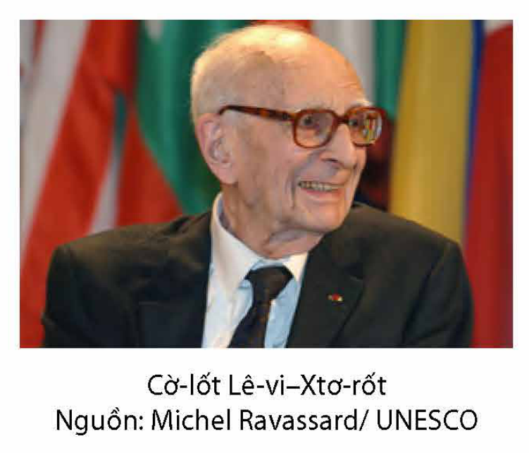
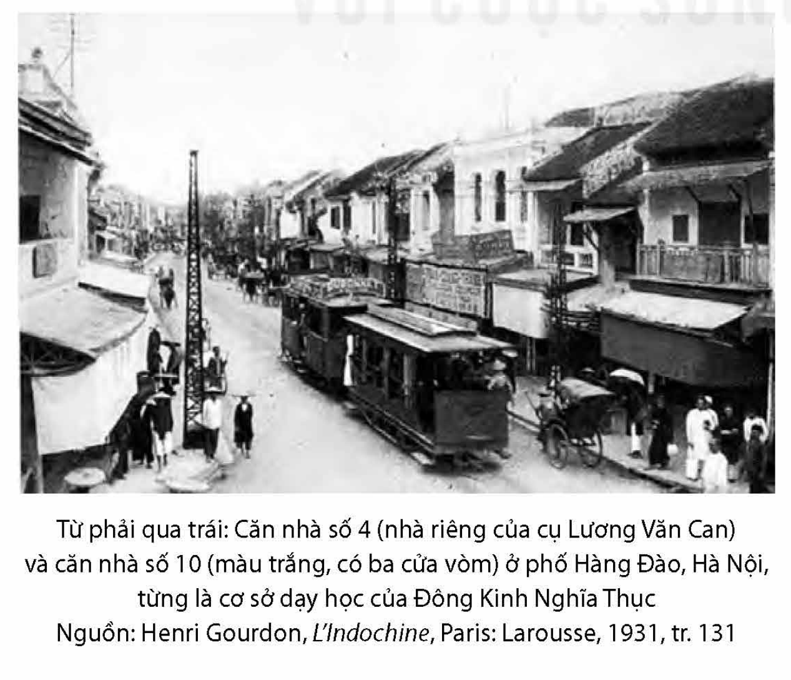

<!-- pdf:66 -->
# BÀI 8: DỮ LIỆU TRONG VĂN BẢN THÔNG TIN

## 🎯 Yêu cầu cần đạt

- Phân tích và đánh giá được đề tài, thông tin cơ bản của văn bản; đánh giá được thái độ, quan điểm của người viết và nội dung của văn bản dựa trên trải nghiệm, quan điểm của người đọc.
- Nhận biết được bố cục, mạch lạc của văn bản; đánh giá được sự phù hợp giữa nội dung và nhan đề; đề xuất được các nhan đề khác.
- Biết suy luận và phân tích mối liên hệ giữa các chi tiết, dữ liệu và vai trò của chúng trong việc thể hiện thông tin; đánh giá được cách chọn lọc, sắp xếp thông tin; phân biệt được dữ liệu sơ cấp và thứ cấp; nhận biết và đánh giá được tính mới mẻ, độ tin cậy của dữ liệu trong văn bản.
- So sánh được hiệu quả biểu đạt của văn bản thông tin chỉ dùng ngôn ngữ và văn bản thông tin có kết hợp với các yếu tố phi ngôn ngữ.
- Hiểu được các quy định liên quan đến việc sử dụng ý tưởng, thông tin hay câu chữ của người khác trong bài viết của mình để tránh vi phạm quyền sở hữu trí tuệ.
- Viết được thư trao đổi về công việc hoặc một vấn đề đáng quan tâm.
- Biết tranh biện về một vấn đề đời sống (có những ý kiến trái ngược nhau); thể hiện được thái độ cầu thị khi tranh biện.
- Có cái nhìn cởi mở, thái độ tôn trọng đối với những gì khác biệt.

## ĐỌC

### TRI THỨC NGỮ VĂN

**Vai trò của dữ liệu trong văn bản thông tin**

**Dữ liệu** là các thông tin dưới dạng chữ viết, kí hiệu, số liệu, hình ảnh, âm thanh,... nhằm mô tả hoặc đo lường sự vật.

<!-- term: văn bản thông tin -->
Có thể nói, dữ liệu là yếu tố quan trọng bậc nhất trong văn bản thông tin. Văn bản thông tin chỉ thực sự có giá trị khi cung cấp được cho người đọc những thông tin mới, đáng tin cậy, dựa trên những dữ liệu phong phú, chính xác, khách quan. Lập trường, thái độ, quan điểm của tác giả cũng được bộc lộ một cách gián tiếp qua cách chọn lọc, sắp xếp, trình bày, phân tích, đánh giá dữ liệu.

<!-- pdf:67 -->
**Dữ liệu sơ cấp và dữ liệu thứ cấp**

**Dữ liệu sơ cấp** là dữ liệu được người viết thu thập một cách trực tiếp qua hoạt động quan sát, phỏng vấn, điều tra, thí nghiệm,... Dữ liệu sơ cấp có thể tồn tại dưới dạng các bản ghi chép, nhật kí, số liệu điều tra, kết quả khảo sát, thực nghiệm, bản vẽ, ảnh chụp tại hiện trường,... Dữ liệu sơ cấp có giá trị thực tiễn, giúp người đọc hình dung ra hiện trạng của vấn đề, sự việc, tuy nhiên có thể hàm chứa thiên kiến của người thu thập.

**Dữ liệu thứ cấp** là dữ liệu được khai thác bằng con đường gián tiếp, sử dụng lại những nguồn thông tin đã có từ trước. Dữ liệu thứ cấp mang lại cái nhìn đa dạng, nhiều chiều hơn về vấn đề, song độ tin cậy của dữ liệu thứ cấp lại phụ thuộc vào nguồn thông tin gốc.

**Tính cập nhật, độ tin cậy của dữ liệu**

Để đánh giá tính cập nhật, độ tin cậy của dữ liệu trong văn bản thông tin, người đọc có thể thực hiện một số thao tác sau:

- Thẩm định nguồn dữ liệu: Ai là người cung cấp dữ liệu, người cung cấp dữ liệu có đủ thẩm quyền và uy tín hay không, dữ liệu được công bố ở đâu, khi nào, qua kênh nào,...

- Đánh giá tính logic trong cách trình bày: Dữ liệu được đưa ra theo trình tự nào? Mức độ tương hợp giữa các dữ liệu được thể hiện ra sao?...

- Phân biệt sự thật và ý kiến: Sự thật là những số liệu, ví dụ, trích dẫn, câu chuyện thực tế mang tính khách quan, có thể đo lường, kiểm chứng; ý kiến là đánh giá, nhận định dựa trên quan điểm chủ quan của một cá nhân, khó xác minh.

- Suy luận để nhận ra thiên kiến của tác giả: Tìm các từ ngữ cho thấy sự thái quá của cảm xúc, những chi tiết thể hiện sự giản lược hoá hoặc cường điệu trong việc huy động dữ liệu,...

- So sánh các dữ liệu trong văn bản đọc với dữ liệu tương tự ở một số văn bản khác: Tìm điểm tương đồng, khác biệt trong cách nêu, phân tích dữ liệu giữa các văn bản và lí giải nguyên nhân dẫn đến điều đó.

**Thư từ**

**Thư từ** (thư nói chung) là hình thức văn bản đặc biệt, có đối tượng tiếp nhận cụ thể, được dùng với nhiều mục đích giao tiếp khác nhau: bày tỏ tình cảm, chia sẻ một trải nghiệm, cung cấp thông tin, thuyết phục hay thể hiện sự đồng tình với người đọc về một vấn đề,... Tuỳ vào mục đích chủ yếu được nhắm đến mà một bức thư có thể là văn bản biểu cảm, văn bản tự sự, văn bản thông tin hay văn bản nghị luận. Sự pha trộn các yếu tố của nhiều kiểu văn bản khác nhau là hiện tượng thường thấy trong một bức thư.

**Tôn trọng và bảo vệ quyền sở hữu trí tuệ**

Tôn trọng kết quả lao động sáng tạo của người khác và biết cách tiếp thu, kế thừa kết quả đó trong sản phẩm trí tuệ của mình theo đúng quy định và thông lệ quốc tế là yêu cầu bắt buộc trong học tập và nghiên cứu. Điều đó không chỉ góp phần tạo nên những sản phẩm sáng tạo mà còn bồi dưỡng cho người học, người nghiên cứu tính trung thực, niềm say mê tìm tòi, khám phá cái mới.

<!-- pdf:68 -->
### VĂN BẢN 1: Pa-ra-na (Parana)$^{(*)}$
<!-- ocr-ok: ảnh p068 có nhãn VĂN BẢN 1 trong khung đồ hoạ làm OCR bỏ sót -->

*(Trích Nhiệt đới buồn)*

**Cờ-lốt Lê-vi-Xtơ-rốt (Claude Lévi-Strauss)**

> **Trước khi đọc**
>
> Bạn biết gì về lịch sử, văn hoá của các dân tộc bản địa ở Nam Mỹ? Chia sẻ với các bạn trong lớp những hiểu biết của bạn.

Trên những dải đất nhìn xuống hai bờ sông Ri-ô Ti-ba-gi (Rio Tibagy) ấy, ở độ cao 1 000 mét so với mặt biển, lần đầu tiên tôi đã tiếp xúc với những người hoang dã, trong khi đi theo một trưởng chi nhánh của cơ quan bảo vệ người Anh điêng trong chuyến đi kiểm tra của ông ta.

Vào thời kì phát hiện ra xứ sở này, toàn bộ khu vực nam Bra-xin (Brasil) là nơi trú ngụ của những nhóm người có mối quan hệ gần gũi về ngôn ngữ và văn hoá và người ta xếp chung dưới tên gọi là Giê (Gé)$^{(1)}$. Có thể họ đã bị dồn về khu vực này bởi những kẻ xâm lược mới đây nói tiếng Tu-pi (Tupi)$^{(2)}$ đã chiếm giữ toàn bộ dải bờ biển và họ đang chiến đấu chống lại những người này. Được bảo vệ do đã lui vào những vùng khó thâm nhập, người Giê ở nam Bra-xin đã tồn tại trong vài thế kỉ thoát khỏi người Tu-pi, còn người Tu-pi thì nhanh chóng bị đám thực dân xoá sổ. Trong những khu rừng của các bang phía nam: Pa-ra-na và Xan-ta Ca-ta-ri-na (Santa Catarina), những nhóm nhỏ người hoang dã đã tồn tại cho tới thế kỉ XX; có thể còn tồn tại vài nhóm cho tới năm 1935, bị truy đuổi tàn bạo đến mức trong khoảng một trăm năm gần đây nhất họ phải trốn biệt; nhưng phần lớn họ đã bị hao mòn và được chính phủ Bra-xin cho định cư ở nhiều trung tâm vào khoảng năm 1914. Lúc đầu, người ta cố gắng đưa họ vào đời sống hiện đại. Làng Xao Phe-rô-ni-mô (Sao Feronymo) là nơi đặt cơ sở của tôi, có một xưởng làm khoá, một xưởng cưa,

> **Theo dõi:** Tóm tắt ý chính của đoạn văn.
<!-- ocr-ok: ảnh p068 hộp chỉ dẫn đọc bị OCR trộn vào văn bản chính -->

*Chú thích:*
(*) *Pa-ra-na*: một bang nằm ở phía nam của Bra-xin, được bao phủ bởi rừng bách tán, một trong những rừng cận nhiệt đới quan trọng nhất trên thế giới.
(1) *Giê*: một nhóm người bản địa ở Bra-xin.
(2) *Tu-pi*: một trong những cộng đồng người bản xứ lớn nhất ở Bra-xin trước thời kì thuộc địa, từng định cư ở vùng rừng mưa A-ma-dôn (Amazon) từ khoảng 2 900 năm trước.

<!-- pdf:69 -->
một trường học, một hiệu thuốc. Trạm bưu điện đều đặn nhận được các dụng cụ: rìu, dao, đinh; người ta phân phát quần áo và chăn. Hai mươi năm sau, những ý đồ đó bị huỷ bỏ. Bằng việc bỏ mặc những thổ dân tự kiếm sống, cơ quan bảo vệ biểu lộ sự thờ ơ mà chính họ trở thành đối tượng từ phía các cơ quan công quyền (sau đó, họ có lấy lại được ít nhiều quyền lực); do vậy, dù không muốn, họ bị bắt buộc phải thử nghiệm một phương pháp khác, là kích thích thổ dân tìm lại một sáng kiến nào đấy và buộc phải nắm lại việc tự cai trị.

Người thổ dân chỉ giữ lại của trải nghiệm văn minh ngắn ngủi những bộ quần áo Bra-xin, cái rìu, con dao và chiếc kim khâu. Toàn bộ phần còn lại, là thất bại. Người ta đã xây nhà cho họ và họ vẫn sống ở ngoài trời. Người ta cố sức định cư họ trong các ngôi làng, và họ vẫn sống du cư. Giường nằm, họ đã phá ra làm củi đun và nằm ngủ ngay dưới đất. Những đàn bò do chính phủ gửi tới lang thang đâu đó, thổ dân ghê sợ từ chối thịt và sữa bò. Những chiếc chày gỗ chuyển động một cách cơ học bằng cách đổ đầy và trút ra một thùng nước gắn ở đầu một cánh tay đòn bẩy (dụng cụ thường thấy ở Bra-xin gọi là môn-giô-lô (monjolo), và có thể là do người Bồ Đào Nha nhập từ phương Đông vào) mục ruỗng vì chẳng ai dùng đến, giã gạo bằng tay vẫn là cách phổ biến.

Thất vọng lớn cho tôi, như vậy người Anh điêng ở Ti-ba-gi vừa không hoàn toàn là “người Anh điêng thực thụ”, vừa, nhất là, không phải là “người hoang dã”. Nhưng lột sạch đi khỏi cái chất thơ của họ hình ảnh khờ khạo mà nhà dân tộc học mới vào nghề tạo nên từ những kinh nghiệm sau này của mình, họ đã cho tôi một bài học về sự thận trọng và tính khách quan. Tìm thấy họ kém nguyên vẹn như tôi vẫn hi vọng, tôi sẽ khám phá ra rằng họ bí ẩn hơn là cái vẻ bề ngoài của họ có thể làm cho ta tưởng. Họ minh hoạ đầy đủ cái tình thế xã hội học có xu hướng trở thành độc quyền cho nhà quan sát nửa sau thế kỉ XX, từ “những người nguyên thuỷ” bị áp đặt nền văn minh một cách thô bạo và, một khi vượt qua được mối hiểm hoạ mà họ bị coi là đại diện, thì người ta không còn quan tâm đến nữa. Nền văn hoá của họ, một mặt được tạo thành bởi những truyền thống lâu đời đã kháng cự lại ảnh hưởng của người da trắng (như tục nhuộm răng và cà răng, vẫn khá phổ biến trong số họ), mặt khác là những vay mượn từ nền văn minh hiện đại, là một tổng thể độc đáo mà việc nghiên cứu, dù có thể thiếu đi sự ý nhị, lại không hề đặt tôi vào một trường học kém giá trị so với việc nghiên cứu những người Anh điêng thuần chủng mà tôi phải tiếp cận về sau.

> **Theo dõi:** Tìm các chi tiết, cách diễn đạt thể hiện thái độ, quan điểm của tác giả.
<!-- ocr-ok: ảnh p069 hộp chỉ dẫn đọc bị OCR trộn vào văn bản chính -->

<!-- pdf:70 -->
Nhưng đặc biệt là, từ khi những người Anh điêng ấy bị phó mặc tự kiếm sống, thì ta chứng kiến một cuộc đảo lộn kì lạ thế cân bằng phù phiếm giữa văn hoá hiện đại và văn hoá nguyên thuỷ. Những lối sống cổ xưa, những kĩ thuật truyền thống tái xuất hiện, nảy sinh từ một quá khứ mà ta sẽ sai lầm khi quên mất sự gần gũi sống động.

> **Suy luận:** Bạn hiểu thế nào là cuộc đổi ngôi kì lạ phá vỡ thế cân bằng phù phiếm giữa văn hoá hiện đại và văn hoá nguyên thuỷ?

Ở đâu ra vậy những chiếc chày đá được mài nhẵn tuyệt đẹp tôi đã tìm thấy, trong nhà của người Anh điêng, lẫn lộn giữa những đĩa sắt tráng men, những cùi dìa$^{(1)}$ của cửa hàng bách hoá, và thậm chí – đôi khi – những bộ xương khung của một chiếc máy khâu? Những cuộc trao đổi buôn bán, trong im lặng của rừng già, với những cư dân cùng chủng tộc, nhưng vẫn sống hoang dã, và hoạt động hiếu chiến của họ vẫn còn chặn đường những người khai khẩn thâm nhập một số vùng của Pa-ra-na chăng? Để trả lời, cần phải hiểu chính xác cuộc phiêu lưu đầy sóng gió của ông già Anh điêng Bra-vô (Bravo), bấy giờ đã về hưu ở khu di dân của chính phủ.

Những đồ vật khiến ta trầm tư ấy vẫn còn trong các bộ lạc như là nhân chứng của một thời kì khi người Anh điêng không biết đến nhà ở, quần áo, cũng như vật dụng bằng kim loại. Và trong những kí ức nửa ý thức của con người, những kĩ thuật xưa cũng còn được lưu giữ. Thay vì những que diêm, đã được biết đến rộng rãi nhưng đắt và khó kiếm, người Anh điêng vẫn cứ ưa thích việc quay hay xát mạnh vào nhau hai mẩu gỗ mềm của cái khoan lửa. Và những khẩu súng trường, súng lục cũ kĩ xưa kia do chính phủ phân phát, thường thấy chúng treo trong những ngôi nhà bỏ hoang, trong khi người đàn ông đi săn trong rừng với cây cung và những mũi tên của một kĩ thuật cũng chắc chắn như kĩ thuật của các dân tộc chưa hề biết đến vũ khí nóng. Như vậy những lối sống cổ xưa, bị che phủ sơ sài bởi những nỗ lực của nhà cầm quyền, lại mở đường đi của chúng, cũng chậm rãi, và vững tin như những đoàn người Anh điêng gặp, đi trên những con đường mòn trong rừng, trong khi các mái nhà đổ rụi ở những ngôi làng bỏ hoang.

> **Theo dõi:** Chú ý đến thái độ, hành xử của người Anh điêng với những thứ được coi là sản phẩm của văn minh, tiến bộ.

(Cờ-lốt Lê-vi-Xtơ-rốt, *Nhiệt đới buồn*, Ngô Bình Lâm dịch, NXB Tri thức, Hà Nội, 2009, tr. 156 – 158)

*Chú thích:*
(1) *Cùi dìa*: thìa.
<!-- ocr-ok: ảnh p070 chú thích ngắn ở cuối trang -->

<!-- pdf:71 -->

> **Cờ-lốt Lê-vi-Xtơ-rốt** (1908 – 2009) là nhà nhân học, dân tộc học, triết học nổi tiếng người Pháp. Các nghiên cứu của Cờ-lốt Lê-vi-Xtơ-rốt bao trùm nhiều lĩnh vực và tư tưởng của ông có ảnh hưởng sâu rộng trên thế giới. Trong trước tác của mình, ông thể hiện một tầm nhìn toàn cầu về nhân loại, chống lại sự độc tôn của văn minh phương Tây, bảo vệ cho sự đa dạng văn hoá và cảnh báo về nguy cơ huỷ diệt thiên nhiên. Các công trình nổi tiếng của ông gồm có: *Những cấu trúc sơ đẳng về thân tộc* (1949), *Chủng tộc và lịch sử* (1952), *Nhiệt đới buồn* (1955), *Nhân loại học cấu trúc* (1958), *Tư tưởng hoang dã* (1962),...
>
> *Nhiệt đới buồn* là tác phẩm tự truyện, du kí, đồng thời cũng là một ghi chép dân tộc học, du khảo triết học độc đáo. Tác phẩm được Cờ-lốt Lê-vi-Xtơ-rốt viết sau hai mươi năm khảo sát thực địa ở Bra-xin, nơi ông có cơ hội được tiếp xúc với nền văn hoá Anh điêng đang đứng trước nguy cơ bị huỷ hoại. Bằng những quan sát và ghi chép tỉ mỉ, khách quan của một nhà nhân học, sự sâu sắc của một nhà triết học, Cờ-lốt Lê-vi-Xtơ-rốt đã đặt ra nhiều vấn đề đáng suy ngẫm về mối quan hệ giữa con người với thiên nhiên và về chính bản chất, lịch sử của nhân loại.

**Sau khi đọc**

1. Văn bản cho bạn biết những thông tin gì về số phận của người bản địa trong lịch sử? Nêu nhận xét về những thông tin đó.

2. Thông tin về cuộc sống của người Giê dưới chế độ thực dân được triển khai qua những dữ liệu nào? Từ những dữ liệu đó, bạn có nhận xét gì về mối quan hệ giữa chính quyền thực dân và những người da đỏ bản xứ?

3. Phân tích vai trò của người trần thuật xưng “tôi” trong văn bản.

4. Các dữ liệu được cung cấp trong văn bản là dữ liệu sơ cấp hay thứ cấp? Giá trị của các dữ liệu đó là gì?

5. Hãy cho biết lập trường, quan điểm, thái độ của tác giả được thể hiện trong văn bản. Bằng cách nào bạn nhận ra điều đó?

6. Thông điệp bạn nhận được từ văn bản là gì? Đặt trong bối cảnh ra đời của văn bản, theo bạn, thông điệp đó có ý nghĩa gì?

**Kết nối đọc – viết**

Văn bản gợi cho bạn suy nghĩ gì về mối quan hệ giữa văn minh và hoang dã? Viết đoạn văn (khoảng 150 chữ) trình bày suy nghĩ của bạn.

<!-- pdf:72 -->
### VĂN BẢN 2: Giáo dục khai phóng ở Việt Nam nhìn từ Đông Kinh Nghĩa Thục

**Nguyễn Nam**

> **Trước khi đọc**
>
> Chia sẻ những hiểu biết của bạn về giáo dục khai phóng.

**Thành lập năm 1907 ở Hà Nội, Đông Kinh Nghĩa Thục là sự tích hợp những thành tựu cải cách giáo dục Đông – Tây vào cuối thế kỉ XIX đầu thế kỉ XX.**

> **Theo dõi:** Đọc lướt phần nhan đề, sa-pô, đề mục, chữ in nghiêng, in đậm để nắm bắt được chủ đề, cấu trúc, các nội dung chính của văn bản.

Dù giáo dục khai phóng có thể được định nghĩa theo nhiều cách khác nhau nhưng tất cả đều có chung một điểm là “cung cấp một nền tảng tri thức rộng mở để tư duy phản biện, lập luận, phân tích và biểu đạt một cách rõ ràng. Những nền tảng tri thức này sẽ chuẩn bị cho người học năng lực xử lí những vấn đề phức tạp nhất của thế giới và ứng phó với những thay đổi không thể lường trước của tương lai”.

> **Theo dõi:** Quan sát hình ảnh và đọc kĩ phần chú thích.

<!-- pdf:73 -->
Nền tảng thực hành của một truyền thống giáo dục như thế có lịch sử lâu đời không chỉ ở các nước phương Tây mà còn ở các nước phương Đông như Ấn Độ, Trung Hoa, hay Ai Cập.

Năm 1907, Đông Kinh Nghĩa Thục (thường được dịch sang tiếng Anh là “The Tonkin Free School”) ra đời trong bối cảnh thuộc địa đánh dấu một bước phát triển mới trong truyền thống giáo dục khai phóng Việt Nam. Đông Kinh Nghĩa Thục là sự tích hợp những thành tựu cải cách giáo dục Đông – Tây vào cuối thế kỉ XIX – đầu thế kỉ XX nhằm đáp ứng những yêu cầu cấp thiết của thời đại, đặc biệt là vấn đề canh tân đất nước về mọi mặt để mưu cầu tiến bộ, bình đẳng, hợp tác và độc lập dân tộc.

> **Theo dõi:** Tìm các từ ngữ, chi tiết thể hiện sự nhận xét, đánh giá của tác giả về Đông Kinh Nghĩa Thục.

Thời gian tồn tại ngắn ngủi của Đông Kinh Nghĩa Thục trong vòng khoảng mười tháng tỉ lệ nghịch cực đại với ảnh hưởng sâu rộng của ngôi trường này đối với truyền thống giáo dục Việt Nam nói riêng, và đối với sự phát triển theo định hướng mới của xã hội Việt Nam nói chung.

**Bối cảnh lịch sử**

Những biến động chính trị, kinh tế, xã hội và quân sự ở khu vực Đông Á cuối thế kỉ XIX – đầu thế kỉ XX đã có tác động mạnh mẽ đến một nước Việt Nam bị phân cắt thành ba kì (Bắc, Trung, Nam), nằm trong vòng kiểm soát của những hệ thống chính trị bảo hộ – thuộc địa của Pháp. Thất bại của Mậu Tuất Duy tân$^{(1)}$ ở Trung Hoa năm 1898 đã dẫn đến sự lưu vong của Khang Hữu Vi (Kang Youwei, 1858 – 1927) và Lương Khải Siêu (Liang Qichao, 1873 – 1929) ở Nhật, và đó cũng chính là một trong những khởi điểm quan trọng cho việc tiếp xúc và truyền bá tư tưởng chính trị, triết học phương Tây (đã được dịch khá nhiều ở Nhật) vào thế giới Đông Á (bao gồm Việt Nam) qua hình thức “tân thư”$^{(2)}$.

> **Theo dõi:** Tìm các từ khoá và câu chủ đề trong mục này.

Chiến thắng của Nhật Bản trong chiến tranh Nhật – Nga (1905) cùng với những thành tựu cải cách chính trị, kinh tế, giáo dục, xã hội của nước này trong giai đoạn Minh Trị Duy tân (1868 – 1889) đã khiến các nước Đông Á

> **Theo dõi:** Tóm tắt những điều kiện chính dẫn đến sự ra đời của Đông Kinh Nghĩa Thục.

*Chú thích:*
(1) *Mậu Tuất Duy tân*: còn gọi là Duy tân Mậu Tuất, biến pháp Mậu Tuất, là phong trào yêu nước và cải cách xã hội xuất hiện ở Trung Quốc thời kì cận đại, được Khang Hữu Vi, Lương Khải Siêu khởi xướng, lấy cảm hứng từ phong trào Minh Trị Duy tân ở Nhật Bản.
(2) *Tân thư*: sách báo chứa đựng tư tưởng mới mẻ, do các học giả Trung Hoa và Nhật Bản biên dịch từ sách vở phương Tây, được truyền bá vào Việt Nam từ nửa cuối thế kỉ XIX đến nửa đầu thế kỉ XX, là cơ sở cho phong trào Đông du, Đông Kinh Nghĩa Thục, Duy tân.

<!-- pdf:74 -->
phải nhận thức lại tiềm lực cách mạng, cải cách của chính mình để đối đầu với hiểm hoạ thôn tính từ phương Tây.

Dân trí, dân khí và dân sinh nổi lên như những yếu tố cốt tuỷ, then chốt mở lối cho dân tộc tự cường và hiện đại, cần được đặc biệt quan tâm và triển khai từ nền tảng giáo dục. Mô hình giáo dục Nhật Bản, đặc biệt là Khánh Ứng Nghĩa Thục$^{(1)}$ (Keio Gijuku) được Phan Bội Châu (1867 – 1940) và Phan Châu Trinh (1872 – 1926) cùng thăm thú, quan sát năm 1906, đã trở thành nguồn cảm hứng cho việc thành lập Đông Kinh Nghĩa Thục do cụ cử Lương Văn Can (1854 – 1927) làm hiệu trưởng ở phố Hàng Đào (Hà Nội) năm 1907.

**Điểm nhấn then chốt trong lịch sử giáo dục Việt Nam**

Dù chỉ tồn tại trong thời gian ngắn khoảng mười tháng, từ tháng Ba dương lịch năm 1907 cho đến khi bị chính quyền thuộc địa đóng cửa vào đầu năm 1908 (tháng Chạp năm Đinh Mùi âm lịch), Đông Kinh Nghĩa Thục là một trong những cải cách quan trọng nhất trong lịch sử giáo dục Việt Nam, được tiến hành không phải từ trên xuống, mà từ dưới lên, bắt nguồn trong dân chúng, do nhân sĩ đề xướng, theo định hướng độc lập dân tộc, khát vọng yêu nước, mong cầu tiến bộ về tri thức, tư duy và dân chủ nhằm phá bỏ những kìm hãm, trì trệ của xã hội thuộc địa và quân chủ Việt Nam đầu thế kỉ XX.

> **Theo dõi:** Chú ý nhận định của tác giả về Đông Kinh Nghĩa Thục.
<!-- ocr-ok: ảnh p074 hộp chỉ dẫn đọc bị OCR đọc nhầm khi trộn vào dòng văn bản chính -->

Hẳn là nguyên nhân chính khiến chính quyền thực dân Pháp quyết định đóng cửa Đông Kinh Nghĩa Thục không phải chỉ vì những nội dung giáo dục tiến bộ về khoa học phổ thông của nhà trường, mà quan trọng hơn là vì nguy cơ nối kết giữa việc đào tạo con người có tư duy khoa học, cởi mở – phản biện, nặng lòng ái quốc, có ý thức học hỏi – tiếp nhận từ năm châu, bốn bể nhưng luôn hướng đến độc lập quốc gia với những cuộc khởi nghĩa vũ trang vẫn đang tồn tại, luôn chờ dịp bùng phát trong cả nước.

> **Theo dõi:** Tìm các bằng chứng được tác giả sử dụng để làm nổi bật nhận định của mình.

Có một khoảng cách đáng kể giữa thời gian hiện hữu của Đông Kinh Nghĩa Thục và thời gian ra đời của những khảo cứu về ngôi trường lịch sử này. Phải đến gần ba mươi năm sau khi bị đình chỉ, những tập chuyên luận đầu tiên về nhà trường mới được biên soạn, nhưng số phận của chúng cũng thật truân chuyên.

*Chú thích:*
(1) *Khánh Ứng Nghĩa Thục*: trường đại học tư thục đầu tiên của Nhật Bản, được học giả Phư-cư-da-oa Y-ư-ki-chi (Fukuzawa Yukichi) sáng lập vào năm 1868, đề cao tính tự cường, ý chí độc lập, sự tháo vát và tinh thần cống hiến của người Nhật. Trường có đóng góp rất quan trọng cho công cuộc Duy tân thời Minh Trị.

<!-- pdf:75 -->
Sách *Đông Kinh Nghĩa Thục* của Đào Trinh Nhất (1900 – 1951) do nhà in Mai Lĩnh xuất bản số lượng lớn (10 000 bản vào tháng 12 năm 1937 ở Hà Nội), vừa đến với người đọc vài tháng đã bị cấm cùng với một khảo cứu khác của ông có tên *Đời cách mệnh Phan Bội Châu*, không ai được “giới thiệu, lưu hành, bày bán, phân phối” trên toàn cõi An Nam từ ngày 17 tháng 3 năm 1938. Cũng từ năm 1936, Hoa Bằng Hoàng Thúc Trâm (1902 – 1977) đã có ý thức thu thập thông tin và trình bày rải rác về Đông Kinh Nghĩa Thục trên các tuần báo *Thế giới* (Sài Gòn) và *Tân Việt Nam* (Hà Nội). Đến năm 1945, khi tài liệu đã khá dày dặn, ông soạn thành sách *Đông Kinh Nghĩa Thục*, kí bút danh Mai Lâm, nhưng do chiến tranh tao loạn, bản thảo bị lạc mất khỏi tay người soạn.

Sau đó hơn chục năm, Hoa Bằng mới có thể hoàn thành một bản thảo khác về ngôi trường lịch sử này, nhưng rất tiếc cho đến nay vẫn chưa được chính thức ấn hành. Trong một thời gian dài, tên gọi “Đông Kinh Nghĩa Thục” đã là một từ cấm kị, trở thành nỗi ám ảnh của chính quyền thực dân bắt đầu từ năm 1908 khi nó bị chính quyền thuộc địa dán cho cái nhãn “hội kín” (société sécrète) và gắn nó với những hoạt động cách mạng bạo động như vụ đầu độc lính Pháp ở Hà thành năm ấy.

> **Theo dõi:** Theo tác giả, đâu là điểm nhấn then chốt của Đông Kinh Nghĩa Thục trong lịch sử giáo dục Việt Nam?

<!-- pdf:76 -->
**Giáo dục khai phóng của Đông Kinh Nghĩa Thục**

Nếu những điều sâu sắc nhất là những gì đọng lại trong kí ức sau một hành trình dài của thời gian, thì những điều Giám học Nguyễn Quyền còn nhớ được về Đông Kinh Nghĩa Thục sau gần ba mươi năm nhà trường bị rút giấy phép, những người sáng lập bị bắt bớ, tù đày tất yếu phải là những thành tựu đáng tự hào nhất của nhà trường. Ông tóm tắt mục đích – tôn chỉ giáo hoá của Đông Kinh Nghĩa Thục trong sáu điểm như sau:

> **Theo dõi:** Chỉ ra các bằng chứng được tác giả sử dụng.

*Giảng dạy bằng ba thứ chữ Pháp, Hán, Việt:* Với cấp phổ thông thì chú trọng giảng dạy quốc văn, thay thế hoàn toàn giáo dục Hán văn bằng quốc ngữ “để diễn dịch những thường thức và tư tưởng mới”.

*Trường chia làm ba cấp: Tiểu, Trung và Đại học.* Chữ Pháp và chữ Hán được giảng dạy các bậc Trung và Đại học. Trường thu nhận cả nam sinh và nữ sinh ở bậc Tiểu học; có cả giáo viên nữ giảng dạy. Tất cả các lớp đều chỉ cốt “học để làm người dân, chớ không học lối từ chương khoa cử”.

*Nhà trường dạy miễn phí*, cấp cả sách vở, giấy bút, “muốn cho ai cũng có thể tới và học được”.

*Trường dạy “những khoa học thường thức, công nghệ thường thức* cho người ta lấy đó mà mưu sanh, tự tồn”.

*Được phép của nhà cầm quyền, Đông Kinh Nghĩa Thục mỗi tuần được tổ chức diễn thuyết công khai một lần* về các vấn đề giáo dục, khoa học; các buổi diễn thuyết ban đầu chỉ ở Hà Nội nhưng sau còn phái cả người đi diễn thuyết ở các nơi khác.

*Đông Kinh Nghĩa Thục được tổ chức với mục đích thực nghiệm* để sẵn sàng mở rộng ra khắp ba kì.

Tác phẩm khuyết danh *Văn minh tân học sách* (1904) có thể xem là cương lĩnh giáo dục của nhà trường Đông Kinh Nghĩa Thục. Theo đó, có thể thấy trường khuyến khích tinh thần sáng tạo khoa học của người học, khuyến cáo xã hội nên học theo mẫu hình châu Âu mà “hạ lệnh cho khắp nước hễ ai học được kiểu mới, chế được đồ mới thì cũng theo lối Âu châu cấp cho bằng khen làm lưu chiếu, thưởng cho phẩm hàm để ngợi khen họ, cấp lương bổng để khen thưởng họ, cho giữ quyền sáng tạo để hậu đãi họ.”. Quan trọng nhất

> **Theo dõi:** Khái quát những đặc điểm chính của Đông Kinh Nghĩa Thục.

<!-- pdf:77 -->
là tinh thần tự do học thuật dựa trên thực học, “cho phép học trò bàn bạc tha hồ, đối đáp tự do, không phải nề hà. Không cần thể cách gì hết [...] để cho cái mà học sinh học và thi không trái với công việc thực tế họ phải làm”.

Tất nhiên, những nội dung dạy và học ở Đông Kinh Nghĩa Thục trong khoảng gần mười tháng ngắn ngủi thời đó tuy vẫn còn rất sơ khai nhưng cái dũng khí dám từ bỏ lối học từ chương, giáo điều hàng nghìn năm áp đặt, kìm hãm tâm trí người dân cần được ghi nhận như một mốc lịch sử giáo dục quan trọng.

> **Theo dõi:** Chú ý các từ ngữ, cách diễn đạt thể hiện thái độ, quan điểm của tác giả.

Tinh thần khai phóng đó cho phép người học trải nghiệm tự do học thuật, hướng họ vào đường thực học, cho phép họ kiểm nghiệm những điều đã học được trong thực tế, tập cách suy nghĩ cởi mở, với tinh thần phản biện mà không phải kiêng dè chi cả.

Cùng với quốc văn, Hán văn và Pháp văn là những ngôn ngữ – văn tự cho phép người học mở rộng và hoà nhập hiệu quả với thế giới hiện đại mà không bị cắt đứt khỏi căn rễ văn hoá của mình, Đông Kinh Nghĩa Thục đã tiếp nối và phát huy tinh thần khai phóng của giáo dục Việt Nam trong khung cảnh thuộc địa của đất nước và trong bối cảnh biến động phức tạp của thế giới đầu thế kỉ XX như thế đó.

(Theo Nguyễn Nam, báo *Vietnamnet*, ngày 09/11/2022)

> **Nguyễn Nam** sinh năm 1961, quê ở tỉnh Hà Tây (nay thuộc thành phố Hà Nội), là người nghiên cứu chuyên sâu về các lĩnh vực: lịch sử tư tưởng, văn chương và điện ảnh Đông Á.

**Sau khi đọc**

1. Đông Kinh Nghĩa Thục ra đời trong bối cảnh lịch sử nào?

2. Theo tác giả, điểm nhấn then chốt của Đông Kinh Nghĩa Thục là gì? Tác giả đã sử dụng những dữ liệu nào để làm rõ điều này?

3. Giáo dục khai phóng có những đặc điểm gì? Vì sao tác giả lại cho rằng Đông Kinh Nghĩa Thục là một mô hình giáo dục khai phóng?

4. Các thông tin trong văn bản được chọn lọc, sắp xếp theo trình tự nào? Cách sắp xếp đó có thuyết phục không? Vì sao?

5. Phân tích tác dụng của việc sử dụng phương tiện phi ngôn ngữ trong văn bản.

<!-- pdf:78 -->
6. Tác giả nhận xét, đánh giá thế nào về Đông Kinh Nghĩa Thục? Có gì thiên kiến trong cách nhận xét, đánh giá đó không? Hãy lí giải về điều này.

7. Từ những thông tin được cung cấp trong văn bản, bạn suy nghĩ như thế nào về giá trị của giáo dục nói chung và giáo dục khai phóng nói riêng?

**Kết nối đọc – viết**

Viết đoạn văn (khoảng 150 chữ) trình bày suy nghĩ về một dữ liệu gây ấn tượng mạnh mẽ với bạn trong văn bản *Giáo dục khai phóng ở Việt Nam nhìn từ Đông Kinh Nghĩa Thục*.

### VĂN BẢN 3: Đời muối
<!-- ocr-ok: ảnh p078 có nhãn VĂN BẢN 3 trong khung đồ hoạ làm OCR bỏ sót -->

*(Trích Đời muối: Lịch sử thế giới)*

**Mác Kơ-len-xki (Mark Kurlansky)**

> **Trước khi đọc**
>
> Ngoài cách tiếp cận lịch sử thông thường qua các cuộc chiến tranh, qua sự biến đổi và tiếp nối của các triều đại, các cuộc cách mạng,... người ta còn có thể tiếp cận lịch sử bằng những cách nào khác?

Khoảng năm 11 000 trước Công nguyên, sau khi Kỉ Băng Hà kết thúc, những tảng băng khổng lồ bao phủ phần lớn thế giới, bao gồm cả Niu Oóc (New York) và Pa-ri ngày nay, bắt đầu thu hẹp lại và dần dần tan biến. Trong khoảng thời gian này, sói A-xi-a-tích (Asiatic), một loài thú săn mồi hung dữ tuy kích thước nhỏ bé nhưng sẵn sàng ăn thịt cả con người nếu có cơ hội, dần dần bị con người kiểm soát do được cho ăn và huấn luyện từ khi còn là con non. Và thế là, một kẻ thù nguy hiểm đã hoá thành một phụ tá đầy trung thành và tận tâm – loài chó.

Khi các dòng sông băng tan chảy, những cánh đồng ngũ cốc hoang dã rộng lớn dần xuất hiện. Con người, và cả cừu, dê hoang dã, đều kiếm ăn trên những cánh đồng này. Phản ứng ban đầu của con người có lẽ là giết chết lũ động vật đang đe doạ đến nguồn thức ăn quý giá. Nhưng chẳng bao lâu sau, các bộ lạc sinh sống gần những cánh đồng này nhận ra rằng nếu kiểm soát được cừu

> **Theo dõi:** Chú ý đến các mốc thời gian và các sự kiện chính.

<!-- pdf:79 -->
và dê, chúng có thể trở thành một nguồn thức ăn mới. Lũ chó cũng góp công sức trong việc này. Đến khoảng năm 8 900 trước Công nguyên, cừu đã được thuần hoá ở I-rắc (Iraq), thậm chí có thể là từ sớm hơn nữa ở những nơi khác trên thế giới.

Vào khoảng năm 8 000 trước Công nguyên, phụ nữ vùng Cận Đông bắt đầu gieo trồng hạt giống ngũ cốc hoang trên những cánh đồng đã được khai khẩn. Dấu mốc này thường được cho là khởi đầu của nông nghiệp. Tuy nhiên, vào năm 1970, một đoàn thám hiểm của Đại học Ha-oai (Hawaii) đã đến Bơ-ma (Burma), nay là Mi-an-ma (Myanmar), báo cáo rằng đã tìm thấy những dấu tích để lại của rau trồng, bao gồm đậu, củ mã thầy và dưa chuột, có niên đại từ năm 9 750 trước Công nguyên tại một nơi được gọi là “Hang Thần”.

Lợn xuất hiện muộn hơn, vào khoảng năm 7 000 trước Công nguyên, do việc chăn nuôi lợn không đơn giản chỉ là chăn thả trên các bãi cỏ, hơn nữa, phải mất kha khá thời gian để con người nhận ra lợi ích của việc tốn thêm một phần thức ăn để chăn nuôi động vật. Mãi cho đến khoảng năm 6 000 trước Công nguyên, ở Thổ Nhĩ Kỳ hoặc vùng bán đảo Ban-căng (Balkan), con người cuối cùng cũng thành công trong việc thuần hoá những con bò rừng châu Âu vừa to lớn, vừa nhanh nhẹn lại vừa khoẻ mạnh. Bằng việc kiểm soát chế độ ăn uống, thiến những con đực và nuôi nhốt con vật trong không gian chật hẹp, người ta đã biến những con bò rừng hoang dã trở thành gia súc. Gia súc trở thành nguồn thức ăn chính, tiêu thụ một lượng lớn ngũ cốc và muối. Bò rừng châu Âu, nhanh nhẹn và hung dữ, đã bị săn bắn đến mức tuyệt chủng vào giữa thế kỉ XVII.

> **Suy luận:** Tìm ra mối liên hệ giữa các sự kiện, dấu mốc lịch sử với số phận của muối.

Khi chế độ ăn của con người chủ yếu bao gồm ngũ cốc và rau quả, được bổ sung thêm thịt động vật từ những trang trại chăn nuôi gia súc, việc buôn bán muối trở thành một nhu cầu thiết yếu trong cuộc sống, mang lại ý nghĩa tượng trưng vô cùng trọng đại và giá trị kinh tế to lớn. Muối trở thành một trong những mặt hàng thương mại quốc tế đầu tiên, sản xuất muối trở thành một trong những ngành công nghiệp đầu tiên, và dĩ nhiên ngành độc quyền nhà nước đầu tiên.

Công cuộc tìm kiếm muối đã tạo ra đề bài hóc búa thách thức các kĩ sư trong nhiều thiên niên kỉ, để rồi chế tạo ra những cỗ máy kì quặc nhất, cũng như những cỗ máy tinh xảo và khéo léo nhất. Nhiều công trình công cộng vĩ đại từng được tạo ra do nhu cầu về vận tải muối thúc đẩy. Muối đã đi đầu trong sự phát triển về cả hoá học lẫn địa chất học. Những tuyến đường trọng yếu được lập nên luôn dành cho mục đích thương mại trao đổi hàng hoá, từ đó hình thành nên các liên minh, nhu cầu bảo vệ đế chế, đồng thời dẫn đến những cuộc khởi nghĩa nổi dậy – tất cả

> **Theo dõi:** Tìm câu chủ đề của đoạn văn.

<!-- pdf:80 -->
đều chỉ vì một thứ vật chất tồn tại đầy trong các đại dương, nổi bong bóng trong các con suối, lắng cặn dưới lòng hồ, hoặc là một thành phần lớn trong tầng khoáng vật gần với bề mặt vỏ Trái Đất.

> **Theo dõi:** Chú ý giọng điệu, thái độ của tác giả.

Hầu như không có nơi nào trên Trái Đất là không có muối. Nhưng trước khi được địa chất học hiện đại tiết lộ, trong suốt chiều dài lịch sử loài người cho đến thế kỉ XX, muối được săn lùng, mua bán và tranh giành gắt gao. Trong hàng thiên niên kỉ, muối là biểu tượng của sự giàu có. Những lái buôn muối vùng Ca-ri-bê (Caribe) dự trữ muối dưới tầng hầm trong nhà. Người Trung Quốc, người La Mã, người Pháp, Vê-nê-xi-a (Venezia), Háp-xbớt (Habsburg), và vô vàn hệ thống chính quyền khác đã đánh thuế muối để lấy tiền phục vụ cho chiến tranh. Đôi khi, binh lính và dân lao động được trả lương bằng muối. Thậm chí, muối còn thường được dùng như một đơn vị tiền tệ.

> **Theo dõi:** Tìm các từ khoá và câu chủ đề của đoạn văn.

Trong chuyên luận năm 1776 về chủ nghĩa tư bản có tên *The Wealth of Nations* (đã xuất bản ở Việt Nam với tên *Của cải của các dân tộc*), A-đam Xmít (Adam Smith) đã chỉ ra rằng hầu hết tất cả những gì có giá trị đều có thể sử dụng làm tiền tệ, ví dụ thuốc lá, đường, cá tuyết khô, gia súc. Ông viết: “Muối được cho là một công cụ thương mại và giao dịch phổ biến ở A-bi-xi-ni-a (Abyssinia)”. Nhưng ông đưa ra ý kiến rằng loại tiền tệ tốt nhất nên được chế tạo bằng kim loại do đặc tính bền vững về mặt vật lí, dù giá trị chỉ tồn tại trong một thời gian ngắn giống như nhiều loại hàng hoá khác.

Ngày nay, sự thèm khát, tranh giành, tích trữ, đánh thuế và tìm kiếm muối của con người suốt hàng ngàn năm qua đã trở thành một điều xa vời và có phần ngớ ngẩn. Các nhà lãnh đạo Anh của thế kỉ XVII quan ngại về sự phụ thuộc đáng lo ngại của quốc gia vào muối biển Pháp có vẻ nực cười hơn các vị lãnh đạo ngày nay lo lắng về sự phụ thuộc vào dầu từ nước ngoài. Ở bất cứ thời đại nào, con người đều tin rằng chỉ có những thứ họ cho là có giá trị mới có giá trị thực sự.

> **Theo dõi:** Chú ý những chi tiết thể hiện lập trường, quan điểm của tác giả.

Khao khát tình yêu và khao khát làm giàu luôn là hai đề tài hấp dẫn nhất đối với con người. Tuy nhiên, trong khi đề tài tình yêu vẫn bền vững theo năm tháng, thì những câu chuyện về truy cầu tiền tài vật chất, đến một lúc nào đó, đều trở thành nỗi ám ảnh theo đuổi một ảo ảnh không có thực.

(Mác Kơ-len-xki, *Đời muối: Lịch sử thế giới*, Hoàng Ly dịch, NXB Dân trí – Công ti cổ phần văn hoá Huy Hoàng, Hà Nội, 2022, tr. 21 – 24)

<!-- pdf:81 -->
> **Mác Kơ-len-xki** sinh năm 1948, là nhà báo và nhà văn người Mỹ. Ông là tác giả của nhiều cuốn sách bán chạy như: *Khi loài cá biến mất* (1997), *Đời muối: Lịch sử thế giới* (2002), *Giấy: Lật giở từng trang sử* (2016), *Cá hồi và trái đất: Lịch sử của một số phận bình thường* (2020),... Thông qua việc khảo sát lịch sử những vật dụng thường nhật, các cuốn sách của ông mang lại một góc nhìn thú vị và mới mẻ về lịch sử loài người.
>
> Văn bản trên được trích trong cuốn *Đời muối: Lịch sử thế giới*, cuốn sách khám phá hành trình của muối trong lịch sử nhân loại.

**Sau khi đọc**

1. Tiến trình lịch sử nhân loại đã được tác giả tóm lược như thế nào? Trong tiến trình lịch sử đó, theo tác giả, muối đóng vai trò gì?

2. Dữ liệu được tác giả sử dụng là dữ liệu sơ cấp hay thứ cấp? Bạn cảm nhận như thế nào về mức độ chính xác, đáng tin cậy của dữ liệu?

3. Phân tích và đánh giá cách trình bày dữ liệu của tác giả trong văn bản.

4. Góc nhìn và quan điểm của tác giả về lịch sử có gì độc đáo?

5. Theo bạn, tác giả muốn gửi thông điệp gì qua văn bản?

6. Nếu cần một nhan đề khác cho văn bản, bạn sẽ đặt nhan đề gì?

**Kết nối đọc – viết**

Thời nay, nhân loại không còn xung đột với nhau vì tranh giành muối, nhưng vẫn còn rất nhiều cuộc chiến tranh và xung đột xảy ra nhằm tranh giành kim cương, dầu mỏ, đất hiếm, nguồn nước,... Bạn nghĩ gì về vấn đề này? Hãy viết đoạn văn (khoảng 150 chữ) trình bày suy nghĩ của bạn.

### Thực hành tiếng Việt: Tôn trọng và bảo vệ quyền sở hữu trí tuệ

1. Tìm trong văn học Việt Nam thời trung đại một số trường hợp mượn ý tưởng hoặc mượn nguyên câu chữ từ một tác phẩm khác.

2. Đọc đoạn văn dưới đây và xác định các dấu hiệu cho thấy người viết có ý thức tuân thủ quy định về trích dẫn:

*Đánh giá về nhà văn Nguyễn Tuân, nhà nghiên cứu Nguyễn Đăng Mạnh viết: “Ông không hoàn toàn thoát li thực tại, nhưng nhìn thực tại ông chỉ thấy vẻ đẹp,*

> **Một số quy định liên quan đến vấn đề tôn trọng và bảo vệ quyền sở hữu trí tuệ**
>
> - Có sự khác biệt đáng kể trong cách nhìn nhận về vấn đề sử dụng ý tưởng, câu chữ của người đi trước ở những bối cảnh lịch sử và văn hoá khác nhau. Trên thế giới, trước khi văn học hiện đại được hình thành, việc người viết đưa một ý văn, ý thơ, cách diễn đạt nào đó của một tác phẩm văn học khác vào sáng tác của

<!-- pdf:82 -->
*chất thơ thuộc về những cái của ngày xưa còn vương sót lại. [...] Hồi ấy, đối với những cái hiện tại ông thường chỉ dành cho những lời khinh bạc. Nhưng đối với những cái của ngày xưa, giọng văn của ông bao giờ cũng đôn hậu.”.*

(Bài làm của học sinh)

3. Hãy viết lại các đoạn văn dùng cách dẫn trực tiếp dưới đây thành đoạn văn dùng cách dẫn gián tiếp, mang tính chất tóm lược.

a. *Trong “Yêu và đồng cảm” của Phong Tử Khải có đoạn viết: “Nói cách khác, con người ta vốn là nghệ thuật, vốn giàu lòng đồng cảm. Chỉ vì lớn lên bị cách nghĩ của người đời dồn ép, nên tấm lòng ấy mới bị cản trở hoặc hao mòn. Chỉ có kẻ thông minh mới không khuất phục, dù bên ngoài chịu đủ thứ áp bức thì bên trong vẫn giữ được lòng đồng cảm đáng quý nọ. Những người ấy chính là nghệ sĩ”.* (Phong Tử Khải, *Yêu và đồng cảm*, in trong *Ngữ văn 10*, tập một, NXB Giáo dục Việt Nam, Hà Nội, 2022, tr. 80)

b. *A. Anh-xtanh (A. Einstein) quan niệm: “Chỉ cá thể đơn lẻ mới có thể tư duy và qua đó, tạo ra những giá trị mới cho xã hội, vâng, thậm chí đề ra những quy phạm đạo đức mới để đời sống cộng đồng hướng theo. Nếu không có những cá thể sáng tạo, suy nghĩ và phán xét độc lập, thì sự phát triển lên cao của xã hội là khó tưởng tượng; cũng như vậy, một cá thể đơn lẻ sẽ không thể phát triển nếu thiếu mảnh đất dinh dưỡng của cộng đồng.”.* (A. Anh-xtanh, *Cộng đồng và cá thể*, in trong *Ngữ văn 11*, tập hai, NXB Giáo dục Việt Nam, Hà Nội, 2023, tr. 108)

4. Nêu quan điểm của bạn về vấn đề đạo văn. Tự nhận xét về việc bản thân sử dụng ý của người khác khi thực hiện các bài viết trong quá trình học tập.

> mình được chấp nhận rộng rãi. Điều này nhiều khi được coi là dấu hiệu của sự học rộng, biết nhiều và được đánh giá cao.
>
> Ngày nay, tất cả những gì được kế thừa của người khác, từ ý tưởng, thông tin đến những cách diễn đạt đặc thù, có tính cá biệt, đều phải được dẫn nguồn, nếu không sẽ bị coi là đạo văn. Như vậy, “đạo văn” là một khái niệm có nội hàm biến động theo thời gian.
>
> Tuy nhiên, có những tri thức phổ quát, được mặc định là tài sản chung của cộng đồng hay nhân loại thì khi dùng không cần chú nguồn, ví dụ: *Trái Đất quay xung quanh Mặt Trời; Văn học là nghệ thuật của ngôn từ; Ngôn ngữ là phương tiện giao tiếp quan trọng nhất của con người*,...
>
> - Khi trích dẫn trực tiếp và đặt phần trích dẫn trong ngoặc kép, cần dẫn đúng nguyên văn kể cả khi có những ý tưởng, thông tin, cách diễn đạt trong văn bản gốc bị coi là sai. Người viết có thể dùng cước chú để thuyết minh về ý tưởng, thông tin, cách diễn đạt bị coi là sai đó hoặc dùng kí hiệu *[sic]*, một từ trong tiếng La-tinh có nghĩa là “nguyên văn như vậy”. Nếu có phần nào đó bị cắt thì cần đánh dấu chỗ bị cắt bằng kí hiệu [...].
>
> - Ngoài trích dẫn trong phần chính của văn bản, việc sử dụng kết quả lao động sáng tạo của người khác còn có thể được thể hiện qua cước chú. Với một số kiểu văn bản như báo cáo nghiên cứu, bài đăng ở tạp chí chuyên ngành, luận văn, luận án, sách chuyên khảo,... còn có phần *Tài liệu tham khảo*, thường được đặt sau văn bản, liệt kê các công trình mà người viết tham khảo với đầy đủ thông tin về tác giả, tên công trình, nhà xuất bản, nơi xuất bản, năm xuất bản.

<!-- pdf:83 -->
## VIẾT

### Viết thư trao đổi về công việc hoặc một vấn đề đáng quan tâm

Trong cuộc sống hằng ngày, có nhiều lí do khiến chúng ta phải viết thư. Việc viết thư thường xuất phát từ những lí do riêng tư như để bày tỏ tình cảm, cảm xúc với người thân, bạn bè... Khi đó, thư được coi thuộc về đời sống cá nhân. Nhưng cũng có nhiều trường hợp, chúng ta viết thư để giải quyết công việc hoặc trao đổi suy nghĩ về một vấn đề được nhiều người quan tâm. Thư hướng tới mục đích đó có thể được chia sẻ rộng rãi. Trong bài học này, bạn sẽ thực hành viết một bức thư ở dạng cần được công bố.

> **Yêu cầu**
>
> - Xác định rõ đối tượng nhận thư (cá nhân hoặc cơ quan, tổ chức).
> - Thể hiện rõ mục đích viết thư và vấn đề chính được trình bày, trao đổi, bàn luận trong thư.
> - Trình bày tường minh, mạch lạc các thông tin (nếu mục đích chủ yếu là cung cấp thông tin) hoặc triển khai các nội dung phù hợp để khẳng định một quan niệm hay sự cần thiết phải tiến hành công việc hay hoạt động (nếu mục đích chủ yếu là thuyết phục).
> - Sử dụng ngôn ngữ (gồm cả từ ngữ xưng hô) phù hợp với mục đích viết thư và người nhận.
> - Sử dụng yếu tố bổ trợ để đạt được mục đích viết một cách hiệu quả.

**Bài viết tham khảo**

*Phri-đéc-Mi-xtếch (Frýdek-Místek), ngày 22 tháng 02 năm 2009*
<!-- ocr-ok: ảnh p083 chữ in nghiêng có dấu Séc làm OCR đọc nhầm -->

> Địa điểm và thời gian viết thư.
<!-- ocr-ok: ảnh p083 hộp chú thích bên lề bị OCR đọc lỗi chữ đầu -->

Ma-két-ta (Markéta) yêu quý!

> Người nhận thư.

Em có khoẻ không? Việc học hành năm nay ra sao rồi? Kể cho chị nghe về Luân Đôn đi chứ. Lâu lắm rồi em không về Phri-đéc thăm nhà. Cả nhà luôn mong gặp lại em đấy. Chị biết em đang dở kì thi (chắc là thế)

> Mở đầu thư bằng cách thăm hỏi sức khoẻ, công việc.

<!-- pdf:84 -->
nhưng vẫn hi vọng khi thi xong em sẽ về thăm nhà dù chỉ trong ít ngày và rồi sẽ phải quay trở lại bằng máy bay (chị không thể nào quen được với việc em đang sống ở một nơi rất xa xôi). Đã lâu lắm rồi chị không viết thư cho em nhưng hôm nay, với tư cách là người chị, chị quyết định “sửa chữa khuyết điểm”. Chị đã đúc kết được một kinh nghiệm vô cùng thú vị đó là “trông người mà nghĩ đến ta”. Và ngay bây giờ chị sẽ giải thích cho em hiểu nhé.

> Dẫn dắt vào vấn đề cần trao đổi.

Sự việc diễn ra vào thứ Ba tuần trước. Hôm ấy đang lên cơn ghiền sô cô la thì tình cờ tìm thấy thanh kẹo em cho chị cách đó ít lâu. Thanh sô cô la đó cũng chẳng có gì đặc biệt ngoại trừ nó không được sản xuất tại Cộng hoà Séc. Chính em cũng đã có lần quả quyết rằng, thanh kẹo này chẳng có gì đặc biệt đâu và thậm chí, em còn kể cho chị nghe đôi điều về nó nữa. Và rồi theo thói quen, chị vẫn lắng nghe em diễn thuyết say sưa nhưng rất tiếc, hôm đó vì cho rằng, điều em kể chẳng có gì thú vị cả nên chị không hề chú ý. Vì thế lần ấy chị có nhập tâm được chút gì đâu cơ chứ. Đến khi nhìn vào lớp giấy bọc chị mới nhận ra trên đó chứa đầy đủ thông tin. Chị ngạc nhiên khi đọc được dòng chữ bằng tiếng Anh: “Mua sản phẩm thương mại tự do – một nghĩa cử cao đẹp!”. Chị đoán có chút gì đó kì bí ẩn sau khẩu hiệu quảng cáo trên thanh sô cô la này. Nhưng chị chẳng phát hiện ra điều gì ngoài những thông tin về sản phẩm như thành phần và nguồn gốc xuất xứ là Dăm-bi-a (Zambia). Sau đó vì sốt sắng tìm hiểu thông tin đến nỗi quên cả cơn ghiền sô cô la nên chị đặt thanh kẹo sang một bên rồi vào internet tra cứu để giải toả cơn hiếu kì.

> Kể câu chuyện có liên quan đến vấn đề trao đổi.

Điều ngạc nhiên nhất đó là chị đã tìm thấy chủ đề cần tra cứu ngay trên một trang web bằng tiếng Séc được dịch từ tiếng Anh cho nên nó giúp chị dễ hiểu hơn. Chị bắt đầu đọc và ngay lập tức biết được bao điều vô cùng bổ ích. Thanh sô cô la chị vừa định ăn kia hoá ra lại là một thanh kẹo không hề bình thường. Người làm ra thanh kẹo sô cô la ở Dăm-bi-a đã nhận được khoản tiền lương đủ để giúp chính anh ta và gia đình có được cuộc sống khấm khá. Điều đó cũng chẳng có gì lạ nhưng sau đó chị còn đọc được rằng, có rất nhiều người trên toàn châu Phi, gồm cả trẻ em, phải làm việc trong những điều kiện vô cùng tồi tệ và tiền lương rất thấp. Hầu như không một ai kiếm được đồng lương kha khá cả. Thực tế này càng cuốn hút trí tò mò của chị và rồi chị cũng vui lên khi được biết đã có những tổ chức quan tâm tới những người như vậy. Họ mua toàn bộ số sản phẩm những người này làm ra rồi đem bán sang châu Âu với giá thành cao hơn để đảm bảo cho người lao động có được

> Nêu vấn đề chính được gợi ra từ câu chuyện: tình trạng bất công đối với nhiều người lao động ở châu Phi.

<!-- pdf:85 -->
thu nhập thích đáng so với công sức lao động cực nhọc mà họ đã bỏ ra. Chị đã cố hình dung ra cuộc sống của những người lao động khổ cực đó. Họ phải lao động vất vả suốt cả ngày nhưng tiền lương nhận được quá ít ỏi khiến họ luôn bị đói. Chị không thể tưởng tượng được những con người đó phải chịu cơ cực đến nhường nào. Rồi sau đó, chị cứ nghĩ mãi về chuyện này và nhủ thầm rằng, phần lớn những người sống trong đất nước chúng ta đều không quý trọng điều kiện làm việc thuận lợi mà họ đang có được.

> Nêu bằng chứng cho vấn đề.

Chị còn đọc thêm được câu chuyện khác trên internet kể về một gia đình ở Kê-ni-a (Kenya) sống trong một căn nhà gỗ đã long rời từng mảnh. Người cha và sáu trong số bảy người con phải thường xuyên làm việc. Đứa con út mới lên bảy tuổi. Họ lao động từ sáng cho đến tận đêm và phải vất vả lắm mới kiếm đủ tiền để nuôi ăn cho gia đình. Bọn trẻ đều trong tình trạng suy dinh dưỡng. Gia đình đó lao động trong những đồn điền ca cao và cuộc sống của họ hoàn toàn thay đổi chỉ khi họ gia nhập thị trường thương mại bình đẳng quốc tế. Người chủ mới của họ đã thiết lập những điều kiện làm việc tốt hơn rất nhiều và chính nhờ vậy cuộc sống của gia đình đó đã được cải thiện gấp nhiều lần. Chỉ còn mỗi người cha và người con trai cả phải lao động. Số tiền lương họ nhận được không những giúp họ cải tạo ngôi nhà cũ nát mà còn đủ để trang trải học phí cho bọn trẻ được đến trường. Được sống trong những điều kiện như thế quả là hiếm. Những đứa trẻ ấy có cơ hội để tạo dựng một tương lai tươi sáng hơn.

> Đưa ra giải pháp góp phần giải quyết vấn đề đã nêu.
>
> Khẳng định quan điểm của người viết.

Chị chưa biết em có thấy câu chuyện này thú vị hay không nhưng với chị thì có, dù bất luận thế nào. Chị rất vui khi được biết rằng, chính điều kiện làm việc thuận lợi sẽ dẫn đến một cuộc sống vô cùng tốt đẹp. Tuy vậy, chị vẫn buồn vì nhận ra rằng, rất ít người có được cơ hội ấy. Chị nghĩ, ở châu Âu điều kiện lao động không có gì đáng chê trách, song như ở châu Phi chẳng hạn, một thực tế hiển nhiên rằng, những điều kiện làm việc tốt sẽ đem lại cho cuộc sống của con người một ý nghĩa hoàn toàn mới.

> Chia sẻ tình cảm, cảm xúc.

Cảm ơn em vì đã mua cho chị thanh sô cô la đó. Đó đúng là một thanh kẹo đặc biệt. Chị đã học được bao điều thú vị từ thanh kẹo này. Chị rất vui khi biết rằng trên trái đất này đã có biết bao người luôn giúp đỡ những người khác nhờ hình thức kinh doanh chân chính.

> Thuyết phục người nhận thư đồng tình với quan điểm của mình.

<!-- pdf:86 -->
Chính cách đó đã giúp điều kiện sống của nhiều người được cải thiện. Và cũng hoàn toàn chính xác rằng, chất lượng cuộc sống của con người sẽ tốt hơn nếu điều kiện làm việc của họ được cải thiện.

Chị biết chắc rằng, em hiểu rõ những gì chị muốn giãi bày qua lá thư này, nếu không thì tại sao em lại mua cho chị thanh sô cô la đó? Tuy vậy, chị cảm thấy mình cần phải kể với một ai đó câu chuyện này và em đã hoàn toàn có lí.

Mong sớm gặp lại em. Gọi điện cho chị khi nào rảnh dù chỉ là chốc lát em nhé!

Chị của em

**Đô-mi-ni-ca (Dominika)**

> Người viết thư.

*(Các bức thư hay nhất thế giới – Kỉ niệm 50 năm cuộc thi viết thư quốc tế UPU (1971 – 2021)*, NXB Thông tin và Truyền thông, Hà Nội, 2022, tr. 126 – 128)

1. Giữa người viết thư và người nhận thư có mối quan hệ gì? Quan hệ đó thể hiện như thế nào qua ngôn ngữ được dùng trong thư? Người nhận thư có đặc điểm gì đáng chú ý?

2. Bức thư này được viết nhằm mục đích gì? Thư trao đổi, bàn luận về vấn đề gì?

3. Phần mở đầu thư có gì đáng chú ý? Nội dung tiếp theo của bức thư triển khai theo trình tự nào? Trình tự đó có liên quan như thế nào với mục đích viết thư?

4. Người viết dùng những yếu tố bổ trợ nào để thuyết phục người đọc về vấn đề được bàn đến trong thư?

5. Qua bức thư, bạn rút ra được kinh nghiệm gì khi viết thư?

**Thực hành viết**

**Chuẩn bị viết**

Trao đổi về công việc hoặc một vấn đề đáng quan tâm là mục đích chung của văn bản thư mà bạn sẽ thực hành viết. Do mục đích cụ thể đa dạng nên đề tài viết cũng phong phú. Bạn có thể viết thư gửi người thân hoặc bạn bè để trao đổi, mong người nhận đồng tình với mình về một vấn đề nào đó trong công việc, cuộc sống; gửi một nhà thơ, nhà văn chia sẻ điều bạn nghĩ về sáng tác của họ hoặc về một vấn đề văn học. Bạn cũng có thể viết thư gửi đến một công ti để xin tài trợ trang thiết bị học tập cho học sinh vùng khó khăn hoặc đến một cơ quan chức năng để kiến nghị một việc có liên quan đến đời sống của cộng đồng.

<!-- pdf:87 -->
**Tìm ý, lập dàn ý**

**Tìm ý**

Tuỳ vào mục đích viết cụ thể mà bạn có thể đặt ra những câu hỏi khác nhau để tìm ý. Tuy nhiên, dựa trên yêu cầu của kiểu bài, có thể hình dung một số gợi ý áp dụng cho nhiều bức thư khác nhau.

- Người nhận thư là ai và có quan hệ như thế nào với người viết thư? Người nhận thư có những đặc điểm gì?

Thư có đối tượng tiếp nhận cụ thể; đó có thể là cá nhân (người thân, bạn bè, nhà thơ, nhà văn,...) với những đặc điểm riêng biệt về tuổi tác, giới tính, trình độ học vấn, vốn sống, tâm lí, niềm tin, giá trị sống, vị thế, quan hệ với người viết,...; hoặc đại diện của một cơ quan, tổ chức có chức năng, nhiệm vụ, lĩnh vực hoạt động liên quan đến công việc hay vấn đề cần trao đổi. Trong bức thư này, người viết thư và người nhận thư có mối quan hệ gia đình, thân thuộc (chị – em). Qua các chi tiết được tác giả bức thư kể lại, có thể thấy người nhận thư cũng là người có ý thức về nguồn gốc của một sản phẩm và vấn đề đời sống của người lao động trực tiếp làm ra sản phẩm đó.

- Thư trao đổi công việc hay vấn đề gì và nhằm mục đích gì?

Nội dung thư và mục đích viết có liên quan mật thiết với nhau. Trong bức thư này, tất cả các nội dung được người viết kể ra đều hướng đến việc mong người nhận chia sẻ, đồng cảm với quan điểm của mình về sự cần thiết phải khuyến khích những hình thức kinh doanh chân chính để giúp người lao động trực tiếp làm ra sản phẩm được nâng cao thu nhập và cải thiện cuộc sống.

- Nội dung của bức thư triển khai theo trình tự nào? Trình tự đó có liên quan như thế nào với mục đích viết thư?

Thư có bố cục rất linh hoạt, đặc biệt có thể thay đổi rất nhiều tuỳ thuộc vào tính chất của nó. Nếu có tính chất thân mật thì thư có thể bắt đầu bằng những lời thăm hỏi. Nếu có tính chất trang trọng thì thư thường bắt đầu ngay vào nội dung công việc hay vấn đề cần trao đổi.

- Để phục vụ cho mục đích chủ yếu, người viết dùng những yếu tố bổ trợ nào?

Dù mục đích viết thư là gì thì bạn cũng cần chú ý sử dụng các yếu tố bổ trợ một cách hiệu quả.

**Lập dàn ý**

Từ những ý tìm được ở trên, bạn sắp xếp thành một dàn ý hợp lí. Bố cục của văn bản thư không thành khuôn mẫu, nhất là một bức thư có tính chất thân mật nhưng vẫn thường có ba phần: Mở bài, Thân bài, Kết bài.

**Mở bài:** Nêu được công việc hay vấn đề cần trao đổi. Với một văn bản thư không đòi hỏi tính chất nghi thức, có thể bắt đầu bằng một vài ý thăm hỏi thân tình.

**Thân bài:**

- Triển khai các nội dung phù hợp với mục đích viết thư.

- Sử dụng các yếu tố bổ trợ tuỳ thuộc vào tính chất của bức thư: thân mật hay trang trọng.

<!-- pdf:88 -->
**Kết bài:** Nêu lại công việc hoặc vấn đề cần trao đổi dưới hình thức tóm tắt và thể hiện mong muốn được người nhận thư chia sẻ, đồng tình, ủng hộ.

**Viết**

Ngôn ngữ sử dụng trong thư phụ thuộc nhiều vào mục đích viết thư và mối quan hệ giữa người gửi và người nhận. Vì vậy, cần xem xét các yếu tố đó một cách thoả đáng để có ngôn ngữ phù hợp.

Dù viết thư cho một đối tượng gần gũi hay chưa quen biết, nhằm trao đổi về công việc hay một vấn đề đáng quan tâm thì văn bản thư cũng cần thể hiện tâm huyết, sự chân thành và những suy nghĩ có chiều sâu của người viết.

Tuỳ vào hình thức thư được lựa chọn (thư thông thường hay thư điện tử) mà thông tin ở đầu thư và cuối thư được trình bày theo đúng thể thức chung.

**Chỉnh sửa, hoàn thiện**

Đọc lại bức thư, đối chiếu với yêu cầu của kiểu bài và dàn ý đã lập để chỉnh sửa, hoàn thiện. Cụ thể:

- Rà soát bố cục và nội dung; đảm bảo mỗi phần của bức thư đều được triển khai đáp ứng yêu cầu nêu trong dàn ý.

- Xem xét phong cách ngôn ngữ của văn bản, đặc biệt là cách sử dụng từ xưng hô, để đảm bảo tính thân mật hay trang trọng nhất quán với mục đích viết và quan hệ giữa người viết với người nhận.

- Rà soát lỗi chính tả, dùng từ ngữ, đặt câu; lỗi về mạch lạc và liên kết trong mỗi đoạn văn và giữa các đoạn văn.

## NÓI VÀ NGHE

**Tranh biện về một vấn đề đời sống**

> **Yêu cầu**
>
> - Nêu được rõ ràng quan điểm (tán thành hay phản đối) về vấn đề tranh biện.
> - Đưa ra được các lí lẽ, bằng chứng thuyết phục để bảo vệ quan điểm của nhóm mình, phản bác lại quan điểm của nhóm đối lập.
> - Thể hiện được sự tương tác tích cực trong quá trình tranh biện; biết lắng nghe và tôn trọng người tranh biện với mình.
> - Có cử chỉ, điệu bộ và ngữ điệu linh hoạt, phù hợp; biết sử dụng hiệu quả phương tiện phi ngôn ngữ để tăng thêm tính thuyết phục.

<!-- pdf:89 -->
**Chuẩn bị tranh biện**

**Lựa chọn đề tài**

Để có thể trở thành đề tài của một cuộc tranh biện, vấn đề đưa ra cần tạo được các luồng ý kiến trái ngược và tương đối cân bằng với nhau, tức mỗi bên đều có những lí lẽ mạnh mẽ để bảo vệ cho quan điểm của mình. Ngoài ra, vấn đề tranh biện cần có phạm vi phù hợp, không quá rộng hay quá hẹp; có tính thời sự, thiết thực với đời sống, đáp ứng được sự quan tâm, chờ đợi của những người tham gia để cuộc tranh biện trở nên có ý nghĩa, gây được hứng thú. Vấn đề tranh biện thường được phát biểu dưới hình thức một ý kiến, một nhận định; những người tham gia sẽ thể hiện quan điểm tán thành hoặc phản đối. Ví dụ:

- Cần cấm ô tô đi vào trung tâm thành phố.

- Nên chọn nghề theo nhu cầu của thị trường lao động.

- Cần phát triển hình thức học và làm việc trực tuyến để thay thế dần hình thức học và làm việc truyền thống.

- Giáo dục ở Việt Nam cần chú trọng định hướng giáo dục khai phóng.

**Lập đội tham gia tranh biện**

Một cuộc tranh biện thường có sự tham gia của hai đội, thể hiện quan điểm trái ngược nhau. Mỗi đội có thể có 2 – 3 thành viên. Ngoài ra, cần có người điều hành và khán giả theo dõi, đánh giá, bình chọn. Mỗi người có thể tham gia vào đội tranh biện bảo vệ cho quan điểm mà mình tán thành hoặc vào đội tranh biện bảo vệ cho quan điểm mà thực ra mình muốn phản đối. Sự linh hoạt trong việc lựa chọn đội tranh biện giúp những người tham gia có điều kiện hiểu rõ và khai thác điểm mạnh cũng như điểm yếu của mỗi quan điểm để phát triển hiệu quả kĩ năng phản biện.

**Nghiên cứu vấn đề đã chọn và chuẩn bị ý kiến tranh biện**

Để chuẩn bị nội dung cho cuộc tranh biện, người tham gia cần chú ý:

- Tìm hiểu kĩ về vấn đề tranh biện, xem xét vấn đề từ nhiều góc độ để nhận ra khả năng có những quan điểm khác biệt, đối lập.

- Dự kiến những lí lẽ có thể bị phản bác để suy nghĩ cách bảo vệ.

- Phân biệt ba loại lập luận để chuẩn bị và vận dụng hiệu quả trong quá trình tranh biện: Lập luận để chứng minh quan điểm của nhóm mình là đúng đắn; Lập luận để chứng minh quan điểm của nhóm đối lập là sai trái; Lập luận để bảo vệ quan điểm của nhóm mình trước ý kiến phản biện của đối phương.

**Tìm hiểu quy tắc tranh biện**

- Tranh biện là hình thức giao tiếp nhằm phân định sự đúng – sai, thuyết phục – không thuyết phục của các quan điểm. Tuy vậy, một cuộc tranh biện cần được diễn ra trên tinh thần bình đẳng và tôn trọng lẫn nhau. Muốn vậy, các bên tham gia tranh biện cần tuân thủ một số quy tắc (xem *Tìm hiểu quy tắc tranh biện* trong *Bài 8 – Cấu trúc của văn bản thông tin*, sách giáo khoa *Ngữ văn 11*, tập hai, tr. 87).

- Chú ý dùng cử chỉ phù hợp khi tranh biện. Trong quá trình tranh biện, có thể có những ý kiến phản biện gai góc, mỗi người cần điềm tĩnh, kiểm soát được thái độ và ngữ điệu nói.

<!-- pdf:90 -->
**Thực hành tranh biện**

- Mở đầu cuộc tranh biện, người điều hành nêu vấn đề, giới thiệu thành phần tham gia, nêu rõ mục đích, quy tắc tranh biện và có trách nhiệm đảm bảo cuộc tranh biện diễn ra theo đúng quy định. Các đội tham gia tranh biện theo tiến trình như đã được thực hành ở Bài 8, sách giáo khoa *Ngữ văn 11*, tập hai, tr. 87.

- Mỗi đội tham gia tranh biện có quyền khiếu nại với người điều hành nếu thấy đội kia vi phạm quy tắc tranh biện. Tuy vậy, các bên tham gia cần thể hiện thái độ cầu thị và có thể điều chỉnh ý kiến nếu thấy cần thiết.

- Sau khi hai phía hoàn thành phần tranh biện, cử toạ có thể đặt một số câu hỏi cho các đội tham gia.

- Phần kết thúc cuộc tranh biện, người điều hành tóm tắt các luận điểm chính về vấn đề tranh biện của phía tán thành và phía phản đối; tổ chức lấy ý kiến đánh giá, bình chọn của khán giả về các nhóm tranh biện, có thể có một nhóm được chỉ định làm “trọng tài”.

## CỦNG CỐ, MỞ RỘNG

1. Tổng hợp thông tin về các văn bản đã học trong bài theo gợi ý sau:

| Tên văn bản | Tên tác giả | Ý chính | Ý phụ | Chi tiết | Quan điểm, thái độ |
| --- | --- | --- | --- | --- | --- |
| ... | ... | ... | ... | ... | ... |
<!-- ocr-ok: ảnh p090 bảng mẫu bị OCR gộp chữ không dấu cách -->

2. Tìm đọc các văn bản khác trong hai cuốn sách *Nhiệt đới buồn* của Cờ-lốt Lê-vi-Xtơ-rốt và *Đời muối: Lịch sử thế giới* của Mác Kơ-len-xki. Tóm tắt các thông tin mà bạn đã đọc.

3. Nêu một số trường hợp vi phạm quyền sở hữu trí tuệ mà bạn biết. Bạn rút được kinh nghiệm gì từ những trường hợp đó?

4. Lập dàn ý cho một bức thư dự kiến viết nhằm một trong những mục đích sau:
- Kiến nghị gửi cho hiệu trưởng về tình trạng lãng phí điện trong trường học
- Kiến nghị gửi cho lãnh đạo địa phương về kế hoạch phát triển cây xanh ở nơi bạn sinh sống
- Trao đổi với một người có ảnh hưởng trong xã hội về vấn đề khởi nghiệp trong giới trẻ

5. Tổ chức cuộc tranh biện trong nhóm hoặc trong lớp về một trong các chủ đề gợi ý sau:
- Có nên phát triển du lịch ở những khu vực bảo tồn thiên nhiên hoang dã?
- Học đại học có phải là con đường duy nhất sau khi tốt nghiệp Trung học phổ thông?
- Có nên thay thế các vật liệu tự nhiên bằng các vật liệu nhân tạo?

<!-- pdf:91 -->
## THỰC HÀNH ĐỌC

**Một số điều cần lưu ý khi đọc văn bản:**

- Tóm tắt các ý chính, ý phụ, các chi tiết trong văn bản.
- Chú ý đến quan điểm của tác giả về vai trò của sách đối với lịch sử loài người và những dữ liệu lịch sử được sử dụng để làm sáng tỏ quan điểm đó.
- Tra cứu, giải thích nghĩa của các thuật ngữ được sử dụng trong văn bản.

**Sách thay đổi lịch sử loài người**

**Vũ Đức Liêm**$^{(1)}$

Bản thân mỗi cuốn sách là một vật phẩm văn hoá và sự tiến hoá của chúng là lịch sử thu nhỏ của sự giao lưu giữa các nền văn minh. Đằng sau mỗi cuốn sách không chỉ là một phả hệ tri thức, mà còn là lịch sử kĩ thuật, chính trị, kinh tế, văn hoá, xã hội, tư tưởng của một thời đại [...]. Sách có ảnh hưởng lớn tới sự tiến hoá của các xã hội. Chúng không chỉ phản ánh sự thay đổi của kênh biểu đạt tri thức mà còn cho thấy sự thay đổi trong thế giới quan, góc nhìn chính trị, tôn giáo, ý thức hệ,... của các cộng đồng qua các thời đại.

[...] Sách đã góp phần tạo ra châu Âu hiện đại. Từ tri thức, ngôn ngữ, tôn giáo, giáo dục, báo chí, đã ra đời nước Pháp, nước Anh, nước Đức,... hiện đại. Sự thắng thế của phương Tây ở thế kỉ XIX – XX sẽ xác lập một nền văn hoá đọc mới trên toàn thế giới. [...]

Lịch sử của sách thời hiện đại cho thấy những tương tác và ảnh hưởng sâu rộng của sách trên nhiều lĩnh vực. Từ cuối thế kỉ XVII, văn hoá in ấn bùng nổ kéo theo sự phát triển của sách in, báo, tạp chí, quảng cáo,... [...] In ấn in dấu lên nhiều lĩnh vực, tạo ra sự khuếch đại tri thức ở quy mô chưa từng có trong lịch sử, dẫn tới những vận động mạnh mẽ trong đời sống xã hội. Không phải ngẫu nhiên đi sau cơn bão in ấn ở châu Âu là cách mạng tư sản, chủ nghĩa dân tộc. Không phải ngẫu nhiên theo sau *tân văn*, *tân thư* cuối thế kỉ XIX – đầu thế kỉ XX là các cuộc chuyển dịch xã hội và cách mạng chính trị sâu rộng ở thế giới Đông Á. [...]

Các cuốn sách như *Của cải của các dân tộc*, *Nguồn gốc các loài*, *Tuyên ngôn của Đảng Cộng sản*,... không chỉ tạo ra “các diễn ngôn về văn minh, đức tin, trí tuệ, khoa học

*Chú thích:*
(1) *Vũ Đức Liêm* sinh năm 1986, quê ở tỉnh Thanh Hoá, là tác giả của một số công trình nghiên cứu về lịch sử Việt Nam và Đông Nam Á từ thế kỉ XVI đến nay.

<!-- pdf:92 -->
và tiến bộ” của thời đại mà còn tham gia dẫn dắt sự vận hành của xã hội loài người, cách mạng khoa học, kĩ thuật, ý thức hệ, cách mạng văn hoá, tư tưởng, chính trị, xã hội,... Từ ý nghĩa này, sách đã góp phần định hình, thúc đẩy hay níu giữ sự tiến hoá của xã hội. Sự phong phú của thư tịch ở Trung Hoa giai đoạn Sơ kì Cận đại là một ví dụ. Lời mở đầu của một bộ sách thời Minh năm 1599 cho biết: “Sách bây giờ nhiều vô cùng như biển nước, người ta làm sao mà đọc hết được?”. Thư tịch và hoạt động sử dụng thư tịch là một trong các yếu tố góp phần định vị vai trò của tầng lớp “sĩ”, những người dẫn dắt xã hội. Bên cạnh đó cũng đừng quên vai trò của những người thợ mộc khắc bản in, các xưởng in, thợ sản xuất mực, giấy, thương nhân buôn bán sách, tiệm sách và quán trà nơi sách được bàn luận.

Ở một góc độ khác, sách mê tín, phù thuỷ, chiến tranh tôn giáo, tin giả,... cũng tham gia định hình xã hội loài người. Đó là những cuốn sách gây hỗn loạn. Nhưng quyền năng của sách chưa dừng lại ở đó. Sách không chỉ tạo ra và lan truyền một thế giới tri thức, xác lập hay huỷ hoại trật tự xã hội, mà đôi khi còn là một vật phẩm linh thiêng. Hành động hôn lên cuốn *Kinh Thánh* ở châu Âu được cho là mang đến một quyền năng hay sự bảo trợ như một thứ bùa hộ mệnh. Vì thế, các chiến binh Thiên Chúa giáo hay Hồi giáo đã mang theo các cuốn kinh sách khi ra trận. [...] Đồng thời, ở chiều hướng ngược lại, mỗi xã hội đều sở hữu một lịch sử phức tạp của quá trình kiểm soát: bản quyền, kiểm duyệt và lưu hành cho tới tác phẩm không chính thống (*samizdat literature*). Đó là lịch sử xung đột và bạo lực nhìn từ thư tịch.

Chính nhu cầu quản lí sách sẽ tạo ra một loạt các thiết chế và lĩnh vực khoa học mới. Có thể kể đến sự ra đời của các ngành thư mục học ở châu Âu thời Sơ kì Cận đại. Các thư viện công được chuẩn hoá đã được thành lập trên khắp nước Anh và nước Đức ở thế kỉ XIX. Đó là cơ sở để thế kỉ sau đó, người Thái cải tổ các thư viện hoàng gia “truyền thống” thành một thư viện quốc gia “hiện đại” thành lập năm 1905; và Việt Nam có Thư viện Trung ương Đông Dương (Bibliothèque centrale de l'Indochine) ra đời năm 1917 dưới sự bảo trợ của người Pháp. [...]

Yếu tố quan trọng tiếp theo của thực hành sách là mối quan hệ giữa sách và độc giả. Điều này phản ánh hoạt động đọc và sự vận động của nó theo sau sự thay đổi thư tịch. Một trong các cách thức “chẩn đoán” một xã hội là “phẫu thuật” nó từ khía cạnh của hoạt động đọc sách. Ai là người đọc? Họ đọc gì? Đọc để làm gì? Đọc trên phương tiện gì và tác động của việc đọc đó? Trả lời cho những câu này sẽ góp phần định vị trình độ phát triển, bản sắc tri thức của mỗi thời đại. Quá trình tiến hoá của lịch sử đã mang lại cuộc cách mạng thực sự cho văn hoá đọc. Đó là sự gia tăng số lượng độc giả, từ một vài phần trăm thời Cổ Trung đại tới gần như toàn bộ dân số

<!-- pdf:93 -->
trưởng thành có khả năng đọc sách ở thời Hiện đại. Khi đó, sách, qua hoạt động đọc, sẽ đóng vai trò trực tiếp trong những chuyển giao của thời đại.

Hành vi đọc cũng sẽ được thay đổi song song với sự thay đổi của không gian đọc, kĩ thuật đọc, thiết bị đọc, mạng lưới độc giả,... Khi lượng sách trở nên phong phú, phát triển nhiều loại hình thì sự phân hoá của độc giả cũng trở nên sâu sắc hơn bao giờ hết. Khái niệm “thị hiếu đọc” sẽ xuất hiện, thống trị và dẫn dắt việc sản xuất sách – giờ đã trở thành một ngành “công nghiệp” chuyên môn hoá cao độ. Khi Khổng Tử biên soạn *Kinh Xuân Thu*, có lẽ ông không thể tưởng tượng rằng 2 500 năm sau, mọi thứ đã tiến xa đến thế. Sự biến đổi của sách giúp thay đổi niềm tin và hành vi của con người đối với hoạt động đọc. Ngược lại, với kĩ thuật hiện đại, chu trình tuần hoàn của các văn bản trở nên nhanh hơn. Quá trình toàn cầu hoá về sách vở, sách dịch, chuẩn hoá về kĩ thuật, bản quyền và mới nhất là sách điện tử đã tạo ra cuộc cách mạng trong cách thức văn bản được thu nhận, truyền tải, lưu hành, đọc, truy vấn, tìm kiếm và lưu trữ. Và đó mới chỉ là một phần nhỏ của câu chuyện tương lai.

Cuối cùng, sách tạo ra các làn sóng văn hoá, văn minh: từ truyền miệng sang văn hoá chép tay, văn hoá in ấn và văn hoá số, mặc dù sự xuất hiện của cái sau không nhất thiết đồng nghĩa với sự triệt tiêu của cái trước. Trên cơ sở đó, việc nghiên cứu lịch sử sách có ý nghĩa đặc biệt quan trọng trong việc phác thảo các mẫu hình tiến hoá của nhân loại. Dù lịch sử sách là lĩnh vực nghiên cứu mới mẻ từ những năm 1980, nhưng bản thân hoạt động này đã có từ hàng nghìn năm trước. Thông qua việc mở rộng phạm vi của lịch sử thư tịch từ khung cảnh địa lí, kĩ thuật và lịch đại, lịch sử của sách gợi mở một góc nhìn mới mẻ, rộng lớn và có tính hệ thống trong lĩnh vực nghiên cứu lịch sử thư tịch trên phạm vi toàn cầu, mở ra những hướng mới cho lĩnh vực nghiên cứu lịch sử xã hội và lịch sử tri thức mà ở đó, sách là một thực hành của loài người.

Sách đã thay đổi lịch sử loài người nhiều hơn chúng ta tưởng, và cuộc hành trình khám phá những thay đổi đó mới chỉ bắt đầu.

(Vũ Đức Liêm, tạp chí *Tia sáng*, ngày 02/7/2021)

## 📷 Danh sách hình trong bài

| Mã hình | Trang PDF | Vị trí trong bài | Chú thích gốc |
| --- | --- | --- | --- |
| H12-ngu_van-b08-01 | 71 | Văn bản 1: Pa-ra-na (Tiểu sử tác giả) | Cờ-lốt Lê-vi–Xtơ-rốt (Nguồn: Michel Ravassard/ UNESCO) (trang 68) |
| H12-ngu_van-b08-02 | 72 | Văn bản 2: Giáo dục khai phóng ở Việt Nam nhìn từ Đông Kinh Nghĩa Thục | Từ phải qua trái: Căn nhà số 4 (nhà riêng của cụ Lương Văn Can) và căn nhà số 10 (màu trắng, có ba cửa vòm) ở phố Hàng Đào, Hà Nội, từng là cơ sở dạy học của Đông Kinh Nghĩa Thục (Nguồn: Henri Gourdon, L'Indochine, Paris: Larousse, 1931, tr. 131) (trang 69) |
| H12-ngu_van-b08-03 | 75 | Văn bản 2: Giáo dục khai phóng ở Việt Nam nhìn từ Đông Kinh Nghĩa Thục | Bìa sách Đông Kinh Nghĩa Thục của Đào Trinh Nhất do nhà Mai Lĩnh xuất bản năm 1937 với ảnh chân dung của Giám học Nguyễn Quyền / Quyết định cấm hai tác phẩm Đông Kinh Nghĩa Thục và Đời cách mệnh Phan Bội Châu được ban hành ngày 17 tháng 3 năm 1938 in trong Bulletin administratif de l'Annam, 15/02/1938 – 09/8/1938 (Nguồn: Gallica, Thư viện Quốc gia Pháp) (trang 72) |
