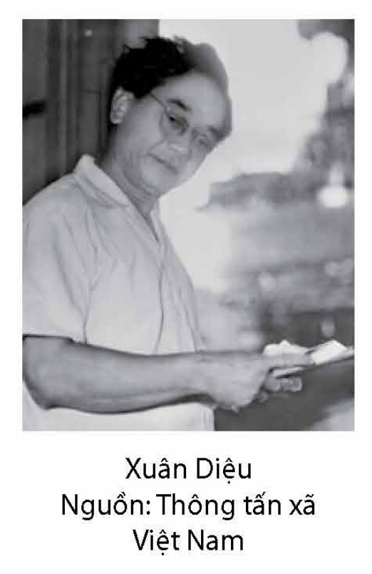
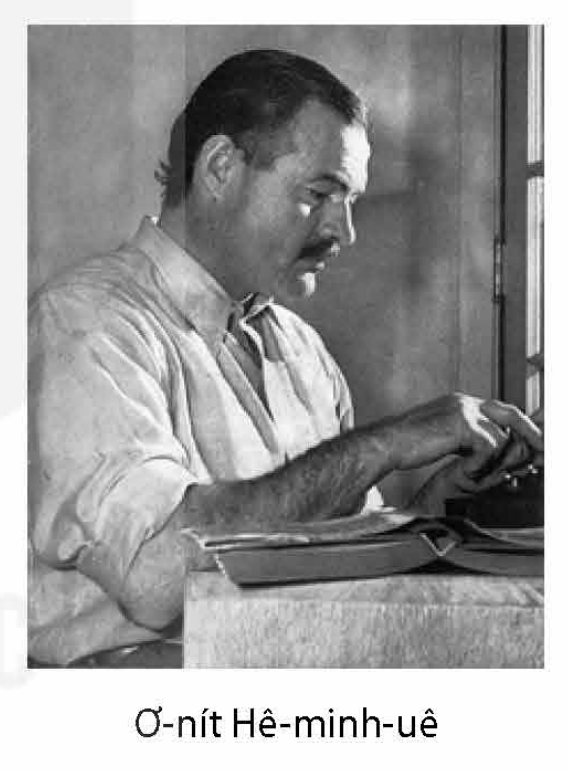
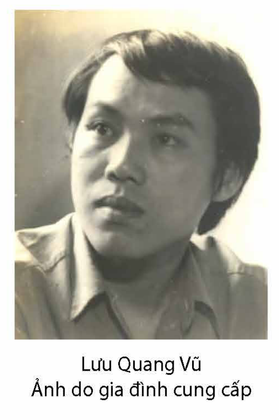

<!-- pdf:94 -->
# BÀI 9: VĂN HỌC VÀ CUỘC ĐỜI

## 🎯 Yêu cầu cần đạt

- Phân tích và đánh giá được chủ đề, tư tưởng, thông điệp mà văn bản muốn gửi đến người đọc thông qua hình thức nghệ thuật của văn bản; phân tích sự phù hợp giữa chủ đề, tư tưởng và cảm hứng chủ đạo của văn bản.
- Phân tích và đánh giá được giá trị nhận thức, giáo dục và thẩm mĩ của tác phẩm; phát hiện được giá trị văn hoá, triết lí nhân sinh từ văn bản.
- Có nhận thức đúng về việc giữ gìn và phát triển tiếng Việt để sử dụng phù hợp với chuẩn ngôn ngữ, góp phần làm cho tiếng nói của dân tộc đáp ứng ngày càng tốt hơn nhu cầu giao tiếp.
- Viết được bài phát biểu trong lễ phát động một phong trào hoặc một hoạt động xã hội.
- Biết thuyết trình về một vấn đề liên quan đến cơ hội và thách thức đối với đất nước; nắm bắt được nội dung và quan điểm của bài thuyết trình.
- Biết sống chủ động, lạc quan và vượt lên mọi nghịch cảnh để khẳng định niềm tin vào cuộc đời.

## ĐỌC

### TRI THỨC NGỮ VĂN

**Giá trị của tác phẩm văn học**

- **Giá trị nhận thức**

Văn học mang lại những tri thức tổng hợp về cuộc sống, mở rộng hiểu biết của người đọc về nhiều lĩnh vực khác nhau: chính trị, lịch sử, địa lí, văn hoá, phong tục,... Đặc biệt, văn học giúp độc giả thấu hiểu thế giới phức tạp của con người cá nhân, từ đó thấu hiểu chính mình.

Ngoài những điều trên, văn học còn có khả năng nhận thức về điều có thể xảy ra hay về một số phương diện phi lí, “bất khả tri” của cuộc sống. Do đó, văn học có thể hỗ trợ người đọc xây dựng được tâm thế sống tích cực, sẵn sàng ứng phó với bao biến cố khó lường ở phía trước.

- **Giá trị giáo dục**

Văn học tác động sâu sắc đến nhân sinh quan của người đọc. Qua việc tạo nên những hình tượng nghệ thuật giàu sức hấp dẫn, văn học giúp con người thể nghiệm, đồng cảm

<!-- pdf:95 -->
với những nhân vật, tình huống trong tác phẩm, khơi dậy những cảm xúc tốt đẹp như sự ngưỡng mộ trước cái đẹp, cái cao cả, sự căm phẫn trước cái xấu, cái ác. Bằng cách đánh thức sự tự suy ngẫm, văn học khiến con người tự chuyển hoá, tự hoàn thiện bản thân.

- **Giá trị thẩm mĩ**

Văn học giúp định hướng lí tưởng thẩm mĩ, mài sắc giác quan thẩm mĩ của con người. Nhờ tiếp xúc với ngôn từ và hình tượng giàu tính thẩm mĩ, thể hiện rõ lí tưởng thẩm mĩ của tác giả, người đọc biết rung động trước cái đẹp, biết thẩm định, thưởng thức cái đẹp nghệ thuật và biết phát hiện ra cái đẹp trong cuộc sống.

- **Giá trị văn hoá**

Văn học là một thành tố quan trọng của văn hoá. Thông qua văn học, người đọc hiểu được lời ăn tiếng nói, lối sống, cách nghĩ, truyền thống và phong tục, quan niệm về giá trị,... của một cộng đồng. Văn học vừa góp phần bảo tồn những giá trị văn hoá truyền thống, vừa không ngừng tìm tòi, phát hiện và sáng tạo ra những giá trị văn hoá mới.

**Chủ đề, tư tưởng và cảm hứng của tác phẩm văn học**

**Chủ đề** là vấn đề trọng tâm, phương diện chính yếu của đề tài, là tư tưởng quán xuyến trong tác phẩm. Chủ đề thể hiện sự tìm tòi, phát hiện về cuộc sống và chiều sâu tư tưởng, cá tính sáng tạo của nhà văn, là yếu tố quan trọng tạo nên tầm vóc của tác phẩm.

**Tư tưởng** là sự nhận thức, lí giải của nhà văn về đời sống, được bộc lộ qua cách lựa chọn đề tài, tổ chức hình tượng, sử dụng ngôn từ trong tác phẩm,... Tư tưởng được biểu hiện qua hai bình diện: sự lí giải chủ đề và cảm hứng. **Sự lí giải chủ đề** là lập trường, quan điểm mà dựa trên đó nhà văn cắt nghĩa các tình huống, sự kiện, nhân vật,... **Cảm hứng** là cảm xúc mãnh liệt, được dồn nén cao độ, thúc đẩy hành động sáng tạo của nhà văn. Nếu sự lí giải chủ đề làm nên chiều sâu tư tưởng của tác phẩm, thì cảm hứng khơi gợi sự đồng cảm, tác động mạnh mẽ đến cảm xúc của người đọc.

Chủ đề, tư tưởng được coi là lớp nội dung chủ quan của tác phẩm, thể hiện rõ cách tiếp cận, sự suy ngẫm, đánh giá, xúc cảm riêng của mỗi nhà văn về phạm vi và các vấn đề đời sống được đề cập trong tác phẩm.

**Giữ gìn và phát triển tiếng Việt**

Tiếng Việt nói riêng và tất cả các ngôn ngữ khác trên thế giới nói chung là những thực thể sống động, không ngừng phát triển theo sự phát triển của đời sống xã hội. Giữ gìn sự trong sáng của tiếng Việt, góp phần làm cho tiếng Việt phát triển là trách nhiệm của mỗi người đối với tiếng nói mà cha ông để lại.

<!-- term: ngữ âm -->
Việc giữ gìn và phát triển tiếng Việt, một mặt, đòi hỏi chúng ta phải tuân thủ các quy ước chung về ngữ âm, chính tả (chữ viết), từ ngữ, ngữ pháp,... vốn được xác lập và phát triển qua một quá trình lịch sử lâu dài; mặt khác, đặt ra yêu cầu sử dụng ngôn ngữ một cách sáng tạo, tạo điều kiện bổ sung các yếu tố mới để tiếng Việt đáp ứng ngày càng tốt hơn nhu cầu giao tiếp của cộng đồng.

<!-- pdf:96 -->
### VĂN BẢN 1: Vội vàng
<!-- ocr-ok: ảnh p096 có nhãn VĂN BẢN 1 trong khung đồ hoạ và chữ Vội vàng cỡ lớn làm OCR bỏ sót -->

**Xuân Diệu**

> **Trước khi đọc**
>
> - Cảm nhận của mỗi cá nhân về thời gian là giống nhau hay khác nhau? Vì sao?
> - Theo bạn, ý niệm về thời gian có ảnh hưởng như thế nào đến thái độ sống, lí tưởng sống của con người?

*Tặng Vũ Đình Liên*

Tôi muốn tắt nắng đi
Cho màu đừng nhạt mất;
Tôi muốn buộc gió lại
Cho hương đừng bay đi.

> **Theo dõi:** Chú ý các động từ, các biện pháp tu từ.

Của ong bướm này đây tuần tháng mật$^{(1)}$;
Này đây hoa của đồng nội xanh rì;
Này đây lá của cành tơ phơ phất;
Của yến anh này đây khúc tình si;
Và này đây ánh sáng chớp hàng mi,
Mỗi buổi sớm, thần Vui hằng gõ cửa;
Tháng Giêng ngon như một cặp môi gần;
Tôi sung sướng. Nhưng vội vàng một nửa:
Tôi không chờ nắng hạ mới hoài xuân$^{(2)}$.

> **Hình dung:** Hình dung về bức tranh cuộc sống được miêu tả.

*Chú thích:*
(1) *Tuần tháng mật*: cũng như *tuần trăng mật*; cụm từ này được dịch từ tiếng Pháp: *la lune de miel*.
(2) *Hoài xuân*: nhớ xuân, tiếc xuân.

<!-- pdf:97 -->
Xuân đương tới, nghĩa là xuân đương qua,
Xuân còn non, nghĩa là xuân sẽ già,
Mà xuân hết, nghĩa là tôi cũng mất.
Lòng tôi rộng, nhưng lượng trời cứ chật,
Không cho dài thời trẻ của nhân gian,
Nói làm chi rằng xuân vẫn tuần hoàn,
Nếu đến nữa không phải rằng gặp lại!$^{(1)}$
Còn trời đất, nhưng chẳng còn tôi mãi,
Nên bâng khuâng tôi tiếc cả đất trời;
Mùi tháng, năm đều rớm vị chia phôi,
Khắp sông, núi vẫn than thầm tiễn biệt...
Con gió xinh thì thào trong lá biếc,
Phải chăng hờn vì nỗi phải bay đi?
Chim rộn ràng bỗng đứt tiếng reo thi,
Phải chăng sợ độ phai tàn sắp sửa?

> **Theo dõi:** Chú ý sự cảm nhận về thời gian của nhân vật trữ tình.

Chẳng bao giờ, ôi! Chẳng bao giờ nữa...
<!-- ocr-ok: ảnh p097 câu thơ tách dòng đứng ngang hộp chỉ dẫn đọc bị OCR đọc lỗi dấu -->

> **Theo dõi:** Lắng nghe giọng điệu của nhân vật trữ tình.

Mau đi thôi! Mùa chưa ngả chiều hôm,
Ta muốn ôm
Cả sự sống mới bắt đầu mơn mởn;
Ta muốn riết mây đưa và gió lượn,
Ta muốn say cánh bướm với tình yêu,
Ta muốn thâu trong một cái hôn nhiều
Và non nước, và cây, và cỏ rạng,
Cho chếnh choáng mùi thơm, cho đã đầy ánh sáng,
Cho no nê thanh sắc của thời tươi;
– Hỡi xuân hồng, ta muốn cắn vào ngươi!

(Xuân Diệu, *Thơ thơ*, NXB Đời nay, Hà Nội, 1938, tr. 55 – 57)

*Chú thích:*
(1) Từ lần in thứ hai trở đi của tập *Thơ thơ*, câu này được tác giả sửa lại là “Nếu tuổi trẻ chẳng hai lần thắm lại!”.

<!-- pdf:98 -->

> **Xuân Diệu** (1916 – 1985) tên khai sinh là Ngô Xuân Diệu, quê ở tỉnh Hà Tĩnh. Ông là một trong những nhà thơ nổi tiếng của phong trào Thơ mới, với những cách tân táo bạo về mặt nghệ thuật và một giọng thơ sôi nổi, đắm say, tràn đầy tình yêu cuộc sống. Ngoài các tập thơ như *Thơ thơ* (1938), *Gửi hương cho gió* (1945), *Riêng chung* (1960), *Tôi giàu đôi mắt* (1970),... Xuân Diệu còn viết các tập văn xuôi như *Phấn thông vàng* (1939), tiểu luận phê bình, nghiên cứu văn học như *Những bước đường tư tưởng của tôi* (1958), *Các nhà thơ cổ điển Việt Nam*, hai tập (1981, 1982),... Năm 1996, ông được truy tặng Giải thưởng Hồ Chí Minh về Văn học nghệ thuật.
>
> *Vội vàng* được coi là một tuyên ngôn của Xuân Diệu về cuộc sống. Tác phẩm được in trong *Thơ thơ*, tập thơ đầu tay của Xuân Diệu và cũng là một trong những tập thơ tiêu biểu của phong trào Thơ mới.

**Sau khi đọc**

1. Nêu cảm nhận chung của bạn về nhịp điệu bài thơ.

2. Xuân Diệu được coi là người có nhiều cách tân trong việc sử dụng ngôn từ. Bạn có đồng ý với nhận định này không? Vì sao?

3. Bức tranh thiên nhiên hiện lên như thế nào trong đoạn thơ thứ hai (từ “*Của ong bướm này đây tuần tháng mật;*” đến “*Phải chăng sợ độ phai tàn sắp sửa?*”)? Qua bức tranh đó, bạn nhận ra điều gì về cái nhìn thế giới của tác giả?

4. Nêu nhận xét khái quát về nhân vật trữ tình. Qua sự tự bộc lộ của nhân vật trữ tình, hãy phân tích mạch vận động cảm xúc trong bài thơ.

5. Quan niệm về thời gian của Xuân Diệu trong bài thơ có gì mới mẻ, độc đáo so với quan niệm về thời gian trong một số bài thơ trữ tình trung đại?

6. Bài thơ *Vội vàng* thể hiện quan niệm gì của Xuân Diệu về cuộc sống, tình yêu và tuổi trẻ? Bạn có đồng ý với quan niệm đó không? Vì sao?

**Kết nối đọc – viết**

Bài thơ *Vội vàng* của Xuân Diệu đã tác động như thế nào đến nhận thức của bạn về thời gian và tuổi trẻ? Viết đoạn văn (khoảng 150 chữ) để trả lời câu hỏi này.

<!-- pdf:99 -->
### VĂN BẢN 2: Trở về$^{(*)}$
<!-- ocr-ok: ảnh p099 có nhãn VĂN BẢN 2 trong khung đồ hoạ làm OCR bỏ sót -->

*(Trích Ông già và biển cả$^{(**)}$)*

**Ơ-nít Hê-minh-uê (Ernest Hemingway)**

> **Trước khi đọc**
>
> - Bạn đã từng đọc một cuốn sách hay xem một bộ phim mà trong đó nhân vật chính phải trải qua một cuộc hành trình tưởng chừng vượt quá sức mình chưa? Chia sẻ cảm nhận của bạn về chặng cuối trong cuộc hành trình đó.
> - Nhan đề “Trở về” gợi cho bạn những suy nghĩ hay liên tưởng gì?

“Chẳng còn gì”, lão nói lớn. “Ta đã đi quá xa”.

Khi lão dong chiếc thuyền cập vào bến nhỏ thì đèn đóm ở Thê-rếch-xơ (Terrace) đã tắt và lão biết mọi người đã đi ngủ. Gió càng ngày càng to và bây giờ đang thổi mạnh. Dù vậy bến cảng rất yên tĩnh và lão đưa thuyền lên trên một bãi cuội nhỏ bên dưới ghềnh đá. Không có ai giúp cả nên lão đã kéo thuyền lên đến mức xa nhất có thể. Rồi lão bước ra và buộc thuyền vào một tảng đá.

> **Theo dõi:** Không gian và thời gian khi ông lão trở về bến cảng được miêu tả như thế nào?

Lão tháo cột buồm, cuộn và buộc cánh buồm lại. Rồi lão vác cột buồm lên vai và bắt đầu trèo lên. Đó là lúc lão biết mình đã mệt đến chừng nào. Lão dừng lại một chốc và ngoảnh lại và nhìn thấy cái đuôi khổng lồ của con cá đang dựng thẳng sau đuôi tàu trong ánh sáng phản chiếu từ đèn đường. Lão nhìn thấy đường nét trần trụi màu trắng của xương sống và khối sẫm màu của cái đầu với lưỡi kiếm nhô ra cùng tất cả sự trống rỗng ở khoảng giữa.

Lão lại bắt đầu leo lên dốc rồi trên đỉnh dốc lão ngã xuống và nằm một lát với cột buồm vắt qua vai. Lão cố ngồi dậy. Nhưng điều đó là quá khó và lão ngồi đó với cột buồm trên vai và nhìn ra đường. Một con mèo đi ngang qua đường phía xa để làm cái gì đó và lão già ngắm nhìn nó. Rồi lão chỉ ngắm nhìn con đường mà thôi.

*Chú thích:*
(*) Nhan đề văn bản do người biên soạn sách giáo khoa đặt.
(**) Nhan đề tiếng Anh là *The Old Man and the Sea*.

<!-- pdf:100 -->
Cuối cùng lão đặt cột buồm xuống và đứng dậy. Lão nhấc cột buồm đặt lên vai và bắt đầu bước đi. Lão đã phải ngồi xuống nghỉ năm lần trước khi đến được lán của mình.

Vào trong lán, lão dựa cột buồm vào tường. Trong bóng tối lão tìm thấy một chai nước và uống một ngụm. Rồi lão nằm xuống giường. Lão kéo chăn trùm lên đôi vai rồi phủ lên lưng, chân và lão nằm sấp mặt lên đống báo mà ngủ với hai cánh tay duỗi thẳng và lòng bàn tay ngửa lên.

> **Theo dõi:** Chú ý tư thế nằm ngủ của nhân vật – một tư thế gợi liên tưởng đến hình ảnh Chúa Giê-su (Jesus) trên cây thập giá.
<!-- ocr-ok: ảnh p100 hộp chỉ dẫn đọc bị OCR đọc nhầm khi trộn vào dòng văn bản chính -->

Lão vẫn đang ngủ khi thằng bé ngó qua cửa vào buổi sáng. Gió thổi mạnh đến nỗi những chiếc thuyền trôi nổi không ra khơi được và thằng bé đã ngủ dậy muộn và đi đến lán của lão như nó vẫn đến mỗi sáng. Thằng bé nhìn thấy ông lão đang thở và rồi nó nhìn thấy hai bàn tay của lão và nó bắt đầu khóc. Nó lặng lẽ đi ra ngoài để lấy chút cà phê và nó cứ khóc suốt cả dọc đường.

Nhiều ngư dân vây quanh chiếc thuyền để xem thứ đang buộc vào mạn thuyền và một ngư dân lội xuống nước, ống quần xắn lên, dùng một sợi dây đo chiều dài bộ xương.

Thằng bé không đi xuống đó. Nó đã đến đó rồi và một trong những ngư dân đang trông chiếc thuyền cho nó. “Ông lão thế nào rồi?”, một người hét lên. “Đang ngủ”, thằng bé đáp. Nó không để tâm đến chuyện họ nhìn thấy nó khóc. “Đừng để ai làm phiền ông ấy”. “Nó dài mười tám feet$^{(1)}$ từ mũi đến đuôi”, người đang đo bộ xương kêu lên.

“Cháu tin là thế”, thằng bé nói.

Nó đi đến Thê-rếch-xơ và hỏi mua một lon cà phê.

“Nóng với nhiều đường và sữa.”

> **Theo dõi:** Lời nói và hành động của các ngư dân cho biết điều gì về cảm nhận của họ trước bộ xương con cá kiếm?

“Còn gì nữa không?”

“Không ạ. Rồi cháu sẽ xem ông ấy có ăn được gì không.”

“Quả là một con cá ra trò”, chủ khách sạn nói. “Chưa từng có con cá nào như vậy. Hai con cá cháu bắt được hôm qua cũng rất được đấy”. “Chết tiệt mấy con cá của cháu”, thằng bé nói và nó lại bắt đầu khóc.

“Cháu có muốn lấy đồ uống gì không?”, chủ khách sạn hỏi.

“Không ạ”, thằng bé nói. “Bảo với họ đừng quấy rầy Xan-ti-a-gô (Santiago), cháu sẽ quay lại.”

*Chú thích:*
(1) *Feet*: đơn vị đo chiều dài, được sử dụng phổ biến ở các nước Anh, Mỹ; 1 feet = 30,48 cm.

<!-- pdf:101 -->
“Bảo ông ấy là bác rất tiếc nhé.”

“Cảm ơn bác”, thằng bé nói.

Thằng bé mang lon cà phê nóng lên lán của ông lão và ngồi kế bên cho đến khi lão tỉnh dậy. Có một lúc hình như lão sắp thức giấc. Nhưng rồi lão lại chìm vào giấc ngủ say và thằng bé băng qua đường để xin một ít củi hâm nóng cà phê.

Cuối cùng ông lão đã tỉnh dậy.

“Đừng ngồi dậy”, thằng bé nói. “Uống cái này đi.”

Cậu rót một ít cà phê vào cốc.

Ông lão cầm lấy và uống hết.

> **Theo dõi:** Chú ý ngôn ngữ đối thoại giữa ông lão và cậu bé.
<!-- ocr-ok: ảnh p101 hộp chỉ dẫn đọc bị OCR dính chữ và trộn vào văn bản chính -->

“Chúng đã đánh bại ông, Ma-nô-lin (Manolin) ạ”, lão nói. “Chúng thật sự đánh bại ông.”

“Nó không đánh bại được ông. Không phải là con cá ấy.”

“Không. Thật đấy. Là lúc sau đó ấy.”

“Pê-đri-cô (Pedrico) đang trông coi thuyền và các thứ. Ông muốn làm gì với cái đầu ạ?”

“Để Pê-đri-cô băm nó ra làm mồi bẫy cá.”

“Còn lưỡi kiếm?”

“Nếu cháu muốn thì cứ giữ lấy nó.”

“Cháu muốn”, thằng bé nói. “Bây giờ chúng ta phải lên kế hoạch cho những việc khác.”

“Họ có tìm ông không?”

“Tất nhiên rồi. Cùng với đội bảo vệ bờ biển và máy bay nữa.”

“Đại dương thì rất rộng lớn và chiếc thuyền thì nhỏ và khó nhìn ra được”, ông lão nói. Lão nhận ra thật dễ chịu khi có ai đó để nói chuyện cùng thay vì chỉ nói với chính mình và với biển cả. “Ông nhớ cháu”. Lão nói. “Cháu đã bắt được gì thế?”. “Một con vào ngày đầu tiên. Một con vào ngày thứ hai và hai con vào ngày thứ ba.”

“Giỏi đấy.”

“Bây giờ chúng ta lại đi câu cùng nhau.”

“Không. Ông không may mắn. Ông không còn vận may nữa.”

“Chết tiệt với cái vận may”, thằng bé nói. “Cháu sẽ mang vận may của cháu theo.”

<!-- pdf:102 -->
“Mọi người ở nhà cháu sẽ nói sao?”

“Cháu không quan tâm. Hôm qua cháu đã bắt được hai con. Nhưng giờ thì chúng ta sẽ đi câu cùng nhau vì cháu còn phải học nhiều thứ lắm.”

“Chúng ta phải tìm một cây lao đâm thật sắc bén và phải luôn luôn giữ nó trên thuyền. Cháu có thể làm lưỡi dao từ một cái nhíp của xe Ford cũ. Chúng ta có thể đem nó đến Goa-na-ba-cô-a (Guanabacoa) để mài. Nó phải thật sắc bén và không luyện quá lửa để khỏi bị gãy. Dao của ông gãy rồi.”

“Cháu sẽ tìm một con dao khác và sẽ mang mài cái nhíp.”

“Biển động mất mấy ngày nhỉ?”

“Có thể là ba ngày. Có thể hơn.”

“Cháu sẽ thu xếp mọi thứ”, thằng bé nói. “Ông cứ chữa cho tay lành lại đã.”

“Ông biết cách chăm sóc chúng mà. Vào ban đêm ông khạc ra thứ lạ lùng gì đó và cảm thấy như có cái gì trong lồng ngực vỡ ra.”. “Chữa cả cái đó nữa”, thằng bé nói. “Nằm xuống đi, ông ơi, và cháu sẽ mang cho ông cái áo sạch. Và thứ gì đó để ăn.”

“Mang cho ông bất kì tờ báo nào trong lúc ông đi vắng nhé”, lão nói.

“Ông phải bình phục thật nhanh vì có nhiều thứ cháu phải học và ông có thể dạy cháu mọi thứ. Ông có đau nhiều không?”

“Nhiều lắm”, lão nói.

“Cháu sẽ mang thức ăn và báo đến”, thằng bé nói. “Nghỉ ngơi đi ông ạ. Cháu sẽ đi ra hiệu thuốc mua thuốc chữa tay của ông nữa.”

“Nhớ bảo Pê-đri-cô rằng cái đầu là của anh ấy.”

“Vâng. Cháu nhớ rồi.”

Khi thằng bé ra khỏi cửa và đi xuống con đường mòn rải đá san hô nó lại tiếp tục khóc.

Chiều hôm đó có một bữa tiệc của nhóm khách du lịch ở Thê-rếch-xơ và khi nhìn xuống làn nước giữa những lon bia rỗng và những xác cá, một người phụ nữ trông thấy bộ xương sống to lớn màu trắng với một cái đuôi khổng lồ ở phần cuối cứ nổi lên và đung đưa theo thuỷ triều khi gió đông thổi qua vùng biển cuộn sóng bên ngoài lối vào bến cảng.

“Cái gì thế kia?”. Cô hỏi người bồi bàn và chỉ vào bộ xương sống dài của con cá khổng lồ giờ chỉ còn là rác rưởi chờ thuỷ triều cuốn đi.

<!-- pdf:103 -->

<!-- pdf:104 -->
“Ti-bu-ron (Tiburon)”, người bồi bàn nói. “Cá mập.”. Anh ta định giải thích về chuyện đã xảy ra.

> **Suy luận:** Giải thích tình huống hiểu lầm trong đoạn này.
<!-- ocr-ok: ảnh p104 hộp chỉ dẫn đọc bị OCR đọc nhầm khi trộn vào dòng văn bản chính -->

“Tôi không biết là cá mập lại có bộ đuôi phom dáng đẹp đẽ như vậy.”

“Anh cũng thế.”, người đàn ông đi cùng cô ta nói.

Phía ngoài đường, trong cái lán của mình, ông lão lại đang ngủ tiếp. Lão vẫn ngủ trong tư thế úp mặt xuống và thằng bé ngồi bên cạnh nhìn lão ngủ. Lão đang mơ về những con sư tử.

> **Suy luận:** Những hình ảnh được sử dụng trong đoạn kết của văn bản có gì đặc biệt?

(Linh Nguyễn dịch, http://nguvan.hnue.edu.vn, ngày 06/5/2023)

> **Ơ-nít Hê-minh-uê** (1899 – 1961) là nhà văn, nhà báo nổi tiếng của nền văn học hiện đại Mỹ. Cuộc đời và sự nghiệp của ông được coi là một điển hình cho “thế hệ lạc lối” – danh xưng chỉ lớp người trưởng thành trong Chiến tranh thế giới lần thứ nhất và phải gánh chịu những di hại tinh thần nặng nề của sự kiện này. Ông cũng là người đưa ra “nguyên lí tảng băng trôi” trong sáng tác văn học, theo đó những ngôn từ nhà văn viết ra chỉ là phần nổi của tảng băng, còn ý nghĩa thực sự của tác phẩm nằm ở phần chìm của nó.
>
> Các tiểu thuyết tiêu biểu của Hê-minh-uê: *Mặt trời vẫn mọc* (1926), *Giã từ vũ khí* (1929), *Chuông nguyện hồn ai* (1940), *Ông già và biển cả* (1952). Năm 1954, Hê-minh-uê được trao giải Nô-ben (Nobel) Văn học.
>
> *Ông già và biển cả* là tiểu thuyết ngắn của Hê-minh-uê giành giải thưởng Pu-lít-dơ (Pulitzer) cho tác phẩm hư cấu năm 1953. Tác phẩm kể câu chuyện về một ngư dân già người Cu Ba tên là Xan-ti-a-gô. Không bắt được con cá nào trong suốt tám mươi tư ngày, ông bị mọi người coi là kẻ mang vận rủi. Ma-nô-lin, cậu bé học việc và người bạn nhỏ của Xan-ti-a-gô, cũng bị cha mẹ buộc phải rời xa ông để làm việc trên một con thuyền khác. Tuy nhiên, Ma-nô-lin vẫn thường xuyên tới thăm và mang đồ ăn, thức uống cho ông. Họ trò chuyện về việc đánh bắt cá, về bóng chày và về những con sư tử trên bãi biển mà Xan-ti-a-gô đã nhìn thấy ở châu Phi khi ông bằng tuổi cậu bé bây giờ.
>
> Ngày thứ tám mươi lăm, Xan-ti-a-gô quyết định dong thuyền đi tới vùng biển xa phía bắc với niềm tin rằng vận may sẽ trở lại với mình. Giữa biển khơi bao la, ông vừa làm việc vừa nói chuyện với biển cả, với các sinh vật xung quanh, và với chính mình. Đôi khi ông ước có Ma-nô-lin ở bên để chia sẻ công việc và những trải nghiệm. Đến trưa, một con cá đã mắc câu mà Xan-ti-a-gô tin là con cá kiếm khổng lồ, nhưng ông không thể kéo nó vào bờ được. Suốt hai ngày đêm, ông và con cá giằng co vật lộn với nhau. Xan-ti-a-gô cố gắng giữ con cá không tuột khỏi dây trong khi nó kéo chiếc thuyền càng lúc càng xa đất liền. Trong cuộc chiến đó, ông cảm thấy ngưỡng mộ sức mạnh và sự kiên cường của con cá kiếm, đồng cảm với nó như một người bạn, một người anh em, thậm chí như thể nó và mình đã hoà làm một. Mặt khác, mặc dù thiếu ngủ, bị thương ở tay và vô cùng đau đớn nhưng ông quyết không bỏ cuộc.

<!-- pdf:105 -->
> Sang ngày thứ ba, con cá kiếm bơi chậm lại quanh chiếc thuyền. Xan-ti-a-gô, lúc này gần như kiệt sức, kéo con cá lại gần thuyền và đâm chết nó bằng cây lao. Ông quay thuyền trở về và nghĩ đến những gì có thể làm với con cá kiếm khổng lồ đó. Con cá dài hơn cả chiếc thuyền nên Xan-ti-a-gô phải buộc nó ở mạn thuyền. Trong tình cảnh đó, có những lúc ông nghĩ không biết mình đang đưa con cá trở về hay con cá đang đưa mình trở về.
>
> Máu từ vết đâm trên mình con cá kiếm đã thu hút lũ cá mập. Một con cá mập khổng lồ tấn công và xé mất một miếng lớn trên mình con cá kiếm. Xan-ti-a-gô dùng cây lao đâm chết con cá mập, nhưng cũng đánh mất cây lao vì nó. Những con cá mập khác tiếp tục kéo đến. Xan-ti-a-gô chiến đấu với chúng bằng một cây lao tự tạo bằng cách buộc con dao vào mái chèo, rồi khi dao gãy, ông chiến đấu bằng cây gậy. Tuy nhiên, lũ cá mập quá đông và chúng đã rỉa hết thịt trên mình con cá kiếm. Xan-ti-a-gô rủa lũ cá mập, cảm thấy hối tiếc cho cả mình lẫn con cá kiếm, và tự trách đã đưa thuyền đi quá xa.
>
> Xan-ti-a-gô trở về đất liền trong đêm tối, dùng hết sức lực còn lại để đưa chiếc thuyền cùng với cái đầu và bộ xương khổng lồ của con cá kiếm vào bờ. Sau đó, ông về lán và lăn ra ngủ.
>
> *Trở về* là đoạn trích nằm ở phần cuối của tiểu thuyết *Ông già và biển cả*.

**Sau khi đọc**

1. Theo bạn, đoạn trích *Trở về* có thể được chia làm mấy phần? Các phần có liên hệ với nhau như thế nào?

2. Cuộc đối thoại giữa Xan-ti-a-gô và Ma-nô-lin trong đoạn trích là cuộc đối thoại dài nhất trong tác phẩm *Ông già và biển cả*. Nội dung và hình thức cuộc đối thoại cho ta biết những gì về quan hệ giữa hai nhân vật?

3. Nêu diễn biến tâm lí của nhân vật Xan-ti-a-gô trong đoạn trích.

4. Trong đoạn trích, tác giả đã miêu tả hành động “khóc” của Ma-nô-lin bao nhiêu lần? Hãy lí giải về hành động này của nhân vật.

5. Trước bộ xương của con cá kiếm, các nhân vật Ma-nô-lin, nhóm ngư dân, chủ khách sạn và hai du khách đã có thái độ khác nhau như thế nào?

6. Nêu đặc điểm của ngôn ngữ kể chuyện và ngôn ngữ đối thoại trong đoạn trích (chú ý liên hệ với “nguyên lí tảng băng trôi” của Hê-minh-uê).

7. Theo bạn, đoạn kết truyện có thể gợi mở những ý nghĩa và liên tưởng gì?

8. Chuyến đi của Xan-ti-a-gô có phải là một chuyến đi thất bại hay không? Tại sao? Nếu coi nhân vật Xan-ti-a-gô là một biểu tượng, thì theo bạn, đó là biểu tượng của điều gì?

**Kết nối đọc – viết**

Trong tiểu thuyết *Ông già và biển cả*, khi miêu tả nhân vật Xan-ti-a-gô một mình giữa biển khơi, Hê-minh-uê đã viết: “Ông lão biết rằng không ai phải cô đơn nơi biển cả”. Viết đoạn văn (khoảng 150 chữ) chia sẻ cảm nhận của bạn về điều này sau khi học đoạn trích *Trở về*.

<!-- pdf:106 -->
### VĂN BẢN 3: Hồn Trương Ba, da hàng thịt
<!-- ocr-ok: ảnh p106 có nhãn VĂN BẢN 3 trong khung đồ hoạ làm OCR bỏ sót -->

*(Trích)*

**Lưu Quang Vũ**

> **Trước khi đọc**
>
> Hãy nhớ lại một tình huống mà bạn tự mâu thuẫn với chính mình. Khi ấy bạn đã cảm thấy ra sao? Chia sẻ về những trải nghiệm cụ thể đó.

**HỒI VII**
**NHÀ TRƯƠNG BA**

*(Tóm lược các lớp của hồi VII: Trưởng Hoạt chê trách Hồn Trương Ba đã thay đổi tâm tính, trở nên thực dụng, thô lỗ. Lí trưởng lấy cớ đã che chở cho Hồn Trương Ba sống trong thân xác hàng thịt để sách nhiễu, châm biếm ông. Con trai ông trở nên hư hỏng. Vợ ông muốn ra đi vì không chấp nhận sự thay đổi của chồng. Cháu gái không nhận ông. Con dâu than phiền rằng ông không còn là Trương Ba xưa kia. Hồn Trương Ba vô cùng đau khổ khi nhận ra ông ngày càng bị Xác Hàng Thịt lấn át.)*

[...]

**HỒN TRƯƠNG BA** – *(ngồi ôm đầu một hồi lâu rồi đứng vụt dậy)* Không! Không! Tôi không muốn sống như thế này mãi! *(nhìn chân tay, thân thể)* Tôi chán cái chỗ ở không phải của tôi này lắm rồi, chán lắm rồi! Cái thân thể kềnh càng thô lỗ này, ta bắt đầu sợ mi, ta chỉ muốn rời xa mi tức khắc! Nếu cái hồn của ta có hình thù riêng nhỉ, để nó tách ra khỏi cái xác này, dù chỉ một lát!

> **Hình dung:** Hình dung về cảnh tượng được tái hiện trên sân khấu (ánh sáng, âm thanh, hình ảnh,...).

*(Tới đây, bắt đầu lớp kịch “Cuộc đối thoại giữa Hồn và Xác”. Trên sân khấu, Hồn Trương Ba tách ra khỏi xác anh hàng thịt và hiện hình lờ mờ trong dáng nhân vật Trương Ba thật. Thân xác bằng thịt vẫn ngồi nguyên trên chõng và lúc này chỉ còn là thân xác.)*

**XÁC HÀNG THỊT** – *(bắt đầu)* Vô ích, cái linh hồn mờ nhạt của ông Trương Ba khốn khổ kia ơi, ông không tách ra khỏi tôi được đâu, dù tôi chỉ là thân xác...

<!-- pdf:107 -->
**HỒN TRƯƠNG BA** – A, mày cũng biết nói kia à? Vô lí, mày không thể biết nói! Mày không có tiếng nói, mà chỉ là xác thịt âm u đui mù...

**XÁC HÀNG THỊT** – Có đấy! Xác thịt có tiếng nói đấy! Ông đã biết tiếng nói của tôi rồi, đã luôn luôn bị tiếng nói ấy sai khiến. Chính vì âm u, đui mù mà tôi có sức mạnh ghê gớm, lắm khi át cả cái linh hồn cao khiết của ông đấy!

**HỒN TRƯƠNG BA** – Nói láo! Mày chỉ là cái vỏ bề ngoài, không có ý nghĩa gì hết, không có tư tưởng, không có cảm xúc!

**XÁC HÀNG THỊT** – Có thật thế không?

**HỒN TRƯƠNG BA** – Hoặc nếu có, thì chỉ là những thứ thấp kém, mà bất cứ con thú nào cũng có được: thèm ăn ngon, thèm rượu thịt,...

**XÁC HÀNG THỊT** – Tất nhiên, tất nhiên. Sao ông không kể tiếp: Khi ông ở bên nhà tôi... Khi ông đứng bên cạnh vợ tôi, tay chân run rẩy, hơi thở nóng rực, cổ nghẹn lại,... Đêm hôm đó, suýt nữa thì...

**HỒN TRƯƠNG BA** – Im đi! Đấy là mày chứ, chân tay mày, hơi thở của mày,...

**XÁC HÀNG THỊT** – Thì tôi có ghen đâu! Ai lại ghen với chính thân thể mình nhỉ! Tôi chỉ trách là sao đêm ấy ông lại tự dưng bỏ chạy, hoài của!... Này, nhưng ta nên thành thật với nhau một chút: Chẳng lẽ ông không xao xuyến chút gì? Hà hà, cái món tiết canh, cổ hũ, khấu đuôi, và đủ các thứ thú vị khác không làm hồn ông lâng lâng cảm xúc sao? Để thoả mãn tôi, chẳng lẽ ông không tham dự vào chút đỉnh gì? Nào, hãy thành thật trả lời!

> **Theo dõi:** Xác định giọng điệu và lập luận của các nhân vật Hồn Trương Ba, Xác Hàng Thịt.
<!-- ocr-ok: ảnh p107 hộp chỉ dẫn đọc bị OCR đọc nhầm khi trộn vào dòng văn bản chính -->

**HỒN TRƯƠNG BA** – Ta... ta... đã bảo mày im đi!

**XÁC HÀNG THỊT** – Rõ là ông không dám trả lời. Giấu ai chứ không thể giấu tôi được! Hai ta đã hoà với nhau làm một rồi!

**HỒN TRƯƠNG BA** – Không! Ta vẫn có một đời sống riêng: nguyên vẹn, trong sạch, thẳng thắn,...

**XÁC HÀNG THỊT** – Nực cười thật! Khi ông phải tồn tại nhờ tôi, chiều theo những đòi hỏi của tôi, mà còn nhận là nguyên vẹn, trong sạch, thẳng thắn!

**HỒN TRƯƠNG BA** – *(bịt tai lại)* Ta không muốn nghe mày nữa!

**XÁC HÀNG THỊT** – *(lắc đầu)* Ông cứ việc bịt tai lại! Chẳng có cách nào chối bỏ tôi được đâu! Mà đáng lẽ ông phải cảm ơn tôi. Tôi đã cho ông sức mạnh. Ông có nhớ hôm ông tát thằng con ông toé máu mồm máu mũi không? Cơn giận của ông lại có thêm sức mạnh của tôi... Ha ha!

<!-- pdf:108 -->
**HỒN TRƯƠNG BA** – Ta cần gì đến cái sức mạnh làm ta trở thành tàn bạo.

**XÁC HÀNG THỊT** – Nhưng tôi là cái hoàn cảnh mà ông buộc phải quy phục! Đâu phải lỗi tại tôi... *(buồn rầu)* Sao ông có vẻ khinh thường tôi thế nhỉ? Tôi cũng đáng được quý trọng chứ! Tôi là cái bình để chứa đựng linh hồn. Nhờ tôi mà ông có thể làm lụng, cuốc xới. Ông nhìn ngắm trời đất, cây cối, những người thân... Nhờ có đôi mắt của tôi, ông cảm nhận thế giới này qua những giác quan của tôi... Khi muốn hành hạ tâm hồn con người, người ta xúc phạm thể xác... Những vị lắm chữ nhiều sách như các ông là hay vin vào cớ tâm hồn là quý, khuyên con người ta sống vì phần hồn, để rồi bỏ bê cho thân xác họ mãi khổ sở, nhếch nhác... Mỗi bữa tôi đòi ăn tám, chín bát cơm, tôi thèm thịt, hỏi có gì là tội lỗi nào? Lỗi là ở chỗ không có đủ tám, chín bát cơm cho tôi ăn chứ!

**HỒN TRƯƠNG BA** – Nhưng... Nhưng...

**XÁC HÀNG THỊT** – Hãy công bằng hơn, ông Trương Ba ạ! Từ nãy tới giờ chỉ có ông nặng lời với tôi, chứ tôi thì vẫn nhã nhặn với ông đấy chứ. *(thì thầm)* Tôi rất biết cách chiều chuộng linh hồn...

**HỒN TRƯƠNG BA** – Chiều chuộng?

**XÁC HÀNG THỊT** – Chứ sao? Tôi thông cảm với những “trò chơi tâm hồn của ông”. Nghĩa là: Những lúc một mình một bóng, ông cứ việc nghĩ rằng ông có một tâm hồn bên trong cao khiết, chẳng qua vì hoàn cảnh, vì để sống mà ông phải nhân nhượng tôi. Làm xong điều xấu gì ông cứ việc đổ tội cho tôi, để ông được thanh thản. Tôi biết: Cần phải để cho tính tự ái của ông được ve vuốt. Tâm hồn là thứ lắm sĩ diện! Hà hà, miễn là... ông vẫn làm đủ mọi việc để thoả mãn những thèm khát của tôi!

**HỒN TRƯƠNG BA** – Lí lẽ của anh thật ti tiện!

**XÁC HÀNG THỊT** – Ấy đấy, ông bắt đầu gọi tôi là anh rồi đấy! Có phải lí lẽ của tôi đâu, tôi chỉ nhắc lại những điều ông vẫn tự nói với mình và với người khác đấy chứ! Đã bảo chúng ta tuy hai mà một!

**HỒN TRƯƠNG BA** – *(như tuyệt vọng)* Trời!
<!-- ocr-ok: ảnh p108 chữ in nghiêng trong ngoặc bị OCR đọc sai thành nu tuyệt oọng -->

**XÁC HÀNG THỊT** – *(an ủi)* Ông đừng nên tự dằn vặt làm gì! Tôi đâu muốn làm khổ ông, bởi tôi cũng rất cần đến ông. Thôi, đừng cãi cọ nhau nữa! Chẳng còn cách nào khác đâu! Phải sống hoà thuận với nhau thôi! Cái hồn vía ương bướng của tôi ơi, hãy về với tôi này!

*(Hồn Trương Ba bất thần nhập lại vào Xác Hàng Thịt. Trên sân khấu, nhân vật Trương Ba biến đi. Chỉ còn lại Xác Hàng Thịt mang Hồn Trương Ba ngồi lặng lẽ bên chõng... Vợ Trương Ba vào.)*

<!-- pdf:109 -->
**VỢ TRƯƠNG BA** – Cái Gái chưa về hả ông?

**HỒN TRƯƠNG BA** – *(thẫn thờ)* Chưa.
<!-- ocr-ok: ảnh p109 chữ in nghiêng trong ngoặc bị OCR đọc sai thành tliẫn thờ Chua -->

**VỢ TRƯƠNG BA** – Nó sang nhà cu Tị từ sớm. Cu Tị bị ốm nặng.

> **Theo dõi:** Chú ý thái độ, tâm trạng của các nhân vật vợ Trương Ba, cái Gái, người con dâu.
<!-- ocr-ok: ảnh p109 hộp chỉ dẫn đọc bị OCR trộn vào văn bản chính -->

**HỒN TRƯƠNG BA** – Ốm nặng? Vậy mà tôi không biết!

**VỢ TRƯƠNG BA** – Ông bây giờ còn biết đến ai nữa! Cu Tị ốm thập tử nhất sinh, từ đêm qua tới giờ bắt đầu mê man, mẹ nó khóc đỏ con mắt. Khổ! Thằng bé ngoan là thế! Cái Gái thương bạn, ngơ ngẩn cả người... Không hiểu thằng bé có qua khỏi được không, khéo mà... *(một lát)* Cái thân tôi thì sao trời lại không bắt đi cho rảnh!

**HỒN TRƯƠNG BA** – Sao bà lại nói thế?

**VỢ TRƯƠNG BA** – *(nghĩ ngợi)* Tôi nói thật đấy... ông Trương Ba ạ, tôi đã nghĩ kĩ: Có lẽ tôi phải đi...

**HỒN TRƯƠNG BA** – Đi đâu?

**VỢ TRƯƠNG BA** – Chưa biết! Đi cấy thuê làm mướn ở đâu cũng được... đi biệt *(rưng rưng)*. Để ông được thảnh thơi... với cô vợ người hàng thịt... Còn hơn là thế này... *(khóc)*.

**HỒN TRƯƠNG BA** – Bà! *(sau một hồi lâu)* Sao lại đến nông nỗi này?

**VỢ TRƯƠNG BA** – Tôi biết, ông vốn là người hết lòng thương yêu vợ con... Chỉ tại bây giờ... *(khóc)*. Ông đâu còn là ông, đâu còn là ông Trương Ba làm vườn ngày xưa, ông biết không: Thằng Cả đã quyết định dứt khoát sẽ bán khu vườn để có tiền mở thêm vốn liếng cửa hàng thịt.

**HỒN TRƯƠNG BA** – Thật sao? Không được!

**VỢ TRƯƠNG BA** – Ông bảo không được nhưng tôi biết rồi sự thể sẽ cứ dẫn đến như vậy, ông sẽ đành ưng chịu như vậy... Thôi tuỳ ông, tôi chỉ muốn ông được thảnh thơi sung sướng... Tôi không còn giúp ông được, tốt nhất là... là... không có tôi nữa, cũng như không có khu vườn nữa! *(bỏ ra)*

**HỒN TRƯƠNG BA** – Bà! *(ngồi xuống, tay ôm đầu)*

*(Khi Hồn Trương Ba ngẩng lên thì đã thấy cái Gái đứng trước mặt với cái nhìn lặng lẽ, soi mói.)*

**HỒN TRƯƠNG BA** – *(như cầu cứu)* Gái, cháu...

**CÁI GÁI** – *(lùi lại)* Tôi không phải là cháu của ông!

<!-- pdf:110 -->
**HỒN TRƯƠNG BA** – *(nhẫn nhục)* Gái, rồi lớn lên cháu sẽ hiểu... ông đúng là ông nội cháu...

**CÁI GÁI** – Ông nội tôi chết rồi. Nếu ông nội tôi hiện về được, hồn ông nội tôi sẽ bóp cổ ông! Ông dám nhận là ông nội, dám đụng vào cây cối trong vườn của ông nội tôi.

**HỒN TRƯƠNG BA** – Dù sao... Cháu... Sáng nào ông cũng ra cuốc xới chăm chút cây cối ngoài vườn, cháu không thấy sao: Chỉ có ông nội cháu mới biết quý cây như thế...

**CÁI GÁI** – Quý cây! Hừ, tôi phải rình lúc này, cả nhà đi vắng hết để đến nói với ông: Từ nay ông không được động vào cây cối trong vườn ông tôi nữa! Ông mà quý cây à? Sáng qua, tôi để ý lúc ông chiết cây cam, bàn tay giết lợn của ông làm gãy tiệt cái chồi non, chân ông to bè như cái xẻng, giẫm lên nát cả cây sâm quý mới ươm! Ông nội đời nào thô lỗ phũ phàng như vậy!

**HỒN TRƯƠNG BA** – Ông không dè... Đấy là... tại...

**CÁI GÁI** – Còn cái diều của cu Tị nữa, chiều hôm kia nó mang diều sang đây chơi, ông cầm lấy đòi chữa cho nó, thế là ông làm gãy cả nan, rách cả giấy, hỏng mất cái diều đẹp mà cu Tị rất quý! Lúc nãy, trong cơn sốt mê man, cu Tị cứ khóc bắt đền cái diều, nó tiếc...

**HỒN TRƯƠNG BA** – Thế ư? Khổ quá...

**CÁI GÁI** – Đừng vờ! Chính ông làm cu Tị thêm khổ thì có! Cu Tị nó cũng rất ghét ông! Ông xấu lắm, ác lắm! Cút đi! Lão đồ tể, cút đi! *(vừa khóc vừa chạy vụt đi)*

*(Chị con dâu Trương Ba ở trong nhà ra, nghe thấy những lời cuối cùng của cái Gái.)*

**CHỊ CON DÂU** – *(gọi theo con)* Gái, quay lại đây, Gái! *(nhìn thấy Hồn Trương Ba đang run rẩy, liền đi tới bên cạnh)* Thầy, thầy đừng giận con trẻ... Nó rất yêu thương ông nội. Đêm nào nó cũng khóc thương ông... Nó cất giữ nâng niu từng chút kỉ niệm của ông: đôi guốc gỗ, bó đóm thuốc lào, nhất là những cây thuốc trong vườn... Chỉ tại nó nghĩ thầy không phải là ông nội của nó, con dỗ dành thế nào nó cũng không nghe... *(rưng rưng)* Khổ thân thầy...

**HỒN TRƯƠNG BA** – Đến lúc này, cả nhà chỉ còn mình con vẫn thương thầy như xưa.

**CHỊ CON DÂU** – Hơn xưa nữa, thưa thầy. Hơn cả hôm thầy mới từ nhà người hàng thịt trở về. Bởi con biết giờ thầy khổ hơn xưa nhiều lắm... *(khẽ)* Mà u con cũng khổ hơn nhiều lắm. U đã định bỏ đi đâu thật xa, cho thầy được thảnh thơi. Nhà ta như sắp tan hoang ra cả...

<!-- pdf:111 -->
**HỒN TRƯƠNG BA** – Thầy đã làm u khổ. Có lẽ cái ngày u chôn xác thầy xuống đất, tưởng thầy đã chết hẳn, u cũng không khổ bằng bây giờ.

**CHỊ CON DÂU** – Thầy bảo con: Cái bên ngoài là không đáng kể, chỉ có cái bên trong, nhưng thầy ơi, con sợ lắm, bởi con cảm thấy, đau đớn thấy... mỗi ngày thầy một đổi khác dần, mất mát dần, tất cả cứ như lệch lạc, nhoà mờ dần đi, đến nỗi có lúc chính con cũng không nhận ra thầy nữa... Con càng thương thầy, nhưng thầy ơi, làm sao, làm sao giữ được thầy ở lại, hiền hậu, vui vẻ, tốt lành như thầy của chúng con xưa kia? Làm thế nào, thầy ơi?

**HỒN TRƯƠNG BA** – *(mặt lặng ngắt như tảng đá)* Giờ thì cả con cũng...

**CHỊ CON DÂU** – Thầy đừng giận nếu con đã nói điều gì không phải.

**HỒN TRƯƠNG BA** – Không, ta không giận. Cảm ơn con đã nói thật. Bây giờ thì... đi đi, cho ta được ngồi yên một lát. Đi đi!

*(Chị con dâu từ từ lui ra.)*
<!-- ocr-ok: ảnh p111 chữ in nghiêng bị OCR đọc sai thành Chị cơn dâu hù tù hư Ta -->

**HỒN TRƯƠNG BA** – *(một mình)* Mày đã thắng thế rồi đấy, cái thân xác không phải của ta ạ, mày đã tìm được đủ mọi cách để lấn át ta... *(sau một lát)* Nhưng lẽ nào ta lại chịu thua mày, khuất phục mày và tự đánh mất mình? “Chẳng còn cách nào khác”! Mày nói như thế hả? Nhưng có thật là không còn cách nào khác? Không cần đến cái đời sống do mày mang lại! Không cần!

> **Hình dung:** Hình dung giọng điệu, hành động của nhân vật trên sân khấu.
<!-- ocr-ok: ảnh p111 hộp chỉ dẫn đọc bị OCR trộn vào văn bản chính -->

*(Đứng dậy, lập cập nhưng quả quyết, đến bên cột nhà, lấy một nén hương châm lửa, thắp lên. Đế Thích xuất hiện.)*

**ĐẾ THÍCH** – Ông Trương Ba! *(thấy vẻ nhợt nhạt của Hồn Trương Ba)* Ông có ốm đau gì không? Một tuần nay tôi bị canh giữ chặt quá, không xuống đánh cờ với ông được, nhưng ông đốt hương gọi, đoán là ông có chuyện khẩn, tôi liều mạng xuống ngay. Có việc gì thế?

**HỒN TRƯƠNG BA** – *(sau một lát)* Ông Đế Thích ạ, tôi không thể tiếp tục mang thân anh hàng thịt được nữa, không thể được!

**ĐẾ THÍCH** – Sao thế? Có gì không ổn đâu!

**HỒN TRƯƠNG BA** – Không thể bên trong một đằng, bên ngoài một nẻo được. Tôi muốn được là tôi toàn vẹn.

**ĐẾ THÍCH** – Thế ông ngỡ tất cả mọi người đều được là mình toàn vẹn cả ư?

<!-- pdf:112 -->
Ngay cả tôi đây. Ở bên ngoài, tôi đâu có được sống theo những điều tôi nghĩ bên trong. Mà cả Ngọc Hoàng nữa, chính người lắm khi cũng phải khuôn ép mình cho xứng với danh vị Ngọc Hoàng. Dưới đất, trên trời đều thế cả, nữa là ông. Ông đã bị gạch tên khỏi sổ Nam Tào. Thân thể thật của ông đã tan rữa trong bùn đất, còn chút hình thù gì của ông đâu!

**HỒN TRƯƠNG BA** – Sống nhờ vào đồ đạc, của cải người khác, đã là chuyện không nên, đằng này đến cái thân tôi cũng phải sống nhờ anh hàng thịt. Ông chỉ nghĩ đơn giản là cho tôi sống, nhưng sống như thế nào thì ông chẳng cần biết!

> **Theo dõi:** Chú ý sự khác biệt trong các lí lẽ, lập luận của Hồn Trương Ba và Đế Thích.

**ĐẾ THÍCH** – *(không hiểu)* Nhưng mà ông muốn gì?

**HỒN TRƯƠNG BA** – Ông từng nói: Nếu thân thể người chết còn nguyên vẹn, ông có thể làm cho hồn người đó trở về. Thì đây, *(chỉ vào người mình)* thân thể anh hàng thịt còn lành lặn nguyên xi đây, tôi trả lại cho anh ta. Ông hãy làm cho hồn anh ta được sống lại với thân xác này.

**ĐẾ THÍCH** – Sao lại có thể đổi tâm hồn đáng quý của bác lấy chỗ cho cái phần hồn tầm thường của anh hàng thịt?

**HỒN TRƯƠNG BA** – Tầm thường, nhưng đúng là của anh ta, sẽ sống hoà thuận được với thân anh ta, chúng sinh ra là để sống cho nhau. Vả lại, còn... còn chị vợ anh ta nữa... chị ta thật đáng thương!

**ĐẾ THÍCH** – Nhưng thế hồn ông muốn trú vào đâu?

**HỒN TRƯƠNG BA** – Ở đâu cũng được, chứ không ở đây nữa. Nếu ông không giúp, tôi sẽ... tôi sẽ... nhảy xuống sông hay đâm một nhát dao vào cổ, lúc đó thì hồn tôi chẳng còn, xác anh hàng thịt cũng mất...

**ĐẾ THÍCH** – Sao ông lại tính nước ấy! Rắc rối thật! Tôi đã phạm phép giời một lần. Trên thiên đình người ta còn đang treo tội tôi đấy để chờ xét xử. Tôi chẳng sợ, họ doạ thế chứ chưa chắc đã làm gì được tôi. Trị tội hết tiên hết thần thì lấy gì cho dân chúng họ thờ! Cái khó nghĩ bây giờ là sắp xếp cho hồn ông nhập vào đâu đây? *(đi lại, suy nghĩ, bỗng lắng nghe)* Có tiếng khóc ran lên từ đâu ấy nhỉ? Từ nhà ai?

**HỒN TRƯƠNG BA** – *(cũng nhìn ra ngoài)* Từ phía nhà chị Lụa mẹ cu Tị. Thằng cu Tị đang bị ốm nặng... Trời, hay là...

*(Cái Gái chạy vào nhà, nước mắt đầm đìa.)*
<!-- ocr-ok: ảnh p112 chữ in nghiêng bị OCR đọc sai thành Cái Gái chạy pào nhà, nước mặt đầm đìa -->

<!-- pdf:113 -->
**CÁI GÁI** – *(gọi thất thanh)* Mẹ ơi, mẹ ơi! Cu Tị... cu Tị... chết rồi! *(oà khóc, rồi chạy đi, chị con dâu chạy theo)*

**ĐẾ THÍCH** – *(nhìn ra ngoài)* Cái nhà sau rặng cau kia phải không? Tôi vừa thấy hồn thằng bé bay vụt lên khỏi mái nhà, tan mờ như một làn sương mỏng... Cu Tị là đứa trẻ như thế nào?

**HỒN TRƯƠNG BA** – Con trai độc nhất của chị Lụa. Nó là bạn thân của cái Gái nhà tôi. Thằng bé ngoan lắm, khôn lắm. Tôi rất quý nó mà nó cũng rất thân với tôi. Dĩ nhiên, đấy là trước kia... Nhưng tại sao nó lại phải chết?

**ĐẾ THÍCH** – Kiểu này, chắc lại do hai ông Nam Tào, Bắc Đẩu tắc trách gạch tên bừa, hoặc cũng do bà Vương Mẫu ép, bà ấy không ưa trẻ con. Lệnh của bà ấy thì chẳng ai cưỡng được! *(bần thần nghĩ ngợi)* A, hay quá, tôi nghĩ ra rồi! Ông Trương Ba! Tôi sẽ giúp ông một lần nữa! Ngay bây giờ đây, ông sẽ trả cái thân thể này cho anh hàng thịt, tôi sẽ làm cho hồn ông nhập vào xác cu Tị. Như vậy là anh hàng thịt được sống, hồn ông vẫn có chỗ trú, mà cái thân thể bé nhỏ của cu Tị sẽ không bị mất đi. Ông thấy được không?

**HỒN TRƯƠNG BA** – Nhập vào xác cu Tị? Tôi?

**ĐẾ THÍCH** – Chứ sao! Ông với anh hàng thịt là hai người xa lạ, còn ông với thằng cu Tị đã từng quấn quýt quý mến nhau, ông sống trong thân thể thằng bé chắc sẽ ổn...

**HỒN TRƯƠNG BA** – Ông cho tôi suy nghĩ một lát đã... Việc này bất ngờ quá! *(ngồi xuống, nghĩ ngợi)* Nhập vào cu Tị... *(lẩm bẩm)* Tôi, một ông già gần sáu mươi, cu Tị thì còn chưa bắt đầu cuộc đời, còn đang tuổi ăn, tuổi lớn, chạy nhảy vô tư... có ổn không nhỉ? *(nhắm mắt lại)* Thử hình dung xem nào... sẽ phải giải thích cho chị Lụa: Tôi không phải là con chị, chị ấy sẽ không nguôi thương nhớ con... Có khi tôi còn phải sang nhà chị Lụa ở... Rồi còn hàng xóm, lí trưởng, trương tuần... Bao nhiêu sự rắc rối. Bà vợ tôi, các con tôi sẽ nghĩ ngợi, xử sự thế nào, khi chồng mình, bố mình mang thân một thằng bé lên mười? Làm trẻ con không phải dễ! Mà cái Gái nhà tôi, nó sẽ nghĩ thế nào nhỉ?

**ĐẾ THÍCH** – Chắc nó sẽ thích. Nó thân với cu Tị mà.

**HỒN TRƯƠNG BA** – *(lắc đầu)* Sợ chỉ càng oái oăm rắc rối hơn. Trẻ con phải ra trẻ con, người lớn phải ra người lớn. Thằng cu Tị bỗng thành ông nội, con bé đời nào chịu. Tôi đã lường trước thấy bao sự không ổn, ông Đế Thích ạ.

**ĐẾ THÍCH** – Trong thân thể một đứa bé, ông sẽ có cả cuộc đời trước mặt.

<!-- pdf:114 -->
**HỒN TRƯƠNG BA** – Để rồi, chẳng bao lâu nữa, bà nhà tôi, bạn bè cùng lứa với tôi như bác Trưởng Hoạt lần lượt nằm xuống, mình tôi vẫn phải sống suốt bao năm tháng dằng dặc. Mình tôi giữa đám người hậu sinh. Những gì chúng thích thì tôi ghét, những gì tôi thích chúng chẳng ưa. Tôi sẽ như ông khách ngồi dai ở nhà người ta, mọi khách khứa đã về hết cả rồi, mình vẫn dầm dề nán lại. Tôi sẽ bơ vơ lạc lõng, hoặc sẽ trở nên thảm hại đáng ghét như kẻ tham lam, một kẻ lí ra phải chết từ lâu mà vẫn cứ sống, cứ trẻ khoẻ, cứ ngang nhiên hưởng thụ mọi thứ lộc trời! Vô lí lắm! Không!

Tôi không thể cướp cái thân thể non nớt của cu Tị. *(nhìn ra ngoài)* Tiếng chị Lụa gào khóc nghe đứt ruột! Mất đứa con, chị ấy làm sao sống được? *(đột ngột)* Ông Đế Thích, hồn cu Tị bây giờ ở đâu?

**ĐẾ THÍCH** – Tôi đã nói với ông rồi: ra khỏi thân xác, hồn chẳng còn là gì nữa!

**HỒN TRƯƠNG BA** – Ông hãy đưa hồn cu Tị về nhập lại vào xác nó, cho nó được sống lại!

**ĐẾ THÍCH** – Không được! Việc cu Tị... chắc chắn đã có lệnh của bà Tây Vương Mẫu.

**HỒN TRƯƠNG BA** – Ông hãy cứu nó! Ông phải cứu nó! Ông có biết đứa con đối với người mẹ là thế nào không? Còn to lớn hơn cả ý muốn bà Tây Vương Mẫu nhà ông. Ông Đế Thích, vì con trẻ ông ạ, vì con trẻ! Ông hãy giúp tôi lần cuối cùng. Tôi sẽ không bao giờ làm phiền ông nữa, không đòi ông điều gì nữa! *(rút bó hương ra)* Đây! *(bẻ gãy cả bó)*

**ĐẾ THÍCH** – Ông Trương Ba... *(đắn đo rất lâu rồi quyết định)* Vì lòng quý mến ông, tôi sẽ làm cu Tị sống lại, dù có bị phạt nặng... Nhưng còn ông... rốt cuộc ông muốn nhập vào thân thể ai?

**HỒN TRƯƠNG BA** – *(sau một hồi lâu)* Tôi đã nghĩ kĩ... *(nói chậm và khẽ)* Tôi không nhập vào hình thù ai nữa! Tôi đã chết rồi, hãy để tôi chết hẳn!

> **Theo dõi:** Chú ý sự thay đổi trong giọng điệu, thái độ của Hồn Trương Ba.

**ĐẾ THÍCH** – Không thể được! Việc ông phải chết chỉ là một lầm lẫn của quan thiên đình. Cái sai ấy đã được sửa bằng cách làm cho hồn ông được sống.

**HỒN TRƯƠNG BA** – Có những cái sai không thể sửa được. Chắp vá gượng ép chỉ càng làm sai thêm. Chỉ có cách là đừng bao giờ sai nữa, hoặc phải bù lại bằng

<!-- pdf:115 -->
một việc đúng khác. Việc đúng còn làm kịp bây giờ là làm cu Tị sống lại. Còn tôi, cứ để tôi chết hẳn...

**ĐẾ THÍCH** – Không! Ông phải sống, dù với bất cứ giá nào...

**HỒN TRƯƠNG BA** – Không thể sống với bất cứ giá nào được, ông Đế Thích ạ! Có những cái giá đắt quá, không thể trả được... Lạ thật, từ lúc tôi có đủ can đảm đi đến quyết định này, tôi bỗng cảm thấy mình lại là Trương Ba thật, tâm hồn tôi lại trở lại thanh thản, trong sáng như xưa...

**ĐẾ THÍCH** – Ông có biết ông quyết định điều gì không? Ông sẽ không còn lại một chút gì nữa, không được tham dự vào bất cứ nỗi vui buồn gì! Rồi đây, ngay cả sự ân hận về quyết định này, ông cũng không có được nữa.

**HỒN TRƯƠNG BA** – Tôi hiểu. Ông tưởng tôi không ham sống hay sao? Nhưng sống thế này, còn khổ hơn là cái chết. Mà không phải chỉ một mình tôi khổ! Những người thân của tôi sẽ còn phải khổ vì tôi! Còn lấy lí lẽ gì khuyên thằng con tôi đi vào con đường ngay thẳng được? Cuộc sống giả tạo này có lợi cho ai? Hoạ chăng chỉ có lão lí trưởng và đám trương tuần hỉ hả thu lợi lộc! Đúng, chỉ bọn khốn kiếp là lợi lộc.

**ĐẾ THÍCH** – Tôi không phải là kẻ khốn kiếp... Tôi quý mến ông... Tôi sẽ chẳng bao giờ được đánh cờ với ông nữa ư? Nhờ ông đánh cờ với tôi, người trên trời, dưới đất mới biết tôi cao cờ như thế nào! Ngoài ông ra, không ai dám đọ cờ với tôi. Ông chính là lẽ tồn tại của tôi.

**HỒN TRƯƠNG BA** – Vì để chứng minh ông tồn tại mà tôi cứ phải tiếp tục cuộc sống không phải là tôi ư? Không, ông phải tồn tại lấy chứ!

**ĐẾ THÍCH** – Nhưng không đánh cờ, Đế Thích sẽ không còn là Đế Thích.

**HỒN TRƯƠNG BA** – Người ta đánh cờ là để rèn luyện tâm trí, để sảng khoái minh mẫn hơn mà sống! Còn ông đánh cờ chỉ để chứng tỏ mình là tiên cờ! Nói thật với ông: Nếu còn tiếp tục sống, tôi cũng chẳng thích đánh cờ với ông nữa! Đánh cờ với ông chán lắm! Không có gì chán bằng đánh cờ với tiên!

**ĐẾ THÍCH** – *(suy nghĩ)* Con người dưới hạ giới các ông thật kì lạ.

**HỒN TRƯƠNG BA** – Ông hãy trả lời đi! Ông có giúp tôi không? Nếu ông từ chối, tôi sẽ... Tôi đã nhất quyết! Ông phải giúp tôi!

**ĐẾ THÍCH** – Trả thân xác này cho anh hàng thịt... và thế là...

**HỒN TRƯƠNG BA** – Không còn cái vật quái gở mang tên “Hồn Trương Ba, da hàng thịt” nữa.

<!-- pdf:116 -->
*(Lược một đoạn: Nam Tào, Bắc Đẩu báo tin Ngọc Hoàng đã cho phép Hồn Trương Ba tiếp tục sống trong Xác Hàng Thịt, nhưng Trương Ba không đồng ý. Đế Thích quyết định ở lại hạ giới và đề nghị Hồn Trương Ba nhập vào xác mình, nhưng Trương Ba cũng từ chối. Trương Ba chia tay Xác Hàng Thịt, dặn dò và vĩnh biệt vợ con rồi ra đi.)*

**ĐOẠN KẾT**

*Vườn cây rung rinh ánh sáng. Ở một góc nhà đó, hiện lên cảnh tượng cu Tị đang ôm chầm lấy mẹ, chị Lụa cuống quýt vuốt ve con... Bà vợ Trương Ba xuất hiện ở phía trước sân khấu.*

**VỢ TRƯƠNG BA** – Ông ở đâu? Ông ở đâu?

*(Giữa màu xanh cây vườn, Trương Ba chập chờn xuất hiện.)*
<!-- ocr-ok: ảnh p116 chữ in nghiêng bị OCR đọc sai thành Giữ tàu xanh câu uườn, Trương Bn -->

**TRƯƠNG BA** – Tôi đây bà ạ. Tôi vẫn ở liền ngay bên bà đây, ngay trên bậc cửa nhà ta, trong ánh lửa bà nấu cơm, cầu ao bà vo gạo, trong cái cơi bà đựng trầu, con dao bà rẫy cỏ... Không phải mượn thân ai cả, tôi vẫn ở đây, trong vườn cây nhà ta, trong những điều tốt lành của cuộc đời, trong mỗi trái cây cái Gái nâng niu...

> **Hình dung:** Hình dung cảnh tượng được miêu tả trong đoạn kết của vở kịch.
<!-- ocr-ok: ảnh p116 hộp chỉ dẫn đọc bị OCR bỏ sót dòng giữa -->

*(Dưới một gốc cây, hiện lên cu Tị và cái Gái.)*
<!-- ocr-ok: ảnh p116 chữ in nghiêng bị OCR đọc sai thành Dưới một gốc câu, hiện lên cu Tị uà cái Gái -->

**CÁI GÁI** – *(tay cầm một trái na)* Cây na này, ông nội tớ trồng đấy! Quả to mà ngon lắm! Ta ăn chung nhé!

*(Bẻ quả na đưa cho cu Tị một nửa. Đôi trẻ ăn ngon lành. Cái Gái lấy những hạt na vùi xuống đất.)*
<!-- ocr-ok: ảnh p116 chữ in nghiêng bị OCR đọc sai thành Bể quả na đua cho cụ Tị một nhu -->

**CU TỊ** – Cậu làm gì thế?

**CÁI GÁI** – Cho nó mọc thành cây mới. Ông nội tớ bảo vậy. Những cây sẽ nối nhau mà lớn khôn. Mãi mãi...

*(Tuyển tập kịch Lưu Quang Vũ*, NXB Sân khấu, Hà Nội, 1994, in trong *Ngữ văn 12 Nâng cao*, tập một, NXB Giáo dục Việt Nam, Hà Nội, 2018, tr. 205 – 215)

> **Lưu Quang Vũ** (1948 – 1988) quê gốc ở thành phố Đà Nẵng, là tác giả thành công trên nhiều thể loại, nổi bật nhất là thơ và kịch. Thơ ông phóng khoáng, tài hoa, có sự chuyển biến rõ nét từ phong cách mơ mộng, trong trẻo ở thời kì đầu sang phong cách triết luận với nhiều day dứt về thế sự ở thời kì sau. Trong những năm tám mươi của thế kỉ XX, ông là cây bút năng động, giàu sức sáng tạo bậc nhất của kịch trường Việt Nam, có nhiều vở kịch gây tiếng vang lớn, đề cập những vấn đề vừa nóng bỏng tính thời sự, vừa có ý nghĩa triết lí sâu sắc. Các tác phẩm tiêu biểu của ông: *Hương cây – Bếp lửa* (thơ, in chung, 1968), *Mùa hè đang đến* (truyện ngắn, 1983), *Người kép đóng hổ* (truyện ngắn, 1984), *Hồn Trương Ba, da hàng thịt* (kịch, 1984),

<!-- pdf:117 -->
> *Nguồn sáng trong đời* (kịch, 1985), *Tôi và chúng ta* (kịch, 1985), *Điều không thể mất* (kịch, 1988), *Bệnh sĩ* (kịch, 1988), *Mây trắng của đời tôi* (thơ, 1989), *Bầy ong trong đêm sâu* (thơ, 1993),... Lưu Quang Vũ được truy tặng Giải thưởng Hồ Chí Minh về Văn học nghệ thuật năm 2000.
>
> Tóm tắt vở kịch *Hồn Trương Ba, da hàng thịt*: Trương Ba, một người làm vườn chăm chỉ, tốt bụng, có tài chơi cờ bỗng nhiên bị chết bất ngờ do sự nhầm lẫn của Nam Tào, Bắc Đẩu. Đế Thích, một vị tiên nổi tiếng cao cờ, vì thương tiếc tài năng của Trương Ba, đã vi phạm luật triều đình, làm cho hồn Trương Ba được sống lại trong thể xác của anh hàng thịt. Tuy nhiên, cuộc sống của Trương Ba từ đó bắt đầu thay đổi. Những người thân trong gia đình không chấp nhận phần thô lỗ trong con người Trương Ba, và bản thân ông cũng vô cùng đau khổ khi nhận ra sự mâu thuẫn bên trong mình. Cuối cùng, hồn Trương Ba đã quyết định nhờ Đế Thích trả lại xác cho anh hàng thịt và tự chấm dứt sự tồn tại của mình.
>
> Đoạn trích gồm phần lớn hồi VII và trọn vẹn đoạn kết của vở kịch *Hồn Trương Ba, da hàng thịt*.

**Sau khi đọc**

1. Tóm tắt những sự kiện chính trong từng lớp kịch. Nêu nhận xét về diễn biến của các sự kiện đó.

2. Xác định xung đột chính trong đoạn trích. Qua xung đột đó, Lưu Quang Vũ làm nổi bật bi kịch gì của con người?

3. Phân tích diễn biến tâm trạng của Trương Ba trong đoạn đối thoại giữa Hồn Trương Ba và Xác Hàng Thịt.

4. Nhận xét về kết thúc của vở kịch. Theo bạn, đó có phải là một kết thúc bi kịch không? Vì sao?

5. Trong đoạn trích, Hồn Trương Ba cho rằng thể xác không có tiếng nói, không có ý nghĩa gì hết, nhưng Xác Hàng Thịt lại cho rằng thể xác có sức mạnh ghê gớm, lắm khi lấn át cả linh hồn. Trình bày ý kiến của bạn về các quan điểm đó.

6. Văn bản *Hồn Trương Ba, da hàng thịt* của Lưu Quang Vũ gợi cho bạn suy nghĩ gì về ý nghĩa cuộc sống? Theo bạn, thế nào là một cuộc sống thực sự có ý nghĩa?

**Kết nối đọc – viết**

Nếu bạn là Hồn Trương Ba trong trích đoạn kịch, bạn có lựa chọn giống như nhân vật hay không? Vì sao? Viết đoạn văn (khoảng 150 chữ) trình bày suy nghĩ của bạn về vấn đề này.

<!-- pdf:118 -->
### Thực hành tiếng Việt: Giữ gìn và phát triển tiếng Việt

1. Xác định dấu hiệu cho thấy người viết không tuân thủ chuẩn tiếng Việt trong những câu sau:

a. *Tôi đã xem bộ phim đó rùi nhưng không thích lém.*

b. *Nhà trường quy định học sinh không được ghi các comment vào sách mượn của thư viện.*

c. *Do sự phát triển của trí tuệ nhân tạo khiến cho việc lựa chọn ngành nghề ngày nay có sự thay đổi mạnh mẽ và sâu sắc.*

2. Tìm những từ ngữ mới thể hiện sự phát triển của tiếng Việt tương tự các từ ngữ thuộc một trong hai nhóm sau:

a. *thư viện số, kinh tế tri thức, chính phủ điện tử, cư dân mạng, công dân toàn cầu*

b. *photocopy, video, VIP*

3. Mỗi từ ngữ in đậm trong những câu dưới đây có các nghĩa khác nhau. Hãy cho biết các nghĩa của mỗi từ ngữ, suy đoán xem trong những nghĩa đó, nghĩa nào có trước, nghĩa nào có sau và giải thích cơ sở của sự suy đoán.

a. *Các cụ ông **say** thuốc*
*Các cụ bà **say** trầu*
*Còn con trai con gái*
*Chỉ nhìn mà **say** nhau.*

(Phan Thị Thanh Nhàn, *Đám cưới ngày mùa*)

> **Nhận biết một số vấn đề về giữ gìn và phát triển tiếng Việt**
>
> - Ngôn ngữ được hình thành do quy ước. Quy ước trong ngôn ngữ dần dần trở thành những quy định nghiêm ngặt, được coi là chuẩn ở các phương diện cơ bản như: ngữ âm, chính tả (chữ viết), từ ngữ, ngữ pháp,... Tuân thủ những quy định ấy trong khi nói và viết góp phần giữ gìn sự trong sáng của ngôn ngữ. Ngược lại, việc vi phạm những quy định ấy sẽ ảnh hưởng tiêu cực đến giao tiếp, làm tổn hại sự chặt chẽ, tinh tế của ngôn ngữ. Trong những văn bản đòi hỏi ngôn ngữ phải có tính chuẩn mực như bài tập luyện viết, đơn kiến nghị, biên bản họp lớp,... những “kiểu” viết sau là khó chấp nhận: *Mọi người đều zui zẻ tán đồng* (viết sai chính tả); *Khi đến lớp, các bạn cần mang theo computer* (lạm dụng từ vay mượn); *Để giảm hiệu ứng nhà kính đòi hỏi chúng ta cần phải trồng nhiều cây xanh* (dùng câu sai ngữ pháp). Những “kiểu” viết lệch chuẩn chính tả như *9 xác* (chính xác), *tềnh iu* (tình yêu), *roài* (rồi),... hay những từ ngữ tiếng nước ngoài như *fan* (người hâm mộ), *sorry* (xin lỗi), *delay* (hoãn),... chỉ có thể sử dụng trong một số ngữ cảnh giao tiếp hẹp, thân mật nhằm tạo nét riêng cho lời nói, tạo không khí gần gũi hoặc chỉ để bông đùa,...
>
> - Giữ gìn sự trong sáng của tiếng Việt còn được thể hiện qua việc sử dụng tiếng Việt phù hợp với ngữ cảnh, chẳng hạn, không dùng cách nói thân mật, suồng sã trong ngữ cảnh đòi hỏi cách nói lịch sự, trang trọng (xem *Thực hành tiếng Việt*, Bài 7), đặc biệt, cần tránh cách nói thô tục, thiếu văn hoá.

<!-- pdf:119 -->
b. – *Đội cứu hoả đến **chữa cháy** kịp thời, cứu được nhiều người và tài sản ở khu chung cư.*

– *Đó chỉ là phương án **chữa cháy**, chứ không phải được dự tính từ trước.*

4. Phân tích cách dùng từ ngữ theo cách rất riêng của Xuân Diệu ở đoạn thơ sau trong bài *Vội vàng*:

*Ta muốn thâu trong một cái hôn nhiều*
*Và non nước, và cây, và cỏ rạng,*
*Cho chếnh choáng mùi thơm, cho đã đầy ánh sáng,*
*Cho no nê thanh sắc của thời tươi;*
*– Hỡi xuân hồng, ta muốn cắn vào ngươi!*

5. Có những cách diễn đạt của Xuân Diệu khi mới xuất hiện bị chê là viết như Tây. Theo bạn, trong đoạn thơ trên của bài thơ *Vội vàng*, cách diễn đạt nào có thể được gọi là “Tây”, xa lạ với cách nói thông thường của người Việt? Hiện nay, ấn tượng về nét “Tây” trong những cách diễn đạt đó của Xuân Diệu có thay đổi gì không? Bạn nhận xét như thế nào về điều đó?

6. Tìm một số dẫn chứng cho thấy sự độc đáo trong cách sử dụng tiếng Việt của các nhà văn, nhà thơ mà bạn biết.

> - Những quy định tạo nên chuẩn ngôn ngữ không phải bất biến. Giữ gìn sự trong sáng của tiếng Việt không phải chỉ giữ gìn những gì đã có mà còn cần sáng tạo, bổ sung những yếu tố mới, cách nói mới miễn là cái mới phù hợp với quy định chung, nhằm giúp tiếng Việt có khả năng biểu đạt ngày càng phong phú. Sự phát triển của ngôn ngữ thể hiện rõ nhất ở lĩnh vực từ vựng. Có những cách thức cơ bản, phổ biến sau để phát triển vốn từ của tiếng Việt:
>
> \+ Cấu tạo những từ ngữ mới trên cơ sở những yếu tố có sẵn. Ví dụ, cấu tạo *kinh tế số, trí tuệ nhân tạo, chính phủ điện tử* trên cơ sở các từ có sẵn: *kinh tế, số, trí tuệ, nhân tạo, chính phủ, điện tử*,...
>
> \+ Vay mượn từ ngữ của các ngôn ngữ khác: *mít tinh, ma-két-tinh, vắc-xin, vi-rút*,...
>
> Ngoài ra, thêm nghĩa mới cho những từ ngữ đã có cũng là phương thức phát triển khả năng biểu đạt của vốn từ. Ví dụ, gần đây từ *bệnh viện* được dùng trong kết hợp mới như *bệnh viện máy tính* với nghĩa “nơi sửa chữa”; tương tự: *ảo* trong *sống ảo* với nghĩa “xa rời thực tế, theo đuổi niềm vui bằng những chia sẻ, tương tác trên các mạng xã hội”.
>
> - Thông qua hoạt động sáng tạo, các nhà văn, nhà thơ đóng vai trò quan trọng trong việc thúc đẩy sự phát triển của ngôn ngữ. Rất cần học hỏi kinh nghiệm của họ để viết, nói không chỉ đúng mà còn hay và hấp dẫn, từ đó góp phần giữ gìn và phát triển ngôn ngữ của dân tộc.

<!-- pdf:120 -->
## VIẾT

### Viết bài phát biểu trong lễ phát động một phong trào hoặc một hoạt động xã hội

Ở sách giáo khoa *Ngữ văn* lớp 11, bạn đã học văn bản “Tôi có một ước mơ” của Mác-tin Lu-thơ Kinh (Martin Luther King). Văn bản này giúp các bạn hình dung cấu trúc và những yếu tố của văn bản nghị luận được viết dưới hình thức một bài phát biểu. Trong bài học này, bạn có cơ hội đại diện cho tập thể lớp, tổ chức đoàn hội, cộng đồng dân cư, hoặc đóng vai một nhà lãnh đạo, nhà hoạt động xã hội,... viết bài phát biểu để hưởng ứng hoặc phát động một phong trào, hoạt động xã hội mang lại lợi ích chung. Có thể hình dung văn bản này sẽ được đọc trong một buổi lễ phát động nhưng không nhất thiết như vậy. Trên thực tế, bài phát biểu có thể đến với công chúng dưới hình thức một văn bản viết miễn là có nội dung phù hợp để đọc trong một buổi lễ phát động.

> **Yêu cầu**
>
> - Giới thiệu được phong trào hoặc hoạt động xã hội mà người viết muốn hưởng ứng hoặc phát động và nói rõ tầm quan trọng, tính cấp bách của nó; có cách mở đầu thu hút được sự chú ý của người đọc.
> - Triển khai hệ thống luận điểm chặt chẽ; sử dụng lí lẽ và bằng chứng thuyết phục; giúp người tiếp nhận hiểu rõ lí do người viết hưởng ứng hoặc phát động phong trào hoặc hoạt động xã hội.
> - Nêu được ý kiến trái chiều có thể có và sử dụng lí lẽ, bằng chứng phản bác để tăng tính thuyết phục cho văn bản.
> - Sử dụng hiệu quả các yếu tố thuyết minh và biểu cảm để tăng thêm sức tác động của bài phát biểu.
> - Có kết bài gây ấn tượng, thuyết phục người đọc thay đổi nhận thức hoặc hành động.

<!-- pdf:121 -->
**Bài viết tham khảo**

**Thông điệp nhân ngày Thế giới phòng chống AIDS, 01/12/2003**

**Cô-phi An-nan (Kofi Annan)**$^{(1)}$

Cách đây hai năm, các quốc gia trên thế giới đã nhất trí rằng để đánh bại căn bệnh HIV/AIDS, cần phải có sự cam kết, nguồn lực và hành động. Tại phiên họp đặc biệt vào năm 2001 của Đại hội đồng Liên hợp quốc về HIV/AIDS, các quốc gia đã nhất trí thông qua *Tuyên bố về Cam kết phòng chống HIV/AIDS*, trong đó đưa ra một loạt mục tiêu cụ thể kèm theo thời hạn để chiến đấu chống lại dịch bệnh này.

> Giới thiệu chương trình hành động mà người viết muốn công chúng quan tâm; nêu tầm quan trọng, tính cấp bách của nó.

Ngày hôm nay, chúng ta đã cam kết và các nguồn lực đã được tăng lên. Song những hành động của chúng ta vẫn quá ít so với yêu cầu thực tế.

Đến thời điểm này, ngân sách dành cho phòng chống HIV đã được tăng lên một cách đáng kể, nhờ vào sự cam kết đóng góp tại từng quốc gia. Đồng thời, vấn đề thành lập Quỹ toàn cầu về phòng chống AIDS, lao và sốt rét cũng đã được thông qua. Đại đa số các nước đã xây dựng chiến lược quốc gia phòng chống HIV/AIDS của mình. Ngày càng có nhiều công ti áp dụng chính sách phòng chống HIV/AIDS tại nơi làm việc. Nhiều nhóm từ thiện và cộng đồng đã luôn đi đầu trong cuộc chiến chống AIDS, hiện đang hoạt động tích cực trong việc phối hợp chặt chẽ với chính phủ và các tổ chức khác để cùng nhau ứng phó với bệnh dịch này.

> Trình bày hệ thống luận điểm, lí lẽ và bằng chứng về những nỗ lực đã có.

Nhưng cũng chính trong lúc này, dịch HIV/AIDS vẫn hoành hành, gây tỉ lệ tử vong cao trên thế giới và có rất ít dấu hiệu suy giảm. Trong năm qua, mỗi phút đồng hồ của một ngày trôi đi, có khoảng mười người bị nhiễm HIV. Ở những khu vực bị ảnh hưởng nặng nề nhất, tuổi thọ của người dân bị giảm sút nghiêm trọng. HIV/AIDS đang lây lan với tốc độ báo động ở phụ nữ. Giờ đây phụ nữ đã chiếm tới một nửa trong tổng số người nhiễm trên toàn thế giới. Bệnh dịch này đang lan rộng

> Nhiều bằng chứng (sự việc thực tế và số liệu thống kê) cho thấy những nỗ lực đã có là chưa đủ.

*Chú thích:*
(1) *Cô-phi An-nan* (1938 – 2018) sinh tại Ga-na (Ghana), nguyên là Tổng Thư kí Liên hợp quốc trong hai nhiệm kì, từ năm 1997 đến năm 2007. Ông coi đấu tranh chống đại dịch AIDS là một ưu tiên trong chương trình hành động của Liên hợp quốc và đã khởi xướng thành lập Quỹ Y tế và AIDS toàn cầu. Năm 2001, Cô-phi An-nan và tổ chức Liên hợp quốc được trao giải Nô-ben Hoà bình.

<!-- pdf:122 -->
nhanh nhất ở chính những khu vực mà trước đây hầu như vẫn còn an toàn – đặc biệt là Đông Âu và toàn bộ châu Á, từ dãy núi U-ran (Ural) đến Thái Bình Dương.

> Sử dụng các yếu tố biểu cảm (nêu nạn nhân là phụ nữ và trẻ em) để tác động đến tình cảm, cảm xúc của người tiếp nhận.

Chúng ta đã không hoàn thành được một số mục tiêu đề ra cho năm nay theo *Tuyên bố về Cam kết phòng chống HIV/AIDS*. Nhưng điều quan trọng hơn là chúng ta đã bị chậm trong việc giảm quy mô và tác động của dịch so với chỉ tiêu đã đề ra cho năm 2005. Lẽ ra chúng ta phải giảm được 1/4 số thanh niên bị nhiễm HIV ở các nước bị ảnh hưởng nghiêm trọng nhất; lẽ ra chúng ta phải giảm được một nửa tỉ lệ trẻ sơ sinh bị nhiễm; và lẽ ra chúng ta phải triển khai các chương trình chăm sóc toàn diện ở khắp mọi nơi. Với tiến độ như hiện nay, chúng ta sẽ không đạt được bất cứ mục tiêu nào vào năm 2005.

Rõ ràng, chúng ta cần phải nỗ lực nhiều hơn nữa để thực hiện cam kết của mình bằng những nguồn lực và hành động cần thiết. Chúng ta không thể tuyên bố rằng những thách thức cạnh tranh có ý nghĩa quan trọng hơn và cấp bách hơn. Chúng ta phải đưa vấn đề AIDS lên vị trí hàng đầu trong chương trình nghị sự về chính trị và hành động thực tế của mình.

> Lí lẽ và bằng chứng chứng minh sự chậm trễ đặt ra thách thức mang tính toàn cầu.

Đó là lí do chúng ta phải công khai lên tiếng về AIDS. Dè dặt, từ chối đối mặt với sự thật không mấy dễ chịu này, hoặc vội vàng phán xét đồng loại của mình, chúng ta sẽ không đạt được tiến độ hoàn thành các mục tiêu đề ra, thậm chí chúng ta còn bị chậm hơn nữa, nếu sự kì thị và phân biệt đối xử vẫn tiếp tục diễn ra đối với những người bị HIV/AIDS. Hãy đừng để một ai có ảo tưởng rằng chúng ta có thể bảo vệ được chính mình bằng cách dựng lên các bức rào ngăn cách giữa “chúng ta” và “họ”. Trong thế giới khốc liệt của AIDS, không có khái niệm chúng ta và họ. Trong thế giới đó, im lặng đồng nghĩa với cái chết.

> Nêu ý kiến trái chiều để phản bác nhằm tăng sức thuyết phục cho bài viết.

Nhân ngày Thế giới phòng chống AIDS năm nay, tôi kêu gọi các bạn hãy cùng với tôi lên tiếng thật to và dõng dạc về HIV/AIDS. Hãy cùng tôi đánh đổ các thành luỹ của sự im lặng, kì thị và phân biệt đối xử đang vây quanh bệnh dịch này.

Hãy sát cánh cùng tôi, bởi lẽ cuộc chiến chống lại HIV/AIDS bắt đầu từ chính các bạn.

> Cách kết bài gây ấn tượng đối với người đọc, kêu gọi mọi người thay đổi nhận thức và hành động.

(Theo bản dịch đăng trên báo *Giáo dục và Thời đại*, số ra ngày 11/12/2003, in trong *Ngữ văn 12 Nâng cao*, tập một, Sđd, tr. 217 – 219)

<!-- pdf:123 -->
1. Tác giả viết bài này trong bối cảnh nào?

2. Bài viết kêu gọi điều gì? Lời kêu gọi đó hướng đến đối tượng nào?

3. Những luận điểm nào được tác giả triển khai để thuyết phục người tiếp nhận hưởng ứng cuộc đấu tranh chống lại HIV/AIDS? Lí lẽ và bằng chứng được dùng trong văn bản có gì đáng chú ý?

4. Ý kiến trái chiều nào được đề cập trong văn bản? Việc nêu ý kiến trái chiều đó có tác dụng gì?

5. Theo bạn, lời kêu gọi của tác giả có thể nhận được sự hưởng ứng rộng khắp không? Nếu có thì sự hưởng ứng đó do đâu mà có?

**Thực hành viết**

**Chuẩn bị viết**

Trước hết, cần xác định vị thế của bản thân khi viết bài phát biểu. Có thể viết với tư cách là người hưởng ứng (đồng tình, ủng hộ) một phong trào hoặc một hoạt động xã hội do một tổ chức hay cá nhân khác phát động (khởi xướng). Cũng có thể viết với tư cách là người phát động, khởi xướng phong trào hoặc hoạt động đó. Dù với tư cách gì thì bài viết của bạn cũng phải gắn với nhu cầu giải quyết những vấn đề bức thiết của đời sống và đòi hỏi sự quan tâm, hưởng ứng của đông đảo công chúng. Đây là điểm khác biệt đáng kể giữa đề tài của bài viết này với đề tài của những bài văn nghị luận thông thường mà bạn đã từng viết. Có thể tham khảo một số vấn đề sau để triển khai bài viết: *Hưởng ứng phong trào “lối sống xanh” để giảm thiểu tác động tiêu cực của con người đến môi trường; Hưởng ứng ngày Quốc tế Tiếng mẹ đẻ; Hưởng ứng ngày Hội đọc sách; Hãy tham gia trồng cây để trả lại màu xanh cho quê hương; Hãy cùng nhau hành động chống bạo lực học đường*.

**Tìm ý, lập dàn ý**

**Tìm ý**

Đọc lướt một lần nữa bài viết tham khảo, chú ý đến cấu trúc và trình tự triển khai các luận điểm, lí lẽ, bằng chứng trong văn bản, tự đặt một số câu hỏi theo gợi ý sau để tìm ý:

- Phong trào hoặc hoạt động xã hội được đề cập trong bài viết nhằm giải quyết vấn đề bức thiết gì của đời sống? Bạn viết bài này với tư cách gì (hưởng ứng hay phát động) và hướng đến đối tượng nào?

Đọc bài viết tham khảo, có thể thấy tác giả đặt vấn đề rất rõ ràng: Cần phải có sự cam kết, nguồn lực và hành động để đánh bại căn bệnh HIV/AIDS. Đối tượng hướng đến là chính phủ các nước, các công ti, nhóm từ thiện, tổ chức phi chính phủ.

<!-- pdf:124 -->
- Vì sao mọi người cần quan tâm đến phong trào hoặc hoạt động mà bạn đề cập? Nó có tầm quan trọng và tính cấp thiết như thế nào? Làm thế nào để thuyết phục mọi người tin điều đó?

Việc trả lời những câu hỏi này giúp bạn chuyển tải được thông điệp một cách mạnh mẽ đến người tiếp nhận và thu hút sự quan tâm của họ. Để thuyết phục đối tượng tiếp nhận, tác giả bài viết tham khảo đã mô tả tình trạng “dịch HIV/AIDS vẫn hoành hành”, “trong năm qua, mỗi phút đồng hồ của một ngày trôi đi, có khoảng mười người bị nhiễm HIV”.

- Đối tượng mà bài viết hướng đến cần phải làm gì để hưởng ứng hoặc đáp lại lời kêu gọi của bạn?

Trong bài viết, Cô-phi An-nan kêu gọi: “Hãy cùng tôi đánh đổ các thành luỹ của sự im lặng, kì thị và phân biệt đối xử đang vây quanh bệnh dịch này.”. Trong bài viết của mình, bạn có thể kêu gọi người đọc thay đổi nhận thức hoặc có hành động tức thời và mạnh mẽ.

- Những lí lẽ và bằng chứng nào cần được huy động?

Bài viết tham khảo triển khai mạch các ý theo logic tường minh và đơn giản: Ngân sách dành cho phòng chống HIV/AIDS đã được tăng lên một cách đáng kể nhưng dịch HIV/AIDS vẫn hoành hành. Thế giới đã bị chậm trễ trong việc chống dịch bệnh. Chúng ta cần phải nỗ lực nhiều hơn nữa. Các bằng chứng là những sự việc thực tế và số liệu thống kê cụ thể.

Về phần mình, bạn có thể sử dụng những loại bằng chứng phổ biến như: bằng chứng lấy từ sự việc thực tế mà người viết chứng kiến; bằng chứng lấy từ các nghiên cứu khoa học; bằng chứng dựa trên niềm tin được công nhận rộng rãi; bằng chứng dựa trên ý kiến của chuyên gia; bằng chứng lấy từ số liệu thống kê, thông tin được lượng hoá;... Các bằng chứng cần sát hợp, đáng tin cậy và được lấy từ nhiều nguồn khác nhau để lí lẽ của bạn có sức thuyết phục.

- Liệu có ý kiến nào trái ngược với quan điểm mà bạn nêu ra hay không? Có thể phản bác ý kiến đó như thế nào?

Khi phát đi thông điệp về phòng chống HIV/AIDS, Cô-phi An-nan đã tính đến khả năng có người cho rằng có những thách thức khác cấp bách hơn việc phòng chống HIV/AIDS hay chỉ cần giữ khoảng cách, tránh xa các bệnh nhân AIDS. Khi kêu gọi mọi người hành động cho một mục tiêu cao cả nào đó, chúng ta cũng cần tính đến khả năng không phải ai cũng đồng ý với mình, vì vậy cần có lí lẽ, bằng chứng để đối thoại với họ.

- Những yếu tố bổ trợ nào (thuyết minh, biểu cảm,...) cần được sử dụng để tăng cường sức thuyết phục cho bài viết?

Khi nói đến nạn nhân của HIV/AIDS, tác giả tập trung vào đối tượng là phụ nữ và trẻ em nhằm tác động mạnh mẽ đến tình cảm, cảm xúc của người tiếp nhận. Về phần mình, bạn cần lựa chọn những yếu tố bổ trợ phù hợp, đó có thể là một mẩu chuyện ngắn, một chi tiết gây xúc động cho người đọc,...

<!-- pdf:125 -->
**Lập dàn ý**

Sau khi tìm được các ý, cần soát lại và sắp xếp những ý đó một cách hệ thống để lập thành dàn ý cho bài viết.

**Mở bài:** Nêu phong trào hoặc hoạt động xã hội mà người viết hưởng ứng hoặc muốn phát động và nói rõ tầm quan trọng, tính cấp bách của nó.

**Thân bài:**

- Trình bày hệ thống luận điểm, lí lẽ và bằng chứng để thuyết phục người đọc.

- Nêu được ý kiến trái chiều có thể có về vấn đề được bàn luận.

- Sử dụng các yếu tố thuyết minh và biểu cảm.

**Kết bài:** Thể hiện thông điệp (hưởng ứng hoặc kêu gọi) dưới dạng những câu nói ngắn gọn và mạnh mẽ, thúc giục người tiếp nhận thay đổi nhận thức hoặc có hành động đáp ứng phù hợp.

**Viết**

- Bài phát biểu trong một buổi lễ phát động đòi hỏi tính hùng biện cao, vì vậy, cần có cách mở đầu thu hút được sự chú ý của người đọc. Cách thông dụng là mở đầu bằng việc đặt một câu hỏi nêu vấn đề, kể một mẩu chuyện để dẫn dắt vào vấn đề hoặc đưa ra một kết quả nghiên cứu kèm theo số liệu thống kê. Để thông điệp không bị bỏ qua hay lãng quên, cần có kết bài gây ấn tượng đối với người đọc.

- Chú ý điều tiết nhằm đảm bảo nội dung vừa đủ, phù hợp với thời gian để đọc trước công chúng (nếu bài phát biểu được đọc trong một buổi lễ) hoặc duy trì được hứng thú của người đọc (nếu bài phát biểu được phổ biến dưới hình thức văn bản viết).

- Ngôn ngữ sử dụng trong bài (bao gồm cả cách xưng hô) cần phù hợp với mục đích và đối tượng mà bạn muốn kêu gọi. Việc dùng một số câu cầu khiến có thể phù hợp trong bài phát biểu, góp phần làm cho lời kêu gọi trở nên mạnh mẽ.

**Chỉnh sửa, hoàn thiện**

Đọc lại bài viết, đối chiếu với yêu cầu của kiểu bài và dàn ý đã lập để chỉnh sửa, hoàn thiện. Cụ thể:

- Rà soát cấu trúc và nội dung chung của văn bản; đảm bảo bài viết có đủ ba phần, mỗi phần đều được triển khai đáp ứng yêu cầu đã được nêu trong dàn ý và trong phần *Viết*.

- Kiểm tra hệ thống lí lẽ, bằng chứng để đáp ứng yêu cầu chính xác, tin cậy, thích hợp, đầy đủ.

- Xem xét phong cách văn bản để đảm bảo tính trang trọng, có cách xưng hô phù hợp với vị thế của người viết trong quan hệ với đối tượng tiếp nhận; tránh những lời kêu gọi đại ngôn hoặc cách nói sáo rỗng, cũ mòn.

- Rà soát lỗi chính tả, dùng từ ngữ, đặt câu; lỗi về mạch lạc và liên kết trong mỗi đoạn văn và giữa các đoạn văn.

<!-- pdf:126 -->
## NÓI VÀ NGHE

**Thuyết trình về một vấn đề liên quan đến cơ hội và thách thức đối với đất nước**

> **Yêu cầu**
>
> - Nêu được vấn đề liên quan đến cơ hội và thách thức đối với đất nước.
> - Trình bày rõ vấn đề trên cả hai phương diện (cơ hội và thách thức), thể hiện được mối quan hệ qua lại giữa cơ hội và thách thức: trong cơ hội có thể có thách thức, trong thách thức có thể có cơ hội; sử dụng hiệu quả các lí lẽ và bằng chứng để chứng minh cho mỗi phương diện.
> - Đề xuất được giải pháp để tăng cường cơ hội, vượt qua thách thức, góp phần đưa đất nước phát triển.
> - Rút ra được ý nghĩa của việc thuyết trình: nâng cao nhận thức của mỗi người về những vấn đề có liên quan đến sự phát triển của đất nước.

**Chuẩn bị nói**

**Lựa chọn đề tài**

Bạn cần lựa chọn một vấn đề thực sự có ý nghĩa đối với đất nước trong bối cảnh hiện nay, chẳng hạn: *Vấn đề sản xuất nông sản sạch; Phát triển du lịch bền vững; Việc ứng dụng trí tuệ nhân tạo vào một số lĩnh vực đời sống; Tác động của quá trình đô thị hoá*,...

**Tìm ý và sắp xếp ý**

Sau khi xác định được vấn đề, cần tìm ý và xây dựng dàn ý cho bài thuyết trình. Để có hướng tìm ý, hãy nêu một số câu hỏi đi sâu vào các mặt của vấn đề:

- Bản chất của vấn đề là gì?

- Vấn đề mang lại cơ hội hay đặt ra thách thức cho đất nước hoặc có tác động trên cả hai phương diện?

- Hai phương diện đó (cơ hội và thách thức) cần được trình bày như thế nào? Những lí lẽ, bằng chứng nào có thể dùng để chứng minh?

- Cần làm gì để phát huy cơ hội và vượt qua thách thức mà vấn đề đặt ra?

Sau khi tìm được đầy đủ các ý, hãy sắp xếp những ý tìm được một cách hợp lí thành dàn ý của bài thuyết trình, gồm đủ các phần Mở đầu, Triển khai, Kết luận.

**Thực hành nói**

- *Mở đầu*: Nêu vấn đề liên quan đến cơ hội và thách thức đối với đất nước. Việc giới thiệu vấn đề để thuyết trình có thể thực hiện bằng nhiều cách: kể một câu chuyện nhỏ, tóm lược

<!-- pdf:127 -->
một bản tin thời sự, đưa ra một kết quả nghiên cứu kèm theo số liệu thống kê, đưa ra một bức tranh hoặc bức ảnh có tính chất gợi dẫn về vấn đề,...

- *Triển khai*:

\+ Nêu khái quát bản chất của vấn đề và nhận xét chung về ý nghĩa của vấn đề đối với đất nước.

\+ Phân tích cả tác động tích cực và tiêu cực của vấn đề. Tuỳ thuộc vào từng vấn đề cụ thể mà các ý nói về tác động tích cực hay tiêu cực được nhấn mạnh hơn. Trên thực tế, ít có vấn đề chỉ mang lại cơ hội hoặc chỉ đặt ra thách thức: trong cơ hội có thách thức, trong thách thức có cơ hội.

\+ Dùng ngôn ngữ và các phương tiện hỗ trợ giúp người nghe nắm được một cách chính xác, chi tiết, đầy đủ về vấn đề.

- *Kết luận*: Nêu ý nghĩa của việc thuyết trình về vấn đề.

**Trao đổi, đánh giá**

- Người nghe có thể nhận xét về sự cần thiết của vấn đề thuyết trình; độ chính xác của các thông tin; tính thuyết phục của các lí lẽ, bằng chứng; cách sử dụng ngôn ngữ và các yếu tố phi ngôn ngữ của người nói. Nếu có nội dung nào chưa rõ, có thể yêu cầu người nói giải thích thêm.

- Người nói cần làm rõ một số chi tiết trong bài nói theo yêu cầu của người nghe, trao đổi lại các ý kiến đánh giá về nội dung và cách thực hiện bài thuyết trình.

## CỦNG CỐ, MỞ RỘNG

1. So sánh đặc trưng của văn bản trữ tình, tự sự và kịch được thể hiện trong *Vội vàng* (Xuân Diệu), *Trở về* (Ơ-nít Hê-minh-uê), *Hồn Trương Ba, da hàng thịt* (Lưu Quang Vũ).

2. Phân tích giá trị của văn học được thể hiện trong các văn bản trên.

3. Tìm đọc một số văn bản nghị luận về giá trị của văn học đối với đời sống con người. Tóm tắt các quan điểm, luận điểm, lí lẽ và bằng chứng được tác giả sử dụng trong văn bản.

4. Lập dàn ý chi tiết cho bài phát biểu nhân một trong những sự kiện sau:
- Lễ phát động phong trào quyên góp sách cho thư viện trường học
- Lễ phát động phong trào làm sạch đường phố
- Lễ phát động tuần lễ *Nói không với kì thị giới*

5. Tổ chức một buổi thuyết trình về những suy nghĩ, lựa chọn của thế hệ trẻ trong tương lai trước những cơ hội và thách thức của đất nước.

<!-- pdf:128 -->
## THỰC HÀNH ĐỌC

**Một số điều cần lưu ý khi đọc văn bản:**

- Phân tích giọng điệu của người trần thuật xưng “tôi” và mạch liên kết các sự kiện.
- Chú ý đến sức gợi của những chi tiết dệt nên “khúc đồng quê” của kí ức.
- Hiểu được giá trị, ý nghĩa của văn chương trong việc làm giàu nội tâm, nuôi dưỡng không gian tinh thần riêng ở mỗi con người.

**Khúc đồng quê**

*(Trích Cô bé nhìn mưa)*

**Đặng Thị Hạnh**$^{(1)}$

Tôi ở một cái làng mà thời gian dường như không trôi, khí hậu Thanh Hoá$^{(2)}$ ôn hoà tới mức nhớ lại, tôi không còn nhận thức gì về xuân hạ thu đông. Diễn biến của mùa thể hiện rõ hơn theo các vụ lúa, mùa thu là rõ nét nhất bởi đấy là lúc thu hoạch lúa, sân gạch nhà bác Chủ đầy những đọn lúa$^{(3)}$ tươi, bác gái và mấy cô con gái chít khăn lên đầu để đỡ bụi rồi bắt đầu đập lúa, quạt lúa, phơi thóc. Chỉ ít lâu sau đấy từ sớm, tôi đã có thể thấy những đụn rơm cao trong vườn, và tôi có nhiều thì giờ tới mức có thể tựa lưng vào vách hàng giờ để nhìn thấy từng cọng rơm xẹp và ướt do sương đêm dần dần gối nhau nở ra, rõ từng cọng một dưới ánh mặt trời. Thật là đẹp.

Buổi sáng tôi thường ra sông Chu giặt. Giặt xong ngâm bàn chân dưới nước, tôi đứng hồi lâu nhìn dòng sông trôi, có lúc sau những trận mưa nguồn, còn mang theo ít bọt, củi khô, bèo và rong rêu. Còn ngay ở Yên Lộ$^{(4)}$, hình như không có mưa rào hay mưa dầm như kiểu ở làng Quỳnh$^{(5)}$. Sau đó về nhà tôi đọc truyện cho đến gần trưa, rồi tôi lên khung cửi thay mẹ tôi dệt để mẹ tôi đi nấu cơm, dệt cửi lúc này đã xuống cấp nghiêm trọng, chẳng còn lụa là gì như thời Quỳnh Đôi, mà chỉ là vải thô, sang là vải rồng, rồi sẽ nhuộm nâu non để các cô thanh nữ Thanh Hoá may áo vạt và khăn chít đầu. Buổi chiều nếu không đọc truyện, tôi đi lang thang một mình trên con đê Yên Lộ, giữa các cánh đồng và cảm thấy thế giới của tôi – với những nhân vật tiểu thuyết tôi luôn nung nấu trong đầu – thế là hoàn toàn đầy đủ. [...]

*Chú thích:*
(1) *Đặng Thị Hạnh* (1930 – 2023) quê ở tỉnh Nghệ An, là nhà giáo, nhà văn, chuyên gia nghiên cứu về văn học Pháp; các tác phẩm chính: *Lịch sử văn học Pháp thế kỉ XX*, tập III (Chủ biên, 1993), *Một vài gương mặt văn xuôi Pháp thế kỉ XX* (2000), *Tiểu thuyết Huy-gô (Hugo)* (2002), *Cô bé nhìn mưa* (2021),...
(2) Tác giả hồi tưởng về những ngày sống ở tỉnh Thanh Hoá trong thời kì kháng chiến chống thực dân Pháp; lúc đó, Thanh Hoá là vùng tự do, làm thành một trong những hậu phương rộng lớn và vững chắc của cuộc kháng chiến.
(3) *Đọn lúa*: thân và bông lúa đã cắt, được bó lại thành bó nhỏ.
(4) *Yên Lộ*: thuộc địa phận huyện Thiệu Hoá, tỉnh Thanh Hoá.
(5) *Làng Quỳnh*: tức xã Quỳnh Đôi, huyện Quỳnh Lưu, tỉnh Nghệ An – quê ngoại của tác giả.

<!-- pdf:129 -->
Có thể nói mấy năm đó, tôi chỉ đối mặt với tôi. Mẹ tôi ở trong căn nhà như một hiện diện thân yêu, che chở và giúp đỡ tôi về mọi mặt, có thể hiểu tôi ở mọi ý muốn mà không bao giờ phải hỏi tôi một điều gì. Sau này tôi mới biết không ai còn hiểu tôi và yêu tôi đến như vậy. Về ăn mặc, tôi không đòi hỏi gì và nhất nhất làm theo ý mẹ tôi. Những áo dài lụa vân của mẹ tôi thời còn ở Hà Nội màu gỗ hồng, màu hương khói,... (nghĩa là hơi già so với tuổi tôi), thỉnh thoảng khi cần đi đâu, mẹ tôi lấy trong hòm ra, tôi đều mặc. Những áo ngắn để mặc với quần đen, bằng đũi$^{(1)}$ màu ngà có một vẻ đẹp và một mùi thơm riêng tôi đều rất thích. Khi phải nhuộm áo màu sẫm để tránh máy bay, vốn là con gái dệt lụa làng Quỳnh, mẹ tôi thường tự tay nhuộm lấy: nếu nhuộm bằng vỏ cây đa, áo sẽ có màu nâu nhạt, gọi đúng tên là màu *rose-thé* (hồng chè) hợp với da tôi, còn nếu nhuộm phẩm đỏ rồi nhẫn qua vài nước củ nâu cho “cắn” màu thì chiếc áo đũi sẽ thành màu rượu chát, cũng là một màu tôi rất thích. Sau này ít tháng, bác Ngọc, bạn của ba mẹ tôi sẽ cho tôi một cái áo màu xác pháo, chất đũi mềm, sợi to hơn lụa với những sọc ngang dọc ẩn hiện, đó là chiếc áo đỏm dáng nhất của tôi trong kháng chiến. Dù là chiến tranh, cũng vẫn có thể có những áo đẹp. Mẹ tôi là một người đàn bà giản dị, tâm hồn ngây thơ, nhưng vẫn thấu hiểu những sở thích của tôi có khi hơn cả tôi, tôi nghĩ thế.

Một cuộc sống *điền viên* thật sự, nhưng chẳng có gì giống với các tiểu thuyết đồng quê Pháp đầu thế kỉ XVII – ở đấy các mục đồng là những quý tộc trá hình thành những người chăn cừu đàm thoại và mơ mộng không thôi về tình yêu. Đây đơn giản chỉ là một thời mà bây giờ nhìn lại thấy thật xa xôi và quý giá, khi tất cả đều sống trong những ngôi nhà mà cửa gỗ đến đêm chỉ khép hờ, không hề chốt. Cũng là điền viên khi ta ít biết đến buôn bán, mấy ngày mới có một phiên chợ. Từ bé tôi đã nghe nói mẹ tôi rất mát tay: các rau ăn hằng ngày mẹ tôi trồng xanh mơn mởn. Các bữa cơm đều thanh đạm mà ngon lành. Món chủ chốt là rau muống luộc hoặc ăn sống, mẹ tôi trồng tưới toàn bằng nước lã. Bụi kinh giới cạnh bếp cao chưa từng thấy. Để làm rau muống sống, mẹ tôi không tỉa mà chỉ tước bớt lá, bóp cuộng cho mềm rồi chấm tương, tương cũng do mẹ tôi tự làm, tương thời ấy chưa xay thành bột như hiện nay mà bao giờ cũng lăn tăn hạt nếp trắng lẫn đậu tương. Thêm một đĩa tép chắn ngoài đồng hoặc cá đồng kho mặn, ở đây làm gì có “cá bể kho lạt” như ở làng Quỳnh của mẹ tôi? Thực đơn đều đặn này cứ đến phiên chợ lại thay đổi: mẹ tôi ra chợ mua nửa cân thịt thăn, một ít bún, và chúng tôi ăn bún chan với nước thịt thăn nấu cà chua. Đó là kí hiệu của bữa cơm phiên chợ mà tôi sẽ còn nhớ mãi cho tới sau này, khi lên Việt Bắc và xa mẹ tôi: thịt thăn thời đó thơm và ngọt hơn bây giờ, dĩ nhiên vì lợn chưa ăn “tăng trọng”, nhưng dù không tính tới quy luật của xã hội tiêu thụ cứ khiến mọi thứ quay vòng ngày càng nhanh (để càng có nhiều lợi nhuận) – thì điều ai cũng biết là bát canh rau, củ khoai luộc,... mẹ nấu từ “ngày xửa ngày xưa” bao giờ cũng ngon hơn mọi thứ ta ăn sau này.

*Chú thích:*
(1) *Đũi*: loại tơ thô được kéo từ tơ gốc và áo nhộng.

<!-- pdf:130 -->
Sống gần như một mình, giữa một đồng quê yên tĩnh, tôi chỉ được nghe vẳng lại từ xa, âm hưởng của một cuộc sống khác. Âm thanh của chiến tranh đến với tôi thường là muộn, qua những bài hát mang tên những trận đánh, tôi nghe được nhờ cái đài bé tí của ba tôi, thời ấy có đài đã là rất đặc biệt. Khi đài ba tôi phát bài: “Sông Lô, nước đục trời trong...” trận đánh hẳn đã qua lâu rồi, dù sao câu hát cũng vẫn thật đẹp chính ở chỗ nó đảo lại trật tự thông thường của màu sắc: nước thường trong và trời thường vẩn mây (tôi nghe sai câu hát).

Hằng ngày đi lang thang trên đê Yên Lộ, tôi ôn lại những truyện tôi vừa đọc. Bằng những con đường khác nhau, sách lại về trong nhà tôi, phần lớn là sách Pháp: tiểu thuyết Pháp, nhất là tiểu thuyết Nga (thời kì này là của Liên Xô) dịch ra tiếng Pháp: *Pa-ri thất thủ* của Ê-ren-bua (Ehrenburg), *Người mẹ* của Go-rơ-ki (Gorky), *Thép đã tôi thế đấy* của A-xtơ-rốp-xki (Ostrovsky), *Đội Cận vệ trẻ* của Pha-đê-ép (Fadéev),... Các nhân vật anh hùng trẻ tuổi của thời cách mạng Nga đã nghiễm nhiên trùng khít với nhân vật anh hùng của chủ nghĩa lãng mạn Pháp thậm chí với hoàng tử xứ Đan Mạch, người tôi “tôn thờ” từ khi còn rất ít tuổi: cũng vẫn những gương mặt xanh xao, những tâm hồn cao quý. Nhưng Pa-ven Coóc-sa-ghin (Pavel Korchagin)$^{(1)}$ không còn do dự như Hăm-lét (Hamlet) và Ô-phê-li-a (Ophélia) thay vì tự vẫn đã trở thành Li-da (Lisa)$^{(2)}$ thanh mảnh và kiên nghị.

Tôi còn phác ra những chuyện mới trong đó nhân vật chính là một cô thiếu nữ không xác định về hình hài, tên tuổi. Duy có điều, trong các khâu nối tiếp của câu chuyện tình mà Mô-li-e (Molière) đã định nghĩa một cách hài hước qua lời của một nhân vật trong *Những nàng cầu kì rởm* (gặp gỡ, tỏ tình, cản trở của bố mẹ, kết hôn), tôi không bao giờ vượt qua được khâu đầu tiên. Và xung quanh khâu “gặp gỡ”, tôi thêu dệt không biết bao nhiêu nơi chốn và tình huống khác nhau, “le prince charmant”$^{(3)}$ cũng giống như nữ nhân vật chính đều không có mặt, ý tôi nói không có dung nhan cụ thể. (Còn các khâu tiếp sau, tìm hiểu, nói chuyện, tỏ tình vân vân... và vân vân... thì tôi chịu chết). Có thể nói đó là “một sự bắt đầu trở lại vô tận”. Nói như Xác-tơ-rơ (Sartre) khi ông viết về những truyện kể ông tưởng tượng ra khi còn bảy tuổi: “Tôi lại xoá tất, rồi tôi bắt đầu trở lại... Giấc mơ là một truyện kể ngàn lần được lặp lại”. Những “tiểu thuyết” của tôi chỉ dừng lại ở bước phôi thai của thể loại, nó giống những *khúc đồng quê* “hướng tới một lí tưởng về sự đơn sơ vô tội”.

[...] Thực sự cuốn tiểu thuyết thời tuổi trẻ của tôi cũng chưa phải là một tiểu thuyết, mà mới chỉ là một *khúc đồng quê* – ở đấy thậm chí không có mục đồng và những đàn cừu – có lẽ nó chỉ có chung một điểm với các khúc nhạc đồng quê hay các tiểu thuyết điền viên: đó là mộng tưởng về một cái gì đó giản dị và ngây thơ, trong trắng.

(Đặng Thị Hạnh, *Cô bé nhìn mưa*, NXB Phụ nữ Việt Nam, Hà Nội, 2021, tr. 159 – 163, 173)

*Chú thích:*
(1) *Pa-ven Coóc-sa-ghin*: nhân vật chính trong tiểu thuyết tự thuật *Thép đã tôi thế đấy*.
(2) *Li-da*: một nhân vật trong tiểu thuyết *Đội Cận vệ trẻ* (hay *Đội Cận vệ thanh niên*, theo bản dịch tiếng Việt phổ biến ở nước ta mấy chục năm nay).
(3) *Le prince charmant*: hoàng tử quyến rũ.

## 📷 Danh sách hình trong bài

| Mã hình | Trang PDF | Vị trí trong bài | Chú thích gốc |
| --- | --- | --- | --- |
| H12-ngu_van-b09-01 | 98 | Văn bản 1: Vội vàng (Tiểu sử tác giả) | Xuân Diệu (Nguồn: Thông tấn xã Việt Nam) (trang 95) |
| H12-ngu_van-b09-02 | 104 | Văn bản 2: Trở về (Tiểu sử tác giả) | Ơ-nít Hê-minh-uê (trang 100) |
| H12-ngu_van-b09-03 | 116 | Văn bản 3: Hồn Trương Ba, da hàng thịt (Tiểu sử tác giả) | Lưu Quang Vũ (Ảnh do gia đình cung cấp) (trang 112) |
