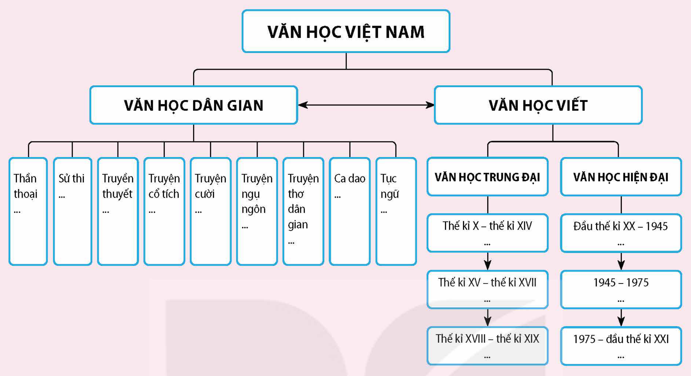

<!-- pdf:131 -->

# ÔN TẬP HỌC KÌ II

## 🎯 Yêu cầu cần đạt

- Hệ thống hoá được những kiến thức đã hình thành trong học kì II.
- Củng cố được các kĩ năng đọc, viết, nói và nghe thông qua việc nhìn lại nội dung những hoạt động đã triển khai.
- Vận dụng được kiến thức, kĩ năng đã có vào việc thực hiện các bài tập mang tính tổng hợp.

## I. HỆ THỐNG HOÁ KIẾN THỨC ĐÃ HỌC

1. Liệt kê và chia nhóm các văn bản đọc có trong sách giáo khoa *Ngữ văn 12*, tập hai theo loại văn bản và thể loại văn học. Nêu tên những văn bản thuộc một thể loại văn học chưa được học trước đó (nếu có).

2. Phân tích mối quan hệ mật thiết giữa *Yêu cầu cần đạt* và phần *Tri thức ngữ văn* ở mỗi bài học trong sách giáo khoa *Ngữ văn 12*, tập hai. Nêu tác dụng thiết thực của việc nắm bắt các khái niệm then chốt được giới thuyết ở phần *Tri thức ngữ văn* đối với việc đọc hiểu các văn bản có trong từng bài học.

3. Các văn bản đọc ở Bài 6 (*Hồ Chí Minh – “Văn hoá phải soi đường cho quốc dân đi”*) thuộc những loại văn bản và thể loại văn học nào? Nêu lí do dẫn đến sự đa dạng về loại, thể loại của các văn bản được chọn học ở đây, xét từ góc độ người sáng tác và từ đặc trưng của bài học về tác gia.

4. Sách giáo khoa *Ngữ văn 12*, tập hai đã hướng dẫn thực hành tiếng Việt theo những nội dung gì? Nêu ý nghĩa của việc thực hành những nội dung đó đối với việc khám phá nét đặc sắc về mặt ngôn ngữ của các văn bản đọc.

<!-- pdf:132 -->

5. Xem kĩ sơ đồ dưới đây và thực hiện các yêu cầu kèm theo (ở quy mô nhóm học tập):

> **Sơ đồ: VĂN HỌC VIỆT NAM**
> - **VĂN HỌC DÂN GIAN** $\leftrightarrow$ **VĂN HỌC VIẾT**
> - **VĂN HỌC DÂN GIAN** gồm: Thần thoại (...); Sử thi (...); Truyền thuyết (...); Truyện cổ tích (...); Truyện cười (...); Truyện ngụ ngôn (...); Truyện thơ dân gian (...); Ca dao (...); Tục ngữ (...).
> - **VĂN HỌC VIẾT** gồm:
>   - **VĂN HỌC TRUNG ĐẠI**: Thế kỉ X – thế kỉ XIV (...) $\rightarrow$ Thế kỉ XV – thế kỉ XVII (...) $\rightarrow$ Thế kỉ XVIII – thế kỉ XIX (...).
>   - **VĂN HỌC HIỆN ĐẠI**: Đầu thế kỉ XX – 1945 (...) $\rightarrow$ 1945 – 1975 (...) $\rightarrow$ 1975 – đầu thế kỉ XXI (...).
<!-- ocr-ok: chữ trong các ô của sơ đồ VĂN HỌC VIỆT NAM bị OCR đọc rời rạc, đã đối chiếu ảnh trang PDF 132 -->

a. Vẽ lại sơ đồ trên giấy khổ lớn (có thể theo một hình thức khác, nhưng vẫn đảm bảo được các thông tin chính).

b. Ghi tên một số tác phẩm văn học dân gian Việt Nam tiêu biểu (đã học theo sách giáo khoa *Ngữ văn* từ lớp 6 đến lớp 10) vào các ô phù hợp trong sơ đồ.

c. Ghi tên một số tác phẩm văn học viết Việt Nam tiêu biểu (đã học theo sách giáo khoa *Ngữ văn* từ lớp 6 đến lớp 12) vào các ô phù hợp trong sơ đồ. *Lưu ý*: Ghi kèm tên tác giả, thể loại; đối với văn học trung đại Việt Nam, cần đề rõ tác phẩm thuộc loại hình sáng tác chữ Hán hay chữ Nôm.

d. Nêu nhận xét khái quát về lịch sử phát triển của văn học Việt Nam dựa trên những thông tin đã được điền bổ sung trong sơ đồ vẽ lại.

6. Liệt kê những kiểu bài viết đã được luyện tập trong học kì II. Theo bạn, kiểu bài viết nào trong số đó có khả năng ứng dụng cao hơn cả? Vì sao?

7. Trong sách giáo khoa *Ngữ văn 12*, tập hai, sự phong phú của hoạt động nói và nghe đã được thể hiện như thế nào? Phân tích một ví dụ cho thấy hoạt động nói và nghe ở lớp cuối cấp có những đòi hỏi cao hơn về kiến thức và kĩ năng so với hoạt động đó ở các lớp dưới.

<!-- pdf:133 -->

## II. LUYỆN TẬP VÀ VẬN DỤNG

### 1. ĐỌC

**Đọc văn bản sau và thực hiện các yêu cầu:**

**Lửa bên trong**$^{(1)}$

*(Trích)*

**Đinh Gia Trinh**$^{(2)}$

Trong tâm ta ai chẳng có một nhóm lửa$^{(3)}$. Những khi bồng bột, những khi say mê, ham muốn, ấy là lửa cháy. Có lúc lửa ấy đốt nóng khiến ta bồn chồn, có khi ta trở nên ngang tàng hầu như điên dại. Ta đi ra ngoài mực sống lặng yên của người xung quanh. Nhà bác học suốt ngày đêm cặm cụi trên con toán hoặc trước kính hiển vi, nghệ sĩ theo đuổi những sáng tác đẹp, người hoạt động luôn luôn chống với thất bại để gây sự nghiệp lớn, đều là có sẵn mang nguồn lửa bên trong. Có những ngày bình thản tựa như cuộc đời vô vị sắp lôi cuốn ta, bỗng đọc một bài văn, xem một đoạn sử, nghe một lời diễn thuyết, trông một cảnh tượng, lòng ta phát bồng bột, ham muốn, tôn thờ. Ngọn lửa trong lòng lại bùng cháy và ta nếm trước tất cả cái vị say sưa của một cuộc đời lớn. Ta bồn chồn muốn đạt ngay tới một cái gì oanh liệt.

Tại sao nhà nhạc sĩ trứ danh nọ của nước Đức bao năm ròng khổ hạnh để tập đàn, có khi hằng ngày chỉ ở trong buồng thiếu ánh sáng để kéo, để ấn một thứ âm? Những ngày mà kẻ bàng quan cho là nặng nhọc, nhạc sĩ không nhận thấy khó chịu, vì trong lòng y có một sự say mê làm nóng ấm.

Không tha thiết thì làm nên được việc gì? Không sợ lòng bạo ngược, chỉ sợ lòng nguội lạnh. Giữ lấy nhóm lửa thiêng liêng ở trong lòng, hỡi thanh niên. Còn nó người còn trẻ, nếu nó đã tắt thì dù hai mươi tuổi, người đã già rồi. Không phải lửa cháy là cái tha thiết bỉ ổi của kẻ đi tìm cái no ấm vinh quang bằng những con đường vật chất hạ tiện$^{(4)}$. Lửa cháy là sức mạnh nâng ta về những nẻo cao của hoạt động tinh thần và duy tha$^{(5)}$. Yêu một cái gì đẹp, dù nhỏ mọn, đem dồn nghị lực tâm hồn của mình vào đấy, thế là đã đủ tỏ một giá trị rồi. Gít-đơ (Gide)$^{(6)}$ có một lời bất diệt:

$^{(1)}$ Bài đăng lần đầu trên tạp chí *Thanh Nghị*, số 40, năm 1943.

$^{(2)}$ Đinh Gia Trinh (1915 – 1974) quê ở tỉnh Bắc Ninh, là nhà báo, nhà phê bình văn học, luật gia; các tác phẩm chính: *Sơ thảo lịch sử Nhà nước và Pháp quyền Việt Nam*, tập một – *Thời đại trước phong kiến và thời đại phong kiến (từ nguồn gốc đến thế kỉ thứ XIX)* (1968), *Hoài vọng của lí trí* (1996).

$^{(3)}$ *Nhóm lửa*: đốm lửa, ngọn lửa (nghĩa trong văn bản).

$^{(4)}$ *Hạ tiện*: thấp hèn, tầm thường.

$^{(5)}$ *Duy tha*: hướng về người khác.

$^{(6)}$ *Gít-đơ*: tên đầy đủ là An-đrê Gít-đơ (André Gide, 1869 – 1951), tiểu thuyết gia người Pháp, được trao giải Nô-ben Văn học năm 1947.

<!-- pdf:134 -->

“Nếu tâm linh ta có chút giá trị, ấy là vì nó đã cháy hăng hái hơn một vài tâm linh khác.” và thực như một danh sĩ phương Tây đã nói: “Thù địch của linh hồn người ta không phải là sự phiền muộn mà là sự tầm thường và uể oải.”.

Ta chớ nên bao giờ coi tuổi thanh niên như một giai đoạn tạm thời, để đem ta đến một phận sự, một địa vị, rồi ở đó sống eo hẹp, chật chội, nghèo nàn, gò ép trí não vào những tính toán ti tiện của nghề nghiệp, mà để cái lửa anh linh khi xưa cháy sáng trong lòng thanh niên phai mờ đi, lạnh đi, để hoàn cảnh lôi cuốn chúng ta vào một cuộc sống không tư cách. Ta chớ nên như ai đó quên những danh nhân mà xưa họ sùng bái để dùng trí nhớ ghi tiểu sử vô vị của một thời nhân$^{(1)}$ vì đua mà có danh vọng.

Là thanh niên, ta phải giữ cho lửa trong lòng cháy mãi mãi. Đừng bao giờ để trái tim ta truỵ lạc cho đến nỗi thấy đồng loại ta khổ, ta không động tâm, thấy sự bất bình, ta không phẫn uất, bị sỉ nhục, ta không tức khí. Đừng để trí thức truỵ lạc cho đến nỗi để cho những dục vọng của cơ thể chi phối các hoạt động của thông minh$^{(2)}$. Hãy giữ lấy mãi mãi cái rung động trước một tác phẩm đẹp, cái mê đắm trong việc khi làm sáng tác, khi hướng dẫn, khi truyền bá.

*(Đinh Gia Trinh, Hoài vọng của lí trí, NXB Văn học, Hà Nội, 1996, tr. 212 – 214)*

1. Xác định ý nghĩa ẩn dụ của hình ảnh “lửa bên trong” và vấn đề chính được tác giả đề cập trong văn bản.

2. Khi viết bài *Lửa bên trong*, tác giả hướng tới đối tượng độc giả nào trước hết? Căn cứ cho phép khẳng định điều đó là gì?

3. Tóm tắt những luận điểm chính của văn bản. Khái niệm “cuộc đời lớn” có mối liên quan như thế nào tới cảm hứng viết và lập luận của tác giả?

4. Theo tác giả, đối với đời sống của mỗi con người, “lửa bên trong” có ý nghĩa gì?

5. Tìm trong văn bản những từ ngữ chỉ trạng thái tâm lí, hoạt động của con người ứng với hai tình trạng: có “lửa bên trong” và không có “lửa bên trong” (lập bảng liệt kê và đối sánh).

6. Chỉ ra một số biện pháp tu từ được tác giả sử dụng trong văn bản. Phân tích tác dụng của một biện pháp tu từ mà bạn thấy tâm đắc.

7. Văn bản ra đời năm 1943, khi Việt Nam đang chuyển mình bước vào một thời đại mới. Qua những gì được gợi ý từ văn bản, liên hệ đến cơ hội và thách thức của đất nước hiện nay, hãy viết đoạn văn (khoảng 600 chữ) bàn về việc lựa chọn thái độ sống tích cực hướng về cộng đồng của tuổi trẻ.

$^{(1)}$ *Thời nhân*: người hiện thời.

$^{(2)}$ *Thông minh*: lí trí hay ý thức (nghĩa trong văn bản).

<!-- pdf:135 -->

### 2. VIẾT

**Chọn một trong các đề sau:**

**Đề 1.** Nêu một bài tập dự án mà bạn hoặc nhóm học tập của bạn muốn thực hiện; phác thảo kế hoạch thực hiện bài tập dự án đó.

**Đề 2.** Viết bài văn nghị luận bàn về một vấn đề liên quan đến con đường phía trước của tuổi trẻ, từ những gợi ý của các văn bản đọc trong sách giáo khoa *Ngữ văn 12*, tập hai.

**Đề 3.** Bạn đã suy nghĩ như thế nào về việc lựa chọn nghề nghiệp của bản thân? Hãy viết bức thư gửi cho một đối tượng phù hợp để trao đổi về vấn đề này.

**Đề 4.** Giả định bạn là người được mời phát biểu trong lễ phát động một phong trào hay một hoạt động xã hội nào đó. Hãy chuẩn bị bài phát biểu của mình trên cơ sở xác định rõ nội dung của lễ phát động.

### 3. NÓI VÀ NGHE

**Chọn thực hiện theo nhóm học tập một trong các nội dung sau:**

**Nội dung 1.** Trình bày lại kết quả thực hiện bài tập dự án mà bạn hoặc nhóm của bạn đã hoàn thành theo yêu cầu của sách giáo khoa *Ngữ văn 12*, tập hai, trên cơ sở tiếp thu những góp ý và việc hoàn thiện sản phẩm ngay sau hoạt động nói và nghe ở Bài 6.

**Nội dung 2.** Theo trải nghiệm và hiểu biết của bạn, những vấn đề xã hội nào thường tạo ra sự phân cực trong các ý kiến phân tích, đánh giá, bàn luận? Đề xuất đề tài thảo luận về một vấn đề thuộc loại này và nêu ý kiến riêng của bạn.

**Nội dung 3.** Cơ hội và thách thức đối với đất nước là một vấn đề lớn mà mỗi cá nhân có thể đề cập theo những cách khác nhau, tuỳ vào nhận thức và vốn sống của mình. Hãy chọn một đề tài phù hợp liên quan đến vấn đề này để thuyết trình.

## 📷 Danh sách hình trong bài

| Mã hình | Trang PDF | Vị trí trong bài | Chú thích gốc |
| --- | --- | --- | --- |
| H12-ngu_van-on-tap-hk2-01 | 132 | Mục I, Câu 5 | Sơ đồ Văn học Việt Nam |
