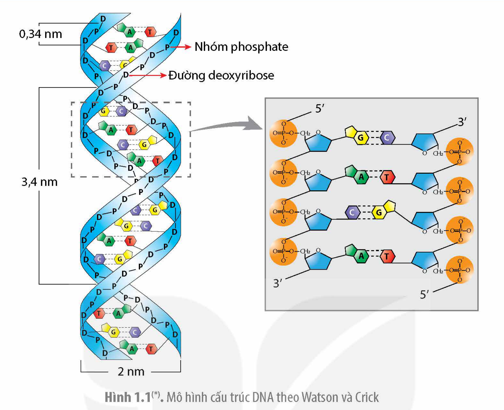
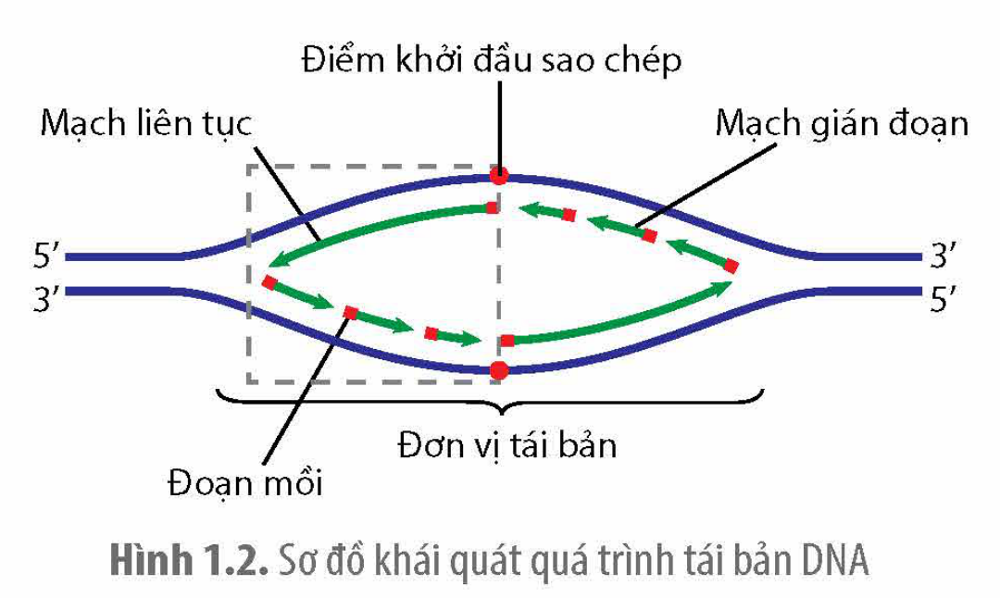
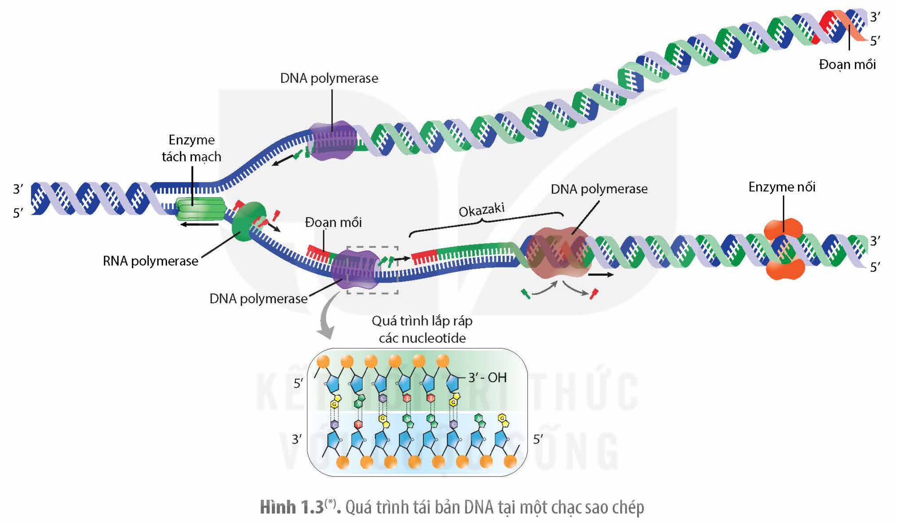

<!-- pdf:7 -->

# BÀI 1: DNA VÀ CƠ CHẾ TÁI BẢN DNA

## 🎯 Yêu cầu cần đạt

- Dựa vào cấu trúc hoá học của phân tử DNA, trình bày được chức năng của DNA.
- Nêu được ý nghĩa của các kết cặp đặc hiệu A – T và G – C.
- Phân tích được cơ chế tái bản của DNA là một quá trình tự sao thông tin di truyền từ tế bào mẹ sang tế bào con hay từ thế hệ này sang thế hệ sau.

## 🔴 Mở đầu

Một phân tử hữu cơ cần phải có các đặc điểm cấu trúc như thế nào để có thể đảm nhận chức năng của một vật chất di truyền?

## I. CHỨC NĂNG CỦA DNA

DNA có chức năng mang, bảo quản và truyền đạt thông tin di truyền. Thông tin di truyền dưới dạng trình tự các nucleotide trong các phân tử DNA là đủ lớn và đa dạng nên bộ máy phân tử của tế có thể tạo ra mọi đặc điểm của tế bào và cơ thể sinh vật. Không những chứa được nhiều thông tin, DNA còn có khả năng tái bản chính xác, nhờ vậy thông tin di truyền của tế bào được truyền đạt gần như nguyên vẹn qua các thế hệ tế bào và cơ thể. Hình 1.1 cho thấy, đặc điểm cấu trúc của DNA phù hợp với chức năng như sau:

<!-- term: Nucleotide -->
- DNA được cấu trúc theo nguyên tắc **đa phân**, gồm 4 loại đơn phân là các nucleotide A, T, G và C. Các đơn phân này dùng như các "chữ cái" có thể "ghi mã" đủ mọi thông tin di truyền về cấu trúc và chức năng của tế bào.
- DNA được cấu trúc kiểu chuỗi xoắn kép nên có cấu trúc bền vững, đảm bảo thông tin di truyền được bảo quản ít bị hư hỏng.
- Các nucleotide có khả năng liên kết theo **nguyên tắc bổ sung** (NTBS) nên thông tin trong DNA có thể được truyền đạt sang mRNA qua quá trình phiên mã và từ mRNA được dịch mã thành các phân tử protein.
- Sự kết hợp đặc hiệu A – T và G – C trong quá trình tái bản DNA đảo bảo cho thông tin di truyền trong DNA được truyền đạt gần như nguyên vẹn qua các thế hệ tế bào và cơ thể.

<!-- pdf:8 -->

Hình 1.1(\*). Mô hình cấu trúc DNA theo Watson và Crick

## ❓ Dừng lại và suy ngẫm

1. Nêu các đặc điểm cấu trúc phù hợp với chức năng của DNA.
2. Tại sao protein tạo nên các tính trạng của sinh vật nhưng không thể đảm nhận chức năng của một vật chất di truyền?

## II. TÁI BẢN DNA

Quá trình tái bản DNA được bắt đầu từ một điểm nhất định gọi là **điểm khởi đầu sao chép** (Ori) và tiến hành theo hai hướng ngược nhau tạo nên một **đơn vị tái bản**. Quá trình tái bản DNA có thể chia thành hai giai đoạn: khởi đầu sao chép và tổng hợp mạch mới. Quá trình tái bản DNA ở sinh vật nhân sơ được trình bày chi tiết sau đây.

### 1. Khởi đầu sao chép

<!-- term: Enzyme RNA polymerase -->
<!-- term: Enzyme DNA polymerase -->
Một số protein và enzyme liên kết vào Ori và tách DNA thành hai mạch đơn ở cả hai phía của điểm khởi đầu sao chép tạo nên **chạc sao chép** hình chữ Y (H 1.2). Sau đó, enzyme RNA polymerase sử dụng mạch DNA làm khuôn tổng hợp nên đoạn RNA ngắn được gọi là **đoạn mồi**, cung cấp đầu 3'–OH cho enzyme DNA polymerase tổng hợp mạch mới.

Hình 1.2. Sơ đồ khái quát quá trình tái bản DNA

> (\*) Nguồn hình: Phạm Minh Kiên.

<!-- pdf:9 -->

### 2. Tổng hợp mạch DNA mới

<!-- term: Enzyme DNA polymerase -->
Tại mỗi chạc sao chép, các mạch DNA được tách thành hai mạch đơn đến đâu thì enzyme DNA polymerase tổng hợp mạch mới đến đó. Mạch mới được kéo dài bằng cách gắn thêm nucleotide vào đầu 3' của đoạn RNA mồi theo NTBS A – T, G – C với mạch khuôn.

<!-- term: Mạch gián đoạn -->
<!-- term: Enzyme DNA polymerase -->
Vì DNA được cấu tạo từ hai mạch ngược chiều nhau và DNA được tách thành hai mạch đơn đến đâu được enzyme DNA polymerase tổng hợp các mạch mới theo cùng một chiều 5' → 3' nên một trong hai mạch mới được tổng hợp liên tục (**mạch liên tục**), trong khi mạch mới còn lại được tổng hợp thành từng đoạn ngắn gọi là **Okazaki**.

<!-- term: Enzyme nối -->
<!-- term: Enzyme DNA polymerase -->
Sau khi các đoạn Okazaki được tổng hợp, enzyme DNA polymerase tiến hành loại bỏ đoạn mồi và tổng hợp đoạn DNA thay thế. Tiếp đến, một loại enzyme nối sẽ gắn các đoạn Okazaki lại với nhau (H 1.3).

Hình 1.3(\*). Quá trình tái bản DNA tại một chạc sao chép

<!-- term: Tái bản DNA -->
Kết thúc quá trình tái bản, từ một DNA tạo ra hai phân tử mới giống nhau và giống với phân tử DNA mẹ, mỗi phân tử có một mạch cũ và một mạch mới (**nguyên tắc bán bảo toàn**). Bộ máy phân tử của tế bào hoạt động tái bản DNA rất chính xác, đảm bảo cho thông tin di truyền trên DNA được truyền đạt gần như nguyên vẹn qua các thế hệ tế bào và cơ thể (đối với loài sinh sản vô tính).

<!-- term: Mạch gián đoạn -->
<!-- term: Tái bản DNA -->
Như vậy, DNA được tái bản theo nguyên tắc bán bảo toàn và NTBS. Ở mỗi chạc sao chép, một mạch được tổng hợp liên tục, mạch còn lại được tổng hợp gián đoạn.

Ở sinh vật nhân sơ, mỗi phân tử DNA chỉ có một điểm khởi đầu sao chép duy nhất, trong khi DNA ở sinh vật nhân thực có nhiều điểm khởi đầu sao chép nên quá trình tái bản xảy ra đồng thời tại nhiều vùng trên một phân tử DNA. Sinh vật nhân thực có nhiều loại DNA polymerase hơn so với sinh vật nhân sơ.

> (\*) Nguồn hình: Phạm Minh Kiên.

<!-- pdf:10 -->

## ❓ Dừng lại và suy ngẫm

1. Nêu ý nghĩa của kết cặp đặc hiệu A – T và G – C phù hợp với chức năng của DNA.
2. Trình bày quá trình tái bản DNA thể hiện sự sao chép thông tin di truyền qua các thế hệ tế bào và cơ thể.

## 💡 Khoa học và đời sống

**Ứng dụng thực tế của cơ chế tái bản DNA**

Phương pháp tái bản DNA có thể được tiến hành trong ống nghiệm và đem lại nhiều ứng dụng thực tiễn. Ví dụ: Nhân bản DNA lấy từ mẫu vật để lại trên hiện trường vụ án, các nhà điều tra có thể truy tìm được thủ phạm cũng như xác định được danh tính nạn nhân; Việc tách chiết DNA từ vật nuôi bị bệnh rồi tái bản tạo ra một số lượng lớn bản sao đủ để tìm ra được tác nhân gây bệnh, qua đó đưa ra các biện pháp chữa trị cũng như phòng tránh bệnh. Tái bản DNA là kĩ thuật cần thiết cho giải trình tự gene và hệ gene cũng như cho công nghệ di truyền.

## 📌 Kiến thức cốt lõi

- DNA là vật chất di truyền do được cấu tạo theo nguyên tắc đa phân nên có đủ thông tin quy định các tính trạng của sinh vật và cấu trúc theo NTBS nên thông tin di truyền được truyền từ gene tới protein qua các thế hệ tế bào và cơ thể.
- DNA được tái bản theo nguyên tắc bán bảo toàn, một mạch DNA được dùng làm khuôn tổng hợp nên mạch mới theo NTBS. Do vậy, từ một phân tử "mẹ" tạo ra được hai phân tử DNA "con" giống nhau và giống với phân tử DNA mẹ.

## ✏️ Luyện tập và vận dụng

1. Tỉ lệ các cặp G – C và T – A trong phân tử DNA có ảnh hưởng đến độ bền vững của phân tử DNA không? Giải thích.
2. Kẻ và hoàn thành bảng tóm tắt quá trình tái bản DNA vào vở theo mẫu sau:

| Nơi diễn ra | ??? |
|---|---|
| Nguyên tắc tái bản | ??? |
| Diễn biến | ??? |
| Kết quả | ??? |
| Ý nghĩa | ??? |

3. Nhiều enzyme và protein tham gia vào bộ máy tái bản DNA ở vi khuẩn khác biệt với các enzyme và protein cùng loại ở tế bào người. Dựa vào thông tin trên, hãy đề xuất hướng sản xuất thuốc trị bệnh nhiễm khuẩn ở người, giảm thiểu tối đa tác dụng không mong muốn của thuốc kháng sinh.

## 📷 Danh sách hình trong bài

| Mã hình | Trang PDF | Vị trí | Chú thích gốc |
|---|---|---|---|
| H12-sinh-b01-01 | 8 | Cuối mục I | Hình 1.1(\*). Mô hình cấu trúc DNA theo Watson và Crick — (\*) Nguồn hình: Phạm Minh Kiên. |
| H12-sinh-b01-02 | 8 | Mục II.1 | Hình 1.2. Sơ đồ khái quát quá trình tái bản DNA |
| H12-sinh-b01-03 | 9 | Mục II.2 | Hình 1.3(\*). Quá trình tái bản DNA tại một chạc sao chép — (\*) Nguồn hình: Phạm Minh Kiên. |
