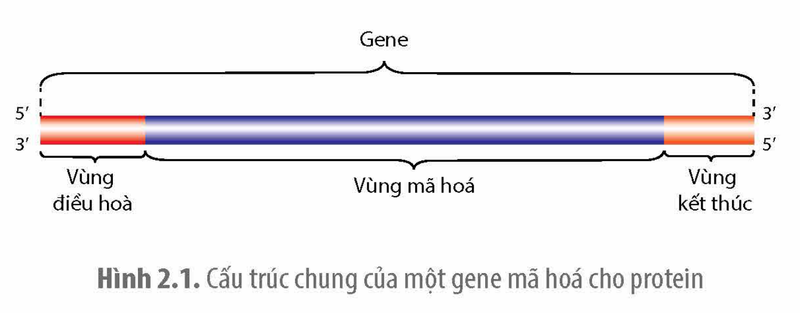
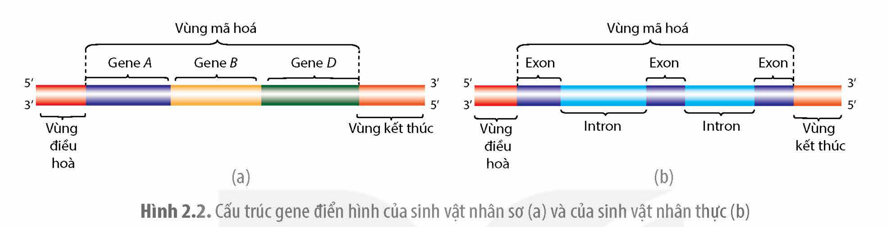
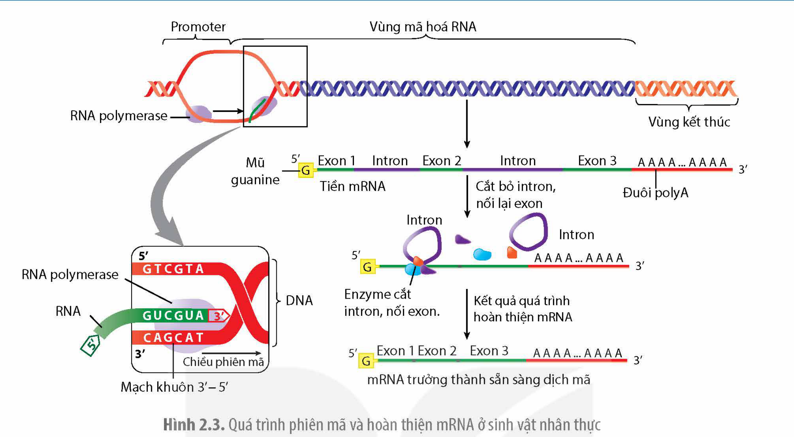
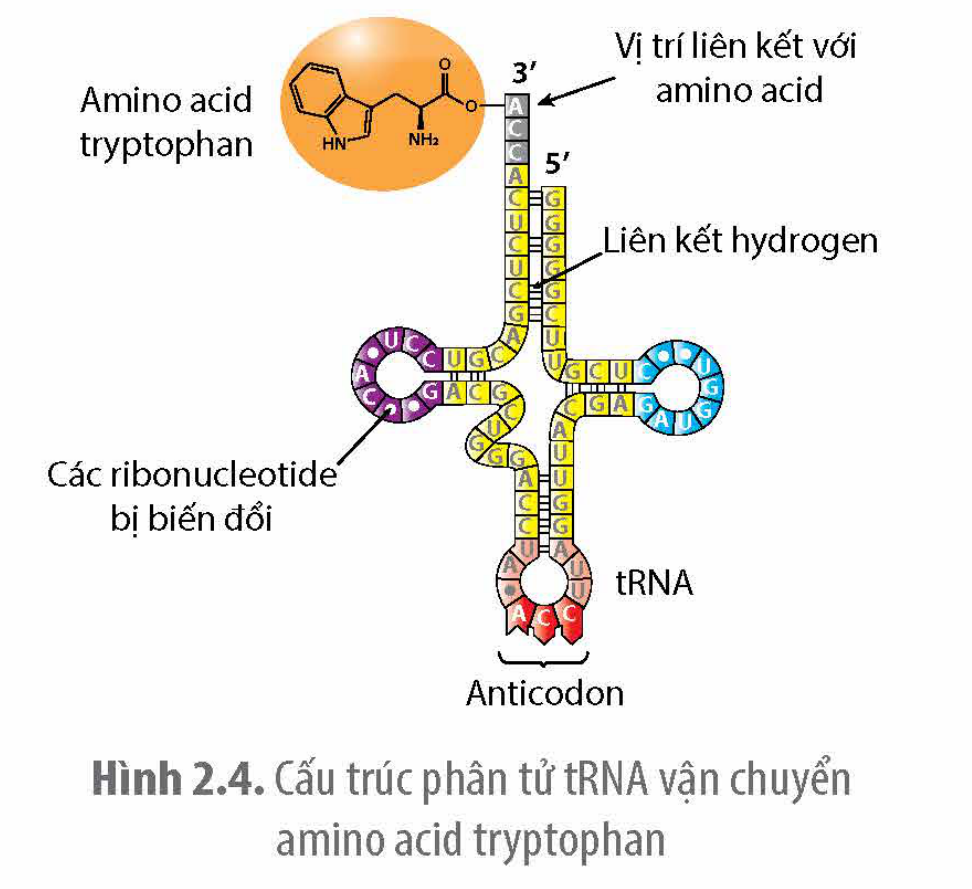
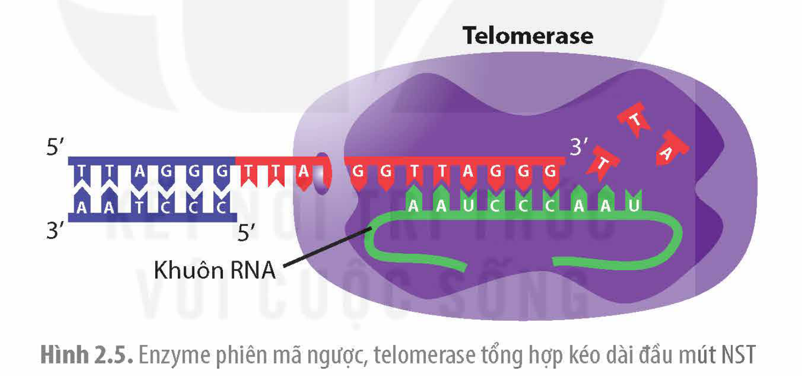
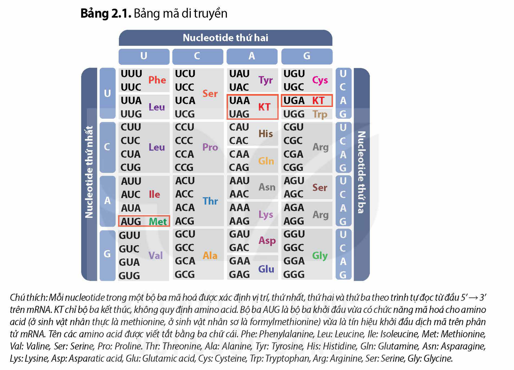
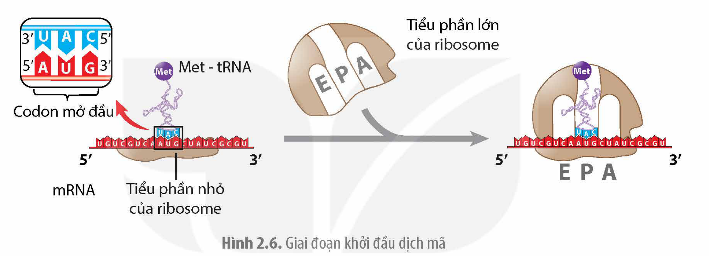
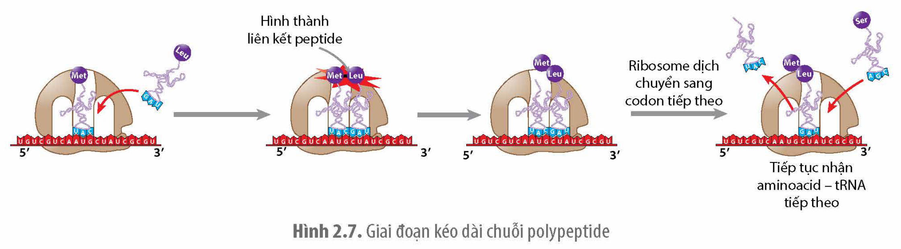
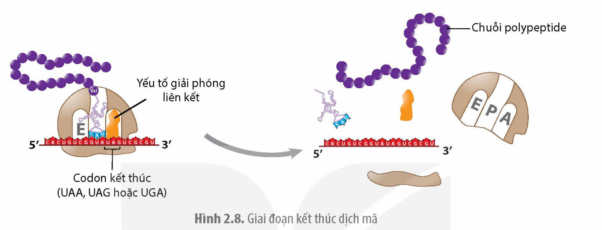
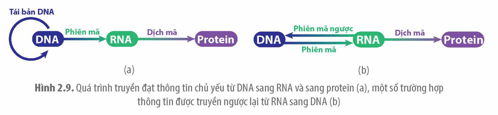

<!-- pdf:11 -->

# BÀI 2: GENE, QUÁ TRÌNH TRUYỀN ĐẠT THÔNG TIN DI TRUYỀN VÀ HỆ GENE

## 🎯 Yêu cầu cần đạt

- Nêu được khái niệm và cấu trúc của gene. Phân biệt được các loại gene dựa vào cấu trúc và chức năng của gene.
- Phân biệt được các loại RNA. Phân tích được bản chất phiên mã thông tin di truyền là cơ chế tổng hợp RNA dựa trên DNA.
- Nêu được khái niệm phiên mã ngược và ý nghĩa.
- Nêu được khái niệm và các đặc điểm của mã di truyền.
- Trình bày được cơ chế tổng hợp protein từ bản sao là RNA có bản chất là quá trình dịch mã.
- Vẽ và giải thích được sơ đồ liên kết ba quá trình thể hiện cơ chế di truyền ở cấp phân tử là quá trình truyền đạt thông tin di truyền.
- Phát biểu được khái niệm hệ gene.
- Trình bày được một số thành tựu và ứng dụng của việc giải trình tự hệ gene người.

## 🔴 Mở đầu

Cơ chế phân tử của quá trình truyền thông tin di truyền từ gene tới protein xảy ra như thế nào?

## I. GENE

### 1. Khái niệm

**Gene** là một đoạn của phân tử DNA mang thông tin quy định một loại sản phẩm là chuỗi polypeptide hoặc RNA.

Mỗi gene mặc dù được cấu tạo từ hai mạch polynucleotide nhưng chỉ có thông tin trên một mạch (**mạch khuôn**) được sử dụng để làm khuôn tổng hợp nên mRNA. Mạch polynucleotide còn lại được gọi là **mạch mã hoá**.

### 2. Cấu trúc

Cấu trúc của một gene bao gồm ba vùng: vùng điều hoà, vùng mã hoá và vùng kết thúc (H 2.1).

- **Vùng điều hoà** nằm ở đầu 3' trên mạch khuôn của gene, có trình tự nucleotide được gọi là **promoter**, nơi enzyme phiên mã có thể liên kết và tiến hành phiên mã cùng một số vùng liên kết với các protein điều hoà, điều khiển sự hoạt động của gene.
- **Vùng mã hoá** nằm kế tiếp vùng điều hoà, chứa thông tin quy định trình tự các amino acid trong chuỗi polypeptide hoặc trình tự RNA.
- **Vùng kết thúc** nằm ở đầu 5' trên mạch khuôn của gene, mang tín hiệu kết thúc phiên mã.

Hình 2.1. Cấu trúc chung của một gene mã hoá cho protein

<!-- pdf:12 -->

Ở sinh vật nhân sơ, vùng mã hoá của gene quy định chuỗi polypeptide bắt đầu bằng bộ ba mở đầu cùng với các bộ ba quy định các amino acid nằm kế tiếp nhau và kết thúc bằng bộ ba kết thúc. Ở sinh vật nhân sơ, các gene thường tồn tại thành nhóm với các vùng mã hoá nằm liền kề nhau có chung vùng điều hoà và vùng kết thúc (H 2.2a).

Ở sinh vật nhân thực, phần lớn các gene quy định protein có vùng mã hoá được chia thành các đoạn được dịch mã (**exon**) xen kẽ với các đoạn không được dịch mã (**intron**) và thường mỗi gene có vùng điều hoà và vùng phiên mã riêng (H 2.2b).

Hình 2.2. Cấu trúc gene điển hình của sinh vật nhân sơ (a) và của sinh vật nhân thực (b)

### 3. Phân loại

Theo chức năng, các gene được chia thành hai loại: gene cấu trúc và gene điều hoà. **Gene cấu trúc** tạo ra các sản phẩm cấu tạo nên các thành phần của tế bào. **Gene điều hoà** tạo ra sản phẩm điều hoà sự biểu hiện của các gene khác.

Dựa trên cấu trúc của vùng mã hoá, các gene được phân loại thành **gene không phân mảnh** (không chứa intron) và **gene phân mảnh** (chứa intron).

## ❓ Dừng lại và suy ngẫm

1. Một trình tự nucleotide như thế nào được gọi là gene?
2. Dựa vào Hình 2.2, phân biệt cấu trúc gene ở sinh vật nhân sơ với gene ở sinh vật nhân thực.

## II. HỆ GENE

### 1. Khái niệm hệ gene

**Hệ gene** là tập hợp tất cả vật chất di truyền (DNA) trong tế bào của một sinh vật.

Hệ gene của sinh vật được biết đến nhờ có các tiến bộ của nhiều ngành khoa học giúp giải trình tự toàn bộ các phân tử DNA của tế bào, qua đó tìm ra được cấu trúc và chức năng của các gene.

### 2. Một số thành tựu và ứng dụng giải trình tự hệ gene người

**a) Thành tựu nghiên cứu hệ gene người**

Các nhà sinh học phân tử đã giải trình tự nucleotide của hệ gene người gồm hơn 3,2 tỉ cặp nucleotide trên 23 cặp NST vào năm 2004 (mặc dù vẫn còn một số vùng nhỏ chưa được giải trình tự) với độ chính xác lên đến 99,999%. Tổng số gene mã hoá protein trong hệ gene người ước tính khoảng gần 21 300. Số lượng nucleotide trong các exon ở toàn bộ gene quy định protein và tổng số vùng mã hoá của các gene quy định rRNA, tRNA chiếm 1,5% số lượng nucleotide trong hệ gene người. Số lượng nuleotide của các vùng điều hoà của tất cả các gene chiếm khoảng 5% hệ gene, trong khi tổng số nucleotide trong tất cả

<!-- pdf:13 -->

các intron xấp xỉ 20% hệ gene. Trung bình mỗi gene của người dài khoảng 27 000 cặp nucleotide và có 10 exon(\*).

**b) Một số ứng dụng giải trình tự hệ gene người**

**Ứng dụng trong y học:** Giải trình tự hệ gene của một người giúp bác sĩ biết được người đó có mang gene bệnh hay không, qua đó đưa ra biện pháp phòng và trị bệnh. Ví dụ: giải trình tự hệ gene của mỗi người có thể biết được người này mang loại gene ung thư nào để lựa chọn sử dụng thuốc đặc trị ức chế sản phẩm của gene đó (thuốc hướng đích), làm tăng hiệu quả điều trị. Giải trình tự hệ gene người cũng được ứng dụng trong ngành pháp y để tìm ra thủ phạm trong các vụ án, danh tính nạn nhân trong các vụ tai nạn hoặc xác định mối quan hệ họ hàng.

**Ứng dụng trong nghiên cứu tiến hoá:** So sánh trình tự nucleotide trong hệ gene của nhiều loài sinh vật có thể cho biết mối quan hệ tiến hoá giữa các loài. Nhìn chung, các loài có cấu trúc hệ gene càng giống nhau thì càng có quan hệ họ hàng gần gũi vì chúng mới được phân tách chưa có nhiều thời gian tích luỹ đột biến tạo nên sự khác biệt lớn. Ví dụ: Khi so sánh hệ gene người và hệ gene của các loài linh trưởng, các nhà khoa học nhận thấy, tinh tinh có quan hệ họ hàng gần gũi nhất với loài người.

## ❓ Dừng lại và suy ngẫm

1. Tập hợp tất cả các gene trong tế bào của cơ thể sinh vật có được gọi là hệ gene hay không? Giải thích.
2. Giải trình tự hệ gene người đem lại những ứng dụng thực tiễn gì?

## III. QUÁ TRÌNH TRUYỀN ĐẠT THÔNG TIN DI TRUYỀN TỪ GENE TỚI PROTEIN

### 1. Quá trình phiên mã

**Phiên mã** là quá trình tổng hợp RNA dựa trên mạch khuôn của gene. Phiên mã có thể được chia thành các bước:

**Khởi đầu:** Một số protein liên kết với vùng điều hoà của gene và thu hút enzyme RNA polymerase đến liên kết với promoter trên mạch khuôn.

<!-- term: Enzyme RNA polymerase -->
**Kéo dài:** Enzyme RNA polymerase sau khi liên kết với promoter sẽ tổng hợp mRNA theo chiều 5'→3' dựa trên NTBS giữa mạch khuôn với mRNA: A–U, T–A, G–C, C–G.

<!-- term: Đuôi poly A -->
**Kết thúc:** Quá trình phiên mã kết thúc khi RNA polymerase gặp tín hiệu kết thúc phiên mã ở đầu 5' của mạch khuôn. Quá trình phiên mã ở sinh vật nhân sơ và sinh vật nhân thực về cơ bản là như nhau, tuy nhiên bộ máy phiên mã và cách thức phiên mã cũng có những điểm khác biệt. Tế bào nhân sơ thường phiên mã một vài gene cùng lúc tạo ra một mRNA và phiên mã đến đâu thì mRNA được dịch mã đến đó. Ở tế bào nhân thực, phiên mã tạo ra **tiền mRNA** và được gắn thêm nucleotide 7-Methyguanine ở đầu 5' và một chuỗi nucleotide loại adenine được gọi là đuôi poly A ở đầu 3'. Sau đó, tiền mRNA được loại bỏ intron và các exon được nối với nhau tạo nên mRNA trưởng thành, đi ra khỏi nhân sẵn sàng để dịch mã ở ribosome (H 2.3). Đối với các gene quy định rRNA, tiền RNA sau khi hình thành sẽ được tách thành các loại rRNA khác nhau.

> (\*) Nguồn: Campbell Biology 12e 2021.

<!-- pdf:14 -->

Hình 2.3. Quá trình phiên mã và hoàn thiện mRNA ở sinh vật nhân thực

### 2. Một số loại RNA – sản phẩm của quá trình phiên mã

Có nhiều loại RNA khác nhau tham gia vào quá trình truyền đạt thông tin di truyền từ gene tới protein. Sau đây chúng ta xem xét cấu trúc và chức năng của một vài loại RNA chủ chốt.

**a) mRNA**

**Cấu trúc:** Các loại mRNA trưởng thành (đã sẵn sàng dịch mã) đều có cấu tạo một mạch đơn, dạng thẳng. Ở sinh vật nhân sơ, một phân tử mRNA thường chứa vài trình tự mã hoá của một số gene khác nhau, trong khi mỗi gene của sinh vật nhân thực tạo ra một loại mRNA riêng.

**Chức năng:** mRNA làm khuôn cho quá trình dịch mã. Cụ thể, mRNA truyền thông tin di truyền từ DNA (gene) tới ribosome và được các tRNA tiến hành dịch mã thành các chuỗi polypeptide.

**b) tRNA**

**Cấu trúc:** tRNA có cấu trúc mạch đơn nhưng có những vùng có thể tự bắt đôi với nhau tạo nên cấu trúc với ba thuỳ chức năng. Một thuỳ chứa bộ ba đối mã (**anticodon**) có thể bắt đôi bổ sung với bộ ba mã hoá trên mRNA, hai thuỳ còn lại liên kết với các protein của ribosome. Đầu 3' của tRNA có nucleotide đặc hiệu nên enzyme có thể gắn vào đó amino acid tương ứng (H 2.4).

Hình 2.4. Cấu trúc phân tử tRNA vận chuyển amino acid tryptophan

**Chức năng:** tRNA có chức năng vận chuyển amino acid tới ribosme và tiến hành dịch mã. Mỗi loại amino acid đều có tRNA vận chuyển riêng. Có 20 loại amino acid nên tế bào phải có tối thiểu 20 loại tRNA và hầu hết các loại tế bào của sinh vật thường có từ 30 đến 40 loại tRNA khác nhau.

<!-- pdf:15 -->

**c) rRNA**

**Cấu trúc:** Tất cả các loại rRNA đều có cấu trúc mạch đơn nhưng khác nhau về số lượng và trình tự nucleotide. Các loại rRNA đều được phiên mã từ một gene, sau đó được cắt ra thành các loại rRNA khác nhau.

<!-- term: Ribosome -->
**Chức năng:** rRNA có chức năng cấu trúc, cấu tạo nên ribosome. Tế bào sinh vật nhân sơ thường có 3 loại rRNA do một gene quy định, trong khi sinh vật nhân thực có 4 loại rRNA do hai gene quy định. Ví dụ: rRNA 16S ở sinh vật nhân sơ có chức năng liên kết với trình tự ribonucleotide nằm trước bộ ba khởi đầu của mRNA, nhờ đó ribosome có thể nhận ra mã mở đầu và tiến hành dịch mã.

### 3. Phiên mã ngược

<!-- term: Telomerase -->
<!-- term: Enzyme phiên mã ngược -->
**Phiên mã ngược** là quá trình tổng hợp DNA dựa trên mạch khuôn là RNA. Từ mạch khuôn RNA, enzyme phiên mã ngược tổng hợp mạch DNA có trình tự nucleotide bổ sung đặc hiệu với trình tự nucleotide của RNA. Quá trình này thường gặp ở một số loại virus có vật chất di truyền là RNA. Sau khi vào tế bào, RNA được enzyme phiên mã ngược của virus chuyển thành DNA và tích hợp vào DNA của tế bào chủ. Trong tế bào giao tử của cơ thể nhân thực có enzyme telomerase, enzyme này dùng một mạch RNA có trong enzyme tổng hợp mạch DNA gắn vào đoạn DNA ở đầu mút của nhiễm sắc thể (NST). Nhờ vậy, đoạn bị ngắn đi trong quá trình nhân đôi DNA được phục hồi ở các giao tử giống như ở trong hợp tử (H 2.5).

Hình 2.5. Enzyme phiên mã ngược, telomerase tổng hợp kéo dài đầu mút NST

Enzyme phiên mã ngược có nguồn gốc virus được các nhà khoa học sử dụng để tổng hợp DNA dựa trên mạch khuôn là mRNA trưởng thành. Loại DNA này (**cDNA**) thường được sử dụng trong công nghệ gene để chuyển gene không còn intron của sinh vật nhân thực vào tế bào vi khuẩn. Ngoài ra, các enzyme phiên mã ngược cũng được dùng để xét nghiệm virus gây bệnh có hệ gene là RNA như HIV, SARS–CoV–2,…

## ❓ Dừng lại và suy ngẫm

1. Phân biệt cấu trúc và chức năng của một số loại RNA.
2. Thông tin từ gene có được truyền nguyên vẹn tới RNA qua quá trình phiên mã hay không? Giải thích.

<!-- pdf:16 -->

### 4. Mã di truyền và quá trình dịch mã

**a) Mã di truyền**

**Mã di truyền** là một bộ các bộ ba nucleotide trên mRNA quy định các amino acid trong protein. Mỗi bộ ba nucleotide được gọi là một đơn vị mã di truyền (**codon**). Bằng thực nghiệm, các nhà khoa học đã xác định được toàn bộ 61 bộ ba mã hoá cho các amino acid và 3 bộ ba cho biết tín hiệu kết thúc dịch mã được gọi là **bộ ba kết thúc** (Bảng 2.1).

Bảng 2.1. Bảng mã di truyền

| Nucleotide thứ nhất | U | C | A | G | Nucleotide thứ ba |
|---|---|---|---|---|---|
| U | UUU Phe | UCU Ser | UAU Tyr | UGU Cys | U |
| U | UUC Phe | UCC Ser | UAC Tyr | UGC Cys | C |
| U | UUA Leu | UCA Ser | UAA KT | UGA KT | A |
| U | UUG Leu | UCG Ser | UAG KT | UGG Trp | G |
| C | CUU Leu | CCU Pro | CAU His | CGU Arg | U |
| C | CUC Leu | CCC Pro | CAC His | CGC Arg | C |
| C | CUA Leu | CCA Pro | CAA Gln | CGA Arg | A |
| C | CUG Leu | CCG Pro | CAG Gln | CGG Arg | G |
| A | AUU Ile | ACU Thr | AAU Asn | AGU Ser | U |
| A | AUC Ile | ACC Thr | AAC Asn | AGC Ser | C |
| A | AUA Ile | ACA Thr | AAA Lys | AGA Arg | A |
| A | AUG Met | ACG Thr | AAG Lys | AGG Arg | G |
| G | GUU Val | GCU Ala | GAU Asp | GGU Gly | U |
| G | GUC Val | GCC Ala | GAC Asp | GGC Gly | C |
| G | GUA Val | GCA Ala | GAA Glu | GGA Gly | A |
| G | GUG Val | GCG Ala | GAG Glu | GGG Gly | G |
<!-- ocr-ok: bảng chép theo hàng–cột từ ảnh phóng to 150 dpi; OCR đọc ảnh bảng theo thứ tự khác -->

<!-- Bảng chép lại từ hình; tiêu đề cột trên hình là "Nucleotide thứ hai". Sách khoanh đỏ các ô UAA, UAG, UGA (KT) và AUG (Met). -->

<!-- term: Bộ ba mở đầu -->
Chú thích: Mỗi nucleotide trong một bộ ba mã hoá được xác định vị trí, thứ nhất, thứ hai và thứ ba theo trình tự đọc từ đầu 5' → 3' trên mRNA. KT chỉ bộ ba kết thúc, không quy định amino acid. Bộ ba AUG là bộ ba khởi đầu vừa có chức năng mã hoá cho amino acid (ở sinh vật nhân thực là methionine, ở sinh vật nhân sơ là formylmethionine) vừa là tín hiệu khởi đầu dịch mã trên phân tử mRNA. Tên các amino acid được viết tắt bằng ba chữ cái. Phe: Phenylalanine, Leu: Leucine, Ile: Isoleucine, Met: Methionine, Val: Valine, Ser: Serine, Pro: Proline. Thr: Threonine, Ala: Alanine, Tyr: Tyrosine, His: Histidine, Gln: Glutamine, Asn: Asparagine, Lys: Lysine, Asp: Asparatic acid, Glu: Glutamic acid, Cys: Cysteine, Trp: Tryptophan, Arg: Arginine, Ser: Serine, Gly: Glycine.

Mã di truyền ở các sinh vật có chung các đặc điểm sau:

<!-- term: Mã vạn năng -->
<!-- term: Tính đặc hiệu của mã di truyền -->
<!-- term: Tính thoái hoá của mã di truyền -->
- Mã di truyền là mã bộ ba, ba nucleotide liền kề quy định một amino acid. Ví dụ: AGU là một trong số bộ ba quy định amino acid serine (Ser).
- Mã di truyền được đọc theo từng bộ ba một, bắt đầu từ bộ ba khởi đầu và không chồng gối lên nhau. Ví dụ: 5'AUGGUUGCC3' được đọc theo chiều từ 5' → 3', lần lượt theo từng bộ ba: AUG–GUU–GCC.
- Mã di truyền có tính thoái hoá, nhiều bộ ba có thể quy định một amino acid. Ví dụ: alanine (Ala) và nhiều amio acid khác có tới 4 bộ ba khác nhau quy định.
- Mã di truyền có tính đặc hiệu, có nghĩa là mỗi bộ ba chỉ mã hoá cho một amino acid. Ví dụ: UAU chỉ mã hoá cho tyrosine.
- Mã di truyền về cơ bản dùng chung cho mọi sinh vật trên Trái Đất, trừ một số ngoại lệ nên còn được gọi là mã vạn năng. Ví dụ: Trong DNA ti thể của người, UGA mã hoá cho Trp, AUA mã hoá cho Met, AGA và AGG là các bộ ba kết thúc.

<!-- pdf:17 -->

**b) Quá trình dịch mã**

<!-- term: Ribosome -->
**Dịch mã** là quá trình tổng hợp protein dựa trên trình tự nucleotide trong phân tử mRNA. Dịch mã được tiến hành ở ribosome. Mỗi ribosome gồm một tiểu phần nhỏ và một tiểu phần lớn, khi chưa dịch mã hai tiểu phần nằm tách rời nhau. Dịch mã có thể chia thành ba giai đoạn: khởi đầu, kéo dài chuỗi polypeptide và kết thúc.

<!-- term: Bộ ba mở đầu -->
**Giai đoạn khởi đầu:** Tiểu phần nhỏ của ribosome liên kết với bộ ba mở đầu (AUG) trên mRNA. Sau đó, tRNA mang amino acid mở đầu (là formylmethionine hoặc methionine) liên kết với bộ ba mở đầu AUG trên mRNA. Tiếp đến, tiểu phần lớn liên kết với tiểu phần nhỏ cùng mRNA tạo nên ribosome hoàn chỉnh, sẵn sàng cho quá trình lắp ráp các amino acid tiếp theo (H 2.6).

Hình 2.6. Giai đoạn khởi đầu dịch mã

**Giai đoạn kéo dài chuỗi polypeptide:** Quá trình kéo dài chuỗi polypeptide được bắt đầu khi tRNA mang amino acid tới **vị trí A** và liên kết peptide với amino acid đầu tiên (methionine) ở **vị trí P** của ribosome. Sau đó, ribosome di chuyển trên mRNA theo chiều 5' → 3' sang bộ ba kế tiếp và tRNA ở vị trí P được chuyển sang **vị trí E** – nơi tRNA không còn mang amino acid rồi rời khỏi ribosome. Khi tRNA ở vị trí A chuyển sang vị trí P, vị trí A lại tiếp nhận tRNA mới. Như vậy, mỗi tRNA di chuyển trong ribosome từ vị trí A tới P rồi qua E ra ngoài. Quá trình này được lặp lại khi ribosome di chuyển từ bộ ba này sang bộ ba khác (H 2.7). Thường có nhiều ribosome (**polyribosome**) cùng dịch mã trên một mRNA.

Hình 2.7. Giai đoạn kéo dài chuỗi polypeptide

<!-- pdf:18 -->

<!-- term: Yếu tố giải phóng -->
**Giai đoạn kết thúc:** Khi ribosome đi tới bộ ba kết thúc, quá trình dịch mã dừng lại vì không có tRNA nào có thể liên kết với bộ ba kết thúc. Bộ ba kết thúc trên mRNA có protein được gọi là yếu tố giải phóng tách chuỗi polypeptide khỏi ribosome và tách ribosome thành hai tiểu đơn vị (H 2.8). Chuỗi polypeptide sau đó được loại bỏ amino acid mở đầu và có thêm sự biến đổi hoá học khác mới có được chức năng.

Hình 2.8. Giai đoạn kết thúc dịch mã

### 4. Mối quan hệ DNA – RNA – protein

Thông tin di truyền được truyền đạt từ thế hệ tế bào này sang thế hệ tế bào khác qua quá trình tái bản DNA và được truyền từ DNA qua mRNA tới protein, từ đó quy định các tính trạng của cơ thể sinh vật. Trong hầu hết trường hợp, thông tin di truyền được truyền một chiều từ DNA → mRNA → protein (H 2.9a). Tuy nhiên, trong những trường hợp đặc biệt, thông tin từ RNA có thể được truyền ngược lại sang DNA qua quá trình phiên mã ngược (H 2.9b). Ví dụ: HIV có vật chất di truyền là RNA, khi vào tế bào người, enzyme phiên mã ngược có trong virus tổng hợp DNA dựa trên mạch khuôn là RNA, sau đó DNA được tích hợp vào NST của tế bào chủ. Toàn bộ quá trình truyền tin từ DNA – RNA – protein đều dựa trên NTBS đặc hiệu kiểu A–T/U; G–C.

Hình 2.9. Quá trình truyền đạt thông tin chủ yếu từ DNA sang RNA và sang protein (a), một số trường hợp thông tin được truyền ngược lại từ RNA sang DNA (b)

## ❓ Dừng lại và suy ngẫm

1. Mã di truyền là gì? Trình bày các đặc điểm của mã di truyền.
2. Tại sao tổng hợp protein lại được gọi là quá trình dịch mã?

<!-- pdf:19 -->

## 📌 Kiến thức cốt lõi

- Gene là một trình tự nucleotide chứa thông tin quy định một sản phẩm nhất định là protein hay RNA. Cấu trúc chung của một gene gồm vùng điều hoà, vùng mã hoá và vùng kết thúc.
- Tập hợp tất cả các phân tử DNA trong tế bào của một sinh vật được gọi là hệ gene. Giải trình tự nucleotide của hệ gene cho biết cấu trúc, số lượng, sự phân bố các gene cũng như các trình tự điều hoà hoạt động gene và các trình tự cấu trúc vận hành bộ máy di truyền.
- Thông tin di truyền từ gene, qua quá trình phiên mã tạo ra mRNA và qua quá trình trình dịch mã tạo ra protein. Phiên mã và dịch mã đều được thực hiện dựa trên NTBS. Trong một số trường hợp, quá trình truyền thông tin có thể xảy ra theo hướng từ RNA tới DNA nhờ các loại enzyme phiên mã ngược.

## ✏️ Luyện tập và vận dụng

1. Một bạn học sinh định nghĩa về gene như sau: "Bất cứ trình tự nucleotide nào mang thông tin chỉ dẫn cho tế bào tạo ra các phân tử RNA đều được gọi là gene". Định nghĩa về gene như vậy là đúng hay sai? Giải thích.
2. Nếu biết tổng số nucleotide trong vùng mã hoá của một gene quy định protein ở sinh vật nhân thực thì có thể tính được số lượng các amino acid trong chuỗi polypeptide do gene này tạo ra hay không? Giải thích.
3. Giả sử một sinh vật nhân sơ có hầu hết các gene thuộc loại phân mảnh thì quá trình truyền đạt thông tin từ gene tới protein sẽ dài hơn hay ngắn hơn so với sinh vật nhân sơ có hầu hết các gene không phân mảnh? Giải thích.

## 💡 Em có biết

**Các loại RNA nhỏ có chức năng điều hoà hoạt động gene**

<!-- term: siRNA -->
<!-- term: miRNA -->
Hai loại RNA nhỏ chủ yếu gồm miRNA (microRNA) và siRNA (RNA can thiệp nhỏ). Các loại RNA này có trình tự nucleotide ngắn và có chức năng điều hoà hoạt động gene. Khi trình tự nucleotide của miRNA hay siRNA liên kết bổ sung với một đoạn mRNA của gene mà nó điều hoà (gene đích) sẽ tạo ra RNA mạch kép và bị các enzyme phân huỷ hoặc nếu không bị phân huỷ cũng không thể dịch mã. Trong hệ gene người có hàng nghìn gene mã hoá cho các loại RNA nhỏ có chức năng điều hoà hoạt động của các gene.

## 📷 Danh sách hình trong bài

| Mã hình | Trang PDF | Vị trí | Chú thích gốc |
|---|---|---|---|
| H12-sinh-b02-01 | 11 | Mục I.2 | Hình 2.1. Cấu trúc chung của một gene mã hoá cho protein |
| H12-sinh-b02-02 | 12 | Mục I.2 | Hình 2.2. Cấu trúc gene điển hình của sinh vật nhân sơ (a) và của sinh vật nhân thực (b) |
| H12-sinh-b02-03 | 14 | Mục III.1 | Hình 2.3. Quá trình phiên mã và hoàn thiện mRNA ở sinh vật nhân thực |
| H12-sinh-b02-04 | 14 | Mục III.2.b | Hình 2.4. Cấu trúc phân tử tRNA vận chuyển amino acid tryptophan |
| H12-sinh-b02-05 | 15 | Mục III.3 | Hình 2.5. Enzyme phiên mã ngược, telomerase tổng hợp kéo dài đầu mút NST |
| H12-sinh-b02-06 | 16 | Mục III.4.a | Bảng 2.1. Bảng mã di truyền (kèm chú thích dưới bảng) |
| H12-sinh-b02-07 | 17 | Mục III.4.b | Hình 2.6. Giai đoạn khởi đầu dịch mã |
| H12-sinh-b02-08 | 17 | Mục III.4.b | Hình 2.7. Giai đoạn kéo dài chuỗi polypeptide |
| H12-sinh-b02-09 | 18 | Mục III.4.b | Hình 2.8. Giai đoạn kết thúc dịch mã |
| H12-sinh-b02-10 | 18 | Mục III.4 (Mối quan hệ DNA – RNA – protein) | Hình 2.9. Quá trình truyền đạt thông tin chủ yếu từ DNA sang RNA và sang protein (a), một số trường hợp thông tin được truyền ngược lại từ RNA sang DNA (b) |
