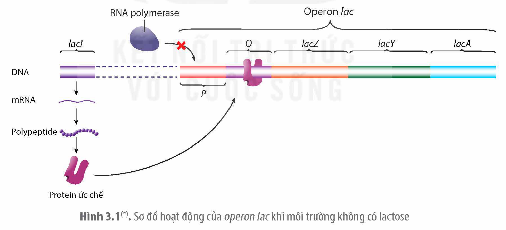
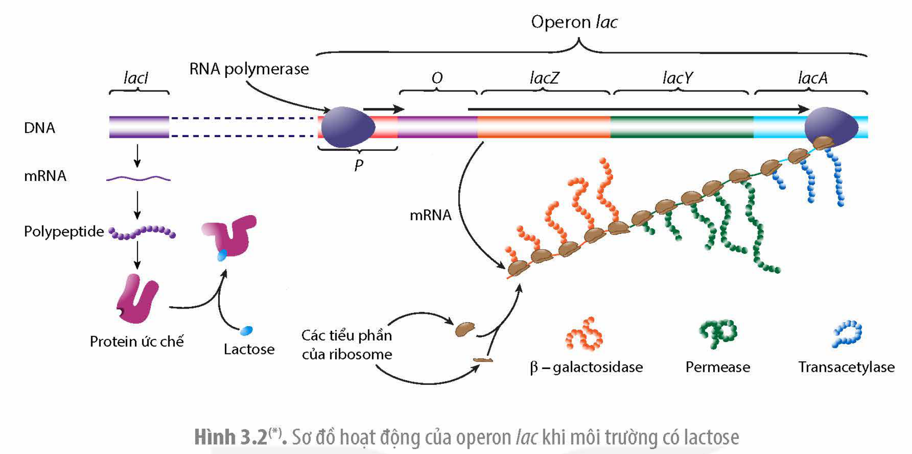

<!-- pdf:20 -->

# BÀI 3: ĐIỀU HOÀ BIỂU HIỆN GENE

## 🎯 Yêu cầu cần đạt

- Trình bày được thí nghiệm trên operon *Lac* của *E. coli*.
- Phân tích được ý nghĩa của điều hoà biểu hiện gene trong tế bào và trong quá trình phát triển cá thể.
- Nêu được ứng dụng của điều hoà biểu hiện gene.

## 🔴 Mở đầu

Trong mỗi tế bào có hàng chục nghìn gene nhưng tại mỗi thời điểm chỉ một số gene hoạt động. Làm thế nào tế bào có thể đóng/mở các gene nhất định đúng thời điểm, tạo ra đúng lượng sản phẩm tế bào cần?

## I. THÍ NGHIỆM PHÁT HIỆN RA OPERON *LAC* Ở VI KHUẨN *E. COLI*

Người đi tiên phong trong lĩnh vực nghiên cứu điều hoà hoạt động gene là Monod và Jacob. Vào những năm 1950, họ đã nghiên cứu phát hiện ra cơ chế điều hoà hoạt động của operon *lac* ở vi khuẩn *E. coli*.

### 1. Thí nghiệm

<!-- term: Transacetylase -->
<!-- term: Permease -->
<!-- term: β-galactosidase -->
Monod và Jacob đã tiến hành thí nghiệm tìm hiểu cơ chế lactose có thể gây cảm ứng khiến tế bào tổng hợp các enzyme phân giải lactose. Hai ông đã sử dụng các dòng đột biến gene ở vi khuẩn *E. coli* và nuôi cấy chúng trong điều kiện môi trường có lactose và không có latose. Sau đó, xác định lượng các loại enzyme tham gia quá trình phân giải lactose trong tế bào (gồm enzyme β–galatosidase có chức năng phân giải lactose, permease có chức năng vận chuyển lactose vào tế bào và transacetylase sau này được biết là có chức năng khử các chất độc vào tế bào). Một trong số các thí nghiệm của hai ông được tiến hành như sau:

**Lô đối chứng:** Nuôi vi khuẩn *E. coli* trong môi trường không có lactose và có các amino acid đánh dấu phóng xạ.

**Lô thí nghiệm:** Nuôi vi khuẩn *E. coli* trong môi trường có lactose và các amino acid đánh dấu phóng xạ.

**Kết quả:** Ở lô đối chứng, các enzyme β–galatosidase, permease và transacetylase đánh dấu phóng xạ xuất hiện với lượng không đáng kể, trong khi ở lô thí nghiệm, lượng các enzyme đánh dấu phóng xạ trong tế bào tăng mạnh so với ở lô đối chứng.

**Kết luận:** Lactose đã kích hoạt tế bào tổng hợp đồng thời cả ba enzyme β–galatosidase, permease và transacetylase.

<!-- pdf:21 -->

<!-- term: Thuyết operon -->
Sử dụng nhiều dòng đột biến khác nhau trong nhiều thí nghiệm di truyền khác, Monod và Jacob đã xác định được trình tự ba gene quy định các enzyme β–galatosidase, permease và transacetylase nằm liền nhau trong một vùng của phân tử DNA và đã đề xuất thuyết operon giải thích cơ chế điều hoà biểu hiện của các gene ở vi khuẩn *E. coli*.

### 2. Cấu trúc và cơ chế điều hoà biểu hiện gene của operon *lac*

**a) Cấu trúc operon lac**
<!-- ocr-ok: tiêu đề nghiêng đậm, đã đối chiếu ảnh PDF 21 -->

<!-- term: Transacetylase -->
<!-- term: Permease -->
<!-- term: β-galactosidase -->
<!-- term: Protein ức chế -->
**Operon** *lac* gồm vùng điều hoà và ba gene cấu trúc. Vùng điều hoà gồm trình tự P (promoter), là nơi enzyme RNA polymerase khởi động quá trình phiên mã các gene cấu trúc và trình tự O (**operator**), nơi liên kết với protein ức chế ngăn cản quá trình phiên mã. Tiếp đến là ba gene cấu trúc: *lacZ* quy định enzyme β-galatosidase, *lacY* quy định enzyme permease và gene *lacA* quy định enzyme transacetylase. Operon *lac* được điều hoà bởi gene điều hoà *lacI* quy định protein ức chế (lacI). Tuy nhiên, gene *lacI* không thuộc operon *lac*. Các nhà di truyền học thống nhất viết tên gene in nghiêng, còn sản phẩm của gene là protein thì được kí hiệu bằng tên gene nhưng không in nghiêng.

**b) Cơ chế điều hoà biểu hiện gene của operon lac**

<!-- term: Protein ức chế -->
**Khi môi trường không có lactose:** Protein ức chế lacI liên kết với operator khiến enzyme RNA polymerase không thể liên kết được với promoter nên các gene cấu trúc không được phiên mã (H 3.1).

Hình 3.1(\*). Sơ đồ hoạt động của *operon lac* khi môi trường không có lactose

**Khi môi trường có lactose:** Một lượng nhỏ lactose chuyển thành đồng phân của lactose và liên kết với protein ức chế lacI khiến protein này thay đổi cấu hình dẫn đến không liên kết được với operator, do vậy enzyme RNA polymerase có thể liên kết với promoter và tiến hành phiên mã các gene cấu trúc. Vì vi khuẩn không có màng nhân và gene không phân mảnh nên các gene cấu trúc phiên mã đến đâu được dịch mã đến đó tạo ra các loại enzyme tham gia vào quá trình phân giải lactose trong môi trường (H 3.2).

> (\*) Nguồn hình: Phạm Minh Kiên.

<!-- pdf:22 -->

Hình 3.2(\*). Sơ đồ hoạt động của operon *lac* khi môi trường có lactose

## ❓ Dừng lại và suy ngẫm

1. Quan sát các Hình 3.1 và 3.2, hãy giải thích cơ chế điều hoà biểu hiện gene của operon *lac*.
2. Tại sao môi trường có lactose thì protein ức chế lại không liên kết với operator?

## II. Ý NGHĨA VÀ ỨNG DỤNG THỰC TIỄN CỦA ĐIỀU HOÀ BIỂU HIỆN GENE

### 1. Ý nghĩa

Tế bào phải tiêu tốn rất nhiều năng lượng cho việc tổng hợp protein. Ví dụ: Tế bào vi khuẩn *E. coli* phải dùng tới 90% số ATP mà tế bào tạo ra để tổng hợp protein. Nhờ có sự điều hoà hoạt động gene, tế bào chỉ tổng hợp sản phẩm của gene khi cần thiết, với lượng phù hợp với nhu cầu nên tiết kiệm được năng lượng. Ngoài ra, điều hoà hoạt động gene còn đảm bảo cho tế bào thích nghi được với sự thay đổi của môi trường. Ví dụ: Khi tế bào gặp điều kiện nhiệt độ môi trường cao bất thường, một số gene được kích hoạt để tạo ra các protein chống sốc nhiệt; hay các tế bào miễn dịch chỉ kích hoạt các gene tổng hợp kháng thể khi tiếp xúc với các tác nhân gây bệnh.

<!-- term: Proto-oncogene -->
Điều hoà hoạt động gene còn có vai trò quan trọng trong quá trình phát triển của các sinh vật đa bào nhân thực. Từ hợp tử tạo ra được cơ thể sinh vật hoàn chỉnh với các tế bào và các mô chuyên hoá khác nhau là nhờ có sự điều hoà hoạt động gene một cách chính xác. Các tế bào sinh ra từ một hợp tử mặc dù có cùng hệ gene, nhưng các tế bào con nhận được các tín hiệu điều hoà khác nhau từ tế bào chất của hợp tử và trong quá trình phát triển lại nhận tín hiệu điều hoà từ các tế bào xung quanh nên các tế bào khác nhau đóng mở các nhóm gene khác nhau, tạo nên các tế bào chuyên hoá. Nếu quá trình điều hoà hoạt động gene trong quá trình phát triển bị trục trặc, phôi thai có thể bị chết hoặc cá thể sinh ra sẽ bị dị dạng. Ví dụ: Ở người, một gene được gọi là proto-oncogene thường tạo ra một

> (\*) Nguồn hình: Phạm Minh Kiên

<!-- pdf:23 -->

<!-- term: Proto-oncogene -->
<!-- term: Gene gây ung thư -->
lượng sản phẩm vừa đủ nhưng khi gene hoạt động quá mức sẽ trở thành gene gây ung thư (oncogene). Sự dư thừa sản phẩm của gene ung thư kích hoạt một loại tế bào cơ thể phân chia không kiểm soát dẫn đến bệnh ung thư.

### 2. Ứng dụng thực tiễn

Trong ngành y dược, khi biết được cơ chế hoạt động của gene gây bệnh, người ta có thể sản xuất ra các thuốc ức chế sản phẩm của gene gây bệnh. Ví dụ: Các nhà khoa học đã xác định được bốn nhóm ung thư vú chính gây nên bởi ba gene khác nhau là: (1) gene quy định thụ thể estrogen alpha *(ERα)*, (2) gene quy định thụ thể progesterone *(PR)* và (3) gene quy định thụ thể tyrosine kinase *(RTK)*. Nhờ vậy, người ta đã sản xuất ra được thuốc tamoxifen, một loại chất ức chế đặc hiệu thụ thể ERα để chữa trị cho những bệnh nhân bị ung thư vú do gene *ERα* biểu hiện quá mức. Tế bào gốc ở người và động vật cũng được nuôi cấy và xử lí để biệt hoá thành các loại tế bào khác nhau, dùng cho mục đích chữa bệnh hoặc để thử thuốc tác động đến các loại tế bào khác nhau.

Trong y học, những người bị lùn bẩm sinh do gene không tạo đủ hormone sinh trưởng có thể được chữa trị để có chiều cao gần như người bình thường.

Trong trồng trọt, các nhà khoa học có thể chủ động đóng mở một số gene nhất định ở cây trồng phù hợp với nhu cầu sản xuất. Ví dụ: Nuôi cấy tế bào thực vật trong môi trường có chứa các chất hoạt hoá gene để tế bào phân chia và tái sinh thành cây con hoàn chỉnh; sử dụng các chế độ chiếu sáng khác nhau điều khiển các gene để cây ra hoa vào mùa thích hợp.

Trong chăn nuôi, người ta có thể sử dụng các hormone sinh dục để điều khiển tỉ lệ giới tính ở động vật. Ví dụ: Sử dụng hormone sinh dục đực (testosterone) xử lí trứng cá rô phi đã thụ tinh có thể cho ra 100% cá đực, đem lại hiệu quả kinh tế cao hơn so với nuôi cá cái vì cá đực cho nhiều thịt và lớn nhanh hơn.

## ❓ Dừng lại và suy ngẫm

1. Phân tích ý nghĩa của điều hoà hoạt động gene trong tế bào và quá trình phát triển cá thể. Giải thích.
2. Hãy tìm thêm một số ứng dụng của điều hoà biểu hiện gene trong nông nghiệp và trong y học.

## 📌 Kiến thức cốt lõi

- Operon *lac* gồm vùng điều hoà promoter, operator và ba gene cấu trúc quy định các enzyme vận chuyển, phân giải lactose. Khi môi trường không có lactose, protein ức chế do gene điều hoà tạo ra liên kết vào vùng operator nên phiên mã không thể xảy ra. Khi môi trường có lactose, đồng phân của lactose liên kết với protein ức chế khiến protein không liên kết được với operator. Khi đó enzyme RNA polymerase liên kết được với promoter và quá trình phiên mã xảy ra.

> (\*) Nguồn: Campbell Biology 12e (2011).

<!-- pdf:24 -->

<!-- term: Điều hoà hoạt động gene -->
- Điều hoà hoạt động gene đảm bảo cho tế bào không bị lãng phí năng lượng. Ở sinh vật đa bào, điều hoà hoạt động gene khiến các tế bào trong cùng cơ thể được biệt hoá thực hiện các chức năng khác nhau trong quá trình phát triển cá thể.
- Điều hoà hoạt động gene có thể được ứng dụng để sản xuất một số loại thuốc chữa bệnh hoặc điều khiển sự sinh trưởng, phát triển của vật nuôi, cây trồng, đem lại hiệu quả kinh tế cao.

## ✏️ Luyện tập và vận dụng

1. Nêu ý nghĩa của điều hoà hoạt động đồng thời nhiều gene cùng lúc kiểu operon *lac*.
2. Nếu môi trường nuôi cấy vi khuẩn *E. coli* không có lactose nhưng operon *lac* vẫn hoạt động thì có thể dự đoán vi khuẩn bị hỏng ở bộ phận nào của operon *lac*? Giải thích.
3. Các nhà khoa học nhận thấy loài vi khuẩn *Streptococcus pneumoniae* khi gặp môi trường bất lợi (có thuốc kháng sinh) thì một trong số các gene được kích hoạt là gene *CSP*, sản sinh ra protein *CSP*. Protein này làm cho tế bào dễ dàng nhận được các gene từ môi trường bên ngoài. Các nhà khoa học cho rằng gene *CSP* hoạt động khi môi trường có thuốc kháng sinh làm cho vi khuẩn nhanh chóng trở nên kháng thuốc kháng sinh. Hãy giải thích.

## 💡 Em có biết

**Thức ăn của mẹ có thể làm thay đổi sự biểu hiện gene ở con**

<!-- term: Methyl hoá -->
<!-- term: Di truyền biểu sinh -->
Các nghiên cứu khoa học cho thấy, ăn thức ăn chứa hợp chất giàu nhóm methyl (CH$_3$) có thể làm cho một số vị trí cytosine của gene được gắn thêm nhóm CH$_3$ dẫn đến thay đổi sự biểu hiện của gene, làm xuất hiện kiểu hình mới. Kiểu hình mới này có thể di truyền được cho thế hệ sau và người ta gọi hiện tượng này là di truyền biểu sinh vì trình tự nucleotide trong gene không bị thay đổi. Một thí nghiệm cho chuột mẹ mang thai ăn thức ăn không chứa hợp chất có nhóm CH$_3$, kết quả sinh ra chuột con béo phì và có lông màu vàng. Tuy nhiên, khi cho chuột mẹ mang thai ăn thức ăn có chứa hợp chất chứa nhóm CH$_3$ như folic acid, thì chuột con sinh ra lại không bị béo phì và có lông màu xám. Hiện tượng di truyền biểu sinh tương tự như vậy cũng gặp ở người. Nhiều phụ nữ mang thai bị đói ăn trong Chiến tranh Thế giới II sinh ra con bị béo phì, tiểu đường type 2 và mỡ máu cao. Những người sinh đôi cùng trứng có cùng kiểu gene vẫn có một số đặc điểm khác nhau, đặc biệt khi tuổi cao, cũng được cho là do sự methyl hoá tại những vị trí khác nhau trong hệ gene ở mỗi người. Nhiều bằng chứng khoa học đã chứng minh, chế độ ăn uống lành mạnh và luyện tập hợp lí có thể hoạt hoá các gene chống lão hoá tế bào, ức chế các gene gây lão hoá dẫn đến kéo dài tuổi thọ.

## 📷 Danh sách hình trong bài

| Mã hình | Trang PDF | Vị trí | Chú thích gốc |
|---|---|---|---|
| H12-sinh-b03-01 | 21 | Mục I.2.b | Hình 3.1(\*). Sơ đồ hoạt động của operon lac khi môi trường không có lactose — (\*) Nguồn hình: Phạm Minh Kiên. |
| H12-sinh-b03-02 | 22 | Mục I.2.b | Hình 3.2(\*). Sơ đồ hoạt động của operon lac khi môi trường có lactose — (\*) Nguồn hình: Phạm Minh Kiên |
