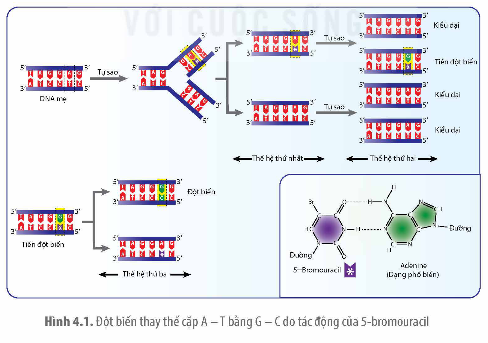

<!-- pdf:25 -->

# BÀI 4: ĐỘT BIẾN GENE

## 🎯 Yêu cầu cần đạt

- Nêu được khái niệm đột biến gene.
- Phân biệt được các dạng đột biến gene.
- Phân tích được nguyên nhân, cơ chế phát sinh đột biến gene.
- Trình bày được vai trò của đột biến gene trong tiến hoá, chọn giống và nghiên cứu di truyền.

## 🔴 Mở đầu

Đột biến gene có thể xảy ra bằng cách nào và liệu có cách nào phòng chống đột biến gene gây bệnh ở người?

## I. KHÁI NIỆM VÀ CÁC DẠNG ĐỘT BIẾN GENE

### 1. Khái niệm

**Đột biến gene** là sự thay đổi trình tự nucleotide trong gene. Nếu đột biến làm thay đổi một cặp nucleotide trong gene được gọi là **đột biến điểm**. Đột biến gene có thể làm thay đổi nhiều cặp nucleotide và có thể làm thay đổi kiểu hình hoặc không. Tuy nhiên, trong phạm vi bài này, chỉ xem xét loại đột biến điểm. Khi sinh vật mang gene đột biến biểu hiện kiểu hình khác thường thì được gọi là **thể đột biến**.

### 2. Các dạng đột biến gene

Dựa trên cơ chế phát sinh đột biến, các nhà di truyền học phân chia đột biến gene thành các loại: thay thế cặp nucleotide này bằng cặp nucleotide khác, thêm một cặp nucleotide và mất một cặp nucleotide. Các đột biến gene cũng có thể được phân loại theo các tiêu chí khác nhau như đột biến trội/lặn, có lợi/hại hay trung tính, có làm thay đổi trình tự amino acid hay không,...

## ❓ Dừng lại và suy ngẫm

1. Nêu khái niệm đột biến gene.
2. Đột biến gene có thể được phân loại theo những tiêu chí nào? Giải thích.

<!-- pdf:26 -->

## II. NGUYÊN NHÂN VÀ CƠ CHẾ PHÁT SINH

### 1. Nguyên nhân

<!-- term: Tác nhân đột biến -->
<!-- term: Đột biến tự phát -->
Đột biến gene có thể xảy ra một cách tự phát hoặc do tác động của các tác nhân đột biến vật lí, hoá học và sinh học. Đột biến tự phát xảy ra trong tế bào phần nhiều là do sai sót trong quá trình nhân đôi DNA. Các tác nhân gây đột biến gene có thể là các chất hoá học khác nhau như 5-bromouracil (5-BrU), HNO$_2$, ethyl methane sulfonate (EMS), các tác nhân vật lí như tia tử ngoại (UV) cũng có thể gây nên đột biến thêm hoặc mất cặp nucleotide. Tia X, tia gamma hay các tác nhân sinh học thường làm đứt gãy hai mạch của DNA dẫn đến các đột biến cấu trúc NST.

### 2. Cơ chế phát sinh

**a) Đột biến thêm/mất cặp nucleotide**

Trong quá trình tái bản DNA, nếu một nucleotide được sử dụng làm khuôn hai lần thì mạch mới được tổng hợp sẽ có thêm một nucleotide. Khi một nucleotide không được làm khuôn, mạch mới tổng hợp sẽ bị mất một nucleotide. Sau lần tái bản kế tiếp, các đột biến này sẽ dẫn đến thêm hoặc mất một cặp nucleotide.

Gene có thể bị đột biến trong quá trình tái bản hoặc không tái bản nếu bị tác động của các tác nhân đột biến. Ví dụ: Tia UV cũng có thể làm hai T trên cùng một mạch liên kết với nhau và khi tế bào sửa chữa thường dẫn đến đột biến thêm hoặc mất một cặp nucleotide. Chất độc màu cam (acridine orange) và dioxin có thể chèn vào DNA gây nên đột biến thêm hoặc mất cặp nucleotide.

**b) Đột biến thay thế cặp nucleotide**

Trong quá trình tái bản DNA, một số chất có cấu trúc giống với base bình thường được gắn vào mạch mới tổng hợp có thể gây ra đột biến thay thế nucleotide. Ví dụ: Chất 5- bromouracil có thể bắt cặp với adenine dẫn đến đột biến thay thế cặp A – T bằng G – C (H 4.2).

Hình 4.1. Đột biến thay thế cặp A – T bằng G – C do tác động của 5-bromouracil

<!-- pdf:27 -->

## ❓ Dừng lại và suy ngẫm

1. Nêu một số nguyên nhân gây đột biến gene.
2. Giải thích một số cơ chế phát sinh đột biến gene.

## III. VAI TRÒ CỦA ĐỘT BIẾN GENE

### 1. Trong nghiên cứu di truyền

Các thể đột biến gene là đối tượng rất quan trọng và cần thiết trong nghiên cứu di truyền. Việc tiến hành lai các dòng đột biến với nhau và theo dõi kết quả có thể giúp các nhà di truyền học tìm ra được tính trạng trội, lặn hay loại đột biến ở mỗi dòng thuộc cùng một gene hay thuộc hai gene khác nhau,... Ví dụ: Cả bố và mẹ đều bị bệnh điếc bẩm sinh do đột biến gene lặn nhưng sinh ra tất cả các con đều có thính lực bình thường. Điều này chứng tỏ đột biến lặn ở bố và mẹ thuộc hai gene khác nhau (♀ AAbb × ♂ aaBB).

### 2. Trong chọn giống

Từ xa xưa, con người đã biết chọn lọc ra những thể đột biến tự nhiên ở cây trồng và vật nuôi từ một số dạng tổ tiên ban đầu để tạo ra nhiều giống mới, đáp ứng nhu cầu dinh dưỡng và sở thích của mình. Ví dụ: Đột biến làm xuất hiện bộ ba kết thúc sớm khiến cho chồi cây cải phân nhánh mạnh đã được con người chọn lọc tạo nên các loại súp lơ trắng và súp lơ xanh, trong khi nhánh tiến hoá có cùng tổ tiên không bị đột biến hình thành nên các giống bắp cải và cải xoăn; Một đột biến ở gene điều hoà làm tăng lượng cơ bắp đã được phát hiện ở lợn và được chọn lọc tạo ra giống lợn có thịt siêu nạc.

### 3. Trong tiến hoá

Đột biến cung cấp nguồn nguyên liệu cho quá trình tiến hoá. Nhờ có các allele mới liên tục được tạo ra mà từ một vài dạng sống sơ khai, chọn lọc tự nhiên đã tạo nên thế giới sống vô cùng đa dạng và phong phú như hiện nay. Đột biến gene tạo nên các đặc điểm khác nhau giữa các loài. Ví dụ: Các đột biến làm thay đổi chỉ 2 trong số 715 amino acid của gene *FOX2* so với trình tự amino acid của gene này ở các loài tinh tinh đã làm xuất hiện tiếng nói đặc trưng cho loài người mà các loài linh trưởng không có được. Đột biến ở một số gene thậm chí có thể dẫn đến hình thành loài mới. Ví dụ: Đột biến làm thay đổi chiều xoắn của vỏ ốc trong chi *Bradybaena* khiến cho các con ốc đột biến không thể giao phối với ốc bình thường dẫn đến cách li sinh sản và hình thành loài mới.

## ❓ Dừng lại và suy ngẫm

1. Tại sao đột biến gene lại được xem là nguồn nguyên liệu cho quá trình tiến hoá?
2 Hãy sưu tập thêm các ví dụ minh hoạ cho vai trò của đột biến gene trong quá trình tiến hoá và trong chọn giống.

<!-- pdf:28 -->

## 📌 Kiến thức cốt lõi

- Đột biến làm thay đổi cấu trúc của gene, chỉ liên quan đến một cặp nucleotide được gọi là đột biến điểm. Nguyên nhân phát sinh đột biến có thể do sai sót trong quá trình tái bản DNA hoặc do các tác nhân đột biến.
- Dựa trên cơ chế phát sinh, đột biến gene được chia thành các loại: thay thế cặp nucleotide, thêm hoặc mất một cặp nucleotide.
- Đột biến gene giúp các nhà di truyền học khám phá chức năng của gene, tìm ra các quy luật di truyền cũng như nhiều quá trình sinh học khác. Đột biến gene là nguồn nguyên liệu cho quá trình tiến hoá và chọn giống.

## ✏️ Luyện tập và vận dụng

1. Sưu tập thông tin về một số tác nhân đột biến có trong môi trường hoặc xuất hiện trong quá trình bảo quản và chế biến thực phẩm.
2. Một số virus có thể chèn hệ gene của chúng vào hệ gene người, gây đột biến gene và gây ra nhiều bệnh hiểm nghèo, trong đó có một số loại ung thư. Hãy cho biết các biện pháp phòng tránh đột biến gene ở người gây nên bởi một số loại virus như virus viêm gan B.
3. Một số bệnh ung thư ở người, ví dụ ung thư da do da tiếp xúc nhiều với tia UV trong ánh sáng mặt trời gây đột biến gene. Dựa vào nguyên nhân và cơ chế phát sinh đột biến gene, hãy cho biết chúng ta có thể làm gì để phòng tránh các bệnh do đột biến gene.

## 📷 Danh sách hình trong bài

| Mã hình | Trang PDF | Vị trí | Chú thích gốc |
|---|---|---|---|
| H12-sinh-b04-01 | 26 | Mục II.2.b | Hình 4.1. Đột biến thay thế cặp A – T bằng G – C do tác động của 5-bromouracil (chữ trong bài dẫn "H 4.2" — lỗi in của sách) |
