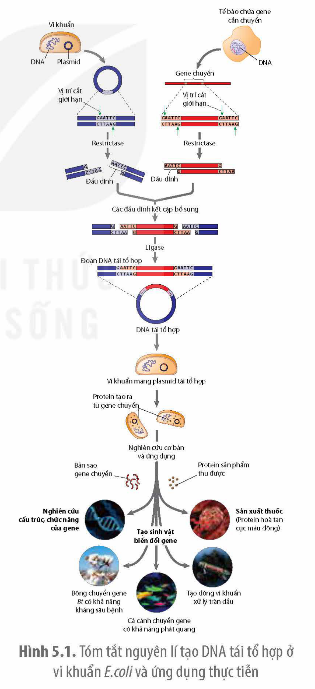
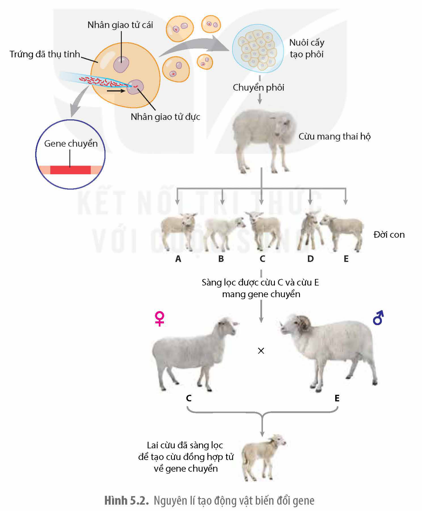

<!-- pdf:29 -->

# BÀI 5: CÔNG NGHỆ GENE

## 🎯 Yêu cầu cần đạt

- Nêu được khái niệm, nguyên lí và một số thành tựu của công nghệ DNA tái tổ hợp.
- Nêu được khái niệm, nguyên lí và một số thành tựu tạo thực vật và động vật biến đổi gene.
- Tranh luận, phản biện được về việc sản xuất và sử dụng sản phẩm biến đổi gene và đạo đức sinh học.

## 🔴 Mở đầu

Làm thế nào các nhà khoa học có thể chuyển được gene từ loài này sang loài khác?

**Công nghệ gene** là quy trình kĩ thuật sử dụng công nghệ DNA tái tổ hợp để thay đổi kiểu gene và kiểu hình của sinh vật, tạo ra các sản phẩm protein ứng dụng trong thực tiễn. Công nghệ gene gồm công nghệ DNA tái tổ hợp và công nghệ tạo sinh vật biến đổi gene.

## I. CÔNG NGHỆ DNA TÁI TỔ HỢP

### 1. Khái niệm

**Công nghệ DNA tái tổ hợp** là quy trình kĩ thuật tạo ra phân tử DNA từ hai nguồn khác nhau (thường từ hai loài) rồi chuyển vào tế bào nhận. **DNA tái tổ hợp** gồm một gene (**gene chuyển**) và DNA dùng làm **vector**. Đoạn DNA làm vector phải có khả năng tái bản cũng như đảm bảo cho gene chuyển được phiên mã và dịch mã tạo ra sản phẩm protein của gene chuyển trong tế bào nhận.

### 2. Nguyên lí

Nguyên lí tạo DNA tái tổ hợp là sử dụng các kĩ thuật di truyền tách chiết gene ra khỏi tế bào, kĩ thuật nhân bản gene, kĩ thuật cắt và ghép nối các đoạn DNA với nhau sao cho gene khi đưa vào tế bào nhận có thể tạo ra được sản phẩm có chức năng.

Hình 5.1 tóm tắt nguyên lí tạo DNA tái tổ hợp ở vi khuẩn và những ứng dụng trong nghiên cứu khoa học và thực tiễn.

Hình 5.1. Tóm tắt nguyên lí tạo DNA tái tổ hợp ở vi khuẩn *E.coli* và ứng dụng thực tiễn

<!-- pdf:30 -->

### 3. Một số thành tựu

Công nghệ DNA tái tổ hợp đạt được nhiều thành tựu quan trọng, đặc biệt là tạo ra các dòng vi sinh vật biến đổi gene đem lại nhiều ứng dụng trong nghiên cứu di truyền học và trong đời sống.

**Trong ngành dược phẩm:** Năm 1979, công ty Eli Lilly đã sản xuất và bán ra thị trường thuốc insulin người được tạo ra nhờ công nghệ DNA tái tổ hợp. Gene quy định hormone insulin của người đã được tách chiết và loại bỏ intron, sau đó được gắn vào vector là plasmid rồi chuyển vào tế bào vi khuẩn. Vi khuẩn chuyển gene đã sản xuất được hormone insulin của người. Sau đó, sản phẩm của gene được tách chiết từ các tế bào vi khuẩn và được xử lí hoá học để tạo ra insulin có chức năng.

**Trong ngành công nghiệp và bảo vệ môi trường:** Vi khuẩn biến đổi gene đã được sử dụng làm tăng hiệu quả sản xuất hơn nhiều lần so với khi sử dụng các vi khuẩn bình thường. Vi sinh vật biến đổi gene được sử dụng trong nhiều ngành sản xuất công nghiệp như ngành sản xuất ethanol từ các vật liệu thực vật hay ngành công nghiệp xử lí nước thải, xử lí các hoá chất độc hại gây ô nhiễm môi trường, tách chiết các kim loại nặng độc hại, tăng cường thu hồi dầu,…

**Trong nông nghiệp:** Một số loại vi khuẩn biến đổi gene giúp cây trồng tăng cường hấp thụ nitrogen, ức chế các vi khuẩn và nấm gây bệnh cho cây.

## ❓ Dừng lại và suy ngẫm

1. Công nghệ DNA tái tổ hợp là gì? Tóm tắt nguyên lí.
2. Sưu tập thêm một số thành tựu của công nghệ DNA tái tổ hợp.

## II. CÔNG NGHỆ TẠO THỰC VẬT VÀ ĐỘNG VẬT BIẾN ĐỔI GENE

### 1. Khái niệm sinh vật biến đổi gene

**Sinh vật biến đổi gene** nói chung hay động vật và thực vật biến đổi gene nói riêng, là sinh vật có hệ gene đã được biến đổi, chủ yếu là có thêm gene mới từ loài khác. Vì vậy, các động vật và thực vật có thêm gene từ các từ loài khác còn được gọi là **động vật và thực vật chuyển gene**.

Mục đích tạo thực vật và động vật biến đổi gene là tạo ra những sinh vật có các đặc điểm khác thường chưa từng tồn tại trong tự nhiên, phục vụ các nhu cầu khác nhau của con người.

### 2. Nguyên lí tạo động vật và thực vật biến đổi gene

Tạo thực vật và động vật biến đổi gene đều dựa trên nguyên lí DNA tái tổ hợp, tạo ra tế bào thực vật hoặc hợp tử của động vật có được gene chuyển (thường là từ loài khác). Tuy vậy, để cho tế bào thực vật và hợp tử của động vật có thể phát triển thành một cá thể chuyển gene hoàn chỉnh cần phải có thêm các công nghệ thích hợp cho từng đối tượng.

<!-- pdf:31 -->

**a) Nguyên lí tạo động vật biến đổi gene**

Để tạo ra động vật chuyển gene, các nhà khoa học phải sử dụng trứng vừa mới được thụ tinh dùng làm tế bào nhận gene chuyển. Tế bào trứng đủ lớn để có thể dùng kim tiêm bơm hàng trăm bản sao của cùng một gene chuyển vào trong tế bào. Trứng vừa mới thụ tinh khi nhân của tinh trùng và nhân của trứng chưa hoà nhập với nhau là thời điểm thích hợp để nhận gene chuyển.

Thông thường, các nhà khoa học phải tiêm gene chuyển vào rất nhiều trứng vừa mới thụ tinh, để có thể may mắn nhận được một vài trứng mà ở đó có gene chuyển tích hợp được vào hệ gene của một trong hai nhân, trứng hoặc tinh trùng. Gene chuyển khi được tiêm vào tế bào trứng mới thụ tinh sẽ tích hợp ngẫu nhiên vào hệ gene của tinh trùng hoặc của trứng. Hợp tử chuyển gene sau đó được nuôi cấy thành phôi nang rồi đưa phôi vào tử cung của "mẹ nuôi" cho mang thai sinh và ra con vật chuyển gene (H 5.2).

Hình 5.2. Nguyên lí tạo động vật biến đổi gene

<!-- pdf:32 -->

**b) Nguyên lí tạo thực vật biến đổi gene**

<!-- term: Súng bắn gene -->
Nguyên lí tạo cây chuyển gene dựa trên công nghệ DNA tái tổ hợp giống như ở vi khuẩn. Vì tế bào thực vật có thành tế bào nên việc chuyển DNA tái tổ hợp có thể thực hiện bằng súng bắn gene bắn các hạt chứa DNA tái tổ hợp được bọc bằng vàng hay vonfram vào tế bào hoặc dùng virus. Tế bào chuyển gene sau đó được nuôi cấy cho tái sinh thành các cây chuyển gene.

### 3. Một số thành tựu

<!-- term: Lúa vàng -->
**Đối với thực vật:** Các nhà khoa học đã tạo ra giống lúa có tên là "lúa vàng" có thêm gene tổng hợp nên tiền chất của vitamin A. Sử dụng loại gạo này giúp con người không bị thiếu hụt vitamin A. Giống bông chuyển gene có được gene lấy từ vi khuẩn tạo ra độc tố chống lại sâu hại nên khi trồng cây không phải sử dụng thuốc trừ sâu hoá học,…

**Đối với động vật:** Cừu chuyển gene đã được tạo ra có gene quy định protein antithrombin của người. Đặc biệt hơn là antithrombin được tổng hợp và tiết vào sữa cừu, vì thế sản phẩm của gene chuyển dễ dàng được tách chiết dùng làm thuốc chống đông máu sử dụng trong các ca phẫu thuật. Cá hồi chuyển gene có thêm gene quy định hormone sinh trưởng có tốc độ sinh trưởng cao hơn nhiều so với cá hồi bình thường.

Mặc dù công nghệ tạo sinh vật biến đổi gene đã đạt được một số thành tựu và mang lại nhiều lợi ích cho xã hội như tăng năng suất, chất lượng cây trồng và vật nuôi nhưng cũng gây nên một số quan ngại trong xã hội. Sử dụng sinh vật biến đổi gene gây nguy cơ phát tán các gene chuyển vào tự nhiên. Ví dụ: Cây trồng có gene kháng thuốc diệt cỏ, kháng côn trùng, kháng virus có thể lai với các cây hoang dại và truyền các gene này vào các cây hoang dại, tạo nên các "siêu cỏ dại" khó có thể bị tiêu diệt. Hay việc sử dụng sản phẩm biến đổi gene về lâu dài có thể gây nên những vấn đề về sức khoẻ như dị ứng hay các bệnh khác. Vì vậy, nhiều chính phủ không cấm sử dụng thực phẩm biến đổi gene nhưng yêu cầu nhà sản xuất ghi rõ trên bao bì sản phẩm là thực phẩm biến đổi gene để cho ngươi tiêu dùng lựa chọn.

Ứng dụng công nghệ gene cũng gây quan ngại về vấn đề đạo đức sinh học. Ví dụ: Liệu có nên cho phép biến đổi hệ gene của người? Nhiều nước cho rằng các phôi thai người là không thể tuỳ tiện phá bỏ hay điều chỉnh hệ gene. Việc sử dụng DNA tái tổ hợp trong việc chữa các bệnh di truyền cũng gây quan ngại vì chưa thể đảm bảo gene được thay thế có hoạt động bình thường và không ảnh hưởng đến các gene khác hay không. Do vậy, sử dụng công nghệ DNA tái tổ hợp để chỉnh sửa hệ gene người được cho là vi phạm đạo đức và đang bị cấm nghiên cứu ở nhiều quốc gia.

## ❓ Dừng lại và suy ngẫm

1. Thế nào là sinh vật biến đổi gene?
2. Sưu tập một số thành tựu tạo sinh vật biến đổi gene.

<!-- pdf:33 -->

## 📌 Kiến thức cốt lõi

- Công nghệ di truyền là quy trình kĩ thuật sử dụng công nghệ DNA tái tổ hợp để thay đổi kiểu gene và kiểu hình của sinh vật, tạo ra các sản phẩm protein ứng dụng trong thực tiễn.
- Công nghệ DNA tái tổ hợp là quy trình kĩ thuật tạo ra phân tử DNA từ hai nguồn khác nhau (thường từ hai loài) rồi chuyển vào tế bào nhận với mục đích tạo ra được nhiều sản phẩm protein của gene chuyển.
- Tạo động vật và thực vật biến đổi gene đều dựa trên công nghệ DNA tái tổ hợp. Tuy vậy, tạo động vật chuyển gene, ngoài công nghệ DNA tái tổ hợp cần có công nghệ thụ tinh nhân tạo; còn tạo cây chuyển gene cần thêm công nghệ nuôi cấy tế bào để tái sinh tế bào chuyển gene thành cây chuyển gene.
- Công nghệ gene đem lại nhiều ứng dụng thực tiễn nhưng cũng gây nên những quan ngại về sức khoẻ, môi trường và đạo đức sinh học.

## ✏️ Luyện tập và vận dụng

1. Nếu tách một gene của người khỏi hệ gene rồi gắn vào plasmid tạo DNA tái tổ hợp, sau đó chuyển vào tế bào vi khuẩn *E. coli* thì vi khuẩn có tạo ra được protein của gene người hay không? Giải thích.
2. Hiện nay nước ta có nhiều loại cây trồng biến đổi gene được trồng ở nhiều địa phương. Hãy tìm hiểu những loại cây trồng nào đang được trồng ở địa phương em và ở Việt Nam nói chung.
3. Đảng và nhà nước ta đang đặc biệt quan tâm đầu từ cho việc nghiên cứu phát triển công nghệ gene. Hãy sưu tập thêm tư liệu về vai trò của công nghệ gene hay kĩ thuật di truyền đối với sự phát triển của đất nước ta trong tương lai.

> (\*) Nguồn: Biology của Campbell 12 và An introduction into genetics analysis, Griffiths 2015.

## 📷 Danh sách hình trong bài

| Mã hình | Trang PDF | Vị trí | Chú thích gốc |
|---|---|---|---|
| H12-sinh-b05-01 | 29 | Mục I.2 | Hình 5.1. Tóm tắt nguyên lí tạo DNA tái tổ hợp ở vi khuẩn E.coli và ứng dụng thực tiễn |
| H12-sinh-b05-02 | 31 | Mục II.2.a | Hình 5.2. Nguyên lí tạo động vật biến đổi gene |
