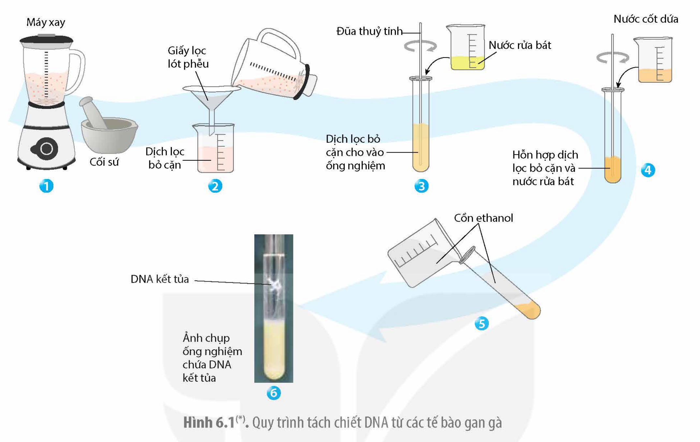

<!-- pdf:34 -->

# BÀI 6: THỰC HÀNH: TÁCH CHIẾT DNA

## I. YÊU CẦU CẦN ĐẠT

Thực hành tách chiết được DNA từ các mẫu vật sống.

## II. CHUẨN BỊ

### 1. Dụng cụ, thiết bị

- Chày, cối sứ hoặc máy xay thịt, máy nghiền mẫu vật sống.
- Ống nghiệm thuỷ tinh, giá đỡ ống nghiệm, giấy lọc và phễu lọc.
- Tăm tre dài hoặc que tre tròn hay que thuỷ tinh.

### 2. Nguyên liệu, hoá chất
<!-- ocr-ok: tiêu đề đậm, đã đối chiếu ảnh PDF 34 -->

- Gan gà hoặc mô động vật, thực vật tươi sống bất kì. Tuỳ điều kiện thực tế để lựa chọn mẫu vật cho phù hợp.
- Dứa tươi: 1/4 quả.
- Nước rửa chén bát hoặc dung dịch tẩy rửa: 500 mL.
- Cồn ethanol lạnh (70 – 95%): 500 mL.

*Lưu ý:*

- Mô thực vật thường chứa nhiều nước, ít DNA hơn so với mô động vật, đồng thời có chứa diệp lục hoặc các sắc tố nên cần phải loại bỏ sắc tố trước khi tách chiết thì mới quan sát được kết tủa DNA. Nếu có điều kiện, nên sử dụng mẫu vật là gan gà hoặc gan lợn (như trình bày trong bài thực hành) vừa dễ nghiền, vừa giàu DNA.
- Khối lượng mẫu vật sống được sử dụng có thể thay đổi tuỳ theo đối tượng sử dụng (đối với mẫu vật là gan, thịt động vật, thường sử dụng khoảng 5 g; đối với mẫu thực vật, thường sử dụng 50 g).
- Trong cùng một lớp, mỗi nhóm học sinh có thể làm với một loại mẫu vật để xem loại mô nào cho nhiều DNA hơn.

## III. NGUYÊN LÍ VÀ CÁCH TIẾN HÀNH

### 1. Nguyên lí

<!-- term: Dung dịch tẩy rửa -->
<!-- term: Protease -->
- Do DNA tồn tại trong nhân tế bào nên để tách chiết được DNA ra khỏi tế bào, cần phá vỡ mô để tách rời các tế bào và phá huỷ thành tế bào bằng việc nghiền mẫu vật trong cối hoặc trong máy xay; phá huỷ màng tế bào, màng nhân bằng các dung dịch tẩy rửa hoà tan lipid nhằm giải phóng dịch nhân tế bào vào dung dịch chiết xuất.
- Trong tế bào, DNA liên kết với nhiều protein (như histone, các protein điều hoà và phiên mã), nên cần loại bỏ các protein bằng enzyme phân giải protein protease (có trong nước ép dứa tươi) để phân cắt chuỗi polypeptide thành các amino acid đơn phân hoặc đoạn peptide nhỏ, dung dịch lúc này chỉ còn các đại phân tử DNA và RNA.

<!-- pdf:35 -->

<!-- term: Kết tủa DNA -->
- Để tách DNA ra khỏi dung dịch chiết xuất, cần kết tủa DNA bằng ethanol. Do ethanol có ái lực với nước mạnh hơn với DNA nên khi cho cồn ethanol vào dịch chiết chứa DNA thì các phân tử DNA có xu hướng bị đẩy sát lại gần nhau và kết tụ lại với nhau dưới dạng vật chất có màu trắng đục.
- Vì ethanol nhẹ hơn nước, nên khi cho ethanol vào phía trên dịch chiết tế bào sẽ tách thành lớp trong suốt trong ống nghiệm phía bên trên, lúc này DNA sẽ đi từ dịch chiết tế bào lên và bị kết tủa dưới dạng vật chất có màu trắng đục. Do bị kết tủa (biến tính), DNA trở nên dễ gãy nên cần nhẹ tay khi thao tác vớt DNA ra khỏi ống nghiệm.

*Lưu ý:*

<!-- term: Diphenylamine -->
Chất kết tủa màu trắng thu được theo quy trình thí nghiệm này chủ yếu là DNA và có thể nhận biết bằng dung dịch diphenylamine ở nhiệt độ cao tạo phức màu xanh lam. Tuy nhiên, trong khuôn khổ bài thực hành này, chúng ta không đủ thời gian và điều kiện để làm thêm thí nghiệm đó.

### 2. Cách tiến hành

Quy trình dưới đây mô tả các bước tách chiết DNA với mẫu vật là gan gà.

*Bước 1:* Nghiền khoảng 5 g gan gà trong cối sứ hoặc xay trong cối xay thịt thật kĩ sao cho gan được xay nhỏ nhất (nếu dùng máy xay thì xay khoảng 30 – 60 giây). Sau đó cho thêm khoảng 150 mL nước lạnh vào, khuấy đều. Lấy 1/4 quả dứa đã gọt vỏ, đem nghiền và ép lấy nước dứa và đổ vào một ống nghiệm.

*Bước 2:* Dung dịch chứa các tế bào gan xay được lọc qua phễu lọc để loại bỏ phần cặn, chỉ lấy dịch nước trong.

*Bước 3:* Cho dịch lọc vào trong một ống nghiệm khác cùng với 30 mL dung dịch nước rửa bát pha loãng, khuấy đều, sau đó để yên trên giá ống nghiệm khoảng 5 – 10 phút.

*Bước 4:* Rót hỗn hợp dịch gan gà cùng nước rửa bát lấy từ bước 3 sang ống nghiệm mới với thể tích dịch khoảng 1/3 đến 1/2 ống nghiệm; bổ sung 5 mL nước dứa tươi vào ống nghiệm và khuấy nhẹ rồi để yên trong khoảng 10 phút.

*Bước 5:* Ống nghiệm lấy từ bước 4 được đổ thêm cồn ethanol theo cách rót cồn chảy từ từ theo thành ống nghiệm cho đến khi gần đầy ống nghiệm. Sau ít phút, chất màu trắng kết tủa sẽ nổi lên ở lớp cồn phía trên ống nghiệm, đây chính là các sợi DNA được kết tủa. Dùng tăm tre hoặc đũa thuỷ tinh quấn lấy DNA và đưa ra khỏi ống nghiệm. Lưu ý, xoay nhẹ tăm tre hoặc đũa thuỷ tinh để DNA bám vào, tránh làm mạnh tay sẽ khiến DNA bị gãy vụn, không lấy ra được.

Toàn bộ quy trình tách chiết DNA được khái quát trong Hình 6.1.

<!-- pdf:36 -->

Hình 6.1(\*). Quy trình tách chiết DNA từ các tế bào gan gà

## IV. THU HOẠCH

Học sinh viết báo cáo thực hành theo các nội dung sau:

**BÁO CÁO THỰC HÀNH**

1. **Mục đích**
2. **Kết quả và giải thích**
3. **Trả lời các câu hỏi**

a) Tại sao phải sử dụng dung dịch nước rửa chén bát hay dung dịch tẩy rửa?

b) Tại sao cần sử dụng nước dứa? Có thể thay nước dứa bằng dung dịch gì?

c) Tại sao cần sử dụng cồn ethanol?

d) Cần phải cải tiến, khắc phục điều gì để thu được kết quả tốt hơn?

> (\*) Nguồn hình: Phạm Minh Kiên

## 📷 Danh sách hình trong bài

| Mã hình | Trang PDF | Vị trí | Chú thích gốc |
|---|---|---|---|
| H12-sinh-b06-01 | 36 | Mục III.2 | Hình 6.1(\*). Quy trình tách chiết DNA từ các tế bào gan gà — (\*) Nguồn hình: Phạm Minh Kiên |
