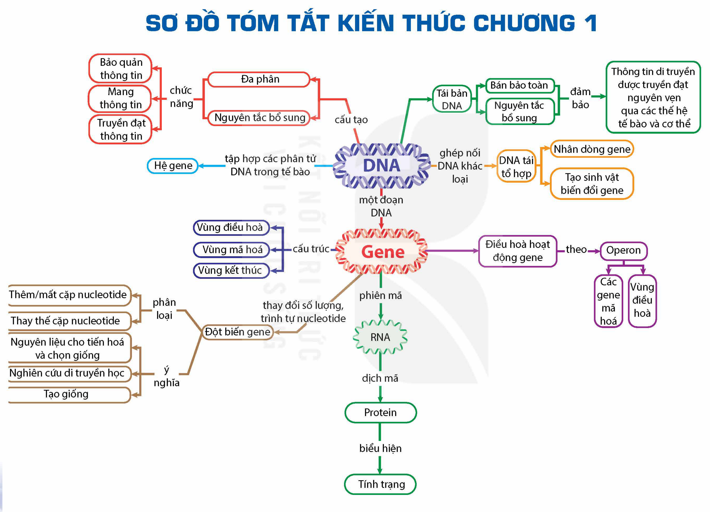

<!-- pdf:37 -->

# SƠ ĐỒ TÓM TẮT KIẾN THỨC CHƯƠNG 1

<!-- Trang in xoay ngang; ảnh đã xoay lại. Dưới đây chép các nhánh của sơ đồ thành danh sách, giữ nguyên chữ trong các ô và trên các mũi tên. -->

- DNA
  - cấu tạo: Đa phân; Nguyên tắc bổ sung
    - chức năng: Bảo quản thông tin; Mang thông tin; Truyền đạt thông tin
  - Tái bản DNA: Bán bảo toàn; Nguyên tắc bổ sung
    - đảm bảo: Thông tin di truyền được truyền đạt nguyên vẹn qua các thế hệ tế bào và cơ thể
  - ghép nối DNA khác loại: DNA tái tổ hợp
    - Nhân dòng gene; Tạo sinh vật biến đổi gene
  - tập hợp các phân tử DNA trong tế bào: Hệ gene
  - một đoạn DNA: Gene
- Gene
  - cấu trúc: Vùng điều hoà; Vùng mã hoá; Vùng kết thúc
  - Điều hoà hoạt động gene
    - theo: Operon (Các gene mã hoá; Vùng điều hoà)
  - thay đổi số lượng, trình tự nucleotide: Đột biến gene
    - phân loại: Thêm/mất cặp nucleotide; Thay thế cặp nucleotide
    - ý nghĩa: Nguyên liệu cho tiến hoá và chọn giống; Nghiên cứu di truyền học; Tạo giống
  - phiên mã: RNA
    - dịch mã: Protein
      - biểu hiện: Tính trạng
<!-- ocr-ok: chữ trong các ô sơ đồ, OCR đọc không theo thứ tự; đã đối chiếu ảnh đã xoay -->

## 📷 Danh sách hình trong bài

| Mã hình | Trang PDF | Vị trí | Chú thích gốc |
|---|---|---|---|
| H12-sinh-so-do-tom-tat-c01-01 | 37 | Cả trang (in xoay ngang) | Sơ đồ tóm tắt kiến thức chương 1 |
