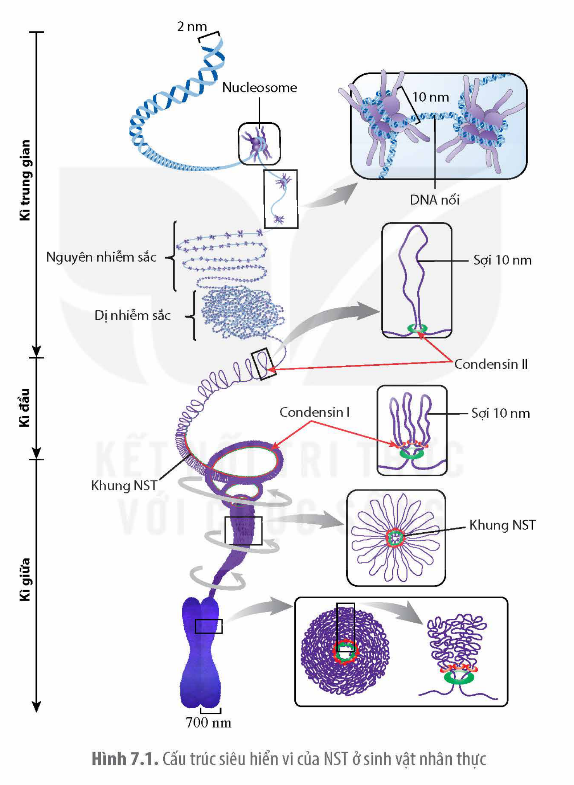
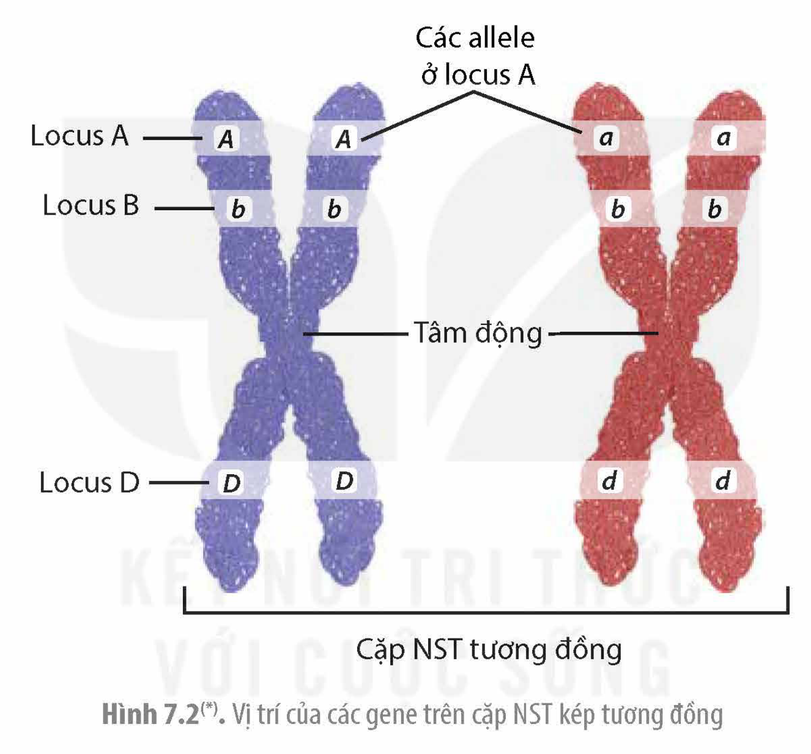

<!-- pdf:38 -->

# BÀI 7: CẤU TRÚC VÀ CHỨC NĂNG CỦA NHIỄM SẮC THỂ

## 🎯 Yêu cầu cần đạt

- Dựa vào sơ đồ (hoặc hình ảnh), trình bày được cấu trúc siêu hiển vi của NST.
- Trình bày được NST là vật chất di truyền.
- Mô tả được cách sắp xếp các gene trên NST, mỗi gene định vị tại mỗi vị trí xác định gọi là locus.
- Trình bày được ý nghĩa của nguyên phân, giảm phân và thụ tinh trong nghiên cứu di truyền. Từ đó, giải thích được nguyên phân, giảm phân và thụ tinh quyết định quy luật vận động và truyền thông tin di truyền của các gene qua các thế hệ tế bào và cá thể.
- Phân tích được sự vận động của NST (tự nhân đôi, phân li, tổ hợp, tái tổ hợp) trong nguyên phân, giảm phân và thụ tinh là cơ sở của sự vận động của gene được thể hiện trong các quy luật di truyền, biến dị tổ hợp và biến dị số lượng NST.

## 🔴 Mở đầu

Tổng chiều dài 46 phân tử DNA trong tế bào người khoảng 2 m. Làm thế nào các phân tử này có thể nằm gọn trong nhân tế bào nhưng vẫn đảm bảo cho các gene có thể phiên mã?

## I. CẤU TRÚC SIÊU HIỂN VI CỦA NHIỄM SẮC THỂ

**NST** là một cấu trúc trong nhân tế bào, dễ bị nhuộm màu bởi một số loại thuốc nhuộm đặc hiệu với DNA. Dưới kính hiển vi quang học, hình thái NST được quan sát rõ nhất vào kì giữa và có thể chia thành các dạng tâm mút, tâm lệch hoặc tâm giữa tuỳ thuộc vào vị trí của tâm động trên NST. Cấu trúc siêu hiển vi của NST ở kì trung gian, kì đầu và kì giữa nhìn dưới kính hiển vi điện tử được trình bày ở Hình 7.1.

**Kì trung gian:** Mỗi NST trông như một chuỗi do các đoạn phân tử DNA liên kết với các protein histone tạo nên cấu trúc hình cầu được gọi là **nucleosome**. Chuỗi các nucleosome có đường kính khoảng 10 nm với các vùng có các nucleosome nằm sát nhau được gọi là **dị nhiễm sắc** và vùng có các nucleosome nằm cách xa nhau được gọi là **nguyên nhiễm sắc**. Vùng dị nhiễm sắc hoặc không chứa gene (như tâm động và đầu mút) hoặc chứa các gene bị bất hoạt. Vùng nguyên nhiễm sắc thường chứa các gene đang hoạt động.

<!-- pdf:39 -->

**Kì đầu:** Sợi nhiễm sắc đường kính 10 nm co xoắn lại dưới tác động của các protein condensin II và condensin I. Các **condensin** là những protein nhỏ, dạng vòng liên kết với nhau tạo nên bộ khung NST. Sợi nhiễm sắc 10 nm được luồn vào các vòng protein tạo ra các vòng nhô ra phía ngoài khung NST làm cho chiều dài NST giảm mạnh và tăng dần chiều rộng. Toàn bộ cấu trúc khung nhiễm sắc tiếp tục co xoắn và nén lại (mũi tên xoắn bên ngoài hình) khiến các vòng sợi 10nm xếp chồng sát bên nhau và nhô dài ra làm NST tăng chiều rộng và ngắn lại ở mức cực đại vào kì giữa tạo nên mỗi chromatid có đường kính khoảng 700 nm.

Hình 7.1. Cấu trúc siêu hiển vi của NST ở sinh vật nhân thực

## ❓ Dừng lại và suy ngẫm

Dựa vào Hình 7.1, hãy mô tả cấu trúc siêu hiển vi của NST qua các kì trung gian, kì đầu và kì giữa.

<!-- pdf:40 -->

## II. CHỨC NĂNG CỦA NST

### 1. Mang thông tin di truyền

<!-- term: Tâm động -->
<!-- term: Đầu mút NST -->
Các gene nằm kế tiếp nhau dọc theo chiều dài NST và vị trí của gene trên NST được gọi là **locus**. Cùng một locus trên cặp NST tương đồng có thể chứa trình tự nucleotide khác nhau được gọi là các **allele** của một gene (H 7.2). Số lượng gene và sự phân bố của các gene trên NST của cùng bộ NST cũng rất khác nhau. Có NST chứa nhiều gene và mật độ khá dày, NST khác lại chứa ít gene và các gene nằm xa nhau. Ngoài các gene, NST còn chứa các trình tự nucleotide ở đầu mút bảo vệ NST và trình tự tâm động gắn với thoi phân bào khiến NST di chuyển được khi phân chia tế bào.

Hình 7.2(\*). Vị trí của các gene trên cặp NST kép tương đồng

### 2. Truyền đạt thông tin di truyền qua các thế hệ tế bào và giữa các cấp độ NST

<!-- term: Nguyên phân -->
Trong nguyên phân, NST được nhân đôi và phân chia đồng đều về hai tế bào con nên thông tin di truyền được truyền đạt nguyên vẹn qua các thế hệ tế bào và thế hệ cơ thể (loài sinh sản vô tính). Ở các sinh vật đa bào có hình thức sinh sản hữu tính, nguyên phân đảm bảo các tế bào cơ thể có bộ NST lưỡng bội như nhau, mỗi gene có hai bản sao nên một bản có bị đột biến cũng ít gây hại cho cơ thể. Nhờ sự vận động của NST trong nguyên phân và giảm phân nên các gene được truyền nguyên vẹn nhưng dưới dạng các tổ hợp gene khác từ thế hệ này sang thế hệ khác. Do vậy, sinh vật ở các thế hệ sau có thể thích nghi với các điều kiện môi trường khác nhau.

> (\*) Nguồn hình: Phạm Minh Kiên.

<!-- pdf:41 -->

## ❓ Dừng lại và suy ngẫm

1. Mô tả cách sắp xếp gene trên NST.
2. Giải thích vai trò của nguyên phân, giảm phân và thụ tinh trong quá trình truyền đạt thông tin di truyền giữa các thế hệ tế bào và thế hệ cơ thể.

## 📌 Kiến thức cốt lõi

- NST ở kì trung gian tồn tại ở dạng chuỗi nucleosome có đường kính khoảng 10 nm. Sợi cơ bản này được co xoắn dần ở kì đầu và co cực đại ở kì giữa với đường kính 700 mm.
- Mỗi gene chiếm một vị trí xác định trên NST được gọi là locus.
- Sự nhân đôi của NST và sự phân li của các nhiễm sắc tử trong nguyên phân, giảm phân đảm bảo thông tin di truyền được truyền từ thế hệ này sang thế hệ khác dưới dạng các tổ hợp gene khác nhau, nhờ vậy sinh vật luôn có khả năng thích nghi với sự thay đôi của môi trường.

## ✏️ Luyện tập và vận dụng

1. Giải thích tại sao ở kì trung gian, NST lại cần được dãn xoắn tối đa tạo ra các vùng nguyên nhiễm sắc có các nucleosome tách rời nha?
2. Tại sao NST cần được co xoắn tối đa ở kì giữa của nguyên phân và giảm phân?

## 📷 Danh sách hình trong bài

| Mã hình | Trang PDF | Vị trí | Chú thích gốc |
|---|---|---|---|
| H12-sinh-b07-01 | 39 | Mục I | Hình 7.1. Cấu trúc siêu hiển vi của NST ở sinh vật nhân thực |
| H12-sinh-b07-02 | 40 | Mục II.1 | Hình 7.2(\*). Vị trí của các gene trên cặp NST kép tương đồng — (\*) Nguồn hình: Phạm Minh Kiên. |
