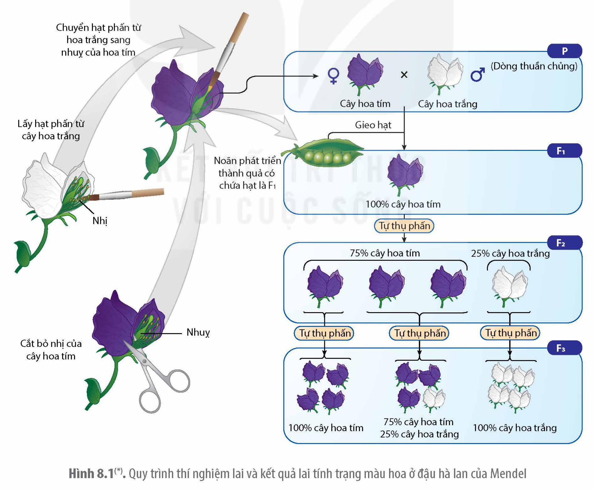
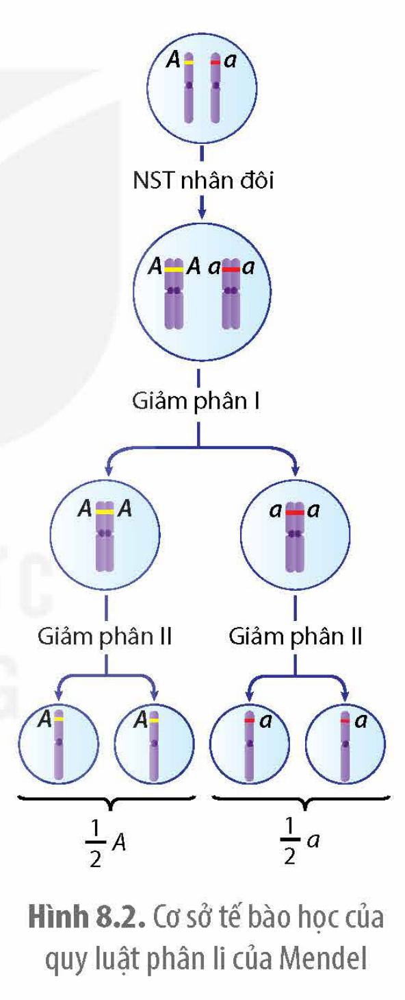
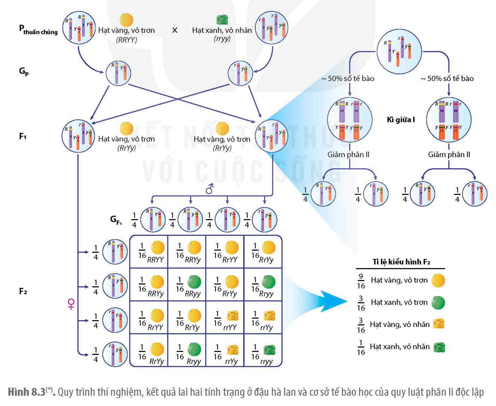

<!-- pdf:42 -->

# BÀI 8: HỌC THUYẾT DI TRUYỀN MENDEL

## 🎯 Yêu cầu cần đạt

- Nêu được bối cảnh ra đời thí nghiệm của Mendel.
- Trình bày được cách bố trí và tiến hành thí nghiệm của Mendel.
- Nêu được tính quy luật của hiện tượng di truyền và giải thích thí nghiệm của Mendel.
- Trình bày được cơ sở tế bào học của các thí nghiệm của Mendel dựa trên mối quan hệ giữa nguyên phân, giảm phân và thụ tinh.
- Nêu được vì sao các quy luật di truyền của Mendel đặt nền móng cho di truyền học hiện đại.

## 🔴 Mở đầu

Phương pháp nghiên cứu của Mendel có gì đặc biệt khiến ông có thể khám phá ra các nhân tố di truyền (gene) mà không cần đến kính hiển vi điện tử hay các phương tiện nghiên cứu hiện đại?

## I. BỐI CẢNH RA ĐỜI THÍ NGHIỆM CỦA MENDEL

Gregor Johann Mendel (1822 – 1884), một nhà giáo, nhà khoa học tự nhiên người Séc rất đam mê với công tác chọn giống thực vật. Mendel đã may mắn được một giáo sư vật lí, Christian Doppler, dạy cách tiến hành thực nghiệm khoa học cũng như sử dụng toán học để giải thích các hiện tượng tự nhiên và nhà thực vật học Franz Unger khuyến khích tìm nguyên nhân gây ra các biến dị ở thực vật. Vào những năm đầu của thế kỉ XIX, ở châu Âu, nhiều nhà sinh học, nhà làm vườn và chọn giống động, thực vật tin vào học thuyết di truyền được gọi là **thuyết di truyền pha trộn**. Theo thuyết này, vật chất di truyền tồn tại dưới dạng chất lỏng như máu nên ở đời con có sự pha trộn giữa vật di truyền của bố và mẹ. Với kinh nghiệm làm vườn và quan sát thực tế trên nhiều đối tượng sinh vật, Mendel nhận thấy thuyết di truyền pha trộn chưa đúng vì nhiều đặc điểm của sinh vật được truyền một cách nguyên vẹn từ thế hệ này sang thế hệ khác mà không hoà trộn với nhau ở đời con. Mong muốn làm sáng tỏ cơ chế di truyền đã thôi thúc Mendel tiến hành nhiều thí nghiệm khác nhau ở các loài như ong mật và đậu hà lan. Kết quả thí nghiệm thu được cho phép ông bác bỏ thuyết di truyền pha trộn và đề xuất học thuyết di truyền hạt với hai quy luật di truyền cơ bản được thừa nhận rộng rãi sau này.

<!-- pdf:43 -->

## II. THÍ NGHIỆM LAI Ở ĐẬU HÀ LAN

Mendel đã chọn đậu hà lan (*Pisum sativum*) làm đối tượng nghiên cứu chính. Đây là loài cây tự thụ phấn, thời gian thế hệ ngắn, có nhiều **giống thuần chủng** với các đặc điểm khác biệt như màu hoa, chiều cao cây, hình dạng, màu sắc hạt,… và dễ tiến hành lai tạo, một cây có thể cho ra nhiều hạt.

### 1. Thí nghiệm lai một tính trạng

**Bố trí thí nghiệm:** Mendel đã tiến hành bảy phép lai một tính trạng với bảy tính trạng là màu hoa, hình dạng hạt, chiều cao cây, màu hạt, hình dạng quả, màu quả và vị trí hoa trên cây. Mỗi tính trạng đều có hai đặc tính khác biệt nhau, ví dụ hoa tím và hoa trắng, hạt trơn và hạt nhăn,… Trước khi lai, Mendel đã tiến hành tạo các dòng thuần chủng về từng đặc tính của mỗi tính trạng bằng cách cho các cây có đặc tính riêng (ví dụ hoa tím) tự thụ phấn qua nhiều thế hệ. Các thí nghiệm lai đều được tiến hành các phép lai thuận và lai nghịch (♀ cây hoa tím × ♂ cây hoa trắng; ♀ cây hoa trắng × ♂ cây hoa tím). Hình 8.1 minh hoạ sơ đồ và kết quả lai qua ba thế hệ đối với tính trạng màu hoa.

Hình 8.1(\*). Quy trình thí nghiệm lai và kết quả lai tính trạng màu hoa ở đậu hà lan của Mendel

> (\*) Nguồn hình: Phạm Minh Kiên.

<!-- pdf:44 -->

**Giải thích kết quả:** Mendel đã giải thích kết quả thí nghiệm như sau:

<!-- term: Trội / lặn -->
- Ở F$_1$ chỉ xuất hiện một trong hai đặc tính của bố hoặc mẹ (đặc tính trội) và ở F$_2$, đặc tính lặn tái xuất hiện chứng tỏ vật chất di truyền quy định tính trạng không hoà trộn vào nhau như hai chất lỏng mà tồn tại độc lập với nhau trong tế bào cơ thể, điều này bác bỏ thuyết di truyền pha trộn.
- Kết quả lai ở F$_3$ chứng tỏ 1/3 số cây F$_2$ có hoa tím cho đời con toàn cây hoa tím có cấu trúc di truyền (ngày nay chúng ta gọi là **kiểu gene**) thuần chủng như ở thế hệ P; 2/3 số cây F$_2$ hoa tím cho đời con có tỉ lệ phân li 3: 1 có cấu trúc di truyền như cây lai F$_1$ (hiện nay gọi là **kiểu gene dị hợp**). Như vậy, xét về cấu trúc di truyền, đời F$_2$ phải có tỉ lệ 1 (trội thuần chủng): 2 (giống F$_1$): 1 (lặn thuần chủng). Mendel dùng các chữ cái để kí hiệu cấu trúc di truyền của mỗi cá thể. Chữ cái viết hoa chỉ đặc điểm di truyền trội, chữ cái cùng loại viết thường chỉ đặc điểm di truyền lặn.

<!-- term: Nhân tố di truyền -->
**Đề xuất giả thuyết mới:** Mỗi tính trạng của cây phải do một cặp nhân tố di truyền (ngày nay gọi là gene) quy định, các nhân tố di truyền tồn tại riêng rẽ không pha trộn với nhau và được truyền nguyên vẹn từ bố mẹ, qua giao tử, sang con cái. Mỗi cây F$_1$ sẽ tạo ra hai loại giao tử với tỉ lệ bằng nhau, mỗi giao tử chỉ chứa một trong hai nhân tố di truyền, hoặc của bố, hoặc mẹ. Sự kết hợp ngẫu nhiên của các giao tử trong quá trình thụ tinh dẫn đến sự phân li tính trạng ở đời con.

<!-- term: Phép lai kiểm nghiệm -->
**Kiểm chứng giả thuyết:** Mendel tiến hành phép lai kiểm nghiệm: Cho cây F$_1$ hoa tím lai với cây có hoa trắng thuần chủng. Kết quả cho tỉ lệ phân li kiểu hình ở đời con là 1/2 số cây có hoa tím, 1/2 số cây cho hoa trắng, điều đó chứng tỏ cây F$_1$ thực sự đã tạo ra hai loại giao tử với tỉ lệ bằng nhau, một loại mang nhân tố di truyền trội, một loại mang nhân tố lặn. Tiến hành phép lai kiểm nghiệm (lai phân tích) như vậy với 6 tính trạng khác cũng cho kết quả tương tự.

**Đề xuất quy luật di truyền:** Sau khi tiến hành kiểm chứng giả thuyết với nhiều loại tính trạng khác nhau, Mendel đã đưa ra quy luật phân li. **Quy luật phân li** phát biểu như sau: *Mỗi tính trạng đều do một cặp nhân tố di truyền quy định, một có nguồn gốc từ bố, một có nguồn gốc từ mẹ và các nhân tố di truyền tồn tại trong tế bào cơ thể một cách riêng rẽ, không pha trộn với nhau. Khi hình thành giao tử, các nhân tố di truyền phân li nhau về giao tử nên mỗi giao tử chỉ chứa một nhân tố.*

Hình 8.2. Cơ sở tế bào học của quy luật phân li của Mendel

Di truyền học hiện đại đã cho thấy, cặp nhân tố di truyền mà Mendel đề xuất chính là cặp allele. Hình 8.2 minh hoạ cơ sở tế bào học của quy luật phân li. Sự phân li của cặp nhân tố di truyền chính là sự phân li của cặp allele nằm trên cặp NST tương đồng về các giao tử trong quá trình giảm phân.

<!-- pdf:45 -->

## ❓ Dừng lại và suy ngẫm

1. Trình bày cách bố trí và tiến hành thí nghiệm lai một tính trạng của Mendel ở đậu hà lan.
2. Giải thích cơ sở tế bào học của quy luật phân li.

### 2. Thí nghiệm lai hai tính trạng

**Bố trí thí nghiệm:** Mendel đã tiến hành nhiều thí nghiệm lai các cây thuần chủng khác biệt nhau về hai tính trạng (lai hai tính trạng) ở đậu hà lan. Một trong số các thí nghiệm lai hai tính trạng của Mendel và kết quả lai được thể hiện ở Hình 8.3.

**Giải thích kết quả:** Sử dụng quy luật xác suất, Mendel đã giải thích kết quả phân li kiểu hình 9: 3: 3: 1 ở đời F$_2$ là do hai cặp nhân tố di truyền quy định hai tính trạng phân li độc lập với nhau về các giao tử nên mỗi cây F$_1$ tạo ra 4 loại giao tử mang các tổ hợp nhân tố di truyền với xác suất ngang nhau. Sự kết hợp ngẫu nhiên của các giao tử trong quá trình thụ tinh tạo ra 16 tổ hợp nhân tố di truyền ở đời F$_2$ với xác suất bằng nhau là 1/16. Do nhân tố di truyền trội lấn át sự biểu hiện của nhân tố lặn nên sự phân li kiểu hình chỉ là 9: 3: 3: 1.

Hình 8.3(\*). Quy trình thí nghiệm, kết quả lai hai tính trạng ở đậu hà lan và cơ sở tế bào học của quy luật phân li độc lập

> (\*) Nguồn hình: Phạm Minh Kiên.

<!-- pdf:46 -->

**Đề xuất giả thuyết mới:** Các cặp nhân tố di truyền quy định các tính trạng khác nhau phân li độc lập với nhau trong quá trình hình thành giao tử.

**Kiểm chứng giả thuyết:** Mendel sử dụng phép lai kiểm nghiệm giữa cá thể F$_1$ có hạt vàng, trơn với cá thể thuần chủng có hạt xanh, nhăn thu được đời con có tỉ lệ phân li kiểu hình là 1/4 số hạt vàng, trơn: 1/4 số hạt xanh, trơn: 1/4 số hạt vàng, nhăn: 1/4 số hạt xanh, nhăn. Kết quả lai thu được hoàn toàn phù hợp với giả thuyết.

**Đề xuất quy luật di truyền:** Giả thuyết được kiểm chứng bằng nhiều phép lai với các tính trạng khác nhau và đều cho kết quả phù hợp, từ đó Mendel đã đề xuất **quy luật di truyền phân li độc lập**. Quy luật này phát biểu như sau: *Các cặp nhân tố di truyền quy định các cặp tính trạng phân li độc lập với nhau trong quá trình hình thành giao tử.*

Ngày nay, chúng ta biết rằng, mỗi cặp allele quy định tính trạng tương ứng với một cặp nhân tố di truyền của Mendel. Các cặp allele nằm trên các cặp NST tương đồng khác nhau phân li độc lập với nhau trong quá trình giảm phân hình thành giao tử và sự tổ hợp ngẫu nhiên của các giao tử tạo nên các tổ hợp gene khác nhau (H 8.2). Như vậy, di truyền học hiện đại đã làm sáng tỏ bản chất của nhân tố di truyền, tìm ra cấu trúc hoá học và cách thức vận hành của chúng. Chính vì vậy, các nhà di truyền học đều coi Mendel là người đã đặt nền móng cho ngành Di truyền học hiện đại.

## ❓ Dừng lại và suy ngẫm

1. Hãy hình dung mình đang thực hiện trò chơi với hai túi đựng số bi và loại bi như nhau. Một túi có 50 viên bi to, màu đỏ và 50 viên bi to cùng cỡ màu trắng; Túi còn lại đựng 50 viên bi nhỏ màu xanh và 50 viên bi nhỏ màu vàng cùng cỡ. Một túi bi tượng trưng cho túi chứa giao tử đực, túi còn lại tượng trưng cho túi đựng giao tử cái (noãn). Lấy ngẫu nhiên từ mỗi túi một viên bi to, một viên bi nhỏ, trộn với nhau (tượng trưng cho thụ tinh) rồi ghi lại hình dạng và màu sắc bi. Ví dụ: lần đầu được lấy được 2 viên bi to, màu đỏ và 1 viên bi nhỏ, màu vàng, một viên bi nhỏ, màu xanh. Ghi lại kết quả và lặp lại thí nghiệm. Hãy dự đoán kết quả sau một số lượng lớn lần lấy bi từ các túi.
2. Nêu điều kiện để hai gene có thể phân li độc lập với nhau trong quá trình giảm phân.

## 📌 Kiến thức cốt lõi

- Mỗi tính trạng do một cặp nhân tố di truyền quy định và khi giảm phân mỗi nhân tố phân li về một giao tử. Các cặp nhân tố di truyền phân li độc lập với nhau trong quá trình giảm phân.
- Nhờ biết lựa chọn đối tượng nghiên cứu thích hợp với cách tiếp cận khoa học: quan sát, đề xuất giả thuyết, làm thí nghiệm kiểm chứng cũng như sử dụng toán xác suất giải thích kết quả thí nghiệm, Mendel đã tìm ra được các quy luật di truyền.

<!-- pdf:47 -->

- Quy luật của Mendel đặt nền móng cho di truyền học hiện đại vì các công trình nghiên cứu hiện đại đều khẳng định. Mỗi tính trạng do một cặp nhân tố di truyền quy định và khi giảm phân mỗi nhân tố phân li về một giao tử. Các cặp nhân tố di truyền phân li độc lập với nhau trong quá trình giảm phân.

## ✏️ Luyện tập và vận dụng

1. Giả sử lai cây hoa đỏ thuần chủng với cây hoa trắng thuần chủng thu được đời F$_1$ tất cả đều có hoa màu hồng thì liệu kết quả này có ủng hộ giả thuyết di truyền pha trộn không? Giải thích.
2. Nêu một số ứng dụng thực tiễn của quy luật Mendel.
3. Làm thế nào người ta có thể khẳng định được một cây hoặc một con vật có kiểu hình trội là thuần chủng?

## 📷 Danh sách hình trong bài

| Mã hình | Trang PDF | Vị trí | Chú thích gốc |
|---|---|---|---|
| H12-sinh-b08-01 | 43 | Mục II.1 | Hình 8.1(\*). Quy trình thí nghiệm lai và kết quả lai tính trạng màu hoa ở đậu hà lan của Mendel — (\*) Nguồn hình: Phạm Minh Kiên. |
| H12-sinh-b08-02 | 44 | Mục II.1 | Hình 8.2. Cơ sở tế bào học của quy luật phân li của Mendel |
| H12-sinh-b08-03 | 45 | Mục II.2 | Hình 8.3(\*). Quy trình thí nghiệm, kết quả lai hai tính trạng ở đậu hà lan và cơ sở tế bào học của quy luật phân li độc lập — (\*) Nguồn hình: Phạm Minh Kiên. |
