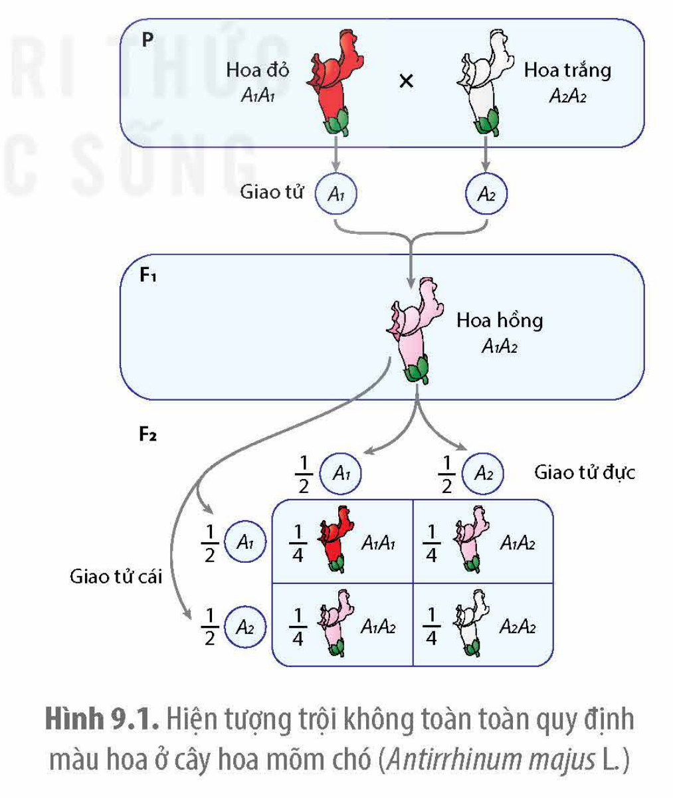
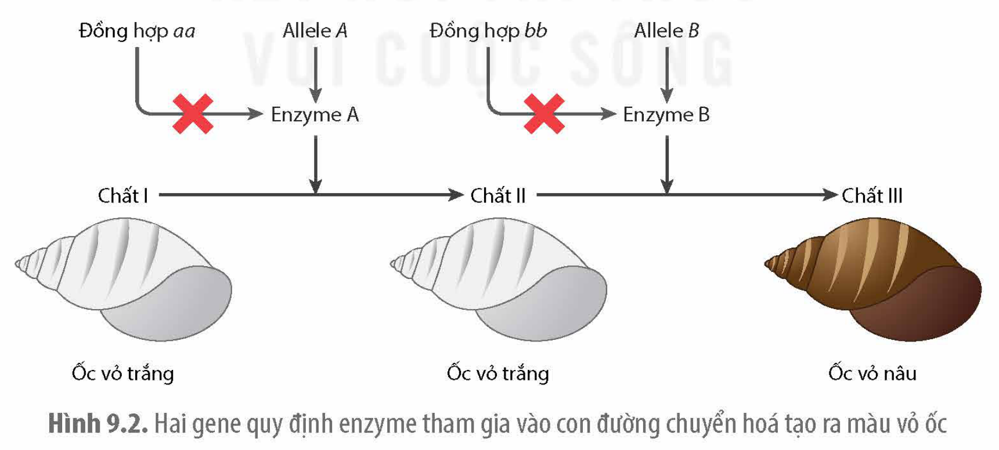
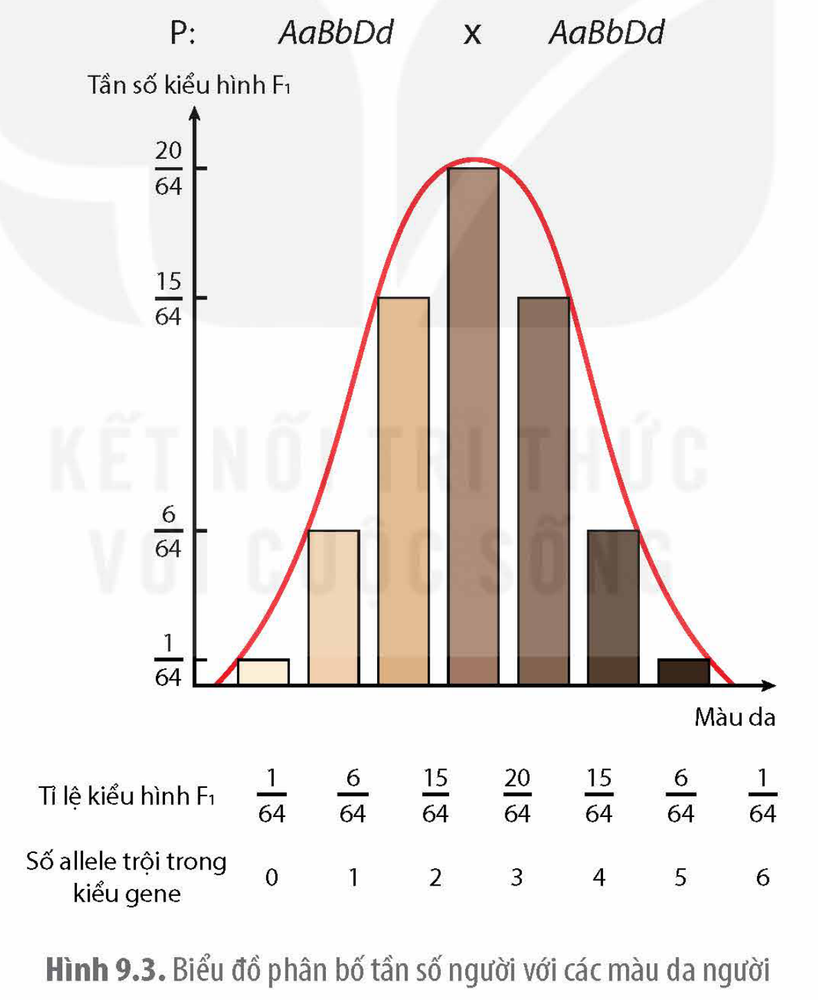

<!-- pdf:48 -->

# BÀI 9: MỞ RỘNG HỌC THUYẾT MENDEL

## 🎯 Yêu cầu cần đạt

Giải thích được sản phẩm của các allele của cùng một gene và của các gene khác nhau có thể tương tác với nhau quy định tính trạng.

## 🔴 Mở đầu

Có phải mọi tính trạng đều do một gene quy định?

Theo quy luật của Mendel, mỗi tính trạng đều do một gene quy định, mỗi gene chỉ gồm hai allele với một allele trội hoàn toàn so với allele kia. Những nghiên cứu sau này cho thấy, một gene có thể có nhiều hơn hai allele và quy định nhiều tính trạng nhưng một tính trạng cũng có thể do nhiều gene quy định. Các allele trong cùng một gene hoặc giữa các gene có thể tương tác với nhau quy định tính trạng của sinh vật. Sự tương tác giữa các allele thực chất là tương tác giữa các sản phẩm protein của chúng theo những cách khác nhau, rất phức tạp. Nội dung bài này chỉ để cập tới một số trường hợp đơn giản làm ví dụ.

## I. TƯƠNG TÁC GIỮA CÁC ALLELE THUỘC CÙNG MỘT GENE

### 1. Trội không hoàn toàn

Các allele của cùng một gene không chỉ có kiểu quan hệ trội lặn hoàn toàn mà còn có các kiểu tương tác khác như trội không hoàn toàn (di truyền trung gian), đồng trội.

Khi thực hiện phép lai giữa hai cây hoa mõm chó (*Antirrhinum majus* L.) thuần chủng có hoa màu đỏ và màu trắng với nhau thu được F$_1$ gồm toàn các cây có hoa màu hồng (màu sắc trung gian giữa hai dạng bố mẹ). Hiện tượng tương tác này được gọi là **trội không hoàn toàn** hay di truyền trung gian. Trong trường hợp trội hoàn toàn, cá thể có kiểu gene *Aa* có kiểu hình giống cá thể có kiểu gene *AA*. Tuy nhiên, trong trường hợp trội không hoàn toàn, cây F$_1$ dị hợp tử *A$_1$A$_2$* có kiểu hình trung gian giữa hai loại cây có kiểu gene đồng hợp do sản phẩm của allele này không đủ để lấn át sự biểu hiện của allele kia (H 9.1).

Hình 9.1. Hiện tượng trội không toàn toàn quy định màu hoa ở cây hoa mõm chó (*Antirrhinum majus* L.)

<!-- pdf:49 -->

### 2. Đồng trội

Trường hợp cả hai allele khác nhau của cùng một gene đều biểu hiện kiểu hình riêng trên kiểu hình cơ thể thì kiểu tương tác này được gọi là **đồng trội**. Ví dụ: Gene quy định nhóm máu ABO ở người có 3 allele. Trong đó allele I$^A$, I$^B$ quy định kháng nguyên tương ứng A và B trên bề mặt tế bào hồng cầu và I$^O$ không có khả năng quy định kháng nguyên A và B. Người có kiểu gene dị hợp I$^A$I$^B$ có cả hai loại kháng nguyên trên bề mặt hồng cầu và có nhóm máu AB.

## ❓ Dừng lại và suy ngẫm

1. Sản phẩm của các allele thuộc cùng một gene có thể quy định kiểu hình theo những cách nào? Giải thích.
2. Tìm thêm ví dụ về tương tác giữa các allele theo kiểu đồng trội.

## II. TƯƠNG TÁC GIỮA CÁC ALLELE THUỘC CÁC GENE KHÁC NHAU

Sản phẩm của các gene (chuỗi polypeptide) có thể cùng tham gia cấu tạo nên protein hình thành một tính trạng, hoặc cùng tham gia vào một con đường chuyển hoá hay con đường truyền tín hiệu. Ví dụ: Sản phẩm của các gene là những enzyme xúc tác cho các phản ứng khác nhau trong một con đường chuyển hoá tạo ra sản phẩm quy định tính trạng.

### 1. Sản phẩm của các gene tương tác gián tiếp với nhau

Sản phẩm của các allele thuộc các gene khác nhau có thể không trực tiếp tương tác với nhau. Ví dụ: Sản phẩm của các gene là những enzyme xúc tác cho các phản ứng khác nhau trong một con đường chuyển hoá tạo ra sản phẩm quy định tính trạng.

Hình 9.2. Hai gene quy định enzyme tham gia vào con đường chuyển hoá tạo ra màu vỏ ốc

Hình 9.2 cho thấy allele *A* và allele *B* thuộc hai gene *A* và *B* quy định enzyme xúc tác cho các phản ứng chuyển hoá các chất tiền thân không màu (màu trắng) tạo ra sản phẩm làm cho vỏ ốc có màu nâu. Nếu một trong hai gene bị đột biến làm mất chức năng của gene (đột biến lặn) hoặc cả hai gene đều bị đột biến mất chức năng thì ốc có vỏ màu trắng. Trong

<!-- pdf:50 -->

trường hợp này, sản phẩm của hai gene không trực tiếp tương tác với nhau nhưng nếu sản phẩm của gene bị mất chức năng hoặc không được tạo ra thì không có nguyên liệu để cho sản phẩm của gene kia chuyển hoá nên kiểu hình chung bị ảnh hưởng. Kiểu tương tác gene này thường được gọi là **tương tác át chế** vì gene này bị đột biến mất chức năng sẽ át chế sự biểu hiện của các gene khác.

### 2. Sản phẩm của các gene tương tác trực tiếp với nhau theo kiểu cộng gộp

Nhiều tính trạng như chiều cao, màu da, màu tóc,… của người do rất nhiều gene quy định. Mỗi allele trội của một gene quy định một "đơn vị" nhỏ sản phẩm, góp phần cùng sản phẩm của các gene khác tạo nên kiểu hình chung. Ví dụ: Mỗi allele trội quy định màu da, màu tóc chỉ tạo ra một lượng rất nhỏ sắc tố. Tổng số các allele trội quy định màu da, màu tóc trong hệ gene sẽ quyết định lượng sắc tố quy định kiểu hình (H 9.3). Kiểu tương tác giữa các gene theo kiểu cộng dồn đó được gọi là **tương tác cộng gộp** và tính trạng đa gene như vậy được gọi là **tính trạng số lượng**. Hầu hết các tính trạng quy định tốc độ sinh trưởng, năng suất, cân nặng,… đều thuộc loại tính trạng số lượng.

Hình 9.3. Biểu đồ phân bố tần số người với các màu da người

Ví dụ: Người có kiểu gene *AABBDD* (tổng hợp được nhiều sắc tố melanin nhất nên có màu da sẫm màu nhất) lấy người có kiểu gene *aabbdd* không có khả năng tổng hợp sắc tố nên có da trắng nhất (sáng màu nhất). Những người có kiểu gene *AaBbDd* có màu da sẫm ở mức trung bình giữa hai kiểu gene trên. Khi hai người có kiểu gene dị hợp về ba cặp gene *AaBbDd* lấy nhau và 3 cặp gene này nằm trên 3 cặp NST tương đồng khác nhau thì sẽ tạo ra tới 64 tổ hợp gene ở đời con với 7 nhóm kiểu hình theo tỉ lệ: 1: 6: 15: 20: 15: 6: 1 (H 9.3).

<!-- pdf:51 -->

## ❓ Dừng lại và suy ngẫm

Sản phẩm của các gene khác nhau có thể cùng tham gia tạo nên một sản phẩm theo những cách nào? Giải thích.

## 📌 Kiến thức cốt lõi

- Một gene có thể có hai hay nhiều allele khác nhau. Các allele trong cùng một gene có thể có quan hệ trội/lặn hoàn toàn, trội không hoàn toàn hoặc đồng trội.
- Sản phẩm của nhiều gene có thể tương tác với nhau cùng tham gia vào một con đường chuyển hoá tạo ra sản phẩm cuối cùng hoặc cùng tạo nên một protein.

## ✏️ Luyện tập và vận dụng

1. Vẽ sơ đồ khái quát thể hiện sản phẩm của các allele thuộc cùng một gene tạo ra một sản phẩm hình thành nên tính trạng.
2. Phân tử protein hemoglobin của người được cấu tạo từ hai loại chuỗi polypeptide khác nhau (α và β). Đây có phải là một ví dụ về tương tác giữa các allele của cùng một gene hay không? Giải thích.

## 📷 Danh sách hình trong bài

| Mã hình | Trang PDF | Vị trí | Chú thích gốc |
|---|---|---|---|
| H12-sinh-b09-01 | 48 | Mục I.1 | Hình 9.1. Hiện tượng trội không toàn toàn quy định màu hoa ở cây hoa mõm chó (Antirrhinum majus L.) |
| H12-sinh-b09-02 | 49 | Mục II.1 | Hình 9.2. Hai gene quy định enzyme tham gia vào con đường chuyển hoá tạo ra màu vỏ ốc |
| H12-sinh-b09-03 | 50 | Mục II.2 | Hình 9.3. Biểu đồ phân bố tần số người với các màu da người |
