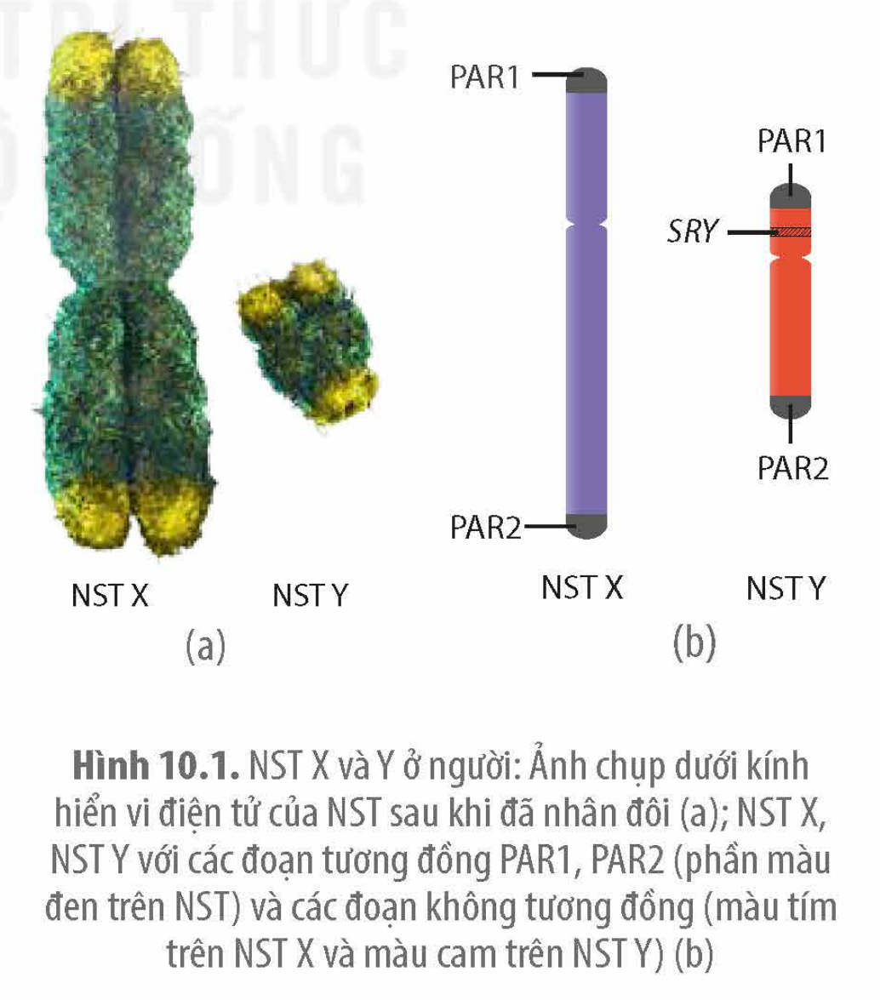
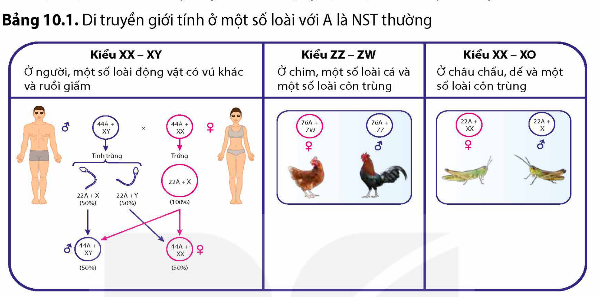
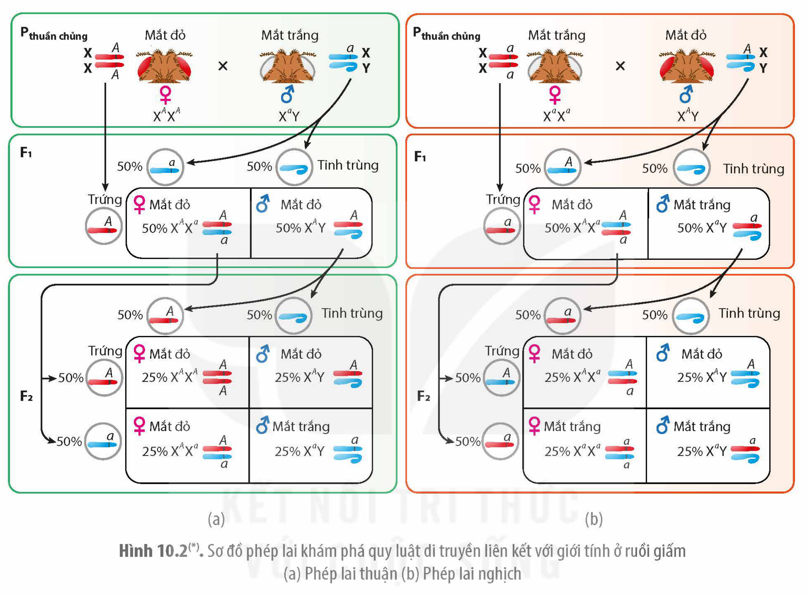

<!-- pdf:52 -->

# BÀI 10: DI TRUYỀN GIỚI TÍNH VÀ DI TRUYỀN LIÊN KẾT VỚI GIỚI TÍNH

## 🎯 Yêu cầu cần đạt

- Nêu được khái niệm NST giới tính; di truyền giới tính.
- Phân tích được cơ chế di truyền xác định giới tính.
- Giải thích được tỉ lệ lí thuyết giới tính trong tự nhiên thường là 1:1.
- Trình bày được quan điểm của bản thân về việc điều khiển giới tính ở người theo ý muốn.
- Nêu được bối cảnh ra đời thí nghiệm của Morgan
- Trình bày được cách bố trí thí nghiệm của Morgan, qua đó nêu được khái niệm di truyền liên kết với giới tính.
- Vận dụng những hiểu biết về di truyền giới tính và liên kết với giới tính để giải thích các vấn đề trong thực tiễn (Ví dụ: điều khiển giới tính trong chăn nuôi, phát hiện bệnh do rối loạn cơ chế phân li, tổ hợp NST giới tính,…).

## 🔴 Mở đầu

Vì sao tỉ lệ các cá thể đực và cái ở nhiều loài động vật lại thường là 1: 1?

## I. DI TRUYỀN GIỚI TÍNH

### 1. Nhiễm sắc thể giới tính

<!-- term: Gene SRY -->
**NST giới tính** là một loại NST chứa các gene quy định giới tính của một sinh vật. Tuỳ theo từng loài, NST giới tính có thể tồn tại thành từng cặp tương đồng hoặc không tương đồng (cặp NST khác nhau về kích thước và có trình tự gene không hoàn toàn tương đồng). Ví dụ: Ở muỗi gây bệnh sốt xuất huyết, *Aedes aegypti*, có cặp NST giới tính tương đồng về hình dạng, kích thước, chỉ khác nhau về một gene. Một số loài lại có nhiều cặp NST giới tính như chim cánh cụt. Ở người, cặp NST tương đồng XX quy định giới tính nữ, cặp XY quy định giới tính nam chỉ có hai vùng tương đồng nằm ở hai đầu NST. Đoạn không tương đồng mang các gene khác nhau. Gene *SRY* có vai trò quyết định giới tính nam và nằm trên NST Y (H 10.1).

Hình 10.1. NST X và Y ở người: Ảnh chụp dưới kính hiển vi điện tử của NST sau khi đã nhân đôi (a); NST X, NST Y với các đoạn tương đồng PAR1, PAR2 (phần màu đen trên NST) và các đoạn không tương đồng (màu tím trên NST X và màu cam trên NST Y) (b)

<!-- pdf:53 -->

### 2. Di truyền giới tính

**Di truyền giới tính** là kiểu di truyền các NST giới tính quy định đặc điểm giới tính của một sinh vật. Một số kiểu di truyền giới tính ở động vật được trình bày ở Bảng 10.1.

Bảng 10.1. Di truyền giới tính ở một số loài với A là NST thường

| Kiểu XX – XY | Kiểu ZZ – ZW | Kiểu XX – XO |
|---|---|---|
| Ở người, một số loài động vật có vú khác và ruồi giấm | Ở chim, một số loài cá và một số loài côn trùng | Ở châu chấu, dế và một số loài côn trùng |
| ♂ 44A + XY × ♀ 44A + XX; tinh trùng 22A + X (50%), 22A + Y (50%); trứng 22A + X (100%); con ♂ 44A + XY (50%), ♀ 44A + XX (50%) | ♀ 76A + ZW, ♂ 76A + ZZ | ♀ 22A + XX, ♂ 22A + X |

<!-- ocr-ok: bảng chép lại từ hình, nội dung sơ đồ trong ô chép theo nhãn trên hình -->

Ngoài các kiểu di truyền giới tính nêu trên, ở một số loài ong và kiến, giới tính được xác định bằng mức bội thể của cơ thể. Con cái phát triển từ trứng đã được thụ tinh và là cơ thể lưỡng bội. Con đực được phát triển từ trứng không được thụ tinh và là cơ thể đơn bội. Một số loài như rùa và cá sấu, điều kiện nhiệt độ của môi trường trong quá trình phát triển phôi lại là yếu tố quyết định giới tính.

Đi sâu vào phân tích cơ chế di truyền xác định giới tính, các nhà khoa học nhận thấy, ngay cả cùng một kiểu di truyền giới tính là XX (con cái), XY (con đực) các cơ chế xác định giới tính cũng khác nhau. Ví dụ: Ở người, hợp tử có NST Y sẽ phát triển thành con trai, hợp tử không có Y sẽ phát triển thành con gái và cơ chế xác định giới tính gồm nhiều gene tương tác với nhau rất phức tạp.

## ❓ Dừng lại và suy ngẫm

1. NST giới tính là gì? Hãy nêu sự khác biệt giữa NST thường và NST giới tính.
2. Giải thích tại sao, theo lí thuyết, xác suất sinh con trai hoặc sinh con gái của mỗi cặp vợ chồng là như nhau và bằng 50%.

## II. DI TRUYỀN LIÊN KẾT VỚI GIỚI TÍNH

Sự di truyền của các tính trạng không liên quan đến các đặc điểm giới do gene quy định nằm trên NST giới tính được gọi là **di truyền liên kết với giới tính**. Hiện tượng này lần đầu được Morgan phát hiện khi nghiên cứu sự di truyền màu mắt ở ruồi giấm (*Drosophila melanogaster*).

<!-- pdf:54 -->

### 1. Thí nghiệm của Morgan phát hiện ra sự di truyền liên kết với nhiễm sắc thể X

Năm 1910, Thomas Hunt Morgan đã tình cờ phát hiện thấy một con ruồi đực duy nhất có mắt màu trắng, trong khi tất cả các con ruồi khác đều có mắt đỏ. Ông đã tiến hành lai con ruồi đực mắt trắng này với ruồi cái mắt đỏ và sau đó tiến hành các phép lai được tóm tắt trong Hình 10.2.

Hình 10.2(\*). Sơ đồ phép lai khám phá quy luật di truyền liên kết với giới tính ở ruồi giấm (a) Phép lai thuận (b) Phép lai nghịch

Kết quả cho thấy có sự khác biệt kiểu hình giữa hai giới chứng tỏ có sự liên quan giữa tính trạng màu mắt với giới tính của ruồi giấm. Morgan đã đưa ra giả thuyết rằng gene quy định màu mắt nằm trên NST X, tại vùng không tương đồng với NST Y.

Hiện tượng di truyền liên kết với NST X cũng được phát hiện ở người. Một số bệnh di truyền ở người do allele lặn nằm trên NST X là bệnh máu khó đông, mù màu. Bệnh còi xương do giảm phosphate máu ở người là do allele trội nằm trên NST X quy định.

### 2. Di truyền liên kết với nhiễm sắc thể Y

Hiện tượng di truyền liên kết với NST Y khá hiếm gặp. Ở người, cho đến nay mới thấy có một tính trạng được cho là do gene nằm trên NST Y không có gene tương đồng nằm trên NST X. Đó là tính trạng có túm lông trên vành tai được phát hiện thấy ở một gia đình người Ấn Độ và tính trạng này luôn di truyền từ bố cho con trai.

> (\*) Nguồn hình: Phạm Minh Kiên.

<!-- pdf:55 -->

## III. ỨNG DỤNG CỦA DI TRUYỀN LIÊN KẾT VỚI GIỚI TÍNH

Ở nhiều loài động vật, giá trị kinh tế của giới đực và giới cái là khác nhau nên việc phân biệt sớm được giới tính của vật nuôi để tiến hành nuôi vật nuôi có giới tính phù hợp với mục đích sản xuất, giúp mang lại lợi ích kinh tế cao. Để có thể sớm phân biệt được giới tính ở các loài vật nuôi, người ta thường dựa vào đặc điểm kiểu hình dễ nhận biết (hình thái, màu sắc,…) do gene nằm trên NST giới tính quy định làm dấu chuẩn nhận biết. Ví dụ: Dựa vào màu sắc trứng có thể phân biệt được giới tính của tằm ngay từ giai đoạn trứng, từ đó lựa chọn những trứng nở ra tằm đực để nuôi vì tằm đực cho nhiều tơ cao hơn so với tằm cái.

Đã có công trình nghiên cứu dùng đột biến chuyển đoạn để chuyển gene quy định gene kháng thuốc trừ sâu ở muỗi sốt rét từ NST thường sang NST Y, nhờ vậy các nhà nghiên cứu có thể dễ dàng thu được các con muỗi đực (muỗi cái không có gene kháng thuốc sẽ bị chết khi bám lên bề mặt có thuốc). Muỗi đực được nhân nuôi hàng loạt dùng cho mục đích phòng trừ côn trùng bằng biện phát thả con đực bất dục.

## ❓ Dừng lại và suy ngẫm

1. Quan sát hình di truyền giới tính ở gà trong Bảng 10.1 và cho biết có thể dùng phép lai nào để phân biệt tính trạng do gene nằm trên NST thường với tính trạng do gene nằm trên NST Z không có gene tương đồng trên W.
2. Tại sao bệnh do allele lặn nằm trên NST X ở người thường biểu hiện chủ yếu ở nam giới?

## 📌 Kiến thức cốt lõi

- NST giới tính là loại NST mang gene quy định giới tính và cả các gene không quy định các đặc điểm giới.
- Giới tính thường được xác định dựa vào sự có mặt của các loại NST giới tính, tuy nhiên ở một số loài giới tính có thể phụ thuộc vào một số yếu tố khác không phải NST giới tính.
- Di truyền liên kết với giới tính là sự di truyền tính trạng do gene nằm trên NST giới tính quy định. Di truyền liên kết với giới tính dẫn đến kết quả kiểu hình khác nhau giữa hai giới và kết quả phép lai thuận nghịch khác nhau.

## ✏️ Luyện tập và vận dụng

1. Tìm hiểu một số ví dụ về ứng dụng của di truyền liên kết với giới tính trong chăn nuôi.
2. Hãy trình bày quan điểm của em về việc điều khiển giới tính theo ý muốn ở người.

## 💡 Em có biết

**Hiện tượng bất hoạt nhiễm sắc thể giới tính X ở người và động vật có vú**

<!-- term: Bất hoạt NST X -->
Ở người và động vật có vú, giới cái có hai NST X nhưng trong mỗi tế bào cơ thể chỉ có một X có các gene được hoạt động, đa số các gene trên NST X còn lại bị bất hoạt. Cơ chế này giúp đảm bảo lượng sản phẩm do gene nằm trên X tạo ra ở hai giới là như nhau.

## 📷 Danh sách hình trong bài

| Mã hình | Trang PDF | Vị trí | Chú thích gốc |
|---|---|---|---|
| H12-sinh-b10-01 | 52 | Mục I.1 | Hình 10.1. NST X và Y ở người: Ảnh chụp dưới kính hiển vi điện tử của NST sau khi đã nhân đôi (a); NST X, NST Y với các đoạn tương đồng PAR1, PAR2 (phần màu đen trên NST) và các đoạn không tương đồng (màu tím trên NST X và màu cam trên NST Y) (b) |
| H12-sinh-b10-02 | 53 | Mục I.2 | Bảng 10.1. Di truyền giới tính ở một số loài với A là NST thường |
| H12-sinh-b10-03 | 54 | Mục II.1 | Hình 10.2(\*). Sơ đồ phép lai khám phá quy luật di truyền liên kết với giới tính ở ruồi giấm (a) Phép lai thuận (b) Phép lai nghịch — (\*) Nguồn hình: Phạm Minh Kiên. |
