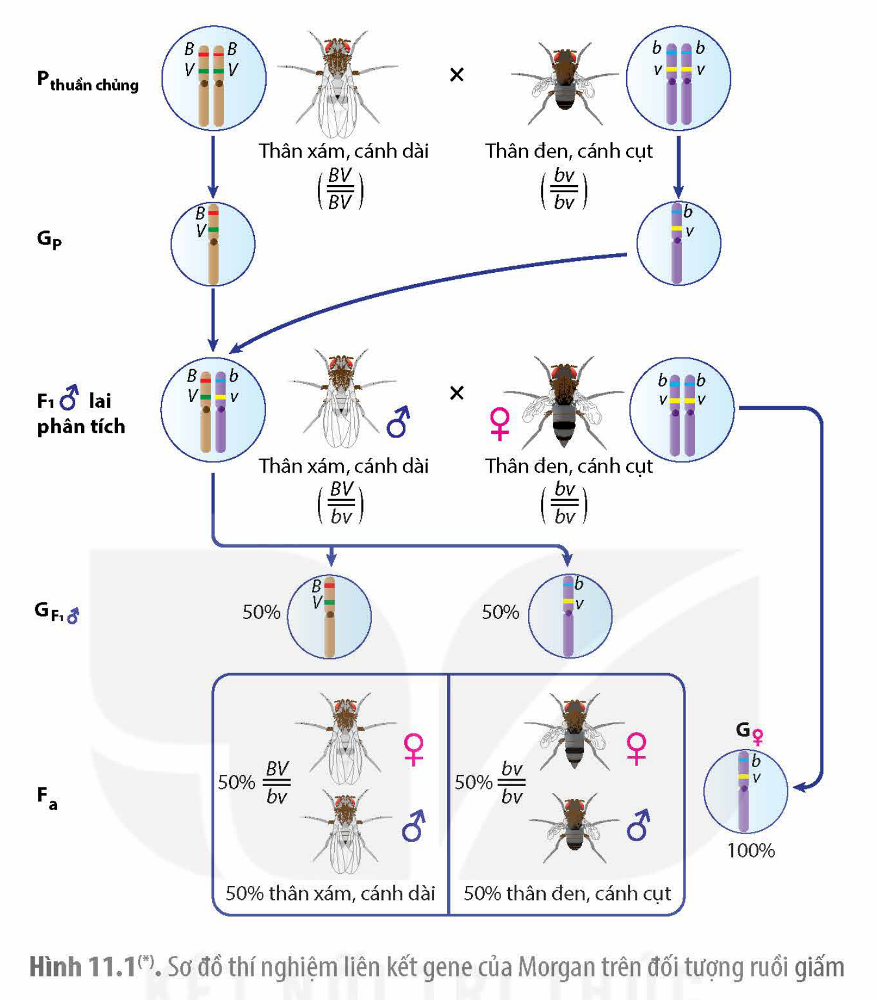
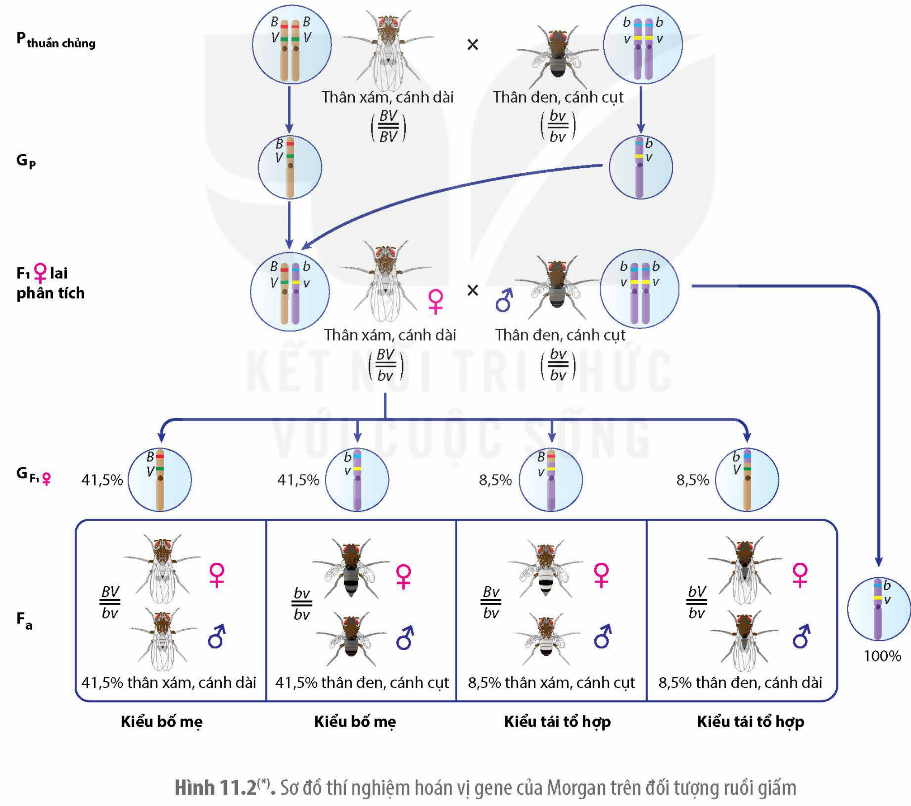
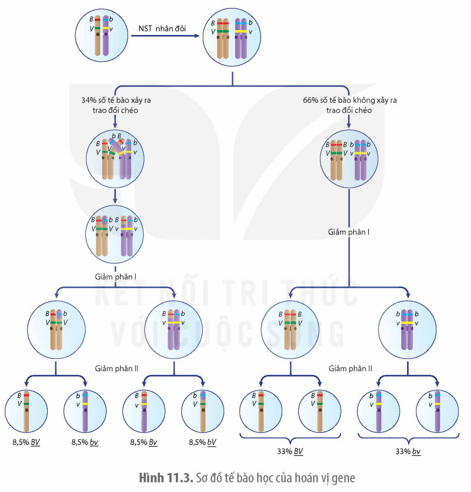

<!-- pdf:56 -->

# BÀI 11: LIÊN KẾT GENE VÀ HOÁN VỊ GENE

## 🎯 Yêu cầu cần đạt

- Trình bày được cách bố trí và tiến hành thí nghiệm của Morgan, từ đó phát biểu được khái niệm liên kết gene.
- Phân tích được cơ sở tế bào học và ý nghĩa của liên kết gene.
- Trình bày được thí nghiệm của Morgan, từ đó phát biểu được khái niệm hoán vị gene.
- Phân tích được cơ sở tế bào học và ý nghĩa của hoán vị gene.
- Nêu được ý nghĩa của việc lập bản đồ di truyền.
- Nêu được quan điểm của Mendel và Morgan về tính quy luật của hiện tượng di truyền.

## 🔴 Mở đầu

Vào năm 1905, W. Bateson, E. R. Saunders và R. C. Punnett khi nghiên cứu hai cặp tính trạng tương phản trên cây đậu ngọt (màu hoa tím/đỏ và hình dạng hạt phấn dài/tròn) đã thu nhận kết quả phân li kiểu hình ở thế hệ F$_2$ khác với tỉ lệ 9: 3: 3: 1 theo quy luật phân li độc lập của Mendel, trong đó chia ra hai nhóm kiểu hình (nhóm kiểu hình giống bố mẹ chiếm ưu thế và nhóm kiểu hình khác bố mẹ chiếm phần nhỏ). Các nhà khoa học vào thời điểm đó đã không giải thích được cơ chế di truyền chi phối. Điều gì đã dẫn tới hiện tượng di truyền khác biệt này?

## I. LIÊN KẾT GENE

### 1. Thí nghiệm về liên kết gene của Morgan
<!-- ocr-ok: tiêu đề in màu, đã đối chiếu ảnh PDF 56 -->

**a) Tiến trình thí nghiệm và kết quả**

Ở ruồi giấm, tính trạng màu thân và kích thước cánh do hai gene khác nhau nằm trên NST thường quy định. Mỗi tính trạng có hai kiểu hình khác nhau: màu thân xám và thân đen, kích thước cánh bình thường gọi là cánh dài và kích thước cánh rất nhỏ gọi là cánh cụt. Tiến hành phép lai (H 11.1), Morgan nhận thấy, kết quả của phép lai phân tích không cho tỉ lệ phân li kiểu hình (1: 1: 1: 1) theo quy luật phân li độc lập của Mendel. Ngược lại, ông thấy hiện tượng di truyền cùng nhau của cặp tính trạng màu thân và kích thước cánh, trong đó thân xám luôn di truyền cùng cánh dài và thân đen luôn di truyền cùng cánh cụt. Morgan cho rằng gene quy định màu thân và gene quy định kích thước cánh nằm trên cùng một NST và có sự liên kết với nhau gọi là liên kết gene.

**b) Cơ sở tế bào học**

Cơ sở tế bào học giải thích cho hiện tượng liên kết gene mà Morgan khám phá ra là mỗi gene nằm trên NST tại một vị trí xác định gọi là locus, các gene phân bố dọc theo chiều dài của NST, các NST phân li trong giảm phân dẫn tới các gene trên cùng một NST phân li cùng nhau (H 11.1).

Như vậy, **liên kết gene** là hiện tượng các gene trên cùng một NST di truyền cùng nhau.

<!-- pdf:57 -->

Hình 11.1(\*). Sơ đồ thí nghiệm liên kết gene của Morgan trên đối tượng ruồi giấm

### 2. Vai trò của liên kết gene

Trong tự nhiên, các gene có lợi, đảm bảo cho sinh vật thích nghi với môi trường có thể được tập hợp trên cùng một NST. Các gene này luôn di truyền cùng nhau đảm bảo duy trì sự ổn định của loài.

<!-- term: Chỉ thị phân tử -->
Trong chọn, tạo giống, các chỉ thị phân tử được sử dụng để hỗ trợ việc sàng lọc, lựa chọn kiểu hình mong muốn của vật nuôi hay giống cây trồng. Chỉ thị phân tử thường được sử dụng là các đoạn trình tự nucleotide liên kết chặt với gene quy định tính trạng mong muốn. Ngoài ra, trong chọn giống, các nhà khoa học có thể dùng các phương pháp khác nhau, ví dụ, gây đột biến chuyển đoạn NST để đưa các gene có lợi vào cùng một NST nhằm tạo ra các giống mới có nhiều đặc điểm mong muốn.

## ❓ Dừng lại và suy ngẫm

1. Liên kết gene là gì? Trình bày cơ sở tế bào học của hiện tượng liên kết gene.
2. Hãy trình bày vai trò của liên kết gene

> (\*) Nguồn hình: Phạm Minh Kiên.

<!-- pdf:58 -->

## II. HOÁN VỊ GENE

### 1. Thí nghiệm về hoán vị gene của Morgan

**a) Tiến trình thí nghiệm và kết quả**

Morgan tiếp tục nghiên cứu tính trạng màu thân và kích thước cánh của ruồi giấm. Kết quả phép lai (H 11.2) Morgan thu được có sự xuất hiện tổ hợp kiểu hình mới khác với kiểu hình của bố mẹ, bao gồm thân xám, cánh cụt và thân đen, cánh dài. Hai tổ hợp kiểu hình mới này (gọi là **kiểu tái tổ hợp**) chiếm tỉ lệ ít hơn so với tổ hợp kiểu hình giống bố mẹ (gọi là **kiểu bố mẹ**). Morgan cho rằng mặc dù gene quy định màu thân và gene quy định kích thước cánh liên kết với nhau nhưng có cơ chế nào đó có thể đã phá vỡ sự liên kết gene này.

Hình 11.2(\*). Sơ đồ thí nghiệm hoán vị gene của Morgan trên đối tượng ruồi giấm

> (\*) Nguồn hình: Phạm Minh Kiên.

<!-- pdf:59 -->

**b) Cơ sở tế bào học**

<!-- term: Trao đổi chéo -->
Ngày nay, người ta biết rằng, trong quá trình giảm phân hình thành giao tử, ở kì đầu của giảm phân I, ở một số tế bào đã xảy ra hiện tượng trao đổi chéo giữa các chromatid khác nguồn gốc của cặp NST kép tương đồng dẫn tới sự hoán đổi vị trí của các gene (H 11.3). Vì thế, hiện tượng di truyền mà Morgan phát hiện được ở thí nghiệm trên gọi là hoán vị gene.

Như vậy, **hoán vị gene** là hiện tượng các allele tương ứng của một gene trao đổi vị trí cho nhau trên cặp NST tương đồng, làm xuất hiện các tổ hợp gene mới, từ đó dẫn tới tạo thành các tổ hợp kiểu hình mới. **Tần số hoán vị gene** được tính bằng tỉ lệ phần trăm các giao tử tái tổ hợp. Tần số hoán vị gene luôn nhỏ hơn hoặc bằng 50%.

Hình 11.3. Sơ đồ tế bào học của hoán vị gene

### 2. Vai trò của hoán vị gene

Hoán vị gene do trao đổi chéo giữa các NST tương đồng, xảy ra trong giảm phân tạo ra các giao tử tái tổ hợp mang các tổ hợp gene mới. Kết hợp với sự tổ hợp ngẫu nhiên của các giao tử trong quá trình thụ tinh hình thành hợp tử ở các loài sinh sản hữu tính, làm tăng nguồn biến dị di truyền cho quá trình tiến hoá và chọn giống.

Dựa vào tần số hoán vị gene, các nhà khoa học có thể thiết lập được bản đồ khoảng cách tương đối giữa các gene trên NST, gọi là bản đồ di truyền.

<!-- pdf:60 -->

## ❓ Dừng lại và suy ngẫm

1. Hoán vị gene là gì? Hãy trình bày cơ sở tế bào học của hiện tượng hoán vị gene.
2. Vì sao hoán vị gene làm tăng nguồn biến dị di truyền?

## III. BẢN ĐỒ DI TRUYỀN

### 1. Khái niệm bản đồ di truyền

**Bản đồ di truyền** là sơ đồ biểu diễn trật tự sắp xếp và khoảng cách tương đối giữa các gene trên NST. Bản đồ di truyền có thể được xây dựng dựa vào cơ chế trao đổi chéo giữa các NST và được gọi là **bản đồ liên kết**, trong đó, khoảng cách giữa các gene trên NST được tính thông qua tần số hoán vị gene. Một loại bản đồ khác gọi là **bản đồ vật lí** thể hiện khoảng cách vật lí giữa các gene trên NST dựa trên số lượng cặp nucleotide. Cả hai loại bản đồ này đều có thông tin giống nhau về trật tự sắp xếp của gene trên NST nhưng khoảng cách giữa các gene thì được biểu thị khác nhau.

### 2. Ý nghĩa của bản đồ di truyền

Bản đồ di truyền với thông tin về tần số hoán vị gene giữa hai gene có thể giúp dự đoán tần số các tổ hợp gene mới trong các phép lai. Điều này có ý nghĩa trong việc chọn, tạo giống.

## ❓ Dừng lại và suy ngẫm

Bản đồ di truyền là gì? Hãy nêu ý nghĩa của việc lập bản đồ di truyền.

## IV. QUAN ĐIỂM CỦA MENDEL VÀ MORGAN VỀ TÍNH QUY LUẬT CỦA HIỆN TƯỢNG DI TRUYỀN

Mendel với công trình nghiên cứu trên đậu hà lan đã phát hiện ra các quy luật di truyền đặt nền móng cho di truyền học hiện đại. Ông đề xuất giả thuyết nghiên cứu dựa trên quan điểm về sự tồn tại của các cặp nhân tố di truyền, các nhân tố di truyền này tồn tại riêng rẽ không pha trộn và phân li độc lập với nhau, mỗi nhân tố di truyền được truyền từ bố, mẹ và có sự kết hợp ngẫu nhiên ở đời con. Dựa trên quan điểm này, Mendel đã áp dụng mô hình toán học (tiếp cận nghiên cứu định lượng và áp dụng xác suất thống kê) để phân tích kết quả nghiên cứu.

Với các nghiên cứu về đặc điểm di truyền ở ruồi giấm, Morgan đã tạo ra bước đột phá mới về di truyền học trong thập kỉ đầu tiên của thế kỉ XX, bổ sung cơ chế di truyền khác bên cạnh cơ chế được phát hiện bởi Mendel. Các nghiên cứu của ông cung cấp bằng chứng đáng tin cậy ủng hộ cho thuyết di truyền NST, chứng tỏ rằng các nhân tố di truyền của Mendel (mà bây giờ gọi là gene) nằm trên NST. Ông cho rằng các gene nằm trên cùng một NST nên chúng di truyền cùng nhau. Ông cũng đề xuất ý tưởng về cơ chế làm phá vỡ liên kết giữa các gene làm chúng tách ra, dẫn tới các kiểu hình mới khác bố mẹ.

<!-- pdf:61 -->

## 📌 Kiến thức cốt lõi

- Liên kết gene là hiện tượng các gene trên cùng một NST luôn di truyền cùng nhau.
- Hoán vị gene là hiện tượng các gene trao đổi vị trí cho nhau trên NST, làm xuất hiện các tổ hợp gene mới. Hoán vị gene là do sự trao đổi các đoạn tương đồng giữa các NST tương đồng trong quá trình giảm phân.
- Bản đồ di truyền là sơ đồ biểu diễn trật tự sắp xếp và khoảng cách tương đối giữa các gene trên NST. Dựa vào bản đồ di truyền có thể dự đoán được tần số các tổ hợp gene mới trong các phép lai, xác định được vị trí của gene gây bệnh ở người, đem lại ý nghĩa lớn trong công tác chọn, tạo giống và y học.

## ✏️ Luyện tập và vận dụng

1. Xét hai cặp tính trạng tương phản do hai gene nằm trên cùng một NST quy định. Hãy viết các kiểu gene có thể có cho cá thể dị hợp tử và vẽ sơ đồ NST thể hiện locus của các gene tương ứng cho mỗi kiểu gene.
2. Tiến hành lai ruồi giấm có kiểu gene dị hợp tử thân xám, mắt đỏ với ruồi đực đồng hợp tử lặn thân đen, mắt tím. Kết quả đời con có sự phân li kiểu hình như sau: 721 con thân xám, mắt đỏ: 751 con thân đen, mắt tím: 49 con thân xám, mắt tím: 45 con thân đen, mắt đỏ. Hãy xác định quy luật di truyền chi phối hai gene quy định các tính trạng trên.

## 📷 Danh sách hình trong bài

| Mã hình | Trang PDF | Vị trí | Chú thích gốc |
|---|---|---|---|
| H12-sinh-b11-01 | 57 | Mục I.1 | Hình 11.1(\*). Sơ đồ thí nghiệm liên kết gene của Morgan trên đối tượng ruồi giấm — (\*) Nguồn hình: Phạm Minh Kiên. |
| H12-sinh-b11-02 | 58 | Mục II.1.a | Hình 11.2(\*). Sơ đồ thí nghiệm hoán vị gene của Morgan trên đối tượng ruồi giấm — (\*) Nguồn hình: Phạm Minh Kiên. |
| H12-sinh-b11-03 | 59 | Mục II.1.b | Hình 11.3. Sơ đồ tế bào học của hoán vị gene |
