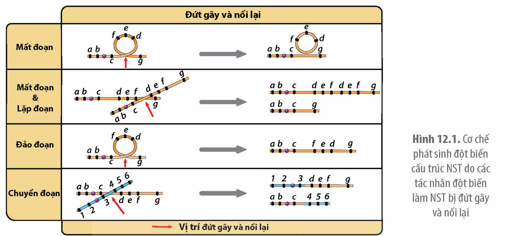
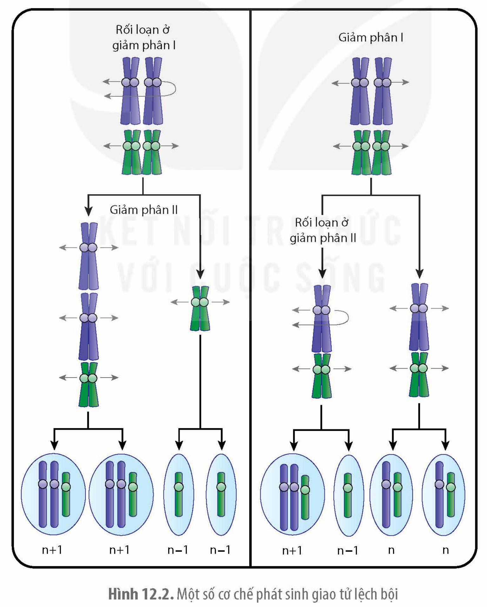
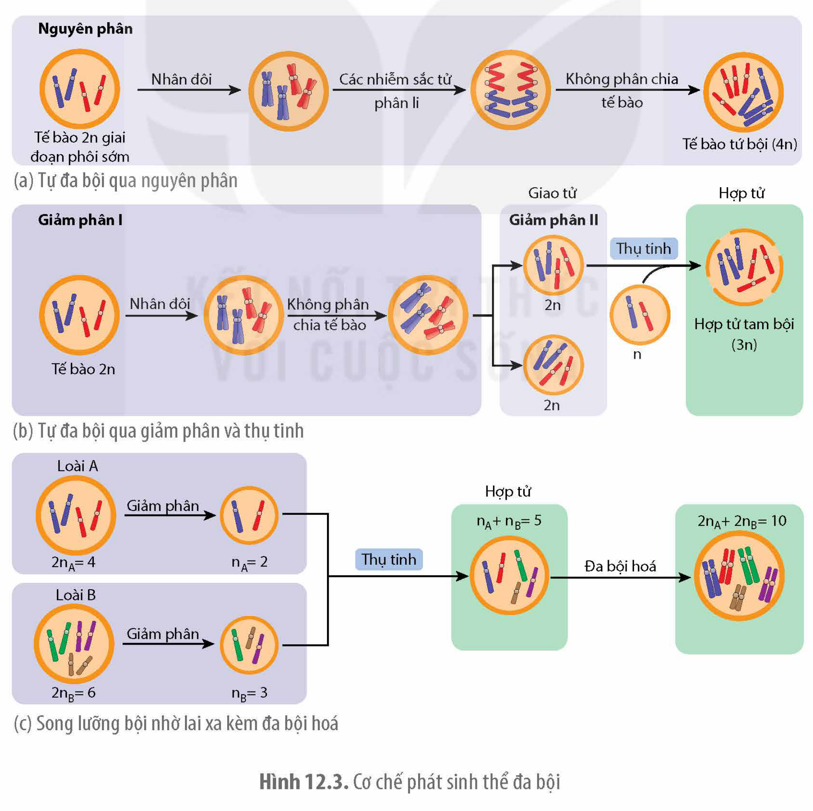
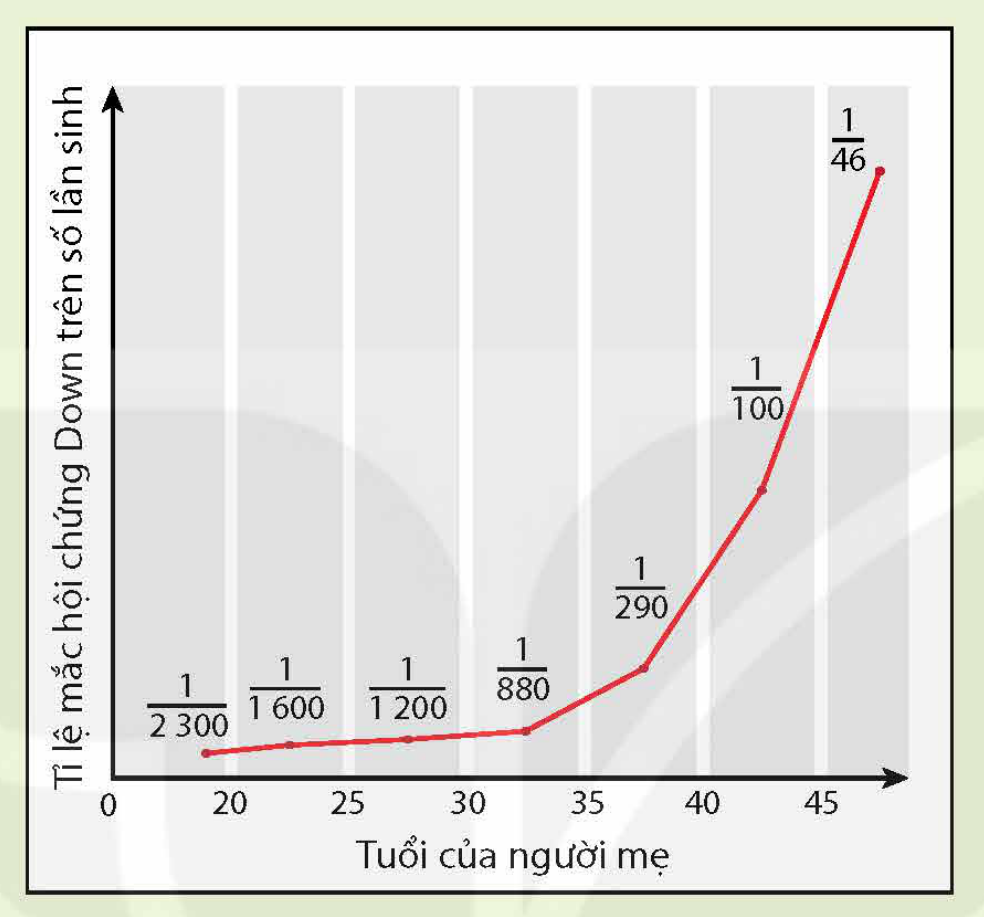

<!-- pdf:62 -->

# BÀI 12: ĐỘT BIẾN NHIỄM SẮC THỂ

## 🎯 Yêu cầu cần đạt

- Phát biểu được khái niệm đột biến NST.
- Trình bày được nguyên nhân và cơ chế phát sinh đột biến cấu trúc NST. Phân biệt được các dạng đột biến cấu trúc NST.
- Trình bày được nguyên nhân và cơ chế phát sinh đột biến số lượng NST. Phân biệt được các dạng đột biến số lượng NST. Lấy được ví dụ minh hoạ.
- Phân tích được tác hại của một số dạng đột biến NST đối với sinh vật.
- Trình bày được vai trò của đột biến cấu trúc NST trong tiến hoá, trong chọn giống và trong nghiên cứu di truyền.
- Phân tích được mối quan hệ giữa di truyền và biến dị

## 🔴 Mở đầu

Một người có kiểu hình nữ giới nhưng NST có cặp giới tính là XY. Tuy nhiên, NST Y có chiều dài ngắn hơn so với bình thường. Hãy giải thích tại sao người này lại có kiểu hình nữ.

## I. KHÁI NIỆM

**Đột biến NST** là những biến đổi liên quan đến cấu trúc hoặc số lượng NST của một loài. Những thay đổi về cấu trúc như mất đoạn, lặp đoạn, đảo đoạn hay chuyển đoạn được gọi là **đột biến cấu trúc NST**. **Đột biến số lượng NST** là những thay đổi về số lượng NST. Sự thay đổi số lượng của một hoặc một vài cặp NST được gọi là **đột biến lệch bội**. Nếu số lượng NST đơn bội của loài tăng lên một số nguyên lần (lớn hơn 2) thì được gọi là **đột biến đa bội**.

## II. ĐỘT BIẾN CẤU TRÚC

### 1. Nguyên nhân và cơ chế phát sinh

**a) Nguyên nhân**

Đột biến cấu trúc NST có thể do các tác nhân vật lí, hoá học hoặc do trao đổi chéo giữa các đoạn tương đồng trên các NST.

**b) Cơ chế phát sinh**

Các tác nhân đột biến có năng lượng cao như tia X, tia gamma thường làm đứt gãy cùng lúc hai mạch của phân tử DNA, sau đó các đoạn được nối lại theo các cách khác nhau hoặc không được nối lại làm xuất hiện nhiều kiểu đột biến cấu trúc NST (H 12.1). Đột biến cấu trúc NST cũng có thể xảy ra trong giảm phân do các NST tiếp hợp và trao đổi chéo với nhau tại các đoạn có trình tự nucleotide tương đồng.

<!-- pdf:63 -->

Hình 12.1. Cơ chế phát sinh đột biến cấu trúc NST do các tác nhân đột biến làm NST bị đứt gãy và nối lại

### 2. Các dạng đột biến cấu trúc

**a) Mất đoạn**

Đột biến **mất đoạn** do một đoạn NST bị đứt mà không được nối lại, làm mất vật chất di truyền nên phần nhiều là có hại. NST bị mất đoạn dài có thể được nhận biết dưới kính hiển vi quang học.

**b) Lặp đoạn**

**Lặp đoạn** NST là loại đột biến cấu trúc làm cho một đoạn NST được lặp lại một hoặc vài lần dẫn đến gia tăng số lượng bản sao của gene trên NST. Loại đột biến này làm tăng chiều dài NST.

**c) Đảo đoạn**

Đảo đoạn thường không làm mất vật chất di truyền. Tuy vậy, nếu các điểm đứt gãy nằm ở giữa các gene có thể, dẫn đến hỏng cả hai gene ở hai đầu đoạn bị đảo hoặc hai phần của hai gene ghép lại có thể tạo ra gene mới.

**d) Chuyển đoạn**

Đột biến **chuyển đoạn** là đột biến làm cho một đoạn NST được chuyển từ vị trí này sang vị trí khác giữa các NST hoặc trên cùng một NST. Chuyển đoạn giữa các NST được gọi là **chuyển đoạn tương đồng**.

Chuyển đoạn NST làm thay đổi nhóm gene liên kết và sự thay đổi vị trí gene trên NST cũng có thể làm thay đổi mức độ biểu hiện của gene. Chuyển đoạn NST cũng có thể làm thay đổi kích thước NST.

## ❓ Dừng lại và suy ngẫm

1. Quan sát Hình 12.1 và trình bày cơ chế phát sinh các dạng các đột biến cấu trúc NST.
2. Phân biệt đột biến chuyển đoạn NST với đột biến đảo đoạn NST.

<!-- pdf:64 -->

## III. ĐỘT BIẾN SỐ LƯỢNG NHIỄM SẮC THỂ

### 1. Đột biến lệch bội

**a) Nguyên nhân và cơ chế phát sinh**

**Nguyên nhân:** Cho đến nay các nhà khoa học cũng chưa biết rõ những hoá chất hay tác nhân đột biến nào là nguyên nhân chính dẫn đến xuất hiện các đột biến dị bội. Ở người, tần số người bị hội chứng Down do thừa NST 21 được cho là có liên quan đến tuổi của mẹ, mẹ càng lớn tuổi thì tần suất sinh con bị hội chứng Down càng cao và 35% số trường hợp mắc hội chứng Down là do rối loạn sự phân li của cặp NST 21 trong giảm phân I ở người mẹ. Tuy vậy, tần số mắc hội chứng Down không thấy có mối quan hệ với tuổi của bố.

**Cơ chế:** Sự rối loạn phân li của một hoặc một vài cặp NST trong giảm phân dẫn đến hình thành các giao tử lệch bội. Giao tử lệch bội kết hợp với nhau hoặc với giao tử bình thường hình thành nên hợp tử dị bội. Hình 12.2 minh hoạ một số cơ chế phát sinh giao tử lệch bội.

Hình 12.2. Một số cơ chế phát sinh giao tử lệch bội

<!-- pdf:65 -->

**b) Các dạng đột biến**

<!-- term: Thể ba -->
<!-- term: Thể một -->
<!-- term: Thể không -->
Tuỳ theo mức độ tăng hoặc giảm số lượng NST mà người ta chia các thể đột biến lệch bội thành các loại: thể ba (2n+1), thể một (2n–1), thể không (2n–2),… với dấu (+) chỉ thêm NST, dấu (–) chỉ mất NST. Đột biến liên quan đến NST giới tính ở người, được kí hiệu theo NST giới tính X và Y, có thể kèm theo tên hội chứng bệnh lí. Ví dụ: XXY (Klinefelter), XO (hội chứng Turner, kí hiệu O chỉ mất một NST giới tính) hay XXX.

### 2. Đột biến đa bội

**a) Nguyên nhân và cơ chế phát sinh**

<!-- term: Colchicine -->
**Nguyên nhân:** Các đột biến đa bội phát sinh trong tự nhiên hầu hết đều chưa rõ nguyên nhân. Các nhà khoa học cũng đã tìm được loại hoá chất gây đột biến đa bội là chất cholchicine, loại hoá chất ngăn cản sự hình thành các vi ống tạo nên bộ thoi phân bào, do đó, hoá chất này còn được sử dụng để tạo ra các thể đột biến đa bội ở thực vật.

**Cơ chế:** Hình 12.3 mô tả một số cơ chế hình thành thể đa bội.

Hình 12.3. Cơ chế phát sinh thể đa bội

<!-- pdf:66 -->

**b) Các dạng đột biến**

Đột biến đa bội có thể được phân loại thành: đột biến tự đa bội hay đa bội cùng nguồn và đột biến đa bội khác nguồn hay song lưỡng bội. **Đột biến đa bội cùng nguồn** là đột biến làm tăng số lượng bộ NST đơn bội (n) của loài lên 3, 4, 5 lần hoặc hơn tạo nên các thể đột biến tam bội (3n), tứ bội (4n), ngũ bội (5n),... Số bộ NST đơn bội trong tế bào của thể đa bội được gọi là **mức bội thể**. **Đột biến đa bội khác nguồn** là loại đột biến làm tăng số lượng bộ NST của tế bào bằng cách kết hợp bộ NST của hai loài.

Ví dụ: Lúa mì hiện nay là loài lục bội (6n) được hình thành do lai xa nhiều lần kèm theo đa bội hoá, hay chuối trồng có quả không hạt là loài tam bội.

## ❓ Dừng lại và suy ngẫm

1. Quan sát Hình 12.2 và 12.3, trình bày cơ chế phát sinh đột biến số lượng NST.
2. Phân biệt đột biến lệch bội với đột biến đa bội.

## IV. TÁC HẠI CỦA ĐỘT BIẾN NHIỄM SẮC THỂ

### 1. Tác hại của đột biến cấu trúc

Các loại đột biến mất đoạn NST làm mất gene nên hầu hết là có hại. Đột biến lặp đoạn NST, thêm số lượng bản sao của gene làm mất cân bằng gene nên có thể gây hại. Ví dụ: Đột biến làm mất một đoạn vai ngắn của NST số 5 ở người gây hội chứng tiếng mèo kêu, trí tuệ chậm phát triển, đầu nhỏ, khoảng cách giữa hai mắt rộng. Đột biến lặp đoạn ở ruồi giấm làm giảm số lượng mắt đơn dẫn đến mắt nhỏ hơn bình thường. Các loại đột biến đảo đoạn và chuyển đoạn, nếu không làm hỏng các gene ở những điểm đứt gãy thì thường ít hoặc không gây hại. Tuy vậy, những đột biến này làm thay đổi vị trí của gene trên NST nên có thể làm thay đổi sự biểu hiện của gene biểu hiện thành kiểu hình có hại. Các cá thể chuyển đoạn dị hợp (có một NST bình thường và một NST tương đồng có đoạn bị chuyển) và cá thể đảo đoạn dị hợp (một NST bình thường, một NST tương đồng có đoạn bị đảo) thường bị giảm 50% khả năng sinh sản.

Ở người, đột biến chuyển gần như nguyên vẹn vai dài của NST số 21 sang vai ngắn của NST số 14 làm xuất hiện hội chứng Down. Hay một chuyển đoạn giữa NST số 9 và số 22 ở tế bào soma tạo ra gene gây ung thư (*oncogene*) gây bệnh ung thư bạch cầu (chronic myologenous leukemia). Một chuyển đoạn giữa NST số 8 và số 9 ở tế bào cơ thể người cũng tạo ra gene gây bệnh ung thư bạch cầu (Burkitt lympoma).

### 2. Tác hại của đột biến số lượng

Các loại đột biến dị bội làm mất cân bằng gene nên thường gây hại và thậm chí gây chết. Ví dụ: Ở người, tất cả các đột biến dị bội về NST đều gây chết thai nhi, ngoại trừ trường hợp thừa hoặc thiếu NST giới tính (X, Y) hay thừa NST 21. Ở người, các thai nhi đa bội đều bị chết sớm. Các thể đột biến đa bội lẻ như 3n ở thực vật và ở một số loài động vật bậc thấp thường gây bất thụ. Các loại đột biến đa bội chẵn như 4n ít gây hại hơn so với các loại đột biến đa bội lẻ vì thường không làm mất cân bằng gene.

<!-- pdf:67 -->

## V. VAI TRÒ CỦA ĐỘT BIẾN NHIỄM SẮC THỂ

### 1. Trong tiến hoá

Các loại đột biến cấu trúc NST có vai trò tái cấu trúc lại bộ NST làm thay đổi số lượng, cấu trúc của một số gene cũng như thay đổi sự phân bố của các gene trong hệ gene. Ví dụ: Đột biến lặp đoạn NST ở người dẫn đến hình thành họ gene hemoglobin gồm nhiều gene có chức năng tương tự nhau, hoạt động ở các giai đoạn khác nhau trong quá trình phát triển cá thể. Hay dạng chuyển đoạn NST đặc biệt, xảy ra ở tổ tiên chung của người và tinh tinh, làm dung hợp hai NST tâm mút thành NST tâm giữa, tạo nên NST số 2 ở người. Vì vậy, người có 46 NST, còn tinh tinh vẫn giữ nguyên bộ NST của tổ tiên chung là 48 NST.

Đột biến đa bội đóng vai trò quan trọng trong quá trình hình thành loài mới ở nhiều loài thực vật và một số loài động vật. Loài chuối trồng không có hạt là loài tam bội, nhiều giống lúa mì, lúa mạch là các loài đa bội khác nguồn được hình thành do lai khác loài kèm theo đa bội hoá. Đột biến đa bội cũng đã góp phần hình thành nên một số loài động vật như thằn lằn tam bội, giun dẹp, đỉa, một số loài tôm nước mặn. Gần đây, người ta cũng đã phát hiện ra loài chuột tứ bội.

### 2. Trong nghiên cứu di truyền

Đột biến mất đoạn được dùng để xác định vị trí gene trên NST. Cá thể có một NST bình thường mang allele lặn, trong khi NST tương đồng của nó có đoạn bị mất chứa allele trội nên gene lặn mặc dù chỉ có một allele vẫn biểu hiện ra kiểu hình. Ở người, các nhà khoa học đã xác định được gene quy định giới tính nam nằm ở đầu vai ngắn của NST Y vì người có NST Y bị mất đoạn đầu vai ngắn sẽ biểu hiện kiểu hình nữ. Chuyển đoạn và đảo đoạn làm thay đổi vị trí gene trên NST có thể dẫn đến sự thay đổi biểu hiện gene nên nghiên cứu các loại đột biến này giúp xác định được hiệu quả vị trí gene trên NST.

### 3. Trong chọn giống

Chuyển đoạn có thể được ứng dụng để chuyển các gene quý mà con người quan tâm trên các NST khác nhau về cùng một NST để chúng luôn di truyền cùng nhau. Các cá thể chuyển đoạn và đảo đoạn dị hợp thường bị giảm khả năng sinh sản nên các nhà khoa học có thể tạo và nhân nuôi một số lượng lớn các cá thể côn trùng đực bị chuyển đoạn hoặc đảo đoạn rồi thả vào tự nhiên cho giao phối với các thể cái bình thường, từ đó làm giảm số lượng của quần thể côn trùng gây hại.

Các cây ăn quả tam bội thường cho quả không hạt. Ví dụ: dưa hấu, nho tam bội không có hạt. Các cây dâu tằm đa bội thường có kích thước lớn hơn và có tốc độ sinh trưởng cao hơn cây lưỡng bội.

## VI. MỐI QUAN HỆ GIỮA DI TRUYỀN VÀ BIẾN DỊ
<!-- ocr-ok: tiêu đề in hoa trang trí, đã đối chiếu ảnh PDF 67 -->

**Di truyền** là quá trình truyền đạt thông tin quy định các tính trạng từ thế hệ này sang thế hệ khác. **Biến dị di truyền** là những biến đổi khác thường trong vật chất di truyền (gene, NST) làm phát sinh những đặc điểm/tính trạng mới có khả năng truyền lại cho thế hệ sau. Như vậy, quá trình di truyền vừa truyền đạt các gene một cách nguyên vẹn từ bố mẹ sang con cái, vừa truyền lại những đột biến mới phát sinh làm tăng biến dị di truyền

<!-- pdf:68 -->

ở đời con. Nhờ có các biến dị di truyền mà sinh vật có thể thích nghi với sự thay đổi của điều kiện môi trường, qua đó sinh giới không ngừng phát triển tạo ra nhiều loài sinh vật từ một số tổ tiên chung.

## ❓ Dừng lại và suy ngẫm

1. Phân tích tác hại của các dạng đột biến NST đối với thể đột biến.
2. Sưu tầm thêm tư liệu về vai trò của đột biến NST trong tiến hoá, chọn giống và nghiên cứu di truyền.

## 📌 Kiến thức cốt lõi

- Đột biến NST bao gồm các loại làm thay đổi cấu trúc hoặc số lượng NST.
- Cơ chế gây đột biến cấu trúc là do tác nhân đột biến làm đứt gãy các đoạn NST. Đoạn bị đứt có thể không được nối lại hoặc nối lại theo cách bất thường. Đột biến cấu NST cũng có thể được hình thành do trao đổi chéo hoặc do trao đổi chéo giữa các trình tự nucleotide tương đồng nằm trên các NST.
- Đột biến số lượng NST được hình thành do rối loạn sự phân li của các NST trong phân bào hoặc do lai xa kèm theo đa bội hoá.
- Hầu hết các đột biến NST đều có hại vì làm mất cân bằng gene do mất hoặc tăng thêm vật chất di truyền.
- Đột biến NST cung cấp nguồn nguyên liệu cho chọn giống, đặc biệt là các đột biến đa bội. Mặc dù phần lớn là có hại nhưng một số loại đột biến NST như chuyển đoạn, đảo đoạn, đa bội đóng vai trò quan trọng trong quá trình hình thành loài mới.

## ✏️ Luyện tập và vận dụng

1. Cơ chế nào hình thành người có kiểu NST giới tính là XYY?
2. Hãy sưu tập thêm một số ví dụ về đột biến cấu trúc NST gây bệnh ở người.
3. Nếu muốn tạo giống cây ăn quả không hạt thì em có thể sử dụng loại đột biến gì? Giải thích.

<!-- pdf:69 -->

## 💡 Em có biết

**Mẹ càng lớn tuổi, con sinh ra càng dễ mắc hội chứng Down do thừa NST 21(\*)**

Theo số liệu nghiên cứu của các nhà khoa học (L.S. Penrose and G.F. Smith, Down's Anomaly. Little, Brown and Company, 1966), những người mẹ lớn tuổi có tần suất sinh con bị hội chứng Down do thừa NST 21 cao hơn nhiều so với những người mẹ trẻ.

> (\*) Nguồn: Introduction to Genetic Analysis, Griffiths et al, 2015.

## 📷 Danh sách hình trong bài

| Mã hình | Trang PDF | Vị trí | Chú thích gốc |
|---|---|---|---|
| H12-sinh-b12-01 | 63 | Mục II.1 | Hình 12.1. Cơ chế phát sinh đột biến cấu trúc NST do các tác nhân đột biến làm NST bị đứt gãy và nối lại |
| H12-sinh-b12-02 | 64 | Mục III.1.a | Hình 12.2. Một số cơ chế phát sinh giao tử lệch bội |
| H12-sinh-b12-03 | 65 | Mục III.2.a | Hình 12.3. Cơ chế phát sinh thể đa bội |
| H12-sinh-b12-04 | 69 | Em có biết | Biểu đồ tỉ lệ mắc hội chứng Down trên số lần sinh theo tuổi của người mẹ (sách không đánh số hình) |
