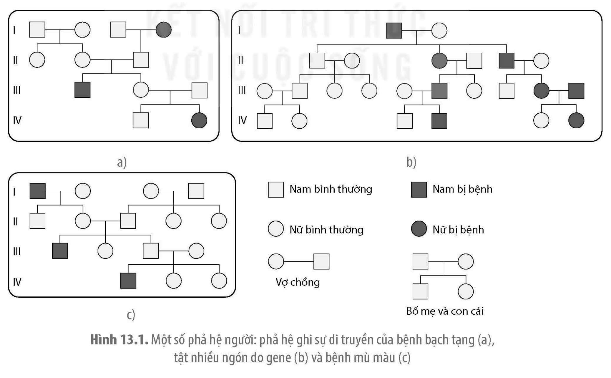
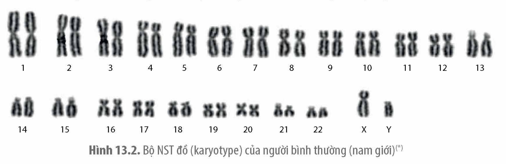
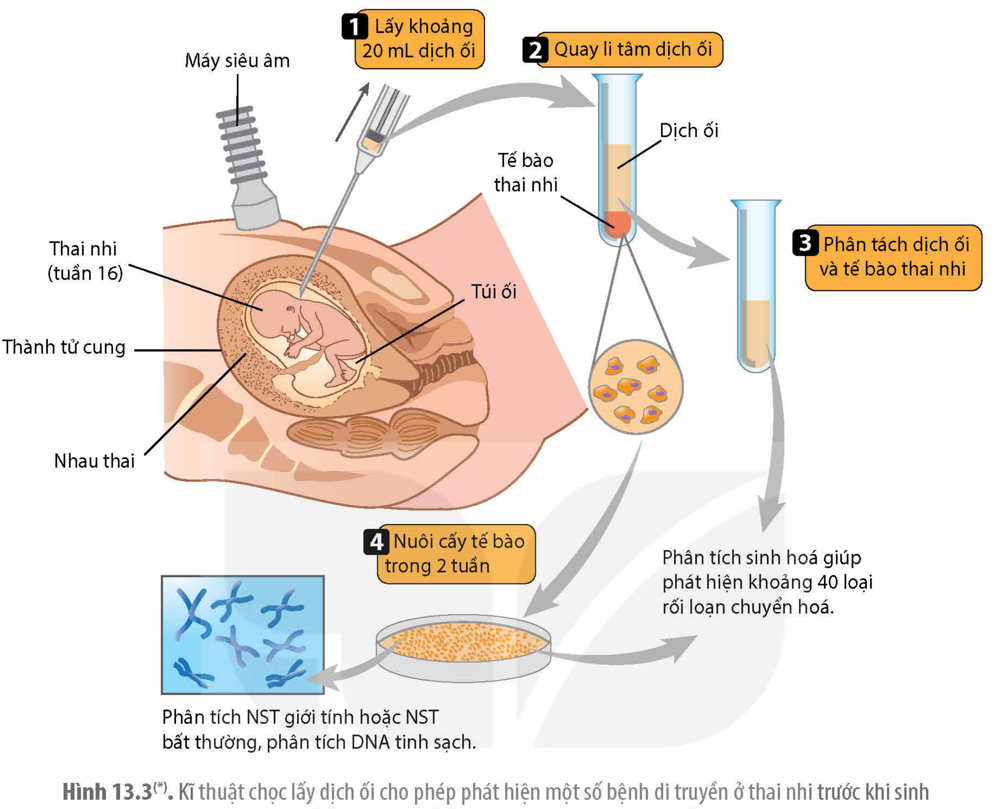

<!-- pdf:70 -->

# BÀI 13: DI TRUYỀN HỌC NGƯỜI VÀ DI TRUYỀN Y HỌC

## 🎯 Yêu cầu cần đạt

- Nêu được khái niệm và vai trò của di truyền học người, di truyền y học.
- Nêu được một số phương pháp nghiên cứu di truyền người (tập trung vào phương pháp phả hệ). Xây dựng được phả hệ để xác định được sự di truyền tính trạng trong gia đình.
- Nêu được khái niệm y học tư vấn. Trình bày được cơ sở của y học tư vấn.
- Giải thích được vì sao cần đến cơ sở tư vấn hôn nhân gia đình trước khi kết hôn và sàng lọc trước sinh.
- Nêu được khái niệm liệu pháp gene. Vận dụng hiểu biết về liệu pháp gene để giải thích việc chữa trị các bệnh di truyền.
- Trình bày được một số thành tựu và ứng dụng của liệu pháp gene.

## 🔴 Mở đầu

Làm thế nào người ta có thể biết được một bệnh di truyền nào đó ở người là do gene trội hay lặn quy định?

## I. KHÁI NIỆM, VAI TRÒ CỦA DI TRUYỀN HỌC NGƯỜI VÀ DI TRUYỀN Y HỌC

### 1. Khái niệm

**Di truyền học người** là ngành khoa học nghiên cứu về sự di truyền và biến dị ở người. Một lĩnh vực của di truyền học người, chuyên nghiên cứu, tìm hiểu về cơ chế phát sinh và di truyền của các bệnh, từ đó để xuất các biện pháp phòng tránh và chữa trị các bệnh di truyền, được gọi là **di truyền y học**.

### 2. Vai trò

Di tryền học người cung cấp cho chúng ta thông tin về cơ chế di truyền và biến dị ở người. Di truyền học người thuộc lĩnh vực nghiên cứu cơ bản nhưng đem lại nhiều ứng dụng thực tiễn. Ví dụ: Hiểu biết về mối quan hệ giữa kiểu gene và môi trường trong việc hình thành tính trạng giúp chúng ta có biện pháp phát triển tối đa về thể chất, năng lực, tố chất bẩm sinh của mình. Di truyền y học thuộc lĩnh vực nghiên cứu ứng dụng, cho chúng ta biết nguyên nhân phát sinh các bệnh di truyền hay triệu chứng bệnh lí, từ đó có thể đưa ra các biện pháp tư vấn phòng ngừa, chẩn đoán và chữa trị một số bệnh di truyền.

<!-- pdf:71 -->

## II. MỘT SỐ PHƯƠNG PHÁP NGHIÊN CỨU DI TRUYỀN NGƯỜI

Các nguyên lí di truyền áp dụng cho mọi sinh vật, kể cả loài người. Tuy nhiên, phương pháp nghiên cứu di truyền học người có một số điểm khác biệt với phương pháp nghiên cứu di truyền trên các đối tượng sinh vật khác. Có nhiều phương pháp nghiên cứu di truyền người như phương pháp nghiên cứu ở cấp độ phân tử, phương pháp nghiên cứu tế bào, phương pháp nghiên cứu trẻ đồng sinh, phương pháp nghiên cứu phả hệ, tuy nhiên, bài này chỉ tập trung nghiên cứu phương pháp phả hệ và phương pháp di truyền tế bào.

### 1. Phương pháp nghiên cứu phả hệ

**a) Khái niệm**

**Phả hệ** là một sơ đồ dùng các biểu tượng hình học ghi lại sự di truyền của một (hoặc một vài) tính trạng từ thế hệ này sang thế hệ khác trong một dòng họ. Thực chất, phả hệ là sơ đồ "lai" tự nhiên ở người, cho biết cách thức một tính trạng nào đó được di truyền qua các thế hệ.

**b) Cách thức xây dựng phả hệ**

Phả hệ được xây dựng bắt đầu từ một người nào đó có đặc điểm khác biệt với các người khác trong gia đình và dòng họ (thường là một bệnh di truyền nhất định). Người có đặc điểm di truyền mà nhà nghiên cứu quan tâm, nếu là nam được kí hiệu bằng hình vuông nhỏ, tô đen; nếu là nữ thì kí hiệu bằng hình tròn nhỏ, tô đen. Từ người có đặc điểm khác thường đó, người ta tìm hiểu và ghi lại những người anh em ruột, bố mẹ, con cái và những người họ hàng trong dòng họ qua các thế hệ xem những ai có đặc điểm đó thì tô màu đen, ai không có đặc điểm quan tâm để hình màu trắng. Các kí hiệu dùng để ghi phả hệ được nêu trong Hình 13.1.

Hình 13.1. Một số phả hệ người: phả hệ ghi sự di truyền của bệnh bạch tạng (a), tật nhiều ngón do gene (b) và bệnh mù màu (c)

<!-- pdf:72 -->

**c) Ứng dụng**

Theo dõi sự di truyền của một đặc điểm nào đó qua các thế hệ có thể biết được đặc điểm này di truyền theo kiểu trội hay lặn, gene quy định tính trạng nằm trên NST thường hay NST giới tính, tính trạng do một, hai hay nhiều gene cùng quy định,...

Bằng phương pháp nghiên cứu phả hệ, các nhà di truyền học đã phát hiện được nhiều bệnh di truyền khác nhau ở người. Ví dụ: Bệnh cholesterol trong máu cao bất thường do một đột biến trội nằm trên NST thường làm hỏng thụ thể tiếp nhận **LDL cholesterol** dẫn đến những người mang gene đột biến bị xơ vữa động mạch và nguy cơ mắc bệnh tim mạch cao bất thường ngay ở độ tuổi 35.

Phương pháp nghiên cứu phả hệ cũng có một số hạn chế. Mỗi gia đình thường chỉ có một vài con nên cần phải nghiên cứu một số lượng lớn phả hệ mới có thể rút ra được kết luận chính xác về kiểu di truyền của một tính trạng.

### 2. Phương pháp di truyền tế bào

**a) Khái niệm**

Phương pháp nghiên cứu các đặc điểm về số lượng, hình dạng, kích thước NST của bộ NST bình thường cũng như của bộ NST bất thường được gọi là **phương pháp nghiên cứu di truyền tế bào**.

**b) Cách tiến hành**

Các nhà nghiên cứu thường lấy các tế bào bạch cầu của người đem nuôi cấy trong môi trường nhân tạo cho chúng phân chia. Các tế bào bạch cầu đang phân chia được lấy ra làm tiêu bản quan sát bộ NST ở kì giữa. Để tăng số lượng các tế bào ở kì giữa, người ta thường cho vào dung dịch nuôi cấy tế bào hoá chất colchicine ngăn cản sự hình thành thoi phân bào khiến các tế bào dừng lại ở kì giữa mà không thể chuyển sang kì sau.

<!-- term: NST đồ -->
Để có dữ liệu đối chứng với những bất thường về NST, các nhà di truyền học thường phải làm NST đồ bằng cách tiến hành thu thập hình ảnh về bộ NST bình thường và sắp xếp các cặp NST tương đồng thành hàng theo kích thước giảm dần, đánh số từ 1 đến 22 (đối với các cặp NST thường), còn cặp NST giới tính được xếp riêng ở phía cuối (H 13.2).

Hình 13.2. Bộ NST đồ (karyotype) của người bình thường (nam giới)(\*)

**c) Ứng dụng**

Phương pháp di truyền tế bào giúp các nhà di truyền học hiểu được các đặc điểm của bộ NST bình thường của loài người. Ngoài ra, khi so sánh những bất thường về số lượng hoặc cấu trúc NST ở người bệnh với hình ảnh của các NST bình thường trên bộ NST đồ, người ta

> (\*) Nguồn: Trần Quế – Viện nghiên cứu Hạt nhân Đà Lạt.

<!-- pdf:73 -->

có thể xác định được những đột biến NST gây bệnh. Phát hiện sớm các đột biến ở thai nhi khi còn trong bụng mẹ giúp các cặp bố mẹ có thể đưa ra quyết định đình chỉ thai kì, tránh sinh ra con bị bệnh di truyền. Phương pháp di truyền tế bào cũng giúp phát hiện ra nhiều bệnh ung thư ở người. Ví dụ: Chuyển đoạn giữa NST số 8 và số 14 trong tế bào soma của người gây nên loại ung thư bạch cầu Burkitt, đột biến chuyển gần như toàn bộ vai dài của NST 21 sang vai ngắn của NST 14 gây nên hội chứng Down.

## ❓ Dừng lại và suy ngẫm

1. Giải thích vai trò của di truyền học người và di truyền y học.
2. Hãy vẽ sơ đồ phả hệ ghi lại sự di truyền một tính trạng nào đó trong gia đình em (như tính trạng thuận tay trái/thuận tay phải, tóc xoăn tự nhiên/tóc thẳng) và cho biết tính trạng nào là trội, tính trạng nào là lặn. Giải thích.

## III. Y HỌC TƯ VẤN

### 1. Khái niệm

**Y học tư vấn** hay di truyền học tư vấn là một lĩnh vực cung cấp thông tin cho bệnh nhân và những đối tượng có nguy cơ mắc bệnh di truyền hoặc sinh con mắc bệnh di truyền về nguyên nhân, cơ chế gây bệnh, khả năng mắc bệnh, biện pháp hạn chế và phòng tránh bệnh cho đời con,…

### 2. Cơ sở khoa học
<!-- ocr-ok: tiêu đề in màu, đã đối chiếu ảnh PDF 73 -->

- Dựa trên quy luật di truyền và di truyền học quần thể, các nhà tư vấn có thể xác định được xác suất sinh con mắc bệnh di truyền của cặp vợ chồng được tư vấn là bao nhiêu để họ cân nhắc đưa ra các quyết định sử dụng các biện pháp giảm thiểu rủi ro. Ví dụ: Nếu cả hai vợ chồng đều mang allele lặn gây bệnh tan máu bẩm sinh thì xác suất sinh con bị bệnh là 1/4.
- Dựa trên các xét nghiệm về NST và các chỉ tiêu sinh hoá lấy từ dịch ối hoặc từ nhau thai, các bác sĩ có thể biết được thai nhi có mang đột biến NST hoặc mắc các bệnh di truyền hay không để tư vấn cho các cặp vợ chồng đưa ra quyết định phù hợp, tránh sinh con mắc bệnh di truyền. Kĩ thuật chọc lấy dịch ối (H 13.3) là một biện pháp chẩn đoán trước sinh có thể giúp phát hiện thai nhi bị các đột biến NST hay một số bệnh rối loạn chuyển hoá bẩm sinh. Ví dụ: Phụ nữ mang thai, đặc biệt là phụ nữ lớn tuổi nên làm các xét nghiệm trước sinh nhằm sớm phát hiện các bệnh tật di truyền (hội chứng Down, dị tật ống thần kinh,…) ở thai nhi để có thể đưa ra quyết định phù hợp với từng trường hợp. Kĩ thuật sinh thiết lấy tế bào nhau thai khi thai nhi ở 11 – 13 tuần tuổi đem phân tích bộ NST cũng có thể phát hiện được các hội chứng Down và một số dị tật bẩm sinh.
- Các kĩ thuật phân tử giúp xác định gene gây bệnh và đưa ra phương pháp điều trị thích hợp. Ví dụ: Những người bị bệnh ung thư phổi có thể xét nghiệm để biết gene nào bị đột biến, qua đó đưa ra được phác đồ điều trị với loại thuốc đặc hiệu (thuốc đích).

<!-- pdf:74 -->

Hình 13.3(\*). Kĩ thuật chọc lấy dịch ối cho phép phát hiện một số bệnh di truyền ở thai nhi trước khi sinh

### 3. Tư vấn

Từ các kết quả nghiên cứu phả hệ, di truyền tế bào cũng như di truyền phân tử, các nhà khoa học có thể đưa ra tư vấn di truyền để phòng tránh và chữa trị một số bệnh di truyền. Ví dụ: Để phòng tránh các bệnh di truyền, phải tránh kết hôn giữa những người có họ hàng gần vì xác suất để các gene lặn gây bệnh trở về trạng thái đồng hợp trong trường hợp này rất cao. Nếu hai vợ chồng cùng có kiểu gene dị hợp thì xác suất sinh con bị bệnh (có kiểu gene đồng hợp lặn) lên tới 25% trong khi kết hôn giữa những người không có họ hàng cho xác suất sinh con bị bệnh rất thấp. Ngoài ra, việc sàng lọc trước sinh cũng giúp các bác sĩ đưa ra lời khuyên để bố mẹ có thể quyết định đình chỉ thai kì, tránh sinh ra con bị bệnh di truyền với các dị tật bẩm sinh không thể chữa trị được. Xét nghiệm một số chỉ tiêu hoá sinh có thể phát hiện dấu hiệu của một số bệnh rối loạn chuyển hoá di truyền như galactose huyết (không dung nạp đường galactose từ sữa) ở trẻ sơ sinh, từ đó áp dụng chế độ ăn hạn chế đường lactose cho trẻ, giúp trẻ không biểu hiện triệu chứng bệnh. Nhiều bệnh nhân mắc bệnh ung thư nếu biết được do gene nào quy định, các bác sĩ có thể đưa ra tư vấn lựa chọn thuốc điều trị riêng cho bệnh nhân (thuốc hướng đích) tránh được nhiều tác dụng phụ của thuốc và tăng hiệu quả điều trị.

> (\*) Nguồn hình: Phạm Minh Kiên.

<!-- pdf:75 -->

## IV. MỘT SỐ THÀNH TỰU VÀ ỨNG DỤNG CỦA LIỆU PHÁP GENE

### 1. Thành tựu trong nghiên cứu

**Liệu pháp gene** là biện pháp chữa trị bệnh di truyền bằng cách thay thế gene bệnh trong tế bào của người bệnh bằng gene bình thường hoặc chỉnh sửa gene bị bệnh. Hiện nay, liệu pháp gene mới được thử nghiệm để thay thế gene trong tế bào soma nhằm chữa một số bệnh di truyền do một gene quy định. Tế bào của người bệnh được lấy ra và đưa gene bình thường vào, đem nuôi cấy nhân lên với số lượng lớn sau đó tiêm trở lại cho bệnh nhân. Một số nghiên cứu liệu pháp gene đã được thử nghiệm tương đối thành công, cải thiện đáng kể triệu chứng của một số bệnh di truyền. Ví dụ: Năm 2007, ở Pennsylvania và London, người ta đã sử dụng liệu pháp gene để chữa cho 4 bệnh nhân bị mù do một đột biến gene hiếm gặp. Mỗi bệnh nhân được tiêm một loại thể truyền là virus mang gene *RPE65* bình thường để thay thế gene bệnh. Kết quả là thị lực của cả 4 bệnh nhân đã được cải thiện đáng kể. Năm 2009, các nhà khoa học đã tiến hành thử nghiệm liệu pháp gene để chữa bệnh mù bẩm sinh Leber's cho 12 người. Kết quả cho thấy tất cả các bệnh nhân đều cải thiện được thị lực.

Năm 2018, các nhà nghiên cứu đã công bố kết quả khả quan việc dùng hệ thống CRISPR–Cas 9 chỉnh sửa được gene gây bệnh hồng cầu hình liềm trong tế bào người, sau đó tế bào đã chỉnh sửa được tiêm trở lại cho bệnh nhân. Mặc dù còn nhiều rào cản cần phải vượt qua trước khi có thể thử nghiệm rộng rãi trên người nhưng đây là một kĩ thuật đầy hứa hẹn của liệu pháp gene tương lai.

### 2. Ứng dụng

Ứng dụng hiện nay của liệu pháp gene chủ yếu hướng đến chữa bệnh di truyền do một gene quy định, gene bình thường đưa vào tế bào để thay thế gene bệnh phải được duy trì và hoạt động trong suốt cuộc đời của bệnh nhân. Điều này có nghĩa là tế bào mang gene chuyển đưa vào người bệnh phải có khả năng phân chia trong suốt cuộc đời, nếu không, việc thay thế gene phải lặp đi lặp lại nhiều lần là không khả thi. Vì vậy, các tế bào gốc tuỷ xương của bệnh nhân là đối tượng thích hợp cho liệu pháp gene để chữa trị một số bệnh di truyền liên quan đến các tế bào máu, bệnh thiếu hụt miễn dịch.

Tuy vậy, liệu pháp gene hiện nay mới đang ở giai đoạn nghiên cứu thử nghiệm và cũng còn nhiều vấn đề về kĩ thuật cần phải giải quyết. Ví dụ: Làm thế nào để gene chuyển vào tế bào người hoạt động đúng thời điểm, đúng vị trí, với liều lượng sản phẩm cần thiết? Làm thế nào đảm bảo được gene chuyển không làm ảnh hưởng đến sự hoạt động của các gene hay các hoạt động khác của tế bào? Bên cạnh đó, những quan ngại về khía cạnh đạo đức cũng phải được tính đến. Ví dụ: Liệu có nên chỉnh sửa hệ gene người? Việc can thiệp chỉnh sửa hệ gene đã được tiến hoá tạo ra qua hàng triệu năm có thể dẫn đến hậu quả khôn lường.

<!-- pdf:76 -->

## ❓ Dừng lại và suy ngẫm

1. Những đối tượng nào cần đến cơ sở tư vấn di truyền trước khi kết hôn và sàng lọc trước sinh? Giải thích.
2. Hãy cho biết những loại bệnh di truyền nào có thể chữa khỏi hoặc làm giảm nhẹ triệu chứng bệnh nếu gene gây bệnh được phát hiện sớm ở trẻ sơ sinh? Giải thích.

## 📌 Kiến thức cốt lõi

- Di truyền học người là ngành khoa học nghiên cứu về sự di truyền và biến dị ở người. Di truyền y học nghiên cứu cơ chế phát sinh, cơ chế di truyền của các bệnh.
- Những kiến thức về di truyền y học có thể giúp bác sĩ tư vấn cho những đối tượng có nguy cơ cao mắc các bệnh di truyền về biện pháp phòng ngừa và điều trị một số bệnh di truyền.
- Liệu pháp gene là phương pháp chữa bệnh di truyền bằng cách thay thế gene gây bệnh trong tế bào người bệnh bằng gene bình thường, sau đó nuôi cấy tế bào đã được thay thế gene rồi đưa trở lại cơ thể bệnh nhân. Tuy nhiên, một số thành tựu mới chỉ dừng lại ở mức thử nghiệm và còn nhiều rào cản về kĩ thuật cũng như đạo đức.

## ✏️ Luyện tập và vận dụng

1. Quan sát Hình 13.1 và cho biết các bệnh di truyền trên hình được di truyền theo kiểu trội hay lặn, gene quy định bệnh nằm trên NST thường hay NST giới tính X. Giải thích.
2. Về lí thuyết, người bị bệnh di truyền do gene lặn có thể được sinh ra ở hai kiểu gia đình: (1) Một trong hai bố mẹ bị bệnh và (2) cả hai bố mẹ đều không bị bệnh. Tuy vậy, hầu hết người bị bệnh lại có cả bố và mẹ đều bình thường. Giải thích.

## 📷 Danh sách hình trong bài

| Mã hình | Trang PDF | Vị trí | Chú thích gốc |
|---|---|---|---|
| H12-sinh-b13-01 | 71 | Mục II.1.b | Hình 13.1. Một số phả hệ người: phả hệ ghi sự di truyền của bệnh bạch tạng (a), tật nhiều ngón do gene (b) và bệnh mù màu (c) |
| H12-sinh-b13-02 | 72 | Mục II.2.b | Hình 13.2. Bộ NST đồ (karyotype) của người bình thường (nam giới)(\*) — (\*) Nguồn: Trần Quế – Viện nghiên cứu Hạt nhân Đà Lạt. |
| H12-sinh-b13-03 | 74 | Mục III.2 | Hình 13.3(\*). Kĩ thuật chọc lấy dịch ối cho phép phát hiện một số bệnh di truyền ở thai nhi trước khi sinh — (\*) Nguồn hình: Phạm Minh Kiên. |
