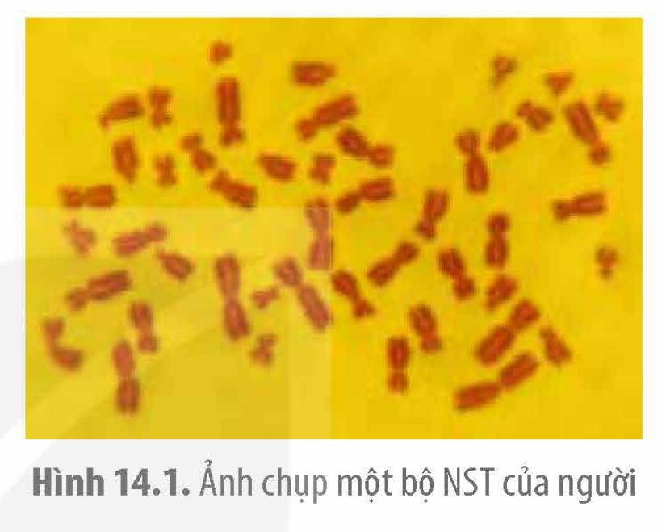

<!-- pdf:77 -->

# BÀI 14: THỰC HÀNH: QUAN SÁT MỘT SỐ DẠNG ĐỘT BIẾN NHIỄM SẮC THỂ

## I. YÊU CẦU CẦN ĐẠT
<!-- ocr-ok: tiêu đề in hoa trang trí, đã đối chiếu ảnh PDF 77 -->

Thực hành, quan sát được đột biến NST trên tiêu bản cố định.

## II. CHUẨN BỊ

### 1. Dụng cụ, thiết bị

- Kính hiển vi.
- Dầu soi kính, giấy lau kính chuyên dụng.
- Ảnh chụp bộ NST bình thường và bộ NST bị đột biến ở một số loài (nếu có).
- Kéo cắt giấy, ảnh.

### 2. Mẫu vật

Tiêu bản cố định bộ NST bình thường và bộ NST bị đột biến ở một số loài.

## III. NGUYÊN LÍ VÀ CÁCH TIẾN HÀNH

### 1. Nguyên lí

- Các NST trong bộ NST lưỡng bội bình thường ở các loài tồn tại thành từng cặp tương đồng gồm hai chiếc NST có hình dạng, kích thước giống nhau (trừ cặp NST giới tính).
- Quan sát dưới kính hiển vi và so sánh hình dạng, kích thước số lượng các NST của bộ NST trong tiêu bản với bộ NST bình thường có thể nhận biết được một số dạng đột biến cấu trúc NST (mất đoạn, lặp đoạn, chuyển đoạn) và đột biến số lượng NST (lệch bội, đa bội) ở một số loài sinh vật.

### 2. Cách tiến hành

*Bước 1:* Đặt tiêu bản lên kính hiển vi, điều chỉnh vùng có mẫu vật trên tiêu bản vào giữa hiển vi trường.

*Bước 2:* Sử dụng vật kính 10× để tìm kiếm bộ NST phân tán đều, dễ quan sát nhất và đưa vào chính giữa hiển vi trường.

*Bước 3:* Chuyển sang vật kính 40× để quan sát rõ hơn và di chuyển tiêu bản sao cho hình ảnh bộ NST muốn quan sát nằm chính giữa hiển vi trường. Sau đó, nhỏ một giọt dầu soi kính lên vùng tiêu bản nằm ở giữa hiển vi trường.

*Bước 4:* Chuyển sang vật kính 100× và điều chỉnh ốc vi cấp trên thân kính hiển vi để quan sát NST rõ nhất có thể.

*Bước 5:* Quan sát và đếm số lượng cũng như cấu trúc các NST trong tiêu bản, so sánh với số lượng, cấu trúc NST trong bộ NST bình thường cùng loài và ghi kết quả vào vở theo mẫu Bảng 14.1. Những nơi có điều kiện có thể sử dụng thiết bị kết nối kính hiển vi với màn hình máy chiếu để phóng to hình ảnh bộ NST lên màn hình lớn cho cả lớp cùng quan sát.

<!-- pdf:78 -->

Bảng 14.1. Kết quả quan sát

| Loài | Hình ảnh quan sát được trên tiêu bản bình thường và tiêu bản đột biến | Nhận xét rút ra khi so sánh với bộ NST bình thường | Kết luận về dạng đột biến quan sát được |
|---|---|---|---|
| ? | ? | ? | ? |

*Lưu ý:*

- Sau khi sử dụng vật kính 100×, cần phải dùng giấy lau chuyên dụng lau dầu dính trên vật kính và trên tiêu bản.
- Những trường không có kính hiển vi đủ tốt với vật kính 100× để quan sát NST thì giáo viên có thể sưu tầm các ảnh chụp bộ NST bị đột biến và bộ NST bình thường cùng loài rồi photo thành nhiều bản để học sinh có thể quan sát đột biến NST trên ảnh. Ví dụ: Hình 14.1 cho thấy một bộ NST của người. Các em có thể quan sát và cho biết đây có phải là bộ NST bị đột biến không. Nếu có thì khả năng cao nhất là loại đột biến gì? Giải thích.

Hình 14.1. Ảnh chụp một bộ NST của người

## IV. THU HOẠCH

Học sinh viết báo cáo thực hành theo cá nhân hoặc nhóm với nội dung như sau:

**BÁO CÁO THỰC HÀNH**

1. **Mục đích**
2. **Kết quả**
3. **Trả lời câu hỏi**
<!-- ocr-ok: tiêu đề in đậm trong khung, đã đối chiếu ảnh PDF 78 -->

a) Tại sao phần lớn các đột biến NST là có hại?

b) Nếu tình cờ phát hiện một cây trồng có kích thước thân, lá và các cơ quan sinh dưỡng to hơn hẳn so với các cây bình thường cùng loài và biết chắc cây này là cây bị đột biến NST thì đó là loại đột biến gì? Làm thế nào có thể kiểm chứng được loại đột biến ở cây này đúng là loại đột biến NST mà em đề xuất?

## 📷 Danh sách hình trong bài

| Mã hình | Trang PDF | Vị trí | Chú thích gốc |
|---|---|---|---|
| H12-sinh-b14-01 | 78 | Mục III, Lưu ý | Hình 14.1. Ảnh chụp một bộ NST của người |
