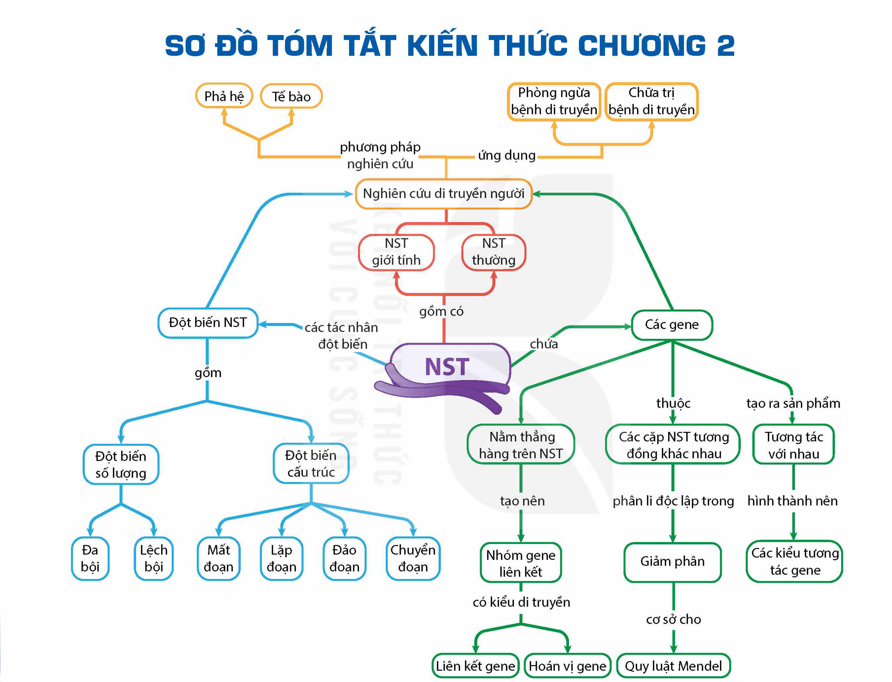

<!-- pdf:79 -->

# SƠ ĐỒ TÓM TẮT KIẾN THỨC CHƯƠNG 2

<!-- Trang in xoay ngang; ảnh đã xoay lại. Dưới đây chép các nhánh của sơ đồ thành danh sách, giữ nguyên chữ trong các ô và trên các mũi tên. -->

- NST
  - gồm có: NST thường; NST giới tính
  - chứa: Các gene
    - tạo ra sản phẩm: Tương tác với nhau
      - hình thành nên: Các kiểu tương tác gene
    - thuộc: Các cặp NST tương đồng khác nhau
      - phân li độc lập trong: Giảm phân
        - cơ sở cho: Quy luật Mendel
    - Nằm thẳng hàng trên NST
      - tạo nên: Nhóm gene liên kết
        - có kiểu di truyền: Liên kết gene; Hoán vị gene
  - các tác nhân đột biến: Đột biến NST
    - gồm: Đột biến cấu trúc (Mất đoạn; Lặp đoạn; Đảo đoạn; Chuyển đoạn); Đột biến số lượng (Lệch bội; Đa bội)
- Nghiên cứu di truyền người
  - phương pháp nghiên cứu: Phả hệ; Tế bào
  - ứng dụng: Phòng ngừa bệnh di truyền; Chữa trị bệnh di truyền
<!-- ocr-ok: chữ trong các ô sơ đồ, OCR đọc không theo thứ tự; đã đối chiếu ảnh đã xoay -->

## 📷 Danh sách hình trong bài

| Mã hình | Trang PDF | Vị trí | Chú thích gốc |
|---|---|---|---|
| H12-sinh-so-do-tom-tat-c02-01 | 79 | Cả trang (in xoay ngang) | Sơ đồ tóm tắt kiến thức chương 2 |
