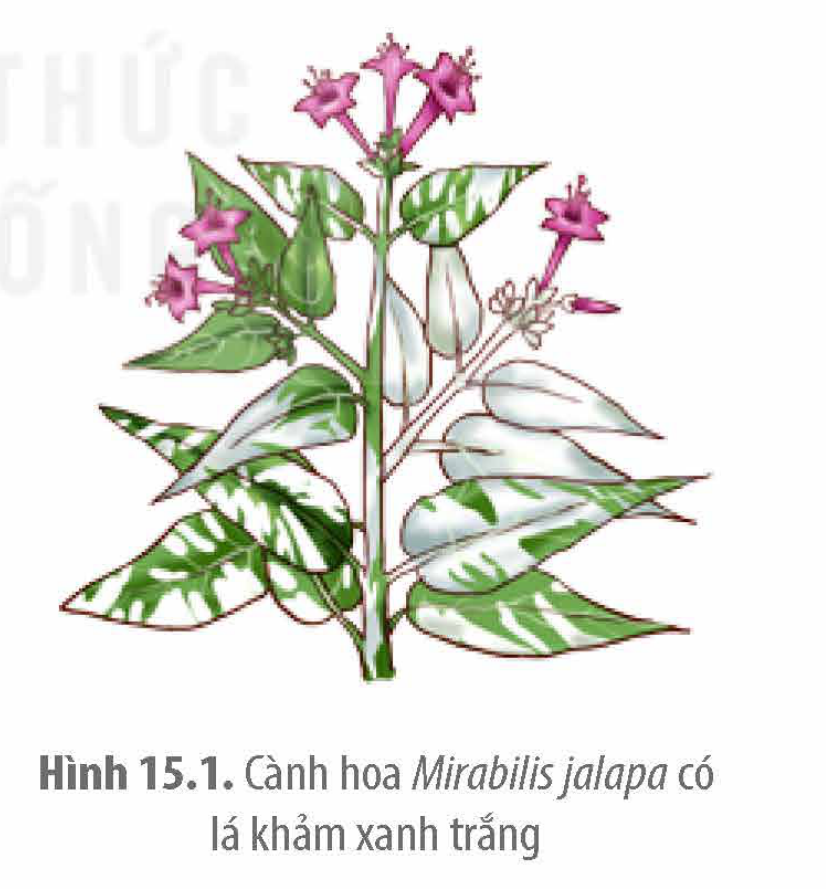
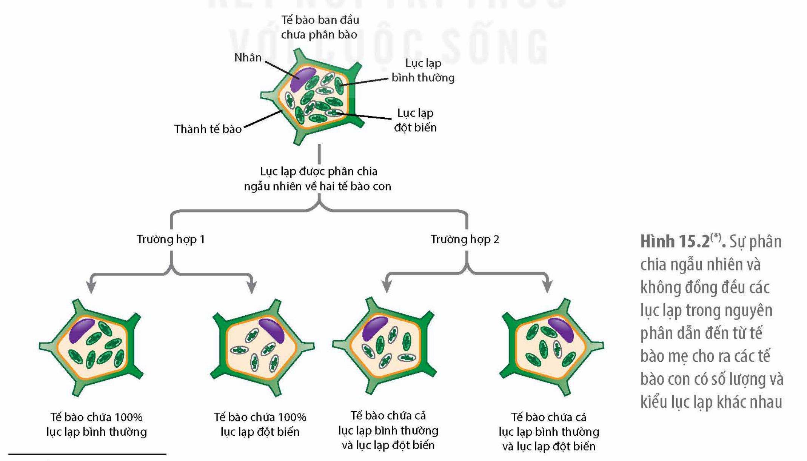
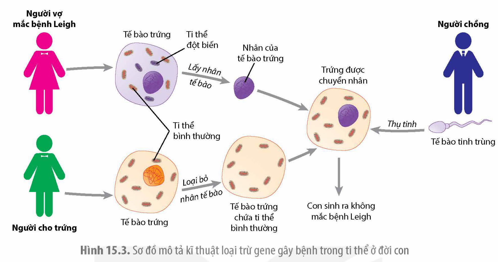

<!-- pdf:80 -->

# BÀI 15: DI TRUYỀN GENE NGOÀI NHÂN

## 🎯 Yêu cầu cần đạt

- Trình bày được bối cảnh ra đời thí nghiệm của Correns.
- Trình bày được thí nghiệm chứng minh di truyền gene ngoài nhân của Correns, từ đó giải thích được gene không những tồn tại trong nhân mà còn tồn tại ngoài nhân (trong các bào quan như ti thể, lạp thể).
- Trình bày được đặc điểm di truyền của gene ngoài nhân và một số ứng dụng.

## 🔴 Mở đầu

Ở người, sự di truyền bệnh cơ ti thể (gây suy yếu và thoái hoá cơ) phụ thuộc hoàn toàn vào mẹ, khi mẹ bị bệnh thì các con đều bị bệnh bất kể là bố có bị bệnh hay không. Hiện tượng này được giải thích như thế nào?

## I. THÍ NGHIỆM CỦA CORRENS VỀ DI TRUYỀN GENE NGOÀI NHÂN

### 1. Bối cảnh ra đời thí nghiệm

<!-- term: Lá khảm -->
Năm 1900, ba nhà thực vật học là Hugo de Vries, Erich von Tschermak và Carl Correns đã độc lập tiến hành thí nghiệm lai ở các loài thực vật khác nhau và cùng đi đến kết luận giống như của Mendel khi làm thí nghiệm trên đậu hà lan. Tuy nhiên, vào năm 1909, Carl Correns đã phát hiện ra một hiện tượng di truyền khác thường ở loài cây hoa bốn giờ (*Mirabilis jalapa*). Ở loài cây này, trên cùng một cây có thể có ba loại nhánh với màu sắc lá khác nhau: nhánh toàn lá xanh, nhánh toàn lá trắng và nhánh có lá khảm (có vệt trắng trên nền lá xanh) (H 15.1). Để tìm hiểu cơ sở di truyền của màu sắc lá ở loài cây này, Correns đã tiến hành các thí nghiệm lai khác nhau.

Hình 15.1. Cành hoa *Mirabilis jalapa* có lá khảm xanh trắng

### 2. Thí nghiệm

Vì trên một cây của loài hoa này có ba loại cành có màu sắc lá khác nhau nên Correns đã lấy hạt phấn từ hoa trên cành này thụ phấn cho hoa trên cành kia theo các tổ hợp khác nhau và thu được kết quả như ở Bảng 15.1.

<!-- pdf:81 -->

Bảng 15.1. Một số phép lai do Correns thực hiện ở loài cây hoa bốn giờ và kết quả

| P: Bố | P: Mẹ | F$_1$ |
|---|---|---|
| Lá trắng | Lá xanh | Lá xanh |
| Lá xanh | Lá trắng | Lá trắng |
| Lá khảm | Lá trắng | Lá trắng |
| Lá trắng | Lá khảm | Lá khảm, lá xanh, lá trắng |
| Lá khảm | Lá xanh | Lá xanh |
| Lá xanh | Lá khảm | Lá khảm, lá xanh, lá trắng |

### 3. Giải thích thí nghiệm

Kết quả các phép lai thuận nghịch ở trên cho thấy, màu lá của đời con hoàn toàn phụ thuộc vào màu lá của cây mẹ mà không chịu ảnh hưởng bởi màu lá của cây bố. Từ kết quả thí nghiệm thu được, Correns đưa ra kết luận, tính trạng màu sắc lá ở cây hoa bốn giờ không di truyền theo quy luật Mendel mà di truyền theo mẹ, từ đó xuất hiện thuật ngữ "**di truyền theo dòng mẹ**".

Những nghiên cứu tiếp theo cho thấy, một số tính trạng do gene nằm trong lục lạp, ti thể ở tế bào chất (còn gọi là **gene ngoài nhân**). Các gene nằm trong lục lạp, ti thể ở tế bào chất chỉ được truyền từ mẹ cho con vì hầu hết các hợp tử chỉ nhận tế bào chất từ tế bào trứng của mẹ mà không nhận tế bào chất từ tinh trùng của bố, dẫn đến đời con mang tính trạng giống mẹ.

<!-- term: Lá khảm -->
Trong thí nghiệm trên, cây lá xanh có tế bào chứa các lục lạp mang allele quy định enzyme xúc tác cho phản ứng tổng hợp tạo ra diệp lục bình thường; cây lá trắng do tế bào trong lục lạp mang allele bị đột biến khiến diệp lục không được tạo ra làm lá màu trắng; còn cây lá khảm có tế bào nhận được cả hai loại lục lạp bình thường và lục lạp chứa allele đột biến. Trong quá trình phân bào, các lục lạp được phân chia ngẫu nhiên và không đồng đều về các tế bào con nên ở đời con, ngoài kiểu hình giống mẹ còn có thể xuất hiện kiểu hình khác (H 15.2).

Hình 15.2(\*). Sự phân chia ngẫu nhiên và không đồng đều các lục lạp trong nguyên phân dẫn đến từ tế bào mẹ cho ra các tế bào con có số lượng và kiểu lục lạp khác nhau

> (\*) Nguồn: Phạm Minh Kiên

<!-- pdf:82 -->

## ❓ Dừng lại và suy ngẫm

Quan sát Bảng 15.1, hãy nhận xét chung về kết quả các phép lai trong bảng và giải thích.

## II. ĐẶC ĐIỂM DI TRUYỀN GENE NGOÀI NHÂN

Sự di truyền các tính trạng do gene ngoài nhân quy định có các đặc điểm sau:

- Kết quả phép lai thuận nghịch là khác nhau, tính trạng được di truyền theo dòng mẹ và biểu hiện ở cả hai giới.
- Trong di truyền gene ngoài nhân, vai trò của các giao tử đực và giao tử cái không ngang nhau mà vai trò chủ yếu thuộc về tế bào chất của giao tử cái.
- Gene ngoài nhân nằm trên các phân tử DNA dạng vòng nhỏ trong ti thể, lục lạp, các gene này không tồn tại thành từng cặp allele như gene trong nhân nên chỉ cần một allele là được biểu hiện ra kiểu hình.
- Các gene ngoài nhân mặc dù được truyền từ mẹ nhưng các cá thể con của cùng một mẹ có thể nhận được số lượng các allele khác nhau dẫn đến có thể có các kiểu hình khác nhau.
- Không có sự tái tổ hợp gene ngoài nhân trong quá trình thụ tinh.

## ❓ Dừng lại và suy ngẫm

Dựa vào đặc điểm nào người ta có thể nhận biết được tính trạng di truyền do gene ngoài nhân?

## III. ỨNG DỤNG CỦA DI TRUYỀN GENE NGOÀI NHÂN

Những hiểu biết về các gene ngoài nhân và cơ chế di truyền chúng đã được ứng dụng trong nhiều lĩnh vực khoa học và đời sống như nghiên cứu tiến hoá, y học, nông nghiệp, pháp y,… mang lại nhiều lợi ích to lớn.

### 1. Trong y học

Ở người có một số bệnh (phần lớn là hiếm gặp) do gene nằm trong ti thể quy định như cơ ti thể, tiểu đường, tim mạch, Alzheimer, Leigh,... Sự phát triển của khoa học và công nghệ ngày nay đã có thể giúp các bà mẹ mắc bệnh do gene ti thể sinh ra đời con khoẻ mạnh bằng kĩ thuật loại trừ gene gây bệnh trong ti thể ở đời con (H 15.3). Bằng kĩ thuật này, vào năm 2016, các nhà khoa học ở Mexico đã thành công trong việc giúp một người mẹ mang gene đột biến trong ti thể quy định hội chứng Leigh (một hội chứng gây thoái hoá hệ thần kinh sớm) sinh ra người con khoẻ mạnh không mang gene bệnh (H 15.3).

<!-- pdf:83 -->

Hình 15.3. Sơ đồ mô tả kĩ thuật loại trừ gene gây bệnh trong ti thể ở đời con

### 2. Trong nông nghiệp

Ở thực vật, **bất dục đực tế bào chất** là tính trạng do nhiều đột biến gene nằm trong ti thể gây ra, làm cho cây không tạo ra được hạt phấn hữu thụ nhưng không ảnh hưởng đến việc hình thành trứng. Hiện nay, các nhà khoa học đã tìm thấy hiện tượng này trên 140 loài khác nhau. Phát hiện này được ứng dụng và đem lại bước tiến lớn trong công tác lai tạo giống cây trồng, đặc biệt là đối với các giống cây trồng có hoa lưỡng tính tự thụ phấn.

Ví dụ: Trong việc lai tạo giống lúa, do lúa là cây lưỡng tính tự thụ phấn nên để lai các giống lúa phải tiến hành khử bao phấn ở cây mẹ và chuyển hạt giống từ cây bố sang. Điều này rất tốn công sức, thời gian và không thể thực hiện lai giống lúa đại trà. Dựa trên hiện tượng bất dục đực do gene trong tế bào chất quy định, các nhà khoa học đã nghiên cứu tạo ra được dòng lúa bất dục đực, tạo điều kiện thuận lợi để tiến hành lai giữa các giống lúa khác nhau, từ đó tạo ra nhiều giống lúa lai cho năng suất cao, chất lượng tốt như giống VT 505, MV2, Long Hương 8117,…

### 3. Trong nghiên cứu tiến hoá

Do mỗi gene trong ti thể có một số lượng lớn bản sao và di truyền theo dòng mẹ nên các nhà khoa học thường giải trình tự nucleotite trên DNA của ti thể để xây dựng cây phân loại của các nhóm sinh vật, truy tìm nguồn gốc chủng tộc loài người,…

Để truy tìm nguồn gốc loài người, các nhà khoa học tách chiết DNA ti thể từ các bộ xương hoá thạch của các loài người đã tuyệt chủng, có thể thu được hệ gene ti thể còn nguyên vẹn để giải trình tự nucleotide. Sau đó so sánh mức độ giống nhau về trình tự nucleotide DNA ti thể của các hoá thạch với DNA ti thể của các chủng tộc người đang sống, từ đó các nhà khoa học có thể truy tìm được nguồn gốc của loài người. Những nghiên cứu như vậy cho thấy loài người xuất hiện ở châu Phi, sau đó phát tán ra các châu lục khác.

Ngoài ra, việc giải trình tự gene trong ti thể còn được áp dụng trong công tác pháp y nhằm xác định hài cốt liệt sĩ và nhân thân các nạn nhân trong các vụ tai nạn cũng như xác định quan hệ huyết thống ở người,...

<!-- pdf:84 -->

## ❓ Dừng lại và suy ngẫm

1. Những nghiên cứu về hiện tượng di truyền gene ngoài nhân được ứng dụng như thế nào trong thực tiễn?
2. Đặc điểm nào của hệ gene ti thể khiến các nhà khoa học thường giải trình tự hệ gene này để xác định nhân thân ở người trong trường hợp các mẫu vật đem phân tích đã bị huỷ hoại nghiêm trọng bởi các yếu tố môi trường (ví dụ như hài cốt)?

## 📌 Kiến thức cốt lõi

- Tính trạng không chỉ do gene trong nhân tế bào quy định mà còn do gene trong tế bào chất quy định. Sự di truyền của các tính trạng do gene ngoài nhân quy định có các đặc điểm như: tính trạng được di truyền theo dòng mẹ, kết quả phép lai thuận nghịch khác nhau, vai trò chủ yếu thuộc về tế bào chất của giao tử cái, chỉ cần một allele là đã biểu hiện ra kiểu hình.
- Di truyền gene ngoài nhân được ứng dụng trong nhiều lĩnh vực như y học, nông nghiệp, nghiên cứu tiến hoá,…

## ✏️ Luyện tập và vận dụng

1. Sự di truyền các tính trạng do gene ngoài nhân quy định có gì khác so với các tính trạng được quy định bởi các gene trong nhân?
2. Hãy tìm hiểu thêm những ứng dụng thực tiễn của hiện tượng di truyền gene ngoài nhân trong y học và nông nghiệp qua sách báo, internet,…

## 📷 Danh sách hình trong bài

| Mã hình | Trang PDF | Vị trí | Chú thích gốc |
|---|---|---|---|
| H12-sinh-b15-01 | 80 | Mục I.1 | Hình 15.1. Cành hoa Mirabilis jalapa có lá khảm xanh trắng |
| H12-sinh-b15-02 | 81 | Mục I.3 | Hình 15.2(\*). Sự phân chia ngẫu nhiên và không đồng đều các lục lạp trong nguyên phân dẫn đến từ tế bào mẹ cho ra các tế bào con có số lượng và kiểu lục lạp khác nhau — (\*) Nguồn: Phạm Minh Kiên |
| H12-sinh-b15-03 | 83 | Mục III.1 | Hình 15.3. Sơ đồ mô tả kĩ thuật loại trừ gene gây bệnh trong ti thể ở đời con |
