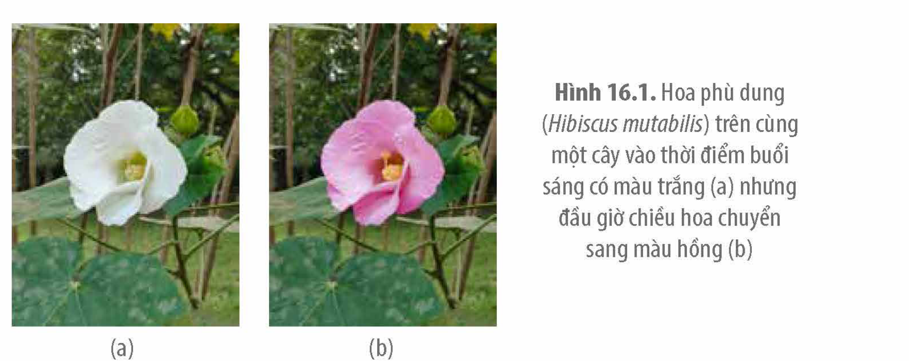
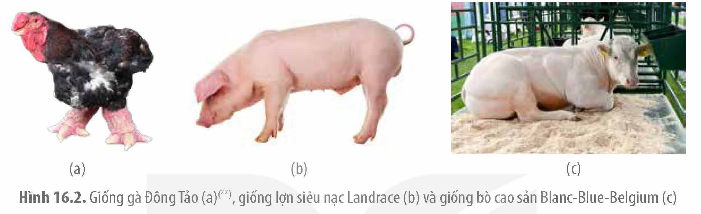
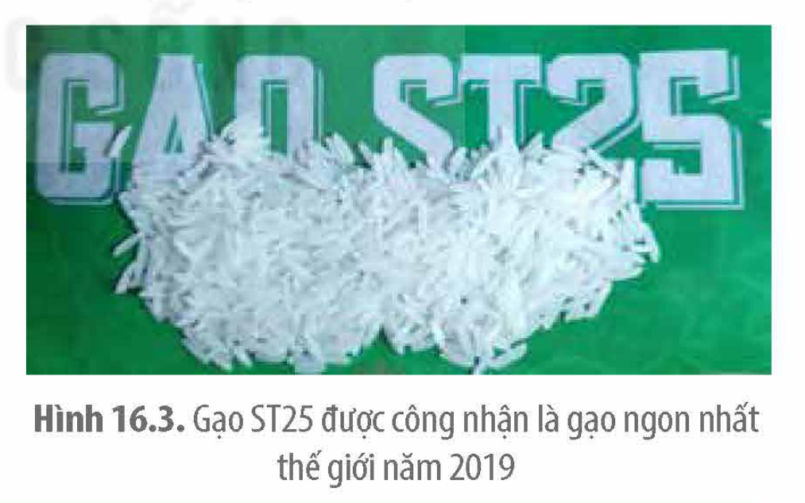
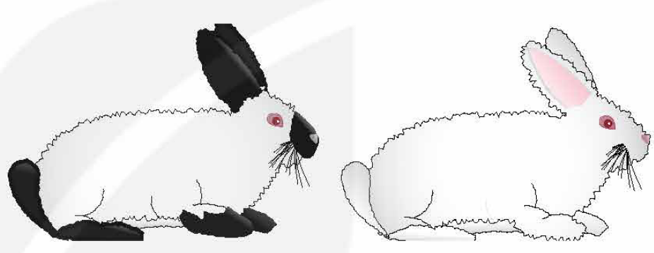

<!-- pdf:85 -->

# BÀI 16: TƯƠNG TÁC GIỮA KIỂU GENE VỚI MÔI TRƯỜNG VÀ THÀNH TỰU CHỌN GIỐNG

## 🎯 Yêu cầu cần đạt

- Phân tích được sự tương tác giữa kiểu gene và môi trường.
- Nêu được khái niệm mức phản ứng. Lấy được ví dụ minh hoạ.
- Trình bày được bản chất di truyền là di truyền mức phản ứng.
- Vận dụng được hiểu biết về thường biến và mức phản ứng của một kiểu gene, giải thích một số ứng dụng trong thực tiễn (tạo và chọn giống, kĩ thuật chăn nuôi, trồng trọt,…).
- Nêu được một số thành tựu chọn, tạo giống cây trồng và vật nuôi.

## 🔴 Mở đầu

Năng lực học tập của mỗi người là do gene hay do môi trường quyết định?

## I. MỐI QUAN HỆ GIỮA KIỂU GENE VÀ MÔI TRƯỜNG

### 1. Sự tương tác giữa kiểu gene và môi trường

<!-- term: Tương tác giữa kiểu gene và môi trường -->
Kiểu gene tương tác với môi trường quy định kiểu hình cơ thể sinh vật. Gene cung cấp thông tin chỉ dẫn bộ máy phân tử của tế bào tạo ra các protein, các protein này liên kết cùng các phân tử khác hình thành nên những đặc điểm kiểu hình của cơ thể sinh vật, trong khi môi trường cung cấp các nguyên liệu cho tế bào chuyển hoá vật chất và năng lượng, đồng thời cung cấp các tín hiệu hiệu điều hoà biểu hiện gene.

Điều kiện môi trường cũng có thể ảnh hưởng trực tiếp đến sự biểu hiện đặc điểm kiểu hình của một kiểu gene. Cùng một kiểu gene nhưng trong điều kiện môi trường khác nhau có thể cho ra những kiểu hình khác nhau (thường biến). Ví dụ: Cây phù dung (*Hibiscus mutabilis*) có hoa màu trắng vào buổi sáng, nhưng buổi chiều hoa chuyển sang màu hồng (H 16.1); Những người sinh đôi cùng trứng có cùng kiểu gene, sống ở môi trường khác nhau cũng có nhiều đặc điểm khác nhau.

Hình 16.1. Hoa phù dung (*Hibiscus mutabilis*) trên cùng một cây vào thời điểm buổi sáng có màu trắng (a) nhưng đầu giờ chiều hoa chuyển sang màu hồng (b)

<!-- pdf:86 -->

### 2. Mức phản ứng

**a) Khái niệm**

Kiểu gene chỉ cung cấp thông tin tạo ra sản phẩm, nhưng sản phẩm có được tạo ra hay không, số lượng nhiều hay ít, chất lượng và số lượng có đảm bảo hay không còn tuỳ thuộc vào điều kiện môi trường cụ thể. Do đó, cùng một kiểu gene có thể cho ra các kiểu hình khác nhau tương ứng với các điều kiện môi trường khác nhau. Tập hợp các kiểu hình của cùng một kiểu gene được gọi là **mức phản ứng** của kiểu gene. Ví dụ: Ruồi giấm có kiểu gene đột biến đồng hợp làm cánh bị tiêu biến (cánh cụt), tuy nhiên nếu ấu trùng được nuôi trong điều kiện nhiệt độ dưới 29 °C thì có cánh cụt, trong khi ấu trùng có cùng kiểu gene được nuôi trong môi trường có nhiệt độ 31 °C lại có cánh phát triển dài gần như bình thường. Ở thực vật, các cành cây được cắt ra từ một cây và đem trồng trong các điều kiện khác nhau phát triển thành các cây con với chiều cao khác nhau. Như vậy, bản chất của sự di truyền tính trạng là di truyền mức phản ứng của kiểu gene, các đặc điểm của cơ thể không trực tiếp được di truyền từ thế hệ này sang thế hệ khác.

**b) Vận dụng thực tiễn**

Hiểu biết về mức phản ứng được ứng dụng trong nhiều lĩnh vực như y học, nông nghiệp, giáo dục,…

<!-- term: Phenylketonuria -->
Trong y học, nghiên cứu về mức phản ứng của các gene gây bệnh, người ta có thể điều chỉnh các yếu tố môi trường như thức ăn, chế độ luyện tập, sinh hoạt,… để giảm nhẹ triệu chứng bệnh. Ví dụ: Bệnh rối loạn chuyển hoá bẩm sinh, phenylketonuria (phenyl keton niệu) ở người do đột biến gene lặn trên NST thường gây ra, với biểu hiện là chậm phát triển trí tuệ. Gene đột biến mất khả năng tổng hợp enzyme chuyển hoá amino acid phenylalanine dẫn đến amino acid này bị tích tụ lại trong tế bào làm tổn thương não ở trẻ em. Nếu phát hiện sớm trẻ mang gene gây bệnh, và áp dụng chế độ ăn kiêng, hạn chế thực phẩm chứa phenylalanine cho trẻ thì mặc dù mang gene gây bệnh nhưng triệu chứng bệnh lí ở trẻ sẽ giảm thiểu hoặc không biểu hiện.

Trong nông nghiệp, kiểu gene quy định mức phản ứng chính là giống (vật nuôi, cây trồng), điều kiện canh tác, chăm sóc là môi trường và kiểu hình là năng suất. Do đó, trong trồng trọt và chăn nuôi, người ta có thể tiến hành chọn, tạo ra những giống cây trồng và vật nuôi có mức phản ứng rộng và giới hạn phản ứng lớn về các tính trạng liên quan đến năng suất, đảm bảo giống tạo ra cho năng suất cao và thích nghi được với các môi trường và điều kiện canh tác khác nhau. Bên cạnh đó, nhà nông khi sử dụng giống mới cần tuân thủ các điều kiện gieo trồng, chăn nuôi theo đúng sự hướng dẫn của nhà sản xuất giống vì qua khảo nghiệm giống đã xác định được môi trường thích hợp để giống cho ra kiểu hình tối ưu. Ví dụ, phải trồng đúng thời vụ, bón phân đúng chủng loại, liều lượng, vào đúng thời điểm,...

Trong giáo dục và phát triển thể chất, những hiểu biết về mức phản ứng được vận dụng nhằm nâng cao tối đa hiệu quả học tập, sức khoẻ và tầm vóc cơ thể. Để đạt được sức khoẻ và tầm vóc tối đa do kiểu gene quy định, cần có chế độ dinh dưỡng đầy đủ, cân đối, kết hợp với chế độ vận động và sinh hoạt phù hợp với từng lứa tuổi; trong khi để phát huy hết năng lực học tập vốn có, ngoài chế độ dinh dưỡng, vận động và sinh hoạt, cần tạo môi trường học tập phù hợp (trang thiết bị học tập, thầy cô, bạn bè,…).

<!-- pdf:87 -->

## ❓ Dừng lại và suy ngẫm

1. Nếu nói tính trạng được di truyền từ bố, mẹ sang con cái có thực sự chính xác không? Giải thích.
2. Thế nào là mức phản ứng? Cho ví dụ minh hoạ.

## II. THÀNH TỰU CHỌN, TẠO GIỐNG BẰNG CÁC PHƯƠNG PHÁP LAI HỮU TÍNH

### 1. Khái quát về chọn, tạo giống vật nuôi, cây trồng

**Giống cây trồng** là một quần thể cây trồng có thể phân biệt được với quần thể cây trồng khác thông qua sự biểu hiện của ít nhất một đặc tính di truyền được cho đời sau; đồng nhất về hình thái, ổn định qua các chu kì nhân giống; có giá trị canh tác và giá trị sử dụng.

**Giống vật nuôi** là quần thể vật nuôi cùng loài, cùng nguồn gốc, có ngoại hình và cấu trúc di truyền tương tự nhau, được hình thành, củng cố, phát triển do tác động của con người; phải có số lượng bảo đảm để nhân giống và di truyền được những đặc điểm của giống cho thế hệ sau. **Dòng** là một nhóm vật nuôi trong giống, mang những đặc điểm chung của giống nhưng có đặc điểm riêng đã ổn định.

Các giống vật nuôi và cây trồng có thể được chọn và tạo ra bằng nhiều phương pháp khác nhau. Bài này chỉ đề cập đến thành tựu chọn, tạo giống vật nuôi và cây trồng bằng phương pháp lai hữu tính.

**Chọn giống vật nuôi và cây trồng** là cách thức con người phát hiện ra những cá thể có các đặc điểm di truyền ưa thích rồi cho chúng lai với nhau tạo ra các dòng và giống thuần chủng. Công việc chọn giống như vậy đã được tiến hành từ xa xưa ngay cả khi con người chưa biết đến cơ chế di truyền và biến dị.

Tạo giống vật nuôi và cây trồng thường được tiến hành theo các bước: (1) tạo ra các dòng thuần chủng khác nhau; (2) lai các dòng với nhau để tìm ra được các cá thể có tổ hợp các đặc tính di truyền mong muốn; (3) nhân giống và chọn lọc ra giống thuần chủng. Các dòng, giống thuần chủng cũng có thể được lai với nhau để tìm tổ hợp lai cho con lai có **ưu thế lai** cao (con lai có năng suất, sức chống chịu cao hơn hẳn so với các dòng bố mẹ) (**phép lai kinh tế**).

### 2. Một số thành tựu chọn, tạo giống vật nuôi

Nhiều giống vật nuôi đặc sản nổi tiếng ở nhiều vùng miền của Việt Nam là những sản phẩm của quá trình chọn lọc và nhân giống lâu đời. Ví dụ: Giống gà Đông Tảo (H 16.2a) của tỉnh Hưng Yên hiện nay được công nhận là giống quốc gia.

Trên thế giới, nhiều giống vật nuôi cao sản là kết quả của quá trình lai tạo kết hợp với chọn lọc. Ví dụ: Giống lợn Landrace của Đan Mạch được lai tạo từ giống lợn địa phương

<!-- pdf:88 -->

với giống Large White, sau đó lợn Landrace tiếp tục được lai tạo và chọn lọc thành giống lợn siêu nạc, năng suất cao, được nhân giống phổ biến khắp thế giới, trong đó có Việt Nam (H 16.2b); Giống bò nổi tiếng thế giới, bò Blanc-Blue-Belgium (BBB)(\*), được lai tạo từ giống bò thuần chủng của Bỉ với giống bò Shorthorn của Anh. Giống bò này có khả năng tăng trưởng cơ bắp cao hơn 40% so với giống bò bình thường và con đực trưởng thành có trọng lượng từ 900 – 1 250 kg (H 16.2c).

Hình 16.2. Giống gà Đông Tảo (a)(\*\*), giống lợn siêu nạc Landrace (b) và giống bò cao sản Blanc-Blue-Belgium (c)

### 3. Một số thành tựu chọn, tạo giống cây trồng

Ở Việt Nam, thành tựu chọn giống lúa nổi bật nhất gần đây là giống lúa ST25 (H 16.3) ở Sóc Trăng có khả năng chống chịu bệnh, cho gạo hạt dài, thơm được công nhận là gạo ngon nhất thế giới năm 2019. Giống lúa này được tạo ra từ cây lúa đột biến có thân màu tím, hạt dài trong giống lúa CD20. Từ cây lúa đột biến này, qua lai tạo hàng chục năm với các dòng khác nhau thu được nhiều giống ST, trong đó có ST25 cho gạo thơm ngon khi trồng trong điều kiện ruộng lúa kết hợp nuôi tôm theo quy trình sản suất lúa hữu cơ. Giống Đài thơm 8 trồng nhiều ở khu vực Đồng bằng sông Cửu Long, Đông Nam Bộ được Công ty Cổ phần giống cây trồng Miền Nam (SSC) lai tạo. Giống này không bị đổ, bông lúa to, nếu chăm sóc tốt có thể đạt mức 10 tấn/ha và cho hạt gạo ngon. Giống lúa lai KC06 –1 được trồng chủ yếu ở khu vực Đồng bằng sông Cửu Long và Đông Nam Bộ cho năng suất 8,5 – 10 tấn/ha, thuộc nhóm có năng suất cao nhất trong các giống lúa chủ yếu ở Việt Nam. Ngoài ra, một số giống cây ăn quả nổi tiếng như nhãn lồng Hưng Yên, bưởi da xanh, cam, táo,... cũng được tạo ra bằng phương pháp chọn lọc hoặc lai tạo kết hợp với chọn lọc.

Hình 16.3. Gạo ST25 được công nhận là gạo ngon nhất thế giới năm 2019

## ❓ Dừng lại và suy ngẫm

Sưu tầm thêm một số thành tựu về giống vật nuôi, cây trồng nổi tiếng ở các vùng miền của Việt Nam.

> (\*) Nguồn: Phụ lục: Danh mục giống vật nuôi được sản xuất, kinh doanh tại Việt Nam do Bộ Nông nghiệp và Phát triển nông thôn ban hành ngày 16-01-2018.
>
> (\*\*) Nguồn hình: Phạm Minh Kiên.

<!-- pdf:89 -->

## 📌 Kiến thức cốt lõi

- Kiểu gene tương tác với môi trường tạo ra kiểu hình. Cùng một kiểu gene, ở môi trường khác nhau có thể cho ra các kiểu hình khác nhau. Tập hợp các loại kiểu hình của cùng một kiểu gene được gọi là mức phản ứng của kiểu gene.
- Sự di truyền của tính trạng chính là di truyền mức phản ứng của kiểu gene với môi trường. Biết được mức phản ứng của kiểu gene các nhà chọn, tạo giống có thể tạo ra những giống thích nghi với từng loại môi trường cũng như xác định được các điều kiện canh tác thích hợp cho từng giống.
- Nhiều giống vật nuôi, cây trồng cho năng suất, chất lượng cao đã được chọn lọc từ các biến dị tổ hợp sẵn có trong tự nhiên hoặc được tạo ra bằng phương pháp lai tạo kết hợp với chọn lọc.

## ✏️ Luyện tập và vận dụng

1. Giống thỏ himalaya nuôi ở nhiệt độ môi trường 25 °C hoặc thấp hơn có đuôi, tai, đầu các chi và mõm màu đen còn toàn thân có lông màu trắng (hình trái). Tuy nhiên, khi nuôi ở nhiệt độ môi trường bằng hoặc lớn hơn 30 °C thì có lông hoàn toàn trắng (hình phải). Hãy đưa ra giả thuyết giải thích hiện tượng trên và đề xuất thí nghiệm kiểm chứng giả thuyết.

2. Nêu một số giống vật nuôi, cây trồng là sản phẩm của quá trình chọn, tạo giống bằng phương pháp lai hữu tính ở địa phương mà em biết.
3. Trẻ em bị bệnh rối loạn chuyển hoá galactosemia, có gene lặn làm mất khả năng sản sinh ra enzyme chuyển hoá đường galactose khiến đường galactose bị tích tụ lại trong máu và trong tế bào cao quá mức bình thường làm xuất hiện hàng loạt triệu chứng bệnh lí. Tác động từ môi trường theo cách nào có thể giúp giảm nhẹ triệu chứng bệnh?

## 💡 Khoa học và đời sống

**Béo phì do gene hay do ăn nhiều?**

Điều dễ thấy là ăn nhiều và ít vận động thì dễ dẫn đến béo phì. Tuy vậy, kiểu gene cũng có vai trò nhất định làm tăng khả năng bị béo phì. Các nhà khoa học đã phát hiện ra một vài gene liên quan đến béo phì. Ví dụ: Gene mã hoá cho hormone leptin có chức năng kìm hãm sự thèm ăn. Nếu gene này bị đột biến sẽ dẫn đến ăn không bao giờ cảm thấy no nên dễ bị béo phì. Không những vậy, các nhà khoa học còn nhận thấy, những phụ nữ khi mang thai bị đói ăn (hay ăn ít đường và tinh bột) thì con sinh ra dễ bị béo phì. Bằng chứng khoa học cho thấy, môi trường trong tử cung của người mẹ làm thay đổi một cách vĩnh viễn sự biểu hiện một số gene của thai nhi trong quá trình phát triển. Qua thức ăn của mẹ, thai nhi đã "cảm nhận được sự đói ăn" nên đã thay đổi sự biểu hiện của gene (dẫn đến luôn thèm ăn), qua đó làm tăng cơ hội sống sót sau này khi không có thức ăn. Tuy nhiên, khi trẻ sinh ra vẫn có đầy đủ thức ăn nên việc thèm ăn làm trẻ ăn quá nhiều dẫn đến tăng khả năng bị béo phì.

## 📷 Danh sách hình trong bài

| Mã hình | Trang PDF | Vị trí | Chú thích gốc |
|---|---|---|---|
| H12-sinh-b16-01 | 85 | Mục I.1 | Hình 16.1. Hoa phù dung (Hibiscus mutabilis) trên cùng một cây vào thời điểm buổi sáng có màu trắng (a) nhưng đầu giờ chiều hoa chuyển sang màu hồng (b) |
| H12-sinh-b16-02 | 88 | Mục II.2 | Hình 16.2. Giống gà Đông Tảo (a)(\*\*), giống lợn siêu nạc Landrace (b) và giống bò cao sản Blanc-Blue-Belgium (c) — (\*\*) Nguồn hình: Phạm Minh Kiên. |
| H12-sinh-b16-03 | 88 | Mục II.3 | Hình 16.3. Gạo ST25 được công nhận là gạo ngon nhất thế giới năm 2019 |
| H12-sinh-b16-04 | 89 | Luyện tập, câu 1 | Hình thỏ himalaya ở hai nhiệt độ (sách không đánh số hình) |
