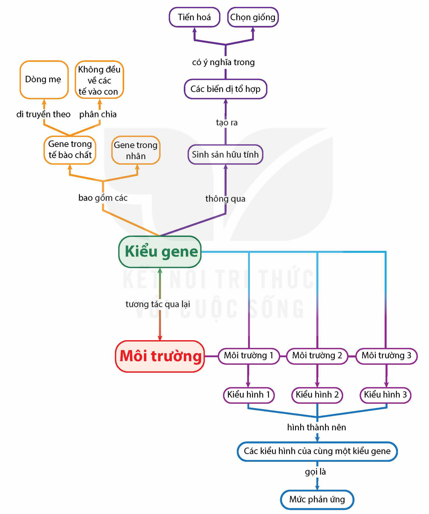

<!-- pdf:92 -->

# SƠ ĐỒ TÓM TẮT KIẾN THỨC CHƯƠNG 3

<!-- Dưới đây chép các nhánh của sơ đồ thành danh sách, giữ nguyên chữ trong các ô và trên các mũi tên. -->

- Kiểu gene
  - bao gồm các: Gene trong tế bào chất (di truyền theo: Dòng mẹ; phân chia: Không đều về các tế bào con); Gene trong nhân
  - thông qua: Sinh sản hữu tính
    - tạo ra: Các biến dị tổ hợp
      - có ý nghĩa trong: Tiến hoá; Chọn giống
  - tương tác qua lại: Môi trường
- Môi trường: Môi trường 1; Môi trường 2; Môi trường 3
  - Kiểu hình 1; Kiểu hình 2; Kiểu hình 3
    - hình thành nên: Các kiểu hình của cùng một kiểu gene
      - gọi là: Mức phản ứng
<!-- ocr-ok: chữ trong các ô sơ đồ, OCR đọc không theo thứ tự; đã đối chiếu ảnh -->

## 📷 Danh sách hình trong bài

| Mã hình | Trang PDF | Vị trí | Chú thích gốc |
|---|---|---|---|
| H12-sinh-so-do-tom-tat-c03-01 | 92 | Cả trang | Sơ đồ tóm tắt kiến thức chương 3 |
