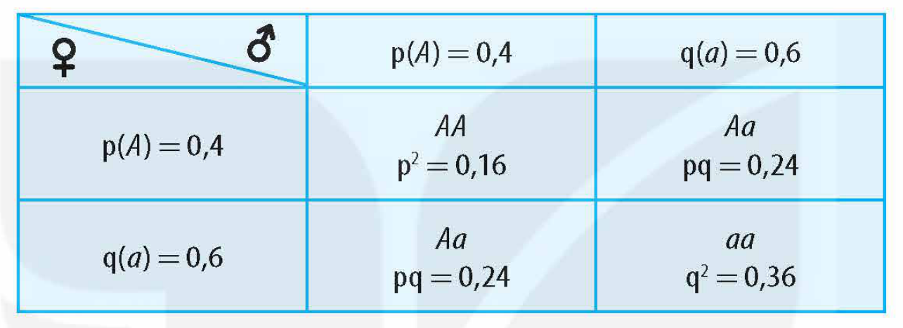
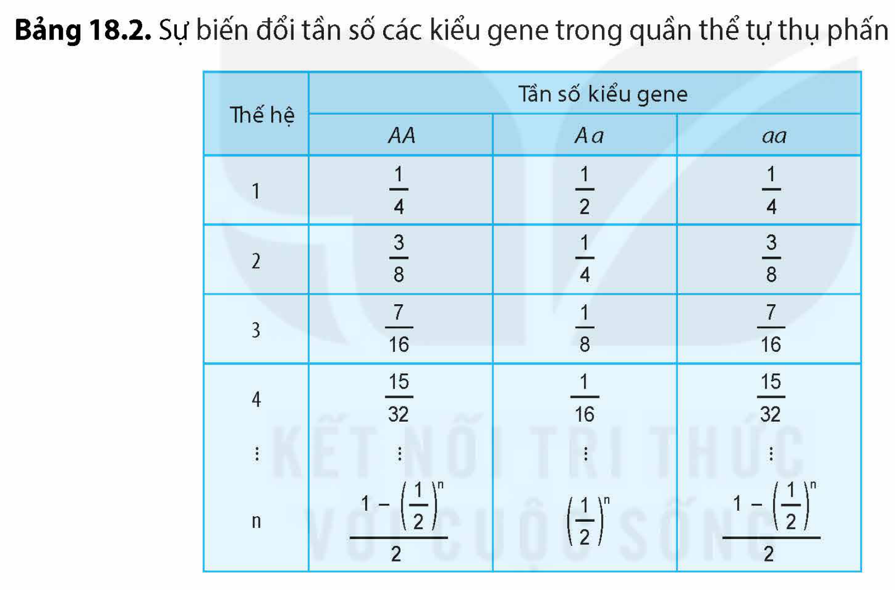

<!-- pdf:93 -->

# BÀI 18: DI TRUYỀN HỌC QUẦN THỂ

## 🎯 Yêu cầu cần đạt

- Phát biểu được khái niệm quần thể (từ góc độ di truyền học). Lấy được ví dụ minh hoạ.
- Phát biểu được khái niệm di truyền quần thể.
- Trình bày được các đặc trưng di truyền của quần thể (tần số của các allele, tần số của các kiểu gene).
- Nêu được cấu trúc di truyền của quần thể ngẫu phối: Mô tả được trạng thái cân bằng di truyền của quần thể.
- Trình bày được định luật Hardy – Weinberg và điều kiện nghiệm đúng.
- Phân tích được cấu trúc di truyền của quần thể tự thụ phấn và quần thể giao phối gần.
- Trình bày được ảnh hưởng của tự thụ phấn, giao phối gần, ngẫu phối chi phối tần số của các allele và thành phần kiểu gene của một quần thể.
- Giải thích một số vấn đề thực tiễn: vấn đề hôn nhân gia đình; vấn đề cho cây tự thụ phấn, động vật giao phối gần giảm năng suất, chất lượng.

## 🔴 Mở đầu

Vì sao Luật Hôn nhân và Gia đình ở nước ta lại cấm những người có họ hàng gần (trong vòng 3 đời) kết hôn với nhau?

## I. QUẦN THỂ VÀ CÁC ĐẶC TRƯNG DI TRUYỀN CỦA QUẦN THỂ

### 1. Quần thể

**Quần thể** là một tập hợp các cá thể cùng loài, có khả năng giao phối với nhau, sống trong cùng khu vực địa lí, ở cùng một thời điểm. Các quần thể của cùng một loài có thể khác nhau về cấu trúc di truyền.

Quần thể có thể được hình thành do một số ít cá thể trong quần thể di cư đến nơi ở mới hay từ quần thể ban đầu bị chia cắt thành hai hoặc nhiều quần thể khác nhau bởi các trở ngại địa lí (núi, sông, biển,…). Sự phân chia các cá thể về hai quần thể là hoàn toàn ngẫu nhiên (các cá thể có kiểu gene khác nhau) dẫn đến cấu trúc di truyền của quần thể ngay từ khi mới hình thành đã khác nhau. Trong quá trình tồn tại và phát triển, các quần thể của cùng một loài chịu ảnh hưởng bởi các điều kiện môi trường khác nhau, sống tương đối cách li nhau nên duy trì được sự khác biệt về các đặc trưng di truyền.

**Di truyền học quần thể** là một lĩnh vực của di truyền học, nghiên cứu về tần số các loại allele, tần số các kiểu gene cũng như những yếu tố tác động làm thay đổi tần số allele và thành phần kiểu gene trong quần thể qua các thế hệ.

<!-- pdf:94 -->

### 2. Các đặc trưng di truyền của quần thể

Mỗi quần thể thường có một vốn gene riêng. **Vốn gene** là tập hợp các loại allele của tất cả các gene trong mọi cá thể của một quần thể tại một thời điểm xác định. Các đặc trưng di truyền của quần thể là tần số allele và tần số kiểu gene.

**Tần số allele** của một gene là tỉ số giữa số lượng một loại allele trên tổng số các loại allele của gene đó trong quần thể. **Tần số kiểu gene** là tỉ số giữa số lượng cá thể có cùng kiểu gene trên tổng số cá thể có trong quần thể. Ví dụ: Một quần thể ruồi giấm gồm 200 con, trong đó 80 con có kiểu gene *BB* (thân nâu), 70 con có kiểu gene *Bb* (thân nâu) và 50 con với kiểu gene *bb* (thân đen). Vì ruồi giấm là sinh vật lưỡng bội nên tổng số các allele của gene quy định màu thân trong quần thể là 200 × 2 = 400 allele. Tần số allele *B* là: [(80 × 2) + 70]/400 = 0,575, tần số allele *b* = [(50 × 2) + 70]/400 = 0,425. Tần số kiểu gene *BB* = 80/200 = 0,4, tần số kiểu gene *Bb* = 70/200 = 0,35 và tần số kiểu gene *bb* = 50/200 = 0,25. Các nhà di truyền học sử dụng chữ cái p chỉ tần số allele trội và q chỉ tần số của allele còn lại (allele lặn).

Quần thể có nhiều loại allele và tần số các kiểu gene dị hợp tử cao được gọi là **quần thể đa dạng di truyền** (hay **đa hình di truyền**). Quần thể có độ đa dạng di truyền càng cao thì càng có khả năng thích nghi với sự biến động của môi trường.

## ❓ Dừng lại và suy ngẫm

Nêu khái niệm về vốn gene của quần thể.

## II. QUẦN THỂ NGẪU PHỐI VÀ ĐỊNH LUẬT HARDY – WEINBERG

### 1. Quần thể ngẫu phối

**Quần thể ngẫu phối** là quần thể có các cá thể giao phối với nhau một cách hoàn toàn ngẫu nhiên. Ví dụ: Cây ngô (bắp) thụ phấn nhờ gió nên hạt phấn của các cây trong quần thể được phát tán ngẫu nhiên đến các cây khác trong quần thể và quá trình thụ tinh xảy ra về cơ bản là ngẫu nhiên.

Quần thể ngẫu phối thường rất đa dạng về mặt di truyền. Các đột biến mới xuất hiện thường tồn tại ở trạng thái dị hợp. Vì vậy, những gene lặn có hại ít có khả năng trở về trạng thái đồng hợp và biểu hiện ra kiểu hình gây hại.

Quá trình sinh sản hữu tính và ngẫu phối không làm thay đổi tần số allele và tần số kiểu gene của quần thể nếu quần thể không chịu tác động của các yếu tố khác. Điều này đã được chứng minh bằng định luật Hardy – Weinberg.

### 2. Định luật Hardy – Weinberg

Định luật Hardy – Weinberg được Hardy (nhà toán học người Anh) và Weinberg (bác sĩ người Đức) phát hiện một cách độc lập nhau vào năm 1908.

**Định luật Hardy – Weinberg** phát biểu như sau: *Tần số allele và tần số các kiểu gene của quần thể sẽ không thay đổi từ thế hệ này sang thế hệ khác nếu quần thể là ngẫu phối, có kích thước lớn, đột biến không xảy ra, các cá thể có khả năng sinh sản như nhau và quần thể được cách li với các quần thể khác.*

<!-- pdf:95 -->

Khi tần số allele và tần số các kiểu gene của một quần thể không thay đổi từ thế hệ này sang thế hệ khác thì quần thể đó được gọi là **cân bằng Hardy – Weinberg** hay **cân bằng di truyền**. Định luật Hardy – Weinberg được khái quát hoá bằng phương trình:

$$(p + q)^2 = p^2 + 2pq + q^2 = 1$$
<!-- ocr-ok: công thức chép từ ảnh PDF 95, phép so OCR không đọc LaTeX -->

Với p là tần số allele *A*, q là tần số allele *a* và quần thể chỉ có hai loại allele (p + q = 1); p$^2$ là tần số kiểu gene *AA*; 2pq là tần số kiểu gene *Aa*; q$^2$ là tần số kiểu gene *aa*.

Khi gene nằm trên NST thường và tần số allele ở giao tử đực và giao tử cái là như nhau thì chỉ sau một lần ngẫu phối, quần thể sẽ thoả mãn phương trình (p + q)$^2$ = 1 và đạt trạng thái cân bằng Hardy – Weinber. Bảng 18.1 cho thấy một quần thể với gene *A* nằm trên NST thường, có tần số allele *A* = 0,4 và tần số allele *a* = 0,6, chỉ cần một lần ngẫu phối quần thể đã đạt được trạng thái cân bằng di truyền (trong trường hợp quần thể đáp ứng được các điều kiện của định luật Hardy – Weinberg).

| ♀ \ ♂ | p(*A*) = 0,4 | q(*a*) = 0,6 |
|---|---|---|
| p(*A*) = 0,4 | *AA* p$^2$ = 0,16 | *Aa* pq = 0,24 |
| q(*a*) = 0,6 | *Aa* pq = 0,24 | *aa* q$^2$ = 0,36 |
<!-- ocr-ok: bảng chép từ ảnh PDF 95, OCR đọc ô bảng không theo thứ tự -->

Khi quần thể đạt trạng thái cân bằng di truyền về một gene, từ tần số kiểu gene, có thể tính được tần số các allele của gene đó trong quần thể. Vì vậy, định luật Hardy – Weinberg được ứng dụng trong thực tiễn. Ví dụ: Nếu biết được tần số người có kiểu gene lặn bị bệnh di truyền trong quần thể, người ta có thể tính được tần số các allele của gene đó, từ đó biết được tần số các kiểu gene và có thể xác định được xác suất mắc bệnh ở đời con của một số cặp vợ chồng.

## ❓ Dừng lại và suy ngẫm

1. Cấu trúc di truyền của quần thể ngẫu phối có đặc điểm gì? Quần thể đạt trạng thái cân bằng di truyền phải thoả mãn những điều kiện nào?
2. Một quần thể gồm toàn cá thể dị hợp tử có kiểu gene *Aa*. Quần thể này có đang ở trạng thái cân bằng Hardy – Weinberg không? Giải thích.

## III. QUẦN THỂ TỰ THỤ PHẤN VÀ QUẦN THỂ GIAO PHỐI GẦN

### 1. Quần thể tự thụ phấn, quần thể giao phối gần

<!-- term: Tự thụ phấn -->
**Quần thể giao phối gần** hay **giao phối cận huyết** (giao phối gần ở động vật và tự thụ phấn ở thực vật) là quần thể mà các cá thể có quan hệ họ hàng gần gũi (gần giống nhau hoặc giống nhau về kiểu gene) thường giao phối với nhau. Hiện tượng tự thụ tinh ở một số loài động vật bậc thấp và tự thụ phấn ở các loài thực vật là những trường hợp đặc biệt của giao phối cận huyết vì trong các trường hợp đó, các cá thể bố mẹ đều có cùng kiểu gene.

<!-- pdf:96 -->

### 2. Các đặc trưng di truyền
<!-- ocr-ok: tiêu đề in màu, đã đối chiếu ảnh PDF 96 -->

Cấu trúc di truyền của quần thể tự thụ phấn và giao phối gần thường gồm nhiều cá thể có kiểu gene đồng hợp và ít cá thể có kiểu gene dị hợp. Vì vậy, các quần thể này kém đa dạng di truyền so với quần thể ngẫu phối.

Để hiểu rõ hơn sự thay đổi cấu trúc di truyền của quần thể tự thụ phấn, hãy cùng theo dõi một quần thể cây ngô gồm toàn cây dị hợp tử về kiểu gene *Aa* được cho tự thụ phấn qua nhiều thế hệ.

Bảng 18.2 cho thấy, một quần thể ngô tự thụ phấn ở thế hệ xuất phát (G$_0$) gồm toàn cá thể có kiểu gene *Aa* với tần số allele *A* = *a* = 0,5. Sau mỗi thế hệ tự thụ phấn, tần số kiểu gene dị hợp luôn giảm đi 1/2 , trong khi tần số kiểu gene đồng hợp không ngừng gia tăng. Kết quả là quần thể các cây tự thụ phấn qua nhiều thế hệ chủ yếu gồm các dòng thuần (đồng hợp tử) về các kiểu gene khác nhau.

Bảng 18.2. Sự biến đổi tần số các kiểu gene trong quần thể tự thụ phấn

| Thế hệ | Tần số kiểu gene: *AA* | Tần số kiểu gene: *Aa* | Tần số kiểu gene: *aa* |
|---|---|---|---|
| 1 | $\frac{1}{4}$ | $\frac{1}{2}$ | $\frac{1}{4}$ |
| 2 | $\frac{3}{8}$ | $\frac{1}{4}$ | $\frac{3}{8}$ |
| 3 | $\frac{7}{16}$ | $\frac{1}{8}$ | $\frac{7}{16}$ |
| 4 | $\frac{15}{32}$ | $\frac{1}{16}$ | $\frac{15}{32}$ |
| ⋮ | ⋮ | ⋮ | ⋮ |
| n | $\frac{1-\left(\frac{1}{2}\right)^n}{2}$ | $\left(\frac{1}{2}\right)^n$ | $\frac{1-\left(\frac{1}{2}\right)^n}{2}$ |
<!-- ocr-ok: bảng phân số chép từ ảnh, OCR không đọc được phân số -->

Đối với các quần thể giao phối cận huyết, mức độ suy giảm tần số các kiểu gene dị hợp và gia tăng tần số các kiểu gene đồng hợp phụ thuộc vào mức độ giống nhau về kiểu gene giữa cá thể bố và mẹ.

Mặc dù có sự thay đổi về tần số các kiểu gene từ thế hệ này sang thế hệ khác nhưng giao phối cận huyết không làm thay đổi tần số của các loại allele trong quần thể.

### 3. Ứng dụng thực tiễn

Ở các quần thể giao phối cận huyết, các đột biến lặn có hại dễ bị đưa về trạng thái đồng hợp dẫn đến hiện tượng **suy thoái cận huyết**, tức là làm giảm sức sống, giảm khả năng sinh sản của các cá thể. Vì vậy, trong chăn nuôi, cần tránh cho các con vật cùng đàn giao phối với nhau. Ở người, việc kết hôn trong cùng dòng họ khiến nhiều đột biến lặn có hại được đưa về trạng thái đồng hợp gây giảm sức sống, tăng tỉ lệ mắc bệnh di truyền và tỉ lệ tử vong ở các thế hệ sau. Chính vì vậy, Luật Hôn nhân và Gia đình ở nước ta đã quy định cấm những người có họ hàng gần (trong vòng 3 đời) kết hôn với nhau.

<!-- pdf:97 -->

Tuy nhiên, giao phối cận huyết cũng được sử dụng để tạo các dòng thuần chủng đồng hợp về các gene có lợi. Sau đó lai các dòng thuần với nhau để tìm kiếm các tổ hợp lai cho con lai có ưu thế lai cao.

## ❓ Dừng lại và suy ngẫm

1. Giao phối cận huyết tác động như thế nào đến tần số các kiểu gene và tần số allele của quần thể?
2. Tại sao những cây thụ phấn nhờ gió như cây ngô, nếu cho tự thụ phấn để tạo dòng thuần thì sau một số thế hệ dòng thuần sẽ bị thoái hoá?

## 📌 Kiến thức cốt lõi

- Di truyền học quần thể nghiên cứu về sự biến đổi tần số allele và tần số kiểu gene của quần thể qua các thế hệ.
- Quần thể giao phối ngẫu nhiên thường có độ đa dạng di truyền cao nên dễ thích nghi trước sự thay đổi của điều kiện môi trường.
- Định luật Hardy – Weinberg cho biết nếu quần thể có kích thước lớn, ngẫu phối, các cá thể có sức sống và khả năng sinh sản như nhau, không bị đột biến và quần thể được cách li với các quần thể khác thì tần số allele và thành phần kiểu gene của quần thể sẽ duy trì ổn định từ thế hệ này sang thế hệ khác.
- Các quần thể giao phối cận huyết chủ yếu gồm các dòng thuần có các kiểu gene đồng hợp nên độ đa dạng di truyền thấp.

## ✏️ Luyện tập và vận dụng

1. Quần thể nào dưới đây đang ở trạng thái cân bằng Hardy – Weinberg, quần thể nào không? Giải thích.

a) Quần thể gồm toàn cá thể có kiểu gene dị hợp.

b) Quần thể gồm toàn cá thể có kiểu gene đồng hợp lặn.

c) Quần thể gồm toàn cá thể có kiểu hình trội.

2. Tại sao nhiều loài cây tự thụ phấn nghiêm ngặt như đậu hà lan lại không bị thoái hoá giống?
3. Trong một quần thể người, các nhà di truyền đã xác định được có 182 người có nhóm máu MM, 172 người có nhóm máu MN và 44 người có nhóm máu NN. Hãy tính tần số allele *M*, *N* và tần số các kiểu gene của quần thể này.

## 📷 Danh sách hình trong bài

| Mã hình | Trang PDF | Vị trí | Chú thích gốc |
|---|---|---|---|
| H12-sinh-b18-01 | 95 | Mục II.2 | Bảng 18.1 (sách không in tiêu đề bảng; chữ trong bài gọi là Bảng 18.1) |
| H12-sinh-b18-02 | 96 | Mục III.2 | Bảng 18.2. Sự biến đổi tần số các kiểu gene trong quần thể tự thụ phấn |
