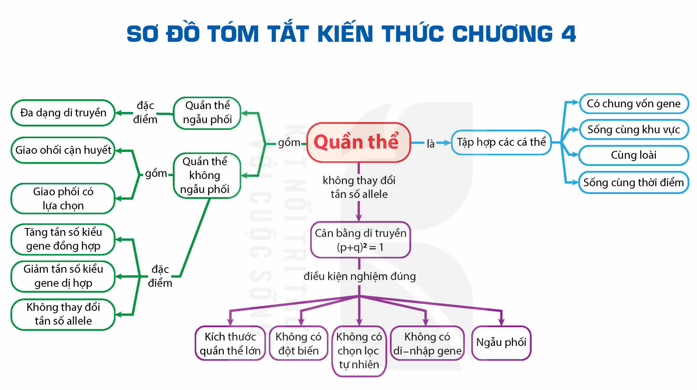

<!-- pdf:98 -->

# SƠ ĐỒ TÓM TẮT KIẾN THỨC CHƯƠNG 4

<!-- Trang in xoay ngang; ảnh đã xoay lại. Dưới đây chép các nhánh của sơ đồ thành danh sách, giữ nguyên chữ trong các ô và trên các mũi tên. -->

- Quần thể
  - là: Tập hợp các cá thể
    - Có chung vốn gene; Sống cùng khu vực; Cùng loài; Sống cùng thời điểm
  - không thay đổi tần số allele: Cân bằng di truyền (p+q)$^2$ = 1
    - điều kiện nghiệm đúng: Ngẫu phối; Không có di–nhập gene; Không có chọn lọc tự nhiên; Không có đột biến; Kích thước quần thể lớn
  - gồm: Quần thể ngẫu phối; Quần thể không ngẫu phối
    - Quần thể ngẫu phối — đặc điểm: Đa dạng di truyền
    - Quần thể không ngẫu phối — gồm: Giao ohối cận huyết; Giao phối có lựa chọn
    - Quần thể không ngẫu phối — đặc điểm: Tăng tần số kiểu gene đồng hợp; Giảm tần số kiểu gene dị hợp; Không thay đổi tần số allele
<!-- ocr-ok: chữ trong các ô sơ đồ, OCR đọc không theo thứ tự; đã đối chiếu ảnh đã xoay -->

## 📷 Danh sách hình trong bài

| Mã hình | Trang PDF | Vị trí | Chú thích gốc |
|---|---|---|---|
| H12-sinh-so-do-tom-tat-c04-01 | 98 | Cả trang (in xoay ngang) | Sơ đồ tóm tắt kiến thức chương 4 |
