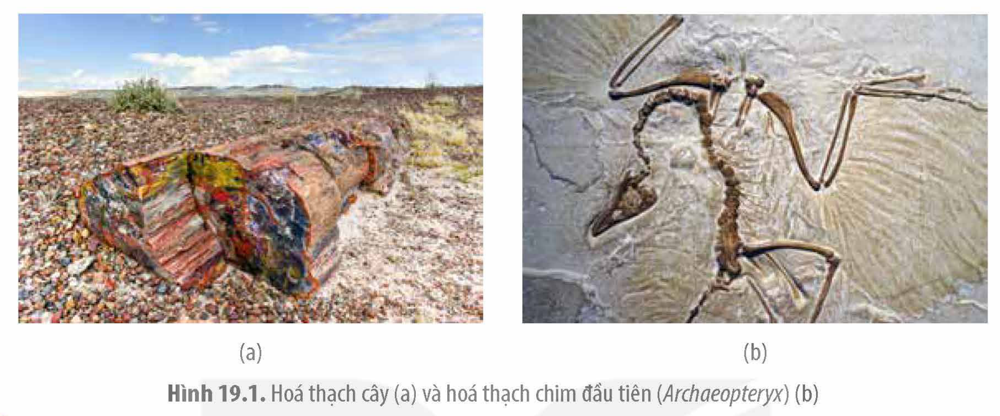
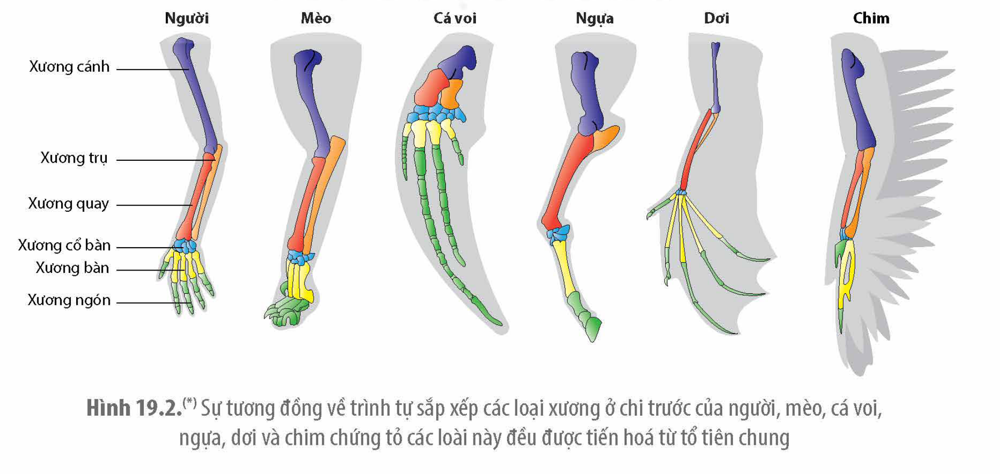

<!-- pdf:99 -->

# BÀI 19: CÁC BẰNG CHỨNG TIẾN HOÁ

## 🎯 Yêu cầu cần đạt

- Trình bày được các bằng chứng tiến hoá: bằng chứng hoá thạch, giải phẫu so sánh, tế bào học và sinh học phân tử.

## 🔴 Mở đầu

Làm thế nào các nhà khoa học biết được sự xuất hiện và phân bố của một loài nào đó trong quá khứ cách đây hàng triệu năm?

<!-- term: Bằng chứng tiến hoá -->
Bằng chứng tiến hoá là những chứng cứ thu được qua các công trình nghiên cứu về sự phát sinh và phát triển của các loài sinh vật trên Trái Đất. Nội dung bài này đề cập đến một số loại bằng chứng tiến hoá chủ yếu.

## I. BẰNG CHỨNG HOÁ THẠCH

<!-- term: Hoá thạch -->
Hoá thạch là tàn tích như xương, xác sinh vật trong hổ phách, trong băng tuyết hay dấu vết của sinh vật trong các lớp đá. Hoá thạch cũng có thể là các sinh vật đã hoá đá do xác sinh vật bị các lớp trầm tích bao bọc, chất hữu cơ phân huỷ được thay thế bởi calcium cùng các khoáng chất khác nhưng vẫn giữ được hình dạng, đặc điểm cấu trúc hình thái của sinh vật (H 19.1a).

Hoá thạch là bằng chứng trực tiếp cho thấy các loài sinh vật đã từng tồn tại, tiến hoá như thế nào theo thời gian cũng như vị trí phân bố của chúng trên Trái Đất. Ở những khu vực có địa tầng ổn định, không bị xáo trộn, hoá thạch càng nằm sâu dưới lòng đất có tuổi càng cao. Tuổi của hoá thạch có thể được xác định thông qua lượng đồng vị phóng xạ có trong hoá thạch hoặc trong đá bao quanh hoá thạch. Khi xếp các hoá thạch thành dãy theo tuổi từ già nhất đến trẻ nhất, người ta sẽ có được bằng chứng về sự thay đổi của các sinh vật trong quá trình tiến hoá.

Một số hoá thạch cho thấy các dạng sống trung gian chuyển tiếp giữa các nhánh sinh vật đã từng tồn tại trong quá khứ. Ví dụ: Hoá thạch chim đầu tiên (*Archaeopteryx*) được tiến hoá từ bò sát vẫn còn răng của loài khủng long ăn thịt, sống cách đây khoảng 165 triệu năm với đuôi có các đốt sống (H 19.1b). Bằng chứng hoá thạch cũng cho thấy cá voi và

<!-- pdf:100 -->

cá heo đã được tiến hoá từ loài tổ tiên là một loài động vật móng guốc sống trên cạn. Hoá thạch của tế bào nhân thực có thành tế bào giống với tảo hiện nay đã được phát hiện có tuổi cách đây khoảng 1,8 tỉ năm.

Hình 19.1. Hoá thạch cây (a) và hoá thạch chim đầu tiên (*Archaeopteryx*) (b)

## ❓ Dừng lại và suy ngẫm

1. Hoá thạch được hình thành như thế nào?
2. Làm thế nào người ta xác định được tuổi của hoá thạch?

## II. BẰNG CHỨNG GIẢI PHẪU SO SÁNH

Những đặc điểm giống nhau giữa các loài sinh vật do cùng thừa hưởng các gene từ tổ tiên chung được gọi là các **cấu trúc tương đồng** (hay cơ quan tương đồng). Ví dụ: Chim và các loài động vật có vú như người, mèo, cá voi, ngựa, dơi đều có bốn chi với trình tự sắp xếp các bộ phận của xương chi giống nhau mặc dù đã có những biến đổi thích nghi với các chức năng khác nhau (H 19.2).

Hình 19.2.(\*) Sự tương đồng về trình tự sắp xếp các loại xương ở chi trước của người, mèo, cá voi, ngựa, dơi và chim chứng tỏ các loài này đều được tiến hoá từ tổ tiên chung

> (\*) Nguồn: Biology concepts and investigations 3$^{rd}$ (2014), Marielle Hoefnagels.

<!-- pdf:101 -->

Hươu cao cổ có cổ dài hơn nhiều so với cổ của con người và nhiều loài thú khác, nhưng nó cũng chỉ có 7 đốt sống cổ như tất cả các loài thú khác. Điều đó cho thấy, các loài thú tiến hoá từ tổ tiên chung chỉ có 7 đốt sống cổ.

<!-- term: Cấu trúc thoái hoá -->
Một số cấu trúc/cơ quan ở sinh vật không có chức năng rõ ràng nhưng rất giống với cấu trúc vốn có chức năng nhất định ở loài tổ tiên được gọi là cấu trúc thoái hoá. Ví dụ: Ở người, ruột thừa, lông trên bề mặt cơ thể được xem là những cấu trúc thoái hoá. Cá voi có cấu trúc xương thoái hoá, là dấu vết của xương chi sau ở tổ tiên bốn chân sống trên cạn. Cấu trúc thoái hoá cũng là một loại cấu trúc tương đồng.

<!-- term: Cấu trúc tương tự -->
Đặc điểm giống nhau giữa các loài nhưng không phải là do được thừa hưởng những gene từ tổ tiên chung mà là do tác động của môi trường sống được gọi là cấu trúc tương tự.

## ❓ Dừng lại và suy ngẫm

1. Một số loài rắn, mặc dù không có chân nhưng trong cơ thể vẫn còn mẩu xương nhỏ không còn chức năng. Từ đặc điểm đó có thể rút ra được kết luận gì về sự tiến hoá liên quan đến các chi của các loài này?
2. Cánh của chim với cánh của chuồn chuồn đều có chức năng giúp các con vật bay lượn. Các cấu trúc này có phải là cấu trúc tương đồng không? Giải thích.

## III. BẰNG CHỨNG TẾ BÀO HỌC VÀ SINH HỌC PHÂN TỬ

### 1. Bằng chứng tế bào học

Có rất nhiều bằng chứng ở cấp độ tế bào cho thấy mọi sinh vật trên Trái Đất đều có chung tổ tiên. Ví dụ: Tất cả các sinh vật đều được cấu tạo từ một hoặc nhiều tế bào và các tế bào đều có những đặc điểm cấu trúc giống nhau như màng tế bào, vùng nhân/nhân, tế bào chất. Các hoạt động chuyển hoá vật chất và năng lượng ở các tế bào cơ bản là giống nhau.

### 2. Bằng chứng phân tử

Các tế bào của mọi sinh vật đều có các thành phần phân tử hoá học cơ bản như nhau. Vật chất di truyền của các tế bào đều là DNA, mã di truyền về cơ bản được dùng chung cho các loài, protein ở hầu hết các loài đều được cấu tạo từ 20 loại amino acid. Các loài có họ hàng càng gần gũi thì trình tự nucleotide của các gene và trình tự amino acid trong phân tử protein của chúng càng giống nhau (Bảng 19.1).

Bảng 19.1(\*). Bằng chứng phân tử về mối quan hệ họ hàng giữa các loài: Sự khác biệt về số lượng amino acid trong cytochrome C ở một số loài sinh vật so với người

| Loài sinh vật | Số lượng amino acid khác so với ở người |
|---|---|
| Tinh tinh | 0 |
| Khỉ Rhessus | 1 |
| Thỏ | 9 |
| Bò | 10 |
| Bồ câu | 12 |
| Ễnh ương | 18 |
| Ruồi giấm | 25 |
| Nấm men | 40 |

> (\*) Nguồn: Biology concepts and investigations 3$^{rd}$ (2014), Marielle Hoefnagels.

<!-- pdf:102 -->

**Cytochrome C** của người và tinh tinh không có sự khác biệt về số lượng amino acid chứng tỏ người và tinh tinh có họ hàng gần gũi nhất. Hai loài mới được tách nhau ra từ tổ tiên chung, thời gian tiến hoá còn chưa đủ lớn để đột biến gene tạo nên sự khác biệt.

Đôi khi các loài có những đặc điểm khác nhau nhưng bằng chứng phân tử cho thấy chúng có quan hệ họ hàng. Ví dụ: Một số loài cá ở Nam Cực được gọi là cá băng, là những loài thuộc họ Channichthyidae, bộ Perciformes có thân trong suốt như pha lê do không có hemoglobin. Tuy nhiên, trong hệ gene của chúng vẫn có gene quy định hemoglobin bị đột biến mất chức năng. Điều đó chứng tỏ các loại cá băng đã tiến hoá từ loài cá có hemoglobin.

Bằng chứng phân tử không chỉ giúp làm sáng tỏ mối quan hệ tiến hoá giữa các loài sinh vật mà còn có thể giúp truy tìm nguồn gốc xuất xứ của các chủng trong cùng một loài. Ví dụ: So sánh trình tự nucleotide của DNA ti thể ở các chủng tộc khác nhau của loài người đã cho thấy, loài người được sinh ra từ châu Phi rồi di cư đến các châu lục khác.

## ❓ Dừng lại và suy ngẫm

1. Những bằng chứng tế bào học nào cho thấy các loài có chung tổ tiên?
2. Nêu một số bằng chứng phân tử cho thấy mọi sinh vật đều có chung nguồn gốc.

## 📌 Kiến thức cốt lõi

- Hoá thạch là bằng chứng trực tiếp cho thấy các sinh vật đã tồn tại và tiến hoá trên Trái Đất.
- Các sinh vật có các cấu trúc tương đồng giống nhau chứng tỏ chúng được tiến hoá từ tổ tiên chung.
- Các sinh vật trên Trái Đất đều có chung nhiều đặc điểm cấu tạo tế bào, phân tử chứng tỏ mọi sinh vật đều có chung tổ tiên. Bằng chứng phân tử và tế bào không chỉ làm sáng tỏ mối quan hệ tiến hoá của các loài ở quy mô lớn (nhân sơ, nhân thực) mà còn giúp phân biệt nguồn gốc xuất xứ của các chủng thuộc cùng một loài.

## ✏️ Luyện tập và vận dụng

1. Giải thích những ưu điểm của bằng chứng hoá thạch.
2. Hãy cho biết bằng chứng tiến hoá nào giúp xác định được mối quan hệ họ hàng cũng như nguồn gốc tiến hoá của mọi loài hiện đang sống trên Trái Đất? Giải thích.
3. Hãy sưu tập một số bằng chứng hoá thạch tại địa phương (nếu có) hoặc trên mạng internet.

## 📷 Danh sách hình trong bài

| Mã hình | Trang PDF | Vị trí | Chú thích gốc |
|---|---|---|---|
| H12-sinh-b19-01 | 100 | Mục I | Hình 19.1. Hoá thạch cây (a) và hoá thạch chim đầu tiên (Archaeopteryx) (b) |
| H12-sinh-b19-02 | 100 | Mục II | Hình 19.2.(\*) Sự tương đồng về trình tự sắp xếp các loại xương ở chi trước của người, mèo, cá voi, ngựa, dơi và chim chứng tỏ các loài này đều được tiến hoá từ tổ tiên chung — (\*) Nguồn: Biology concepts and investigations 3rd (2014), Marielle Hoefnagels. |
