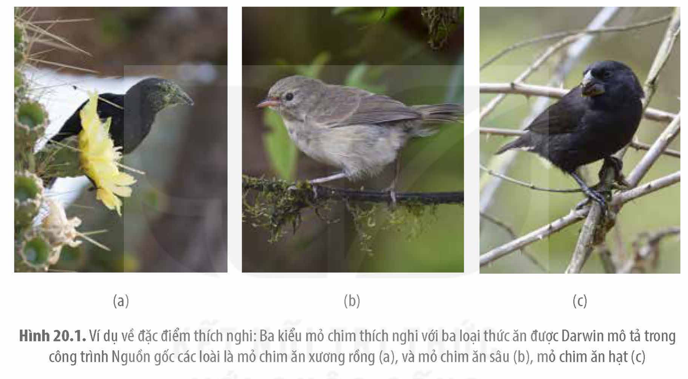
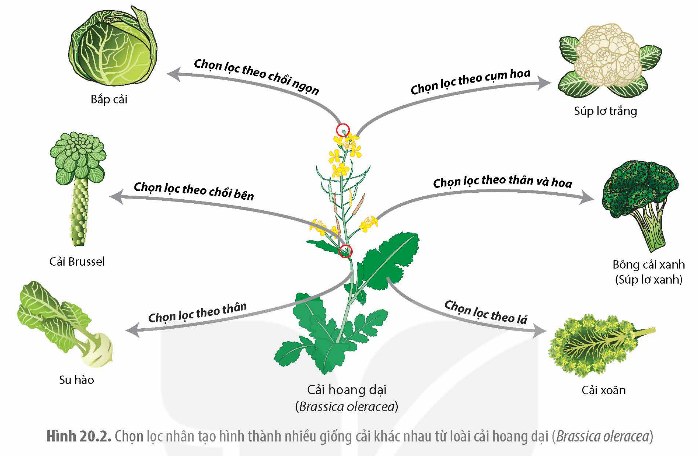
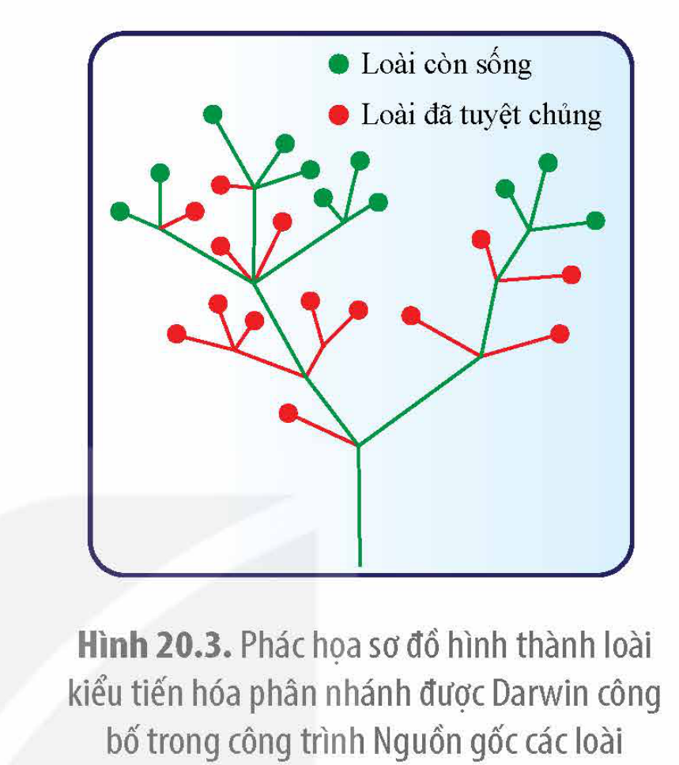

<!-- pdf:103 -->

# BÀI 20: QUAN NIỆM CỦA DARWIN VỀ CHỌN LỌC TỰ NHIÊN VÀ HÌNH THÀNH LOÀI

## 🎯 Yêu cầu cần đạt

- Nêu được phương pháp mà Darwin đã sử dụng để xây dựng học thuyết về chọn lọc tự nhiên và hình thành loài (quan sát, hình thành giả thuyết, kiểm chứng giả thuyết).

## 🔴 Mở đầu

Tại sao dùng thuốc kháng sinh lâu dài để chữa bệnh dễ dẫn tới các vi khuẩn gây bệnh trở nên kháng thuốc?

Charles Darwin (1809 – 1882) là nhà khoa học lỗi lạc, một trong những người xây dựng nên quy trình nghiên cứu khoa học mà cho đến nay các nhà khoa học tự nhiên đều áp dụng. Quy trình nghiên cứu bao gồm các bước: Quan sát thu thập dữ liệu → Hình thành giả thuyết giải thích dữ liệu quan sát được → Kiểm chứng giả thuyết bằng thực nghiệm. Bài học này giới thiệu cách Darwin nghiên cứu xây dựng nên học thuyết về chọn lọc tự nhiên và giải thích quá trình tiến hoá hình thành các loài.

## I. QUAN SÁT CÁC ĐẶC ĐIỂM DI TRUYỀN VÀ BIẾN DỊ

### 1. Quan sát các loài sinh vật trong tự nhiên

Với mong ước khám phá thế giới sống, Darwin đã tham gia đoàn thám hiểm kéo dài 5 năm vòng quanh thế giới trên con tàu Beagle rời nước Anh vào năm 1831. Những quan sát về thế giới sống cùng hàng nghìn mẫu động, thực vật thu thập được trong chuyến hành trình đã được Darwin sử dụng làm cơ sở để hình thành học thuyết tiến hoá của mình sau này.

<!-- term: Biến dị cá thể -->
Mặc dù chưa biết về cơ chế di truyền và biến dị, nhưng qua quan sát các cá thể sinh vật có cùng bố mẹ, các sinh vật thuộc cùng một loài, Darwin nhận thấy các cá thể sinh vật có họ hàng càng gần gũi thì càng có nhiều đặc điểm giống nhau, như vậy các sinh vật có nhiều đặc điểm giống nhau là do chúng có chung tổ tiên. Tuy nhiên, Darwin cũng nhận thấy các cá thể có cùng bố mẹ vẫn có một số đặc điểm khác biệt nhau và khác với bố mẹ. Ông gọi đó là các biến dị cá thể.

Những loài chim mà Darwin quan sát thấy trên các đảo thuộc quần đảo Galapagos ở Nam Mỹ cách đất liền khoảng 900 km, có nhiều đặc điểm giống với các loài chim sống ở vùng đất liền gần nhất mà không giống với những loài sống ở nơi khác có cùng vĩ độ trên Trái Đất. Ông cho rằng, chim và các loài khác trên đảo có nguồn gốc từ đất liền

<!-- pdf:104 -->

<!-- term: Đặc điểm thích nghi -->
Nam Mỹ. Darwin đã phát hiện thấy, mặc dù các loài chim trên các đảo có nhiều đặc điểm giống nhau, nhưng chúng cũng khác nhau về một vài đặc điểm nhỏ như kích thước và hình dạng mỏ nên có khả năng chúng là các loài khác nhau. Ví dụ: Những con chim sẻ ở các đảo có nhiều cây cho hạt to thì hầu hết có mỏ ngắn, dày có thể tách được vỏ hạt để lấy thức ăn, còn những con sống ở đảo có nhiều côn trùng mỏ lại mảnh, dài thích hợp với việc bắt sâu bọ (H 20.1). Darwin gọi những biến dị cá thể giúp sinh vật sống sót và sinh sản tốt hơn giống như các dạng mỏ chim là các đặc điểm thích nghi. Các đặc điểm thích nghi được Darwin quan sát thấy ở nhiều loài sinh vật như các loài hoa lan, côn trùng,...

Hình 20.1. Ví dụ về đặc điểm thích nghi: Ba kiểu mỏ chim thích nghi với ba loại thức ăn được Darwin mô tả trong công trình Nguồn gốc các loài là mỏ chim ăn xương rồng (a), và mỏ chim ăn sâu (b), mỏ chim ăn hạt (c)

Ngoài những quan sát về các biến dị cá thể và đặc điểm thích nghi, Darwin còn nhận thấy các sinh vật có khả năng sinh ra một số lượng rất lớn cá thể con, vượt xa số lượng cá thể mà nguồn tài nguyên của môi trường có thể nuôi dưỡng. Vì vậy, chỉ một số ít cá thể con sinh ra có thể sống sót đến giai đoạn trưởng thành và sinh sản.

### 2. Quan sát các giống vật nuôi và cây trồng

Darwin đã quan sát các giống vật nuôi và cây trồng được con người tạo ra từ một giống ban đầu. Trong cùng một giống, khi phát hiện thấy những biến dị cá thể ưa thích, con người đã giữ lại, nhân giống riêng và chỉ qua một số thế hệ đã có thể tạo nên giống mới. Ví dụ: Các giống chim bồ câu khác nhau được chọn lọc và nhân giống từ giống bồ câu núi; Các loại rau bắp cải, su hào, rau cải, súp lơ,… được chọn lọc từ giống cải hoang dại (H 20.2). Darwin gọi phương pháp tạo giống mới như vậy là **chọn lọc nhân tạo**. Như vậy, để chọn lọc nhân tạo có thể xảy ra thì cần phải có các biến dị cá thể. Con người chọn ra những loại biến dị cá thể mà mình ưa thích, cho nhân giống và loại bỏ những biến dị mà mình không mong muốn.

<!-- pdf:105 -->

Hình 20.2. Chọn lọc nhân tạo hình thành nhiều giống cải khác nhau từ loài cải hoang dại (*Brassica oleracea*)

Các quan sát của Darwin có thể được tóm tắt một cách khái quát như sau:

- Các cá thể trong cùng một quần thể mặc dù có nhiều đặc điểm giống nhau nhưng cũng khác nhau về một số đặc điểm di truyền (biến dị cá thể).
- Các loài thường có khả năng sinh ra một số lượng lớn cá thể con so với số lượng cá thể mà môi trường có thể nuôi dưỡng.

## ❓ Dừng lại và suy ngẫm

1. Tại sao Darwin cho rằng đặc điểm về cấu trúc, hình thái của mỏ chim trên quần đảo Galapagos là đặc điểm thích nghi?
2. Hãy đưa ra một vài đặc điểm thích nghi mà em quan sát được và cho biết đặc điểm đó đem lại lợi ích gì cho sinh vật.

## II. ĐỀ XUẤT GIẢ THUYẾT CHỌN LỌC TỰ NHIÊN GIẢI THÍCH QUÁ TRÌNH HÌNH THÀNH LOÀI

<!-- term: Chọn lọc tự nhiên -->
Từ những quan sát về quá trình chọn giống vật nuôi và cây trồng cũng như những gì quan sát được về hiện tượng di truyền, biến dị trong các quần thể tự nhiên, Darwin cho rằng quá trình tương tự như chọn lọc nhân tạo đã xảy ra trong tự nhiên dẫn đến hình thành các loài khác nhau từ một tổ tiên chung. Trong quần thể sinh vật luôn sẵn có một số biến dị di truyền, những biến dị làm tăng khả năng sống sót và khả năng sinh sản của sinh vật thì tần số các cá thể có các biến dị đó sẽ ngày một tăng dần trong quần thể ở các thế hệ sau. Darwin gọi quá trình tự nhiên làm tăng dần tần số cá thể mang đặc điểm

<!-- pdf:106 -->

thích nghi qua các thế hệ là chọn lọc tự nhiên. Chọn lọc tự nhiên không chỉ làm cho sinh vật thích nghi được với môi trường sống mà còn làm xuất hiện các loài mới từ một tổ tiên chung.

<!-- term: Hậu duệ có biến đổi -->
Trong công trình Nguồn gốc các loài, Darwin đưa ra khái niệm "hậu duệ có biến đổi" để giải thích sự tiến hoá của sinh giới bằng cơ chế chọn lọc tự nhiên. "Hậu duệ có biến đổi" nghĩa là ở đời con, bên cạnh những đặc điểm của bố mẹ, luôn có những biến dị di truyền. Mỗi loại biến dị di truyền có thể giúp các cá thể thích nghi với một kiểu môi trường nhất định. Theo thời gian, số lượng các cá thể có biến dị thích nghi tăng dần, hình thành nên loài mới.

Hình 20.3 phác hoạ ý tưởng của Darwin về quá trình hình thành các loài trong quá trình tiến hoá. Tận cùng của mỗi nhánh trong hình tượng trưng cho một loài sinh vật. Các loài tiến hoá từ tổ tiên chung và có các biến dị di truyền giúp chúng thích nghi với các điều kiện môi trường khác nhau. Trong quá trình tiến hoá, nhiều loài không thích nghi được với môi trường nên đã tuyệt chủng.

Hình 20.3. Phác họa sơ đồ hình thành loài kiểu tiến hóa phân nhánh được Darwin công bố trong công trình Nguồn gốc các loài

## ❓ Dừng lại và suy ngẫm

1. Một đặc điểm như thế nào được gọi là đặc điểm thích nghi?
2. Giải thích quá trình hình thành loài mới theo quan niệm của Darwin.

## III. KIỂM CHỨNG GIẢ THUYẾT

Mặc dù học thuyết chọn lọc tự nhiên đã được Darwin phác hoạ từ lâu nhưng ông vẫn chưa dám công bố và dành nhiều năm thu thập các bằng chứng cũng như tự mình làm thí nghiệm kiểm chứng học thuyết. Darwin đã tiến hành rất nhiều thí nghiệm kiểm chứng giả thuyết của mình. Ví dụ: Ông đã tiến hành ngâm nhiều loại hạt giống khác nhau trong nước biển với thời gian dài và kiểm tra độ nảy mầm của các loại hạt sau đó. Thí nghiệm cho thấy, hạt của nhiều loài cây vẫn còn khả năng nảy mầm sau khi ngâm thời gian dài trong nước biển, chứng tỏ các cây trên đảo đã được phát tán từ đất liền. Quan sát các loài cây bắt côn trùng như cây nắp ấm, Darwin đưa ra giả thuyết cho rằng, với cấu trúc lá để bắt côn trùng như vậy, cây có thể thích nghi với môi trường nghèo nitrogen. Darwin đã làm thí nghiệm nhỏ vào lá các cây nắp ấm những loại dung dịch khác nhau như nước đường, lipid hay protein. Kết quả cho thấy, cây nắp ấm chỉ tiêu thụ protein đúng như ông dự đoán.

Một điều lí thú là, cùng với Darwin, một nhà khoa học khác cùng thời là Wallace, đã độc lập nghiên cứu đưa ra học thuyết chọn lọc tự nhiên giải thích quá trình hình thành các loài và gửi cho Darwin góp ý. Mặc dù hai nhà khoa học cùng phát hiện ra cơ chế chọn lọc tự nhiên nhưng học thuyết chọn lọc tự nhiên chỉ được mang tên Darwin vì ông đã đưa ra được một số lượng rất lớn các bằng chứng khoa học cho học thuyết của mình.

<!-- pdf:107 -->

## ❓ Dừng lại và suy ngẫm

Sưu tập từ sách, báo, internet,… một số thí nghiệm kiểm chứng học thuyết Darwin.

## 📌 Kiến thức cốt lõi

- Quan sát thu thập dữ liệu → Đề xuất giả thuyết giải thích các dữ liệu quan sát được → Tìm kiếm bằng chứng thực nghiệm kiểm chứng giả thuyết là quy trình nghiên cứu khoa học mà Darwin đã áp dụng để xây dựng học thuyết về chọn lọc tự nhiên và hình thành loài.
- Chọn lọc tự nhiên là cơ chế hình thành nên quần thể có các đặc điểm thích nghi với môi trường, từ đó hình thành nên các loài sinh vật từ một tổ tiên chung.

## ✏️ Luyện tập và vận dụng

1. Trình bày phương pháp mà Darwin đã sử dụng để xây dựng học thuyết chọn lọc tự nhiên và hình thành loài.
2. Một bạn học sinh đề xuất như sau: "Nếu muốn biết một đặc điểm nào là đặc điểm thích nghi chỉ cần làm thí nghiệm xác định tỉ lệ sống sót của các cá thể mang đặc điểm đó có cao hơn so với các cá thể không có đặc điểm nghiên cứu hay không". Đề xuất này đúng hay sai? Giải thích.

## 📷 Danh sách hình trong bài

| Mã hình | Trang PDF | Vị trí | Chú thích gốc |
|---|---|---|---|
| H12-sinh-b20-01 | 104 | Mục I.1 | Hình 20.1. Ví dụ về đặc điểm thích nghi: Ba kiểu mỏ chim thích nghi với ba loại thức ăn được Darwin mô tả trong công trình Nguồn gốc các loài là mỏ chim ăn xương rồng (a), và mỏ chim ăn sâu (b), mỏ chim ăn hạt (c) |
| H12-sinh-b20-02 | 105 | Mục I.2 | Hình 20.2. Chọn lọc nhân tạo hình thành nhiều giống cải khác nhau từ loài cải hoang dại (Brassica oleracea) |
| H12-sinh-b20-03 | 106 | Mục II | Hình 20.3. Phác họa sơ đồ hình thành loài kiểu tiến hóa phân nhánh được Darwin công bố trong công trình Nguồn gốc các loài |
