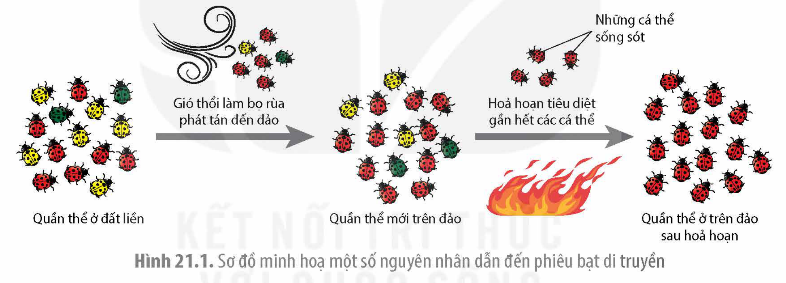
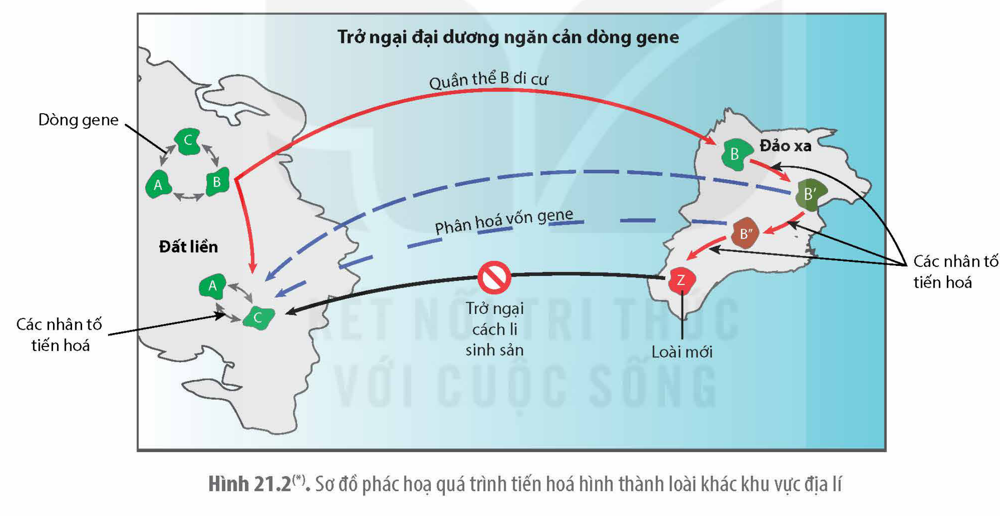
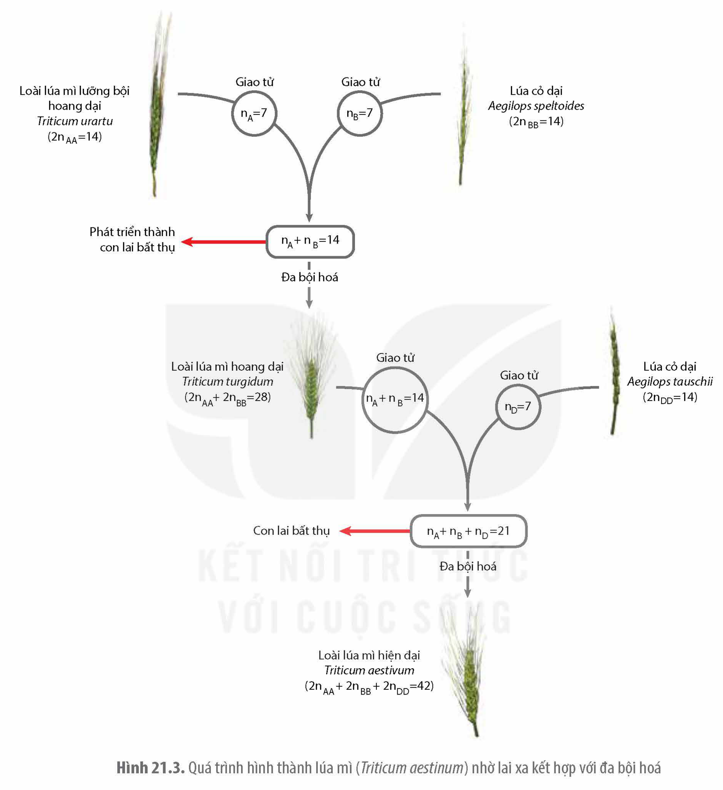

<!-- pdf:108 -->

# BÀI 21: HỌC THUYẾT TIẾN HOÁ TỔNG HỢP HIỆN ĐẠI

## 🎯 Yêu cầu cần đạt

- Nêu được khái niệm tiến hoá nhỏ và quần thể là đơn vị tiến hoá nhỏ.
- Trình bày được các nhân tố tiến hoá (đột biến, phiêu bạt di truyền, dòng gene, chọn lọc tự nhiên, giao phối không ngẫu nhiên).
- Phát biểu được khái niệm thích nghi và trình bày được cơ chế hình thành đặc điểm thích nghi.
- Giải thích được các đặc điểm thích nghi chỉ hợp lí tương đối. Lấy được ví dụ minh hoạ.
- Phát biểu được khái niệm loài sinh học và giải thích được cơ chế hình thành loài.

## 🔴 Mở đầu

Tần số allele và tần số kiểu gene của quần thể có được duy trì ổn định qua các thế hệ hay không? Nếu có thì do những yếu tố nào?

## I. KHÁI NIỆM TIẾN HOÁ NHỎ

<!-- term: Học thuyết tiến hoá tổng hợp -->
Học thuyết tiến hoá tổng hợp ra đời vào những năm 1930 khi các nhà khoa học kết nối học thuyết chọn lọc tự nhiên của Darwin với thành tựu của di truyền học hiện đại và nhiều ngành khoa học khác để giải thích quá trình tiến hoá của sinh giới.

<!-- term: Tiến hoá nhỏ -->
Theo thuyết tiến hoá tổng hợp, tiến hoá là quá trình thay đổi tần số allele và tần số các kiểu gene của quần thể từ thế hệ này sang thế hệ khác. Quá trình tiến hoá như vậy ở quy mô quần thể được gọi là tiến hoá nhỏ. Vì các quần thể thuộc cùng một loài, sống trong các điều kiện môi trường khác nhau nên vốn gene của các quần thể cũng thường khác nhau. Do vậy, mỗi quần thể là một đơn vị của tiến hoá nhỏ.

## II. CÁC NHÂN TỐ TIẾN HOÁ

<!-- term: Nhân tố tiến hoá -->
Các nhân tố làm thay đổi tần số allele và tần số kiểu gene của quần thể được gọi là các nhân tố tiến hoá. Khi tần số allele bị thay đổi sẽ dẫn đến sự thay đổi tần số của các kiểu gene trong quần thể. Tuy nhiên, có nhân tố tiến hoá chỉ làm thay đổi tần số kiểu gene nhưng không làm thay đổi tần số allele của quần thể. Các nhân tố tiến hoá bao gồm: đột biến, phiêu bạt di truyền, dòng gene, chọn lọc tự nhiên và giao phối không ngẫu nhiên.

### 1. Đột biến

Đột biến gene làm xuất hiện các allele mới hoặc biến allele này thành allele khác, từ đó làm thay đổi tần số allele của quần thể. Tần số đột biến tự phát thường rất thấp nên không làm thay đổi đáng kể tần số allele của quần thể. Tuy nhiên, mỗi cá thể có rất nhiều gene và số lượng cá thể trong một quần thể khá lớn nên đột biến có vai trò làm phong phú vốn gene của quần thể, tạo nguyên liệu cho quá trình tiến hoá.

<!-- pdf:109 -->

### 2. Phiêu bạt di truyền

<!-- term: Phiêu bạt di truyền -->
Phiêu bạt di truyền là quá trình thay đổi tần số allele của quần thể, gây nên bởi các yếu tố ngẫu nhiên. Yếu tố ngẫu nhiên có thể là các yếu tố môi trường, bão tố, lũ lụt, hoả hoạn,… làm chết các cá thể, bất kể chúng mang các gene có lợi hay có hại. Phiêu bạt di truyền thường làm biến mất một loại allele nào đó khỏi quần thể bất kể allele đó là có lợi, có hại hay trung tính dẫn đến làm giảm sự đa dạng di truyền của quần thể. Quần thể có kích thước càng nhỏ thì các yếu tố ngẫu nhiên làm thay đổi tần số allele càng mạnh. Trong tự nhiên, phiêu bạt di truyền làm thay đổi tần số allele của quần thể khi một số ít cá thể phát tán đi nơi khác thành lập nên quần thể mới, hoặc quần thể bị các yếu tố thiên tai làm chết hàng loạt cá thể và chỉ còn một số ít sống sót tạo nên quần thể mới.

Ví dụ: Gió bão phát tán một số ít cá thể bọ rùa (không phân biệt kiểu gene của chúng) từ đất liền ra một đảo xa thành lập nên quần thể mới. Ngay ở thế hệ thứ nhất trên đảo, tần số các cá thể có kiểu gene quy định cánh màu đỏ đã khác biệt với quần thể gốc trên đất liền. Quần thể sau đó gia tăng về kích thước. Trong quá trình tồn tại, hoả hoạn tiêu diệt hầu hết các cá thể và một số ít sống sót nên quần thể mới có cấu trúc di truyền khác với quần thể khi chưa xảy ra hoả hoạn (H 21.1).

Hình 21.1. Sơ đồ minh hoạ một số nguyên nhân dẫn đến phiêu bạt di truyền

### 3. Dòng gene

<!-- term: Dòng gene -->
<!-- term: Hệ số nhập cư -->
Dòng gene (di – nhập gene) là sự di chuyển các allele vào hoặc ra khỏi quần thể thông qua sự di chuyển của các cá thể hữu thụ hoặc các giao tử của chúng. Dòng gene làm thay đổi tần số allele của quần thể không theo một hướng xác định. Mức độ thay đổi tần số allele của quần thể bởi dòng gene phụ thuộc vào sự chênh lệch tần số allele giữa quần thể cho và quần thể nhận. Sự chênh lệch càng lớn thì sự thay đổi tần số allele càng mạnh. Ngoài ra, sự thay đổi tần số allele bởi dòng gene còn phụ thuộc vào hệ số nhập cư (m) là lớn hay nhỏ. Hệ số nhập cư là tỉ số giữa số cá thể nhập vào quần thể nhận trên tổng số các cá thể của quần thể nhận sau khi nhập cư. Ví dụ: Hệ số nhập cư càng lớn thì tần số allele của quần thể nhận thay đổi càng mạnh.

Dòng gene có thể làm tăng sự đa dạng di truyền của quần thể khi đưa thêm allele mới vào quần thể.

### 4. Chọn lọc tự nhiên

<!-- term: Chọn lọc tự nhiên -->
Dưới góc độ của thuyết tiến hoá tổng hợp, chọn lọc tự nhiên là quá trình làm tăng dần tần số allele và tần số kiểu gene quy định đặc điểm thích nghi trong quần thể, đồng thời làm

<!-- pdf:110 -->

giảm dần tần số allele và tần số các kiểu gene quy định các đặc điểm không thích nghi. Các yếu tố của môi trường (tác nhân gây ra chọn lọc) tác động trực tiếp lên kiểu hình, qua đó gián tiếp làm thay đổi tần số kiểu gene của cá thể trong quần thể.

<!-- term: Áp lực chọn lọc -->
Mức độ thay đổi tần số allele bởi chọn lọc tự nhiên phụ thuộc vào loại allele và áp lực chọn lọc. Chọn lọc tác động lên cá thể có kiểu hình trội sẽ làm thay đổi tần số allele trội nhanh hơn so với tác động lên cá thể có kiểu hình lặn. Khi điều kiện môi trường thay đổi càng mạnh (áp lực chọn lọc cao) thì chọn lọc tự nhiên làm thay đổi tần số allele càng nhanh và ngược lại. Chọn lọc tự nhiên thường làm thay đổi tần số allele theo một hướng xác định nên làm giảm sự đa dạng di truyền (nghèo vốn gene) của quần thể. Tuy nhiên, trong một số trường hợp, chọn lọc tự nhiên vẫn duy trì được sự đa dạng di truyền của quần thể. Ví dụ: Các cá thể có kiểu hình thích nghi có kiểu gene dị hợp. Một quần thể có độ đa dạng di truyền cao khi có nhiều cá thể mang các kiểu gene dị hợp tử, đảm bảo cho quần thể có nhiều loại allele khác nhau.

### 5. Giao phối không ngẫu nhiên

<!-- term: Giao phối không ngẫu nhiên -->
Giao phối không ngẫu nhiên bao gồm các kiểu giao phối cận huyết và giao phối có lựa chọn. Các kiểu giao phối không ngẫu nhiên không làm thay đổi tần số allele nhưng làm thay đổi tần số các kiểu gene của quần thể theo hướng tăng tần số kiểu gene đồng hợp, giảm tần số kiểu gene dị hợp. Trong giao phối cận huyết, các cá thể có quan hệ họ hàng càng gần gũi giao phối với nhau thì tần số kiểu gene đồng hợp ở đời sau càng tăng nhanh. Vì vậy, giao phối không ngẫu nhiên luôn làm giảm sự đa dạng di truyền của quần thể.

## ❓ Dừng lại và suy ngẫm

1. Tại sao cá thể sinh vật không phải là đơn vị của tiến hoá nhỏ?
2. Chọn lọc tự nhiên làm thay đổi tần số của loại allele nào nhanh hơn: allele trội hay allele lặn? Giải thích.

## III. HÌNH THÀNH ĐẶC ĐIỂM THÍCH NGHI

### 1. Khái niệm

<!-- term: Đặc điểm thích nghi -->
<!-- term: Giá trị thích nghi -->
Đặc điểm di truyền làm tăng khả năng sống sót và khả năng sinh sản của cá thể sinh vật trong môi trường nhất định được gọi là đặc điểm thích nghi. Mức độ thích nghi của sinh vật với môi trường được đo bằng giá trị thích nghi, thể hiện qua tổng số cá thể con mà cá thể đó sinh ra trong suốt cuộc đời có thể sống sót được cho đến khi sinh sản. Cá thể nào sinh ra nhiều con hơn thì cá thể đó thích nghi với môi trường hơn. Ví dụ: Một cây vân sam sống hàng trăm năm, thậm chí cả nghìn năm nhưng cũng chỉ có thể tạo ra số lượng cây con bằng số lượng mà một cây sống một năm sinh ra, như vậy, khả năng thích nghi của chúng là như nhau.

### 2. Cơ chế

Cơ chế chọn lọc tự nhiên hình thành đặc điểm thích nghi có thể tóm tắt như sau: Đột biến cung cấp nguồn nguyên liệu, chọn lọc tự nhiên giữ lại những cá thể có các đột biến làm tăng khả năng sống sót và sinh sản của sinh vật dẫn đến số lượng các cá thể mang đột biến có lợi ngày một tăng dần trong quần thể qua các thế hệ.

<!-- pdf:111 -->

Ví dụ: Đột biến kháng chất kháng sinh penicillin ngẫu nhiên xuất hiện ở một số rất ít vi khuẩn ở quần thể vi khuẩn sống trong môi trường không chứa penicillin. Khi môi trường có penicillin, những vi khuẩn bị đột biến sống sót được và sinh sản làm tăng nhanh số vi khuẩn kháng thuốc. Khi hầu hết các vi khuẩn trong quần thể đều kháng thuốc penicilin thì đặc điểm kháng penicilin mới được gọi là đặc điểm thích nghi. Như vậy, chọn lọc tự nhiên là nhân tố tiến hoá duy nhất làm cho một đặc điểm trở nên phổ biến trong quần thể (đặc điểm thích nghi).

### 3. Tính tương đối của đặc điểm thích nghi

Mọi đặc điểm thích nghi chỉ mang tính tương đối. Có một số nguyên nhân chính khiến chọn lọc tự nhiên không thể tạo ra sinh vật thích nghi một cách hoàn hảo với nhiều điều kiện sống khác nhau. Đó là:

- Điều kiện môi trường (tác nhân gây ra chọn lọc tự nhiên) chỉ lựa chọn các biến dị di truyền có sẵn trong quần thể. Vì vậy, chọn lọc tự nhiên chỉ có thể lựa chọn biến dị tốt nhất trong số những biến dị sẵn có. Biến dị được lựa chọn do vậy không hẳn là đã tối ưu. Ví dụ: loài dơi có cấu trúc xương chi trước giống như các loài thú khác nên chọn lọc tự nhiên chỉ giữ lại cá thể nào có lớp màng da kết nối các bộ phận của chi trước để nâng đỡ cơ thể khi bay mà không thể tạo ra cấu trúc cánh như ở chim.
- Các đặc điểm thích nghi mang tính dung hoà vì một đặc điểm đem lại lợi ích này lại gây bất lợi khác. Ví dụ: Con chim công đực có màu sắc sặc sỡ thu hút được nhiều chim cái để giao phối làm tăng khả năng sinh sản, tuy nhiên, màu sắc sặc sỡ cũng làm cho nó dễ bị nhiều loài săn mồi phát hiện.
- Một đặc điểm thích nghi chỉ có lợi trong môi trường này nhưng lại vô dụng hoặc có hại trong môi trường khác.

## ❓ Dừng lại và suy ngẫm

1. Thuốc kháng sinh có phải là tác nhân đột biến gây nên sự kháng thuốc kháng sinh ở vi khuẩn hay không? Giải thích.
2. Tại sao chọn lọc tự nhiên không thể tạo ra một loại sinh vật thích nghi với mọi điều kiện môi trường?

## IV. LOÀI VÀ CƠ CHẾ HÌNH THÀNH LOÀI

### 1. Khái niệm loài sinh học và các cơ chế cách li sinh sản

<!-- term: Loài sinh học -->
Có nhiều khái niệm về loài khác nhau nhưng khái niệm loài sinh học do nhà tiến hoá học lỗi lạc Ernst Mayr đưa ra được các nhà sinh học sử dụng nhiều nhất. *Loài sinh học là một hoặc nhóm các quần thể gồm các cá thể có khả năng giao phối với nhau trong tự nhiên sinh ra đời con hữu thụ nhưng cách li sinh sản với nhóm quần thể khác tương tự.*

<!-- term: Cách li sinh sản -->
Cách li sinh sản là những đặc điểm sinh học ngăn cản các cá thể cho dù sống cùng nhau cũng không giao phối với nhau, hoặc có giao phối cũng không sinh ra đời con hữu thụ.

<!-- pdf:112 -->

### 2. Cơ chế hình thành loài

**a) Hình thành loài khác khu vực địa lí**

Điều kiện tiên quyết để cách li sinh sản có thể xảy ra là phải có những trở ngại ngăn cản dòng gene giữa các quần thể. Dòng gene càng bị ngăn cản triệt để và kéo dài thì xác suất hình thành sự cách li sinh sản giữa các quần thể dẫn đến hình thành loài mới càng cao. Điều này cho thấy, phần lớn các loài được hình thành trong tự nhiên nhờ cách li địa lí vì các trở ngại địa lí ngăn cản dòng gene giữa các quần thể khá triệt để.

Ngăn cản dòng gene là điều kiện cần nhưng chưa đủ để phát sinh cách li sinh sản. Khi cách li địa lí đã xảy ra, vốn gene của các quần thể cách li được phân hoá bởi các nhân tố tiến hoá như đột biến, chọn lọc tự nhiên và phiêu bạt di truyền,… Sự khác biệt về vốn gene càng nhiều và càng được duy trì lâu dài thì xác suất xuất hiện các trở ngại sinh học ngăn cản quá trình thụ tinh hoặc ngăn cản quá trình tạo con lai hữu thụ càng cao. Sự cách li sinh sản thường xuất hiện một cách ngẫu nhiên. Quá trình phân hoá các quần thể của cùng một loài thành các loài khác nhau được tóm tắt qua sơ đồ trong Hình 21.2.

Hình 21.2(\*). Sơ đồ phác hoạ quá trình tiến hoá hình thành loài khác khu vực địa lí

**b) Hình thành loài cùng khu vực địa lí**

Các quần thể cùng loài sống trong cùng một khu vực địa lí nên thường hay xảy ra dòng gene giữa các quần thể và sự cách li sinh sản khó xảy ra hơn so với các quần thể sống ở các khu vực địa lí khác nhau. Tuy nhiên, khi đã xuất hiện sự cách li sinh sản thì loài mới lại xuất hiện một cách nhanh chóng. Ví dụ: Trong quần thể cây lưỡng bội, nếu đột biến làm xuất hiện cây tứ bội và cây này có thể sinh sản tạo ra quần thể tứ bội sẽ hình thành nên loài mới vì cây tứ bội lai với cây lưỡng bội sẽ cho ra cây tam bội bất thụ; hoặc các loài thực vật có họ hàng gần có thể lai với nhau, sau đó ở một số con lai xảy ra hiện tượng đa bội hoá hình thành nên loài mới (H 22.3). Hình thành loài cùng khu vực địa lí hay xảy ra đối với các loài thực vật hơn là đối với các loài động vật.

> (\*) Nguồn hình: Phạm Minh Kiên.

<!-- pdf:113 -->

Hình 21.3. Quá trình hình thành lúa mì (*Triticum aestinum*) nhờ lai xa kết hợp với đa bội hoá

## ❓ Dừng lại và suy ngẫm

1. Loài sinh học là gì?
2. Cách li sinh sản và các nhân tố tiến hoá có vai trò gì trong quá trình hình thành loài mới.

<!-- pdf:114 -->

## 📌 Kiến thức cốt lõi

- Tiến hoá nhỏ là quá trình thay đổi tần số allele và tần số kiểu gene của quần thể từ thế hệ này sang thế hệ khác.
- Nhân tố tiến hoá là những tác nhân làm thay đổi tần số allele và tần số kiểu gene của quần thể. Chọn lọc tự nhiên là nhân tố tiến hoá duy nhất làm thay đổi tần số allele theo một hướng xác định hình thành nên quần thể thích nghi.
- Đặc điểm thích nghi chỉ hợp lí tương đối vì chọn lọc tự nhiên chỉ lựa chọn những biến dị thích nghi nhất trong số các biến dị di truyền có sẵn trong quần thể, đồng thời mỗi đặc điểm thích nghi chỉ có giá trị trong một môi trường nhất định và có thể trở nên có hại trong môi trường khác.
- Loài sinh học là một hoặc nhóm các quần thể gồm các cá thể có khả năng giao phối với nhau trong tự nhiên sinh ra đời con hữu thụ nhưng cách li sinh sản với nhóm quần thể khác tương tự.
- Loài mới được hình thành khi có sự ngăn cản dòng gene giữa các quần thể. Khi các quần thể đã cách li với nhau, các nhân tố tiến hoá sẽ tác động làm vốn gene của các quần thể cách li trở nên khác biệt. Sự khác biệt về vốn gene đến một mức độ nhất định sẽ làm xuất hiện sự cách li sinh sản dẫn đến hình thành loài mới.

## ✏️ Luyện tập và vận dụng

1. Nêu điểm khác biệt về sự biến động của tần số allele gây nên bởi chọn lọc tự nhiên và phiêu bạt di truyền.
2. Với điều kiện như hiện nay, loài người có thể tiến hoá thành loài mới ngay trên Trái Đất hay không? Giải thích.
3. Con người có khả năng tạo ra các công cụ và phương tiện để có thể thích nghi hơn với môi trường. Vậy loài người có còn chịu sự tác động của chọn lọc tự nhiên không? Giải thích.

## 📷 Danh sách hình trong bài

| Mã hình | Trang PDF | Vị trí | Chú thích gốc |
|---|---|---|---|
| H12-sinh-b21-01 | 109 | Mục II.2 | Hình 21.1. Sơ đồ minh hoạ một số nguyên nhân dẫn đến phiêu bạt di truyền |
| H12-sinh-b21-02 | 112 | Mục IV.2.a | Hình 21.2(\*). Sơ đồ phác hoạ quá trình tiến hoá hình thành loài khác khu vực địa lí — (\*) Nguồn hình: Phạm Minh Kiên. |
| H12-sinh-b21-03 | 113 | Mục IV.2.b | Hình 21.3. Quá trình hình thành lúa mì (Triticum aestinum) nhờ lai xa kết hợp với đa bội hoá |
