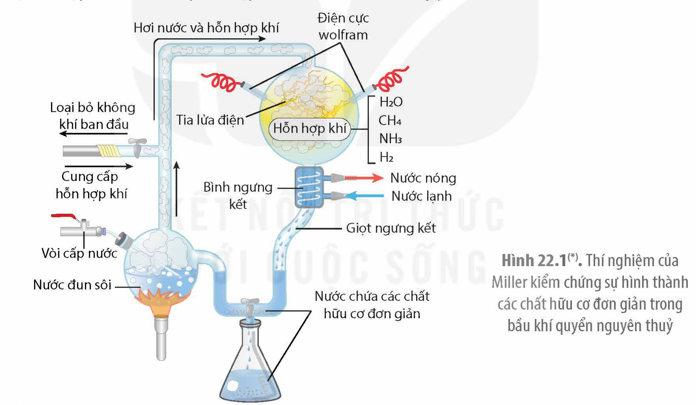
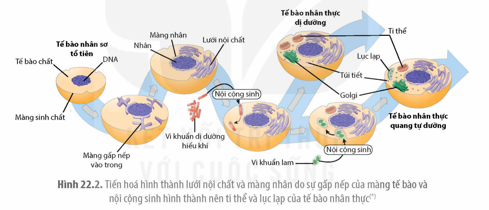
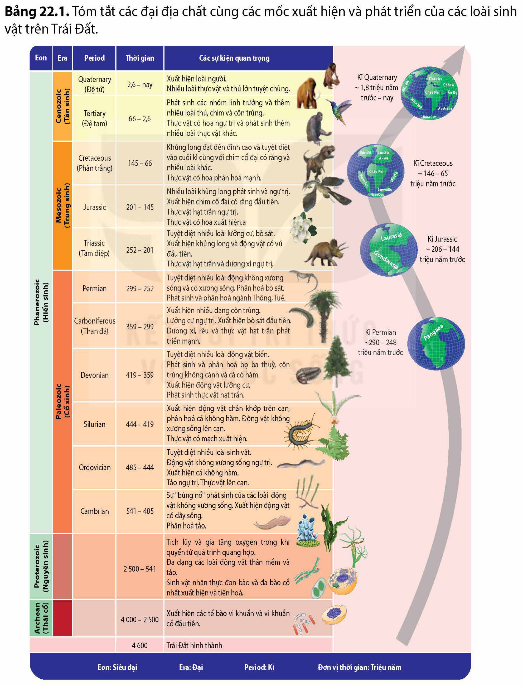
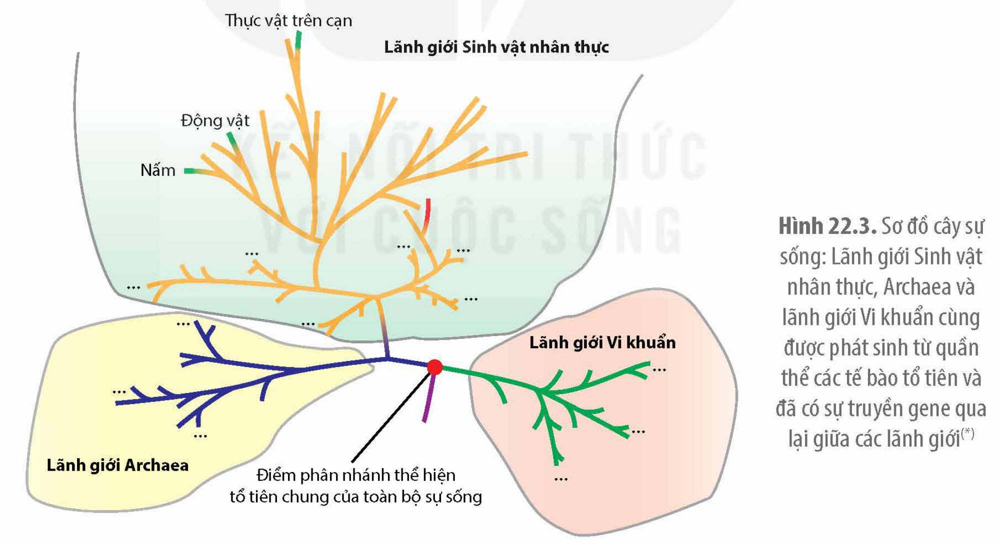
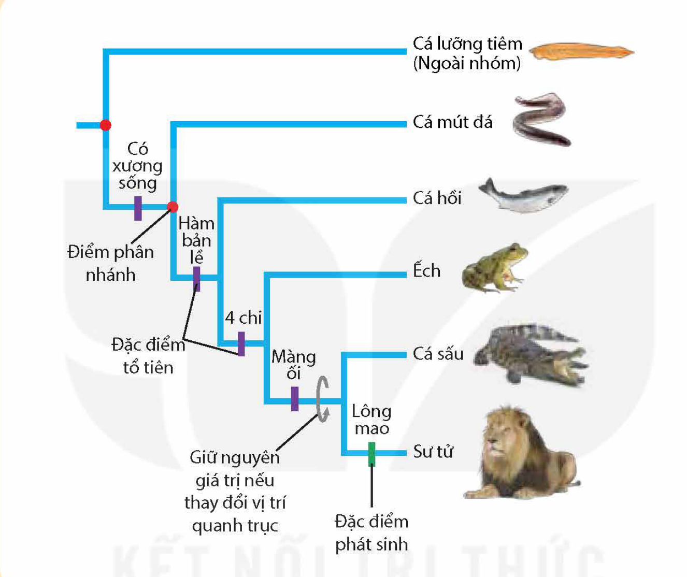
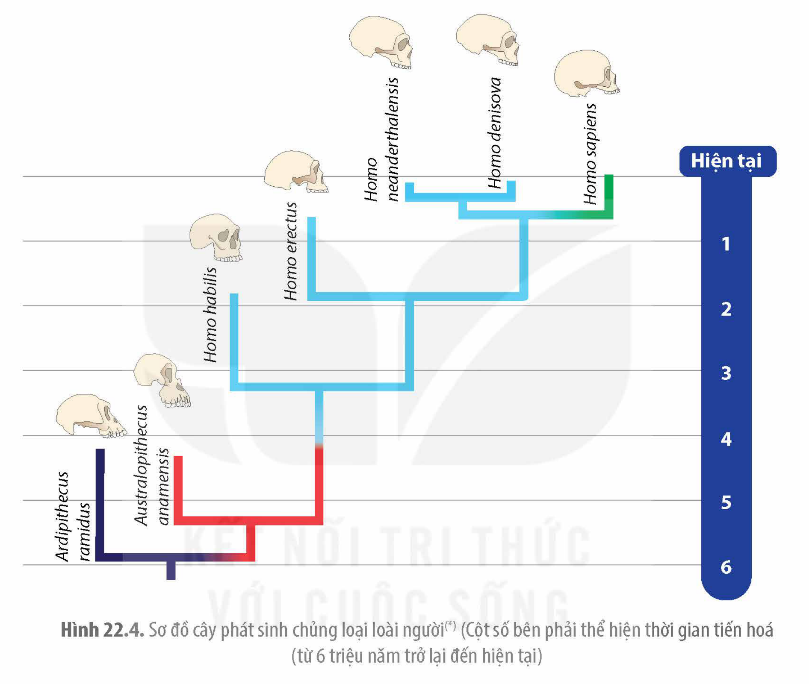

<!-- pdf:115 -->

# BÀI 22: TIẾN HOÁ LỚN VÀ QUÁ TRÌNH PHÁT SINH CHỦNG LOẠI

## 🎯 Yêu cầu cần đạt

- Phát biểu được khái niệm tiến hoá lớn. Phân biệt được tiến hoá lớn và tiến hoá nhỏ.
- Vẽ được sơ đồ ba giai đoạn phát sinh sự sống trên Trái Đất (tiến hoá hoá học, tiến hoá tiền sinh học, tiến hoá sinh học).
- Dựa vào sơ đồ, trình bày được các đại địa chất và biến cố lớn thể hiện sự phát triển của sinh vật trong các đại đó.
- Nêu được một số minh chứng về tiến hoá lớn.
- Dựa vào sơ đồ cây sự sống, trình bày được sinh giới có nguồn gốc chung và phân tích được sự phát sinh chủng loại là kết quả của tiến hoá.
- Vẽ được sơ đồ các giai đoạn chính trong quá trình phát sinh loài người.
- Nêu được loài người hiện nay (*H.sapiens*) đã tiến hoá từ loài vượn người (*Australopithecus*) qua các giai đoạn trung gian.
- Làm được bài tập sưu tầm tài liệu về sự phát sinh và phát triển của sinh giới hoặc của loài người.

## 🔴 Mở đầu

Loài người chúng ta đã được hình thành như thế nào?

## I. TIẾN HOÁ LỚN

<!-- term: Tiến hoá lớn -->
Tiến hoá lớn là quá trình tiến hoá hình thành loài và các đơn vị phân loại trên loài (chi, bộ, họ,…) và toàn bộ sinh giới. Nếu như tiến hoá nhỏ là quá trình biến đổi tần số allele và tần số kiểu gene của quần thể thì tiến hoá lớn là quá trình tiến hoá xảy ra ở quy mô lớn với khoảng thời gian dài hàng trăm triệu năm đến cả tỉ năm. Kết quả của tiến hoá nhỏ là hình thành nên các loài mới. Tuy nhiên, tiến hoá nhỏ phần lớn tạo ra các loài có đặc điểm khác biệt không nhiều nên thường vẫn thuộc cùng một chi. Tiến hoá lớn, do sự biến đổi của điều kiện Trái Đất xảy ra ở quy mô lớn và kéo dài nên loài mới có nhiều đặc điểm khác biệt đến mức có thể xếp vào những đơn vị trên loài. Ví dụ: Từ các loài bò sát (khủng long) đã hình thành nên loài chim đầu tiên. Những bằng chứng về tiến hoá lớn sẽ được đề cập rõ hơn khi nghiên cứu về sự phát triển của sinh vật qua các **đại địa chất**.

## ❓ Dừng lại và suy ngẫm

Phân biệt giữa tiến hoá lớn với tiến hoá nhỏ.

## II. QUÁ TRÌNH PHÁT SINH SỰ SỐNG TRÊN TRÁI ĐẤT

Phần lớn các nhà sinh học tin rằng, sự tiến hoá của sinh giới được chia thành ba giai đoạn: tiến hoá hoá học, tiến hoá tiền sinh học và tiến hoá sinh học.

<!-- pdf:116 -->

### 1. Tiến hoá hoá học

<!-- term: Tiến hoá hoá học -->
Tiến hoá hoá học là quá trình tiến hoá hình thành các hợp chất hữu cơ từ các chất vô cơ, xảy ra trên Trái Đất cách đây hơn bốn tỉ năm. Có một số giả thuyết khoa học giải thích về quá trình tiến hoá hoá học.

**a) Giả thuyết súp tiền sinh học**

Vào những năm 1920, Oparin, nhà sinh hoá học người Nga và Haldane, nhà sinh lí học và di truyền học người Scotland đã cùng đề xuất học thuyết cho rằng các hợp chất hữu cơ đơn giản như đường đơn, nucleotide base, các amino acid có thể hình thành một cách tự phát từ các chất vô cơ trên bề mặt trái đất (trong đại dương nước nông) với nguồn năng lượng từ sấm sét, núi lửa phun trào, bức xạ tử ngoại từ Mặt Trời. Học thuyết này đã được các nhà hoá sinh học của Mỹ là Stanley Miller và Harold Urey làm thí nghiệm kiểm chứng vào những năm 1950. Họ đã tạo ra bầu khí quyển nguyên thuỷ của Trái Đất trong phòng thí nghiệm và nguồn năng lượng điện được dùng mô phỏng hiện tượng sấm sét thời tiền sử (H 22.1). Sau một tuần thí nghiệm, các nhà khoa học đã phát hiện thấy, 15% lượng carbon trong khí methane đã được chuyển thành các hợp chất hữu cơ đơn giản khác như formaldehyde (CH$_2$O) và hydrogen cyanide (HCN). Các chất này sau đó kết hợp với nhau tạo ra ra một số phân tử hữu cơ đơn giản như formic acid (HCOOH), urea (NH$_2$CONH$_2$) và một số hợp chất hữu cơ phức tạp hơn như amino acid glycine và alanine.

Hình 22.1(\*). Thí nghiệm của Miller kiểm chứng sự hình thành các chất hữu cơ đơn giản trong bầu khí quyển nguyên thuỷ

**b) Giả thuyết hợp chất hữu cơ đến từ vũ trụ**

Một số nhà khoa học cũng cho rằng hợp chất hữu cơ đầu tiên trên Trái Đất có thể đến từ vũ trụ bởi các thiên thạch. Một số chất hữu cơ đơn giản đã được tìm thấy trong các thiên thạch rơi xuống Trái Đất ủng hộ cho giả thuyết này. Ví dụ: Hoá thạch có tên là Murchison 4,5 tỉ năm tuổi rơi xuống Australia năm 1969 có chứa hơn 80 amino acid, lipid, đường đơn và uracil.

### 2. Tiến hoá tiền sinh học

<!-- term: Tiến hoá tiền sinh học -->
Tiến hoá tiền sinh học là giai đoạn tiến hoá hình thành nên các tế bào sơ khai trên Trái Đất và được cho là đã xuất hiện cách đây 4,2 – 3,8 tỉ năm. Kết quả của quá trình tiến hoá này hình thành nên tế bào nhân sơ đầu tiên trên Trái Đất (H 22.2).

> (\*) Nguồn hình: Phạm Minh Kiên.

<!-- pdf:117 -->

<!-- Đầu trang PDF 117 có dòng chữ viết tay "Đoàn văn Doanh - THPT Nam Trực - Nam Định" của bản quét, không thuộc nội dung sách; không chép. -->

<!-- term: Protobiont -->
Các nhà sinh học cho rằng, khi các phân tử lipid, đặc biệt là phospholipid ở trong nước tạo nên lớp màng bao bọc lấy các phân tử hữu cơ sẽ hình thành nên cấu trúc được gọi là protobiont hay các siêu giọt (microsphere). Những protobiont nào chứa tập hợp các đại phân tử hữu cơ khiến nó có được khả năng tăng kích thước; khả năng chuyển hoá vật chất và năng lượng; có thể phân đôi (sinh sản) thì sẽ hình thành nên tế bào sơ khai. Bằng chứng ủng hộ giả thuyết này là những thí nghiệm tổng hợp nhân tạo các protobiont có biểu hiện nhiều đặc điểm giống với tế bào và có thể phân chia kiểu phân đôi, thậm chí có thể chuyển hoá vật chất và năng lượng.

### 3. Tiến hóa sinh học

<!-- term: Tiến hoá sinh học -->
<!-- term: Thuyết nội cộng sinh -->
Tiến hoá sinh học được bắt đầu từ khi tế bào được hình thành. Hoá thạch tế bào nhân sơ cổ nhất có tuổi là 3,5 tỉ năm. Các tế bào nhân sơ sau đó đã tiến hoá thành tế bào nhân thực và hoá thạch tế bào nhân thực cổ nhất được phát hiện cách đây 1,8 tỉ năm. Có bằng chứng cho rằng, màng tế bào nhân sơ gấp nếp vào bên trong bao bọc lấy vùng chứa vật chất di truyền tạo nên màng nhân và hệ thống lưới nội chất của tế bào nhân thực (H 22.2). Giả thuyết nội cộng sinh cho rằng, sau đó, ở các giai đoạn tiến hoá khác nhau, các tế bào nhân thực sơ khai đã thực bào vi khuẩn hiếu khí và vi khuẩn lam hình thành ti thể và lục lạp. Hiện nay, có nhiều bằng chứng sinh học phân tử và tế bào ủng hộ thuyết nội cộng sinh.

Hình 22.2. Tiến hoá hình thành lưới nội chất và màng nhân do sự gấp nếp của màng tế bào và nội cộng sinh hình thành nên ti thể và lục lạp của tế bào nhân thực(\*)

Các sinh vật nhân thực đơn bào sau đó tiếp tục tiến hoá thành các sinh vật đa bào khác nhau theo quy luật tiến hoá sinh học mà thuyết tiến hoá tổng hợp hiện đại đã đề cập trong bài trước. Các mốc thời gian tiến hoá của toàn bộ sinh giới được đề cập ở phần sau.

## ❓ Dừng lại và suy ngẫm

Cho các sự kiện sau: (a) protobiont mang các đặc tính sống hình thành tế bào sơ khai, (b) hình thành tế bào nhân sơ, (c) các chất vô cơ được xúc tác thành các hợp chất hữu cơ đơn giản trong điều kiện khí hậu nguyên thuỷ, (d) hình thành tế bào nhân thực sơ khai, (e) các hợp chất hữu cơ đơn giản xảy ra phản ứng tạo thành các đại phân tử hữu cơ, (g) hình thành sinh vật đa bào dị dưỡng, (h) hình thành sinh vật đa bào tự dưỡng, (k) các protobiont tổ hợp tự do với các đại phân tử hữu cơ, (l) hình thành tế bào nhân thực mang ti thể, (m) hình thành tế bào nhân thực mang ti thể và lục lạp.

Dựa vào kiến thức trong mục II, xác định các sự kiện thuộc về mỗi giai đoạn tiến hoá. Vẽ sơ đồ sắp xếp các sự kiện theo trình tự tiến hoá trong sinh giới.

> (\*) Nguồn: Campbell Biology 12e (2021) – Lisa A. Urry et al.

<!-- pdf:118 -->

## III. SỰ PHÁT TRIỂN CỦA SINH VẬT QUA CÁC ĐẠI ĐỊA CHẤT

Sự phát sinh và phát triển của sinh vật gắn liền với những biến đổi địa chất của Trái Đất. Những biến cố lớn về địa chất như sự trôi dạt lục địa, phân chia rồi tái liên kết làm biến đổi mạnh điều kiện sống khiến nhiều loài sinh vật bị diệt vong và sau đó nhiều loài mới tái xuất hiện. Các sự kiện biến đổi địa chất và sự xuất hiện của các loài sinh vật sau đó (Bảng 22.1) là những bằng chứng về quá trình tiến hoá lớn dẫn đến toàn bộ sinh giới như ngày nay.

Bảng 22.1. Tóm tắt các đại địa chất cùng các mốc xuất hiện và phát triển của các loài sinh vật trên Trái Đất.

| Eon | Era | Period | Thời gian | Các sự kiện quan trọng |
|---|---|---|---|---|
| Phanerozoic (Hiển sinh) | Cenozoic (Tân sinh) | Quaternary (Đệ tứ) | 2,6 – nay | Xuất hiện loài người. Nhiều loài thực vật và thú lớn tuyệt chủng. |
| Phanerozoic (Hiển sinh) | Cenozoic (Tân sinh) | Tertiary (Đệ tam) | 66 – 2,6 | Phát sinh các nhóm linh trưởng và thêm nhiều loài thú, chim và côn trùng. Thực vật có hoa ngự trị và phát sinh thêm nhiều loài thực vật khác. |
| Phanerozoic (Hiển sinh) | Mesozoic (Trung sinh) | Cretaceous (Phấn trắng) | 145 – 66 | Khủng long đạt đến đỉnh cao và tuyệt diệt vào cuối kỉ cùng với chim cổ đại có răng và nhiều loài khác. Thực vật có hoa phân hoá mạnh. |
| Phanerozoic (Hiển sinh) | Mesozoic (Trung sinh) | Jurassic | 201 – 145 | Nhiều loài khủng long phát sinh và ngự trị. Xuất hiện chim cổ đại có răng đầu tiên. Thực vật hạt trần ngự trị. Thực vật có hoa xuất hiện.a |
| Phanerozoic (Hiển sinh) | Mesozoic (Trung sinh) | Triassic (Tam điệp) | 252 – 201 | Tuyệt diệt nhiều loài lưỡng cư, bò sát. Xuất hiện khủng long và động vật có vú đầu tiên. Thực vật hạt trần và dương xỉ ngự trị. |
| Phanerozoic (Hiển sinh) | Paleozoic (Cổ sinh) | Permian | 299 – 252 | Tuyệt diệt nhiều loài động không xương sống và có xương sống. Phân hoá bò sát. Phát sinh và phân hoá ngành Thông, Tuế. |
| Phanerozoic (Hiển sinh) | Paleozoic (Cổ sinh) | Carboniferous (Than đá) | 359 – 299 | Xuất hiện nhiều dạng côn trùng. Lưỡng cư ngự trị. Xuất hiện bò sát đầu tiên. Dương xỉ, rêu và thực vật hạt trần phát triển mạnh. |
| Phanerozoic (Hiển sinh) | Paleozoic (Cổ sinh) | Devonian | 419 – 359 | Tuyệt diệt nhiều loài động vật biển. Phát sinh và phân hoá bọ ba thuỳ, côn trùng không cánh và cá có hàm. Xuất hiện động vật lưỡng cư. Phát sinh thực vật hạt trần. |
| Phanerozoic (Hiển sinh) | Paleozoic (Cổ sinh) | Silurian | 444 – 419 | Xuất hiện động vật chân khớp trên cạn, phân hoá cá không hàm. Động vật không xương sống lên cạn. Thực vật có mạch xuất hiện. |
| Phanerozoic (Hiển sinh) | Paleozoic (Cổ sinh) | Ordovician | 485 – 444 | Tuyệt diệt nhiều loài sinh vật. Động vật không xương sống ngự trị. Xuất hiện cá không hàm. Tảo ngự trị. Thực vật lên cạn. |
| Phanerozoic (Hiển sinh) | Paleozoic (Cổ sinh) | Cambrian | 541 – 485 | Sự "bùng nổ" phát sinh của các loài động vật không xương sống. Xuất hiện động vật có dây sống. Phân hoá tảo. |
| Proterozoic (Nguyên sinh) |  |  | 2 500 – 541 | Tích lũy và gia tăng oxygen trong khí quyển từ quá trình quang hợp. Đa dạng các loài động vật thân mềm và tảo. Sinh vật nhân thực đơn bào và đa bào cổ nhất xuất hiện và tiến hoá. |
| Archean (Thái cổ) |  |  | 4 000 – 2 500 | Xuất hiện các tế bào vi khuẩn và vi khuẩn cổ đầu tiên. |
|  |  |  | 4 600 | Trái Đất hình thành |
<!-- ocr-ok: bảng chép từ ảnh PDF 118 (phóng to); ô gộp Eon/Era được lặp lại ở từng dòng; giữ nguyên "xuất hiện.a" và "động không xương sống" như sách in -->

Eon: Siêu đại; Era: Đại; Period: Kỉ; Đơn vị thời gian: Triệu năm

<!-- Chữ trên các quả địa cầu bên phải bảng (từ dưới lên): -->

- Kỉ Permian ~290 – 248 triệu năm trước (Pangaea)
- Kỉ Jurassic ~ 206 – 144 triệu năm trước (Laurasia, Gondwana)
- Kỉ Cretaceous ~ 146 – 65 triệu năm trước (Bắc Mỹ, Lục địa Á - Âu, Châu Phi, Ấn Độ, Nam Mỹ, Australia, Nam Cực)
- Kỉ Quaternary ~ 1,8 triệu năm trước – nay (Bắc Mỹ, Châu Âu, Châu Á, Châu Phi, Ấn Độ, Nam Mỹ, Australia, Nam Cực)
<!-- ocr-ok: chữ trên hình địa cầu, OCR không đọc được; đã đối chiếu ảnh PDF 118 phóng to -->

<!-- pdf:119 -->

## ❓ Dừng lại và suy ngẫm

Theo Stanley Miller và Harold Urey, bầu khí quyển nguyên thuỷ không có oxygen. Sự xuất hiện và tích luỹ oxygen trong khí quyển của Trái Đất cách đây 2,5 tỉ năm đã ảnh hưởng như thế nào đến các sinh vật tồn tại trước đó?

## IV. SƠ ĐỒ CÂY SỰ SỐNG

<!-- term: Sơ đồ cây sự sống -->
Sơ đồ cây sự sống là một sơ đồ hình cây phân nhánh thể hiện sự phát sinh của các loài trong quá trình tiến hoá. Từ một gốc chung toả ra các cành, trên các cành lại có các nhánh. Sơ đồ cây sự sống hay sơ đồ phát sinh chủng loại chỉ mang tính giả thuyết và có thể thay đổi theo thời gian khi các nhà khoa học tìm kiếm thêm được các bằng chứng mới.

<!-- term: Phát sinh chủng loại -->
<!-- term: Lãnh giới -->
Dựa vào các bằng chứng tiến hoá, đặc biệt là các bằng chứng phân tử, phần lớn các nhà sinh học hiện nay đều cho rằng toàn bộ sinh giới ngày nay được tiến hoá từ một tổ tiên chung qua quá trình được gọi là phát sinh chủng loại. Dựa trên các bằng chứng phân tử (sự giống nhau về rRNA của các sinh vật), các nhà khoa học đã chia thế giới sống hiện nay thành ba nhóm lớn gọi là các lãnh giới hay miền (domain) và cả ba đều được tiến hoá từ tổ tiên chung. Tuy vậy, do ở giai đoạn tiền sử, giữa các sinh vật thuộc các nhánh tiến hoá khác nhau đã có sự truyền gene từ loài này sang loài khác (qua biến nạp, tải nạp, tiếp hợp và thực bào) nên việc xác định tổ tiên chung của tất cả các loài trên Trái Đất là không thể thực hiện được. Hình 22.3 dưới đây là một sơ đồ cây sự sống gồm ba lãnh giới bắt nguồn từ nhiều quần thể các tế bào tổ tiên.

Hình 22.3. Sơ đồ cây sự sống: Lãnh giới Sinh vật nhân thực, Archaea và lãnh giới Vi khuẩn cùng được phát sinh từ quần thể các tế bào tổ tiên và đã có sự truyền gene qua lại giữa các lãnh giới(\*)

Sự phát sinh chủng loại là kết quả của quá trình tiến hoá nhỏ và tiến hoá lớn. Tiến hoá nhỏ làm thay đổi dần dần tần số allele và tần số các kiểu gene của quần thể, đến một mức độ nào đó nếu xuất hiện sự cách li sinh sản giữa các quần thể thì loài mới xuất hiện. Những biến đổi địa chất lớn xảy ra qua hàng triệu, hàng tỉ năm trong tiến hoá lớn dẫn đến các sinh vật bị huỷ diệt hàng loạt, sau đó lại phát sinh và phát triển thành nhiều loài mới với các đặc điểm khác biệt đến mức các nhà sinh học xếp chúng vào những đơn vị phân loại trên loài.

> (\*) Nguồn: Campbell Biology 12e (2021) – Lisa A. Urry et al.

<!-- pdf:120 -->

## ❓ Dừng lại và suy ngẫm

Sơ đồ cây tiến hoá dưới đây cho thấy những đặc điểm ở loài tổ tiên xuất hiện ở tất cả các loài trong cùng một nhánh, đặc điểm phát sinh chỉ đặc trưng riêng cho một nhánh. Từ sơ đồ cây sự sống này, hãy giải thích phát sinh chủng loại là kết quả của quá trình tiến hoá (gợi ý: các cá thể đời con vừa thừa hưởng các đặc điểm của bố mẹ vừa có những đặc điểm mới phát sinh do biến dị và tổ hợp lại các gene).

## V. QUÁ TRÌNH PHÁT SINH LOÀI NGƯỜI

Quá trình phát sinh loài người có thể chia thành ba giai đoạn với các đặc điểm riêng.

**Giai đoạn người vượn _Ardipithercus_:** Loài *Ardipithecus ramidus* được phát hiện năm 1994 ở Ethiopia có tuổi hoá thạch cách đây khoảng 4,4 triệu năm và là loài được cho là loài tổ tiên cổ nhất trong nhánh tiến hoá người. *Ardipithecus ramidus* là loài ăn tạp, có dáng đi thẳng nhưng cũng leo trèo giỏi và có ngón cái linh hoạt có thể cầm nắm đồ vật.

**Giai đoạn người vượn _Austrapithecus_:** Từ *Ardipithecus* hình thành nên chi *Australopithecus* (người vượn phương nam) với 4 – 5 loài người vượn nhỏ, có dáng đi thẳng, sống cách đây 4 – 2,5 triệu năm. Trong số các loài hoá thạch này có loài *Australopithecus afarensis* được phát hiện ở châu Phi với tên gọi là "Lucy".

**Giai đoạn chi _Homo_:** Từ chi *Australopithecus* hình thành nên chi *Homo*. Chi *Homo* gồm nhiều loài có kích thước cơ thể và não lớn hơn so với những loài thuộc chi *Australopithecus* và đã biết sử dụng công cụ bằng đá. Tất cả những loài thuộc chi *Homo* đều được gọi là loài

<!-- pdf:121 -->

người và sống cách đây từ 2,5 triệu năm đến 500 000 năm. Những loài *Homo* tiến hoá sau có răng nhỏ, hộp sọ lớn, hàm nhẹ và ít nhô ra phía trước. Nhánh tiến hoá *Neanderthals/Denisova* và nhánh hình thành nên loài người hiện đại *Homo sapiens* tách nhau ra từ tổ tiên chung cách đây 550 000 – 760 000 năm. Tất cả các loài trong nhánh tiến hoá của loài người đều đã tuyệt chủng, chỉ còn tồn tại duy nhất người hiện đại *Homo sapiens* (H 22.4).

Hình 22.4. Sơ đồ cây phát sinh chủng loại loài người(\*) (Cột số bên phải thể hiện thời gian tiến hoá (từ 6 triệu năm trở lại đến hiện tại)

## ❓ Dừng lại và suy ngẫm

Quan sát Hình 22.4, hãy mô tả tóm tắt ba giai đoạn phát sinh loài người.

> (\*) Nguồn: Biology concepts and investigations 3$^{rd}$ (2014), Hoefnagels.

<!-- pdf:122 -->

## 📌 Kiến thức cốt lõi

- Tiến hoá lớn là quá trình hình thành các loài và đơn vị phân loại trên loài xảy ra ở quy mô lớn dẫn đến hình thành toàn bộ sinh giới.
- Sự sống được hình thành và tiến hoá trên Trái Đất theo ba giai đoạn: tiến hoá hoá học, tiến hoá tiền sinh học và tiến hoá sinh học.
- Sự biến đổi địa chất của Trái Đất có vai trò quan trọng trong quá trình tiến hoá của các sinh vật. Nhiều loài bị tuyệt chủng và nhiều loài xuất hiện với các đặc điểm khác biệt nhiều so với các loài đã từng sinh sống trước đó.
- Cây phát sinh chủng loại là giả thuyết dưới dạng sơ đồ giải thích mối quan hệ tiến hoá giữa các loài sinh vật.
- Từ tổ tiên chung, các sinh vật phát sinh thêm các biến dị di truyền, đảm bảo cho chúng thích nghi với các điều kiện sống khác nhau tạo nên thế giới sống vô cùng đa dạng.
- Cây phát sinh chủng loại loài người cho thấy, loài người được tiến hoá từ loài tổ tiên là vượn người, sống cách đây khoảng hơn 4 triệu năm. Loài người *Homo sapiens* chỉ mới hình thành cách đây khoảng 300 000 – 200 000 năm.

## ✏️ Luyện tập và vận dụng

1. Tóm tắt toàn bộ quá trình phát sinh, phát triển sự sống trên Trái Đất.
2. Mỗi người chúng ta có thể làm được những gì để giảm thiểu sự tuyệt chủng của các loài sinh vật trong tự nhiên?
3. Hãy sưu tầm tài liệu mới nhất về cây tiến hoá phát sinh loài người.

## 📷 Danh sách hình trong bài

| Mã hình | Trang PDF | Vị trí | Chú thích gốc |
|---|---|---|---|
| H12-sinh-b22-01 | 116 | Mục II.1.a | Hình 22.1(\*). Thí nghiệm của Miller kiểm chứng sự hình thành các chất hữu cơ đơn giản trong bầu khí quyển nguyên thuỷ — (\*) Nguồn hình: Phạm Minh Kiên. |
| H12-sinh-b22-02 | 117 | Mục II.3 | Hình 22.2. Tiến hoá hình thành lưới nội chất và màng nhân do sự gấp nếp của màng tế bào và nội cộng sinh hình thành nên ti thể và lục lạp của tế bào nhân thực(\*) — (\*) Nguồn: Campbell Biology 12e (2021) – Lisa A. Urry et al. |
| H12-sinh-b22-03 | 118 | Mục III | Bảng 22.1. Tóm tắt các đại địa chất cùng các mốc xuất hiện và phát triển của các loài sinh vật trên Trái Đất. |
| H12-sinh-b22-04 | 119 | Mục IV | Hình 22.3. Sơ đồ cây sự sống: Lãnh giới Sinh vật nhân thực, Archaea và lãnh giới Vi khuẩn cùng được phát sinh từ quần thể các tế bào tổ tiên và đã có sự truyền gene qua lại giữa các lãnh giới(\*) — (\*) Nguồn: Campbell Biology 12e (2021) – Lisa A. Urry et al. |
| H12-sinh-b22-05 | 120 | Dừng lại và suy ngẫm, cuối mục IV | (Sách không in chú thích; sơ đồ cây tiến hoá: Cá lưỡng tiêm, Cá mút đá, Cá hồi, Ếch, Cá sấu, Sư tử) |
| H12-sinh-b22-06 | 121 | Mục V | Hình 22.4. Sơ đồ cây phát sinh chủng loại loài người(\*) (Cột số bên phải thể hiện thời gian tiến hoá (từ 6 triệu năm trở lại đến hiện tại) — (\*) Nguồn: Biology concepts and investigations 3rd (2014), Hoefnagels. |
