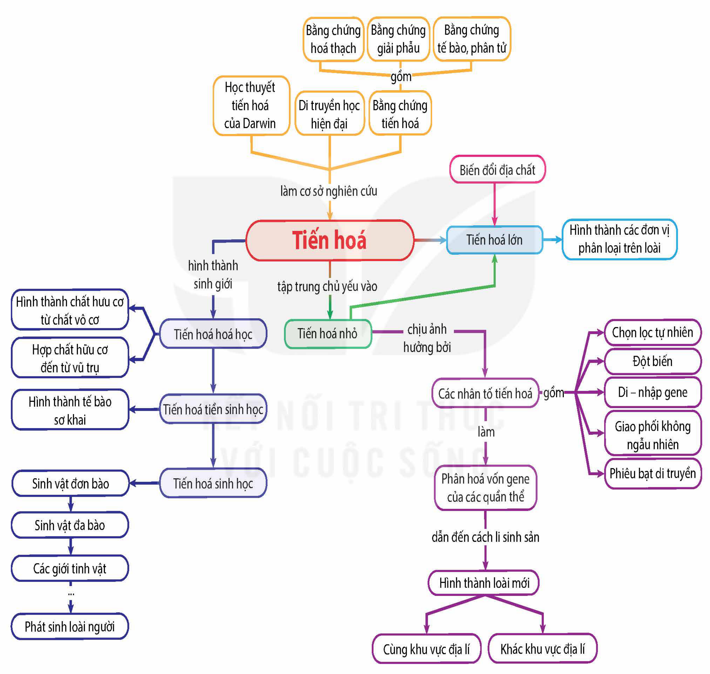

<!-- pdf:123 -->

# SƠ ĐỒ TÓM TẮT KIẾN THỨC CHƯƠNG 5

<!-- Dưới đây chép các nhánh của sơ đồ thành danh sách, giữ nguyên chữ trong các ô và trên các mũi tên (kể cả lỗi in "chất hưu cơ", "Các giới tinh vật"). -->

- Tiến hoá
  - làm cơ sở nghiên cứu: Học thuyết tiến hoá của Darwin; Di truyền học hiện đại; Bằng chứng tiến hoá
    - Bằng chứng tiến hoá — gồm: Bằng chứng hoá thạch; Bằng chứng giải phẫu; Bằng chứng tế bào, phân tử
  - hình thành sinh giới: Tiến hoá hoá học → Tiến hoá tiền sinh học → Tiến hoá sinh học
    - Tiến hoá hoá học: Hình thành chất hưu cơ từ chất vô cơ; Hợp chất hữu cơ đến từ vũ trụ
    - Tiến hoá tiền sinh học: Hình thành tế bào sơ khai
    - Tiến hoá sinh học: Sinh vật đơn bào → Sinh vật đa bào → Các giới tinh vật → … → Phát sinh loài người
  - Tiến hoá lớn
    - Biến đổi địa chất → Tiến hoá lớn
    - Tiến hoá lớn → Hình thành các đơn vị phân loại trên loài
  - tập trung chủ yếu vào: Tiến hoá nhỏ (→ Tiến hoá lớn)
    - chịu ảnh hưởng bởi: Các nhân tố tiến hoá
      - gồm: Chọn lọc tự nhiên; Đột biến; Di – nhập gene; Giao phối không ngẫu nhiên; Phiêu bạt di truyền
      - làm: Phân hoá vốn gene của các quần thể
        - dẫn đến cách li sinh sản: Hình thành loài mới
          - Cùng khu vực địa lí; Khác khu vực địa lí
<!-- ocr-ok: chữ trong các ô sơ đồ, OCR đọc không theo thứ tự; đã đối chiếu ảnh PDF 123 phóng to -->

## 📷 Danh sách hình trong bài

| Mã hình | Trang PDF | Vị trí | Chú thích gốc |
|---|---|---|---|
| H12-sinh-so-do-tom-tat-c05-01 | 123 | Cả trang | Sơ đồ tóm tắt kiến thức chương 5 |
