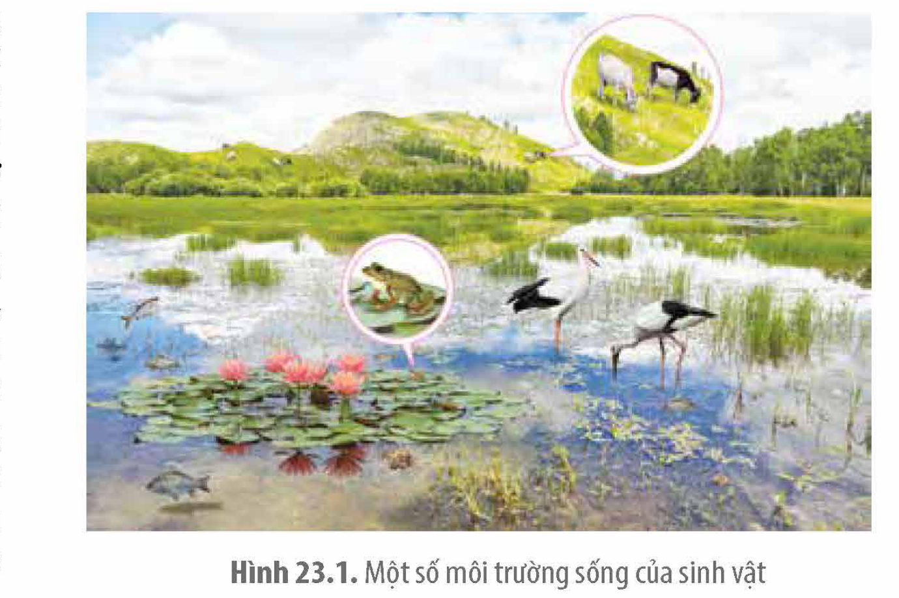
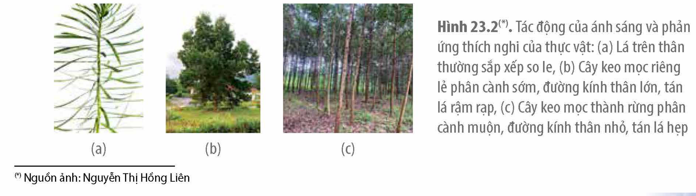
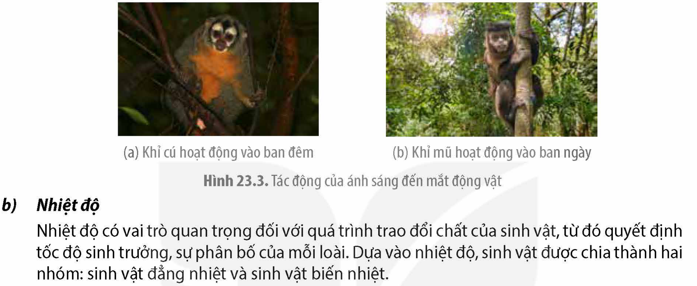
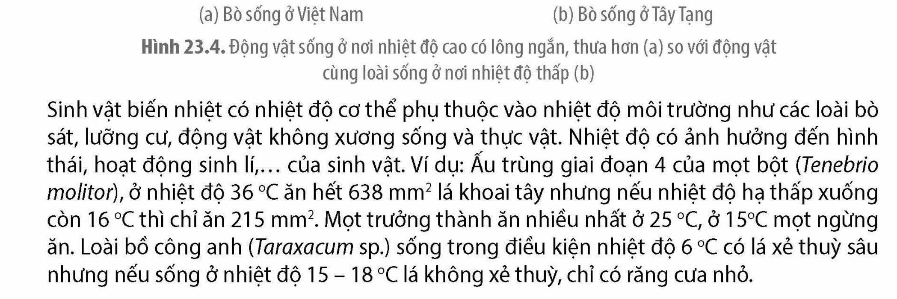
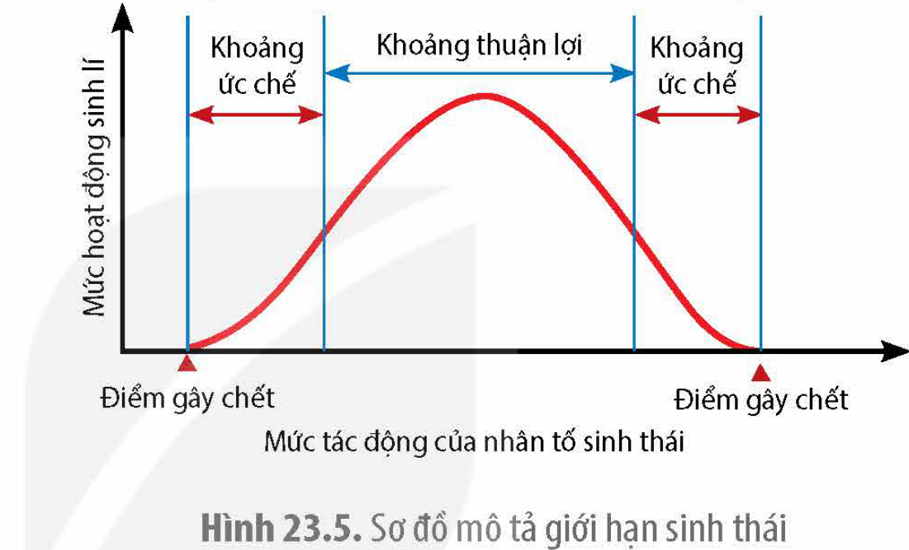

<!-- pdf:124 -->

# BÀI 23: MÔI TRƯỜNG VÀ CÁC NHÂN TỐ SINH THÁI

## 🎯 Yêu cầu cần đạt

- Phát biểu được khái niệm môi trường sống của sinh vật.
- Nêu được khái niệm nhân tố sinh thái. Phân biệt được các nhân tố sinh thái vô sinh và hữu sinh. Lấy được ví dụ về tác động của các nhân tố sinh thái lên đời sống sinh vật và thích nghi của sinh vật với các nhân tố đó. Phân tích được những hoạt động của sinh vật có thể tác động làm thay đổi môi trường sống của chúng.
- Trình bày được các quy luật về tác động của các nhân tố sinh thái lên đời sống sinh vật.
- Phát biểu được khái niệm nhịp sinh học; giải thích được nhịp sinh học chính là sự thích nghi của sinh vật với những thay đổi có tính chu kì của môi trường.
- Tìm hiểu được nhịp sinh học của chính cơ thể mình.

## 🔴 Mở đầu

Một người khoẻ mạnh bay từ đông bán cầu sang tây bán cầu, những ngày đầu tiên có thể bị mất ngủ ban đêm, buồn ngủ ban ngày. Nguyên nhân nào dẫn đến hiện tượng này?

## I. MÔI TRƯỜNG SỐNG CỦA SINH VẬT

<!-- term: Môi trường sống -->
Mỗi loài sinh vật thường sống trong môi trường nhất định. Ví dụ: thực vật thân gỗ, bò, trâu,… sống ở môi trường cạn; tôm, cá,… sống ở môi trường nước (H 23.1). Môi trường sống là tất cả những nhân tố xung quanh sinh vật, ảnh hưởng tới sự tồn tại, sinh trưởng, phát triển của sinh vật. Có thể hiểu, môi trường sống là nơi sinh vật thu nhận nguồn sống để tồn tại, sinh trưởng, phát triển và cũng là

Hình 23.1. Một số môi trường sống của sinh vật

<!-- pdf:125 -->

nơi chứa đựng chất thải của sinh vật. Sinh vật sống trong môi trường, chịu sự tác động của các yếu tố môi trường xung quanh như ánh sáng, nhiệt độ, vật săn mồi,… Điều kiện môi trường thuận lợi hay khắc nghiệt sẽ ảnh hưởng tích cực hoặc tiêu cực tới tốc độ sinh trưởng, sinh sản của sinh vật. Ngược lại, hoạt động của sinh vật có thể làm thay đổi tính chất của môi trường. Ví dụ: Hoạt động sống của giun đất làm đất tơi xốp, thúc đẩy hoạt động của sinh vật phân giải, qua đó làm giàu dinh dưỡng cho đất; Hoạt động gặm cỏ thường xuyên của động vật ăn cỏ như trâu, bò, ngựa,… ngăn cản sự phát triển chồi thân của thực vật hai lá mầm, tạo điều kiện hình thành nên các đồng cỏ rộng lớn, hạn chế sự phát triển của rừng,…

## ❓ Dừng lại và suy ngẫm

1. Loài chim ở Hình 23.1 sống ở môi trường cạn hay môi trường nước? Giải thích.
2. Phân tích một ví dụ về hoạt động sống của sinh vật làm thay đổi môi trường sống của chúng.

## II. CÁC NHÂN TỐ SINH THÁI

### 1. Khái niệm và phân loại nhân tố sinh thái

<!-- term: Nhân tố sinh thái -->
<!-- term: Nhân tố vô sinh -->
<!-- term: Nhân tố hữu sinh -->
Nhân tố môi trường có tác động trực tiếp hoặc gián tiếp đến đời sống của sinh vật gọi là nhân tố sinh thái. Nhân tố sinh thái được chia thành hai nhóm: nhân tố vô sinh và nhân tố hữu sinh.

Nhân tố vô sinh là tất cả các nhân tố vật lí và hoá học của môi trường tự nhiên tác động tới đời sống của sinh vật như khí hậu, thổ nhưỡng, nước,…

Nhân tố hữu sinh là các loài sinh vật sống trong cùng môi trường, tạo nên các mối quan hệ kí sinh, cộng sinh, hợp tác, vật ăn thịt – con mồi,… Trong nhóm nhân tố hữu sinh, nhân tố con người có ảnh hưởng lớn đến cả nhân tố vô sinh và hữu sinh.

### 2. Ảnh hưởng của một số nhân tố sinh thái đến sinh vật

Tất cả các nhân tố sinh thái đều là các tác nhân CLTN hình thành nên các đặc điểm thích nghi về hình thái, cấu tạo, sinh lí, tập tính,… của sinh vật, trong đó ánh sáng và nhiệt độ là những nhân tố ảnh hưởng rõ rệt.

**a) Ánh sáng**

Ánh sáng là nguồn năng lượng quan trọng Trái Đất nhận từ Mặt Trời. Sự phân bố không đồng đều của ánh sáng trên Trái Đất hình thành các đặc điểm thích nghi của mỗi nhóm sinh vật như thực vật ưa sáng hay ưa bóng; động vật hoạt động ngày hay hoạt động đêm…

Ánh sáng ảnh hưởng đến hình thái của thực vật. Các lá trên cây có xu hướng xếp so le, hạn chế sự che bóng lẫn nhau (H 23.2a). Cây mọc nơi quang đãng (H 23.2b), ít cạnh tranh ánh sáng có đường kính thân, tán lá lớn hơn so với cây mọc thành rừng (H 23.2c)

Hình 23.2.(\*) Tác động của ánh sáng và phản ứng thích nghi của thực vật: (a) Lá trên thân thường sắp xếp so le, (b) Cây keo mọc riêng lẻ phân cành sớm, đường kính thân lớn, tán lá rậm rạp, (c) Cây keo mọc thành rừng phân cành muộn, đường kính thân nhỏ, tán lá hẹp

> (\*) Nguồn ảnh: Nguyễn Thị Hồng Liên

<!-- pdf:126 -->

Ánh sáng giúp động vật định hướng trong không gian và nhận biết môi trường xung quanh. Cơ quan thị giác thu nhận các tia sáng phản xạ từ những vật xung quanh, cho phép động vật nhận biết được hình dạng, kích thước, màu sắc và khoảng cách của vật thể. Ánh sáng ảnh hưởng tới hình thái, cấu tạo, tập tính,… của nhiều loài động vật. Ví dụ: Nhiều loài chim di cư có khả năng định hướng đường bay theo ánh sáng mặt trời và các vì sao. Hai loài khỉ ở Hình 23.3 có cùng nguồn gốc, khỉ cú kiếm ăn ban đêm có mắt lớn hơn hẳn so với khỉ mũ hoạt động vào ban ngày.

Hình 23.3. Tác động của ánh sáng đến mắt động vật

**b) Nhiệt độ**

Nhiệt độ có vai trò quan trọng đối với quá trình trao đổi chất của sinh vật, từ đó quyết định tốc độ sinh trưởng, sự phân bố của mỗi loài. Dựa vào nhiệt độ, sinh vật được chia thành hai nhóm: sinh vật đẳng nhiệt và sinh vật biến nhiệt.

<!-- term: Sinh vật đẳng nhiệt -->
Sinh vật đẳng nhiệt như chim, thú có nhiệt độ cơ thể ổn định, không phụ thuộc vào nhiệt độ môi trường. Chúng có cơ chế điều hoà nhiệt độ cơ thể bằng các đặc điểm hình thái, cấu tạo, sinh lí, tập tính. Khi di chuyển từ vĩ độ thấp lên vĩ độ cao, kích thước của các sinh vật đẳng nhiệt cùng loài hoặc có quan hệ họ hàng gần gũi tăng dần nhưng kích thước những phần thò ra ngoài như tai, đuôi, chi có xu hướng giảm dần. Ví dụ: Động vật ở vùng ôn đới hay ở nơi có nhiệt độ thấp có lông dày và dài hơn so với động vật cùng loài sống ở vùng nhiệt đới (H 23.4). Sự tích luỹ lớp mỡ dày dưới da, lớp lông dài, kích thước cơ thể lớn làm giảm tỉ lệ diện tích bề mặt với thể tích cơ thể, đảm bảo cho sinh vật đẳng nhiệt tăng khả năng chống rét.

Hình 23.4. Động vật sống ở nơi nhiệt độ cao có lông ngắn, thưa hơn (a) so với động vật cùng loài sống ở nơi nhiệt độ thấp (b)

<!-- term: Sinh vật biến nhiệt -->
Sinh vật biến nhiệt có nhiệt độ cơ thể phụ thuộc vào nhiệt độ môi trường như các loài bò sát, lưỡng cư, động vật không xương sống và thực vật. Nhiệt độ có ảnh hưởng đến hình thái, hoạt động sinh lí,… của sinh vật. Ví dụ: Ấu trùng giai đoạn 4 của mọt bột (*Tenebrio molitor*), ở nhiệt độ 36 °C ăn hết 638 mm$^2$ lá khoai tây nhưng nếu nhiệt độ hạ thấp xuống còn 16 °C thì chỉ ăn 215 mm$^2$. Mọt trưởng thành ăn nhiều nhất ở 25 °C, ở 15 °C mọt ngừng ăn. Loài bồ công anh (*Taraxacum* sp.) sống trong điều kiện nhiệt độ 6 °C có lá xẻ thuỳ sâu nhưng nếu sống ở nhiệt độ 15 – 18 °C lá không xẻ thuỳ, chỉ có răng cưa nhỏ.

<!-- pdf:127 -->

## ❓ Dừng lại và suy ngẫm

1. Phân biệt các nhóm nhân tố sinh thái. Cho ví dụ.
2. Lá trên cành/thân xếp so le với nhau (H 23.2a) đem lại lợi ích gì cho thực vật?

## III. CÁC QUY LUẬT SINH THÁI
<!-- ocr-ok: OCR nhận dạng nhầm "CÁC" thành "GÁC" trên PDF 127 -->

Các nhân tố sinh thái của môi trường không tác động ngẫu nhiên lên sinh vật mà tuân theo một số quy luật chủ yếu dưới đây.

### 1. Quy luật giới hạn sinh thái

<!-- term: Giới hạn sinh thái -->
Khoảng giá trị xác định của một nhân tố sinh thái mà tại đó sinh vật có thể tồn tại và phát triển ổn định theo thời gian được gọi là giới hạn sinh thái. Giới hạn sinh thái bao gồm khoảng thuận lợi và khoảng ức chế (H 23.5). Mỗi sinh vật chỉ sinh trưởng, phát triển tốt trong khoảng thuận lợi, ngoài khoảng đó, hoạt động sinh lí của sinh vật bị ức chế, thậm chí sinh vật có thể bị chết nếu tác động vượt quá điểm gây chết. Ví dụ: Thực vật quang hợp tốt ở 20 – 30 °C; cây ngừng quang hợp và hô hấp ở nhiệt độ thấp hơn 0 °C hoặc cao hơn 40 °C(\*). Những loài có giới hạn rộng với nhiều nhân tố sinh thái thì có phạm vi phân bố rộng như chuột, ruồi, muỗi,… Những loài có giới hạn hẹp với nhiều nhân tố sinh thái thì vùng phân bố hẹp như thực vật sống dưới tán rừng, sinh vật chỉ sống ở ngoài khơi xa,…

Hình 23.5. Sơ đồ mô tả giới hạn sinh thái

### 2. Quy luật tác động tổng hợp của các nhân tố sinh thái

<!-- term: Quy luật tác động tổng hợp của các nhân tố sinh thái -->
Sinh vật sống không chịu tác động đơn lẻ của bất kì nhân tố sinh thái nào mà chịu tác động đồng thời của các nhân tố sinh thái. Một số nhân tố khi thay đổi có thể dẫn tới sự thay đổi của các nhân tố sinh thái khác và sinh vật chịu ảnh hưởng của các thay đổi đó. Ví dụ: Lượng mây thay đổi dẫn tới sự thay đổi của cường độ ánh sáng, từ đó ảnh tới nhiệt độ, độ ẩm và tất cả những thay đổi này tác động đồng thời lên sinh vật.

Nếu một nhân tố sinh thái không nằm trong khoảng thuận lợi có thể ảnh hưởng tiêu cực đến những nhân tố sinh thái khác. Ví dụ: Bón đủ lượng phân bón cho cây trồng nhưng nếu thiếu nước thì cây không hấp thụ được. Vì vậy, để đem lại hiệu quả kinh tế, người sản xuất cần chú ý điều chỉnh các nhân tố sinh thái trong môi trường về khoảng thuận lợi đối với vật nuôi, cây trồng.

### 3. Quy luật tác động không đồng đều của các nhân tố sinh thái

<!-- term: Quy luật tác động không đồng đều của các nhân tố sinh thái -->
Mỗi giai đoạn khác nhau trong chu trình sống của sinh vật có các yêu cầu sinh thái khác nhau đối với cùng một nhân tố sinh thái. Ví dụ: Loài tôm he (*Penaeus merguiensis*) ở giai đoạn trưởng thành, trứng và ấu trùng mới nở thích nghi với nồng độ muối cao

> (\*) Nguồn: Sinh thái học và bảo vệ môi trường, Mai Sỹ Tuấn và cộng sự, NXB Đại học Sư phạm 2022.

<!-- pdf:128 -->

(3,2 – 3,3%) nên giai đoạn này chúng sống ở biển khơi. Sang giai đoạn sau ấu trùng chúng thích nghi với nồng độ muối thấp hơn, chỉ 1,0 – 2,5% (nước lợ) nên chúng di chuyển vào bờ và sống trong rừng ngập mặn cho đến khi đạt kích thước trưởng thành mới di cư ra biển(\*). Con người vận dụng quy luật tác động không đồng đều để xây dựng kế hoạch nuôi trồng, khai thác, bảo vệ sinh vật nhằm đem lại hiệu quả kinh tế cao.

Trong cùng khoảng giá trị của một nhân tố sinh thái, có thể cực thuận đối với hoạt động này nhưng lại có hại cho hoạt động khác. Ví dụ: Ở vùng rừng ngập mặn, nguồn thức ăn trong môi trường phong phú nhưng hàm lượng muối thấp không thuận lợi cho hoạt động sinh lí của giai đoạn sau ấu trùng của tôm he.

## ❓ Dừng lại và suy ngẫm

1. Quan sát Hình 23.5 và cho biết mức hoạt động sinh lí cao nhất của sinh vật nằm trong khoảng tác động nào.
2. Quan sát trong tự nhiên và lấy ví dụ về quy luật tác động không đồng đều của các nhân tố sinh thái lên sinh vật.

## IV. NHỊP SINH HỌC

<!-- term: Nhịp sinh học -->
Nhịp sinh học là sự phản ứng một cách nhịp nhàng của sinh vật trước những thay đổi có tính chu kì của môi trường. Ví dụ: Hoa mười giờ thường nở vào khoảng 10 giờ sáng, gấu trắng Bắc Cực thường ngủ đông, chim và thú thường thay lông trước khi mùa đông tới,… Sự thay đổi có tính chu kì của các nhân tố sinh thái (đặc biệt là nhân tố ánh sáng) tác động tới cơ thể sinh vật và gây ra các phản ứng có tính chu kì tương ứng như hoạt động thức ngủ theo chu kì ngày đêm ở động vật; hoạt động rụng lá, nở hoa; hoạt động sinh dục, ngủ hè, ngủ đông theo mùa hay nhỏ hơn là theo chu kì tế bào, nhịp tim, nhịp hô hấp,… Ở người quá trình sinh lí của cơ thể có thể diễn ra theo nhịp ngày đêm như nhịp thân nhiệt, hô hấp, co bóp tim, bài tiết,… Ví dụ: Ở người trưởng thành khoẻ mạnh, nhịp tim ban ngày trung bình khoảng 60 – 80 nhịp/phút. Trong giai đoạn đầu của giấc ngủ (giấc ngủ nông), nhịp tim bắt đầu chậm lại. Trong giấc ngủ sâu (ngủ say) nhịp tim chậm nhất, khoảng 40 – 50 nhịp/phút. Hay cũng có loại nhịp sinh học diễn ra theo chu kì dài hơn như chu kì kinh nguyệt,… Nhịp sinh học ở người là cơ sở để xây dựng thời gian biểu nhằm nâng cao hiệu quả lao động và học tập.

Nhịp sinh học đảm bảo cho sinh vật thích ứng với những thay đổi có tính chu kì của môi trường. Những phản ứng mang tính chu kì này ở sinh vật được hình thành trong quá trình phát triển của mỗi loài, dưới tác dụng của chọn lọc tự nhiên mà tác nhân chọn lọc là sự thay đổi có tính chu kì của các nhân tố sinh thái trong môi trường. Vì vậy, nhịp sinh học là những đặc điểm thích nghi của loài với những thay đổi có tính chu kì của môi trường.

> (\*) Nguồn: Sinh thái học và bảo vệ môi trường, Mai Sỹ Tuấn và cộng sự, NXB Đại học Sư phạm 2022.

<!-- pdf:129 -->

## ❓ Dừng lại và suy ngẫm

1. Em hãy nêu thêm các ví dụ về nhịp sinh học ở động vật, thực vật và người.
2. Trong chăn nuôi, người nuôi gà thường thắp đèn sáng để kéo dài thời gian ăn của gà, giúp tăng tốc độ sinh trưởng. Hành động thắp đèn sáng có ảnh hưởng đến nhịp ngày đêm của gà không? Giải thích.

## 📌 Kiến thức cốt lõi

- Môi trường là toàn bộ các nhân tố ở xung quanh sinh vật. Những nhân tố môi trường có tác động trực tiếp hoặc gián tiếp lên đời sống của sinh vật gọi là nhân tố sinh thái.
- Các nhân tố sinh thái có ảnh hưởng đến sự hình thành các đặc điểm thích nghi, hình thái, cấu tạo sinh lí,… của sinh vật.
- Các nhân tố sinh thái tác động lên sinh vật tuân theo các quy luật sinh thái chủ yếu như quy luật giới hạn sinh thái, quy luật tác động tổng hợp, quy luật tác động không đồng đều của các nhân tố sinh thái,…
- Nhịp sinh học là sự phản ứng một cách nhịp nhàng của sinh vật trước những thay đổi có tính chu kì của môi trường bên ngoài cũng như bên trong cơ thể sinh vật.

## ✏️ Luyện tập và vận dụng

1. Một số loài thực vật rụng lá như bàng (*Terminalia catappa*), xoan (*Melia azedarach*) trong mùa đông lạnh. Điều này có ý nghĩa gì đối với đời sống của chúng?
2. Mùa đông, người chăn nuôi gia súc thường che kín chuồng, ngăn gió lùa; mùa hè, chuồng nuôi được thông gió, phun nước trên mái. Em hãy vận dụng kiến thức về quy luật sinh thái để giải thích ý nghĩa của những việc làm này.
3. Theo nhiều nghiên cứu khoa học, nhịp sinh học kiểm soát giấc ngủ của con người nhạy cảm nhất vào khoảng thời gian 2 giờ trước khi đi ngủ(\*).

a) Hãy giải thích vì sao sử dụng điện thoại trước giờ đi ngủ lại gây khó ngủ, thậm chí mất ngủ?

b) Mỗi người nên làm gì để duy trì nhịp sinh học ổn định cho giấc ngủ?

4. Khi nghiên cứu sự phân bố của muỗi vằn gây bệnh sốt xuất huyết, người ta thấy chúng phân bố từ vùng vĩ độ cao cho tới vĩ độ thấp. Em có nhận xét gì về giới hạn nhiệt độ của loài này?

> (\*) Nguồn: Ánh sáng xanh và chất lượng giấc ngủ (trang 226 – 235), Đinh Thị Quỳnh An và cộng sự, Tạp chí Nghiên cứu y học, số 128, 2020.

## 📷 Danh sách hình trong bài

| Mã hình | Trang PDF | Vị trí | Chú thích gốc |
|---|---|---|---|
| H12-sinh-b23-01 | 124 | Mục I | Hình 23.1. Một số môi trường sống của sinh vật |
| H12-sinh-b23-02 | 125 | Mục II.2.a | Hình 23.2.(\*) Tác động của ánh sáng và phản ứng thích nghi của thực vật: (a) Lá trên thân thường sắp xếp so le, (b) Cây keo mọc riêng lẻ phân cành sớm, đường kính thân lớn, tán lá rậm rạp, (c) Cây keo mọc thành rừng phân cành muộn, đường kính thân nhỏ, tán lá hẹp — (\*) Nguồn ảnh: Nguyễn Thị Hồng Liên |
| H12-sinh-b23-03 | 126 | Mục II.2.a | Hình 23.3. Tác động của ánh sáng đến mắt động vật |
| H12-sinh-b23-04 | 126 | Mục II.2.b | Hình 23.4. Động vật sống ở nơi nhiệt độ cao có lông ngắn, thưa hơn (a) so với động vật cùng loài sống ở nơi nhiệt độ thấp (b) |
| H12-sinh-b23-05 | 127 | Mục III.1 | Hình 23.5. Sơ đồ mô tả giới hạn sinh thái |
