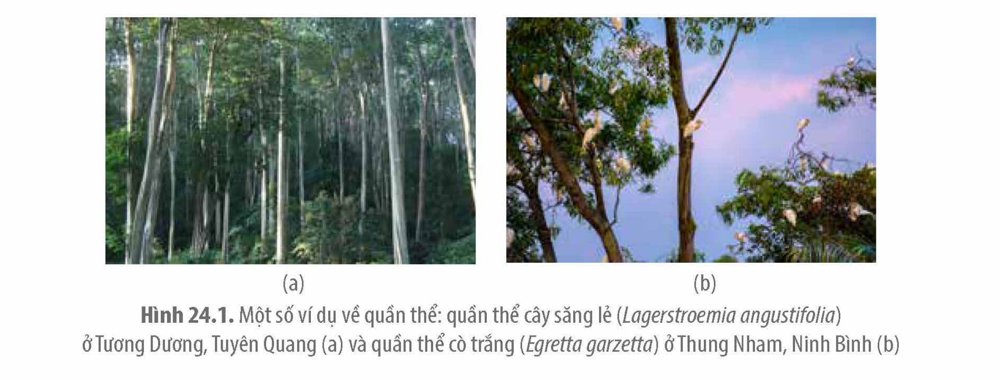
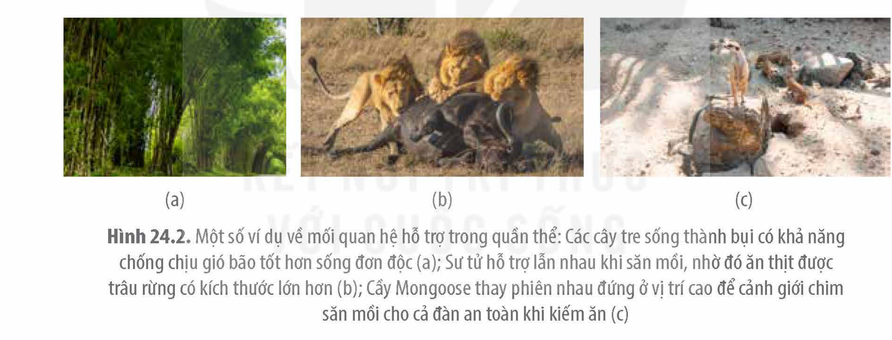
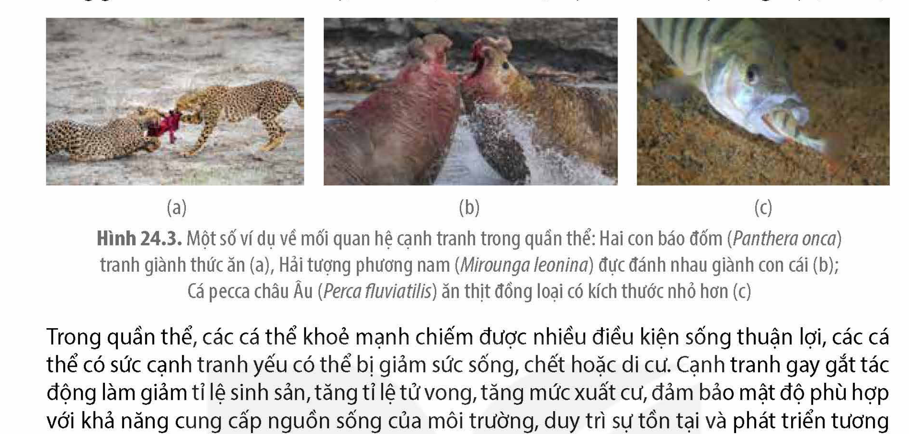
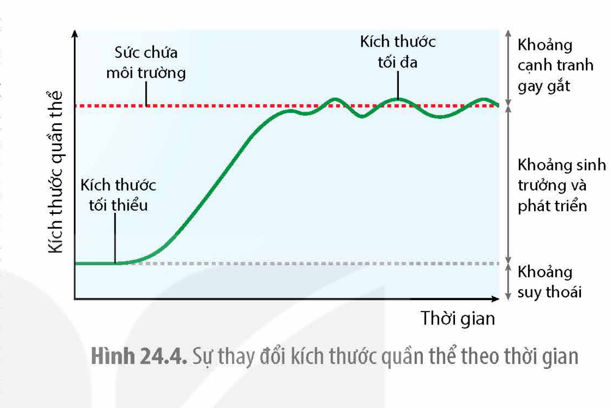
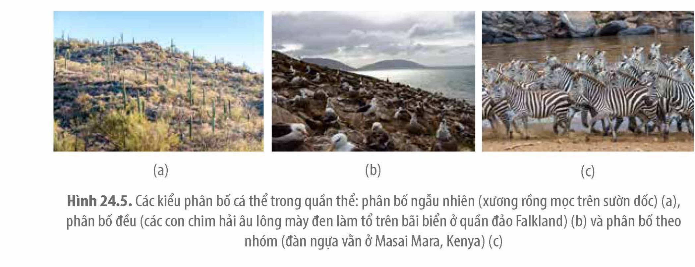
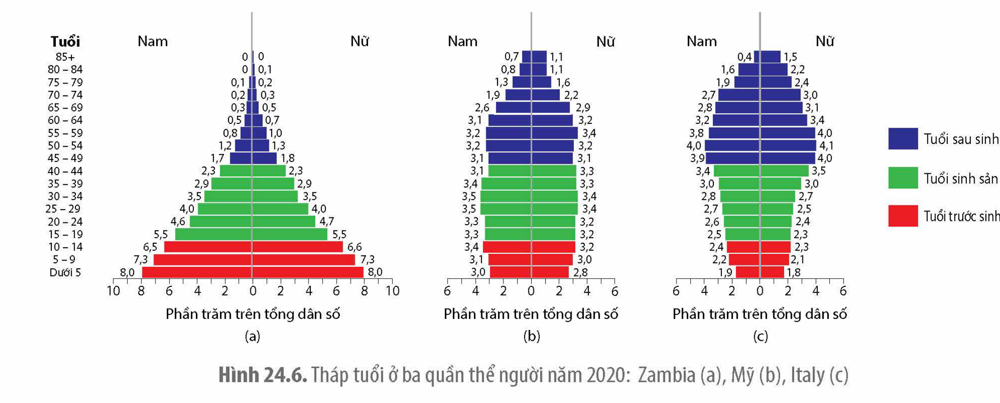
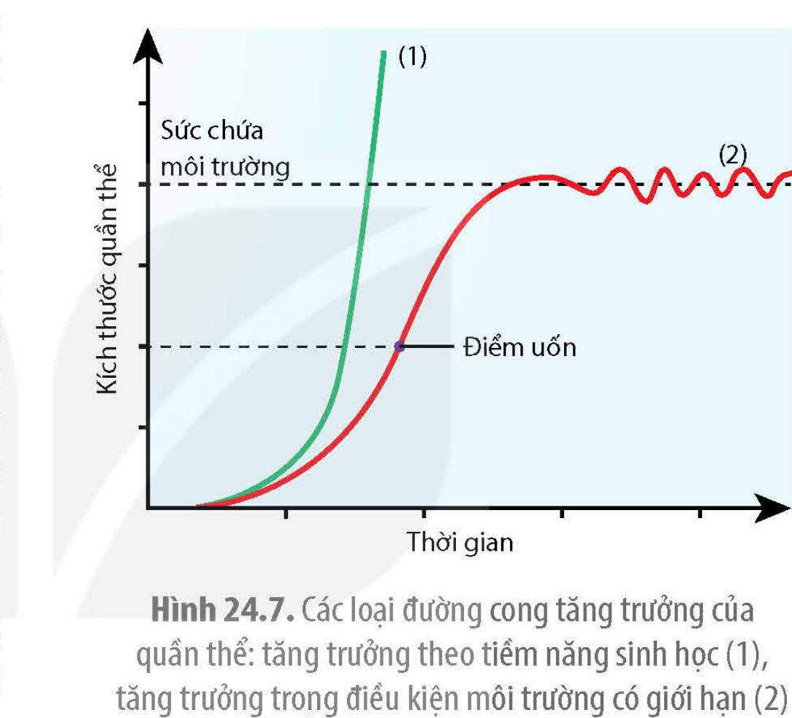
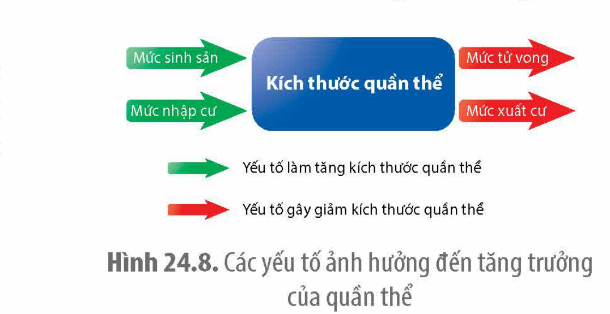
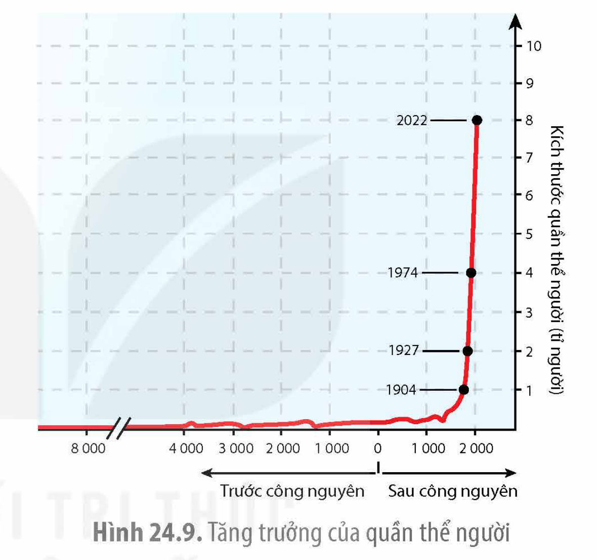
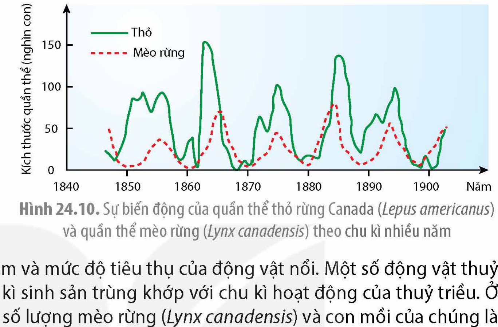

<!-- pdf:130 -->

# BÀI 24: SINH THÁI HỌC QUẦN THỂ

## 🎯 Yêu cầu cần đạt

- Phát biểu được khái niệm quần thể sinh vật. Lấy được ví dụ minh hoạ.
- Giải thích được quần thể là một cấp độ tổ chức sống.
- Phân tích được các mối quan hệ hỗ trợ và cạnh tranh trong quần thể. Lấy được ví dụ minh hoạ.
- Trình bày được các đặc trưng cơ bản của quần thể sinh vật. Lấy được ví dụ chứng minh sự ổn định của quần thể phụ thuộc vào sự ổn định của các đặc trưng đó. Giải thích được cơ chế điều hoà mật độ của quần thể.
- Phân biệt được các kiểu tăng trưởng của quần thể sinh vật (tăng trưởng theo tiềm năng sinh học và tăng trưởng trong môi trường có nguồn sống bị giới hạn). Nêu được các yếu tố ảnh hưởng tới tăng trưởng quần thể.
- Nêu được các đặc điểm tăng trưởng của quần thể người; phân tích được hậu quả của tăng trưởng dân số quá nhanh.
- Trình bày được các kiểu biến động số lượng cá thể của quần thể.
- Phân tích được các ứng dụng hiểu biết về quần thể trong thực tiễn (trồng trọt, chăn nuôi, bảo tồn,...).

Các cá thể sư tử (*Panthera leo*) sống trong một đàn có ưu thế và bất lợi gì so với cá thể sống đơn lẻ?

## I. KHÁI NIỆM QUẦN THỂ VÀ MỐI QUAN HỆ GIỮA CÁC CÁ THỂ TRONG QUẦN THỂ

### 1. Khái niệm quần thể

<!-- term: Quần thể sinh vật -->
<!-- term: Quần thể -->
Quần thể là tập hợp các cá thể cùng loài, cùng sinh sống trong một khoảng không gian và thời gian xác định, có khả năng sinh sản (hữu tính hoặc vô tính) tạo ra những thế hệ mới có thể sinh sản được (H 24.1).

Hình 24.1. Một số ví dụ về quần thể: quần thể cây săng lẻ (*Lagerstroemia angustifolia*) ở Tương Dương, Tuyên Quang (a) và quần thể cò trắng (*Egretta garzetta*) ở Thung Nham, Ninh Bình (b)

<!-- pdf:131 -->

Quần thể là một hệ thống mở, trong đó các cá thể thường xuyên trao đổi vật chất và năng lượng với môi trường nhằm đảm bảo cho sự sinh trưởng, phát triển và sinh sản, qua đó duy trì sự tồn tại và phát triển của cả quần thể. Giữa các cá thể trong quần thể có mối quan hệ chặt chẽ với nhau và cùng với các điều kiện ngoại cảnh hình thành một cấu trúc hoàn chỉnh.

Các quần thể trong tự nhiên thường có xu hướng phát tán cá thể. Khi một nhóm cá thể phát tán đến một khu vực địa lí mới, những cá thể không thích nghi sẽ bị đào thải, những cá thể thích nghi sẽ sinh trưởng, phát triển, sinh sản, dần hình thành quần thể mới ở khu vực đó.

### 2. Mối quan hệ giữa các cá thể trong quần thể

Giữa các cá thể trong quần thể có hai mối quan hệ là quan hệ hỗ trợ và quan hệ cạnh tranh.

**a) Quan hệ hỗ trợ**

<!-- term: Quan hệ hỗ trợ -->
Trong tự nhiên, ngoại trừ một số loài động vật sống đơn độc, thường chỉ gặp đồng loại khi sinh sản như báo tuyết, gấu Bắc Cực,... đa số các loài khác sống tập trung thành nhóm. Khi sống thành nhóm, các cá thể hỗ trợ lẫn nhau trong tìm kiếm thức ăn, tự vệ... (H 24.2) dẫn đến mỗi cá thể trong nhóm có nhiều thuận lợi hơn so với một cá thể sống đơn lẻ, hiện tượng này được gọi là hiệu quả nhóm.

Hình 24.2. Một số ví dụ về mối quan hệ hỗ trợ trong quần thể: Các cây tre sống thành bụi có khả năng chống chịu gió bão tốt hơn sống đơn độc (a); Sư tử hỗ trợ lẫn nhau khi săn mồi, nhờ đó ăn thịt được trâu rừng có kích thước lớn hơn (b); Cầy Mongoose thay phiên nhau đứng ở vị trí cao để cảnh giới chim săn mồi cho cả đàn an toàn khi kiếm ăn (c)

Quan hệ hỗ trợ đảm bảo cho quần thể khai thác tối ưu nguồn sống, tăng hiệu quả sinh sản và hạn chế tác động bất lợi của môi trường, kết quả làm tăng số lượng cá thể của quần thể.

**b) Quan hệ cạnh tranh**

<!-- term: Quan hệ cạnh tranh -->
Nguồn sống của môi trường là có giới hạn, nếu số lượng cá thể của quần thể vượt quá khả năng cung cấp của môi trường thì cạnh tranh giữa các cá thể trở nên gay gắt.

Ở thực vật, các cá thể cạnh tranh ánh sáng, nước và dinh dưỡng khoáng. Các cây sinh trưởng mạnh có thể gây thiếu hụt nguồn sống cho những cây sinh trưởng yếu mọc gần chúng. Khi mật độ tăng cao, cạnh tranh gay gắt là nguyên nhân chính gây chết một số cá thể, hiện tượng này được gọi là tỉa thưa tự nhiên ở thực vật.

Ở động vật, các cá thể cạnh tranh thức ăn, nơi ở và cạnh tranh sinh sản. Khi mật độ tăng cao, nguồn sống cung cấp cho mỗi cá thể bị suy giảm, các cá thể tốn nhiều năng lượng hơn để giành giật thức ăn dẫn đến khả năng sinh trưởng và sinh sản bị suy giảm (giảm số con trên

<!-- pdf:132 -->

một lứa đẻ, sức sống của con non thấp,...). Cạnh tranh gay gắt có thể tăng hành vi hung hăng giữa các cá thể như đe doạ, xua đuổi, đánh nhau, thậm chí là ăn thịt đồng loại (H 24.3).

Hình 24.3. Một số ví dụ về mối quan hệ cạnh tranh trong quần thể: Hai con báo đốm (*Panthera onca*) tranh giành thức ăn (a); Hải tượng phương nam (*Mirounga leonina*) đực đánh nhau giành con cái (b); Cá pecca châu Âu (*Perca fluviatilis*) ăn thịt đồng loại có kích thước nhỏ hơn (c)

Trong quần thể, các cá thể khoẻ mạnh chiếm được nhiều điều kiện sống thuận lợi, các cá thể có sức cạnh tranh yếu có thể bị giảm sức sống, chết hoặc di cư. Cạnh tranh gay gắt tác động làm giảm tỉ lệ sinh sản, tăng tỉ lệ tử vong, tăng mức xuất cư, đảm bảo mật độ phù hợp với khả năng cung cấp nguồn sống của môi trường, duy trì sự tồn tại và phát triển tương đối ổn định của quần thể.

Cạnh tranh gay gắt phân hoá sức sống của các cá thể trong quần thể, đào thải những cá thể kém thích nghi và tăng số lượng cá thể mang đặc điểm thích nghi trong quần thể.

## ❓ Dừng lại và suy ngẫm

1. Hãy lấy một số ví dụ về các mối quan hệ hỗ trợ và quan hệ cạnh tranh ở động vật, thực vật.
2. Tại sao cạnh tranh gay gắt giữa các cá thể trong quần thể không dẫn đến sự suy vong của quần thể?

## II. CÁC ĐẶC TRƯNG CƠ BẢN CỦA QUẦN THỂ

Các đặc trưng cơ bản của quần thể là những tiêu chí quan trọng để nghiên cứu và so sánh các quần thể. Các đặc trưng này thay đổi phụ thuộc vào thuộc tính loài và đặc điểm môi trường của khu vực phân bố.

### 1. Mật độ cá thể

<!-- term: Mật độ cá thể -->
Mật độ cá thể của quần thể là số lượng cá thể trên một đơn vị diện tích hoặc thể tích. Mật độ cá thể biểu thị mức độ khai thác nguồn sống của quần thể.

Khi mật độ thấp, nguồn sống dồi dào, tỉ lệ sinh sản lớn hơn tỉ lệ tử vong, kết quả làm tăng mật độ quần thể. Ngược lại, khi mật độ cao, các cá thể sẽ cạnh tranh gay gắt để giành nguồn sống. Mức tăng mật độ tương quan thuận với mức tăng ô nhiễm môi trường, tăng số lượng kẻ thù, tăng dịch bệnh, tăng cạnh tranh dẫn đến tỉ lệ tử vong lớn hơn tỉ lệ sinh sản, tăng xuất cư, kết quả làm giảm mật độ quần thể.

Ví dụ: Ở cá tầm biển (*Brachyistius frenatus*), khi mật độ cá thể tăng lên quá cao, chỗ ẩn nấp an toàn không đủ cho mọi cá thể dẫn đến tỉ lệ tử vong tăng lên do tác động của vật săn mồi.

<!-- pdf:133 -->

### 2. Kích thước quần thể

<!-- term: Kích thước quần thể -->
Kích thước quần thể là số lượng cá thể (hoặc sinh khối hoặc năng lượng) có trong khu vực phân bố của quần thể.

Quần thể thường phát triển ổn định trong khoảng giữa kích thước tối đa và kích thước tối thiểu. Kích thước tối đa của quần thể là số lượng cá thể lớn nhất mà quần thể đạt được phù hợp với sức chứa của môi trường. Khi kích thước quần thể lớn hơn sức chứa của môi trường, cạnh tranh gay gắt xảy ra dẫn đến giảm kích thước quần thể (H 24.4). Kích thước tối thiểu của quần thể là số lượng cá thể ít nhất để quần thể đó tồn tại và phát triển. Nếu kích thước quần thể nhỏ hơn kích thước tối thiểu thì quần thể có nguy cơ bị suy vong do giảm hiệu quả sinh sản, tăng giao phối cận huyết và giảm hỗ trợ giữa các cá thể.

Hình 24.4. Sự thay đổi kích thước quần thể theo thời gian

Kích thước quần thể thể hiện mức độ ổn định và tiềm năng phát triển của quần thể. Dựa vào kích thước quần thể, con người có thể đưa ra phương án bảo tồn, phát triển và khai thác tài nguyên sinh vật một cách hợp lí. Các chương trình bảo tồn loài voọc Chà vá chân nâu (*Pygathrix nemaeus*) ở bán đảo Sơn Trà, Đà Nẵng đã giúp khôi phục số lượng loài này từ 180 – 200 cá thể lên đến hơn 1 300 cá thể tương ứng với 237 đàn(\*).

> (\*) Nguồn: Đinh Thị Phương Anh và cộng sự 2010 – Green Việt 2017.

### 3. Kiểu phân bố

<!-- term: Kiểu phân bố -->
Kiểu phân bố là kiểu bố trí các cá thể (vị trí tương đối giữa các cá thể) trong khoảng không gian sống của quần thể.

Kiểu phân bố biểu thị đặc điểm phân bố nguồn sống của môi trường, mức độ khai thác nguồn sống và sự tương tác giữa các cá thể trong quần thể. Trong tự nhiên có ba kiểu phân bố cá thể trong quần thể chính là phân bố theo nhóm, phân bố đều và phân bố ngẫu nhiên.

Hình 24.5. Các kiểu phân bố cá thể trong quần thể: phân bố ngẫu nhiên (xương rồng mọc trên sườn dốc) (a), phân bố đều (các con chim hải âu lông mày đen làm tổ trên bãi biển ở quần đảo Falkland) (b) và phân bố theo nhóm (đàn ngựa vằn ở Masai Mara, Kenya) (c)

<!-- pdf:134 -->

Phân bố ngẫu nhiên là kiểu phân bố mà mỗi cá thể có thể sống ở vị trí bất kì trong khu vực phân bố của quần thể. Phân bố ngẫu nhiên xảy ra khi điều kiện sống của môi trường phân bố đồng đều và không có sự tương tác rõ rệt giữa các cá thể trong cùng quần thể. Ví dụ: Xương rồng (*Carnegiea gigantea*) mọc ngẫu nhiên ở sườn dốc (H 24.5a).

Phân bố đều là kiểu phân bố mà các cá thể bố trí cách đều nhau trong toàn bộ khu vực phân bố của quần thể. Kiểu phân bố này thường gặp ở môi trường có nguồn sống phân bố tương đối đồng đều, mật độ cá thể cao, các cá thể cạnh tranh gay gắt. Phân bố đều làm giảm sự cạnh tranh giữa các cá thể. Ví dụ: Đàn chim hải âu lông mày đen (*Thalassarche melanophris*) ở quần đảo Falkland làm tổ cách đều nhau trong mùa sinh sản (H 24.5b).

Phân bố theo nhóm là kiểu phân bố mà các cá thể tập trung thành từng nhóm ở những khu vực có điều kiện sống thuận lợi nhất. Phân bố theo nhóm thường gặp ở nơi có điều kiện sống không đồng đều, các cá thể trong nhóm hỗ trợ nhau cùng khai thác nguồn sống và chống lại các điều kiện bất lợi từ môi trường. Ví dụ: Đàn ngựa vằn (*Equus quagga*) thường phân bố ở nơi có nhiều thức ăn (H 24.5c).

### 4. Tỉ lệ giới tính

<!-- term: Tỉ lệ giới tính -->
Tỉ lệ giới tính là tỉ lệ đực : cái của quần thể. Trong tự nhiên, tỉ lệ giới tính thường xấp xỉ 1 : 1, tuy nhiên, tỉ lệ giới tính có thể thay đổi phụ thuộc vào đặc điểm của từng loài, môi trường (nhiệt độ, dinh dưỡng,...) và giai đoạn phát triển. Ví dụ: Ngỗng và vịt trưởng thành thường có tỉ lệ đực : cái là 40 : 60; Nai sừng tấm Á – Âu (*Alces alces*) có tỉ lệ đực : cái sơ sinh khoảng 53 : 47 và khi trưởng thành là 23 : 77; Nhiệt độ ấp trứng ảnh hưởng tới tỉ lệ giới tính của cá sấu Mỹ (*Alligator mississippiensis*), trên 34 °C trứng nở ra toàn con đực và dưới 30 °C trứng nở ra toàn con cái.

Đối với loài sinh sản hữu tính, tỉ lệ giới tính biểu thị tiềm năng sinh sản của quần thể.

### 5. Nhóm tuổi

<!-- term: Nhóm tuổi -->
Tuổi là đơn vị đo thời gian sống của cá thể sinh vật. Đặc trưng nhóm tuổi được áp dụng cho các loài có thời gian sống nhiều năm. Nếu lấy tiêu chí tuổi liên quan đến quá trình sinh sản thì quần thể được chia thành ba nhóm tuổi: tuổi trước sinh sản, tuổi sinh sản và tuổi sau sinh sản. Dựa vào tương quan của ba nhóm tuổi này có thể dự đoán được xu hướng tăng trưởng của quần thể trong tương lai (H 24.6).

Hình 24.6. Tháp tuổi ở ba quần thể người năm 2020: Zambia (a), Mỹ (b), Italy (c)

<!-- pdf:135 -->

## ❓ Dừng lại và suy ngẫm

1. Tại sao có thể dựa vào kích thước quần thể để đánh giá mức độ ổn định và tiềm năng phát triển của quần thể?
2. Quan sát Hình 24.6, dựa vào cấu trúc tuổi của mỗi quần thể để dự đoán xu hướng tăng trưởng trong tương lai của quần thể đó.

## III. TĂNG TRƯỞNG CỦA QUẦN THỂ SINH VẬT

### 1. Các kiểu tăng trưởng của quần thể sinh vật

<!-- term: Tăng trưởng của quần thể -->
Tăng trưởng của quần thể là sự gia tăng về kích thước của quần thể qua các thế hệ.

Trong điều kiện lí tưởng (lí thuyết), nguồn sống vô hạn và các nhân tố vô sinh luôn đạt cực thuận thì tăng trưởng của quần thể đạt cực đại, kích thước quần thể qua mỗi thế hệ tăng không ngừng theo cấp số mũ. Kiểu tăng trưởng này gọi là tăng trưởng theo tiềm năng sinh học và đường cong tăng trưởng có hình chữ J (H 24.7).

Trong tự nhiên, khi kích thước quần thể nhỏ, điều kiện sống thuận lợi, quần thể có thể tăng trưởng gần với cấp số mũ như quần thể bồ công anh mọc ở bãi bồi ven sông, các quần thể thỏ ở châu Úc nửa đầu thế kỉ XX. Do trong môi trường thực tế có nguồn sống giới hạn, nhân tố vô sinh có thể biến đổi bất lợi nên kiểu tăng trưởng gần giống cấp số mũ chỉ diễn ra trong một khoảng thời gian đầu. Khi kích thước quần thể tăng đến một mức nhất định (điểm uốn) thì tăng trưởng dần chậm lại, kích thước quần thể càng lớn thì tăng trưởng càng chậm. Kích thước quần thể thực tế chỉ tăng đến một giới hạn nhất định và dao động quanh ngưỡng sức chứa của môi trường. Kiểu tăng trưởng này gọi là tăng trưởng trong điều kiện môi trường có giới hạn và đường cong tăng trưởng có hình chữ S (H 24.7).

Hình 24.7. Các loại đường cong tăng trưởng của quần thể: tăng trưởng theo tiềm năng sinh học (1), tăng trưởng trong điều kiện môi trường có giới hạn (2)

### 2. Các yếu tố ảnh hưởng tới tăng trưởng quần thể

Sự tăng trưởng của quần thể phụ thuộc vào mức sinh sản, mức tử vong, mức nhập cư và mức xuất cư (H 24.8).

<!-- term: Mức sinh sản -->
Mức sinh sản là số lượng cá thể được sinh ra trên một đơn vị thời gian. Mức tử vong là số cá thể bị chết (vì già hoặc vì nguyên nhân sinh thái) trên một đơn vị thời gian. Hiệu số giữa mức sinh sản và mức tử vong có tác động rõ rệt đến mức tăng trưởng của quần thể.

Hình 24.8. Các yếu tố ảnh hưởng đến tăng trưởng của quần thể

<!-- pdf:136 -->

<!-- term: Mức xuất cư -->
<!-- term: Mức nhập cư -->
Mức xuất cư là số lượng cá thể rời khỏi quần thể trên một đơn vị thời gian. Mức nhập cư là số lượng cá thể tăng lên trên một đơn vị thời gian do sự di chuyển của cá thể từ quần thể khác tới.

Trong điều kiện môi trường thuận lợi, nguồn sống dồi dào, các cá thể trong quần thể sinh trưởng, phát triển, tăng mức sinh sản, giảm mức tử vong, giảm mức xuất cư và có khả năng chứa thêm các cá thể nhập cư, kết quả làm tăng kích thước quần thể. Ngược lại, nếu điều kiện môi trường bất lợi, mật độ cá thể quá cao so với khả năng cung cấp nguồn sống thì cạnh tranh gay gắt dẫn đến giảm mức sinh sản, tăng mức tử vong, tăng mức xuất cư, kết quả làm giảm kích thước quần thể.

### 3. Tăng trưởng của quần thể người

Từ khi hình thành cho đến nửa đầu thế kỉ XVII, loài người (*Homo sapiens*) có quy mô dân số nhỏ và tốc độ tăng dân số chậm. Từ thế kỉ XVIII trở đi, với sự phát triển vượt bậc về y học, khoa học và công nghệ, con người khai thác được nhiều nguồn tài nguyên và thích nghi tốt hơn với môi trường dẫn đến tăng nhanh kích thước quần thể. Dân số loài người tăng gấp đôi từ 1 tỉ lên 2 tỉ trong khoảng 123 năm và từ 2 tỉ tăng gấp 4 lần thành 8 tỉ trong khoảng 95 năm (H 24.9). Tỉ lệ tăng dân số loài người liên tục tăng trong một khoảng thời gian, đạt đỉnh khoảng 2,2% trong thập niên 1960, sau đó giảm dần. Dự báo đến năm 2050, tỉ lệ tăng dân số khoảng 0,5%, khi đó dân số toàn cầu ước đạt 9,8 tỉ người.

Hình 24.9. Tăng trưởng của quần thể người

Sự gia tăng dân số nhanh chóng trong khoảng 1 000 năm trở lại đây dẫn đến quy mô dân số ngày càng lớn và mật độ ngày càng cao. Dân số tăng cao kéo theo nhu cầu về thức ăn, nơi ở, nguyên liệu, nhiên liệu, đất canh tác nông nghiệp,... ngày càng lớn, dẫn đến hệ quả là việc khai thác quá mức các nguồn tài nguyên như rừng, khoáng sản, đất đai, nguồn nước,... và gia tăng ô nhiễm môi trường. Mật độ dân số quá cao cũng là nguyên nhân gây suy giảm chất lượng môi trường sống, tạo điều kiện lây lan nhiều loại dịch bệnh. Do đó, kiểm soát mức gia tăng dân số là nội dung quan trọng trong chiến lược phát triển bền vững của tất cả các quốc gia trên toàn thế giới.

## ❓ Dừng lại và suy ngẫm

1. Phân biệt kiểu tăng trưởng theo tiềm năng sinh học và kiểu tăng trưởng trong môi trường có nguồn sống bị giới hạn.
2. Giải thích tại sao trước thế kỉ XVII, tốc độ tăng dân số của loài người diễn ra chậm.

<!-- pdf:137 -->

## IV. CÁC KIỂU BIẾN ĐỘNG SỐ LƯỢNG CÁ THỂ CỦA QUẦN THỂ

Biến động số lượng cá thể là sự thay đổi số lượng cá thể của quần thể dưới tác động của môi trường. Có hai kiểu biến động là biến động theo chu kì và biến động không theo chu kì.

### 1. Biến động theo chu kì

<!-- term: Biến động theo chu kì -->
Biến động theo chu kì là sự thay đổi số lượng cá thể theo chu kì, tương ứng với những biến đổi có tính chu kì của môi trường. Ví dụ: Các loài thực vật nổi (vi khuẩn lam, tảo,...) tăng số lượng vào ban ngày, giảm vào ban đêm tương ứng với chu kì chiếu sáng ngày đêm và mức độ tiêu thụ của động vật nổi. Một số động vật thuỷ sinh (tôm, cua, cá) có chu kì sinh sản trùng khớp với chu kì hoạt động của thuỷ triều. Ở rừng nguyên sinh Bắc Mỹ, số lượng mèo rừng (*Lynx canadensis*) và con mồi của chúng là thỏ rừng Canada (*Lepus americanus*) cùng biến động theo chu kì 9 – 10 năm (H 24.10). Ở Việt Nam, một số loài động vật biến nhiệt như muỗi, ếch, nhái,... phát triển mạnh vào mùa mưa và suy giảm số lượng vào mùa khô.

### 2. Biến động không theo chu kì

<!-- term: Biến động không theo chu kì -->
Biến động không theo chu kì là sự thay đổi đột ngột số lượng cá thể trong quần thể do các yếu tố ngẫu nhiên của môi trường như cháy rừng, bão, dịch bệnh,... hoặc do tác động của con người (khai thác khoáng sản, xả thải, xây dựng,...). Ví dụ: Cháy rừng ở Tây Nam Bộ và cháy rừng ở Vườn Quốc gia U Minh Thượng, Kiên Giang năm 2002 đã thiêu rụi hàng nghìn ha rừng, gây suy giảm số lượng cá thể của nhiều quần thể động, thực vật.

Hình 24.10. Sự biến động của quần thể thỏ rừng Canada (*Lepus americanus*) và quần thể mèo rừng (*Lynx canadensis*) theo chu kì nhiều năm

## ❓ Dừng lại và suy ngẫm

1. Hãy lấy một số ví dụ về hoạt động khai thác tài nguyên của con người gây ra sự biến động đột ngột số lượng cá thể của quần thể sinh vật.
2. Giải thích tại sao ở Việt Nam, ếch, nhái phát triển mạnh về mùa mưa và suy giảm số lượng vào mùa khô.

## V. ỨNG DỤNG CÁC HIỂU BIẾT VỀ QUẦN THỂ TRONG THỰC TIỄN

### 1. Trong nông nghiệp

Trong trồng trọt, canh tác với mật độ hợp lí giúp cây trồng có đủ điều kiện để sinh trưởng tốt nhất; hạn chế cạnh tranh; thuận tiện cho chăm sóc, thu hoạch và phòng trừ sâu bệnh giúp nâng cao năng suất, phẩm chất nông sản. Ví dụ: Mật độ cấy tối ưu của giống lúa thuần VNR20 ở Bắc Trung Bộ trong vụ Xuân (tháng 1) là 45 – 50 khóm/m$^2$ với 2 – 3 cây/khóm; mật độ trồng thanh long khoảng 900 – 1 100 trụ/ha với cây cách cây 3 – 3,5 m, hàng cách hàng 3 – 3,5 m.

<!-- pdf:138 -->

Trong chăn nuôi và thuỷ sản, tuỳ từng giai đoạn phát triển để xác định mật độ cá thể, thiết kế chuồng trại và chuẩn bị ao nuôi phù hợp. Mật độ cá thể quá cao là nguyên nhân gây ô nhiễm môi trường, tăng stress cho vật nuôi dẫn đến giảm hiệu quả chuyển hoá thức ăn, tăng nguy cơ mắc bệnh. Ví dụ: Ao nuôi cá tra cần có diện tích từ 500 m$^2$ trở lên, độ sâu nước 1,5 – 2 m, mật độ cá giống 15 – 20 con/m$^2$; Tôm thẻ chân trắng khi nuôi với mật độ quá cao làm tăng nguy cơ mắc bệnh đốm đen, bệnh đốm trắng.

Ngoài ra, con người có thể điều chỉnh tỉ lệ giới tính hoặc quy mô đàn để tăng hiệu quả chăn nuôi. Ví dụ: Bố trí số lượng lợn nuôi trên một chuồng phù hợp với từng giai đoạn phát triển như lợn nái đẻ là 1 con/chuồng, lợn nái chờ phối là 4 – 6 con/chuồng, lợn thịt nhỏ là 10 – 15 con/chuồng; Đàn ong mật có kích thước lớn sẽ có xu hướng chia đàn làm giảm hiệu suất tạo mật, người nuôi ong can thiệp vào các điều kiện sống của đàn ong để ngăn chia đàn tự nhiên hoặc để chủ động chia đàn vào thời điểm phù hợp; Trong nhân giống gà ri, gà tàu vàng, tỉ lệ trống : mái hiệu quả là khoảng 1 trống ghép với 10 – 13 mái,...

### 2. Trong bảo tồn và khai thác tài nguyên sinh vật

Đối với từng loài, dựa vào số lượng quần thể, khu vực phân bố, kích thước các quần thể, tỉ lệ giới tính, nhóm tuổi,... để đánh giá thực trạng và tiềm năng phát triển hoặc nguy cơ suy thoái của loài trong tự nhiên, từ đó xác định được các loài cần được bảo vệ, các loài có thể khai thác và định mức khai thác.

Ở Việt Nam, có nhiều loài động vật như sao la (*Pseudoryx nghetinhensis*), voọc mông trắng (*Trachypithecus delacouri*), vượn cáo (*Pygathrix cinerea*),... có kích thước quần thể rất nhỏ và đang suy giảm, được Sách đỏ Việt Nam xếp vào nhóm loài rất nguy cấp, có nguy cơ cao bị tuyệt chủng và cần được bảo vệ.

Nhiều nước trên thế giới có những quy định rất chặt chẽ về khai thác tài nguyên sinh vật như dụng cụ đánh bắt, số lượng, khối lượng, kích thước, độ tuổi, giới tính của các cá thể, khu vực và khoảng thời gian khai thác. Ở Việt Nam, có các quy định chi tiết về bảo vệ nguồn lợi hải sản như các loại ngư cụ bị cấm, tiêu chuẩn của từng loại dụng cụ đánh bắt,...

### 3. Trong các chính sách xã hội

Dựa vào các nghiên cứu dân số như tỉ lệ giới tính, nhóm tuổi, tỉ lệ sinh sản, tỉ lệ tử vong, phân bố dân cư,... các nhà hoạch định chính sách nắm được đặc điểm và tiềm năng của dân số, từ đó đưa ra những chính sách về dân số, phát triển kinh tế, giáo dục, an sinh xã hội, y tế, bảo vệ môi trường,... phù hợp.

## ❓ Dừng lại và suy ngẫm

1. Hãy lấy một số ví dụ về ứng dụng các hiểu biết về quần thể trong chăn nuôi và trồng trọt ở địa phương em.
2. Tại sao trong khai thác thuỷ sản người ta thường quy định kích thước mắt lưới tương ứng với từng loài cá?

<!-- pdf:139 -->

## 📌 Kiến thức cốt lõi
<!-- ocr-ok: OCR đọc "KIẾN THỨC CỐT LÕI" thành "lá KIẾN THỨC CỐT LÕI" -->

- Quần thể là tập hợp các cá thể cùng loài, cùng sinh sống trong một khoảng không gian và thời gian xác định và có khả năng sinh sản tạo ra các thế hệ mới.
- Giữa các cá thể trong quần thể có hai mối quan hệ là quan hệ hỗ trợ và quan hệ cạnh tranh.
- Các đặc trưng cơ bản của quần thể gồm: mật độ cá thể, kích thước quần thể, kiểu phân bố, tỉ lệ giới tính, nhóm tuổi.
- Trong điều kiện lí thuyết, quần thể tăng trưởng theo tiềm năng sinh học và đường cong tăng trưởng có hình chữ J. Trong thực tế, nguồn sống bị giới hạn, đường cong tăng trưởng có hình chữ S. Sự tăng trưởng của quần thể chịu ảnh hưởng của các yếu tố: mức sinh sản, mức tử vong, mức nhập cư, mức xuất cư.
- Quần thể người tăng trưởng nhanh trong khoảng 1 000 năm trở lại đây. Dân số loài người hiện tại ở mức cao và tốc độ tăng trưởng chậm dần.
- Số lượng cá thể của quần thể có thể biến động theo chu kì hoặc không theo chu kì dưới sự tác động có quy luật hoặc ngẫu nhiên của các nhân tố môi trường.
- Con người áp dụng những hiểu biết về quần thể để tối ưu hoá sản xuất nông nghiệp, bảo tồn và khai thác tài nguyên sinh vật cũng như hoạch định các chính sách phát triển xã hội.

## ✏️ Luyện tập và vận dụng

1. Hãy lấy ví dụ về một số quần thể sinh vật ở trường em hoặc địa phương nơi em đang sinh sống. Giải thích tại sao các tập hợp sinh vật đó được gọi là quần thể.
2. Khi đánh bắt cá chép sông (*Cyprinus carpio*), nếu đa số các mẻ lưới thu được chủ yếu là cá nhỏ, rất ít cá trưởng thành thì có nên tiếp tục khai thác quần thể này nữa không? Tại sao?
3. Loài muỗi vằn (*Aedes aegypti*) là trung gian truyền virus Dengue gây bệnh sốt xuất huyết ở người. Giải thích tại sao ở Việt Nam, bệnh sốt xuất huyết thường xảy ra chủ yếu vào mùa mưa. Em có thể làm gì để phòng trừ muỗi ở gia đình và địa phương em?
4. Đặc điểm dân số ảnh hưởng như thế nào đến chính sách xã hội của mỗi quốc gia? Lấy ví dụ minh hoạ.

## 💡 Em có biết

**Nhờ con đực khác hấp dẫn bạn tình và bảo vệ trứng**

Cá mang xanh (*Lepomis macrochirus*) có hai loại con đực khác nhau về kích thước cơ thể. Con đực có kích thước lớn (parental) có tập tính đào hang, hấp dẫn con cái đến giao phối và bảo vệ trứng. Con đực có kích thước bé (cuckolder) có bề ngoài giống con cái, chúng không đào hang mà ẩn nấp gần hang của con đực parental. Khi con đực parental thụ tinh ngoài cho trứng, con đực cuckolder “lén” vào và thụ tinh “một cách lén lút”. Sau thụ tinh, con đực parental bảo vệ trứng, trong đó có cả trứng thụ tinh bởi tinh trùng của nó và của con đực cuckolder. Hiện tượng con đực cuckolder lợi dụng “công sức” của con đực parental là hình thức cạnh tranh giữa các cá thể trong quần thể và được xem là một dạng kí sinh cùng loài.

## 📷 Danh sách hình trong bài

| Mã hình | Trang PDF | Vị trí | Chú thích gốc |
|---|---|---|---|
| H12-sinh-b24-01 | 130 | Mục I.1 | Hình 24.1. Một số ví dụ về quần thể: quần thể cây săng lẻ (*Lagerstroemia angustifolia*) ở Tương Dương, Tuyên Quang (a) và quần thể cò trắng (*Egretta garzetta*) ở Thung Nham, Ninh Bình (b) |
| H12-sinh-b24-02 | 131 | Mục I.2.a | Hình 24.2. Một số ví dụ về mối quan hệ hỗ trợ trong quần thể: Các cây tre sống thành bụi có khả năng chống chịu gió bão tốt hơn sống đơn độc (a); Sư tử hỗ trợ lẫn nhau khi săn mồi, nhờ đó ăn thịt được trâu rừng có kích thước lớn hơn (b); Cầy Mongoose thay phiên nhau đứng ở vị trí cao để cảnh giới chim săn mồi cho cả đàn an toàn khi kiếm ăn (c) |
| H12-sinh-b24-03 | 132 | Mục I.2.b | Hình 24.3. Một số ví dụ về mối quan hệ cạnh tranh trong quần thể: Hai con báo đốm (*Panthera onca*) tranh giành thức ăn (a); Hải tượng phương nam (*Mirounga leonina*) đực đánh nhau giành con cái (b); Cá pecca châu Âu (*Perca fluviatilis*) ăn thịt đồng loại có kích thước nhỏ hơn (c) |
| H12-sinh-b24-04 | 133 | Mục II.2 | Hình 24.4. Sự thay đổi kích thước quần thể theo thời gian |
| H12-sinh-b24-05 | 133 | Mục II.3 | Hình 24.5. Các kiểu phân bố cá thể trong quần thể: phân bố ngẫu nhiên (xương rồng mọc trên sườn dốc) (a), phân bố đều (các con chim hải âu lông mày đen làm tổ trên bãi biển ở quần đảo Falkland) (b) và phân bố theo nhóm (đàn ngựa vằn ở Masai Mara, Kenya) (c) |
| H12-sinh-b24-06 | 134 | Mục II.5 | Hình 24.6. Tháp tuổi ở ba quần thể người năm 2020: Zambia (a), Mỹ (b), Italy (c) |
| H12-sinh-b24-07 | 135 | Mục III.1 | Hình 24.7. Các loại đường cong tăng trưởng của quần thể: tăng trưởng theo tiềm năng sinh học (1), tăng trưởng trong điều kiện môi trường có giới hạn (2) |
| H12-sinh-b24-08 | 135 | Mục III.2 | Hình 24.8. Các yếu tố ảnh hưởng đến tăng trưởng của quần thể |
| H12-sinh-b24-09 | 136 | Mục III.3 | Hình 24.9. Tăng trưởng của quần thể người |
| H12-sinh-b24-10 | 137 | Mục IV.2 | Hình 24.10. Sự biến động của quần thể thỏ rừng Canada (*Lepus americanus*) và quần thể mèo rừng (*Lynx canadensis*) theo chu kì nhiều năm |
