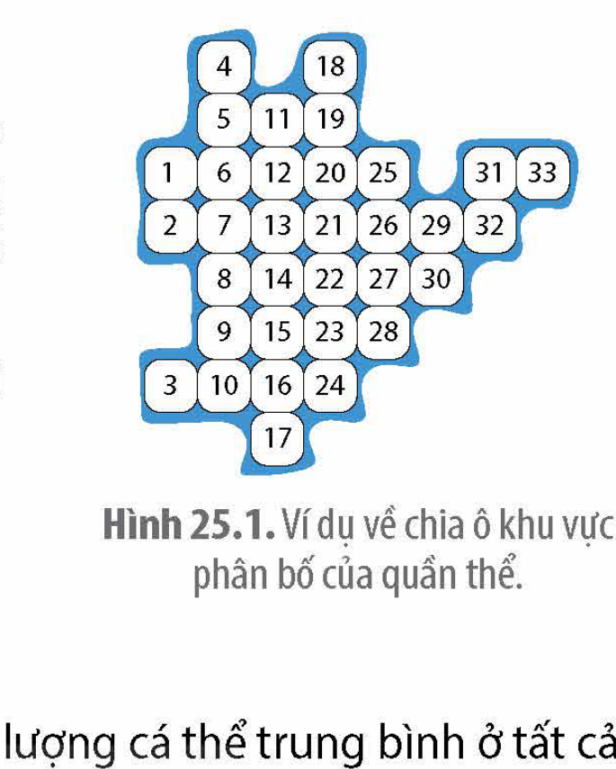

<!-- pdf:140 -->

# BÀI 25: THỰC HÀNH: XÁC ĐỊNH MỘT SỐ ĐẶC TRƯNG CỦA QUẦN THỂ

## 🎯 Yêu cầu cần đạt

Thực hành ước tính kích thước quần thể, ước tính mật độ cá thể của quần thể ở loài thực vật hoặc động vật ít di chuyển.

## I. CHUẨN BỊ

### 1. Dụng cụ

- Dụng cụ quan sát và tìm kiếm như ống nhòm, cuốc xẻng,... (tuỳ vào đối tượng cần xác định khu vực phân bố).
- Bản đồ (bản đồ bằng giấy hoặc bản đồ điện tử), thước dây, bút, sổ ghi chép.
- Dụng cụ tạo ô vuông (dây thép hoặc khung bằng gỗ hoặc dùng các cọc tre (gỗ) để chăng dây). Mỗi loại ô vuông có kích thước tương thích với đối tượng cần ước tính (10 m × 10 m với cây gỗ lớn, 1 m × 1 m với cây thân thảo, 10 cm × 10 cm với địa y).

### 2. Xác định đối tượng nghiên cứu

Quần thể các loài thực vật hoặc các loài động vật ít di chuyển như giun đất, ốc, cua, sò,...

## II. CÁCH TIẾN HÀNH

### 1. Nguyên lí

Mỗi quần thể được phân bố trong một khoảng không gian xác định. Tập hợp cá thể cùng loài được tính là cùng quần thể phải có các mối quan hệ sinh thái và sinh sản với nhau. Bố trí mẫu và thu thập số liệu về các đặc trưng của quần thể được thực hiện bên trong khu vực phân bố của quần thể.

Để xác định chính xác nhất các đặc trưng của quần thể, cần dựa trên cơ sở toán học (xác suất, thống kê) để bố trí thí nghiệm, xử lí số liệu và rút ra kết luận. Phương pháp này thường được áp dụng trong điều tra chuyên sâu. Trong trường hợp khảo sát nhanh quần thể, từ các số liệu thu thập sơ bộ và phân tích các đặc điểm của quần thể ở thực địa có thể giúp học sinh ước tính được một số đặc trưng của quần thể.

### 2. Quy trình

Phương pháp ô vuông (quadrat) là phương pháp lấy mẫu bằng cách đặt ô vuông vào một số vị trí ngẫu nhiên trong khu vực phân bố của quần thể. Đếm số lượng cá thể trong các ô vuông, từ đó ước tính kích thước của quần thể. Đối tượng áp dụng là các quần thể thực vật, nấm, các loài động vật nhỏ và ít di chuyển như giun đất, ốc, cua, sò,... và vi sinh vật.

<!-- pdf:141 -->

Quy trình thực hành được thực hiện theo các bước sau:

- Bước 1: Xác định khu vực phân bố của quần thể. Lập bản đồ chia các ô và đánh số (H 25.1). Sử dụng phương pháp ngẫu nhiên để chọn một số vị trí lấy mẫu (số lượng mẫu càng lớn thì độ tin cậy số liệu càng cao).
- Bước 2: Đặt ô vuông vào vị trí đã chọn, đếm số lượng cá thể và ghi số liệu.
- Bước 3: Xử lí số liệu, ước tính kích thước của quần thể theo công thức sau:

$$N = \frac{A}{a} \times n$$
<!-- ocr-ok: công thức toán, OCR không nhận dạng chuẩn -->

Trong đó: N: số lượng cá thể của quần thể (ước tính); n: số lượng cá thể trung bình ở tất cả các ô vuông; A: tổng diện tích khu vực khảo sát; a: diện tích một ô vuông.

- Bước 4: Dựa vào số liệu kích thước của quần thể ở bước 3 và diện tích khu vực phân bố của quần thể để ước tính mật độ của quần thể.

Hình 25.1. Ví dụ về chia ô khu vực phân bố của quần thể.

## III. THU HOẠCH

Học sinh viết báo cáo thực hành theo các nội dung sau:

> ### BÁO CÁO THỰC HÀNH
> 
> 1. **Mục đích**
> 2. **Kết quả và giải thích**
> 3. **Trả lời câu hỏi**
>    Tại sao cần xác định khu vực phân bố của quần thể trước khi ước tính các đặc trưng của quần thể?

## 📷 Danh sách hình trong bài

| Mã hình | Trang PDF | Vị trí | Chú thích gốc |
|---|---|---|---|
| H12-sinh-b25-01 | 141 | Mục II.2 | Hình 25.1. Ví dụ về chia ô khu vực phân bố của quần thể. |
