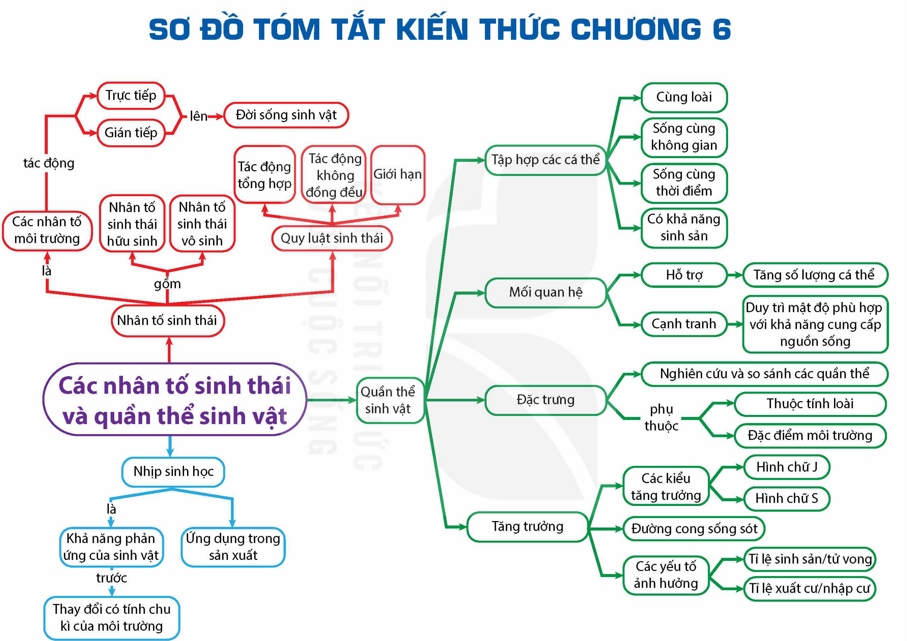

<!-- pdf:142 -->

# SƠ ĐỒ TÓM TẮT KIẾN THỨC CHƯƠNG 6

<!-- Dưới đây chép các nhánh của sơ đồ thành danh sách, giữ nguyên chữ trong các ô và trên các mũi tên. -->

- Các nhân tố sinh thái và quần thể sinh vật
  - Nhịp sinh học
    - là → Khả năng phản ứng của sinh vật → trước → Thay đổi có tính chu kì của môi trường
    - Ứng dụng trong sản xuất
  - Nhân tố sinh thái
    - gồm:
      - Nhân tố sinh thái vô sinh
      - Nhân tố sinh thái hữu sinh
    - là → Các nhân tố môi trường → tác động → Trực tiếp / Gián tiếp → lên → Đời sống sinh vật
    - Quy luật sinh thái:
      - Tác động tổng hợp
      - Tác động không đồng đều
      - Giới hạn
      → lên → Đời sống sinh vật
  - Quần thể sinh vật
    - Tập hợp các cá thể:
      - Cùng loài
      - Sống cùng không gian
      - Sống cùng thời điểm
      - Có khả năng sinh sản
    - Mối quan hệ:
      - Hỗ trợ → Tăng số lượng cá thể
      - Cạnh tranh → Duy trì mật độ phù hợp với khả năng cung cấp nguồn sống
    - Đặc trưng:
      - Nghiên cứu và so sánh các quần thể
      - phụ thuộc:
        - Thuộc tính loài
        - Đặc điểm môi trường
    - Tăng trưởng:
      - Các kiểu tăng trưởng:
        - Hình chữ J
        - Hình chữ S
      - Đường cong sống sót
      - Các yếu tố ảnh hưởng:
        - Tỉ lệ sinh sản/tử vong
        - Tỉ lệ xuất cư/nhập cư
<!-- ocr-ok: chữ trong các ô sơ đồ, OCR đọc không theo thứ tự do trang in xoay ngang; đã đối chiếu ảnh PDF 142 phóng to -->

## 📷 Danh sách hình trong bài

| Mã hình | Trang PDF | Vị trí | Chú thích gốc |
|---|---|---|---|
| H12-sinh-so-do-tom-tat-c06-01 | 142 | Đầu bài | Sơ đồ tóm tắt kiến thức chương 6 |
