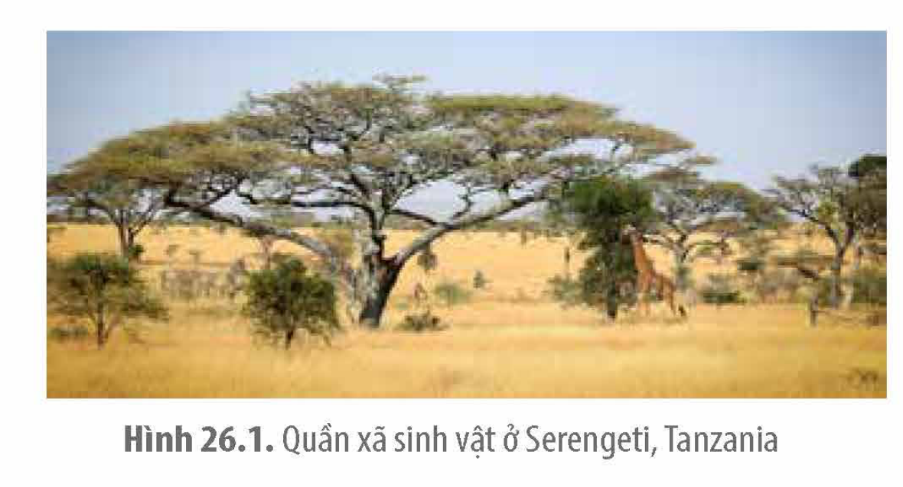
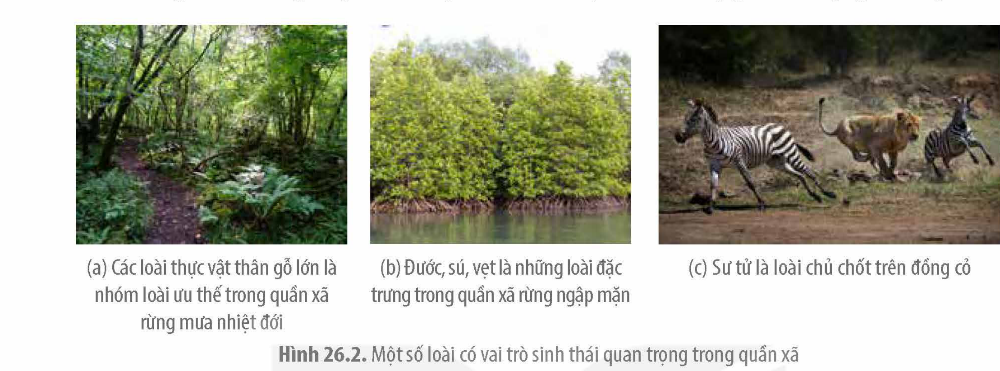
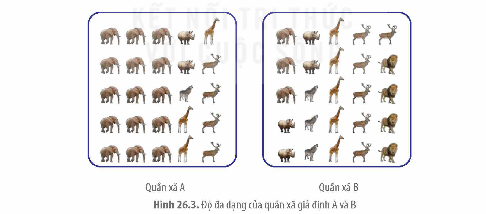
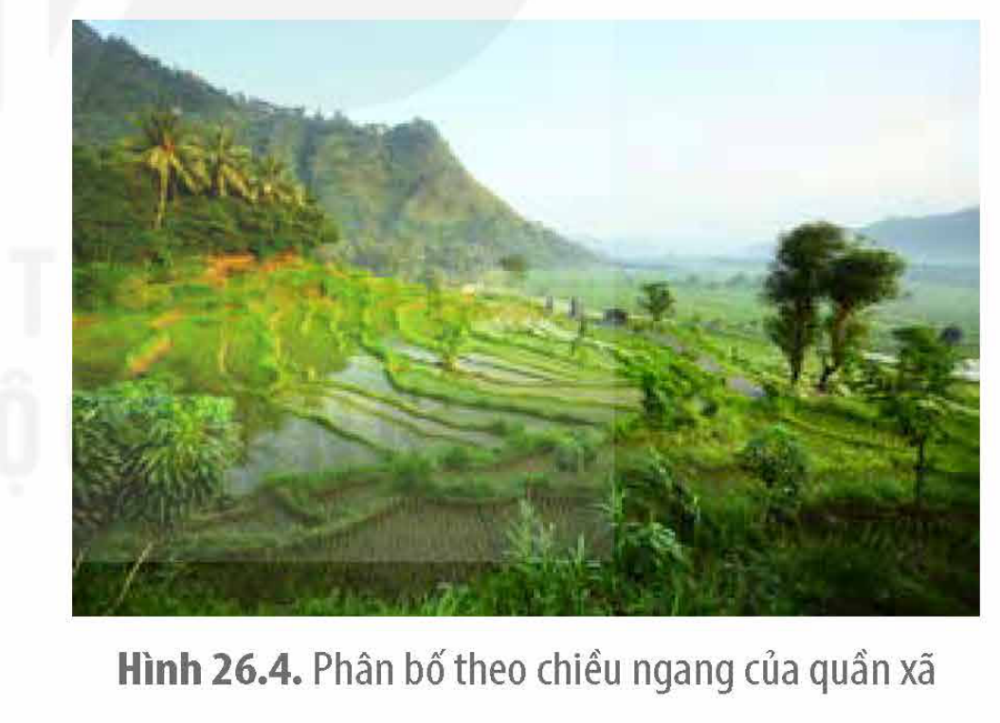
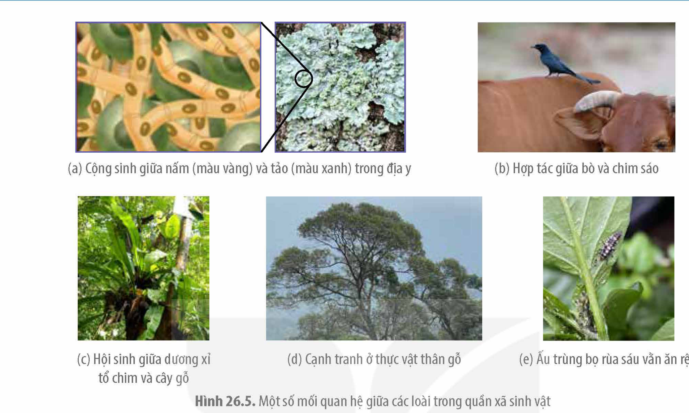
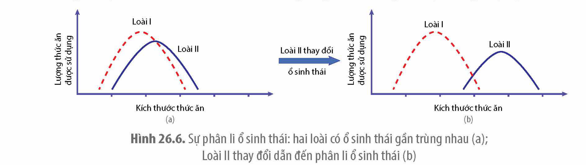
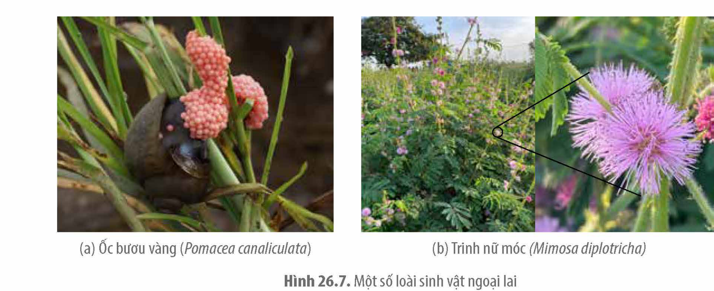

<!-- pdf:143 -->

# BÀI 26: QUẦN XÃ SINH VẬT

## 🎯 Yêu cầu cần đạt

- Phát biểu được khái niệm quần xã sinh vật.
- Phân tích được các đặc trưng cơ bản của quần xã: thành phần loài (loài ưu thế, loài đặc trưng, loài chủ chốt); chỉ số đa dạng và độ phong phú trong quần xã; cấu trúc không gian; cấu trúc chức năng dinh dưỡng. Giải thích được sự cân bằng của quần xã được bảo đảm bởi sự cân bằng chỉ số các đặc trưng đó.
- Trình bày được khái niệm và phân biệt được các mối quan hệ giữa các loài trong quần xã (cạnh tranh, hợp tác, cộng sinh, hội sinh, ức chế, kí sinh, động vật ăn thực vật, vật ăn thịt con mồi).
- Trình bày được khái niệm ổ sinh thái và vai trò của cạnh tranh trong việc hình thành ổ sinh thái.
- Phân tích được tác động của việc du nhập các loài ngoại lai hoặc giảm loài trong cấu trúc quần xã sinh vật đến trạng thái cân bằng của hệ sinh thái. Lấy được ví dụ minh hoạ.
- Giải thích được quần xã là một cấp độ tổ chức sống và trình bày được một số biện pháp bảo vệ quần xã.

## 🔴 Mở đầu

Trên cây ở hình bên có nhiều loài cùng sinh sống, tất cả các sinh vật đó có được gọi là quần xã sinh vật không?

## I. KHÁI NIỆM QUẦN XÃ SINH VẬT

<!-- term: Quần xã sinh vật -->
Quần xã sinh vật bao gồm các quần thể của nhiều loài khác nhau, cùng sống trong một không gian, thời gian nhất định, gắn bó với nhau như một thể thống nhất qua mối quan hệ dinh dưỡng và nơi ở.

Ranh giới, kích thước của các quần xã trong tự nhiên có nhiều khác biệt. Có những quần xã lớn như rừng mưa nhiệt đới, đồng cỏ,... (H 26.1) nhưng cũng có những quần xã rất nhỏ như một khu vườn hay trên một cơ thể sinh vật. Tên của quần xã thường được đặt theo đặc điểm vật lí của môi trường hoặc tên của loài chiếm ưu thế. Ví dụ: Quần xã sinh vật ở cồn cát, vùng đất ngập nước, sườn núi, rừng thông, ruộng lúa, ao cá,...

<!-- pdf:144 -->

Quần xã là một hệ mở có khả năng tự điều chỉnh. Giữa các loài trong quần xã, giữa quần xã với môi trường vô sinh thường xuyên có sự trao đổi vật chất và chuyển hoá năng lượng, đảm bảo cho quần xã tồn tại, sinh trưởng, phát triển dần tiến tới trạng thái cân bằng và tương đối ổn định theo thời gian.

Hình 26.1. Quần xã sinh vật ở Serengeti, Tanzania

## ❓ Dừng lại và suy ngẫm

1. Người ta thu thập các loài động vật từ nhiều nơi khác nhau rồi đem nuôi nhốt chung ở một địa điểm nhất định như vườn thú Hà Nội. Tập hợp các loài động vật đó có được gọi là quần xã không? Giải thích.
2. Hãy lấy một ví dụ về quần xã sinh vật và giải thích tại sao em gọi đó là quần xã.

## II. CÁC ĐẶC TRƯNG CƠ BẢN CỦA QUẦN XÃ
<!-- ocr-ok: Tiêu đề mục II đối chiếu ảnh SGK p.144 (OCR nhận nhầm BẢNM) -->

Mỗi quần xã có các đặc trưng về độ đa dạng, thành phần loài, cấu trúc không gian và cấu trúc dinh dưỡng.

### 1. Thành phần loài

Thành phần loài được thể hiện qua số lượng loài trong quần xã, tác động sinh thái của mỗi loài tới những loài khác, qua đó ảnh hưởng đến độ đa dạng của quần xã.

Trong quần xã, sự tương tác giữa các loài với nhau và với môi trường có thể duy trì, tăng hay giảm tính ổn định của quần xã. Số lượng loài càng lớn thì tính ổn định của quần xã càng cao do một số loài có thể thay thế vị trí của nhau khi loài nào đó bị suy giảm hay tuyệt chủng. Một số loài có ảnh hưởng nhiều hơn đến thành phần loài, độ đa dạng của quần xã như loài ưu thế, loài đặc trưng, loài chủ chốt,...

<!-- term: Loài ưu thế -->
Loài ưu thế là loài có số lượng lớn nhất hoặc sinh khối cao nhất trong quần xã. Ví dụ: Các loài cây gỗ trong quần xã rừng mưa nhiệt đới (H 26.2a), các loài cỏ trên đồng cỏ,... Loài ưu thế cung cấp thức ăn, nơi ở hoặc làm thay đổi các nhân tố sinh thái qua hoạt động sống, do đó có ảnh hưởng lớn đến cấu trúc của quần xã.

<!-- term: Loài đặc trưng -->
Loài đặc trưng chỉ phân bố hoặc tập trung nhiều ở một số sinh cảnh nhất định. Trong nhiều trường hợp, loài đặc trưng trùng với loài ưu thế. Ví dụ: Ở vùng đất ngập nước ven biển, các loài đước, sú, vẹt là loài đặc trưng của quần xã sinh vật này đồng thời cũng là loài ưu thế (H 26.2b).

<!-- term: Loài chủ chốt -->
Loài chủ chốt là loài có vai trò kiểm soát, khống chế sự phát triển của loài khác và quyết định sự ổn định của quần xã. Loài chủ chốt kiểm soát cấu trúc quần xã không phải bằng số lượng cá thể lớn mà bằng vai trò dinh dưỡng hoặc ổ sinh thái của chúng. Ví dụ: Sư tử là loài chủ chốt trên đồng cỏ, chúng kiểm soát kích thước các quần thể động vật ăn thực vật như

<!-- pdf:145 -->

ngựa vằn, hạn chế sự sinh trưởng quá mức của những quần thể này (H 26.2c). Nếu không có những loài ăn thịt như sư tử, động vật ăn cỏ có thể phát triển quá mức dẫn đến thảm cỏ không sinh trưởng được, làm thay đổi cấu trúc quần xã và suy giảm đa dạng sinh học.

(a) Các loài thực vật thân gỗ lớn là nhóm loài ưu thế trong quần xã rừng mưa nhiệt đới; (b) Đước, sú, vẹt là những loài đặc trưng trong quần xã rừng ngập mặn; (c) Sư tử là loài chủ chốt trên đồng cỏ

Hình 26.2. Một số loài có vai trò sinh thái quan trọng trong quần xã

Khi thành phần loài trong quần xã có sự thay đổi như thêm loài mới di cư từ nơi khác đến hay thay thế loài ưu thế này bằng loài ưu thế khác,... có thể dẫn đến biến động về cấu trúc, mối quan hệ giữa các loài và môi trường sống.

### 2. Đa dạng của quần xã

<!-- term: Độ đa dạng của quần xã -->
<!-- term: Độ phong phú -->
Độ đa dạng của quần xã là độ phong phú về thành phần loài và số lượng cá thể của mỗi loài. Độ phong phú được tính bằng số cá thể mỗi loài trên tổng số cá thể trong quần xã. Ví dụ: Hai quần xã giả định A, B (H 26.3) có số lượng loài giống nhau nhưng có độ phong phú tương đối khác nhau nên độ đa dạng của hai quần xã sẽ khác nhau.

Hình 26.3. Độ đa dạng của quần xã giả định A và B

Độ đa dạng quần xã sinh vật thay đổi theo xu hướng giảm dần khi di chuyển từ vĩ độ thấp đến vĩ độ cao, từ chân núi lên đỉnh núi, từ bờ đến khơi xa và từ tầng mặt xuống các lớp nước sâu. Độ đa dạng thể hiện sự biến động, ổn định hay suy thoái của quần xã sinh vật. Độ đa dạng của quần xã càng cao, tính ổn định càng lớn bởi những loài cùng bậc dinh dưỡng hoặc có mối quan hệ gần gũi có thể thay thế nhau trong lưới thức ăn. Ngược lại,

<!-- pdf:146 -->

khi độ đa dạng của quần xã giảm, ví dụ số lượng cá thể của một loài nào đó giảm mạnh sẽ làm giảm số lượng cá thể của loài ăn nó và gia tăng số lượng cá thể của loài là thức ăn của nó, qua đó tác động tới những loài khác khiến quần xã mất ổn định.

### 3. Cấu trúc không gian

<!-- term: Cấu trúc không gian -->
Cấu trúc không gian là sự phân bố cá thể của tất cả các loài trong quần xã. Phân bố của các cá thể trong quần xã tuỳ thuộc vào nhu cầu sinh thái của mỗi loài. Phân bố của các loài có xu hướng làm giảm mức độ cạnh tranh và tăng khả năng sử dụng hiệu quả nguồn sống, đảm bảo sự ổn định trong quần xã. Khi cấu trúc không gian của quần xã bị phá vỡ hoặc cản trở sẽ gia tăng mức độ cạnh tranh giữa các loài, giảm hiệu quả sử dụng nguồn sống, gây mất ổn định trong quần xã. Các quần xã trong tự nhiên thường có hai kiểu phân bố chính là phân bố theo chiều thẳng đứng và phân bố theo chiều ngang.

**a) Phân bố theo chiều thẳng đứng**

Kiểu phân bố này thể hiện rõ ở các quần xã dưới nước, trong đất và rừng. Sinh vật phân tầng theo nhu cầu ánh sáng, dinh dưỡng, có vai trò giảm áp lực cạnh tranh, khai thác tốt nguồn sống từ môi trường. Ví dụ: Ở rừng mưa nhiệt đới, thực vật phân tầng theo nhu cầu ánh sáng của mỗi nhóm loài (H 26.2a). Sự phân tầng của thực vật dẫn tới sự phân tầng của các loài động vật như chim, côn trùng sống trên tán lá, linh trưởng, sóc leo trèo trên cành cây, một số loài bò sát, giun tròn,... sống trên mặt đất hay trong các tầng đất khác nhau.

**b) Phân bố theo chiều ngang**

Trong kiểu phân bố này, các loài sinh vật trong quần xã phân bố theo vành đai, tương ứng với những thay đổi của môi trường. Ví dụ: phân bố từ ven bờ tới khơi xa, từ đồng bằng đến vùng núi, từ chân núi đến đỉnh núi,... (H 26.4).

Hình 26.4. Phân bố theo chiều ngang của quần xã

### 4. Cấu trúc dinh dưỡng

<!-- term: Cấu trúc dinh dưỡng -->
Cấu trúc dinh dưỡng là đặc điểm về mối quan hệ thức ăn giữa các loài sinh vật trong quần xã. Dựa vào mối quan hệ dinh dưỡng, các loài trong quần xã được chia thành ba nhóm chính: sinh vật sản xuất, sinh vật tiêu thụ và sinh vật phân giải.

<!-- term: Sinh vật sản xuất -->
Sinh vật sản xuất là những sinh vật tự dưỡng có khả năng chuyển năng lượng mặt trời hoặc năng lượng trong các phản ứng hoá học thành năng lượng hoá học trong các hợp chất hữu cơ do chúng tổng hợp được, qua quá trình quang hợp hoặc hoá tự dưỡng. Sinh vật sản xuất gồm thực vật và một số vi sinh vật tự dưỡng.

<!-- term: Sinh vật tiêu thụ -->
Sinh vật tiêu thụ sử dụng năng lượng có sẵn trong các chất hữu cơ từ những sinh vật khác cho các hoạt động sống. Sinh vật tiêu thụ chủ yếu là động vật.

<!-- term: Sinh vật phân giải -->
Sinh vật phân giải chuyển hoá các chất hữu cơ thành chất vô cơ, khép kín vòng tuần hoàn vật chất. Sinh vật phân giải chủ yếu là các vi khuẩn, nấm...

<!-- pdf:147 -->

## ❓ Dừng lại và suy ngẫm

1. Nêu các đặc trưng cơ bản của quần xã.
2. Quan sát Hình 26.3 và cho biết quần xã nào đa dạng hơn. Giải thích.

## III. MỐI QUAN HỆ TRONG QUẦN XÃ VÀ SỰ PHÂN LI Ổ SINH THÁI

### 1. Các mối quan hệ trong quần xã

Trong quá trình tìm kiếm thức ăn, nơi ở, các loài đã hình thành những mối quan hệ tương tác, duy trì tính cân bằng và ổn định của quần xã (Bảng 26.1).

Bảng 26.1. Các mối quan hệ trong quần xã

| Quan hệ | Đặc điểm | Ví dụ |
| :--- | :--- | :--- |
| **Hỗ trợ** | | |
| Cộng sinh | Quan hệ sống chung, gắn bó mật thiết không thể tách rời giữa hai hay nhiều loài, trong đó tất cả các loài đều có lợi. | Nấm, vi khuẩn lam/tảo lục đơn bào cộng sinh trong địa y; vi khuẩn phân giải cellulose sống cộng sinh trong đường tiêu hoá của động vật ăn cỏ;... |
| Hợp tác | Quan hệ giữa hai hay nhiều loài, trong đó tất cả các loài đều có lợi, tuy nhiên không nhất thiết cần cho sự tồn tại của mỗi loài. | Quan hệ giữa chim sáo và bò; chim hút mật và thực vật; cá mập và cá xỉa răng;... |
| Hội sinh | Quan hệ giữa hai loài, trong đó một loài được lợi, loài còn lại không bị hại cũng không được lợi. | Quan hệ giữa cây dương xỉ tổ chim và cây gỗ lớn; cá ép sống bám trên cá lớn;... |
| **Đối kháng** | | |
| Cạnh tranh | Quan hệ tranh giành nguồn sống (thức ăn, nơi ở) giữa hai hay nhiều loài, trong đó cả hai loài đều bị hại, có thể dẫn đến loại trừ lẫn nhau. | Cạnh tranh thức ăn giữa thỏ và cừu; cạnh tranh con mồi giữa linh cẩu và sư tử;... |
| Kí sinh – vật chủ | Một loài sống bám (vật kí sinh) và thu nhận chất dinh dưỡng từ cơ thể loài khác (vật chủ) nhưng không giết chết ngay vật chủ. | Giun sán kí sinh trong ruột người và thú; cây tầm gửi, tơ hồng kí sinh trên cây thân gỗ;... |
| Sinh vật ăn sinh vật | Loài này sử dụng loài khác làm thức ăn. | Trâu ăn cỏ; hổ ăn thịt hươu nai; cây nắp ấm bắt ruồi;... |
| Ức chế – cảm nhiễm | Một loài tiết ra chất ức chế hoặc gây độc cho các loài khác. | Tảo giáp nở hoa tiết ra chất gây độc cho các động vật thuỷ sinh; cây tỏi tiết ra chất ức chế các vi sinh vật sống xung quanh;... |

<!-- pdf:148 -->

(a) Cộng sinh giữa nấm (màu vàng) và tảo (màu xanh) trong địa y; (b) Hợp tác giữa bò và chim sáo; (c) Hội sinh giữa dương xỉ tổ chim và cây gỗ; (d) Cạnh tranh ở thực vật thân gỗ; (e) Ấu trùng bọ rùa sáu vằn ăn rệp
<!-- ocr-ok: Chú thích các hình con Hình 26.5 đối chiếu ảnh SGK p.148 -->

Hình 26.5. Một số mối quan hệ giữa các loài trong quần xã sinh vật

### 2. Ổ sinh thái

<!-- term: Ổ sinh thái -->
Khoảng giới hạn của một nhân tố sinh thái mà ở đó sinh vật có thể tồn tại và phát triển gọi là ổ sinh thái của loài với nhân tố đó. Tuy nhiên, trong tự nhiên, sinh vật chịu tác động tổng hợp của nhiều nhân tố sinh thái và tổ hợp các giới hạn đó tạo thành ổ sinh thái chung của loài.

Ổ sinh thái là không gian sinh thái mà ở đó tất cả các nhân tố sinh thái nằm trong giới hạn cho phép sự tồn tại, phát triển lâu dài của loài.

Ví dụ: Ổ sinh thái của loài bọ rùa sáu vằn (*Menochilus sexmaculatus*) gồm rất nhiều thành phần như giới hạn nhiệt độ loài có thể chịu đựng; đặc điểm của lá, cành cây nơi loài sinh sống, kích thước và loại rệp là thức ăn của loài,...

Cạnh tranh là nguyên nhân quan trọng dẫn đến phân li ổ sinh thái. Những loài có nhu cầu sinh thái giống nhau trong quần xã có thể xảy ra hiện tượng loại trừ lẫn nhau. Khi xảy ra cạnh tranh giữa các loài có ổ sinh thái giống nhau mà không loài nào bị tuyệt chủng chứng tỏ đã có ít nhất một loài thay đổi ổ sinh thái của mình (H 26.6). Tiến hoá dẫn đến phân li ổ sinh thái có vai trò làm giảm sự cạnh tranh giữa các loài. Sự phân li ổ sinh thái cho phép các loài có giới hạn của nhiều nhân tố sinh thái giống nhau cùng tồn tại trong một quần xã.

Hình 26.6. Sự phân li ổ sinh thái: hai loài có ổ sinh thái gần trùng nhau (a); Loài II thay đổi dẫn đến phân li ổ sinh thái (b)

<!-- pdf:149 -->

## ❓ Dừng lại và suy ngẫm

1. Quan sát Hình 26.5c, xác định loài nào có lợi, loài nào không có lợi cũng không bị hại.
2. Phân biệt mối quan hệ cộng sinh với quan hệ hợp tác.

## IV. MỘT SỐ YẾU TỐ TÁC ĐỘNG VÀ BIỆN PHÁP BẢO VỆ QUẦN XÃ

Hoạt động của con người có thể tác động tiêu cực hoặc tích cực tới quần xã sinh vật. Thành lập vườn quốc gia, trồng và bảo vệ rừng,... là những hoạt động có ảnh hưởng tích cực tới cấu trúc, độ đa dạng của quần xã, trong khi nhiều hoạt động khác của con người lại làm thay đổi môi trường sống và suy giảm đa dạng của quần xã.

### 1. Loài ngoại lai

<!-- term: Loài ngoại lai -->
Loài ngoại lai là loài xuất hiện ở khu vực vốn không phải môi trường sống tự nhiên của chúng. Như vậy, loài ngoại lai không phải là loài bản địa mà được di nhập từ một vùng hay quốc gia này đến một vùng hay quốc gia khác. Một số loài vật nuôi, cây trồng có giá trị kinh tế đã được di nhập chủ động vào Việt Nam như cây ca cao, mắc ca, cao lương,...; vật nuôi như vịt bầu cánh trắng.

Khi di nhập vào môi trường mới, nếu các nhân tố sinh thái phù hợp và không còn chịu kiểm soát của các loài sinh vật tiêu thụ, loài cạnh tranh hay tác nhân gây bệnh,... loài ngoại lai có thể tăng nhanh số lượng cá thể, gia tăng mức ảnh hưởng đến các nhân tố sinh thái vô sinh và các loài bản địa. Chúng trở thành loài mới của quần xã, cạnh tranh với các loài bản địa về thức ăn, nơi ở,... thậm chí có thể phát triển thành loài ưu thế, làm thay đổi cấu trúc của quần xã hình thành trạng thái cân bằng mới.

Ví dụ: Ốc bươu vàng được di nhập về Việt Nam với mục đích làm thức ăn cho chăn nuôi đã gây ra những ảnh hưởng tiêu cực đến các loài bản địa. Với đặc điểm sinh trưởng nhanh, đẻ nhiều (H 26.7a) và có thể sử dụng nhiều loài thực vật làm thức ăn, ốc bươu vàng đã cạnh tranh với loài bản địa và gây hại cho ngành nông nghiệp, đặc biệt là sản xuất lúa. Loài trinh nữ móc có nguồn gốc từ châu Mỹ di nhập vào Việt Nam. Chúng sinh trưởng mạnh mẽ ở các hệ sinh thái trên cạn, nơi có nhiều ánh sáng và trở thành loài ưu thế, cạnh tranh loại trừ nhiều loài bản địa (H 26.7b).

(a) Ốc bươu vàng (*Pomacea canaliculata*); (b) Trinh nữ móc (*Mimosa diplotricha*)

Hình 26.7. Một số loài sinh vật ngoại lai

<!-- pdf:150 -->

### 2. Tác động của con người

Dân số thế giới tăng nhanh kéo theo nhu cầu sử dụng tài nguyên ngày càng lớn cùng với nhiều hoạt động sản xuất của con người đã gây ra những tác động tiêu cực đến quần xã sinh học, làm suy giảm đa dạng sinh vật, trong đó tiêu biểu là một số hoạt động sau:

- Phá rừng, chuyển đất rừng thành đất nông nghiệp gây xói mòn đất, lũ lụt, làm thay đổi khả năng điều hoà vòng tuần hoàn nước và khí hậu.
- Thay thế các hệ sinh thái tự nhiên bằng các hệ sinh thái nhân tạo có độ đa dạng rất thấp như hệ sinh thái đô thị, khu công nghiệp,... Những hoạt động này làm mất nơi sống, thay đổi sâu sắc môi trường sống của sinh vật dẫn đến sự tuyệt chủng của những loài nhạy cảm, những loài có ổ sinh thái hẹp hoặc những loài có kích thước quần thể nhỏ, chu kì sống dài.
- Khai thác quá mức tài nguyên sinh vật, vượt quá khả năng tự phục hồi của quần thể sinh vật khiến kích thước quần thể giảm mạnh xuống dưới mức tối thiểu dẫn đến sự tuyệt chủng hoặc đe doạ tuyệt chủng của nhiều loài.
- Sử dụng thiếu kiểm soát phân bón hoá học, thuốc trừ sâu trong trồng trọt, kháng sinh, chất kích thích sinh trưởng trong chăn nuôi cũng là nguyên nhân dẫn đến sự suy giảm đa dạng sinh vật của quần xã.

### 3. Một số biện pháp bảo vệ quần xã

Tác động của con người hoặc những biến đổi bất thường của tự nhiên có thể ảnh hưởng trực tiếp đến cấu trúc hoặc độ đa dạng của quần xã. Tuy nhiên, quần xã có khả năng tự phục hồi nếu tác động không quá sâu sắc. Mối quan hệ giữa các loài là điều kiện quan trọng thiết lập trạng thái cân bằng tương đối của quần xã. Dựa trên cơ sở sinh thái học quần thể, quần xã, hệ sinh thái, các nhà sinh học bảo tồn, cơ quan quản lí đã sử dụng nhiều biện pháp bảo vệ các quần xã sinh vật như:

- Xây dựng các khu bảo tồn thiên nhiên, vườn quốc gia, trung tâm cứu hộ động vật hoang dã.
- Xây dựng kế hoạch khai thác và sử dụng hợp lí tài nguyên đất, nước mặt, rừng.
- Bảo vệ rừng, khai thác hợp lí tài nguyên sinh vật.
- Bảo vệ, phục hồi những quần thể sinh vật có kích thước nhỏ hoặc suy thoái.
- Sử dụng các biện pháp kiểm soát sinh học thay thế cho kiểm soát hoá học.
- Kiểm soát chặt chẽ các loài sinh vật ngoại lai, thực hiện nghiên cứu, đánh giá tác động môi trường trước khi nhập nội sinh vật.

## ❓ Dừng lại và suy ngẫm

1. Vì sao loài ngoại lai thường tác động tiêu cực đến các loài bản địa?
2. Lấy ví dụ về sự tuyệt chủng của một loài sinh vật do hoạt động khai thác quá mức của con người.

## 📌 Kiến thức cốt lõi

- Quần xã bao gồm những quần thể khác loài, cùng sống trong một không gian, thời gian, gắn bó với nhau bằng mối quan hệ dinh dưỡng và nơi ở. Cấu trúc của một quần xã phụ thuộc nhiều vào các mối quan hệ thức ăn giữa các loài sinh vật.

<!-- pdf:151 -->

- Loài ưu thế, loài chủ chốt đóng vai trò quan trọng đối với kiểm soát đa dạng của quần xã.
- Đa dạng của quần xã thay đổi theo vĩ độ, độ sâu, độ cao, khoảng cách so với bờ. Độ đa dạng càng lớn, quần xã càng ổn định.
- Mối quan hệ giữa các loài trong quần xã có thể chia thành tác động có lợi, có hại hoặc không bị ảnh hưởng đối với những loài có liên quan.
- Phân li ổ sinh thái giúp những loài có nhu cầu sinh thái giống nhau có thể chung sống với nhau lâu dài.
- Loài du nhập và khai thác quá mức là hai nguyên nhân làm giảm đa dạng của quần xã, từ đó gây mất cân bằng sinh thái.

## ✏️ Luyện tập và vận dụng

1. Trong một ô nghiên cứu diện tích 6,6 ha ở rừng nhiệt đới Malaysia, có 711 loài thực vật. Một ô nghiên cứu có diện tích tương đương ở khu rừng rụng lá của Michigan chỉ có 15 loài. Hãy phân tích nguyên nhân dẫn tới sự khác biệt này.
2. Khi nghiên cứu cấu trúc của một quần xã, một bạn học sinh đã xác định được 6 loài thực vật với với độ phong phú tương đối của mỗi loài như sau: *Alternanthera ficoidea*: 5%, *Cardamine hirsuta*: 3%, *Dicliptera chinensis*: 70%, *Amaranthus spinosus*: 15%, *Ageratum* sp.: 2%, *Ammannia baccifera*: 5%. Hãy xác định vai trò sinh thái của loài *Dicliptera chinensis*.
3. Trong các vườn cây ăn quả, kiến đen tha rệp từ các lá già sang lá non và ăn đường do rệp bài tiết, rệp lấy chất dinh dưỡng từ cây. Hãy xác định mối quan hệ sinh thái của mỗi cặp sinh vật dưới đây và giải thích.
a) Kiến đen và rệp.
b) Rệp và thực vật.
c) Kiến đen và thực vật.

(*) Nguồn: *Biology*, 12^th^ edition, Campbell et al.
<!-- ocr-ok: Chú thích nguồn đối chiếu ảnh SGK p.151 -->

## 📷 Danh sách hình trong bài

| Mã hình | Trang PDF | Vị trí | Chú thích gốc |
| :--- | :--- | :--- | :--- |
| H12-sinh-b26-01 | 144 | Giữa trang | Hình 26.1. Quần xã sinh vật ở Serengeti, Tanzania |
| H12-sinh-b26-02 | 145 | Nửa trên | (a) Các loài thực vật thân gỗ lớn là nhóm loài ưu thế trong quần xã rừng mưa nhiệt đới; (b) Đước, sú, vẹt là những loài đặc trưng trong quần xã rừng ngập mặn; (c) Sư tử là loài chủ chốt trên đồng cỏ; Hình 26.2. Một số loài có vai trò sinh thái quan trọng trong quần xã |
| H12-sinh-b26-03 | 145 | Nửa dưới | Hình 26.3. Độ đa dạng của quần xã giả định A và B |
| H12-sinh-b26-04 | 146 | Cột phải | Hình 26.4. Phân bố theo chiều ngang của quần xã |
| H12-sinh-b26-05 | 148 | Nửa trên | (a) Cộng sinh giữa nấm (màu vàng) và tảo (màu xanh) trong địa y; (b) Hợp tác giữa bò và chim sáo; (c) Hội sinh giữa dương xỉ tổ chim và cây gỗ; (d) Cạnh tranh ở thực vật thân gỗ; (e) Ấu trùng bọ rùa sáu vằn ăn rệp; Hình 26.5. Một số mối quan hệ giữa các loài trong quần xã sinh vật |
| H12-sinh-b26-06 | 148 | Nửa dưới | Hình 26.6. Sự phân li ổ sinh thái: hai loài có ổ sinh thái gần trùng nhau (a); Loài II thay đổi dẫn đến phân li ổ sinh thái (b) |
| H12-sinh-b26-07 | 149 | Giữa trang | (a) Ốc bươu vàng (*Pomacea canaliculata*); (b) Trinh nữ móc (*Mimosa diplotricha*); Hình 26.7. Một số loài sinh vật ngoại lai |

