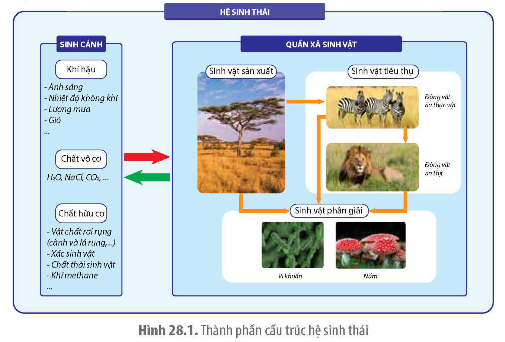
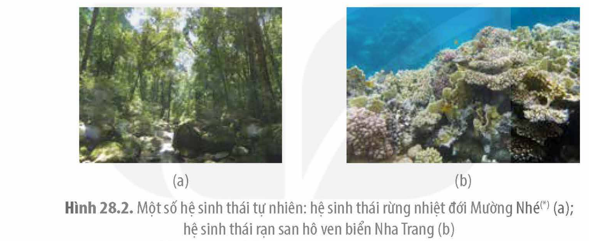
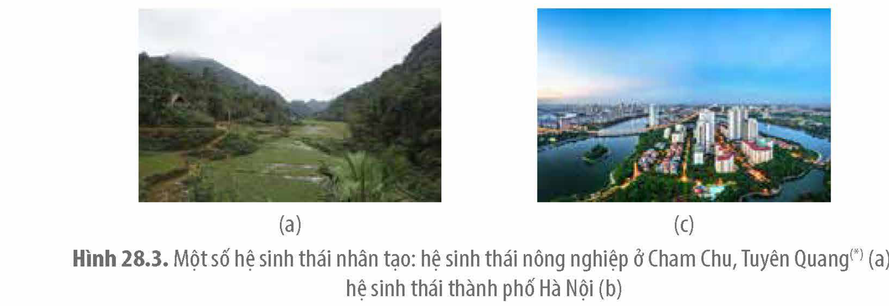

<!-- pdf:154 -->

# BÀI 28: HỆ SINH THÁI

## 🎯 Yêu cầu cần đạt

- Phát biểu được khái niệm hệ sinh thái.
- Phân biệt được các thành phần cấu trúc của hệ sinh thái và các kiểu hệ sinh thái chủ yếu của Trái Đất, bao gồm các hệ sinh thái tự nhiên (hệ sinh thái trên cạn, dưới nước) và các hệ sinh thái nhân tạo.

## 🔴 Mở đầu

Ở một hồ tự nhiên, sự thay đổi các nhân tố vô sinh như nhiệt độ, nồng độ oxygen, nồng độ muối khoáng hoà tan,... có thể ảnh hưởng như thế nào đến các hoạt động sống của quần xã sinh vật trong hồ?

## I. KHÁI QUÁT VỀ HỆ SINH THÁI

### 1. Khái niệm

<!-- term: Hệ sinh thái -->
Hệ sinh thái là một cấp độ tổ chức sống bao gồm quần xã sinh vật và sinh cảnh, trong đó các thành phần cấu trúc tác động qua lại và gắn bó với nhau như một thể thống nhất tương đối ổn định.

Ví dụ: Một hồ tự nhiên là một hệ sinh thái. Giữa các loài sống trong quần xã hồ như tảo, thực vật thuỷ sinh, động vật nổi, cá, tôm,... không những có các mối quan hệ sinh thái (hỗ trợ, cạnh tranh) hình thành nên một quần xã mà còn tương tác qua lại như một thể thống nhất với các nhân tố vô sinh của sinh cảnh (nhiệt độ, cường độ ánh sáng, nồng độ oxygen trong nước, nồng độ các muối khoáng hoà tan,...).

Trong hệ sinh thái, có sự trao đổi vật chất và năng lượng giữa các sinh vật trong quần xã và giữa quần xã với sinh cảnh hình thành nên vòng tuần hoàn vật chất và dòng năng lượng. Hệ sinh thái là một hệ thống mở, tự điều chỉnh, thường xuyên trao đổi vật chất, năng lượng với hệ sinh thái khác và có các cơ chế duy trì cấu trúc ở trạng thái cân bằng động. Kích thước hệ sinh thái rất khác nhau, có thể nhỏ như một vườn hoa hoặc lớn như một khu rừng, hệ sinh thái lớn nhất là sinh quyển.

### 2. Thành phần cấu trúc của hệ sinh thái

Hình 28.1. Thành phần cấu trúc hệ sinh thái

<!-- pdf:155 -->

Cấu trúc hệ sinh thái bao gồm quần xã sinh vật (sinh vật sản xuất, sinh vật tiêu thụ, sinh vật phân giải) và sinh cảnh (các yếu tố khí hậu, các chất vô cơ và các chất hữu cơ) (H 28.1).

## ❓ Dừng lại và suy ngẫm

1. Hãy lấy ví dụ về một hệ sinh thái ở địa phương em.
2. Dựa vào Hình 28.1, hãy chỉ ra mối quan hệ giữa các nhóm sinh vật trong quần xã và giữa quần xã với sinh cảnh.

## II. CÁC KIỂU HỆ SINH THÁI TRÊN TRÁI ĐẤT

### 1. Hệ sinh thái tự nhiên

<!-- term: Hệ sinh thái tự nhiên -->
Hệ sinh thái tự nhiên là hệ sinh thái hình thành và tồn tại trong tự nhiên, ít hoặc không có sự can thiệp của con người như rừng mưa nhiệt đới, rừng ngập mặn, rạn san hô,... (H 28.2).

Hình 28.2. Một số hệ sinh thái tự nhiên: hệ sinh thái rừng nhiệt đới Mường Nhé(*) (a); hệ sinh thái rạn san hô ven biển Nha Trang (b)

Hệ sinh thái tự nhiên có các đặc điểm như: số lượng loài lớn; tính ổn định cao; sử dụng nguồn vật chất, năng lượng sẵn có trong môi trường; các thành phần của hệ sinh thái tương tác chặt chẽ với nhau và tự điều chỉnh theo các quy luật tự nhiên.

Hệ sinh thái tự nhiên được chia thành hai nhóm: hệ sinh thái trên cạn (rừng rụng lá ôn đới, sa mạc, đồng rêu hàn đới,...) và hệ sinh thái dưới nước (hồ, sông, rừng ngập mặn,...).

### 2. Hệ sinh thái nhân tạo

<!-- term: Hệ sinh thái nhân tạo -->
Hệ sinh thái nhân tạo là hệ sinh thái do con người tạo ra như ao nuôi cá, rừng trồng, ruộng lúa, công viên, thành phố,... (H 28.3).

Hình 28.3. Một số hệ sinh thái nhân tạo: hệ sinh thái nông nghiệp ở Cham Chu, Tuyên Quang(*) (a); hệ sinh thái thành phố Hà Nội (b)

(*) Nguồn ảnh: Lê Trung Dũng.
<!-- ocr-ok: Chú thích nguồn ảnh đối chiếu ảnh SGK p.155 -->

<!-- pdf:156 -->

Hệ sinh thái nhân tạo có các đặc điểm: số lượng loài ít và chịu sự kiểm soát của con người như lựa chọn cây trồng, lựa chọn vật nuôi, diệt cỏ, diệt cá tạp,...; tính ổn định thấp và mức độ ổn định phụ thuộc vào tác động của con người,...; không chỉ sử dụng nguồn vật chất, năng lượng của môi trường mà còn được con người bổ sung thêm từ các nguồn khác như nước, ánh sáng nhân tạo, thức ăn chăn nuôi, phân bón, thuốc bảo vệ thực vật,...; các thành phần của hệ sinh thái nhân tạo tương tác với nhau lỏng lẻo và chịu sự điều chỉnh của con người như cải tạo đất, dọn ao, bố trí mật độ cây trồng,...

## ❓ Dừng lại và suy ngẫm

1. Tại sao hệ sinh thái tự nhiên có tính ổn định cao hơn hệ sinh thái nhân tạo?
2. Con người kiểm soát thành phần loài trong một hệ sinh thái ruộng lúa như thế nào? Mục đích của các hoạt động đó là gì?

## 📌 Kiến thức cốt lõi

- Hệ sinh thái là một cấp độ tổ chức sống bao gồm quần xã và sinh cảnh, trong đó các thành phần cấu trúc tác động qua lại và gắn bó với nhau như một thể thống nhất tương đối ổn định.
- Có hai kiểu hệ sinh thái là hệ sinh thái tự nhiên và hệ sinh thái nhân tạo. Hệ sinh thái tự nhiên gồm hệ sinh thái trên cạn và hệ sinh thái dưới nước. Hệ sinh thái tự nhiên có tính ổn định cao và tự điều chỉnh theo các quy luật tự nhiên. Hệ sinh thái nhân tạo được con người tạo ra, có tính ổn định thấp và được duy trì nhờ sự tác động của con người.

## ✏️ Luyện tập và vận dụng

1. Tại sao nói rừng mưa nhiệt đới Cúc Phương, Ninh Bình là một hệ sinh thái?
2. Phân biệt hệ sinh thái tự nhiên với hệ sinh thái nhân tạo.
3. Một khu vườn trồng cam là một hệ sinh thái nhân tạo.
a) Người trồng có những tác động gì lên hệ sinh thái vườn cam để thu được năng suất cao?
b) Trong canh tác, để hạn chế tối thiểu việc sử dụng phân bón hoá học và thuốc bảo vệ thực vật, người trồng cam có thể thực hiện những biện pháp nào để cung cấp dinh dưỡng cho cây và hạn chế sâu bệnh?

## 📷 Danh sách hình trong bài

| Mã hình | Trang PDF | Vị trí | Chú thích gốc |
| :--- | :--- | :--- | :--- |
| H12-sinh-b28-01 | 154 | Nửa dưới | Hình 28.1. Thành phần cấu trúc hệ sinh thái |
| H12-sinh-b28-02 | 155 | Giữa trang | Hình 28.2. Một số hệ sinh thái tự nhiên: hệ sinh thái rừng nhiệt đới Mường Nhé(*) (a); hệ sinh thái rạn san hô ven biển Nha Trang (b) |
| H12-sinh-b28-03 | 155 | Nửa dưới | Hình 28.3. Một số hệ sinh thái nhân tạo: hệ sinh thái nông nghiệp ở Cham Chu, Tuyên Quang(*) (a); hệ sinh thái thành phố Hà Nội (b) |
